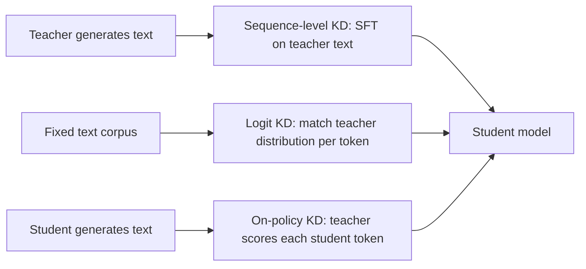

# Knowledge Distillation for LLMs

## Introduction

Most small open models you can download today were not trained from scratch on their own. Gemma 2's 2B and 9B models learned from a larger Gemma's probability distributions during pretraining. Llama 3.2 1B and 3B were pruned from Llama 3.1 8B and trained on the logits of the 8B and 70B models. DeepSeek-R1-Distill-Qwen-32B is a Qwen2.5 base model fine-tuned on 800k reasoning traces written by DeepSeek-R1. Qwen3's small models were distilled from Qwen3-235B-A22B and Qwen3-32B instead of going through the full RL pipeline.

That is *knowledge distillation*: training a smaller *student* model to imitate a larger *teacher*. It is the cheapest way to get a capable small model, often cheaper and better than running the same post-training pipeline on the small model directly. It also comes in several flavors that differ in what the student imitates (the teacher's probabilities or its text), on whose samples (the teacher's or the student's own), and with which divergence.

By the end of this page you will be able to:

- Derive Hinton's soft-target loss, explain the temperature and the $T^2$ factor, and implement token-level distillation for a causal LM.
- Explain why soft targets carry more information than sampled text, and what top-k logit storage costs and breaks.
- Distinguish forward and reverse KL, demonstrate mode covering versus mode seeking, and explain why on-policy distillation (MiniLLM, GKD) uses the reverse direction.
- Choose between logit, sequence-level and on-policy distillation for a given teacher, budget and tokenizer.

## Soft Targets and Temperature

Hinton, Vinyals and Dean (2015, "Distilling the Knowledge in a Neural Network") observed that a trained classifier's full output distribution contains far more information than its top prediction. If a teacher says the next word after "the" is "cat" with probability 0.73, "kitten" with 0.16 and "dog" with 0.10 and "car" with almost nothing, it is telling the student that kitten and dog are reasonable substitutes and car is not. A one-hot label "cat" says none of that. Hinton called this similarity structure "dark knowledge".

To expose more of it, both distributions are softened with a temperature $T$:

$$
p_i^{(T)} = \frac{\exp(v_i / T)}{\sum_j \exp(v_j / T)}, \qquad q_i^{(T)} = \frac{\exp(z_i / T)}{\sum_j \exp(z_j / T)}
$$

where $v$ are teacher logits and $z$ student logits. $T = 1$ is the ordinary softmax; $T > 1$ flattens it so small probabilities get more weight. The distillation loss is the KL divergence between the softened distributions, usually mixed with the ordinary cross-entropy on the true label $y$:

$$
\mathcal{L}_{\mathrm{KD}} = \alpha\, T^2\, \mathbb{D}_{\mathrm{KL}}\big(p^{(T)} \,\Vert\, q^{(T)}\big) + (1 - \alpha)\, \mathrm{CE}\big(y, q^{(1)}\big)
$$

**Why $T^2$?** The gradient of the KL term with respect to a student logit is

$$
\frac{\partial\, \mathbb{D}_{\mathrm{KL}}}{\partial z_i} = \frac{1}{T}\left(q_i^{(T)} - p_i^{(T)}\right)
$$

For large $T$, each probability is close to $1/V$ plus a term proportional to the logit divided by $T$, so the difference $q_i - p_i$ is itself of order $1/T$ and the whole gradient shrinks like $1/T^2$. Multiplying by $T^2$ keeps the soft-target gradients on the same scale as the hard-label term when you change $T$. The script measures it:

```python
import torch
import torch.nn.functional as F

torch.manual_seed(0)
teacher_logits = torch.tensor([4.0, 2.5, 2.0, -1.0])     # "cat", "kitten", "dog", "car"
student_logits = torch.tensor([3.0, 0.0, 1.0, 0.0], requires_grad=True)

for T in [1.0, 2.0, 4.0]:
    p_t = F.softmax(teacher_logits / T, -1)
    log_p_s = F.log_softmax(student_logits / T, -1)
    kd = F.kl_div(log_p_s, p_t, reduction="sum")           # KL(teacher || student) at temperature T
    grad, = torch.autograd.grad(kd, student_logits)
    print(f"T={T}: teacher soft targets {p_t.numpy().round(3)}  KL {kd.item():.4f}"
          f"  grad norm {grad.norm():.4f}  x T^2 {grad.norm() * T**2:.4f}")
```

```text
T=1.0: teacher soft targets [0.732 0.163 0.099 0.005]  KL 0.1350  grad norm 0.1500  x T^2 0.1500
T=2.0: teacher soft targets [0.52  0.246 0.191 0.043]  KL 0.0837  grad norm 0.0752  x T^2 0.3007
T=4.0: teacher soft targets [0.388 0.266 0.235 0.111]  KL 0.0330  grad norm 0.0275  x T^2 0.4403
```

The raw gradient norm falls from 0.150 to 0.0275 as $T$ goes from 1 to 4, roughly the $1/T^2$ trend; after multiplying by $T^2$ it stays in the same range (it converges to a constant only as $T$ grows further). Note also how $T = 4$ makes the teacher reveal that "car" is not impossible (0.111), information the student could not get at $T = 1$. Note that PyTorch's `F.kl_div(input, target)` expects the student's *log*-probabilities as `input` and computes $\mathrm{KL}(\text{target} \Vert \text{input})$, the reverse of what the argument order suggests.

For LLMs, temperatures close to 1 are common, because the teacher's next-token distribution is already informative and the student must match it at inference temperature. Many LLM recipes use pure KD ($\alpha = 1$) when the training text was itself produced by the teacher.

## Token-Level Distillation for Language Models

A language model is a classifier applied at every position, so logit distillation is the same loss summed over positions. Given teacher and student logits for the same token sequence, shaped `(batch, length, vocab)`, compute the per-position KL over the vocabulary and average over the trained positions:

```python
import torch
import torch.nn.functional as F

torch.manual_seed(0)
torch.set_num_threads(1)

def lm_distillation_loss(student_logits, teacher_logits, labels, T=1.0, alpha=0.5):
    """Token-level KD for causal LMs.
    student_logits, teacher_logits: (B, L, V), already aligned (position t predicts token t+1)
    labels: (B, L) next-token ids, -100 where no loss should be taken (prompt, padding)."""
    mask = labels != -100                                         # (B, L)
    s = student_logits[mask]                                      # (N, V) trained positions only
    t = teacher_logits[mask]                                      # (N, V)
    # Forward KL(teacher || student) at temperature T, summed over vocab, mean over tokens
    kd = F.kl_div(F.log_softmax(s / T, -1), F.log_softmax(t / T, -1),
                  log_target=True, reduction="batchmean") * T ** 2
    ce = F.cross_entropy(s, labels[mask])                         # usual hard-label loss
    return alpha * kd + (1 - alpha) * ce, kd.detach(), ce.detach()

B, L, V = 2, 6, 100
teacher_logits = torch.randn(B, L, V) * 3
student_logits = torch.randn(B, L, V, requires_grad=True)
labels = teacher_logits.argmax(-1)                                # pretend data = teacher's choices
labels[:, :2] = -100                                              # first two positions are prompt
loss, kd, ce = lm_distillation_loss(student_logits, teacher_logits, labels, T=2.0)
loss.backward()
print(f"loss {loss.item():.3f}  (KD {kd.item():.3f}, CE {ce.item():.3f})")
print("grad on masked prompt positions is zero:",
      bool((student_logits.grad[:, :2] == 0).all()))
```

```text
loss 5.570  (KD 5.751, CE 5.389)
grad on masked prompt positions is zero: True
```

`reduction="batchmean"` divides the summed KL by the number of rows, here the number of trained tokens, which is the mathematically correct per-token KL. The default `reduction="mean"` would also divide by the vocabulary size and silently shrink the loss by a factor of $V$.

Logit distillation has one hard requirement: **teacher and student must share a tokenizer**, because the KL is taken position by position over the same vocabulary. That is why it is used within model families (Gemma to Gemma, Llama to Llama, Qwen to Qwen). Cross-tokenizer distillation is an active research area but not yet standard practice.

## How Much Better Are Soft Targets?

The information argument is easy to test. The next script has a teacher with a fixed next-token distribution for each of 64 contexts over a 50-token vocabulary, and trains a student three ways for the same 300 steps: on one sampled teacher token per context per step (what you get from training on teacher-generated text), on the teacher's top-$k$ probabilities renormalized, and on the full distribution.

```python
import torch
import torch.nn.functional as F

torch.manual_seed(0)
torch.set_num_threads(1)
n_ctx, vocab = 64, 50
# Teacher: a fixed next-token distribution for each of 64 contexts (peaked, like a real LM).
teacher_logits = 3.0 * torch.randn(n_ctx, vocab)
p_teacher = F.softmax(teacher_logits, -1)                       # (n_ctx, vocab)

def kl_to_teacher(student_logits):
    log_q = F.log_softmax(student_logits, -1)
    return (p_teacher * (p_teacher.log() - log_q)).sum(-1).mean().item()

def train(mode, steps=300, k=5):
    student = torch.zeros(n_ctx, vocab, requires_grad=True)     # tabular student logits
    opt = torch.optim.Adam([student], lr=0.05)
    for _ in range(steps):
        log_q = F.log_softmax(student, -1)
        if mode == "hard":       # sequence-level KD: train on ONE sampled teacher token per context
            y = torch.multinomial(p_teacher, 1).squeeze(1)
            loss = F.nll_loss(log_q, y)
        elif mode == "soft":     # logit KD: full teacher distribution as the target
            loss = -(p_teacher * log_q).sum(-1).mean()
        else:                    # top-k KD: keep the teacher's k largest probs, renormalize
            top_p, top_i = p_teacher.topk(k, -1)
            target = torch.zeros_like(p_teacher).scatter(1, top_i, top_p / top_p.sum(-1, keepdim=True))
            loss = -(target * log_q).sum(-1).mean()
        opt.zero_grad(); loss.backward(); opt.step()
    return kl_to_teacher(student.detach())

print(f"KL(teacher || student) after 300 steps, {n_ctx} contexts, vocab {vocab}")
print(f"  hard labels (1 sampled token per context per step):    {train('hard'):.4f}")
for k in [5, 20]:
    covered = p_teacher.topk(k, -1).values.sum(-1).mean()
    print(f"  top-{k:<2} soft targets, renormalized ({covered:.0%} of teacher mass): {train('topk', k=k):.4f}")
print(f"  full soft targets:                                     {train('soft'):.4f}")
print(f"  teacher entropy (nats): {-(p_teacher * p_teacher.log()).sum(-1).mean():.3f}")
```

```text
KL(teacher || student) after 300 steps, 64 contexts, vocab 50
  hard labels (1 sampled token per context per step):    0.0591
  top-5  soft targets, renormalized (87% of teacher mass): 0.4011
  top-20 soft targets, renormalized (99% of teacher mass): 0.0131
  full soft targets:                                     0.0046
  teacher entropy (nats): 1.594
```

Full soft targets get the student about 13 times closer to the teacher than sampled tokens with the same number of steps, because every step delivers the whole distribution instead of one noisy draw from it. This is why logit distillation is so sample-efficient and why Gemma 2 could train its small models with distillation on far more effective signal per token.

The top-5 row is a warning. Keeping 87 percent of the teacher's mass sounds harmless, but the student is told that the other 45 tokens have probability zero and drives them toward zero, and the true KL explodes. This matters in practice because storing full teacher logits is impossible at scale: a 128k-token vocabulary in BF16 is 256 KB per position, about 256 TB for a billion tokens. Gemma 3's report describes the fix used in production: sample 256 logits per token, weighted by the teacher's probabilities, set the rest to zero and renormalize. Sampling (rather than always taking the top $k$) means low-probability tokens appear in the targets in proportion to their probability, and with a large enough $k$ the bias becomes small, as the top-20 row suggests.

## Sequence-Level Distillation

Kim and Rush (2016, "Sequence-Level Knowledge Distillation") proposed the simplest alternative: let the teacher *generate* outputs (they used beam search) and train the student with ordinary cross-entropy on that text. It needs no access to teacher logits, works across tokenizers and architectures, and the teacher can be a closed API model.

This is by far the most common form of distillation in the open-model ecosystem, often without being called distillation:

- **Alpaca and Vicuna** fine-tuned Llama on outputs of OpenAI models.
- **Orca** (Mukherjee et al., 2023) showed that training on the teacher's step-by-step *explanations*, not just its answers, transferred much more reasoning ability.
- **DeepSeek-R1-Distill** fine-tuned six Qwen2.5 and Llama bases on about 800k samples curated from DeepSeek-R1, SFT only, with no RL. The 32B distill scored 72.6 on AIME 2024 according to the model card. DeepSeek reported that this beat applying large-scale RL directly to the smaller base models.

Sequence-level KD has a clear interpretation: training on teacher samples with cross-entropy minimizes the forward KL from the teacher's *sequence* distribution, estimated by sampling. With greedy or beam decoding the student learns the teacher's most likely outputs, its mode, rather than its full distribution. Its weaknesses are the ones the soft-target experiment showed: each token delivers one sample instead of a distribution, so it needs much more data, and the student only ever sees the teacher's prefixes, never its own.

Check licenses before distilling. Some model licenses and many API terms of service restrict using outputs to train other models, especially competing ones.

## Forward KL, Reverse KL and On-Policy Distillation

So far the student has trained on the *teacher's* text. At inference, though, the student generates from *its own* prefixes, which drift away from anything the teacher would write. A small error early in a sequence puts the student in states it never trained on, and errors compound: the exposure-bias problem familiar from teacher forcing. On-policy distillation fixes this by letting the student generate and asking the teacher to grade every token of the student's sample.

That change also flips the natural divergence. Sampling from the student and comparing log-probabilities estimates the **reverse KL**

$$
\mathbb{D}_{\mathrm{KL}}(q \,\Vert\, p) = \sum_y q(y) \log \frac{q(y)}{p(y)}
$$

where $q$ is the student and $p$ the teacher, while logit KD on teacher data minimizes the **forward KL** $\mathbb{D}_{\mathrm{KL}}(p \Vert q)$. The two behave very differently when the student is too small to represent the teacher. Forward KL is infinite wherever $p \gt  0$ and $q = 0$, so it forces the student to cover every mode of the teacher, spreading mass even into the gaps between modes (*mode covering*). Reverse KL is infinite wherever $q \gt  0$ and $p = 0$, so it forces the student to avoid putting mass where the teacher puts none, and it is happy to pick one mode and ignore the rest (*mode seeking*).

The script fits a unimodal student (a discretized Gaussian over 20 tokens) to a bimodal teacher in both directions:

```python
import torch

torch.manual_seed(0)
x = torch.arange(20, dtype=torch.float32)
# Bimodal teacher over 20 "tokens": two plausible continuations.
teacher = torch.exp(-0.5 * ((x - 4) / 1.5) ** 2) + torch.exp(-0.5 * ((x - 15) / 1.5) ** 2)
teacher = teacher / teacher.sum()

def student_dist(mu, log_sigma):          # a unimodal student family (discretized Gaussian)
    logits = -0.5 * ((x - mu) / log_sigma.exp()) ** 2
    return torch.softmax(logits, 0)

def fit(direction):
    mu = torch.tensor(6.0, requires_grad=True)
    log_sigma = torch.tensor(0.5, requires_grad=True)
    opt = torch.optim.Adam([mu, log_sigma], lr=0.05)
    for _ in range(3000):
        q = student_dist(mu, log_sigma)
        if direction == "forward":   # KL(teacher || student): what logit distillation minimizes
            loss = (teacher * (teacher.log() - q.clamp_min(1e-30).log())).sum()
        else:                        # KL(student || teacher): what on-policy distillation minimizes
            loss = (q * (q.clamp_min(1e-30).log() - teacher.log())).sum()
        opt.zero_grad(); loss.backward(); opt.step()
    return student_dist(mu, log_sigma).detach(), mu.item(), log_sigma.exp().item()

def bar(p):
    return "".join(" .:-=+*#%@"[min(9, int(v * 60))] for v in p)

print("teacher           ", bar(teacher))
for d in ["forward", "reverse"]:
    q, mu, s = fit(d)
    mass_between = q[7:12].sum().item()   # tokens the teacher considers unlikely
    print(f"{d:<8} KL student", bar(q), f" mean {mu:5.2f}  std {s:4.2f}  mass on tokens 7-11: {mass_between:.2f}")
print(f"teacher mass on tokens 7-11: {teacher[7:12].sum().item():.2f}")
```

```text
teacher             .-*#*-.    .-*#*-. 
forward  KL student ::::-----------:::::  mean  8.97  std 21.22  mass on tokens 7-11: 0.26
reverse  KL student  :*@@@*:              mean  4.00  std 1.50  mass on tokens 7-11: 0.05
teacher mass on tokens 7-11: 0.03
```

The forward-KL student spreads itself over the whole range, putting 26 percent of its mass on tokens 7 to 11 that the teacher considers unlikely; sampling from it would often produce text the teacher would never write. The reverse-KL student locks onto the left mode, matching it exactly (mean 4.00, std 1.50), and puts almost nothing where the teacher has nothing. For generation, where every sampled token should be plausible, mode seeking is usually what you want.

That is the argument of **MiniLLM** (Gu et al., 2023), which optimized reverse KL with policy-gradient methods, and of **GKD** (Generalized Knowledge Distillation; Agarwal et al., 2023, "On-Policy Distillation of Language Models: Learning from Self-Generated Mistakes"). GKD trains on a mix of fixed data and student-generated sequences, with the teacher supplying full token distributions on those sequences, and uses a generalized Jensen-Shannon divergence that interpolates between forward and reverse KL. Its authors found on-policy data consistently helped, while the best divergence depended on the task.

On-policy distillation has become a mainstream post-training tool. The Qwen3 report compares, for Qwen3-8B starting from the same checkpoint, RL against on-policy distillation from a larger Qwen3 teacher: distillation reached 74.4 on AIME 2024 versus 67.6 for RL, using about 1,800 GPU hours versus 17,920. Distillation also raised pass@64, which RL did not. Thinking Machines' 2025 write-up on on-policy distillation frames it as RL with a dense reward, the per-token reverse KL to the teacher, instead of one sparse reward per sequence.



## Choosing a Distillation Method

| Method | Needs teacher logits | Same tokenizer | Student sees own mistakes | Main cost | Used by |
|---|---|---|---|---|---|
| Sequence-level (SFT on teacher outputs) | No | No | No | Teacher generation once, then cheap SFT | Alpaca, Orca, DeepSeek-R1-Distill |
| Logit KD on fixed data | Yes | Yes | No | Teacher forward pass on every training token, or stored sparse logits | Gemma 2 and 3, Llama 3.2 1B and 3B, Minitron |
| On-policy KD (GKD, MiniLLM style) | Yes | Yes | Yes | Student generation plus teacher scoring every step | Qwen3 small models |

A sensible order for a new project: start with sequence-level KD, since it needs only teacher text and gets you most of the way; add logit KD if you control a same-family teacher; add an on-policy phase last to fix the errors the student makes on its own samples. Qwen3 follows exactly that progression, an off-policy phase on teacher outputs followed by an on-policy phase.

Distillation combines naturally with **pruning**. NVIDIA's Minitron work (Muralidharan et al., 2024) and Llama 3.2 first remove layers, heads or MLP width from a trained model and then recover quality with distillation from the unpruned model, which is much cheaper than training the small model from scratch.

## Worked Scenario: Distilling a 70B Model into an 8B Model

Suppose you have a 70B instruct model tuned for your domain and want an 8B model to serve cheaply. Both are from the same family.

1. **Collect prompts, not answers.** Gather 100k to 1M representative prompts from your traffic (with consent and privacy review) and public instruction sets.
2. **Sequence-level phase.** Generate one or several answers per prompt with the 70B teacher at moderate temperature, filter with your quality checks, and SFT the 8B model on them. With an average answer of 500 tokens, 500k prompts is 250M tokens, a modest SFT run.
3. **Logit phase (optional).** Run the teacher over the same text and keep a sparse sample of logits per position, for example 64 to 256 tokens sampled by teacher probability with their probabilities stored in FP16. At 128 entries with 4-byte token ids and 2-byte probabilities that is about 768 bytes per position, roughly 190 GB for 250M tokens, instead of tens of terabytes for full logits.
4. **On-policy phase.** Let the 8B model answer a fresh prompt set, have the 70B model compute log-probabilities of the student's tokens, and minimize the per-token reverse KL. This needs the teacher in memory during training (about 140 GB in BF16 for 70B, or less if quantized), so it is the most expensive phase per token but needs the fewest tokens.
5. **Evaluate** against the teacher on held-out prompts with a judge, and on your task metrics. Expect the student to close most of the gap on in-distribution prompts and less on rare, knowledge-heavy ones: distillation transfers behavior better than it transfers facts the student has no capacity to store.

:::note
Distillation passes on the teacher's flaws as faithfully as its strengths: hallucinations, biases, and safety gaps included. Re-run your safety evaluations on the student; do not assume they transfer (see [Alignment, Safety Training and Their Limits](./6-llm-alignment-safety.mdx)).
:::

## Common Mistakes

- Using `F.kl_div` with probabilities instead of log-probabilities as the first argument, or with the default `reduction="mean"`, which divides by the vocabulary size.
- Forgetting the $T^2$ factor when changing temperature, so the KD term silently becomes negligible next to the hard-label loss.
- Truncating teacher logits to the top few tokens and renormalizing, which teaches the student that every other token is impossible.
- Attempting logit KD across different tokenizers by aligning token ids. Different vocabularies do not line up position by position.
- Distilling only on teacher-generated prefixes and wondering why the student degrades on long generations. Add on-policy data.
- Ignoring the teacher's license or the API provider's terms on training with outputs.

## Summary

- Distillation trains a small student to imitate a large teacher; most small open models are built this way.
- Hinton's soft targets use temperature to expose the teacher's full distribution; the $T^2$ factor keeps gradient scales stable.
- Logit distillation is far more sample-efficient than training on sampled text but requires a shared tokenizer and either a live teacher or stored sparse logits; sampling the stored logits avoids truncation bias.
- Sequence-level distillation trains on teacher outputs with plain SFT; it is simple, works with any teacher, and powered Alpaca, Orca and DeepSeek-R1-Distill.
- Forward KL covers modes, reverse KL seeks them; on-policy distillation samples from the student and minimizes reverse KL per token, fixing exposure bias at much lower cost than RL in Qwen3's comparison.

## Further Reading

- [Distilling the Knowledge in a Neural Network (Hinton et al., 2015)](https://arxiv.org/abs/1503.02531): soft targets and temperature.
- [Sequence-Level Knowledge Distillation (Kim and Rush, 2016)](https://arxiv.org/abs/1606.07947): training on teacher outputs.
- [MiniLLM: On-Policy Distillation of Large Language Models (Gu et al., 2023)](https://arxiv.org/abs/2306.08543): reverse KL with policy gradients.
- [On-Policy Distillation of Language Models: Learning from Self-Generated Mistakes (Agarwal et al., 2023)](https://arxiv.org/abs/2306.13649): GKD and the generalized JSD.
- [Orca: Progressive Learning from Complex Explanation Traces of GPT-4 (Mukherjee et al., 2023)](https://arxiv.org/abs/2306.02707): distilling explanations.
- [Gemma 2: Improving Open Language Models at a Practical Size (Gemma Team, 2024)](https://arxiv.org/abs/2408.00118): distillation instead of next-token prediction for small models.
- [Gemma 3 Technical Report (Gemma Team, 2025)](https://arxiv.org/abs/2503.19786): 256 sampled logits per token.
- [Compact Language Models via Pruning and Knowledge Distillation (Muralidharan et al., 2024)](https://arxiv.org/abs/2407.14679): Minitron.
- [Qwen3 Technical Report (Yang et al., 2025)](https://arxiv.org/abs/2505.09388): strong-to-weak distillation, off-policy then on-policy.
- [On-Policy Distillation (Thinking Machines Lab, 2025)](https://thinkingmachines.ai/blog/on-policy-distillation/): per-token reverse KL as a dense reward.
- [TRL GKD Trainer documentation](https://huggingface.co/docs/trl/main/en/gkd_trainer): `lmbda`, `beta` and `seq_kd` options for on-policy and sequence-level KD.
