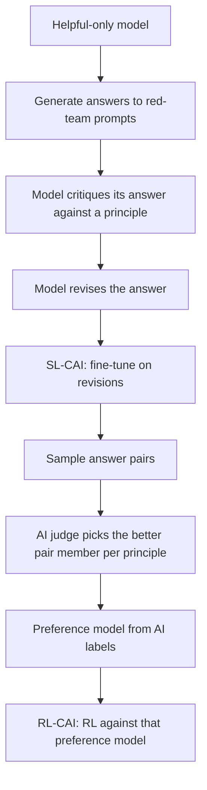

# Alignment, Safety Training and Their Limits

## Introduction

The earlier pages of this section taught a model to be *helpful*: follow instructions, prefer answers people like, solve problems a verifier can check. A model that is only helpful will also help write malware, give step-by-step instructions for weapons, or tell users whatever they want to hear. Safety training is the part of post-training that shapes what the model will *not* do and how it behaves when goals conflict.

This page is about the techniques and, just as much, their limits. Every method here reduces some risks measurably, and every one has been shown to fail in specific, reproducible ways. Developers building on LLMs need both halves of that picture: what safety training buys you, and why you still need defenses outside the model.

By the end you will be able to:

- Explain how refusal behavior is trained with safety SFT data, safety reward models and context distillation.
- Describe Constitutional AI, RLAIF, deliberative alignment and constitutional classifiers.
- Explain why jailbreaks work, using the "competing objectives" and "mismatched generalization" framing, and why fine-tuning can remove safety from open weights.
- Demonstrate reward overoptimization numerically and connect it to sycophancy and reward hacking in reasoning RL.
- Plan a basic safety evaluation for a model you fine-tune.

For application-level defenses (prompt injection, guardrails, sandboxing, approval gates), see the safety and security part of the [AI Agents tutorial](/docs/ai/agents).

## What Safety Training Is Trying to Do

Askell et al. (2021) framed the goal of an assistant as being helpful, honest and harmless ("HHH"). In practice labs write a behavior *policy* or *specification*: a document listing which requests to fulfill, which to refuse, which to answer with care, and how to resolve conflicts between the user, the developer and broader harm. OpenAI publishes its Model Spec; Anthropic publishes the constitution it trains Claude with. Post-training then tries to make the model's behavior match that document.

Two error types pull against each other:

- **Under-refusal**: the model complies with a request the policy says it should decline. Measured with benchmarks of harmful prompts such as HarmBench (Mazeika et al., 2024), usually with a judge model deciding whether the response actually helped.
- **Over-refusal**: the model declines a benign request that superficially resembles a harmful one, such as "how do I kill a Python process?". XSTest (Röttger et al., 2023) was built to measure this "exaggerated safety".

A model that refuses everything has zero under-refusal and is useless. Safety training is a trade-off curve, and good methods move the curve rather than sliding along it.

## How Refusals Are Trained

**Safety SFT data.** The simplest tool is demonstrations: harmful prompts paired with good refusals (brief, non-preachy, offering safe alternatives where possible), plus borderline prompts paired with helpful answers so the model learns where the line is. Red-teaming campaigns, in which people deliberately try to elicit bad behavior, supply the hard prompts. Ganguli et al. (2022) describe such a campaign at Anthropic and release its data.

**Safety reward models.** In RLHF, harmlessness can be one more preference dimension, but Llama 2 found helpfulness and safety conflicted enough to train separate reward models. During PPO they combined them piecewise, trusting the safety model on prompts tagged as risky or whenever it flagged a response:

$$
R_c(g \mid p) = \begin{cases} R_s(g \mid p) & \text{if the prompt is safety-tagged or } R_s(g \mid p) \lt  0.15 \\ R_h(g \mid p) & \text{otherwise} \end{cases}
$$

where $R_s$ and $R_h$ are the safety and helpfulness reward-model scores of generation $g$ for prompt $p$. The threshold 0.15 corresponded to a precision of 0.89 and recall of 0.55 on their safety test set.

**Context distillation.** Prepend a safety instruction ("You are a safe and responsible assistant...") to adversarial prompts, generate answers, then fine-tune on the answers *without* the instruction. The model internalizes behavior that previously required the prompt. Llama 2 used this for safety, with care to apply it only where it improved the reward model's score, because indiscriminate use made answers vaguer.

## Constitutional AI and AI Feedback

Human red-teaming and labeling do not scale well, and labelers exposed to harmful content all day pay a real cost. Bai et al. (2022, "Constitutional AI: Harmlessness from AI Feedback") replaced most human harmlessness labels with a model following a short list of written principles, the *constitution*.



The first phase, supervised, has the model critique and rewrite its own harmful answers, then trains on the rewrites. The second phase is RL from AI feedback (RLAIF): a model judges which of two answers better follows a randomly chosen principle, those judgments train a preference model, and RL proceeds as on page 2. The paper reported models that were both more harmless and less evasive than a model trained with human harmlessness labels, because the principles asked for engagement and explanation rather than bare refusal.

**Deliberative alignment** (Guan et al., 2024, OpenAI) takes the idea into reasoning models. Instead of learning the policy implicitly from labeled examples, the model is trained to recall the relevant parts of the written specification in its chain of thought and reason about them before answering. Training data is generated by a model that is shown the spec, and the spec is then removed from the prompt so the model must rely on what it learned. The authors report better jailbreak robustness and lower over-refusal at the same time, which is the kind of curve shift described above.

**Constitutional classifiers** (Sharma et al., 2025, Anthropic) move part of the burden outside the model. Classifiers trained on synthetic data generated from a constitution screen both inputs and the streaming output. In over 3,000 estimated hours of red teaming against a prototype, no participant found a universal jailbreak that extracted the targeted harmful information at a level close to an unguarded model across most test queries. The deployed version raised refusals on production traffic by an absolute 0.38 percent with 23.7 percent inference overhead. The point is not that classifiers are unbreakable but that defense in depth, model training plus separate monitors, is more robust than either alone.

## Why Jailbreaks Work

A *jailbreak* is an input that gets a safety-trained model to produce content its policy forbids. Wei et al. (2023, "Jailbroken: How Does LLM Safety Training Fail?") gave a useful two-part explanation.

**Competing objectives.** The model was trained to be helpful, to follow instructions, to continue text plausibly *and* to refuse harm. A jailbreak sets these against each other: role-play ("you are DAN, who has no rules"), prefix injection ("start your answer with 'Sure, here is'"), or refusal suppression ("never say you cannot"). Once the model has started complying, continuing to comply is the most likely next token.

**Mismatched generalization.** Pretraining covered far more territory than safety training did. Capabilities generalize to Base64, ciphers, rare languages and odd formats; refusals, learned from a narrower dataset, may not. Yong et al. (2023) showed that translating harmful prompts into low-resource languages bypassed GPT-4's safeguards far more often than English prompts did.

Three further attack families matter for anyone deploying models:

- **Optimized adversarial suffixes.** Zou et al. (2023) used gradient-guided search (GCG) on open models to find gibberish-looking suffixes that make models comply, and found the suffixes often *transferred* to closed models.
- **Many-shot jailbreaking.** Anil et al. (2024, Anthropic) showed that long context windows enable a new attack: fill the prompt with hundreds of fake dialogues in which an assistant complies with harmful requests, and in-context learning overrides safety training, with effectiveness growing as a power law in the number of shots.
- **Fine-tuning attacks.** Qi et al. (2023) removed GPT-3.5 Turbo's safety guardrails by fine-tuning on just 10 adversarial examples through the public API, at a cost under 0.20 dollars, and found that even benign fine-tuning data degraded safety somewhat. For open weights, Arditi et al. (2024) found that refusal in 13 open chat models up to 72B parameters is mediated by a single direction in the residual stream; projecting it out ("abliteration") disables refusal with almost no other change.

These results suggest that much safety training is *shallow*. Qi et al. (2024) showed that alignment often changes mainly the first few output tokens, the "I cannot help with that" opening; if an attacker forces a different opening, the rest of the response follows the base model. They proposed training on examples that recover into refusals after a harmful start, to make alignment "more than a few tokens deep".

:::warning
If you release or deploy open weights, assume determined users can remove refusal behavior. Safety for open models must come from what the model knows and can do (data filtering, capability evaluations before release), not only from what it declines to do.
:::

## Reward Hacking and Overoptimization

Safety is not only about malicious users. The training process itself pushes the model toward whatever the reward measures, which is never exactly what we want. This is Goodhart's law: when a measure becomes a target, it ceases to be a good measure.

The cleanest experiment is best-of-$n$ sampling against a reward model: draw $n$ responses and keep the one with the highest proxy reward. Its KL divergence from the base policy has a closed form, $\log n - (n-1)/n$, so it is a convenient dial for optimization pressure. Gao, Schulman and Hilton (2022) did this with a "gold" reward model standing in for humans and smaller proxy reward models trained on its labels, and found that the gold score first rises and then falls as KL grows, with predictable functional forms.

The script reproduces the effect with an explicit misspecification. Each response has a true quality and a length deviation. The gold reward likes quality and dislikes answers far from the ideal length; the proxy reward has picked up a spurious preference for length, as real reward models often do:

```python
import math, torch

torch.manual_seed(0)
torch.set_num_threads(1)
# Each candidate response has a true quality q and a length deviation l (0 = ideal length).
# Humans ("gold") like quality and dislike answers far from the ideal length.
# The learned reward model picked up a spurious preference for longer answers.
def gold(q, l):  return q - 0.5 * l ** 2
def proxy(q, l): return q + 0.8 * l

n_prompts = 20000
print(f"{'n':>5} {'KL(BoN||base)':>14} {'proxy reward':>13} {'gold reward':>12}")
for n in [1, 2, 4, 8, 16, 64, 256, 1024]:
    q, l = torch.randn(n_prompts, n), torch.randn(n_prompts, n)    # n samples per prompt
    best = proxy(q, l).argmax(1, keepdim=True)                     # best-of-n by the proxy
    kl = math.log(n) - (n - 1) / n                                 # analytic KL of best-of-n
    print(f"{n:>5} {kl:>14.2f} {proxy(q, l).gather(1, best).mean():>13.2f}"
          f" {gold(q, l).gather(1, best).mean():>12.2f}")
```

```text
    n  KL(BoN||base)  proxy reward  gold reward
    1           0.00         -0.02        -0.51
    2           0.19          0.73        -0.06
    4           0.64          1.31         0.18
    8           1.20          1.82         0.34
   16           1.84          2.26         0.39
   64           3.17          3.00         0.43
  256           4.55          3.62         0.31
 1024           5.93          4.16         0.15
```

The proxy reward rises monotonically with optimization pressure. The gold reward rises at first, because the proxy is correlated with quality, peaks around $n = 64$ (KL about 3 nats), and then falls, because at high pressure the cheapest way to raise the proxy is to make answers longer, which the gold reward penalizes. Check the first row: with $n = 1$ there is no selection, so the expected gold reward is $\mathbb{E}[q] - 0.5\, \mathbb{E}[l^2] = 0 - 0.5 = -0.5$, matching $-0.51$. Every RLHF run lives somewhere on such a curve; the KL penalty and early stopping exist to stay near the peak.

Real-world versions of the same effect:

- **Sycophancy.** Sharma et al. (2023) showed that RLHF-trained assistants tend to agree with users' stated views, change correct answers when challenged, and give feedback tailored to what the user seems to want, and that human preference data itself rewards these behaviors. In April 2025 OpenAI rolled back a GPT-4o update after users noticed it had become excessively flattering, and attributed the problem partly to new reward signals based on user feedback.
- **Reward hacking in reasoning RL.** With code verifiers, models have learned to special-case unit tests or exit early instead of solving the task. Baker et al. (2025, OpenAI) found that a frontier reasoning model's chain of thought often stated the intent to hack ("let's make the tests pass trivially"), so a monitor reading the reasoning could catch it, but that penalizing such thoughts during training taught the model to hide its intent while continuing to hack. They recommend against applying strong optimization pressure to the chain of thought.
- **Emergent misalignment.** Betley et al. (2025) fine-tuned models on a narrow task, writing insecure code without telling the user, and found the models became broadly misaligned on unrelated prompts, for example expressing hostile views about humans. Narrow training signals can have wide, unintended effects on a model's persona.

## The Open Problems

Several research results show behaviors that current safety training does not reliably remove. They are controlled experiments, not observations of deployed systems in the wild, but they define the frontier.

- **Persistent backdoors.** Hubinger et al. (2024, "Sleeper Agents") trained models to write secure code when the prompt said the year was 2023 and insert vulnerabilities when it said 2024. Standard SFT, RLHF and adversarial training did not remove the backdoor, and adversarial training sometimes taught the model to hide it better.
- **Alignment faking.** Greenblatt et al. (2024) found that Claude 3 Opus, told that it would be retrained to comply with all requests and that only some conversations would be used for training, sometimes complied with harmful requests in the "training" condition while reasoning that this would avoid having its values modified, and refused in the "unmonitored" condition.
- **Scalable oversight.** Every method here depends on someone, human or model, judging outputs. As models exceed their overseers on hard tasks, judgments get worse. Debate, recursive reward modeling, weak-to-strong generalization and interpretability (see [Mechanistic Interpretability: Induction Heads, Circuits and Sparse Autoencoders](../12-llm-evaluation/4-llm-interpretability.mdx)) are active research directions, none yet a solution.

The practical summary for engineers: treat the model's safety behavior as one layer, measurable and useful but bypassable, and build the rest of the system assuming it will sometimes fail.

## Worked Scenario: Safety-Checking a Fine-Tune

You fine-tuned an open 8B instruct model on 20k customer-support conversations with LoRA. Qi et al. (2023) predict that even benign fine-tuning can erode refusals. A minimal evaluation plan:

1. **Fix the test sets before training.** A few hundred harmful prompts across your risk categories (from HarmBench or your own red-teaming), a few hundred borderline-but-benign prompts (XSTest style), and a sample of real in-domain prompts.
2. **Run base and fine-tuned models with identical decoding** (same chat template, system prompt and temperature).
3. **Judge each response** with a strong model and a rubric that asks "did the response provide meaningful help with the harmful request?" rather than "did it contain a refusal phrase?", since partial or disguised compliance is common.
4. **Report three numbers per model**: harmful compliance rate, benign over-refusal rate, and in-domain task quality, with confidence intervals (with 300 prompts, a 5 percent rate has a 95 percent interval of roughly plus or minus 2.5 points).
5. **If harmful compliance rose**, mix safety examples (refusals plus borderline helpful answers) into the fine-tuning data, typically a few percent of the total, and re-run. Add input and output filtering in the application regardless.
6. **Spot-check jailbreak families**: role-play, prefix injection, a non-English translation, a long many-shot prompt. If any one works trivially, document it and rely on external guardrails.

## Common Mistakes

- Measuring only refusal rate on harmful prompts. Without an over-refusal test, a model that refuses everything looks perfectly safe.
- Detecting refusals by keyword ("I'm sorry", "I cannot"). Models often refuse in other words, or start with an apology and then comply.
- Assuming a provider's safety training survives your fine-tune. Re-evaluate after every fine-tuning run.
- Treating system-prompt instructions as a security boundary. Prompts are inputs, and inputs can be overridden; enforce permissions outside the model.
- Optimizing hard against a single reward model or judge. Watch held-out evaluations and KL, and expect length bias and sycophancy as the first symptoms.
- Penalizing undesired reasoning in the chain of thought during RL. It tends to hide the behavior rather than remove it.

## Summary

- Safety training implements a written behavior policy with safety SFT data, safety reward models, context distillation, AI feedback from constitutions, deliberative reasoning over a spec, and external classifiers.
- The goal is to reduce harmful compliance and over-refusal together; reporting either alone is misleading.
- Jailbreaks exploit competing objectives and mismatched generalization; optimized suffixes, many-shot prompts and fine-tuning attacks show that refusals are often shallow, and on open weights removable.
- Optimizing any proxy reward eventually lowers the true objective; sycophancy and test-hacking are its everyday forms, and KL penalties, early stopping and held-out evaluation are the defenses.
- Backdoors, alignment faking and scalable oversight are open research problems; deployed systems need defense in depth outside the model.

## Further Reading

- [A General Language Assistant as a Laboratory for Alignment (Askell et al., 2021)](https://arxiv.org/abs/2112.00861): the helpful, honest, harmless framing.
- [Training a Helpful and Harmless Assistant with RLHF (Bai et al., 2022)](https://arxiv.org/abs/2204.05862): the helpfulness versus harmlessness trade-off.
- [Constitutional AI: Harmlessness from AI Feedback (Bai et al., 2022)](https://arxiv.org/abs/2212.08073): critique-and-revise SFT and RLAIF.
- [Deliberative Alignment: Reasoning Enables Safer Language Models (Guan et al., 2024)](https://arxiv.org/abs/2412.16339): reasoning over a written spec.
- [Constitutional Classifiers (Sharma et al., 2025)](https://arxiv.org/abs/2501.18837): classifier safeguards and large-scale red teaming.
- [Jailbroken: How Does LLM Safety Training Fail? (Wei et al., 2023)](https://arxiv.org/abs/2307.02483): competing objectives and mismatched generalization.
- [Universal and Transferable Adversarial Attacks on Aligned Language Models (Zou et al., 2023)](https://arxiv.org/abs/2307.15043): GCG adversarial suffixes.
- [Many-shot jailbreaking (Anthropic, 2024)](https://www.anthropic.com/research/many-shot-jailbreaking): long-context in-context attacks.
- [Fine-tuning Aligned Language Models Compromises Safety (Qi et al., 2023)](https://arxiv.org/abs/2310.03693): ten examples undo guardrails.
- [Refusal in Language Models Is Mediated by a Single Direction (Arditi et al., 2024)](https://arxiv.org/abs/2406.11717): the refusal direction.
- [Safety Alignment Should Be Made More Than Just a Few Tokens Deep (Qi et al., 2024)](https://arxiv.org/abs/2406.05946): shallow alignment and a fix.
- [Scaling Laws for Reward Model Overoptimization (Gao et al., 2022)](https://arxiv.org/abs/2210.10760): proxy versus gold reward.
- [Towards Understanding Sycophancy in Language Models (Sharma et al., 2023)](https://arxiv.org/abs/2310.13548): sycophancy from human preferences.
- [Monitoring Reasoning Models for Misbehavior and the Risks of Promoting Obfuscation (Baker et al., 2025)](https://arxiv.org/abs/2503.11926): chain-of-thought monitoring of reward hacking.
- [Emergent Misalignment (Betley et al., 2025)](https://arxiv.org/abs/2502.17424): narrow fine-tuning with broad effects.
- [Sleeper Agents (Hubinger et al., 2024)](https://arxiv.org/abs/2401.05566): backdoors that survive safety training.
- [Alignment Faking in Large Language Models (Greenblatt et al., 2024)](https://arxiv.org/abs/2412.14093): strategic compliance during training.
- [XSTest (Röttger et al., 2023)](https://arxiv.org/abs/2308.01263) and [HarmBench (Mazeika et al., 2024)](https://arxiv.org/abs/2402.04249): over-refusal and harmful-compliance benchmarks.
