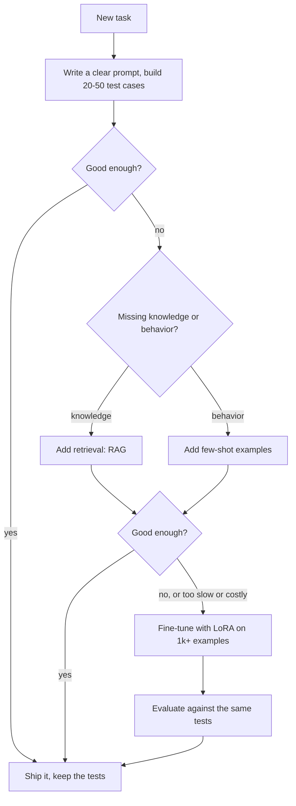

# When to Fine-Tune, and When to Use Prompting or RAG

## Introduction

Fine-tuning is the most powerful way to change how a language model behaves, and also the easiest to reach for too early. It needs a dataset, GPUs, an evaluation setup and a plan for redoing everything when the base model changes. Often a better prompt or a retrieval step gets you the same result in an afternoon.

This page is about the decision, not the mechanics. The rest of the section covers the mechanics: [LoRA](./1-llm-lora.mdx), [QLoRA](./2-llm-qlora.mdx), [training with TRL](./3-llm-fine-tuning-with-hf.mdx), [data preparation](./4-llm-fine-tuning-data.mdx) and [evaluation](./5-llm-evaluating-fine-tunes.mdx). Here you will learn:

- what fine-tuning changes inside a model and what it does not change well,
- the ladder of options from prompting to continued pretraining, and what each costs,
- how to estimate whether a fine-tune pays for itself, with a small script,
- the research results that explain why "fine-tune it on our documents" usually disappoints.

Prompting, retrieval-augmented generation (RAG) and agents are covered in depth in the [AI Agents tutorial](/docs/ai/agents). This page only compares them with fine-tuning.

## What Fine-Tuning Actually Changes

A pretrained model has seen trillions of tokens. Fine-tuning shows it a few thousand to a few million more, with gradient updates that push its next-token probabilities toward your examples. The model is trained with the same cross-entropy loss as in pretraining (see [Supervised Fine-Tuning and Chat Templates](../8-llm-post-training/1-llm-supervised-fine-tuning.mdx)):

$$
\mathcal{L}(\theta) = -\frac{1}{\lvert C \rvert} \sum_{t \in C} \log p_\theta(x_t \mid x_{<t})
$$

Here $\theta$ are the model's weights, $x_t$ is the token at position $t$, $x_{<t}$ are the tokens before it, and $C$ is the set of positions that carry loss (usually only the response tokens, not the prompt). The loss is small when the model already assigns high probability to the tokens in your examples.

What does a few thousand examples of this loss change? Research gives a fairly consistent answer: fine-tuning is very good at changing **behavior** and poor at adding **knowledge**.

- **Behavior** means format, style, tone, which skill to apply, how long to answer, when to refuse, which tool to call. These are patterns the model can already produce; fine-tuning makes them the default. A model that can write JSON when asked nicely becomes a model that always writes your JSON schema.
- **Knowledge** means facts the model did not see in pretraining: your product catalog, last month's policy change, an internal API.

Three results support this split:

1. **LIMA** (Zhou et al., 2023) fine-tuned a 65B LLaMA model on only 1,000 carefully chosen prompt-response pairs and got a strong assistant. The authors proposed the "superficial alignment hypothesis": almost all knowledge comes from pretraining, and instruction tuning mostly teaches the format and style of answers.
2. **Fine-Tuning or Retrieval?** (Ovadia et al., 2023) compared unsupervised fine-tuning on documents with RAG for injecting knowledge. RAG was better in their experiments, both for facts the model had seen before and for entirely new facts. Fine-tuning helped somewhat, mostly when the same fact appeared in many paraphrased variations.
3. **Does Fine-Tuning LLMs on New Knowledge Encourage Hallucinations?** (Gekhman et al., 2024) found that examples containing facts unknown to the model are learned more slowly than examples consistent with what it knows, and that once the model fits them, its tendency to hallucinate on other questions increases. Teaching facts through fine-tuning can make the model more confidently wrong.

An analogy: pretraining is a university education, fine-tuning is the first month on a new job. The month teaches you the house style, the forms and the tone the team uses. It does not make you memorize the whole company wiki; for that you keep the wiki open (retrieval).

:::note
These are research results on specific models and datasets, not laws. Continued pretraining on a large domain corpus (billions of tokens) does add domain knowledge; that is how code and medical models are built. The point is that a few thousand supervised examples are a weak and risky channel for facts.
:::

## The Ladder of Options

Think of the options as a ladder. Each rung costs more and changes more. Climb only as far as you need.

| Option | What changes | Data you need | Typical cost | Time to update |
|---|---|---|---|---|
| Prompt engineering | Nothing in the model; the input | A few test cases | Minutes | Instant |
| Few-shot prompting | Nothing; examples in the context | 3-50 examples | Longer prompts on every call | Instant |
| RAG | Nothing; retrieved text in the context | A document store | Index + retrieval latency | Re-index |
| Parameter-efficient fine-tuning (LoRA, QLoRA) | Small adapter weights | 500-50,000 examples | One GPU for hours | Retrain |
| Full fine-tuning | All weights | 10,000+ examples | Many GPUs | Retrain |
| Continued pretraining | All weights, broad knowledge | Billions of tokens | A cluster for days | Rare |
| Pretraining from scratch | Everything | Trillions of tokens | See [Pretraining](../6-llm-pretraining/0-llm-pretraining-data.mdx) | Never |

The data-size numbers are rough ranges from practice, not hard limits. A narrow formatting task can work with a few hundred examples; teaching a new language or programming language needs far more.

The ladder also tells you what to try first. Most production systems use several rungs at once: a fine-tuned model (behavior) that receives retrieved documents (knowledge) through a carefully written prompt (instructions). RAFT (Zhang et al., 2024) goes one step further and fine-tunes the model specifically to answer from retrieved documents and ignore distractor documents, which combines the strengths of both.



The test cases from the first step are the most important artifact in the whole process. They let you compare every rung on the same footing, and they become the evaluation set for a fine-tune later.

## Good and Bad Reasons to Fine-Tune

Fine-tuning earns its cost in a few recurring situations:

- **A strict output format at high volume.** Extraction into a fixed JSON schema, classification into your label set, SQL in your dialect. Prompting gets 95 percent there; fine-tuning closes the gap and makes outputs consistent.
- **Shorter prompts, lower latency and cost.** If every request carries a 2,000-token system prompt full of examples, a fine-tuned model can drop most of it. Fewer input tokens means faster time to first token and lower cost on every call.
- **A smaller model for a narrow task.** A fine-tuned 1B-8B model often matches a much larger general model on one task, and you can run it on your own hardware. This is a form of [distillation](../8-llm-post-training/5-llm-distillation.mdx) when the training labels come from the large model.
- **Style and voice that are hard to describe.** Brand voice, a doctor's note format, a particular code style. Showing 1,000 examples beats describing the style in words.
- **Privacy or offline constraints.** You cannot send data to an external API, so you need an open model, and an open small model usually needs adaptation.
- **Tool use and agent behavior for a fixed toolset.** Teaching the model your function signatures and when to call them.

And some reasons that usually lead to disappointment:

- **"The model should know our documents."** Use RAG. Documents change, and fine-tuned facts cannot be updated or cited. As the research above shows, it can also increase hallucination.
- **"The model makes reasoning mistakes."** A few thousand SFT examples rarely make a model smarter. Try a stronger base model, or look at [reinforcement learning with verifiable rewards](../8-llm-post-training/4-llm-reasoning-rl.mdx) if you have a checker for correct answers.
- **"We have no evaluation yet."** Without a test set, you cannot tell whether the fine-tune helped. Build the evaluation first.
- **"Prompting failed after one attempt."** Spend a day on prompts and examples before spending a week on data.

## The Cost Math

The economic argument for fine-tuning is usually about tokens. A large API model with a long few-shot prompt pays for those prompt tokens on every request. A small fine-tuned model has learned the examples and needs only the input.

Let $P_\text{in}$ and $P_\text{out}$ be the price per token for input and output, $n_\text{in}$ and $n_\text{out}$ the tokens per request. The cost per request is

$$
c = n_\text{in} P_\text{in} + n_\text{out} P_\text{out}
$$

If fine-tuning has a one-off cost $F$ (labeling time, GPU hours, evaluation), and it reduces the per-request cost from $c_1$ to $c_2$, it pays for itself after

$$
N^\ast = \frac{F}{c_1 - c_2}
$$

requests. The script below measures real token counts for a ticket-triage task with 20 examples in the prompt. The prices are placeholders, so plug in your provider's numbers.

```python
from transformers import AutoTokenizer

tok = AutoTokenizer.from_pretrained("HuggingFaceTB/SmolLM2-135M-Instruct")

instructions = ("You triage support tickets. Return JSON with keys order_id (int), product "
                "(one of router, laptop, headphones, printer, phone, monitor) and sentiment "
                "(positive or negative). Output JSON only, no prose.\n")
shot = ('Ticket: Order 48213: my printer arrived with a cracked screen.\n'
        'JSON: {"order_id": 48213, "product": "printer", "sentiment": "negative"}\n')
ticket = "Ticket: Order 31337: my router keeps disconnecting.\nJSON:"
answer = '{"order_id": 31337, "product": "router", "sentiment": "negative"}'

def n(text):
    return len(tok(text)["input_ids"])

few_shot_prompt = instructions + shot * 20 + ticket    # 20 worked examples in the prompt
tuned_prompt = ticket                                   # the fine-tuned model needs no examples
print("few-shot prompt tokens:", n(few_shot_prompt))
print("fine-tuned prompt tokens:", n(tuned_prompt))
print("answer tokens:", n(answer))

# Example prices in USD per million tokens. Placeholders: use your provider's real numbers.
big = dict(inp=2.50, out=10.00)      # a large general model behind an API
small = dict(inp=0.20, out=0.80)     # a small model you host or rent after fine-tuning

def cost_per_million_requests(prompt_tokens, answer_tokens, price):
    return prompt_tokens * price["inp"] + answer_tokens * price["out"]   # USD per 1M requests

a = cost_per_million_requests(n(few_shot_prompt), n(answer), big)
b = cost_per_million_requests(n(tuned_prompt), n(answer), small)
print(f"big model + few-shot : USD {a:,.0f} per million tickets")
print(f"small fine-tuned     : USD {b:,.0f} per million tickets")
one_off = 3000.0                      # assumed USD for labeling time, GPU hours and evals
print(f"break-even after {one_off / ((a - b) / 1e6):,.0f} tickets")
```

```text
few-shot prompt tokens: 1027
fine-tuned prompt tokens: 20
answer tokens: 25
big model + few-shot : USD 2,818 per million tickets
small fine-tuned     : USD 24 per million tickets
break-even after 1,073,922 tickets
```

Check one line by hand: the few-shot cost is $1027 \times 2.50 + 25 \times 10.00 = 2567.5 + 250 = 2817.5$ dollars per million requests, which rounds to 2,818. The difference per request is about $2794 / 10^6$ dollars, and $3000$ divided by that is about 1.07 million.

So for this task the fine-tune pays off after roughly a million tickets. At 10,000 tickets a day that is about three and a half months; at 100 tickets a day it is never worth it on cost alone. Two caveats keep this honest:

- **Prompt caching** changes the numbers. Many APIs charge much less for a repeated prompt prefix, which shrinks the few-shot penalty. Recompute with cached prices.
- **Hosting is not free.** A self-hosted model has a fixed cost per GPU hour whether it serves one request or a million. The per-token "small model" price above assumes high utilization or a serverless provider.

The compute for the fine-tune itself is usually the smallest line item. A rough rule: full training costs about $6ND$ FLOPs for $N$ parameters and $D$ training tokens (see [Counting Parameters, FLOPs and Memory](../3-llm-transformer/6-llm-parameter-and-flop-counting.mdx)). With LoRA the frozen weights still need the forward pass ($2N$ per token) and the backward pass through activations (about $2N$), but skip their weight gradients (about $2N$), so roughly $4ND$. For an 8B model on 10 million tokens that is $4 \times 8 \times 10^9 \times 10^7 = 3.2 \times 10^{17}$ FLOPs: at a realistic 400 TFLOP/s on one H100-class GPU that is about $3.2 \times 10^{17} / (4 \times 10^{14}) = 800$ seconds, under fifteen minutes. The expensive part is the people who build and check the data.

## A Worked Scenario: Ticket Triage

Suppose a support team wants each incoming ticket turned into `{"order_id", "product", "sentiment"}` so it can be routed. Here is how the decision plays out.

**Step 1: prompt and test set.** Write a clear instruction and collect 100 real tickets with correct labels. Run a strong API model. Suppose it gets 93 percent exact-match accuracy; the failures are mostly products named in unusual ways ("my HP thing") and occasional extra prose around the JSON.

**Step 2: structured output.** Many serving stacks can force output to match a JSON schema ([Constrained Decoding and Structured Output](../10-llm-inference/7-llm-structured-output.mdx)). That removes the extra-prose failures for free. Accuracy goes to 96 percent.

**Step 3: few-shot.** Add 20 examples of tricky product names. Accuracy reaches 97 percent, but the prompt grows to about 1,000 tokens, which is what the cost script above measured.

**Step 4: is fine-tuning worth it?** The team handles 30,000 tickets a day, so the break-even of about a million tickets arrives in about a month. There is also a privacy requirement to keep tickets in-house. Both point to fine-tuning a small open model.

**Step 5: fine-tune.** Label 3,000 tickets (using the big model for drafts and humans to correct them), train a LoRA adapter on a 1B-4B model, and evaluate on the same 100-ticket test set plus a general-ability check. [Page 3](./3-llm-fine-tuning-with-hf.mdx) trains a toy version of exactly this task, and [page 5](./5-llm-evaluating-fine-tunes.mdx) measures what it costs the model elsewhere.

Notice what did not happen: nobody fine-tuned the model on the product catalog. If the catalog changes weekly, product names go into the prompt or a retrieval step, and the fine-tune only teaches the format and the triage behavior.

## Managed Fine-Tuning Versus Open Weights

You can fine-tune in two places, and the choice affects everything downstream.

| | Managed fine-tuning API | Open-weight model you train |
|---|---|---|
| Models | The provider's models only | Llama, Qwen, Mistral, Gemma, DeepSeek, ... |
| Control | Few hyperparameters, provider's data rules | Everything: method, rank, data mix, loss |
| Infrastructure | None | GPUs, training code, serving stack |
| Output | A model ID you call | Weights or an adapter you own |
| Lock-in | Tied to the provider | Portable |
| Best for | Teams without ML infrastructure | Privacy, cost at scale, research |

This section focuses on the second column because it is where you learn how things work. Everything about data quality and evaluation applies to both.

## Common Mistakes

- **Fine-tuning before building an evaluation set.** You cannot tell if it worked, and you cannot compare against the prompt baseline.
- **Using fine-tuning to inject facts that change.** Every update needs a retrain, the model cannot cite sources, and hallucination can increase. Retrieve facts instead.
- **Comparing a tuned model to an untuned prompt.** Give the prompting baseline a real effort (good instructions, examples, structured output) before declaring it insufficient.
- **Ignoring the cost of the data.** GPU time is cheap compared with the hours needed to collect, clean and check thousands of examples.
- **Forgetting the base model moves.** A better base model next quarter may beat your fine-tune with no training at all. Keep the data and pipeline so you can retrain cheaply.
- **Assuming fine-tuning keeps safety behavior.** Qi et al. (2023) showed that fine-tuning an aligned model, even on benign data, can weaken its refusals. Re-test safety after every fine-tune.

## Summary

- Fine-tuning reliably changes behavior (format, style, skills, defaults); it is a weak and risky way to add knowledge.
- Climb the ladder in order: prompt, few-shot, structured output, RAG, then LoRA fine-tuning; most systems combine several rungs.
- The economic case is usually prompt tokens saved per request times request volume; compute $N^\ast = F / (c_1 - c_2)$ with real prices.
- Build the test set first; it decides every later step and becomes the fine-tune's evaluation set.
- Fine-tuning compute is cheap (roughly $4ND$ FLOPs with LoRA); data collection and evaluation are the real costs.

## Further Reading

- [LIMA: Less Is More for Alignment (Zhou et al., 2023)](https://arxiv.org/abs/2305.11206) - 1,000 curated examples and the superficial alignment hypothesis.
- [Fine-Tuning or Retrieval? Comparing Knowledge Injection in LLMs (Ovadia et al., 2023)](https://arxiv.org/abs/2312.05934) - RAG versus unsupervised fine-tuning for new and existing facts.
- [Does Fine-Tuning LLMs on New Knowledge Encourage Hallucinations? (Gekhman et al., 2024)](https://arxiv.org/abs/2405.05904) - unknown facts are learned slowly and increase hallucination.
- [RAFT: Adapting Language Model to Domain Specific RAG (Zhang et al., 2024)](https://arxiv.org/abs/2403.10131) - fine-tuning a model to use retrieved documents well.
- [Fine-tuning Aligned Language Models Compromises Safety (Qi et al., 2023)](https://arxiv.org/abs/2310.03693) - why safety must be re-tested after fine-tuning.
- [Hugging Face PEFT documentation](https://huggingface.co/docs/peft) - the library used in the rest of this section.
- [AI Agents tutorial](/docs/ai/agents) - prompting, RAG and agents in depth.
