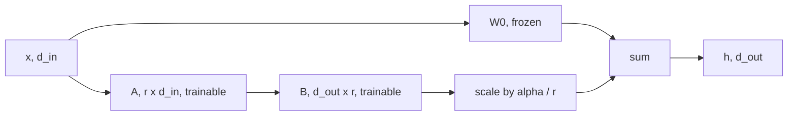

# LoRA Explained

## Introduction

Full fine-tuning updates every weight of a model. For an 8-billion-parameter model trained with AdamW in mixed precision, that means holding the weights, their gradients, an FP32 master copy and two optimizer moments: about 16 bytes per parameter, or roughly 130 GB before a single activation is stored. It also means every fine-tuned variant is another 16 GB checkpoint.

LoRA (Low-Rank Adaptation, Hu et al., 2021) avoids both problems. It freezes the pretrained weights and learns a small low-rank correction next to each chosen weight matrix. On GPT-3 175B the paper reports about 10,000 times fewer trainable parameters and about 3 times less GPU memory than full fine-tuning with Adam, with comparable quality on the tasks it tested. Today LoRA is the default way to fine-tune open models on one GPU, and the basis of [QLoRA](./2-llm-qlora.mdx).

By the end of this page you will be able to:

- derive the LoRA forward pass and its gradients, and say why one factor starts at zero,
- explain what rank $r$ and alpha $\alpha$ do, including the rsLoRA variant,
- count LoRA parameters for a real model from its config.json,
- implement a LoRA linear layer in PyTorch, merge it, and match the result with Hugging Face PEFT,
- choose target modules, rank and learning rate with reasons.

## Why a Low-Rank Update Is Enough

Write the fine-tuned weight as the pretrained weight plus a change:

$$
W = W_0 + \Delta W, \qquad W_0, \Delta W \in \mathbb{R}^{d_\text{out} \times d_\text{in}}
$$

Full fine-tuning learns all $d_\text{out} d_\text{in}$ entries of $\Delta W$. The LoRA hypothesis is that the change needed to adapt a pretrained model to one task has low "intrinsic rank": it can be written as a product of two thin matrices without losing much.

This idea builds on Aghajanyan et al. (2020), "Intrinsic Dimensionality Explains the Effectiveness of Language Model Fine-Tuning". They showed that fine-tuning can be done in a randomly projected subspace of surprisingly low dimension; for RoBERTa on one benchmark task, a few hundred dimensions recovered 90 percent of full fine-tuning performance. Pretrained models already contain the features a task needs, and fine-tuning mostly recombines them.

Any matrix of rank at most $r$ can be written as

$$
\Delta W = B A, \qquad B \in \mathbb{R}^{d_\text{out} \times r}, \quad A \in \mathbb{R}^{r \times d_\text{in}}
$$

with $r \ll \min(d_\text{in}, d_\text{out})$. The number of trainable parameters drops from $d_\text{out} d_\text{in}$ to $r(d_\text{in} + d_\text{out})$. For a square $4096 \times 4096$ projection with $r = 16$, that is $16{,}777{,}216$ versus $16 \times 8192 = 131{,}072$, or 0.78 percent.

An analogy: $W_0$ is a long, carefully edited book. Full fine-tuning lets you rewrite any word. LoRA lets you add a short list of margin notes that apply systematic edits ("everywhere you discuss X, emphasize Y"). For most adaptation tasks, the margin notes are enough.

## The LoRA Forward Pass

LoRA never forms $W$ explicitly during training. For an input $x \in \mathbb{R}^{d_\text{in}}$ it computes

$$
h = W_0 x + \frac{\alpha}{r} B A x
$$

The frozen path $W_0 x$ is the original layer. The adapter path first projects $x$ down to $r$ dimensions with $A$, then back up to $d_\text{out}$ with $B$, then scales the result by $s = \alpha / r$.



**A worked example by hand.** Take $d_\text{in} = d_\text{out} = 3$, $r = 1$, $\alpha = 2$, so $s = 2$:

$$
A = \begin{pmatrix} 1 & 0 & 2 \end{pmatrix}, \quad
B = \begin{pmatrix} 0.5 \\ 0 \\ -1 \end{pmatrix}, \quad
x = \begin{pmatrix} 1 \\ 1 \\ 1 \end{pmatrix}
$$

The adapter path is $A x = 1 + 0 + 2 = 3$ (a single number because $r = 1$), then $B (A x) = (1.5, 0, -3)^\top$, then times $s$: $(3, 0, -6)^\top$. The same answer comes from forming the update matrix first:

$$
s B A = 2 \begin{pmatrix} 0.5 & 0 & 1 \\ 0 & 0 & 0 \\ -1 & 0 & -2 \end{pmatrix}
= \begin{pmatrix} 1 & 0 & 2 \\ 0 & 0 & 0 \\ -2 & 0 & -4 \end{pmatrix},
\qquad s B A x = \begin{pmatrix} 3 \\ 0 \\ -6 \end{pmatrix}
$$

Every row of $sBA$ is a multiple of the same row vector $(1, 0, 2)$: that is what rank 1 means. Here LoRA has 6 parameters against 9 for the full matrix, so it saves little; the savings appear when $d$ is in the thousands.

The two ways of computing give the same result, but their cost differs. Computing $B(Ax)$ costs $r(d_\text{in} + d_\text{out})$ multiply-adds per token; forming $BA$ costs $d_\text{out} d_\text{in} r$. During training LoRA always uses the first order. For serving, you can form $BA$ once and add it into $W_0$, which is merging (below).

## Initialization, Scaling and Gradients

**Zero start.** LoRA initializes $A$ randomly and $B$ to zero. Then $BA = 0$ and the adapted model is exactly the pretrained model at step 0. Training starts from the model you chose, not from a randomly perturbed one. The original paper uses a random Gaussian for $A$; Hugging Face PEFT uses Kaiming-uniform initialization for $A$ (the same as `nn.Linear`) and zeros for $B$.

**Gradients.** Let $g = \partial \mathcal{L} / \partial h \in \mathbb{R}^{d_\text{out}}$ be the gradient flowing back into the layer output. Since $h = W_0 x + s B (A x)$, the chain rule gives

$$
\frac{\partial \mathcal{L}}{\partial B} = s \, g \, (A x)^\top \in \mathbb{R}^{d_\text{out} \times r},
\qquad
\frac{\partial \mathcal{L}}{\partial A} = s \, B^\top g \, x^\top \in \mathbb{R}^{r \times d_\text{in}}
$$

At initialization $B = 0$, so $\partial \mathcal{L} / \partial A = 0$ while $\partial \mathcal{L} / \partial B$ is not zero (because $A$ is random). On the first step only $B$ moves; from the second step both factors learn. If both were zero, neither would ever get a gradient; if both were random, the model would start away from the pretrained weights. The asymmetric choice avoids both. A quick check with autograd:

```python
import torch

torch.manual_seed(0)
d_in, d_out, r, s = 6, 4, 2, 2.0
W0 = torch.randn(d_out, d_in)
A = torch.randn(r, d_in, requires_grad=True)          # random init
B = torch.zeros(d_out, r, requires_grad=True)         # zero init
x = torch.randn(d_in)
target = torch.randn(d_out)

y = W0 @ x + s * (B @ (A @ x))                         # (d_out,)
loss = 0.5 * ((y - target) ** 2).sum()
loss.backward()

g = (y - target).detach()                              # dL/dy, shape (d_out,)
print("grad A all zero:", torch.all(A.grad == 0).item())
print("grad B matches s * g (A x)^T:",
      torch.allclose(B.grad, s * torch.outer(g, (A @ x).detach())))
```

```text
grad A all zero: True
grad B matches s * g (A x)^T: True
```

**What alpha does.** The scale $s = \alpha / r$ multiplies the adapter output. The LoRA authors set $\alpha$ once (to the first $r$ they tried) and kept it fixed while varying $r$. The reason: with Adam, the size of each update is roughly set by the learning rate, not by the gradient magnitude, so the change in $BA$ per step grows with $r$. Dividing by $r$ keeps the effective change roughly stable, so you do not have to retune the learning rate every time you change the rank. A common convention is $\alpha = 2r$ (for example $r = 16$, $\alpha = 32$), but treat $\alpha$ as a learning-rate multiplier for the adapter, not as a magic number.

**rsLoRA.** Kalajdzievski (2023) analyzed this scaling and argued that $\alpha / r$ shrinks the adapter's contribution too much at high rank, so large ranks learn slowly and show no benefit. The proposed rank-stabilized scale is

$$
s = \frac{\alpha}{\sqrt{r}}
$$

With it, higher ranks did improve results in that paper's experiments. In PEFT this is `use_rslora=True`. If you use ranks above about 64, it is worth trying.

## Implementing a LoRA Linear Layer

Here is a complete LoRA wrapper for `nn.Linear`, including merge and unmerge. It checks the two properties that matter: the adapter is a no-op at initialization, and merging gives the same output as the unmerged forward pass.

```python
import math
import torch
import torch.nn as nn

torch.manual_seed(0)

class LoRALinear(nn.Module):
    """A frozen nn.Linear plus a trainable low-rank update B @ A."""
    def __init__(self, base: nn.Linear, r: int = 8, alpha: float = 16.0,
                 dropout: float = 0.0, rslora: bool = False):
        super().__init__()
        self.base = base
        for p in self.base.parameters():          # freeze W0 (and its bias)
            p.requires_grad_(False)
        d_in, d_out = base.in_features, base.out_features
        self.r = r
        self.scaling = alpha / math.sqrt(r) if rslora else alpha / r
        self.lora_A = nn.Parameter(torch.empty(r, d_in))   # (r, d_in)
        self.lora_B = nn.Parameter(torch.zeros(d_out, r))  # (d_out, r): zero init
        nn.init.kaiming_uniform_(self.lora_A, a=math.sqrt(5))
        self.dropout = nn.Dropout(dropout)
        self.merged = False

    def forward(self, x):                      # x: (..., d_in)
        y = self.base(x)                       # (..., d_out)
        if not self.merged:
            h = self.dropout(x) @ self.lora_A.T    # (..., r)
            y = y + (h @ self.lora_B.T) * self.scaling  # (..., d_out)
        return y

    @torch.no_grad()
    def merge(self):
        # W = W0 + s * B A, shape (d_out, d_in), same as base.weight
        self.base.weight += self.scaling * (self.lora_B @ self.lora_A)
        self.merged = True

    @torch.no_grad()
    def unmerge(self):
        self.base.weight -= self.scaling * (self.lora_B @ self.lora_A)
        self.merged = False

base = nn.Linear(512, 512)
layer = LoRALinear(base, r=8, alpha=16)
x = torch.randn(4, 10, 512)                    # (batch, seq_len, d_in)

# 1. At initialization the adapter is a no-op because B = 0.
print("max diff at init:", (layer(x) - base(x)).abs().max().item())

# 2. Parameter counts.
trainable = sum(p.numel() for p in layer.parameters() if p.requires_grad)
total = sum(p.numel() for p in layer.parameters())
print(f"trainable {trainable:,} of {total:,} ({100*trainable/total:.2f}%)")

# 3. Pretend we trained: give B some values, then check merge == unmerged forward.
with torch.no_grad():
    layer.lora_B.normal_(std=0.02)
y_adapter = layer(x)
layer.merge()
y_merged = layer(x)
print("max diff merged vs adapter:", (y_adapter - y_merged).abs().max().item())
print("rank of the update:", torch.linalg.matrix_rank(layer.scaling * layer.lora_B @ layer.lora_A).item())
```

```text
max diff at init: 0.0
trainable 8,192 of 270,848 (3.02%)
max diff merged vs adapter: 1.430511474609375e-06
rank of the update: 8
```

The trainable count is $8 \times (512 + 512) = 8192$. The total includes the frozen $512 \times 512$ weight and its 512-element bias. The merged and unmerged outputs differ only by float32 rounding ($10^{-6}$), because $W_0 x + s B A x$ and $(W_0 + sBA) x$ add the same numbers in a different order. Dropout on the adapter input is applied only on the adapter path, which is how PEFT's `lora_dropout` works.

### Experiment: Rank Versus a Low-Rank Target

Does rank matter the way the theory says? Build a target weight that is the frozen $W_0$ plus a hidden rank-4 change, and ask LoRA adapters of rank 1, 2, 4 and 8 to fit it. Run this after the class above (same file or notebook):

```python
torch.manual_seed(0)
d, true_rank = 64, 4
W0 = torch.randn(d, d) / math.sqrt(d)
delta = (torch.randn(d, true_rank) @ torch.randn(true_rank, d)) * 0.1  # rank-4 "task" change
X = torch.randn(2048, d)
Y = X @ (W0 + delta).T                       # targets from the fine-tuned weight

for r in [1, 2, 4, 8]:
    torch.manual_seed(1)
    base = nn.Linear(d, d, bias=False)
    with torch.no_grad():
        base.weight.copy_(W0)
    layer = LoRALinear(base, r=r, alpha=2 * r)
    opt = torch.optim.Adam([layer.lora_A, layer.lora_B], lr=1e-2)
    for step in range(1500):
        loss = ((layer(X) - Y) ** 2).mean()
        opt.zero_grad(); loss.backward(); opt.step()
    print(f"r={r}: trainable={r * 2 * d:5d}  final MSE={loss.item():.6f}")
```

```text
r=1: trainable=  128  final MSE=1.413559
r=2: trainable=  256  final MSE=0.838731
r=4: trainable=  512  final MSE=0.000000
r=8: trainable= 1024  final MSE=0.000000
```

Ranks below the true rank of the change hit a floor: they cannot represent it, no matter how long they train. At $r = 4$ the error drops to zero, and $r = 8$ adds nothing but parameters. Real tasks do not have a clean "true rank", but the same shape appears: quality rises with rank until the adapter has enough capacity for the task, then flattens. A narrow format task saturates at small ranks; a large dataset with new skills keeps benefiting from more capacity.

## Which Modules to Adapt and What Rank to Use

A decoder block has seven large linear layers: the attention projections `q_proj`, `k_proj`, `v_proj`, `o_proj` and the SwiGLU MLP's `gate_proj`, `up_proj`, `down_proj` (see [Inside a Decoder Block](../3-llm-transformer/2-llm-transformer-block.mdx)). Which ones get adapters?

- The **original LoRA paper** (2021), working under a tight parameter budget on GPT-3, adapted only the attention projections and found that spreading a fixed budget over $W_q$ and $W_v$ at small rank beat putting it all into one matrix at higher rank. That is why many old tutorials use `target_modules=["q_proj", "v_proj"]`.
- **QLoRA** (Dettmers et al., 2023) found that adapters on all linear layers were needed to match full 16-bit fine-tuning, and that rank mattered less once all layers were adapted.
- **"LoRA Without Regret"** (Schulman and colleagues at Thinking Machines, 2025) reported that attention-only LoRA underperforms MLP-only LoRA even at matched parameter counts, and recommended applying LoRA to all layers, especially the MLP (and MoE) layers that hold most of the parameters.

Current practice follows the later results: adapt all linear layers in the blocks. In PEFT you write `target_modules="all-linear"`, which selects every linear layer except the output head.

Here is what that costs for a real model. Qwen3-8B's config.json has `hidden_size` 4096, `intermediate_size` 12288, 36 layers, 32 query heads and 8 key-value heads of `head_dim` 128. So `k_proj` and `v_proj` map 4096 to $8 \times 128 = 1024$. With $r = 16$:

| Module | Shape (in to out) | Full weights | LoRA params, r=16 |
|---|---|---|---|
| q_proj | 4096 to 4096 | 16,777,216 | 131,072 |
| k_proj | 4096 to 1024 | 4,194,304 | 81,920 |
| v_proj | 4096 to 1024 | 4,194,304 | 81,920 |
| o_proj | 4096 to 4096 | 16,777,216 | 131,072 |
| gate_proj | 4096 to 12288 | 50,331,648 | 262,144 |
| up_proj | 4096 to 12288 | 50,331,648 | 262,144 |
| down_proj | 12288 to 4096 | 50,331,648 | 262,144 |
| One layer | | 192,937,984 | 1,212,416 |
| 36 layers | | 6.95 B | 43.6 M |

The adapter is 43.6 million parameters, about 0.53 percent of the model's 8.2 billion, and about 87 MB in BF16. Note that 65 percent of the LoRA parameters sit in the MLP; adapting only `q_proj` and `v_proj` would leave out the layers that the 2025 results found most useful.

**Rank.** Typical values are 8 to 64. Small ranks suffice for format and style tasks; larger datasets and harder skills benefit from more. Biderman et al. (2024), "LoRA Learns Less and Forgets Less", found that on code and math with large datasets (instruction tuning on about 100K examples and continued pretraining on billions of tokens), low-rank LoRA clearly underperformed full fine-tuning, and that full fine-tuning learns weight changes with 10 to 100 times higher rank than typical LoRA settings. The same paper found LoRA forgets less of the base model's other abilities, a trade-off discussed on [the evaluation page](./5-llm-evaluating-fine-tunes.mdx).

**Learning rate.** LoRA needs a higher learning rate than full fine-tuning. "LoRA Without Regret" found the optimal LoRA learning rate to be about 10 times the optimal full fine-tuning rate across their experiments. In practice, 1e-4 to 2e-4 is a common LoRA starting point where full fine-tuning would use 1e-5 to 2e-5.

## Merging and Serving Adapters

After training, you have two ways to serve:

1. **Merge.** Compute $W = W_0 + sBA$ for every adapted layer and save an ordinary checkpoint. Inference is exactly as fast as the base model, because the adapter no longer exists. This is `merge_and_unload()` in PEFT.
2. **Keep adapters separate.** Load the base model once and attach different adapters per request. One GPU can then serve many fine-tunes of the same base model. S-LoRA (Sheng et al., 2023) showed how to batch requests for thousands of adapters together; vLLM supports this pattern with `--enable-lora`. The cost is the extra $B(Ax)$ work per adapted layer at inference time.

Here is the same idea with Hugging Face PEFT on a toy block that uses Llama-style module names, so `target_modules` works exactly as on a real model:

```python
import torch
import torch.nn as nn
from peft import LoraConfig, get_peft_model

torch.manual_seed(0)

class TinyBlock(nn.Module):
    """Stand-in for one decoder block: attention projections and a SwiGLU MLP."""
    def __init__(self, d=64, d_ff=172):
        super().__init__()
        self.q_proj = nn.Linear(d, d, bias=False)
        self.k_proj = nn.Linear(d, d, bias=False)
        self.v_proj = nn.Linear(d, d, bias=False)
        self.o_proj = nn.Linear(d, d, bias=False)
        self.gate_proj = nn.Linear(d, d_ff, bias=False)
        self.up_proj = nn.Linear(d, d_ff, bias=False)
        self.down_proj = nn.Linear(d_ff, d, bias=False)

    def forward(self, x):                       # x: (batch, seq, d)
        q, k, v = self.q_proj(x), self.k_proj(x), self.v_proj(x)
        att = torch.softmax(q @ k.transpose(-1, -2) / q.shape[-1] ** 0.5, dim=-1)
        x = x + self.o_proj(att @ v)
        return x + self.down_proj(nn.functional.silu(self.gate_proj(x)) * self.up_proj(x))

model = TinyBlock()
config = LoraConfig(r=8, lora_alpha=16, lora_dropout=0.0,
                    target_modules=["q_proj", "k_proj", "v_proj", "o_proj",
                                    "gate_proj", "up_proj", "down_proj"])
peft_model = get_peft_model(model, config)
peft_model.print_trainable_parameters()
print(peft_model.base_model.model.q_proj)

x = torch.randn(2, 5, 64)
with torch.no_grad():
    for name, p in peft_model.named_parameters():   # simulate training
        if "lora_B" in name:
            p.normal_(std=0.02)
    y_adapter = peft_model(x)
    merged = peft_model.merge_and_unload()          # plain TinyBlock again
    y_merged = merged(x)
print(type(merged).__name__, "max diff:", (y_adapter - y_merged).abs().max().item())
```

```text
trainable params: 9,760 || all params: 59,168 || trainable%: 16.4954
lora.Linear(
  (base_layer): Linear(in_features=64, out_features=64, bias=False)
  (lora_dropout): ModuleDict(
    (default): Identity()
  )
  (lora_A): ModuleDict(
    (default): Linear(in_features=64, out_features=8, bias=False)
  )
  (lora_B): ModuleDict(
    (default): Linear(in_features=8, out_features=64, bias=False)
  )
  (lora_embedding_A): ParameterDict()
  (lora_embedding_B): ParameterDict()
  (lora_magnitude_vector): ModuleDict()
)
TinyBlock max diff: 3.5762786865234375e-07
```

Check the count: four $64 \to 64$ projections give $4 \times 8 \times 128 = 4096$, and three MLP projections give $3 \times 8 \times (64 + 172) = 5664$; the sum is 9,760. PEFT's structure mirrors our class: the frozen `base_layer`, `lora_A` and `lora_B` stored as `nn.Linear` modules, and a dictionary per adapter name ("default") so several adapters can live on one layer. The percentage is high only because the toy block is tiny.

Tested with peft 0.21 (October 2026). The `LoraConfig` defaults are `r=8`, `lora_alpha=8` and `lora_dropout=0.0`, so set them explicitly rather than relying on them.

## LoRA Variants Worth Knowing

LoRA spawned many variants. These are the ones available as a flag in PEFT and with clear motivation:

| Variant | Idea | PEFT switch |
|---|---|---|
| rsLoRA (Kalajdzievski, 2023) | Scale by $\alpha / \sqrt{r}$ so high ranks keep learning | `use_rslora=True` |
| DoRA (Liu et al., 2024) | Split each weight into a magnitude vector and a direction; LoRA updates the direction, the magnitude is trained separately | `use_dora=True` |
| PiSSA (Meng et al., 2024) | Initialize $A$ and $B$ from the top singular vectors of $W_0$ instead of zero-plus-random | `init_lora_weights="pissa"` |
| LoftQ (Li et al., 2023) | Initialize the adapter to compensate for quantization error in a quantized base | `init_lora_weights="loftq"` |
| LoRA+ (Hayou et al., 2024) | Use a larger learning rate for $B$ than for $A$ | `peft.optimizers.create_loraplus_optimizer` |

DoRA writes the adapted weight as

$$
W = m \odot \frac{W_0 + BA}{\lVert W_0 + BA \rVert_c}
$$

where $\lVert \cdot \rVert_c$ is the norm of each column and $m$ is a trainable vector with one magnitude per column. It reported consistent gains over LoRA at the same rank, at the cost of extra compute per step. All these are research results on specific benchmarks; plain LoRA on all linear layers with a well-tuned learning rate remains a strong baseline.

## Common Mistakes

- **Adapting only `q_proj` and `v_proj` by habit.** That recipe came from a parameter-budget experiment in 2021; current evidence favors all linear layers, especially the MLP.
- **Using a full fine-tuning learning rate.** A 2e-5 rate that suits full fine-tuning is usually far too small for LoRA; start around 1e-4 to 2e-4 and sweep.
- **Changing rank and forgetting the scale.** With the default $\alpha / r$ scaling, doubling $r$ with a fixed $\alpha$ halves the per-parameter scale. Keep $\alpha / r$ constant or use rsLoRA when you sweep ranks.
- **Initializing $B$ randomly in a hand-written layer.** The model then starts away from the pretrained weights, and early training spends its steps undoing noise.
- **Merging into a quantized base and expecting identical outputs.** Adding $sBA$ to 4-bit weights requires re-quantizing, which changes results slightly. Merge into a 16-bit copy of the base instead (see [QLoRA](./2-llm-qlora.mdx)).
- **Expecting LoRA to match full fine-tuning on large datasets at tiny rank.** Below the task's needed capacity, LoRA hits a floor, like the $r = 1$ and $r = 2$ adapters above.

## Summary

- LoRA freezes $W_0$ and learns $\Delta W = BA$ with $B \in \mathbb{R}^{d_\text{out} \times r}$, $A \in \mathbb{R}^{r \times d_\text{in}}$, using $r(d_\text{in} + d_\text{out})$ parameters per matrix.
- The forward pass is $h = W_0 x + (\alpha / r) B A x$; $B$ starts at zero so training begins at the pretrained model, and only $B$ gets a gradient on the first step.
- $\alpha / r$ keeps the effective step size stable across ranks; rsLoRA's $\alpha / \sqrt{r}$ works better at high rank.
- Adapt all linear layers; for Qwen3-8B at $r = 16$ that is 43.6M parameters, about 0.5 percent of the model.
- Merge for zero-overhead inference, or keep adapters separate to serve many fine-tunes from one base model.

## Further Reading

- [LoRA: Low-Rank Adaptation of Large Language Models (Hu et al., 2021)](https://arxiv.org/abs/2106.09685) - the original method and GPT-3 experiments.
- [Intrinsic Dimensionality Explains the Effectiveness of Language Model Fine-Tuning (Aghajanyan et al., 2020)](https://arxiv.org/abs/2012.13255) - why low-dimensional updates work.
- [A Rank Stabilization Scaling Factor for Fine-Tuning with LoRA (Kalajdzievski, 2023)](https://arxiv.org/abs/2312.03732) - rsLoRA.
- [DoRA: Weight-Decomposed Low-Rank Adaptation (Liu et al., 2024)](https://arxiv.org/abs/2402.09353) - magnitude and direction decomposition.
- [LoRA Learns Less and Forgets Less (Biderman et al., 2024)](https://arxiv.org/abs/2405.09673) - LoRA versus full fine-tuning on code and math.
- [LoRA Without Regret (Thinking Machines, 2025)](https://thinkingmachines.ai/blog/lora/) - all-layer LoRA, learning-rate ratio, capacity.
- [S-LoRA: Serving Thousands of Concurrent LoRA Adapters (Sheng et al., 2023)](https://arxiv.org/abs/2311.03285) - multi-adapter serving.
- [PEFT LoRA developer guide](https://huggingface.co/docs/peft/developer_guides/lora) - every `LoraConfig` option.
