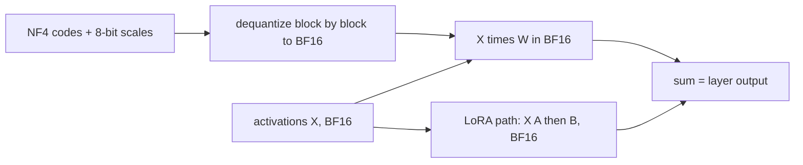

# QLoRA and Memory-Efficient Fine-Tuning

## Introduction

[LoRA](./1-llm-lora.mdx) removes the optimizer memory for the frozen weights, but the frozen weights themselves still sit on the GPU in 16-bit precision. For an 8B model that is about 16 GB; for a 32B model, 65 GB; for a 70B model, 140 GB. Those weights are only read, never updated, so do they need 16 bits?

QLoRA (Dettmers et al., 2023, "QLoRA: Efficient Finetuning of Quantized LLMs") answered no. It stores the frozen base model in 4 bits and trains LoRA adapters in 16 bits on top. The paper fine-tuned a 65B model on a single 48 GB GPU while matching 16-bit fine-tuning on its benchmarks, and its Guanaco model reached 99.3 percent of ChatGPT's score on the Vicuna benchmark after 24 hours of training on one GPU. It introduced three pieces:

1. **4-bit NormalFloat (NF4)**, a 4-bit data type built from the quantiles of a normal distribution,
2. **double quantization**, which quantizes the per-block scale constants too,
3. **paged optimizers**, which move optimizer state to CPU memory during memory spikes.

On this page you will build NF4 from scratch, measure its error against plain 4-bit integers, compute exactly how many bits per weight QLoRA uses, write a memory budget for Qwen3-8B and Qwen3-32B from their config.json files, and see the Hugging Face configuration that puts it all together. For quantization in general (scales, zero points, GPTQ, AWQ) see [Quantization Basics](../11-llm-quantization/0-llm-quantization-basics.mdx).

## Where Fine-Tuning Memory Goes

Start with a budget. For $N$ parameters trained with AdamW in BF16 mixed precision, full fine-tuning keeps:

| Item | Bytes per parameter |
|---|---|
| BF16 weights | 2 |
| BF16 gradients | 2 |
| FP32 master weights | 4 |
| Adam first moment $m$ (FP32) | 4 |
| Adam second moment $v$ (FP32) | 4 |
| Total | 16 |

Implementations differ (some keep gradients in FP32, some skip the master copy), but 16 bytes per parameter is the standard estimate (see [Mixed Precision](../6-llm-pretraining/4-llm-mixed-precision.mdx)). On top of that come **activations**, which depend on batch size and sequence length, not on how you store the weights.

With LoRA, only the $N_\text{LoRA}$ adapter parameters need gradients and optimizer states:

$$
M_\text{LoRA} \approx 2N + 16 N_\text{LoRA} + M_\text{act}
$$

With QLoRA the frozen weights shrink to about half a byte:

$$
M_\text{QLoRA} \approx \frac{b}{8} N_\text{quant} + 2 N_\text{other} + 16 N_\text{LoRA} + M_\text{act}
$$

where $b$ is the bits per quantized weight (including scale overhead, computed below), $N_\text{quant}$ are the linear-layer weights that get quantized, and $N_\text{other}$ are the parts left in 16 bits: embeddings, the output head and normalization weights. Since $N_\text{LoRA}$ is under 1 percent of $N$, the first term dominates, and cutting it by four is the whole game.

## NF4: Quantiles of a Normal Distribution

Pretrained weights are roughly normally distributed around zero. A uniform 4-bit grid (like the integers $-7, \dots, 7$ scaled into $[-1, 1]$) spends as many levels on the rare large values in the tails as on the crowded region near zero. A better grid puts levels where the weights actually are.

**Quantile quantization** does that: choose the 16 levels so that each one represents an equal share of the probability mass. For a standard normal distribution with cumulative distribution function $\Phi$, the level for share $p$ is the inverse CDF $\Phi^{-1}(p)$, also called the quantile function. Levels end up dense near zero and sparse in the tails.

NF4 adds two practical details:

- **An exact zero.** Many operations (padding, pruning, ReLU-like sparsity) want zero to be representable. With 16 levels you cannot have a symmetric set that includes zero, so NF4 is asymmetric: 7 negative levels, zero, and 8 positive levels.
- **Clipping the infinite tails.** $\Phi^{-1}(1) = \infty$, so the outermost quantile is taken at an offset $\delta$ slightly below 1. The bitsandbytes implementation uses $\delta = 0.9677083$, the average of $1 - \frac{1}{2 \cdot 15}$ and $1 - \frac{1}{2 \cdot 16}$.

The positive levels are $\Phi^{-1}(p)$ for 8 evenly spaced $p$ from $\delta$ down to (but excluding) $0.5$; the negative levels are $-\Phi^{-1}(p)$ for 7 evenly spaced $p$ in the same range; then everything is divided by the largest value so the grid spans exactly $[-1, 1]$.

**Blockwise absmax scaling.** A weight tensor is split into blocks of 64 consecutive values. Each block stores one scale, its absolute maximum $c = \max_i \lvert w_i \rvert$. To quantize, divide by $c$ (now every value is in $[-1, 1]$), then store the index of the nearest NF4 level as a 4-bit code. To dequantize, look up the level and multiply by $c$:

$$
q_i = \arg\min_{j \in \{0, \dots, 15\}} \left\lvert \frac{w_i}{c} - \ell_j \right\rvert,
\qquad
\hat w_i = c \, \ell_{q_i}
$$

Small blocks matter because a single outlier only spoils the scale of its own 64 neighbors, not the whole matrix.

The script builds the NF4 levels with SciPy's normal quantile function, then compares blockwise NF4 against a uniform 4-bit grid and the FP4 (E2M1) format that bitsandbytes also offers:

```python
import torch
from scipy.stats import norm

torch.manual_seed(0)

# 1. Build the 16 NF4 levels from normal quantiles (the QLoRA recipe).
offset = 0.9677083                       # (1 - 1/(2*15) + 1 - 1/(2*16)) / 2, see text
pos = norm.ppf(torch.linspace(offset, 0.5, 9)[:-1].numpy())   # 8 positive levels
neg = -norm.ppf(torch.linspace(offset, 0.5, 8)[:-1].numpy())  # 7 negative levels
levels = torch.tensor(sorted(list(pos) + [0.0] + list(neg)), dtype=torch.float32)
levels = levels / levels.max()           # normalize to [-1, 1]
print("NF4 levels:", [round(v, 4) for v in levels.tolist()])

def quantize_blockwise(w, codebook, block=64):
    """Absmax-scale each block of 64 values to [-1, 1], snap to nearest codebook level."""
    flat = w.reshape(-1, block)                          # (n_blocks, block)
    absmax = flat.abs().amax(dim=1, keepdim=True)        # (n_blocks, 1): one constant per block
    scaled = flat / absmax                               # in [-1, 1]
    idx = (scaled.unsqueeze(-1) - codebook).abs().argmin(dim=-1)   # (n_blocks, block) 4-bit codes
    return idx.to(torch.uint8), absmax

def dequantize_blockwise(idx, absmax, codebook, shape):
    return (codebook[idx.long()] * absmax).reshape(shape)

int4 = torch.arange(-7, 8, dtype=torch.float32) / 7      # 15 evenly spaced levels
fp4 = torch.tensor([0, 0.0625, 8, 12, 4, 6, 2, 3], dtype=torch.float32)
fp4 = torch.cat([fp4, -fp4]) / 12                        # bitsandbytes FP4 (E2M1) levels

W = torch.randn(4096, 4096) * 0.02                       # a weight matrix, roughly N(0, 0.02^2)
for name, cb in [("int4", int4), ("fp4", fp4), ("nf4", levels)]:
    idx, absmax = quantize_blockwise(W, cb)
    W_hat = dequantize_blockwise(idx, absmax, cb, W.shape)
    err = (W - W_hat).pow(2).mean().sqrt() / W.std()
    print(f"{name}: relative RMS error {err:.4f}")
```

```text
NF4 levels: [-1.0, -0.6962, -0.5251, -0.3949, -0.2844, -0.1848, -0.0911, 0.0, 0.0796, 0.1609, 0.2461, 0.3379, 0.4407, 0.5626, 0.723, 1.0]
int4: relative RMS error 0.1076
fp4: relative RMS error 0.1219
nf4: relative RMS error 0.0920
```

The 16 levels match the table hard-coded in bitsandbytes (`get_4bit_type("nf4")`) to four decimals. Notice the spacing: about 0.08 to 0.09 between levels near zero, and 0.28 between the last two. On normally distributed weights NF4's error is about 15 percent lower than the uniform grid and 25 percent lower than FP4. As a cross-check, bitsandbytes' own `quantize_4bit(..., quant_type="nf4")` and `dequantize_4bit` on a random $1024 \times 1024$ matrix of the same distribution give a relative error of 0.0920 as well.

:::note
The QLoRA paper calls NF4 "information-theoretically optimal" for normally distributed data, meaning each code is used equally often. Later work has questioned whether equal-mass bins minimize error for absmax-scaled blocks, and bitsandbytes ships an alternative `af4` table for that reason. NF4 remains the standard choice in practice.
:::

## Double Quantization: Bits Per Weight

Every block of 64 weights carries a scale. If the scale is stored in FP32, it costs $32 / 64 = 0.5$ extra bits per weight, so "4-bit" is really 4.5 bits. Double quantization quantizes the scales themselves: the FP32 absmax values are grouped into blocks of 256, each quantized to 8 bits, with one FP32 second-level constant per group of 256. Bits per weight become

$$
b = 4 + \frac{8}{64} + \frac{32}{64 \times 256} = 4 + 0.125 + 0.00195 = 4.127
$$

The saving is $0.5 - 0.127 = 0.373$ bits per weight. For a 65B model, $0.373 \times 65 \times 10^9 / 8 \approx 3.0$ GB, which is the figure the paper reports. In bitsandbytes this is `bnb_4bit_use_double_quant=True` (internally `compress_statistics=True`, with a second-level block size of 256).

The computation path during training is:



The weights are stored in 4 bits but the matrix multiplication runs in the compute dtype, BF16 (`bnb_4bit_compute_dtype=torch.bfloat16`). Dequantization happens one layer at a time, so only one layer's 16-bit weights exist at any moment. This is why QLoRA is slower per step than 16-bit LoRA: every forward and backward pass pays for dequantizing every weight. In return, gradients flow through the frozen quantized weights into the 16-bit LoRA parameters exactly as in ordinary LoRA.

## Paged Optimizers and Activation Memory

The third QLoRA piece handles spikes, not steady-state memory. With gradient checkpointing, memory use jumps when a long sequence comes through, and a single such batch can run out of memory hours into a run. Paged optimizers use NVIDIA unified memory: optimizer states live in pages that the driver can evict to CPU RAM when the GPU is full, and bring back when needed. Normally nothing moves; during a spike the optimizer step gets slower instead of crashing.

In the Hugging Face `Trainer` (and TRL, which builds on it) this is one argument, for example `optim="paged_adamw_8bit"` or `optim="paged_adamw_32bit"`. The 8-bit variants also store Adam's moments in 8 bits with blockwise quantization (Dettmers et al., 2021), cutting optimizer state from 8 to about 2 bytes per trainable parameter. With LoRA, optimizer state is small anyway, so paging matters more than the 8-bit format.

**Activations** are usually the second-largest item after the weights. With gradient checkpointing, the training loop keeps only each layer's input and recomputes the inside of a layer during backward. Two numbers are worth knowing for Qwen3-8B at sequence length 4096 and batch size 1:

- Checkpointed layer inputs: $L \cdot T \cdot d \cdot 2 = 36 \times 4096 \times 4096 \times 2 \approx 1.2$ GB in BF16.
- Output logits: $T \cdot V \cdot 4 = 4096 \times 151936 \times 4 \approx 2.5$ GB in FP32, and again for their gradient. With a 150K vocabulary the loss computation can need more memory than all checkpointed activations together.

Fused cross-entropy kernels that never materialize the full logit matrix fix the second item; TRL exposes one through `use_liger_kernel=True` in `SFTConfig` (requires the `liger-kernel` package). Gradient checkpointing is already on by default in TRL's `SFTConfig`.

## A Memory Budget for Real Models

Now combine everything. The script below reads the shapes from the Qwen3-8B and Qwen3-32B config.json files, counts the parameters that get quantized (the seven linear layers in each block), the parameters that stay in 16 bits (embeddings, output head, RMSNorm and QK-norm weights), and the LoRA parameters at $r = 16$ on all linear layers:

```python
def count(cfg, r=16):
    d, f, L, V = cfg["hidden_size"], cfg["intermediate_size"], cfg["num_hidden_layers"], cfg["vocab_size"]
    hq = cfg["num_attention_heads"] * cfg["head_dim"]       # query width
    hkv = cfg["num_key_value_heads"] * cfg["head_dim"]      # key/value width
    shapes = [(d, hq), (d, hkv), (d, hkv), (hq, d), (d, f), (d, f), (f, d)]  # (in, out)
    linear = L * sum(i * o for i, o in shapes)              # weights NF4 can quantize
    lora = L * sum(r * (i + o) for i, o in shapes)          # A is (r, in), B is (out, r)
    emb = V * d * (1 if cfg["tie_word_embeddings"] else 2)  # embeddings + lm_head stay 16-bit
    norms = L * 2 * d + d + L * 2 * cfg["head_dim"]         # RMSNorm and QK-norm weights
    return linear, emb + norms, lora

GB = 1e9
def budget(name, cfg, r=16):
    lin, other, lora = count(cfg, r)
    total = lin + other
    full = total * 16                                       # bf16 w + bf16 g + fp32 master + Adam m, v
    lora16 = total * 2 + lora * 16                          # frozen bf16 base + trainable adapter
    nf4_bits = 4 + 8 / 64 + 32 / (64 * 256)                 # code + 8-bit absmax + fp32 second level
    qlora = lin * nf4_bits / 8 + other * 2 + lora * 16
    print(f"{name}: {total / 1e9:.2f}B params, LoRA r={r}: {lora / 1e6:.1f}M trainable")
    print(f"  full fine-tune  {full / GB:7.1f} GB")
    print(f"  LoRA (bf16)     {lora16 / GB:7.1f} GB")
    print(f"  QLoRA (NF4+DQ)  {qlora / GB:7.1f} GB   ({nf4_bits:.3f} bits per quantized weight)")

qwen3_8b = dict(hidden_size=4096, intermediate_size=12288, num_hidden_layers=36, vocab_size=151936,
                num_attention_heads=32, num_key_value_heads=8, head_dim=128, tie_word_embeddings=False)
qwen3_32b = dict(hidden_size=5120, intermediate_size=25600, num_hidden_layers=64, vocab_size=151936,
                 num_attention_heads=64, num_key_value_heads=8, head_dim=128, tie_word_embeddings=False)
budget("Qwen3-8B", qwen3_8b)
budget("Qwen3-32B", qwen3_32b)
```

```text
Qwen3-8B: 8.19B params, LoRA r=16: 43.6M trainable
  full fine-tune    131.1 GB
  LoRA (bf16)        17.1 GB
  QLoRA (NF4+DQ)      6.8 GB   (4.127 bits per quantized weight)
Qwen3-32B: 32.76B params, LoRA r=16: 134.2M trainable
  full fine-tune    524.2 GB
  LoRA (bf16)        67.7 GB
  QLoRA (NF4+DQ)     21.4 GB   (4.127 bits per quantized weight)
```

The parameter totals match the model cards (8.2B and 32.8B). These numbers cover weights, gradients and optimizer states only. Add activations (a few GB at 4K context with checkpointing, more for longer sequences or larger batches) and the CUDA context and allocator overhead (often 1-2 GB). Summarized:

| Model | Full FT (16 B/param) | LoRA r=16, BF16 base | QLoRA r=16, NF4 base | Fits on |
|---|---|---|---|---|
| Qwen3-8B | 131 GB | 17 GB + activations | 7 GB + activations | QLoRA: one 16-24 GB GPU |
| Qwen3-32B | 524 GB | 68 GB + activations | 21 GB + activations | QLoRA: one 40-48 GB GPU |

Look at Qwen3-8B's QLoRA line more closely: 2.5 GB of its 6.8 GB is the untied 16-bit embedding and output matrices ($2 \times 151936 \times 4096$ parameters at 2 bytes each). With large vocabularies, the parts QLoRA does not quantize are more than a third of the budget.

## Putting It Together in Hugging Face

The configuration below loads a model in 4-bit NF4 with double quantization and BF16 compute, then trains LoRA adapters on every linear layer. It needs an NVIDIA GPU with BF16 support (Ampere or newer) and the `bitsandbytes` package; it does not run on CPU.

```bash
pip install "transformers>=5" peft trl bitsandbytes accelerate datasets
```

```python
import torch
from transformers import AutoModelForCausalLM, AutoTokenizer, BitsAndBytesConfig
from peft import LoraConfig, get_peft_model, prepare_model_for_kbit_training

model_id = "Qwen/Qwen3-8B"
bnb_config = BitsAndBytesConfig(
    load_in_4bit=True,
    bnb_4bit_quant_type="nf4",            # default is "fp4"; NF4 is the QLoRA type
    bnb_4bit_use_double_quant=True,       # quantize the absmax constants: 4.127 bits per weight
    bnb_4bit_compute_dtype=torch.bfloat16 # dequantize to BF16 for the matmuls
)
model = AutoModelForCausalLM.from_pretrained(model_id, quantization_config=bnb_config,
                                             device_map="auto", dtype=torch.bfloat16)
tokenizer = AutoTokenizer.from_pretrained(model_id)

# Casts every non-4-bit parameter (norms, embeddings, lm_head) to FP32,
# enables gradient checkpointing and makes the inputs require gradients.
model = prepare_model_for_kbit_training(model)

lora = LoraConfig(r=16, lora_alpha=32, lora_dropout=0.05,
                  target_modules="all-linear", task_type="CAUSAL_LM")
model = get_peft_model(model, lora)
model.print_trainable_parameters()
```

That FP32 cast is for numerical stability, but it is not free: for Qwen3-8B it turns the 2.5 GB of BF16 embedding and output matrices into 5 GB. With TRL you can skip the manual steps: `SFTTrainer` accepts a model ID string together with `quantization_config=bnb_config` and `peft_config=lora`, loads the model quantized, wraps it with the adapter, and casts the trainable adapter weights to BF16 as the QLoRA paper recommends; it does not call `prepare_model_for_kbit_training`, so the other weights stay in BF16 (checked in the TRL 1.16 source). The [next page](./3-llm-fine-tuning-with-hf.mdx) shows a full training run.

:::warning
Do not call `merge_and_unload()` on a 4-bit model and ship the result as if nothing changed. Merging into quantized weights means dequantize, add $sBA$, and re-quantize, which adds new rounding error. The clean path is to reload the base model in BF16, attach the trained adapter, merge there, and quantize the merged model afterwards if you need a small deployment format.
:::

A related subtlety: the adapter was trained to correct the NF4 version of the base model, quantization errors included. Merging it into the BF16 base gives a model that is slightly different from the one you evaluated during training. The difference is usually small, but evaluate the merged model, not just the training-time model. LoftQ initialization (`init_lora_weights="loftq"` in PEFT) was designed to reduce this gap.

## Measured: LoRA Versus QLoRA on One GPU

To see the trade-off in real numbers, we trained the same adapter twice on the ticket task from [the next page](./3-llm-fine-tuning-with-hf.mdx), once on a BF16 base and once on an NF4 base, with SmolLM2-360M-Instruct so that both runs fit easily. This script needs a CUDA GPU and `bitsandbytes`; the numbers below were measured on an RTX 4060 Ti (8 GB) shared with other jobs, so treat the timings as rough. Run it as `python gpu_qlora.py lora` and `python gpu_qlora.py qlora`; the output below combines both runs with the progress bars and per-step logs removed.

```python
import json, random, sys, time
import torch
from datasets import Dataset
from transformers import BitsAndBytesConfig
from peft import LoraConfig
from trl import SFTConfig, SFTTrainer

mode = sys.argv[1]                         # "lora" or "qlora"
MODEL_ID = "HuggingFaceTB/SmolLM2-360M-Instruct"
random.seed(0); torch.manual_seed(0)
products = ["router", "laptop", "headphones", "printer", "phone", "monitor"]
problems = {"negative": ["stopped working after two days", "keeps disconnecting", "arrived with a cracked screen",
                         "is far too loud and buzzes"],
            "positive": ["works perfectly, thank you", "was easy to set up", "exceeded my expectations",
                         "is the best purchase I made this year"]}
def make_example():
    product = random.choice(products); sentiment = random.choice(["negative", "positive"])
    order = random.randint(10000, 99999)
    text = f"Order {order}: my {product} {random.choice(problems[sentiment])}."
    answer = json.dumps({"order_id": order, "product": product, "sentiment": sentiment})
    return {"prompt": [{"role": "user", "content": f"Extract the ticket fields as JSON.\n{text}"}],
            "completion": [{"role": "assistant", "content": answer}]}
rows = [make_example() for _ in range(240)]

bnb = BitsAndBytesConfig(load_in_4bit=True, bnb_4bit_quant_type="nf4", bnb_4bit_use_double_quant=True,
                         bnb_4bit_compute_dtype=torch.bfloat16) if mode == "qlora" else None
args = SFTConfig(output_dir=f"smol360-{mode}", num_train_epochs=2, per_device_train_batch_size=8,
                 learning_rate=2e-4, lr_scheduler_type="cosine", warmup_steps=0.1, max_length=256,
                 logging_steps=25, save_strategy="no", report_to="none", seed=0,
                 optim="paged_adamw_8bit" if mode == "qlora" else "adamw_torch_fused",
                 model_init_kwargs={"dtype": torch.bfloat16})
trainer = SFTTrainer(model=MODEL_ID, args=args, train_dataset=Dataset.from_list(rows[:200]),
                     eval_dataset=Dataset.from_list(rows[200:]), quantization_config=bnb,
                     peft_config=LoraConfig(r=16, lora_alpha=32, lora_dropout=0.05,
                                            target_modules="all-linear", task_type="CAUSAL_LM"))
trainer.model.print_trainable_parameters()
print("weights on GPU after load:", round(torch.cuda.memory_allocated() / 2**20), "MiB")
print("adapter dtype:", next(p.dtype for n, p in trainer.model.named_parameters() if "lora_A" in n))
torch.cuda.reset_peak_memory_stats()
t0 = time.time()
trainer.train()
print(f"train time {time.time() - t0:.1f} s, peak memory {torch.cuda.max_memory_allocated() / 2**20:.0f} MiB")
print("eval_loss", round(trainer.evaluate()["eval_loss"], 5))
```

```text
lora:   trainable params: 8,683,520 || all params: 370,504,640 || trainable%: 2.3437
        weights on GPU after load: 723 MiB
        adapter dtype: torch.float32
        train time 25.0 s, peak memory 912 MiB
        eval_loss 0.00145
qlora:  trainable params: 8,683,520 || all params: 370,504,640 || trainable%: 2.3437
        weights on GPU after load: 262 MiB
        adapter dtype: torch.bfloat16
        train time 77.7 s, peak memory 386 MiB
        eval_loss 0.00203
```

Four observations:

- **Weights shrank 2.8 times**, not 4. The 723 MiB BF16 model became 262 MiB, because the tied 49,152-row embedding matrix (about 90 MiB in BF16) and the norms are not quantized, and every quantized weight carries its scale overhead. This is the same effect the budget table showed for Qwen3-8B's untied embeddings.
- **Peak training memory fell from 912 to 386 MiB.** At this tiny scale activations and the CUDA workspace are a large share; for an 8B model the weights dominate and the saving approaches the 17 GB versus 7 GB of the table above.
- **Each step was about three times slower** with NF4, which is the dequantization cost described earlier. The 8-bit paged optimizer contributes little here because the adapter is small.
- **Quality was the same for this task**: both reached an eval loss near 0.002 after two epochs. Note the adapter dtypes: with a BF16 base, PEFT keeps the adapter weights in FP32 by default; with a quantized base, TRL casts them to BF16, following the QLoRA paper.

## QLoRA Versus the Alternatives

| Approach | Base weights | Speed per step | Quality vs 16-bit LoRA | When to use |
|---|---|---|---|---|
| LoRA, BF16 base | 16-bit | Fastest | Reference | The model fits in memory |
| QLoRA, NF4 base | 4.127-bit | Slower: dequantization every pass | Matched 16-bit in the paper's experiments | The model does not fit otherwise |
| 8-bit base + LoRA | 8-bit (LLM.int8) | Slower than BF16 | Close | Rarely used since QLoRA |
| Full fine-tuning + FSDP / ZeRO | Sharded 16-bit | Fast, many GPUs | Best capacity | Large datasets, multi-GPU budget |

The general rule: use plain LoRA if it fits, QLoRA when it does not. Memory you save with QLoRA can also be spent on a longer context or a larger batch, which sometimes matters more than the model size. For sharding and multi-GPU training, see [Distributed Training](../6-llm-pretraining/5-llm-distributed-training.mdx).

## Common Mistakes

- **Leaving `bnb_4bit_quant_type` at its default.** The default in `BitsAndBytesConfig` is `"fp4"`. QLoRA uses `"nf4"`, which had lower error in the experiment above.
- **Forgetting the compute dtype.** Without `bnb_4bit_compute_dtype=torch.bfloat16` the matmuls may run in FP32 (slow) or the wrong half-precision type.
- **Budgeting only for weights.** Logits for a 150K vocabulary at long context, activations and allocator overhead can add several GB; measure with `torch.cuda.max_memory_allocated()` on a real batch.
- **Merging into the 4-bit model.** Merge into a BF16 copy of the base and evaluate the merged result.
- **Using QLoRA when the model fits in BF16.** You pay the dequantization slowdown for nothing.
- **Comparing step speed without counting tokens.** Packing and padding change tokens per step more than QLoRA changes the time per token.

## Summary

- QLoRA stores frozen weights in 4-bit NF4 and trains 16-bit LoRA adapters on top; gradients pass through the dequantized weights into the adapters.
- NF4's 16 levels are normal-distribution quantiles with an exact zero; with blockwise absmax scaling (blocks of 64) its error on normal weights is lower than uniform INT4 or FP4.
- Double quantization stores block scales in 8 bits with second-level FP32 constants per 256 blocks: 4.127 bits per weight instead of 4.5.
- Paged optimizers move optimizer pages to CPU RAM during memory spikes instead of crashing.
- Budget: full fine-tuning about 16 bytes per parameter, LoRA about 2, QLoRA about 0.52 for quantized layers, plus activations; Qwen3-8B QLoRA needs about 7 GB before activations.

## Further Reading

- [QLoRA: Efficient Finetuning of Quantized LLMs (Dettmers et al., 2023)](https://arxiv.org/abs/2305.14314) - NF4, double quantization, paged optimizers, Guanaco.
- [8-bit Optimizers via Block-wise Quantization (Dettmers et al., 2021)](https://arxiv.org/abs/2110.02861) - blockwise quantization of optimizer states.
- [LoftQ: LoRA-Fine-Tuning-Aware Quantization (Li et al., 2023)](https://arxiv.org/abs/2310.08659) - initializing adapters to offset quantization error.
- [bitsandbytes documentation](https://huggingface.co/docs/bitsandbytes) - 4-bit and 8-bit kernels and optimizers.
- [Transformers bitsandbytes quantization guide](https://huggingface.co/docs/transformers/quantization/bitsandbytes) - every `BitsAndBytesConfig` option.
- [PEFT quantization guide](https://huggingface.co/docs/peft/developer_guides/quantization) - `prepare_model_for_kbit_training` and LoftQ.
- [Qwen3-8B model card and config](https://huggingface.co/Qwen/Qwen3-8B) - the shapes used in the budget above.
