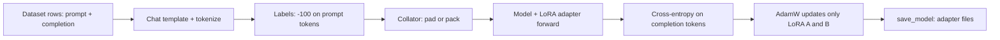

# Fine-Tuning with Hugging Face Transformers, PEFT and TRL

## Introduction

The previous pages explained [LoRA](./1-llm-lora.mdx) and [QLoRA](./2-llm-qlora.mdx) on paper. This page runs a real fine-tune from start to finish: build a dataset, configure TRL's `SFTTrainer` with a PEFT LoRA adapter, train, read the logs, load the adapter for inference, merge it, and then scale the same script to a bigger model on a GPU.

The example is small on purpose. It fine-tunes SmolLM2-135M-Instruct (135 million parameters) on a toy ticket-extraction task, so it runs on a laptop CPU. Every line carries over unchanged to an 8B model on a GPU; only the model name, precision and batch settings change.

You will be able to:

- choose the right dataset format and know which tokens TRL puts into the loss,
- set the `SFTConfig` options that matter, with their real defaults,
- interpret `loss`, `entropy`, `mean_token_accuracy` and `eval_loss` during training,
- save, reload and merge an adapter, and move the setup to QLoRA on a GPU.

All code on this page was run with torch 2.14 (CPU), transformers 5.21, peft 0.21.2, trl 1.16.0 and datasets 5.1.0 in October 2026. TRL moves fast; if an argument name fails, check the [SFTTrainer docs](https://huggingface.co/docs/trl/sft_trainer) for your version.

## The Stack

Four libraries split the work:

| Library | Role in fine-tuning |
|---|---|
| `transformers` | Model and tokenizer classes, `from_pretrained`, chat templates, the base `Trainer` |
| `peft` | `LoraConfig`, `get_peft_model`, adapter saving, loading and merging |
| `trl` | `SFTTrainer` and `SFTConfig`: dataset formatting, tokenization, label masking, packing; also DPO, GRPO and other post-training trainers |
| `datasets` | Loading, mapping and splitting data as Arrow tables |

`SFTTrainer` is a subclass of the Transformers `Trainer`, and `SFTConfig` is a subclass of `TrainingArguments`. Everything you know about `Trainer` (gradient accumulation, schedulers, checkpoints, `accelerate launch`) still applies.



## Dataset Formats and What Gets Trained

TRL recognizes the format from the column names. The format decides how text is built and which tokens contribute to the loss:

| Format | Columns | Example row | Loss on, by default |
|---|---|---|---|
| Language modeling | `text` | `{"text": "The sky is blue."}` | All tokens |
| Prompt-completion | `prompt`, `completion` | `{"prompt": "The sky is", "completion": " blue."}` | Completion only |
| Conversational | `messages` | `{"messages": [{"role": "user", ...}, {"role": "assistant", ...}]}` | All tokens, unless `assistant_only_loss=True` |
| Conversational prompt-completion | `prompt`, `completion` as message lists | see the script below | Completion only |

Two flags control the masking:

- `completion_only_loss` (default `None`): for prompt-completion data it behaves as `True`, so prompt tokens get the label `-100` and do not contribute to the loss. For language-modeling data it behaves as `False`.
- `assistant_only_loss` (default `False`): for `messages` data, trains only on assistant turns. It needs a chat template that marks assistant text with the `generation` keyword so the tokenizer can return an assistant mask. TRL patches templates for some known model families; for others you must provide such a template. SmolLM2-135M-Instruct's template, for example, is rejected with a `ValueError` saying it is missing `` markers (checked with TRL 1.16).

Why mask the prompt? The model should learn to produce answers, not to predict the user's question. Training on prompt tokens spends capacity on modeling inputs you will never generate, and with long prompts and short answers it can dominate the loss. [Supervised Fine-Tuning and Chat Templates](../8-llm-post-training/1-llm-supervised-fine-tuning.mdx) derives this masked loss. The conversational prompt-completion format gives you completion-only loss with any chat template, which is why the example uses it.

## The Complete Training Script

The task: read a short support message and return JSON with three fields. The data is generated in code so the script is self-contained; [Preparing Fine-Tuning Data](./4-llm-fine-tuning-data.mdx) covers real data.

```bash
pip install torch transformers peft trl datasets accelerate
```

```python
import json, random
import torch
from datasets import Dataset
from transformers import AutoModelForCausalLM, AutoTokenizer
from peft import LoraConfig
from trl import SFTConfig, SFTTrainer

random.seed(0)
torch.manual_seed(0)
MODEL_ID = "HuggingFaceTB/SmolLM2-135M-Instruct"

# 1. A tiny synthetic task: turn a support message into a fixed JSON schema.
products = ["router", "laptop", "headphones", "printer", "phone", "monitor"]
problems = {
    "negative": ["stopped working after two days", "keeps disconnecting", "arrived with a cracked screen",
                 "is far too loud and buzzes"],
    "positive": ["works perfectly, thank you", "was easy to set up", "exceeded my expectations",
                 "is the best purchase I made this year"],
}
def make_example():
    product = random.choice(products)
    sentiment = random.choice(["negative", "positive"])
    order = random.randint(10000, 99999)
    text = f"Order {order}: my {product} {random.choice(problems[sentiment])}."
    answer = json.dumps({"order_id": order, "product": product, "sentiment": sentiment})
    return {
        "prompt": [{"role": "user", "content": f"Extract the ticket fields as JSON.\n{text}"}],
        "completion": [{"role": "assistant", "content": answer}],
    }
rows = [make_example() for _ in range(240)]
train_ds = Dataset.from_list(rows[:200])
eval_ds = Dataset.from_list(rows[200:])
print(train_ds)

# 2. Model and tokenizer (fp32 on CPU; use dtype=torch.bfloat16 on a GPU).
tokenizer = AutoTokenizer.from_pretrained(MODEL_ID)
model = AutoModelForCausalLM.from_pretrained(MODEL_ID, dtype=torch.float32)

# 3. LoRA on every linear layer of the decoder blocks.
peft_config = LoraConfig(
    r=16, lora_alpha=32, lora_dropout=0.05,
    target_modules="all-linear", task_type="CAUSAL_LM",
)

# 4. Training arguments. completion_only_loss defaults to True for prompt-completion data.
args = SFTConfig(
    output_dir="smol-ticket-lora",
    num_train_epochs=2,
    per_device_train_batch_size=8,
    gradient_accumulation_steps=1,
    learning_rate=2e-4,
    lr_scheduler_type="cosine",
    warmup_steps=0.1,                 # a float below 1 is a ratio of total steps
    max_length=256,
    logging_steps=10,
    eval_strategy="epoch",
    save_strategy="no",
    bf16=False,                       # CPU demo; leave the default on a bf16-capable GPU
    gradient_checkpointing=False,     # on by default in TRL; off here for speed on CPU
    report_to="none",
    seed=0,
)

trainer = SFTTrainer(
    model=model,
    args=args,
    train_dataset=train_ds,
    eval_dataset=eval_ds,
    processing_class=tokenizer,
    peft_config=peft_config,
)
trainer.model.print_trainable_parameters()
trainer.train()
trainer.save_model("smol-ticket-lora")   # saves only the adapter (a few MB)
```

The output, with progress bars removed:

```text
Dataset({
    features: ['prompt', 'completion'],
    num_rows: 200
})
trainable params: 4,884,480 || all params: 139,399,488 || trainable%: 3.5039
{'loss': '0.8438', 'grad_norm': '0.8182', 'learning_rate': '0.0001961', 'entropy': '1.068', 'mean_token_accuracy': '0.7827', 'num_tokens': '6539', 'epoch': '0.4'}
{'loss': '0.09399', 'grad_norm': '0.15', 'learning_rate': '0.0001559', 'entropy': '0.2473', 'mean_token_accuracy': '0.985', 'num_tokens': '1.303e+04', 'epoch': '0.8'}
{'eval_loss': '0.005081', 'eval_runtime': '13.16', 'eval_samples_per_second': '3.04', 'eval_steps_per_second': '0.38', 'eval_entropy': '0.03149', 'eval_mean_token_accuracy': '1', 'eval_num_tokens': '1.631e+04', 'epoch': '1'}
{'loss': '0.005278', 'grad_norm': '0.01851', 'learning_rate': '8.955e-05', 'entropy': '0.03169', 'mean_token_accuracy': '1', 'num_tokens': '1.957e+04', 'epoch': '1.2'}
{'loss': '0.003108', 'grad_norm': '0.02451', 'learning_rate': '2.807e-05', 'entropy': '0.01981', 'mean_token_accuracy': '1', 'num_tokens': '2.609e+04', 'epoch': '1.6'}
{'loss': '0.002632', 'grad_norm': '0.02003', 'learning_rate': '2.436e-07', 'entropy': '0.017', 'mean_token_accuracy': '1', 'num_tokens': '3.263e+04', 'epoch': '2'}
{'eval_loss': '0.002784', 'eval_runtime': '26.82', 'eval_samples_per_second': '1.491', 'eval_steps_per_second': '0.186', 'eval_entropy': '0.01879', 'eval_mean_token_accuracy': '1', 'eval_num_tokens': '3.263e+04', 'epoch': '2'}
{'train_runtime': '549.4', 'train_samples_per_second': '0.728', 'train_steps_per_second': '0.091', 'train_loss': '0.1898', 'epoch': '2'}
```

The run took about nine minutes on four CPU threads of a busy shared machine; a laptop is similar, and any GPU does it in under a minute. The saved adapter is 19.6 MB (4.9M parameters in FP32), against 540 MB for the full FP32 model.

### What the Trainer Did Before Step 1

`SFTTrainer` prints four preprocessing passes (visible as progress bars): **tokenizing** (apply the chat template to `prompt + completion` and tokenize), **building labels** (copy `input_ids` to `labels` and set prompt positions to `-100` using a completion mask), **truncating** to `max_length`, and **dropping fully masked examples** (rows where truncation removed every completion token, which would contribute nothing). You can inspect the result with `trainer.train_dataset[0]`.

### Checking the Trainable Parameter Count

SmolLM2-135M's config.json has `hidden_size` 576, `intermediate_size` 1536, 30 layers, 9 query heads and 3 key-value heads of size 64 (so `k_proj` and `v_proj` map 576 to 192). With $r = 16$ on all seven linear layers, the per-layer LoRA count is

$$
16 \times \big[(576{+}576) + 2(576{+}192) + (576{+}576) + 3(576{+}1536)\big] = 16 \times 10176 = 162{,}816
$$

and $30 \times 162{,}816 = 4{,}884{,}480$, exactly the number printed. The output head is not adapted: `"all-linear"` excludes it, and in SmolLM2 it is tied to the input embedding anyway. Always do this check once for a new model; it catches `target_modules` that silently matched nothing or matched too much.

## Reading the Training Logs

Each log line averages over the last `logging_steps` optimizer steps:

- **`loss`**: mean cross-entropy per completion token. It started near 0.84 and dropped below 0.01, which means the model now assigns probability close to $e^{-0.003} \approx 0.997$ to each correct token. On a real task, a training loss this low usually means memorization; here the task is fully regular, so it is expected.
- **`eval_loss`**: the same quantity on the 40 held-out rows. The number to watch for overfitting: if training loss keeps falling while `eval_loss` rises, stop or reduce epochs.
- **`mean_token_accuracy`**: the fraction of completion tokens where the model's top prediction is the correct token. Easier to interpret than loss; a value of 1 means teacher-forced predictions are all right, which is not the same as free generation being right.
- **`entropy`**: the average entropy of the model's predicted distribution on completion tokens, in nats. Falling entropy means growing confidence. A collapse to near zero on a creative task is a warning sign of lost diversity.
- **`num_tokens`**: cumulative tokens processed (including prompt tokens). Useful for comparing runs with different batch sizes or packing.
- **`grad_norm`**: the global gradient norm before clipping (`max_grad_norm` defaults to 1.0). Spikes point to bad examples or a too-high learning rate.
- **`learning_rate`**: follows the cosine schedule from a 10 percent warmup down to almost zero at the end.

A useful sanity check is the loss at step 0. Before any training, the masked loss should be the base model's cross-entropy on your answers. A starting loss far above about 5 often means labels and inputs are misaligned or the chat template is wrong.

## Loading, Testing and Merging the Adapter

The adapter directory holds `adapter_config.json` (the `LoraConfig` plus the base model name) and `adapter_model.safetensors`. To use it, load the base model and attach the adapter:

```python
import torch
from transformers import AutoModelForCausalLM, AutoTokenizer
from peft import PeftModel

torch.manual_seed(0)
MODEL_ID = "HuggingFaceTB/SmolLM2-135M-Instruct"
tokenizer = AutoTokenizer.from_pretrained(MODEL_ID)
base = AutoModelForCausalLM.from_pretrained(MODEL_ID, dtype=torch.float32)

def ask(model, text):
    messages = [{"role": "user", "content": f"Extract the ticket fields as JSON.\n{text}"}]
    inputs = tokenizer.apply_chat_template(messages, add_generation_prompt=True,
                                           return_tensors="pt", return_dict=True)
    out = model.generate(**inputs, max_new_tokens=40, do_sample=False)
    return tokenizer.decode(out[0, inputs["input_ids"].shape[1]:], skip_special_tokens=True)

ticket = "Order 31337: my tablet keeps disconnecting."   # "tablet" never appeared in training
print("base   :", ask(base, ticket))

model = PeftModel.from_pretrained(base, "smol-ticket-lora")   # attach the adapter
print("adapter:", ask(model, ticket))

merged = model.merge_and_unload()             # fold B A into W, drop the LoRA modules
print("merged :", ask(merged, ticket))
merged.save_pretrained("smol-ticket-merged")
tokenizer.save_pretrained("smol-ticket-merged")
```

```text
base   : {
  "order_number": "1234567890",
  "order_date": "2023-01-01",
  "order
adapter: {"order_id": 31337, "product": "tablet", "sentiment": "negative"}
merged : {"order_id": 31337, "product": "tablet", "sentiment": "negative"}
```

The base model knows it should produce JSON but invents its own schema and values. After 50 steps the adapter produces exactly the trained schema, copies the order number, and generalizes to a product ("tablet") that was not in the training data. The merged model gives the same answer, as it must (see the merge check in [LoRA Explained](./1-llm-lora.mdx)).

The generation call matters as much as the training. `add_generation_prompt=True` appends the assistant header (`<|im_start|>assistant` for this template), exactly as during training, where the prompt part of the conversational prompt-completion format was rendered the same way. Leaving it out is a classic cause of "the fine-tune does nothing at inference".

Note also that `apply_chat_template` in transformers v5 returns a dictionary-like `BatchEncoding` with `input_ids` and `attention_mask` (`return_dict=True` is the default), so pass it with `**inputs`.

**Merged or not?** Keep the adapter separate when you want to serve several fine-tunes of one base model, or to switch it off for an A/B comparison (`with model.disable_adapter():` runs the base model). Merge when you deploy a single fine-tune and want base-model speed, or when your serving engine does not support adapters. For a QLoRA run, merge into a BF16 copy of the base, as explained on the [QLoRA page](./2-llm-qlora.mdx).

## Scaling Up: QLoRA on a GPU

The same script, adapted for an 8B model with QLoRA on one 24 GB GPU. This needs an NVIDIA GPU with BF16 support and `bitsandbytes`; it does not run on CPU.

```python
import torch
from datasets import load_dataset
from transformers import BitsAndBytesConfig
from peft import LoraConfig
from trl import SFTConfig, SFTTrainer

dataset = load_dataset("trl-lib/Capybara", split="train")   # conversational "messages" data

bnb_config = BitsAndBytesConfig(load_in_4bit=True, bnb_4bit_quant_type="nf4",
                                bnb_4bit_use_double_quant=True,
                                bnb_4bit_compute_dtype=torch.bfloat16)
peft_config = LoraConfig(r=16, lora_alpha=32, lora_dropout=0.05,
                         target_modules="all-linear", task_type="CAUSAL_LM")
args = SFTConfig(
    output_dir="qwen3-8b-capybara-qlora",
    model_init_kwargs={"dtype": torch.bfloat16, "device_map": "auto"},
    max_length=2048,
    per_device_train_batch_size=2,
    gradient_accumulation_steps=8,     # effective batch 16 sequences
    learning_rate=1e-4,
    lr_scheduler_type="cosine",
    warmup_steps=0.03,
    num_train_epochs=1,
    optim="paged_adamw_8bit",
    logging_steps=10,
    save_steps=500,
    # bf16 and gradient_checkpointing are already on by default in SFTConfig
)
trainer = SFTTrainer(
    model="Qwen/Qwen3-8B",             # a string: TRL loads it with quantization_config
    args=args,
    train_dataset=dataset,
    quantization_config=bnb_config,
    peft_config=peft_config,
)
trainer.train()
trainer.save_model()
```

What changed, and why:

- **`model` as a string** with `quantization_config`: `SFTTrainer` loads the model in 4 bits itself and casts the LoRA weights to BF16. The `quantization_config` argument is ignored if you pass an already loaded model.
- **`model_init_kwargs`** carries `from_pretrained` options such as the dtype and device map. Note `dtype`, the transformers v5 name; `torch_dtype` is the older name.
- **Effective batch size** = `per_device_train_batch_size` times `gradient_accumulation_steps` times the number of GPUs. Increase accumulation, not the per-device batch, when memory is tight.
- **`max_length`** defaults to 1024 in `SFTConfig`; sequences longer than it are truncated (keeping the start). Set it from your data's length distribution so you neither cut answers nor waste memory.
- **`optim="paged_adamw_8bit"`** adds QLoRA's paged optimizer.
- **Messages data**: Capybara has a `messages` column, so by default the loss covers all tokens; set `assistant_only_loss=True` if the model's chat template supports it.

**Packing.** With many short examples, padding wastes compute. `packing=True` concatenates examples into rows of `max_length` tokens. The default strategy, `"bfd"` (best-fit decreasing), places whole examples into bins and turns on padding-free mode, where examples in a row are separated through `position_ids` instead of padding. This requires a FlashAttention implementation, for example `model_init_kwargs={"attn_implementation": "flash_attention_2", ...}`, so that attention does not leak across example boundaries; see [Using FlashAttention](../5-llm-flash-attention/4-llm-using-flash-attention.mdx) and [document masking](../6-llm-pretraining/1-llm-training-objective.mdx).

**Multiple GPUs.** Save the script as `train.py` and run it with Accelerate; add an FSDP or DeepSpeed config for models that do not fit on one GPU even with QLoRA (see [Distributed Training](../6-llm-pretraining/5-llm-distributed-training.mdx)):

```bash
accelerate launch --num_processes 4 train.py
```

**The CLI.** For standard setups TRL ships a command-line entry point with the same options:

```bash
trl sft --model_name_or_path Qwen/Qwen3-8B --dataset_name trl-lib/Capybara \
    --use_peft --lora_r 16 --lora_alpha 32 --lora_target_modules all-linear \
    --load_in_4bit --bnb_4bit_quant_type nf4 --use_bnb_nested_quant \
    --learning_rate 1e-4 --max_length 2048 --output_dir qwen3-8b-capybara-qlora
```

## Hyperparameter Starting Points

There is no universal recipe, but these defaults are a reasonable first run for LoRA SFT on 1K-100K examples. Sweep the learning rate first; it matters most.

| Setting | Starting value | Notes |
|---|---|---|
| `learning_rate` | 1e-4 to 2e-4 | About 10x full fine-tuning (LoRA Without Regret, 2025); TRL's default 2e-5 is meant for full fine-tuning |
| `r`, `lora_alpha` | 16, 32 | Larger rank for bigger datasets; keep $\alpha / r$ fixed when sweeping |
| `target_modules` | `"all-linear"` | MLP layers matter most |
| `lora_dropout` | 0.0 to 0.1 | Helps small datasets a little |
| Epochs | 1 to 3 | More epochs on small data overfit quickly |
| Effective batch | 16 to 64 sequences | LoRA is less tolerant of very large batches than full fine-tuning |
| Scheduler | cosine or linear, 3-10 percent warmup | `warmup_steps` as a float is a ratio |
| `max_length` | 95th-99th percentile of your data | Check how many examples get truncated |

## Common Mistakes

- **Keeping TRL's default learning rate for LoRA.** `SFTConfig` defaults to 2e-5, suited to full fine-tuning; LoRA usually needs about ten times more.
- **Training on the prompt by accident.** A `text` or `messages` dataset trains on every token unless you use prompt-completion data or `assistant_only_loss=True`. Inspect `trainer.train_dataset[0]` and the labels.
- **Generating without `add_generation_prompt=True`** or with a different chat template than training used. The model then sees an input it was never trained on.
- **Silent truncation.** Long examples are cut at `max_length` (default 1024). If the answer is at the end, it is lost, and the trainer drops rows where nothing trainable remains.
- **Not checking the trainable parameter count.** A typo in `target_modules` can mean an adapter on the wrong layers, or none at all.
- **Passing `quantization_config` with a loaded model.** It only applies when `model` is a string; with an instance it is ignored with a warning.
- **Packing without FlashAttention.** Padding-free packing relies on `position_ids` handled by FlashAttention; with other attention implementations examples can attend to each other.

## Summary

- `SFTTrainer` plus a `LoraConfig` is a complete LoRA fine-tuning pipeline: chat-template formatting, tokenization, label masking, truncation, padding or packing, training and saving.
- Prompt-completion data gives completion-only loss by default; `messages` data trains on everything unless `assistant_only_loss=True` and the template supports it.
- Check the trainable count by hand from config.json; for SmolLM2-135M at $r = 16$ it is 4,884,480.
- Watch `eval_loss` for overfitting and `mean_token_accuracy` and `entropy` for confidence; validate with real generations.
- To scale up, pass the model ID with `quantization_config` for QLoRA, raise gradient accumulation, set `max_length` from data, and launch with Accelerate for multiple GPUs.

## Further Reading

- [TRL SFTTrainer documentation](https://huggingface.co/docs/trl/sft_trainer) - dataset formats, `SFTConfig`, packing and PEFT integration.
- [TRL dataset formats](https://huggingface.co/docs/trl/dataset_formats) - language modeling, prompt-completion and conversational types.
- [PEFT documentation](https://huggingface.co/docs/peft) - `LoraConfig`, saving, loading, merging and multi-adapter use.
- [Transformers Trainer documentation](https://huggingface.co/docs/transformers/main_classes/trainer) - the arguments `SFTConfig` inherits.
- [Transformers chat templating guide](https://huggingface.co/docs/transformers/chat_templating) - `apply_chat_template` and generation prompts.
- [LoRA Without Regret (Thinking Machines, 2025)](https://thinkingmachines.ai/blog/lora/) - learning rate and batch-size evidence for LoRA.
- [Project: LoRA Fine-Tune an Open Model](../14-llm-projects/3-llm-project-lora-fine-tune.mdx) - a longer hands-on project built on this page.
