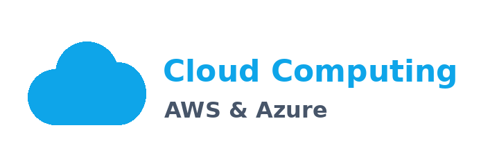
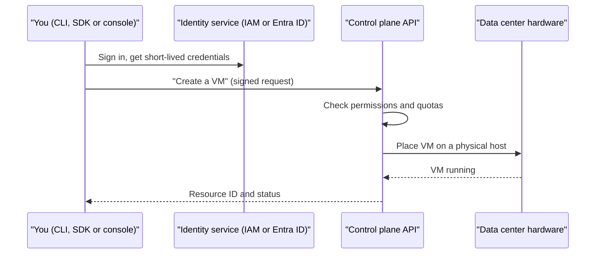
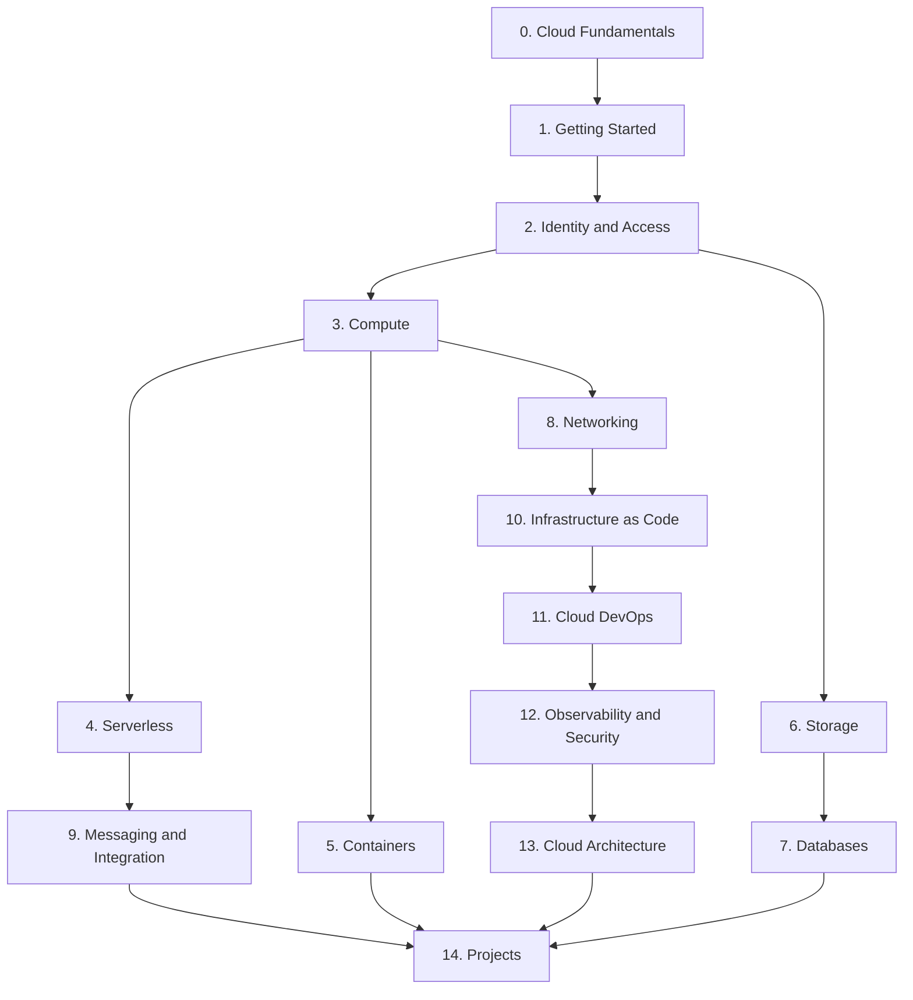
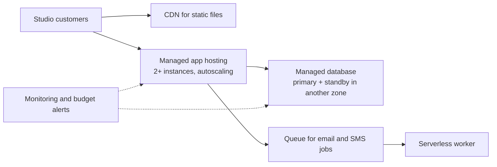

# Cloud Computing Introduction

<div style={{
    "width": "30%",
    "margin": "0 auto",
    "text-align": "center"
}}>
    
</div>

## Introduction

**Cloud computing** means renting computing resources, such as servers, storage, databases, networks and ready-made services, from a provider over the internet, and paying for what you use. Instead of buying a server, waiting weeks for it to arrive, and installing it in a closet, you run one command and get a server in about a minute. When you no longer need it, you delete it and stop paying.

This tutorial teaches cloud computing on the two platforms that readers asked for most: **Amazon Web Services (AWS)** and **Microsoft Azure**. Every page teaches a concept once, then shows how it works on both clouds side by side, with CLI commands, code and a mapping table. You will learn *how* to build things, and you will also learn *why* and *when* to choose one service over another.

Think of it like housing:

- **Owning a data center** is like owning a house. You control everything, and you also fix the roof, pay the property tax, and buy the furniture up front.
- **Renting virtual machines** is like renting an apartment. The landlord owns the building and fixes the plumbing. You furnish it and lock the door.
- **Using managed services** is like staying in a hotel. Someone else makes the bed and runs the kitchen. You just bring your luggage, and you pay by the night.

All three are valid. The right choice depends on how long you are staying, how much control you need, and how much you want to spend. That same trade-off runs through every page of this tutorial.

## The Official Definition

The most widely cited definition of cloud computing comes from the US National Institute of Standards and Technology, in [NIST SP 800-145](https://csrc.nist.gov/pubs/sp/800/145/final). It lists five essential characteristics:

| Characteristic | What it means in practice | Example |
|----------------|---------------------------|---------|
| On-demand self-service | You create resources yourself, with no ticket to a human | `aws ec2 run-instances` or `az vm create` |
| Broad network access | You reach the service over standard networks and protocols | HTTPS APIs, the web console, the CLI |
| Resource pooling | Many customers share the provider's hardware, isolated from each other | Your VM runs on a host that also runs other tenants' VMs |
| Rapid elasticity | Capacity grows and shrinks quickly, often automatically | An autoscaling group adds servers during a sale |
| Measured service | Usage is metered, and you pay for what is measured | Billing per second of VM time or per GB stored |

If a service you are evaluating is missing several of these, it is probably a hosting contract dressed up with the word "cloud".

## Why the Cloud Matters for Developers

AWS describes [six advantages of cloud computing](https://docs.aws.amazon.com/whitepapers/latest/aws-overview/six-advantages-of-cloud-computing.html). In plain terms:

1. **Trade fixed expense for variable expense.** You pay as you go instead of buying hardware up front.
2. **Benefit from economies of scale.** Providers buy hardware and power in huge volumes.
3. **Stop guessing capacity.** Scale up for a busy week and back down afterward.
4. **Increase speed and agility.** A new database takes minutes, not a purchase order.
5. **Stop spending money running and maintaining data centers.** Spend engineering time on your product.
6. **Go global in minutes.** Deploy close to users on other continents.

Each of these has a flip side, and this tutorial is honest about them. Variable cost can become *unpredictable* cost. Easy provisioning can lead to forgotten resources. Managed services can create lock-in. [When the Cloud Makes Sense and When It Doesn't](./8-cloud-when-to-use.mdx) covers these trade-offs directly.

## A First Look: The Same Task on Both Clouds

Here is a taste of what you will do throughout the tutorial. Both commands list the regions (geographic locations) available to your account. You will set up these CLIs properly in [The AWS CLI](../1-cloud-getting-started/2-cloud-aws-cli.mdx) and [The Azure CLI](../1-cloud-getting-started/3-cloud-azure-cli.mdx), so do not worry if you cannot run them yet.

### On AWS

```bash
# List the regions enabled for your AWS account, as a simple table
aws ec2 describe-regions \
  --query "Regions[].RegionName" \
  --output table
```

Example output (trimmed):

```text
-----------------------
|   DescribeRegions   |
+---------------------+
|  ap-south-1         |
|  eu-north-1         |
|  eu-west-3          |
|  eu-west-2          |
|  eu-west-1          |
|  us-east-1          |
|  us-east-2          |
|  us-west-1          |
|  us-west-2          |
+---------------------+
```

### On Azure

```bash
# List physical Azure regions, showing the short name and display name
az account list-locations \
  --query "[?metadata.regionType=='Physical'].{name:name, display:displayName}" \
  --output table
```

Example output (trimmed):

```text
Name            Display
--------------  ----------------
eastus          East US
eastus2         East US 2
westus2         West US 2
northeurope     North Europe
westeurope      West Europe
uksouth         UK South
```

Notice the pattern you will see again and again: the **concept** (a region) is the same, but the **names, commands and output shapes** differ. Learning to translate between the two is one of the main skills this tutorial builds.

## How a Cloud Request Works

Every action you take in the cloud, whether you click a button in the console, run a CLI command, or call an SDK, becomes an authenticated API request to the provider's control plane.



Two ideas from this diagram matter from day one:

- **Identity comes first.** Every request is checked against permissions. That is why a whole section of this tutorial covers [Identity and Access Management](../2-cloud-identity/0-cloud-iam-concepts.mdx).
- **Everything is an API.** If you can click it, you can script it. That is what makes [Infrastructure as Code](../10-cloud-infrastructure-as-code/0-cloud-iac-introduction.mdx) possible.

## What You'll Learn

The tutorial has 15 sections. Each one builds on the earlier ones, but once you know the fundamentals you can jump to the section you need.

| # | Section | What it covers | Start here |
|---|---------|----------------|------------|
| 0 | Cloud Fundamentals | Service and deployment models, shared responsibility, regions, AWS vs Azure, pricing, and when the cloud is the wrong choice | [Cloud Computing Introduction](./0-cloud-introduction.mdx) |
| 1 | Getting Started | Safe account setup, the AWS CLI and Azure CLI, SDKs, organizing resources, tagging, and budgets | [Setting Up an AWS Account Safely](../1-cloud-getting-started/0-cloud-aws-account-setup.mdx) |
| 2 | Identity and Access Management | IAM, Microsoft Entra ID and Azure RBAC, least privilege, managed identities, SSO, and keyless CI/CD | [Cloud IAM Concepts](../2-cloud-identity/0-cloud-iam-concepts.mdx) |
| 3 | Compute | VMs, instance types, autoscaling, Spot and reserved pricing, PaaS hosting, and machine images | [Choosing a Compute Option](../3-cloud-compute/0-cloud-compute-options.mdx) |
| 4 | Serverless | AWS Lambda, Azure Functions, triggers, API gateways, workflows, cold starts, and costs | [Serverless Introduction](../4-cloud-serverless/0-cloud-serverless-introduction.mdx) |
| 5 | Containers | Registries, ECS and Fargate, Azure Container Apps, EKS, AKS, and choosing a platform | [Container Options in the Cloud](../5-cloud-containers/0-cloud-container-options.mdx) |
| 6 | Storage | Object, block and file storage, S3, Blob Storage, tiers and lifecycle rules, static sites, and backups | [Object, Block and File Storage](../6-cloud-storage/0-cloud-storage-types.mdx) |
| 7 | Databases | RDS, Aurora, Azure SQL, DynamoDB, Cosmos DB, caching, high availability, migration, and analytics | [Choosing a Cloud Database](../7-cloud-databases/0-cloud-database-options.mdx) |
| 8 | Networking | VPCs and VNets, subnets, security groups, load balancers, DNS, CDNs, private connectivity, and hybrid links | [Cloud Networking Introduction](../8-cloud-networking/0-cloud-networking-introduction.mdx) |
| 9 | Messaging and Integration | Queues, pub/sub, streaming, and event-driven patterns | [Choosing a Messaging Service](../9-cloud-messaging-and-integration/0-cloud-messaging-options.mdx) |
| 10 | Infrastructure as Code | CloudFormation, AWS CDK, Bicep, Terraform, and choosing a tool | [Infrastructure as Code in the Cloud](../10-cloud-infrastructure-as-code/0-cloud-iac-introduction.mdx) |
| 11 | Cloud DevOps | CI/CD on AWS and Azure, deployment strategies, environments, secrets, and feature flags | [CI/CD on AWS](../11-cloud-devops/0-cloud-ci-cd-on-aws.mdx) |
| 12 | Observability and Security | Monitoring, logging, tracing, alerting, security services, encryption, audit logs, and governance | [Monitoring: CloudWatch and Azure Monitor](../12-cloud-observability-and-security/0-cloud-monitoring.mdx) |
| 13 | Cloud Architecture | Well-Architected, high availability, disaster recovery, scaling, FinOps, multi-cloud, migration, and AI services | [Well-Architected Frameworks](../13-cloud-architecture/0-cloud-well-architected.mdx) |
| 14 | Cloud Projects | Eight hands-on projects, from a static website to a production-ready capstone | [Project: Static Website with CDN and HTTPS](../14-cloud-projects/0-cloud-project-static-site.mdx) |

### Section highlights

- **Fundamentals (section 0)** gives you the vocabulary and the mental models: who is responsible for what, where your code physically runs, and how you are billed.
- **Getting Started and Identity (sections 1 and 2)** are about doing things *safely*. Most real cloud incidents come from leaked credentials and overly broad permissions, not from exotic attacks.
- **Compute, Serverless and Containers (sections 3 to 5)** answer the most common question new cloud developers ask: "Where should my code run?"
- **Storage, Databases, Networking and Messaging (sections 6 to 9)** cover the building blocks every real application needs.
- **Infrastructure as Code and DevOps (sections 10 and 11)** turn clicking into repeatable, reviewable code.
- **Observability, Security and Architecture (sections 12 and 13)** separate a demo from a production system.
- **Projects (section 14)** put everything together on both clouds.

## Learning Path



### Suggested routes

Not everyone needs every page in order. Pick the route that fits your goal:

| Your goal | Suggested route |
|-----------|-----------------|
| Understand the cloud well enough to make decisions (tech lead, PM) | Section 0, then skim 3, 13, and the cost pages |
| Deploy your first app this week | Sections 0, 1, 2, then [Project: Serverless REST API](../14-cloud-projects/1-cloud-project-serverless-api.mdx) |
| Move an existing app off a single server | Sections 3, 7, 8, then [Project: Three-Tier Web Application](../14-cloud-projects/2-cloud-project-three-tier-app.mdx) |
| Prepare for a containers-first team | Sections 2, 5, 10, and 11 |
| Learn the "other" cloud when you know one already | [AWS vs Azure](./5-cloud-aws-vs-azure.mdx) and [AWS and Azure Service Mapping](./6-cloud-service-mapping.mdx), then any section |

## Prerequisites

:::info Prerequisites
You will get the most from this tutorial if you have:

- **Basic programming**, ideally Python. SDK examples use Python with `boto3` and the `azure-*` packages.
- **A terminal** and comfort running commands such as `cd`, `ls`, and environment variables.
- **Basic networking ideas**: what an IP address, a port and DNS are. The [Networking tutorial](/docs/fundamental/network) covers these if you need a refresher.

You do **not** need to be a system administrator. You will learn the infrastructure concepts as you go.
:::

Some later pages assume a little knowledge of [Docker](/docs/devops/docker), [Kubernetes](/docs/devops/kubernetes), [Terraform](/docs/devops/terraform) and [CI/CD](/docs/devops/cicd). Each page links to what you need.

## Cost and Safety First

:::warning
Cloud resources cost real money from the moment they are created, and some keep costing money until you delete them, even when idle. Before you create anything in this tutorial:

1. **Set a budget alert** on day one. [Budgets and Billing Alerts](../1-cloud-getting-started/7-cloud-budgets-and-alerts.mdx) shows how on both clouds.
2. **Never use the root user (AWS) or a Global Administrator (Azure) for daily work.** The account setup pages show safer options.
3. **Never commit access keys** to Git. Prefer single sign-on, roles, managed identities and OIDC, all covered in [section 2](../2-cloud-identity/0-cloud-iam-concepts.mdx).
4. **Clean up** after every exercise. Pages that create resources end with cleanup commands.
:::

Both providers offer free options for new customers, but the details change. As of this writing, new AWS accounts can choose a **Free plan** with promotional credits that expire after a fixed period, and new Azure customers can get a **free account** with a time-limited credit plus some free monthly service amounts. Check the official [AWS Free Tier](https://aws.amazon.com/free/) and [Azure free account](https://azure.microsoft.com/pricing/purchase-options/azure-account) pages for current terms before you sign up.

A handy pattern for practice work is to put everything in one disposable container and delete the container when you are done:

```bash
# Azure: everything for an exercise lives in one resource group
az group create --name rg-cloud-tutorial --location eastus
# ... do the exercise ...
az group delete --name rg-cloud-tutorial --yes --no-wait
```

```bash
# AWS: tag everything you create, then find leftovers by tag
aws resourcegroupstaggingapi get-resources \
  --tag-filters Key=project,Values=cloud-tutorial \
  --query "ResourceTagMappingList[].ResourceARN" \
  --output text
```

Example output (AWS, when two resources are left over):

```text
arn:aws:s3:::cloud-tutorial-demo-bucket-7f3a
arn:aws:ec2:us-east-1:111122223333:instance/i-0abc1234def567890
```

AWS has no single "delete this folder" equivalent of an Azure resource group, which is why tagging matters so much there. You will learn more in [Organizing Resources](../1-cloud-getting-started/5-cloud-resource-organization.mdx) and [Tagging Strategies](../1-cloud-getting-started/6-cloud-tagging.mdx).

## How Each Page Is Organized

Every page follows the same shape, so you always know where to look:

| Part | What you get |
|------|--------------|
| Introduction | What the topic is, in plain language, often with an analogy |
| Concept sections | The idea built up step by step, with diagrams |
| On AWS / On Azure | The same task on both platforms, with CLI commands, code and sample output |
| Mapping table | How the AWS and Azure versions line up, and where they differ |
| Real-World Scenario | A concrete situation, the solution, **why** it fits, **when** to use it or not, and a table of **alternatives and trade-offs** |
| Common Mistakes or Best Practices | Pitfalls that catch real teams |
| Summary | A short recap |
| Further Learning | Exercises and links to related pages |

## Frequently Asked Questions

**Should I learn AWS or Azure first?**
Learn the concepts first, then go deep on whichever cloud your job or target employer uses. Both share the same core ideas. [AWS vs Azure: How the Platforms Compare](./5-cloud-aws-vs-azure.mdx) helps you decide.

**What about Google Cloud?**
Google Cloud is the third major public cloud and uses the same concepts. This tutorial focuses on AWS and Azure because that is what readers asked for, but almost everything transfers.

**Do I need a credit card?**
Both providers ask for a payment method at sign-up, even for free offers, to verify identity and prevent abuse. Set up billing alerts immediately.

**Is the cloud always cheaper?**
No. It is often cheaper for variable or growing workloads and for small teams, and often more expensive for large, steady, predictable workloads. See [Cloud Pricing Models](./7-cloud-pricing-models.mdx).

**Will these commands keep working?**
Cloud providers rename services and change defaults regularly. This tutorial uses current names and links to official docs so you can check for changes.

## Real-World Scenario

Your team of four builds a booking app for local fitness studios. Today it runs on two rented servers in a small hosting company's data center. Last January, a promotion caused a traffic spike, the database server ran out of memory, and the app was down for three hours. The founder asks: "Should we move to the cloud, and which one?"

Here is how the material in this tutorial helps you answer well instead of guessing.

**Step 1: Understand what you would be buying (section 0).** You compare the current setup to IaaS (VMs), PaaS (managed app hosting) and serverless. You read the [shared responsibility model](./3-cloud-shared-responsibility.mdx) and realize a managed database would take patching and backups off your plate.

**Step 2: Pick a platform with your constraints in mind (section 0).** Two studios use Microsoft 365 and want single sign-on with their work accounts. Your developers know Python and Linux. Either cloud can do both. You use [AWS vs Azure](./5-cloud-aws-vs-azure.mdx) to compare and pick based on team skills and existing contracts, not marketing.

**Step 3: Set up safely (sections 1 and 2).** You create the account with MFA, a budget alert, and no long-lived keys.

**Step 4: Move the riskiest piece first (sections 3 and 7).** The database is what failed, so you move it to a managed database with automated backups and a standby in a second availability zone.

**Step 5: Automate and observe (sections 10 to 12).** You describe everything in Infrastructure as Code and add alerts for memory, errors and spending.



### Why this approach

The outage came from a single, manually managed database server. A managed database with a standby in another zone removes that single point of failure without hiring a database administrator. Managed app hosting with autoscaling handles the next promotion spike. The team stays small and spends its time on features.

### When to use it and when not to

This migration fits a small team with spiky traffic and no dedicated operations staff. It would fit less well if the app had steady, predictable load and the current servers were cheap and reliable, or if a regulation required data to stay in a specific facility the cloud provider does not serve.

### Alternatives and trade-offs

| Approach | Pros | Cons | Best for |
|----------|------|------|----------|
| Stay on rented servers, add a second database server | Familiar, predictable monthly bill | You still patch, back up and fail over by hand | Steady load, strong in-house ops skills |
| Lift and shift to cloud VMs | Fast migration, few code changes | Keeps most of the operational work | Moving quickly before a hosting contract ends |
| Managed PaaS plus managed database | Less ops work, built-in scaling and backups | Some lock-in, less control over the OS | Small teams with variable traffic |
| Fully serverless rewrite | Scales to zero, pay per request | Big rewrite, new debugging and testing skills | New products or very spiky workloads |
| Kubernetes on the cloud | Portable, powerful | Steep learning curve for a team of four | Larger teams with many services |

## Best Practices for Learning This Material

- **Type the commands yourself**, but read them first. Know what a command creates before you run it.
- **Use one region** for all exercises unless a page says otherwise. Resources in a region you forgot about are a classic source of surprise bills.
- **Delete as you go.** Treat every exercise environment as disposable.
- **Learn the concept, then the product name.** "Object storage" outlives any single product's branding.
- **Read the official docs** linked on each page. Providers update services constantly.

## Common Mistakes

- **Using the root or global admin account for everything.** It is the fastest way to turn a small mistake into a big one.
- **Leaving resources running.** A forgotten VM, NAT gateway or database keeps billing every hour.
- **Hard-coding access keys** in code or config files. Leaked keys are found by automated scanners within minutes of being pushed to a public repository.
- **Comparing clouds by price list alone.** Team skills, existing licenses and support matter as much as unit prices.
- **Assuming "managed" means "no responsibility".** You always own your data, identities and configuration.

## Summary

- Cloud computing means renting computing resources on demand over the internet and paying for what you measure and use.
- NIST defines five essential characteristics: on-demand self-service, broad network access, resource pooling, rapid elasticity and measured service.
- Every cloud action is an authenticated API call, which is why identity and automation are central topics.
- This tutorial covers AWS and Azure side by side across 15 sections, from fundamentals to production projects.
- Set budget alerts, avoid root and long-lived keys, and clean up resources from day one.

## Further Learning

Exercises:

1. Read the five NIST characteristics again. For a service you already use (for example a web host, a Git hosting site or an email provider), decide which characteristics it has and which it lacks.
2. List every server, database and file share your current project depends on. Mark which ones you manage yourself today. Keep the list; you will reuse it in [IaaS, PaaS, SaaS and FaaS](./1-cloud-service-models.mdx).
3. Visit the [AWS Free Tier](https://aws.amazon.com/free/) and [Azure free account](https://azure.microsoft.com/pricing/purchase-options/azure-account) pages. Write down how long each free offer lasts and what happens when it ends.

Next pages in this section:

- [IaaS, PaaS, SaaS and FaaS](./1-cloud-service-models.mdx)
- [Public, Private, Hybrid and Multi-Cloud](./2-cloud-deployment-models.mdx)
- [The Shared Responsibility Model](./3-cloud-shared-responsibility.mdx)
- [Regions, Availability Zones and Edge Locations](./4-cloud-regions-and-zones.mdx)
- [AWS vs Azure: How the Platforms Compare](./5-cloud-aws-vs-azure.mdx)

External reading:

- [NIST SP 800-145: The NIST Definition of Cloud Computing](https://csrc.nist.gov/pubs/sp/800/145/final)
- [Overview of Amazon Web Services](https://docs.aws.amazon.com/whitepapers/latest/aws-overview/introduction.html)
- [Azure for AWS professionals](https://learn.microsoft.com/azure/architecture/aws-professional/)
