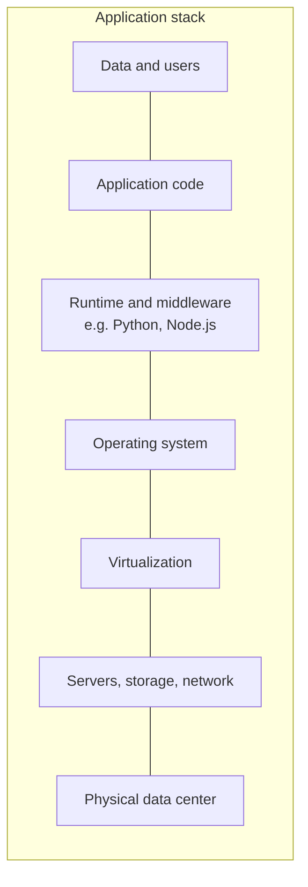
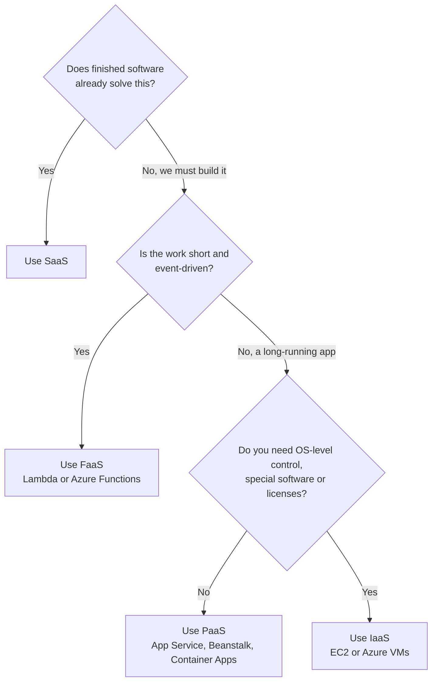

# IaaS, PaaS, SaaS and FaaS

## Introduction

When you use the cloud, you are always choosing **how much of the stack you want to manage yourself**. The cloud industry names these choices with a handful of acronyms:

- **IaaS** (Infrastructure as a Service): you rent virtual machines, disks and networks. You manage the operating system and everything above it.
- **PaaS** (Platform as a Service): you hand the provider your code or container, and the provider runs it on servers you never log into.
- **FaaS** (Functions as a Service): you hand the provider a single function, and it runs only when an event arrives. This is what most people mean by "serverless compute".
- **SaaS** (Software as a Service): you use finished software, such as email or a CRM, through a browser or API. You manage only your data and users.

A useful analogy is getting a pizza:

| Model | Pizza analogy | You handle | Provider handles |
|-------|---------------|-----------|------------------|
| On-premises | Make it at home from scratch | Oven, ingredients, cooking, table | Nothing |
| IaaS | Rent a kitchen | Ingredients, cooking, table | The building and the oven |
| PaaS | Take-and-bake pizza | Baking it and serving it | Dough, toppings, the recipe |
| FaaS | Pizza by the slice, made when you order | Ordering the slice you want | Everything else, and you pay per slice |
| SaaS | Eat at a restaurant | Showing up and paying | Everything |

No model is "best". Each one trades **control** for **convenience**. This page explains each model, shows the same small Python web app deployed three ways on both AWS and Azure, and gives you a framework for choosing.

## The Stack, Layer by Layer

Every application runs on the same layers. The service models differ in where the line falls between "you" and "the provider".



| Layer | On-premises | IaaS | PaaS | FaaS | SaaS |
|-------|-------------|------|------|------|------|
| Data and users | You | You | You | You | You |
| Application code | You | You | You | You (one function at a time) | Provider |
| Runtime and middleware | You | You | Provider (you pick a version) | Provider (you pick a version) | Provider |
| Operating system | You | You | Provider | Provider | Provider |
| Virtualization | You | Provider | Provider | Provider | Provider |
| Servers, storage, network | You | Provider | Provider | Provider | Provider |
| Physical data center | You | Provider | Provider | Provider | Provider |

Notice the top row. **Your data and your users are always your responsibility**, in every model. The [Shared Responsibility Model](./3-cloud-shared-responsibility.mdx) page covers this in depth.

## The Example App

To compare the models fairly, we will deploy the same tiny Flask app each way. Save it as `app.py`:

```python
# app.py: a tiny web app we will deploy as IaaS, PaaS and FaaS
from flask import Flask, jsonify

app = Flask(__name__)


@app.route("/")
def hello():
    return jsonify(message="Hello from the cloud!", model="unknown")


if __name__ == "__main__":
    # Local development only. In the cloud a real server (gunicorn) runs the app.
    app.run(host="0.0.0.0", port=8000)
```

And `requirements.txt`:

```text
flask==3.1.*
gunicorn==23.*
```

Run it locally first:

```bash
python3 -m venv .venv && source .venv/bin/activate
pip install -r requirements.txt
python app.py &
curl -s http://localhost:8000/
```

Output:

```text
{"message":"Hello from the cloud!","model":"unknown"}
```

:::warning Cost warning
The commands below create real, billable resources. Free offers may cover some of them, but terms vary by account and change over time. Run each example only if you plan to clean it up right away, and use the cleanup commands at the end of each section.
:::

## IaaS: Virtual Machines

With IaaS you get a virtual machine with an operating system and nothing else. You install Python, copy your code, start the web server, open the firewall, and keep the OS patched forever after.

**Main services:** Amazon EC2 on AWS, Azure Virtual Machines on Azure. Block storage (Amazon EBS, Azure Managed Disks) and virtual networks (VPC, VNet) are also IaaS.

### On AWS

```bash
# Launch a small Amazon Linux 2023 instance.
# The AMI ID is looked up from a public SSM parameter so it is always current.
aws ec2 run-instances \
  --image-id resolve:ssm:/aws/service/ami-amazon-linux-latest/al2023-ami-kernel-default-x86_64 \
  --instance-type t3.micro \
  --tag-specifications 'ResourceType=instance,Tags=[{Key=project,Value=service-models-demo}]' \
  --query "Instances[0].InstanceId" \
  --output text
```

Example output:

```text
i-0a1b2c3d4e5f67890
```

Running the app still requires you to connect (for example with Session Manager or SSH), install Python, copy the code and configure a firewall rule (a security group) for port 8000. You will do all of that in [Virtual Machines: EC2 and Azure VMs](../3-cloud-compute/1-cloud-virtual-machines.mdx).

### On Azure

```bash
az group create --name rg-service-models --location eastus

# Create a small Ubuntu VM with an SSH key
az vm create \
  --resource-group rg-service-models \
  --name vm-iaas-demo \
  --image Ubuntu2404 \
  --size Standard_B1s \
  --admin-username azureuser \
  --generate-ssh-keys \
  --query "{name:name, publicIp:publicIpAddress}" \
  --output table
```

Example output:

```text
Name          PublicIp
------------  -------------
vm-iaas-demo  20.120.45.183
```

Image aliases such as `Ubuntu2404` and VM sizes change over time. Run `az vm image list --output table` and `az vm list-sizes --location eastus --output table` to see current options.

### What you still own with IaaS

- OS patches and security updates
- Installing and upgrading the Python runtime
- Process supervision (restart the app if it crashes)
- Scaling (adding more VMs) and load balancing
- Backups of anything on the disk

## PaaS: Managed App Hosting

With PaaS you give the platform your code and a few settings. It provisions servers, installs the runtime, routes traffic, restarts crashed processes, and patches the OS.

**Main services:** AWS Elastic Beanstalk and AWS App Runner on AWS; Azure App Service and Azure Container Apps on Azure. Managed databases such as Amazon RDS and Azure SQL Database are also PaaS.

### On Azure

Azure App Service has a one-command deploy for simple apps. Run it from the folder that contains `app.py`:

```bash
# Package and deploy the current folder as a Python web app.
# --sku F1 asks for the Free tier, where it is available in your region.
az webapp up \
  --resource-group rg-service-models \
  --name webapp-models-demo-$RANDOM \
  --runtime "PYTHON:3.12" \
  --sku F1
```

Example output (trimmed):

```text
Creating AppServicePlan 'azureuser_asp_Linux_eastus_0' ...
Creating webapp 'webapp-models-demo-18342' ...
Configuring default logging for the app, if not already enabled
Creating zip with contents of dir /home/me/models-demo ...
Starting zip deployment. This operation can take a while to complete ...
You can launch the app at http://webapp-models-demo-18342.azurewebsites.net
```

App Service detects Flask and starts it with gunicorn. You did not choose an OS, install Python or open a firewall port.

### On AWS

Elastic Beanstalk uses its own CLI, `eb`, which wraps the AWS API:

```bash
pip install awsebcli
eb init models-demo --platform python-3.12 --region us-east-1
eb create models-demo-env --single   # one instance, no load balancer
```

Example output (trimmed):

```text
Creating application version archive "app-251011_101500".
Environment details for: models-demo-env
  Application name: models-demo
  Region: us-east-1
  Platform: arn:aws:elasticbeanstalk:us-east-1::platform/Python 3.12 running on 64bit Amazon Linux 2023
...
Successfully launched environment: models-demo-env
```

Elastic Beanstalk expects a WSGI entry point named `application` by default, so add `application = app` to the bottom of `app.py` or configure a `Procfile`. Platform names change as new runtime versions ship; run `eb platform list` to see current ones.

:::note
Elastic Beanstalk is PaaS that **creates IaaS resources on your behalf** (EC2 instances, a security group, and optionally a load balancer) that you can see in your account. App Service hides its underlying VMs completely. This is a recurring difference: AWS often exposes the building blocks, while Azure more often abstracts them. [PaaS App Hosting](../3-cloud-compute/5-cloud-paas-app-hosting.mdx) covers both in depth.
:::

## FaaS: Functions

With FaaS you do not deploy a web server at all. You deploy a function, and the platform calls it when an event arrives: an HTTP request, a file upload, a queue message or a timer. When nothing happens, nothing runs, and on most plans you pay nothing for compute.

**Main services:** AWS Lambda and Azure Functions.

The Flask app becomes a handler function. Here is the AWS Lambda version, `lambda_function.py`:

```python
# lambda_function.py: the same "hello" endpoint as an AWS Lambda handler
import json


def lambda_handler(event, context):
    return {
        "statusCode": 200,
        "headers": {"Content-Type": "application/json"},
        "body": json.dumps({"message": "Hello from the cloud!", "model": "FaaS"}),
    }


if __name__ == "__main__":
    # Quick local test: call the handler with an empty event
    print(lambda_handler({}, None))
```

Output when run locally:

```text
{'statusCode': 200, 'headers': {'Content-Type': 'application/json'}, 'body': '{"message": "Hello from the cloud!", "model": "FaaS"}'}
```

### On AWS

```bash
zip function.zip lambda_function.py

# The execution role must already exist and trust lambda.amazonaws.com.
aws lambda create-function \
  --function-name models-demo \
  --runtime python3.13 \
  --handler lambda_function.lambda_handler \
  --role arn:aws:iam::111122223333:role/models-demo-lambda-role \
  --zip-file fileb://function.zip

# Give it a public HTTPS URL (no API Gateway needed for a demo)
aws lambda create-function-url-config \
  --function-name models-demo \
  --auth-type NONE
```

Example output (second command, trimmed):

```text
{
    "FunctionUrl": "https://abcdefgh1234.lambda-url.us-east-1.on.aws/",
    "AuthType": "NONE"
}
```

With `--auth-type NONE` you also need a resource-based permission that allows public invocation; the Lambda docs on function URLs show the exact `add-permission` call. Supported runtimes change regularly; check the [Lambda runtimes list](https://docs.aws.amazon.com/lambda/latest/dg/lambda-runtimes.html).

### On Azure

Azure Functions uses the Python v2 programming model, where a decorator declares the trigger. Save as `function_app.py`:

```python
# function_app.py: the same endpoint as an Azure Function (Python v2 model)
import json

import azure.functions as func

app = func.FunctionApp(http_auth_level=func.AuthLevel.ANONYMOUS)


@app.route(route="hello")
def hello(req: func.HttpRequest) -> func.HttpResponse:
    body = json.dumps({"message": "Hello from the cloud!", "model": "FaaS"})
    return func.HttpResponse(body, mimetype="application/json")
```

Create a function app on the **Flex Consumption** plan, which Microsoft now recommends for new serverless function apps (the older Consumption plan is labeled legacy, and Linux Consumption is being retired):

```bash
az storage account create --name stmodelsdemo$RANDOM \
  --resource-group rg-service-models --location eastus --sku Standard_LRS

az functionapp create \
  --resource-group rg-service-models \
  --name func-models-demo-$RANDOM \
  --storage-account <your-storage-account-name> \
  --flexconsumption-location eastus \
  --runtime python \
  --runtime-version 3.12

# Publish with Azure Functions Core Tools
func azure functionapp publish <your-function-app-name>
```

Example output (publish, trimmed):

```text
Deployment completed successfully.
Functions in func-models-demo-27561:
    hello - [httpTrigger]
        Invoke url: https://func-models-demo-27561.azurewebsites.net/api/hello
```

The full workflow is in [Azure Functions](../4-cloud-serverless/2-cloud-azure-functions.mdx) and [AWS Lambda](../4-cloud-serverless/1-cloud-aws-lambda.mdx).

## SaaS: Software You Just Use

SaaS is finished software. You do not deploy anything; you sign in and configure it. Examples include Microsoft 365, GitHub, Salesforce and Slack. For developers, SaaS shows up in two ways:

1. **As a buy-instead-of-build option.** Do you really need to run your own email server, wiki or error tracker?
2. **As something you build.** Your own product is probably SaaS to *your* customers, built on top of IaaS, PaaS and FaaS.

Many cloud services blur the line. Amazon S3, Azure Blob Storage, Amazon SQS and Azure Service Bus are sometimes called "serverless" or "fully managed" services. You use them through an API with no servers to manage, much like SaaS, but they are building blocks for your own applications.

## AWS and Azure Mapping

| Model | AWS examples | Azure examples |
|-------|--------------|----------------|
| IaaS compute | Amazon EC2 | Azure Virtual Machines |
| IaaS storage and network | Amazon EBS, Amazon VPC | Azure Managed Disks, Azure Virtual Network |
| PaaS app hosting | AWS Elastic Beanstalk, AWS App Runner | Azure App Service |
| PaaS containers | Amazon ECS on AWS Fargate | Azure Container Apps |
| PaaS databases | Amazon RDS, Amazon Aurora | Azure SQL Database, Azure Database for PostgreSQL |
| FaaS | AWS Lambda | Azure Functions |
| Serverless building blocks | Amazon S3, Amazon SQS, Amazon DynamoDB | Azure Blob Storage, Azure Service Bus, Azure Cosmos DB |
| SaaS from the provider | Amazon WorkMail, Amazon Connect | Microsoft 365, Dynamics 365 |

Where a mapping is not one-to-one, the service pages explain the gap. For the full list, see [AWS and Azure Service Mapping](./6-cloud-service-mapping.mdx).

## How Billing Differs by Model

The service model also changes **what you pay for**. Exact prices vary by region and change over time, so always check the [AWS Pricing Calculator](https://calculator.aws/) or the [Azure Pricing Calculator](https://azure.microsoft.com/pricing/calculator/). The *shape* of the bill is what matters here:

| Model | Typical billing unit | You pay when idle? |
|-------|----------------------|--------------------|
| IaaS VM | Per second or hour the VM is running, plus disk per GB-month | Yes, until you stop or delete it (disks bill even when stopped) |
| PaaS app hosting | Per hour for the plan or instance size you choose | Usually yes, for the reserved capacity |
| FaaS | Per request plus compute time multiplied by memory | Usually no, unless you keep instances warm |
| SaaS | Per user per month, or a subscription tier | Yes, per seat |

Here is a small script that shows how the shape of the bill changes with traffic. **The rates are made up for illustration and are not real prices.**

```python
# billing_shapes.py: compare how cost scales with traffic for each model.
# All rates below are invented placeholders, not real AWS or Azure prices.

VM_PER_HOUR = 0.02            # always running
PAAS_PLAN_PER_HOUR = 0.03     # always running, includes some management
FAAS_PER_MILLION_REQ = 0.40   # pay per request
FAAS_PER_GB_SECOND = 0.00002  # pay per compute time x memory

HOURS_PER_MONTH = 730


def monthly_cost(requests_per_month, avg_ms=100, memory_gb=0.5):
    vm = VM_PER_HOUR * HOURS_PER_MONTH
    paas = PAAS_PLAN_PER_HOUR * HOURS_PER_MONTH
    gb_seconds = requests_per_month * (avg_ms / 1000) * memory_gb
    faas = (requests_per_month / 1_000_000) * FAAS_PER_MILLION_REQ + gb_seconds * FAAS_PER_GB_SECOND
    return vm, paas, faas


for reqs in [10_000, 1_000_000, 50_000_000, 500_000_000]:
    vm, paas, faas = monthly_cost(reqs)
    print(f"{reqs:>12,} req/month  VM={vm:7.2f}  PaaS={paas:7.2f}  FaaS={faas:8.2f}")
```

Output:

```text
      10,000 req/month  VM=  14.60  PaaS=  21.90  FaaS=    0.01
   1,000,000 req/month  VM=  14.60  PaaS=  21.90  FaaS=    1.40
  50,000,000 req/month  VM=  14.60  PaaS=  21.90  FaaS=   70.00
 500,000,000 req/month  VM=  14.60  PaaS=  21.90  FaaS=  700.00
```

The lesson is not the numbers, which are fake. It is the **shape**: FaaS is very cheap at low or spiky traffic and can become more expensive than always-on capacity at high, steady traffic. (In reality one small VM could not serve 500 million requests a month on its own, so the VM line would also grow.) [Serverless Trade-offs and Costs](../4-cloud-serverless/7-cloud-serverless-trade-offs.mdx) explores this with real pricing dimensions.

## Choosing a Model



This is a starting point, not a rule. [Choosing a Compute Option](../3-cloud-compute/0-cloud-compute-options.mdx) adds containers and more detailed criteria.

## Real-World Scenario

Your team runs a small SaaS helpdesk product. It has three parts:

1. A **web app** where agents answer tickets (steady traffic during business hours).
2. A **nightly job** that generates PDF reports for each customer (runs for about 20 minutes).
3. An **email intake** process that turns incoming emails into tickets (bursty, sometimes nothing for an hour, then hundreds at once).

The team also uses a hosted Git service, an error-tracking service and a chat tool. The CTO asks you to propose where each part should run.

**Your proposal:**

| Component | Model | AWS choice | Azure choice |
|-----------|-------|-----------|--------------|
| Web app | PaaS | Elastic Beanstalk or App Runner | App Service |
| Nightly reports | PaaS containers (scheduled job) | ECS task on Fargate, started by an EventBridge schedule | Container Apps job on a schedule |
| Email intake | FaaS | Lambda triggered by SES or SQS | Azure Functions triggered by a Service Bus queue |
| Git, error tracking, chat | SaaS | Third-party SaaS | Third-party SaaS |

### Why this approach

- The web app runs all day, so per-request FaaS pricing gives no advantage, while PaaS removes OS patching.
- The report job runs 20 minutes, which is close to or above the maximum duration of some function plans (Lambda's maximum timeout is 15 minutes), so a scheduled container job is a better fit.
- Email intake is bursty and short, the ideal FaaS workload: it scales up for bursts and costs little when idle.
- Nobody on a five-person team should be running their own Git server.

### When to use it and when not to

This mix works when each component has a clear traffic pattern. It is less appealing if the team is very small and wants **one** way to deploy everything; then a single PaaS or container platform for all three parts may be simpler, even if slightly less efficient. If you need a custom kernel module or a licensed product that only runs on a specific OS, IaaS is still the answer for that part.

### Alternatives and trade-offs

| Approach | Pros | Cons | Best for |
|----------|------|------|----------|
| Everything on IaaS VMs | Full control, one familiar model | You patch, scale and recover everything | Legacy apps, special OS needs |
| Everything on PaaS | One deploy model, little ops | Idle capacity for bursty parts | Small teams wanting simplicity |
| Mix of PaaS, containers and FaaS | Each part fits its traffic pattern | More services to learn and monitor | Teams with clear, distinct workloads |
| Everything on FaaS | Scales to zero, pay per use | Time limits, cold starts, harder local testing | Event-driven apps with spiky traffic |
| Kubernetes for all parts | Portable, one platform | Highest operational complexity | Larger teams with many services |

## Common Mistakes

- **Treating PaaS as "no ops".** You still own app configuration, secrets, scaling settings, dependencies and your data.
- **Lifting a long-running app into FaaS.** Functions have execution time limits and are billed per invocation; long-running web servers fit poorly.
- **Choosing IaaS by habit.** Teams often pick VMs because they are familiar, then spend years patching them. Ask what you gain from OS control.
- **Forgetting that stopped VMs still cost money.** Disks, public IP addresses and snapshots keep billing after a VM is stopped.
- **Building what you could buy.** A SaaS product with a monthly per-user fee is often cheaper than the engineer-hours to run your own.

## Cleanup

If you ran any of the examples, delete everything now.

```bash
# Azure: one command removes the VM, web app, function app and storage
az group delete --name rg-service-models --yes --no-wait
```

```bash
# AWS: delete each resource you created
aws ec2 terminate-instances --instance-ids i-0a1b2c3d4e5f67890
aws lambda delete-function --function-name models-demo
eb terminate models-demo-env --force
```

Example output (EC2):

```text
{
    "TerminatingInstances": [
        {
            "InstanceId": "i-0a1b2c3d4e5f67890",
            "CurrentState": {"Code": 32, "Name": "shutting-down"},
            "PreviousState": {"Code": 16, "Name": "running"}
        }
    ]
}
```

## Summary

- **IaaS** gives you VMs, disks and networks; you manage the OS and above.
- **PaaS** runs your code or container; the provider manages servers, OS and runtime.
- **FaaS** runs individual functions on events and bills per request and compute time.
- **SaaS** is finished software; you manage only data, users and settings.
- Your **data, identities and configuration** are always your responsibility.
- Choose by traffic pattern, need for control, team size and cost shape, and mix models within one system when it helps.

## Further Learning

Exercises:

1. Take the list of components from your current project (from the exercise on the [introduction page](./0-cloud-introduction.mdx)). Label each one IaaS, PaaS, FaaS or SaaS today, then label what you would choose if you moved it to the cloud.
2. Modify `billing_shapes.py` to model a workload with 10 hours of traffic per day and zero at night. How does the comparison change?
3. Find the maximum execution time for AWS Lambda and for the Azure Functions Flex Consumption plan in the official docs. Which of your components would not fit?

Related pages:

- [The Shared Responsibility Model](./3-cloud-shared-responsibility.mdx)
- [Choosing a Compute Option](../3-cloud-compute/0-cloud-compute-options.mdx)
- [Serverless Introduction](../4-cloud-serverless/0-cloud-serverless-introduction.mdx)
- [Container Options in the Cloud](../5-cloud-containers/0-cloud-container-options.mdx)

External reading:

- [Azure Functions hosting options](https://learn.microsoft.com/azure/azure-functions/functions-scale)
- [AWS Lambda runtimes](https://docs.aws.amazon.com/lambda/latest/dg/lambda-runtimes.html)
- [Types of cloud computing (AWS)](https://aws.amazon.com/types-of-cloud-computing/)
