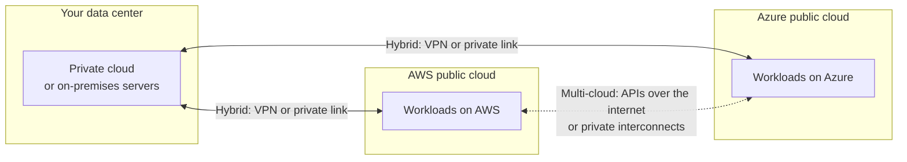
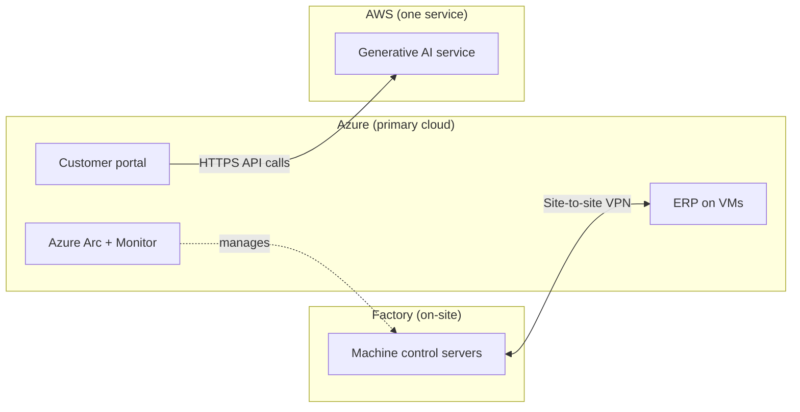

# Public, Private, Hybrid and Multi-Cloud

## Introduction

The [service models](./1-cloud-service-models.mdx) answer "how much of the stack do I manage?". **Deployment models** answer a different question: "**where** does the infrastructure live, and **who** shares it?"

- **Public cloud**: a provider such as AWS or Azure owns the hardware and shares it among many customers, isolated from each other by software.
- **Private cloud**: cloud-style infrastructure (self-service, APIs, elasticity) dedicated to one organization, usually in its own data center.
- **Hybrid cloud**: public and private (or on-premises) infrastructure connected and managed together.
- **Multi-cloud**: using two or more public cloud providers, such as AWS *and* Azure.

NIST SP 800-145 also defines a **community cloud**, shared by organizations with common requirements. Today you see that idea mostly as **government and sovereign clouds**, such as AWS GovCloud (US) and Azure Government.

An analogy: public cloud is a large apartment building where many tenants share the structure. Private cloud is a house you own. Hybrid is owning a house and also renting a storage unit across town, with a key that opens both. Multi-cloud is renting apartments from two different landlords.

This page explains each model, shows how AWS and Azure support them, and spends extra time on the question teams get wrong most often: **is multi-cloud worth it?**

## The Models at a Glance



| Model | Who owns the hardware | Who shares it | Typical reason |
|-------|----------------------|---------------|----------------|
| Public | Provider | Many customers, isolated | Speed, elasticity, no hardware to buy |
| Private | You (or a hosting partner) | Only you | Control, special compliance, steady large workloads |
| Hybrid | Both | Mixed | Gradual migration, data that must stay on-site, low-latency factories or stores |
| Multi-cloud | Several providers | Many customers per provider | Best-of-breed services, acquisitions, regulatory or negotiating reasons |
| Community / sovereign | Provider, in a restricted environment | Customers with shared requirements | Government, defense, data sovereignty |

## Public Cloud

Public cloud is the default for most new projects and the focus of this tutorial. You get:

- Capacity in minutes instead of weeks
- Hundreds of managed services
- Pay-as-you-go billing
- Global reach through many regions

"Public" does **not** mean your data is public. It means the *infrastructure* is shared. Your resources are isolated by the provider's hypervisors, networks and identity systems, and you control who can reach them.

### On AWS and Azure

Every standard AWS account and Azure subscription is public cloud. You already saw how to list regions in the [introduction](./0-cloud-introduction.mdx). There is nothing extra to enable.

## Private Cloud

A private cloud gives one organization cloud-like features on dedicated infrastructure. Historically that meant running software such as VMware vSphere or OpenStack in your own data center.

Today both major providers also sell **their own cloud, installed in your building**:

| Offering | Provider | What it is |
|----------|----------|------------|
| AWS Outposts | AWS | AWS-designed racks or servers installed on your premises, running a subset of AWS services, managed through your AWS account |
| Azure Local | Microsoft | Validated hardware in your data center running Azure-managed virtualization, managed through Azure Arc (previously called Azure Stack HCI) |

These blur the line between private and hybrid: the hardware is yours or on your site, but the management plane is the provider's cloud.

**Why choose private?** Steady, predictable workloads at large scale can cost less on owned hardware. Some regulations or contracts require physical control. Some workloads need very low latency to on-site equipment.

**Why not?** You buy capacity up front, you staff a team to run it, and you rarely get the breadth of managed services the public cloud offers.

## Hybrid Cloud

Hybrid cloud connects on-premises infrastructure to a public cloud so that they work as one environment. It is extremely common, especially during migrations that take years.

Hybrid has two halves:

1. **Network connectivity**: a site-to-site VPN over the internet, or a private dedicated link (AWS Direct Connect, Azure ExpressRoute). See [Hybrid Connectivity](../8-cloud-networking/8-cloud-hybrid-connectivity.mdx).
2. **Unified management**: seeing and managing on-premises servers with the same tools you use in the cloud.

### On AWS: Systems Manager hybrid nodes

AWS Systems Manager can manage on-premises servers alongside EC2 instances. You create an *activation*, then register the agent on each server.

```bash
# 1. Create an activation (the IAM role must trust ssm.amazonaws.com)
aws ssm create-activation \
  --default-instance-name onprem-web \
  --iam-role SSMServiceRoleForHybrid \
  --registration-limit 5 \
  --region us-east-1
```

Example output:

```text
{
    "ActivationId": "e488f2f6-e686-4afb-8a04-ef6dfEXAMPLE",
    "ActivationCode": "bxxxxxxxxxxxxxxxxxxx"
}
```

```bash
# 2. On the on-premises Linux server, with the SSM Agent installed:
sudo amazon-ssm-agent -register \
  -code "bxxxxxxxxxxxxxxxxxxx" \
  -id "e488f2f6-e686-4afb-8a04-ef6dfEXAMPLE" \
  -region "us-east-1"
```

After registration the server appears as a managed node (with an ID starting with `mi-`) and you can patch it or run commands on it from AWS.

### On Azure: Azure Arc

Azure Arc projects non-Azure servers, Kubernetes clusters and databases into Azure Resource Manager, so they appear in the portal, can be tagged, and can be governed by Azure Policy and monitored by Azure Monitor.

```bash
# On the on-premises server, after installing the Connected Machine agent:
sudo azcmagent connect \
  --resource-group rg-hybrid \
  --tenant-id <your-tenant-id> \
  --subscription-id <your-subscription-id> \
  --location eastus
```

Example output (trimmed):

```text
INFO    Connecting machine to Azure... This might take a few minutes.
INFO    Testing connectivity to endpoints that are needed to connect to Azure... This might take a few minutes.
INFO    Successfully Onboarded Resource to Azure  VM Id=4c1b2f7e-...
```

```bash
# Back on your laptop: list Arc-enabled servers like any other Azure resource
az connectedmachine list --resource-group rg-hybrid --output table
```

Example output:

```text
Name          Location    OsName    Status
------------  ----------  --------  ---------
onprem-web01  eastus      linux     Connected
```

### Hybrid mapping

| Need | AWS | Azure |
|------|-----|-------|
| Manage on-prem servers from the cloud | AWS Systems Manager (hybrid nodes) | Azure Arc-enabled servers |
| Run the provider's cloud on your site | AWS Outposts | Azure Local |
| Private network link | AWS Direct Connect | Azure ExpressRoute |
| Encrypted link over the internet | AWS Site-to-Site VPN | Azure VPN Gateway |
| Small metro-area extensions of a region | AWS Local Zones | Azure Extended Zones |
| Kubernetes anywhere | Amazon EKS Anywhere, EKS Hybrid Nodes | Azure Arc-enabled Kubernetes |

:::note
Azure Arc is a notable difference in approach. Arc's goal is to make *anything* (other clouds included) appear as an Azure resource and be governed with Azure tools. AWS's hybrid story centers more on running AWS infrastructure on-site (Outposts) and managing servers with Systems Manager. Both work; Arc is broader if you want one governance plane across many environments.
:::

## Multi-Cloud

Multi-cloud means using more than one public cloud provider. It happens for two very different reasons:

- **On purpose**: a team picks a specific service from each cloud, or a regulator requires a second provider for resilience.
- **By accident**: a company acquires another company that uses a different cloud, or different teams chose different providers.

### Patterns of multi-cloud

| Pattern | Example | Difficulty |
|---------|---------|------------|
| Different apps on different clouds | HR system on Azure, e-commerce on AWS | Low: each app is single-cloud |
| Best-of-breed services | App on AWS calls an AI model hosted on Azure | Medium: cross-cloud identity, network and egress costs |
| Same app, failover across clouds | Active on AWS, standby on Azure | High: two of everything, data replication, testing |
| Same app, active-active across clouds | Traffic split across both | Very high: rarely justified |

### A taste of multi-cloud tooling

Terraform is popular for multi-cloud because one tool and language can manage both providers. Here is a minimal configuration that declares one storage bucket on each cloud:

```hcl
terraform {
  required_providers {
    aws = {
      source  = "hashicorp/aws"
      version = "~> 6.0"
    }
    azurerm = {
      source  = "hashicorp/azurerm"
      version = "~> 4.0"
    }
  }
}

provider "aws" {
  region = "us-east-1"
}

provider "azurerm" {
  features {}
  # azurerm 4.x requires the subscription; it can also come from ARM_SUBSCRIPTION_ID
  subscription_id = var.azure_subscription_id
}

variable "azure_subscription_id" {
  type = string
}

resource "aws_s3_bucket" "reports" {
  bucket = "acme-reports-demo-7f3a"
}

resource "azurerm_resource_group" "reports" {
  name     = "rg-reports-demo"
  location = "eastus"
}

resource "azurerm_storage_account" "reports" {
  name                     = "acmereportsdemo7f3a"
  resource_group_name      = azurerm_resource_group.reports.name
  location                 = azurerm_resource_group.reports.location
  account_tier             = "Standard"
  account_replication_type = "LRS"
}
```

Running `terraform plan` shows both clouds in one plan:

```text
Terraform will perform the following actions:

  # aws_s3_bucket.reports will be created
  # azurerm_resource_group.reports will be created
  # azurerm_storage_account.reports will be created

Plan: 3 to add, 0 to change, 0 to destroy.
```

Notice what Terraform does **not** do: it does not make an S3 bucket and a storage account interchangeable. The resources, settings and behaviors are still provider-specific. One tool is not the same as one abstraction. See [Terraform for AWS and Azure](../10-cloud-infrastructure-as-code/4-cloud-terraform-multi-cloud.mdx) and the site's [Terraform tutorial](/docs/devops/terraform).

:::warning Cost warning
If you apply this configuration, it creates billable storage. Run `terraform destroy` when you are done.
:::

### The hidden costs of multi-cloud

Multi-cloud is often presented as pure upside ("no lock-in!"). The costs are real:

- **Data egress**: moving data out of a cloud to the internet or another cloud is usually billed per GB. Cross-cloud architectures pay this on every call.
- **Two of everything**: two identity systems, two networking models, two monitoring stacks, two security baselines, two sets of IAM policies.
- **Lowest common denominator**: to stay portable, teams avoid the best managed services and run more themselves.
- **Skills**: every engineer now needs to understand two platforms well enough to debug production.
- **Weaker discounts**: committed-use discounts reward concentrating spend with one provider.

## A Simple Decision Helper

This script encodes a rough first-pass decision. It is a thinking aid, not a policy.

```python
# deployment_model_helper.py: a rough first-pass recommendation.

def recommend(needs):
    reasons = []
    if needs.get("must_stay_on_site"):
        reasons.append("Data or equipment must stay on-site -> hybrid (Outposts / Azure Local / Arc)")
    if needs.get("government_or_sovereign"):
        reasons.append("Government or sovereignty rules -> check sovereign clouds (GovCloud, Azure Government)")
    if needs.get("acquired_other_cloud"):
        reasons.append("Acquired a team on another cloud -> multi-cloud by app, not by component")
    if needs.get("needs_unique_service"):
        reasons.append("Needs a service only one cloud has -> targeted multi-cloud, measure egress first")
    if needs.get("steady_large_scale") and needs.get("strong_ops_team"):
        reasons.append("Large steady load + strong ops team -> evaluate private cloud costs")
    if not reasons:
        reasons.append("No special constraints -> single public cloud")
    return reasons


startup = {}
bank = {"must_stay_on_site": True, "government_or_sovereign": False, "needs_unique_service": True}

print("Startup:")
for r in recommend(startup):
    print("  -", r)
print("Bank:")
for r in recommend(bank):
    print("  -", r)
```

Output:

```text
Startup:
  - No special constraints -> single public cloud
Bank:
  - Data or equipment must stay on-site -> hybrid (Outposts / Azure Local / Arc)
  - Needs a service only one cloud has -> targeted multi-cloud, measure egress first
```

## Sovereign and Government Clouds

Some organizations must keep data, and sometimes operations staff, within a specific country or legal jurisdiction. Both providers offer separate environments for this:

| Need | AWS | Azure |
|------|-----|-------|
| US government workloads | AWS GovCloud (US) regions, accessed through a separate GovCloud account | Azure Government, a separate cloud instance |
| China | AWS China regions (Beijing, Ningxia), operated by local partners with separate accounts | Azure operated by 21Vianet |
| EU sovereignty | AWS European Sovereign Cloud, a separate cloud in the EU | Microsoft's EU Data Boundary and sovereign cloud offerings |

These environments are isolated from the standard cloud: for example, AWS documents that you cannot access GovCloud or China regions from a standard AWS account. They often have fewer services and features, and new features may arrive later. Check current availability on the official pages, because sovereign offerings are changing quickly.

## Real-World Scenario

You work at a regional manufacturing company. It has:

- A factory floor system that controls machines and must keep working if the internet goes down.
- An ERP system running on VMs in a small company data center, whose hardware lease ends in 18 months.
- A new customer portal the team wants to build.
- A data science team that wants to try a generative AI service that is only available on one specific cloud.

Leadership asks: "Should we go all-in on one cloud, do hybrid, or be multi-cloud?"

**The proposal:**

1. **Customer portal**: build it on one public cloud (say Azure, because the company already uses Microsoft 365 and Entra ID for staff sign-in).
2. **ERP**: migrate it to the same cloud before the hardware lease ends, as VMs first, modernizing later. See [Migration Strategies: The 7 Rs](../13-cloud-architecture/6-cloud-migration-strategies.mdx).
3. **Factory floor**: keep it on-site. Connect it with a VPN, and manage the servers with Azure Arc so patching and monitoring use the same tools as the cloud.
4. **AI service**: if the service really only exists on AWS, call it from the Azure app over HTTPS, with a small, well-defined interface. This is *targeted* multi-cloud, not a commitment to run everything on both.



### Why this approach

The factory has a hard requirement to work offline, so it stays on-site, which makes the company **hybrid** by necessity. Everything else concentrates on one cloud to keep skills, security and billing simple. The AI service is reached through a narrow interface, so if the other cloud gets an equivalent later, swapping it is a small change.

### When to use it and when not to

This "primary cloud plus exceptions" pattern fits most companies. It is not enough if a regulator requires the ability to run critical services on a second provider; then you need a tested exit or failover plan, which is far more work.

### Alternatives and trade-offs

| Approach | Pros | Cons | Best for |
|----------|------|------|----------|
| Single public cloud | Simplest, deepest discounts, one skill set | Dependency on one provider | Most startups and mid-size companies |
| Hybrid (on-prem + one cloud) | Meets on-site and latency needs, gradual migration | Network and management complexity | Factories, retail, regulated industries |
| Private cloud only | Full control, predictable cost at scale | Up-front capital, staff to run it, fewer managed services | Very large steady workloads, strict physical control |
| Targeted multi-cloud | Access to unique services, lower lock-in for that piece | Egress cost, two identity systems | One or two specific service needs |
| Full multi-cloud portability | Leverage in negotiations, survive a provider outage | Very high cost and complexity, lowest common denominator | Rare: regulatory mandates, very large enterprises |

## Common Mistakes

- **Choosing multi-cloud to "avoid lock-in" without pricing it.** The engineering cost of portability often exceeds the cost of a future migration.
- **Ignoring egress.** Chatty traffic between clouds, or between cloud and on-premises, can dominate the bill.
- **Treating hybrid as temporary without a plan.** "Temporary" hybrid setups often last a decade. Design them properly.
- **Assuming sovereign clouds have every service.** Check service availability before you commit.
- **Calling a private data center with a VM portal a "private cloud".** Without self-service, APIs and elasticity, it is just virtualization.

## Summary

- **Public cloud** shares provider-owned infrastructure among isolated customers; it is the default for new work.
- **Private cloud** dedicates cloud-style infrastructure to one organization; AWS Outposts and Azure Local bring provider hardware on-site.
- **Hybrid cloud** connects on-premises and cloud, with tools such as AWS Systems Manager and Azure Arc for unified management.
- **Multi-cloud** uses several providers; it adds egress, skills and tooling costs, so use it for clear reasons.
- **Sovereign and government clouds** are separate environments with their own accounts and service lists.

## Further Learning

Exercises:

1. List the systems at your company or in a project you know. For each, decide whether it must stay on-site, could move to a public cloud, or depends on a service only one provider offers.
2. Extend `deployment_model_helper.py` with a `latency_ms_to_equipment` input. If it is under some threshold you choose, recommend an edge option (Local Zones, Extended Zones, Outposts or Azure Local).
3. Read the official pages for AWS Outposts and Azure Local. Write three sentences comparing how each is managed and billed.

Related pages:

- [The Shared Responsibility Model](./3-cloud-shared-responsibility.mdx)
- [Regions, Availability Zones and Edge Locations](./4-cloud-regions-and-zones.mdx)
- [Multi-Cloud and Hybrid Strategy](../13-cloud-architecture/5-cloud-multi-cloud-strategy.mdx)
- [Hybrid Connectivity: VPN and Direct Connect/ExpressRoute](../8-cloud-networking/8-cloud-hybrid-connectivity.mdx)

External reading:

- [NIST SP 800-145](https://csrc.nist.gov/pubs/sp/800/145/final)
- [What is Azure Local?](https://learn.microsoft.com/azure/azure-local/overview)
- [Azure Arc overview](https://learn.microsoft.com/azure/azure-arc/overview)
- [AWS Outposts](https://aws.amazon.com/outposts/)
