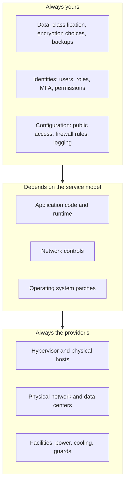

# Cloud Shared Responsibility Model

## Introduction

When something goes wrong in the cloud, such as a data leak, a hacked server or a deleted database, the first question is: **whose job was it to prevent this?** The **shared responsibility model** is the answer both AWS and Microsoft publish. It splits security and operational duties between the provider and you, the customer.

AWS summarizes it in one memorable phrase:

- AWS is responsible for **security *of* the cloud**: the hardware, software, networking and facilities that run AWS services.
- You are responsible for **security *in* the cloud**: your data, your identities and permissions, and how you configure the services you use.

Microsoft expresses the same idea as a matrix: as you move from on-premises to IaaS, PaaS and SaaS, more responsibilities shift to Microsoft, but **your data, endpoints, accounts and access management always stay with you**.

An analogy: a bank provides a vault, guards and cameras. That is security *of* the vault. If you hand your safe-deposit box key to a stranger, or leave the box open on the counter, that is your problem. Security *in* the vault is yours.

This matters because most real cloud security incidents are not caused by a provider failing at physical security. They come from customer-side issues: storage left open to the public, leaked credentials, over-broad permissions and unpatched VMs. Knowing exactly where your responsibilities begin is the first step to avoiding them.

## The Responsibility Matrix

Microsoft's [shared responsibility documentation](https://learn.microsoft.com/azure/security/fundamentals/shared-responsibility) lays out the split in a table. AWS's [model](https://aws.amazon.com/compliance/shared-responsibility-model/) says the same thing in prose. Here is a combined view:

| Responsibility area | On-premises | IaaS | PaaS | SaaS |
|---------------------|-------------|------|------|------|
| Customer data | You | You | You | You |
| Configurations and settings | You | You | You | You |
| Identities and users | You | You | You | You |
| Client devices | You | You | You | Shared |
| Applications | You | You | Shared | Shared |
| Network controls | You | You | Shared | Provider |
| Operating system | You | You | Provider | Provider |
| Physical hosts | You | Provider | Provider | Provider |
| Physical network | You | Provider | Provider | Provider |
| Physical data center | You | Provider | Provider | Provider |

The top three rows never move. No matter how "managed" a service is, the provider cannot decide who in your company should read a file, or whether a bucket should be public.



## How the Line Moves by Service

AWS gives a concrete example of how responsibility changes between services:

- With **Amazon EC2** (IaaS), the customer performs "all of the necessary security configuration and management tasks", including **guest OS patching** and configuring the **security group** firewall.
- With **abstracted services** such as **Amazon S3** and **Amazon DynamoDB**, AWS operates the infrastructure, OS and platform. You still manage your data, its encryption options and the permissions on it.

Here is that idea expanded across common services on both clouds:

| Task | EC2 / Azure VM | Elastic Beanstalk / App Service | Lambda / Azure Functions | RDS / Azure SQL Database | S3 / Blob Storage |
|------|---------------|---------------------------------|--------------------------|--------------------------|-------------------|
| Patch the OS | You | Provider (platform updates) | Provider | Provider | Provider |
| Patch the language runtime | You | You choose the version; provider patches minor versions | You upgrade before a runtime is deprecated | Not applicable | Not applicable |
| Patch the database engine | You (if self-installed) | Not applicable | Not applicable | Provider applies; you choose maintenance windows and major upgrades | Not applicable |
| Firewall rules | You (security groups / NSGs) | Mostly you (access restrictions, VNet integration) | You (who can invoke, network settings) | You (network access, private endpoints) | You (public access settings, network rules) |
| Encryption at rest | You turn it on or confirm defaults | Provider default; you can choose keys | Provider default | Provider default; you can choose keys | On by default; you choose key management |
| Backups | You | You (app content), provider (platform) | Your code in source control | Provider automates; you set retention and test restores | You enable versioning and replication |
| Who can access | You | You | You | You | You |

:::note
"Provider default" does not mean "nothing to do". You still need to confirm settings meet your requirements, decide on key management, and monitor that nobody turns protections off.
:::

### Shared controls

AWS also describes **shared controls** that apply at both layers, each in its own context:

- **Patch management**: AWS patches its infrastructure; you patch your guest OS and applications.
- **Configuration management**: AWS configures its infrastructure devices; you configure your OS, databases and applications.
- **Awareness and training**: AWS trains its staff; you train yours.

## Checking Your Side: Public Access to Storage

Accidentally public storage is the classic customer-side failure. Both clouds now block public access by default on new storage, but older resources, scripts and human edits can change that. Here is how to check.

### On AWS

S3 has **Block Public Access** settings at the account level and the bucket level. New buckets have it enabled by default.

```bash
# Account-wide setting (applies to all buckets in the account)

aws s3control get-public-access-block \
  --account-id 111122223333

# Setting on one bucket
aws s3api get-public-access-block \
  --bucket my-app-uploads
```

Example output (healthy):

```text
{
    "PublicAccessBlockConfiguration": {
        "BlockPublicAcls": true,
        "IgnorePublicAcls": true,
        "BlockPublicPolicy": true,
        "RestrictPublicBuckets": true
    }
}
```

If any value is `false`, find out why. Some static website setups intentionally allow public reads; most buckets should not.

### On Azure

Azure Storage accounts have an `allowBlobPublicAccess` setting. When it is `false`, no container in the account can be made public.

```bash
# List storage accounts and whether anonymous blob access is allowed
az storage account list \
  --query "[].{name:name, rg:resourceGroup, publicBlob:allowBlobPublicAccess, minTls:minimumTlsVersion}" \
  --output table
```

Example output:

```text
Name               Rg              PublicBlob    MinTls
-----------------  --------------  ------------  --------
stappuploads01     rg-app-prod     False         TLS1_2
stlegacyexport99   rg-old-reports  True          TLS1_0
```

The second account allows anonymous access and old TLS versions. That is **your** responsibility to fix:

```bash
az storage account update \
  --name stlegacyexport99 \
  --resource-group rg-old-reports \
  --allow-blob-public-access false \
  --min-tls-version TLS1_2
```

## A Small Responsibility Audit Script

You can turn the matrix into code. The script below takes a simple inventory of resources (in a real project you would generate it from the cloud APIs or your Infrastructure as Code) and lists what the customer must still handle for each.

```python
# responsibility_audit.py: list customer-side duties for each resource.

CUSTOMER_DUTIES = {
    "iaas": ["data", "identity and access", "configuration", "OS patching",
             "runtime patching", "firewall rules", "backups"],
    "paas": ["data", "identity and access", "configuration", "runtime version upgrades",
             "app-level network rules", "backup retention and restore tests"],
    "faas": ["data", "identity and access", "configuration", "runtime upgrades before deprecation",
             "invoke permissions"],
    "storage": ["data", "identity and access", "public access settings",
                "versioning and replication", "key management choice"],
}

inventory = [
    {"name": "web-vm-01", "cloud": "azure", "kind": "iaas"},
    {"name": "orders-db", "cloud": "aws", "kind": "paas"},
    {"name": "thumbnailer", "cloud": "aws", "kind": "faas"},
    {"name": "stappuploads01", "cloud": "azure", "kind": "storage"},
]

for res in inventory:
    duties = CUSTOMER_DUTIES[res["kind"]]
    print(f"{res['name']} ({res['cloud']}, {res['kind']}): {len(duties)} customer duties")
    for duty in duties:
        print(f"   [ ] {duty}")
```

Output:

```text
web-vm-01 (azure, iaas): 7 customer duties
   [ ] data
   [ ] identity and access
   [ ] configuration
   [ ] OS patching
   [ ] runtime patching
   [ ] firewall rules
   [ ] backups
orders-db (aws, paas): 6 customer duties
   [ ] data
   [ ] identity and access
   [ ] configuration
   [ ] runtime version upgrades
   [ ] app-level network rules
   [ ] backup retention and restore tests
thumbnailer (aws, faas): 5 customer duties
   [ ] data
   [ ] identity and access
   [ ] configuration
   [ ] runtime upgrades before deprecation
   [ ] invoke permissions
stappuploads01 (azure, storage): 5 customer duties
   [ ] data
   [ ] identity and access
   [ ] public access settings
   [ ] versioning and replication
   [ ] key management choice
```

Notice that moving from IaaS to PaaS or FaaS **reduces** the list but never empties it.

## Checking Your Side: VM Patching

With IaaS, OS patching is yours. Both clouds give you tools to see patch status across your fleet, but you have to turn them on and act on what they report.

### On AWS

AWS Systems Manager Patch Manager reports patch compliance for managed nodes (EC2 instances or hybrid servers running the SSM Agent):

```bash
# Patch compliance summary per managed node
aws ssm list-resource-compliance-summaries \
  --filters Key=ComplianceType,Values=Patch,Type=EQUAL \
  --query "ResourceComplianceSummaryItems[].{node:ResourceId, status:Status, critical:NonCompliantSummary.SeveritySummary.CriticalCount}" \
  --output table
```

Example output:

```text
-------------------------------------------------------
|           ListResourceComplianceSummaries           |
+-----------+-----------------------+-----------------+
| critical  |         node          |     status      |
+-----------+-----------------------+-----------------+
|  0        |  i-0a1b2c3d4e5f67890  |  COMPLIANT      |
|  3        |  i-0fedcba9876543210  |  NON_COMPLIANT  |
+-----------+-----------------------+-----------------+
```

### On Azure

Azure Update Manager assesses Azure VMs and Arc-enabled servers. Its results are queryable through Azure Resource Graph (the `resource-graph` CLI extension installs on first use):

```bash
az graph query -q "
patchassessmentresources
| where type =~ 'microsoft.compute/virtualmachines/patchassessmentresults'
| project vm = tostring(split(id, '/')[8]),
          status = tostring(properties.status),
          critical = toint(properties.availablePatchCountByClassification.critical)
" --output table
```

Example output:

```text
Vm            Status     Critical
------------  ---------  --------
vm-iaas-demo  Succeeded  0
vm-legacy-01  Succeeded  4
```

The table names and properties in Resource Graph evolve, so check the Update Manager docs if the query returns nothing. Either way, the lesson is the same: **the provider gives you the report; applying the patches is your job.** Moving the workload to PaaS removes the job entirely.

## Encoding Your Responsibilities in Code

The most reliable way to meet your side of the model is to make the safe settings part of your Infrastructure as Code, so every new resource starts secure. Here is a Terraform sketch for both clouds:

```hcl
# AWS: block public access for the whole account, not just one bucket
resource "aws_s3_account_public_access_block" "this" {
  block_public_acls       = true
  ignore_public_acls      = true
  block_public_policy     = true
  restrict_public_buckets = true
}

# Azure: a storage account that cannot expose anonymous blobs
resource "azurerm_storage_account" "uploads" {
  name                            = "stappuploads01"
  resource_group_name             = "rg-app-prod"
  location                        = "westeurope"
  account_tier                    = "Standard"
  account_replication_type        = "ZRS"
  allow_nested_items_to_be_public = false
  min_tls_version                 = "TLS1_2"
}
```

In the `azurerm` provider, `allow_nested_items_to_be_public` is the Terraform name for the `allowBlobPublicAccess` setting. Review these in pull requests just like application code, and pair them with organization-wide policies so a manual change cannot undo them.

## Beyond Security: Operational Responsibility

The model is usually discussed for security, but the same split applies to reliability and operations:

| Concern | Provider | You |
|---------|----------|-----|
| Hardware failure | Replaces failed disks and hosts | Design for failure: multiple instances, multiple availability zones |
| Region or zone outage | Restores service, publishes health events | Decide whether you need multi-zone or multi-region, and test failover |
| Service limits and quotas | Sets and documents them | Monitor usage, request increases before you need them |
| Cost | Bills accurately for usage | Set budgets, delete unused resources, choose pricing models |
| Compliance certifications | Audits its infrastructure (SOC, ISO and others) and publishes reports | Configure your workloads to meet the same controls; collect your own evidence |

A provider's **SLA** (service level agreement) usually promises a certain availability for a service, often only if you deploy it in a specific way (for example, across multiple availability zones). It typically gives you service credits if the provider misses the target; it does not compensate your business losses. See [High Availability Design](../13-cloud-architecture/1-cloud-high-availability.mdx).

### Compliance reports

You can download the provider's audit reports to show auditors what the provider covers:

| Need | AWS | Azure |
|------|-----|-------|
| Provider audit reports (SOC, ISO and others) | AWS Artifact | Microsoft Service Trust Portal |
| Continuous checks of your configuration | AWS Security Hub, AWS Config | Microsoft Defender for Cloud, Azure Policy |

The provider's certification covers *its* layers. Your auditors will still ask about *your* layers.

## Shared Responsibility for AI Services

Microsoft also publishes shared responsibility guidance for AI workloads and AI agents. The pattern holds: the provider secures the model hosting platform and its infrastructure; you remain responsible for your data, what you send to the model, who can call it, how outputs are used, and any tools an agent can invoke. See [Cloud AI Services: Bedrock and Microsoft Foundry](../13-cloud-architecture/7-cloud-ai-services.mdx).

## Real-World Scenario

A small analytics startup runs on AWS. It stores customer CSV exports in S3, processes them with Lambda, and serves a dashboard from Elastic Beanstalk. A security researcher emails: "Your bucket `acme-exports` is publicly listable." The CEO asks, "Isn't AWS supposed to handle security?"

**What happened:** Months earlier, a developer turned off Block Public Access on the bucket to share one file with a customer quickly, and forgot to turn it back on. AWS did its part: the bucket was stored on secure infrastructure, and new buckets block public access by default. The setting change was a customer-side configuration decision.

**The fix:**

1. Re-enable Block Public Access on the bucket immediately, and at the **account** level so no single bucket can override it.
2. Use **presigned URLs** for sharing individual files temporarily, instead of public access.
3. Turn on audit logging (CloudTrail) and a detective control (AWS Config or Security Hub) that alerts when public access is enabled.
4. Restrict who can change the setting with IAM, and later with an organization-wide guardrail (a service control policy).
5. Write down the shared responsibility split for each service the company uses, and assign an owner for each customer-side duty.

The same design on Azure would use `allowBlobPublicAccess=false` on every storage account, **SAS tokens** (preferably user delegation SAS) for temporary sharing, the Activity Log for auditing, and Azure Policy to deny storage accounts that allow public access.

### Why this approach

The root cause was a human configuration change with no guardrail and no alert. Fixing just this bucket would leave the same risk for the next one. Account-level blocks, policy guardrails and alerts make the safe setting the default and make unsafe changes visible.

### When to use it and when not to

Account-wide public-access blocks fit almost every account. The exception is an account that intentionally hosts a public static website directly from storage; even then, a better design is to keep the bucket private and serve it through a CDN with origin access control. See [Hosting Static Websites](../6-cloud-storage/6-cloud-static-websites.mdx).

### Alternatives and trade-offs

| Approach | Pros | Cons | Best for |
|----------|------|------|----------|
| Fix only the affected bucket | Fast | Same mistake can recur anywhere | Never sufficient on its own |
| Account-level block plus presigned URLs / SAS | Prevents the whole class of mistakes | Developers need to learn temporary sharing | Almost all accounts |
| Preventive policy (SCP or Azure Policy deny) | Cannot be bypassed by account admins | Needs an organization or management group setup | Companies with several accounts or subscriptions |
| Detective controls only (Config, Defender alerts) | Easy to add, no workflow changes | Finds problems after they happen | A first step while preventive controls are designed |
| Third-party CSPM tool | Works across clouds | Extra cost and another tool | Multi-cloud estates |

## Common Mistakes

- **"It's managed, so it's secure."** Managed services secure their own layers. Your data, access and configuration remain yours.
- **Assuming defaults never change.** A safe default can be turned off by a script, a console click or old Infrastructure as Code.
- **Forgetting runtime deprecations.** Lambda and Azure Functions retire old language versions. Upgrading is your job.
- **Not testing restores.** A managed database takes backups, but only you can confirm your app can recover from them.
- **Equating provider certifications with your compliance.** An ISO certificate for the data center does not certify your application.

## Summary

- The provider secures **the cloud** (hardware, facilities, hypervisor, managed platforms); you secure what you put **in** it.
- Your **data, identities, accounts, endpoints and configuration** are always your responsibility.
- The OS, runtime and network responsibilities shift toward the provider as you move from IaaS to PaaS, FaaS and SaaS.
- Check and enforce storage public-access settings on both clouds; they are a common source of incidents.
- The same split applies to reliability, cost and compliance: the provider gives you tools and reports, and you must use them.

## Further Learning

Exercises:

1. For each service your project uses, write one line stating who patches the OS, who controls network access and who manages backups.
2. Extend `responsibility_audit.py` to read the inventory from a JSON file and output a Markdown checklist per team.
3. If you have a sandbox account, run the storage public-access checks above for both clouds and fix anything you find.

Related pages:

- [IaaS, PaaS, SaaS and FaaS](./1-cloud-service-models.mdx)
- [Cloud IAM Concepts](../2-cloud-identity/0-cloud-iam-concepts.mdx)
- [Cloud Security Services: GuardDuty, Security Hub and Defender](../12-cloud-observability-and-security/4-cloud-security-services.mdx)
- [Policies and Governance: SCPs and Azure Policy](../12-cloud-observability-and-security/7-cloud-compliance-and-governance.mdx)

External reading:

- [AWS Shared Responsibility Model](https://aws.amazon.com/compliance/shared-responsibility-model/)
- [Shared responsibility in the cloud (Microsoft Learn)](https://learn.microsoft.com/azure/security/fundamentals/shared-responsibility)
- [Blocking public access to your Amazon S3 storage](https://docs.aws.amazon.com/AmazonS3/latest/userguide/access-control-block-public-access.html)
- [Prevent anonymous read access to Azure blobs](https://learn.microsoft.com/azure/storage/blobs/anonymous-read-access-prevent)
