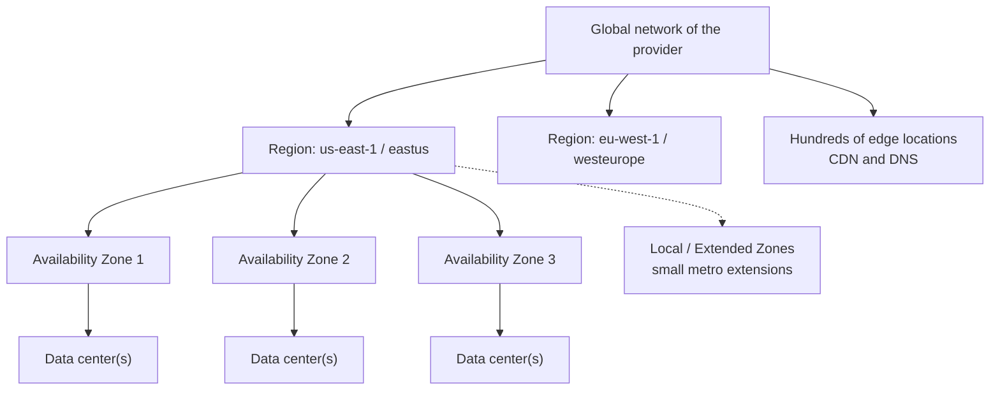
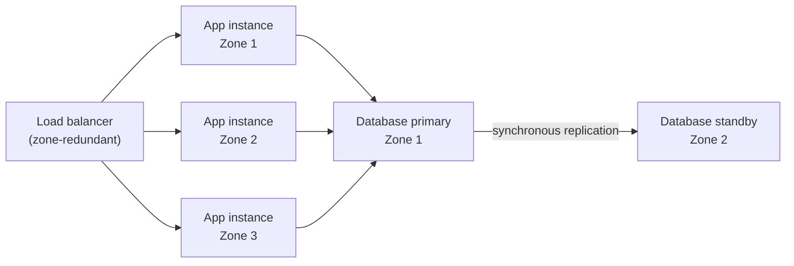

# Regions, Availability Zones and Edge Locations

## Introduction

"The cloud" is not a vague place in the sky. It is a large number of very real buildings full of servers, in specific cities, connected by the provider's private fiber network. Where your code runs affects:

- **Latency**: how fast your app feels to users
- **Resilience**: what happens when a building loses power
- **Compliance**: which country's laws apply to your data
- **Cost**: prices differ by location, and moving data between locations costs money
- **Features**: not every service is available everywhere

Both AWS and Azure organize their infrastructure into the same three main layers:

1. **Regions**: a geographic area, such as "US East (N. Virginia)" or "West Europe", containing one or more data centers.
2. **Availability Zones (AZs)**: physically separate groups of data centers *inside* a region, each with independent power, cooling and networking.
3. **Edge locations**: many smaller sites around the world that cache content and terminate connections close to users.

An analogy: a region is a city. Availability zones are separate neighborhoods in that city, far enough apart that a flood in one does not reach the others, but close enough for a quick drive. Edge locations are corner shops all over the country that stock the most popular items so customers do not have to travel to the city.

## The Hierarchy at a Glance



| Concept | AWS | Azure |
|---------|-----|-------|
| Geographic area with data centers | Region (code like `us-east-1`) | Region (name like `eastus`) |
| Data residency boundary | Region (and partitions such as GovCloud, China) | Geography (contains one or more regions) |
| Isolated data center groups within a region | Availability Zone (`us-east-1a`, ID `use1-az1`) | Availability zone (logical zones `1`, `2`, `3`) |
| Metro-area extension of a region | Local Zones | Extended Zones |
| Inside telecom 5G networks | Wavelength Zones | Varies by partner offering |
| Content caching and edge networking | CloudFront edge locations (points of presence) | Azure Front Door and CDN points of presence |
| Provider hardware in your building | Outposts | Azure Local |
| Built-in region pairing | No (you choose your own second region) | Region pairs for some regions; many newer regions are nonpaired |

## Regions

A region is the unit you choose most often. Almost every resource you create, such as a VM, a database or a storage account, lives in exactly one region.

Both providers run dozens of regions across every inhabited continent and keep adding more. The exact counts change often, so check the official sources rather than memorizing numbers: the [AWS Global Infrastructure](https://aws.amazon.com/about-aws/global-infrastructure/) page and the [Azure regions list](https://learn.microsoft.com/azure/reliability/regions-list).

### On AWS: region codes and opt-in regions

AWS regions have codes such as `us-east-1`, `eu-west-2` and `ap-southeast-1`. One detail surprises newcomers: **regions introduced after March 20, 2019 are disabled by default**, and you must opt in before you can use them. Older regions are enabled automatically.

```bash
# Regions enabled for your account (default + ones you opted into)
aws account list-regions \
  --region-opt-status-contains ENABLED_BY_DEFAULT ENABLED \
  --query "Regions[].RegionName" \
  --output text

# Is a specific newer region enabled?
aws account get-region-opt-status --region-name af-south-1
```

Example output:

```text
ap-northeast-1  ap-northeast-2  ap-northeast-3  ap-south-1  ap-southeast-1  ap-southeast-2  ca-central-1  eu-central-1  eu-north-1  eu-west-1  eu-west-2  eu-west-3  sa-east-1  us-east-1  us-east-2  us-west-1  us-west-2
{
    "RegionName": "af-south-1",
    "RegionOptStatus": "DISABLED"
}
```

AWS also has separate **partitions** that a standard account cannot access: AWS GovCloud (US) and the AWS China regions each require their own type of account.

### On Azure: regions and geographies

Azure regions have short names (`eastus`, `westeurope`, `swedencentral`) and display names ("East US"). Each region belongs to a **geography**, which Microsoft describes as a fixed data residency boundary, such as the United States or Europe.

```bash
# Physical regions with their geography group
az account list-locations \
  --query "[?metadata.regionType=='Physical'].{name:name, display:displayName, geo:metadata.geographyGroup}" \
  --output table
```

Example output (trimmed):

```text
Name             Display               Geo
---------------  --------------------  -------------
eastus           East US               US
westus3          West US 3             US
northeurope      North Europe          Europe
swedencentral    Sweden Central        Europe
japaneast        Japan East            Asia Pacific
```

### Region pairs (Azure only)

Microsoft pairs some regions with another region in the same geography, for example for geo-redundant storage replication and staged platform updates. You cannot choose the pair. **Many newer Azure regions are nonpaired** and rely on availability zones as their primary redundancy; you can still replicate to any region you choose.

AWS has no built-in pairing. You pick your secondary region yourself, and services such as S3 Cross-Region Replication or Aurora Global Database replicate where you tell them to.

## Availability Zones

An availability zone is one or more data centers with independent power, cooling and networking. Zones in a region are close enough for low-latency synchronous replication, and far enough apart that a fire, flood or local power failure is unlikely to hit two at once. Microsoft documents that its zones are typically several kilometers apart and usually within 100 km of each other, with a target inter-zone round-trip latency under about 2 ms.

Spreading your app across zones is the single most effective way to survive common infrastructure failures **inside one region**. It does not protect you if the entire region has a problem; for that you need [disaster recovery](../13-cloud-architecture/2-cloud-disaster-recovery.mdx) in another region.



### Zone names are per-account (both clouds)

Here is a subtle point that trips up even experienced engineers. On both clouds, the zone *label* you see is mapped to a physical zone **per account or subscription**:

- On **AWS**, `us-east-1a` in your account may be a different physical zone from `us-east-1a` in another account. Use the **AZ ID** (such as `use1-az1`) when you coordinate across accounts.
- On **Azure**, logical zone `1` in your subscription may map to a different physical zone than zone `1` in another subscription.

This spreads customers evenly across physical zones. It matters when two accounts must place resources in the *same* physical zone, for example to keep latency low between a shared service and its consumers.

### On AWS

```bash
aws ec2 describe-availability-zones \
  --region us-east-1 \
  --query "AvailabilityZones[].{Name:ZoneName, Id:ZoneId, Type:ZoneType}" \
  --output table
```

Example output:

```text
-------------------------------------------------
|           DescribeAvailabilityZones           |
+------------+--------------+-------------------+
|     Id     |    Name      |       Type        |
+------------+--------------+-------------------+
|  use1-az6  |  us-east-1a  |  availability-zone|
|  use1-az1  |  us-east-1b  |  availability-zone|
|  use1-az2  |  us-east-1c  |  availability-zone|
|  use1-az4  |  us-east-1d  |  availability-zone|
|  use1-az3  |  us-east-1e  |  availability-zone|
|  use1-az5  |  us-east-1f  |  availability-zone|
+------------+--------------+-------------------+
```

### On Azure

```bash
# Show how logical zones map to physical zones for your subscription
az account list-locations \
  --query "[?name=='eastus2'].availabilityZoneMappings" \
  --output json
```

Example output:

```text
[
  [
    { "logicalZone": "1", "physicalZone": "eastus2-az1" },
    { "logicalZone": "2", "physicalZone": "eastus2-az3" },
    { "logicalZone": "3", "physicalZone": "eastus2-az2" }
  ]
]
```

### Zonal vs zone-redundant resources

Microsoft's terms are useful on both clouds:

| Term | Meaning | AWS example | Azure example |
|------|---------|-------------|---------------|
| **Zonal** | You place the resource in one zone you choose | An EC2 instance in `us-east-1a`; an EBS volume | A VM in zone 2; a zonal managed disk |
| **Zone-redundant** | The service spreads it across zones for you | S3 Standard; DynamoDB; an Application Load Balancer across subnets in several AZs | Zone-redundant storage (ZRS); zone-redundant App Service plans |
| **Nonzonal / regional** | Placed somewhere in the region, no zone guarantee | Less common on AWS | Resources without zone configuration |

A zonal resource is only resilient if you deploy **several copies in different zones** and handle failover. A zone-redundant resource handles it for you, sometimes only on certain tiers or SKUs.

### Cross-zone data transfer cost

Billing differs here. Azure documents that it does not charge for data transfer between availability zones in the same region. On AWS, data transfer between AZs for many services (such as traffic between EC2 instances in different AZs) is billed per GB in each direction. For chatty multi-AZ architectures on AWS, include this in your estimates. Check current details in each provider's pricing pages.

## Edge Locations

Users in Sydney should not have to wait for every image to travel from Virginia. **Edge locations** (also called points of presence, or PoPs) are smaller sites, far more numerous than regions, that:

- Cache static content close to users (a CDN)
- Terminate TLS and route traffic over the provider's backbone
- Run DNS
- Absorb and filter DDoS attacks
- Run small pieces of code at the edge

| Edge capability | AWS | Azure |
|-----------------|-----|-------|
| CDN and edge HTTP routing | Amazon CloudFront | Azure Front Door |
| Global DNS | Amazon Route 53 | Azure DNS, Azure Traffic Manager |
| Static anycast IPs to the nearest healthy region | AWS Global Accelerator | Azure cross-region Load Balancer |
| Code at the edge | CloudFront Functions, Lambda@Edge | Front Door Rules Engine |
| DDoS protection at the edge | AWS Shield | Azure DDoS Protection, Front Door WAF |

You do not choose an edge location; the network routes each user to a nearby one automatically. See [CDNs: CloudFront and Azure Front Door](../8-cloud-networking/6-cloud-cdn.mdx).

### Local Zones, Wavelength and Extended Zones

Between a full region and an edge cache sits a middle tier: small compute sites in specific metro areas, for apps that need single-digit-millisecond latency to users in that city (live video editing, gaming, real-time trading tools) or must keep data in a specific jurisdiction.

- **AWS Local Zones** extend a parent region to a metro area with a subset of services such as EC2, EBS and some databases.
- **AWS Wavelength Zones** place compute inside telecom carriers' 5G networks.
- **Azure Extended Zones** are small-footprint extensions of Azure in metro areas or jurisdictions, supporting VMs, AKS, managed disks and a selected set of services. The control plane stays in the parent region. Access must be requested.

These are specialized tools. Most applications should start in a normal region.

## Choosing a Region

The usual decision order is:

1. **Compliance and data residency**: Which countries is your data allowed to live in? This often rules out most options immediately.
2. **Service availability**: Does the region have every service and instance type you need? Newer services often launch in a few regions first.
3. **Latency to users**: Pick the region closest to most of your users. Use a CDN for global users.
4. **Availability zones**: Does the region support zones for the services you use?
5. **Cost**: Prices for the same service vary between regions. Compare with the [AWS Pricing Calculator](https://calculator.aws/) or [Azure Pricing Calculator](https://azure.microsoft.com/pricing/calculator/).
6. **Sustainability and capacity**: Some teams also consider a region's carbon footprint or capacity for scarce resources such as GPUs.

Here is a small script that scores candidate regions. The data is **made up** for illustration; in practice you would measure latency from your users and look up availability in official docs.

```python
# pick_region.py: score candidate regions on simple criteria (illustrative data only).

candidates = [
    # name, allowed by policy, has needed services, has AZs, median latency ms to users, relative price
    {"name": "eu-west-1 / northeurope", "allowed": True, "services": True, "zones": True, "latency": 28, "price": 1.00},
    {"name": "eu-central-1 / germanywestcentral", "allowed": True, "services": True, "zones": True, "latency": 22, "price": 1.08},
    {"name": "us-east-1 / eastus", "allowed": False, "services": True, "zones": True, "latency": 95, "price": 0.95},
    {"name": "eu-south-2 / spaincentral", "allowed": True, "services": False, "zones": True, "latency": 35, "price": 1.02},
]


def score(c):
    # Hard requirements first: fail any and the region is out.
    if not (c["allowed"] and c["services"] and c["zones"]):
        return None
    # Lower latency and lower price are better. Weights are a team decision.
    return round(100 - c["latency"] * 1.0 - (c["price"] - 1.0) * 100, 1)


results = [(c["name"], score(c)) for c in candidates]
for name, s in sorted(results, key=lambda r: (r[1] is None, -(r[1] or 0))):
    print(f"{name:38} {'excluded' if s is None else s}")
```

Output:

```text
eu-west-1 / northeurope                72.0
eu-central-1 / germanywestcentral      70.0
us-east-1 / eastus                     excluded
eu-south-2 / spaincentral              excluded
```

The ranking depends heavily on your weights. Write them down and agree on them as a team.

## Real-World Scenario

Your team runs a SaaS helpdesk for European small businesses. Customers are mostly in Germany, France and the Netherlands. Contracts require customer data to stay in the EU. The app runs on VMs in a single zone today, and last quarter a zone-level power problem caused a two-hour outage. Marketing also wants faster page loads for a growing group of customers in Australia.

**The plan:**

1. **Region**: Choose an EU region with availability zones, close to most customers, that offers every service you use (on AWS, for example, Frankfurt or Ireland; on Azure, Germany West Central or West Europe). Data residency is satisfied because both are in the EU.
2. **Zones**: Run app instances in at least two zones (preferably three) behind a zone-redundant load balancer. Use a managed database with a synchronous standby in another zone.
3. **Edge**: Put CloudFront or Azure Front Door in front for static assets and TLS termination, which speeds up page loads in Australia **without moving customer data out of the EU**. Configure caching so only static, non-personal content is cached at the edge.
4. **Disaster recovery**: Keep encrypted backups replicated to a **second EU region** for the rare full-region failure.

### Why this approach

The outage was a zone-level failure, which multi-AZ deployment directly addresses at a modest cost. The Australian latency problem is mostly static content and connection setup, which an edge network fixes without a second region full of personal data. A second EU region for backups covers disasters while keeping data in the EU.

### When to use it and when not to

Multi-AZ is the right default for production in almost every case. Skip it only for dev/test environments or truly disposable workloads. A full active-active second region is usually **not** justified for a small SaaS product: it doubles infrastructure and adds data consistency problems. Consider it only when a regional outage would cause losses larger than that cost.

### Alternatives and trade-offs

| Approach | Pros | Cons | Best for |
|----------|------|------|----------|
| Single zone | Cheapest, simplest | One building's failure is your outage | Dev/test, batch jobs that can rerun |
| Multi-AZ in one region | Survives zone failures, low latency between zones | Somewhat higher cost; AWS bills cross-AZ traffic | Most production workloads |
| Multi-AZ plus backups in a second region | Recovers from region loss, moderate cost | Recovery takes time (hours, depending on your plan) | Most businesses |
| Active-passive across regions | Faster regional recovery | Paying for standby capacity, replication complexity | Revenue-critical systems |
| Active-active across regions | Near-zero regional downtime, low latency worldwide | Highest cost, data conflicts, complex testing | Large global platforms |
| Edge network in front of any of the above | Faster global delivery, DDoS protection | Cache invalidation and configuration to learn | Any public website or API |

## Common Mistakes

- **Deploying everything in one zone** because it is the default in a tutorial or console wizard.
- **Assuming a service is in every region.** Check regional availability before you design around it.
- **Comparing zone letters across accounts.** Use AWS AZ IDs, or the Azure zone mappings, when coordinating between accounts or subscriptions.
- **Forgetting opt-in regions on AWS.** A newer region may simply be disabled in your account.
- **Caching personal data at the edge** when data residency rules apply.
- **Ignoring cross-zone and cross-region data transfer costs** in chatty designs.

## Summary

- **Regions** are geographic areas; nearly every resource lives in one. AWS uses codes like `us-east-1`, Azure uses names like `eastus`.
- **Availability zones** are isolated data center groups within a region; spread production workloads across at least two.
- Zone labels map to physical zones **per account or subscription** on both clouds.
- **Edge locations** (CloudFront, Front Door) bring caching, TLS and DDoS protection close to users.
- **Local Zones, Wavelength and Extended Zones** serve special low-latency or residency needs.
- Choose regions by compliance first, then service availability, latency, zones and cost.

## Further Learning

Exercises:

1. If you have accounts set up, run the AWS and Azure zone commands above for a region near you. Record the AZ IDs or physical zone mappings.
2. Change the weights in `pick_region.py` so that price matters twice as much as latency. Does the top choice change?
3. Pick one managed service you plan to use (for example a managed PostgreSQL database). Look up whether it supports zone-redundant deployment on each cloud, and in which tiers.

Related pages:

- [AWS vs Azure: How the Platforms Compare](./5-cloud-aws-vs-azure.mdx)
- [High Availability Design](../13-cloud-architecture/1-cloud-high-availability.mdx)
- [Disaster Recovery Strategies](../13-cloud-architecture/2-cloud-disaster-recovery.mdx)
- [CDNs: CloudFront and Azure Front Door](../8-cloud-networking/6-cloud-cdn.mdx)

External reading:

- [AWS Regions (AWS docs)](https://docs.aws.amazon.com/global-infrastructure/latest/regions/aws-regions.html)
- [What are Azure regions?](https://learn.microsoft.com/azure/reliability/regions-overview)
- [What are Azure availability zones?](https://learn.microsoft.com/azure/reliability/availability-zones-overview)
- [What is Azure Extended Zones?](https://learn.microsoft.com/azure/extended-zones/overview)
