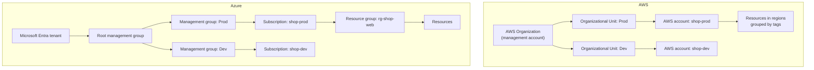

# AWS vs Azure: How the Platforms Compare

## Introduction

AWS and Azure are the two largest public clouds. They offer similar building blocks (VMs, storage, databases, serverless functions, containers, AI services), so at a distance they look interchangeable. Up close, they feel different. Microsoft's own guide for AWS professionals puts it well: the capabilities are similar, but the resources that provide them **are often organized differently**, because the two platforms grew independently.

A useful analogy: AWS and Azure are like two large hardware stores. Both sell hammers, nails and paint. But the aisles are arranged differently, the brand names differ, the checkout process differs, and each store has a few specialty departments the other lacks. Once you learn one store, the second is much faster to learn, as long as you expect the layout to differ.

This page compares the platforms on the things that shape your daily work:

- How accounts and resources are organized
- How identity and permissions work
- How resources are named and addressed
- Tooling: console, CLI, SDKs and Infrastructure as Code
- Typical strengths and how to choose

It does not try to declare a winner. The right choice depends on your team, your existing systems and your workloads.

## A Short History, and Why It Matters

- **AWS** launched its first broadly available services (S3 and SQS, then EC2) in 2006. It grew from the developer and startup world, with a philosophy of many small, composable services that each do one thing.
- **Azure** launched commercially in 2010 (as Windows Azure) and grew from Microsoft's enterprise software business. It integrates deeply with Microsoft's identity system (now **Microsoft Entra ID**), Windows Server, SQL Server, .NET, Microsoft 365 and GitHub.

These origins still show. AWS tends to expose lower-level building blocks and lets you assemble them. Azure tends to group things into larger managed offerings and makes enterprise identity and Microsoft-stack workloads very smooth. Both now serve startups and enterprises alike.

## How Resources Are Organized

This is the biggest conceptual difference, and it affects billing, permissions and cleanup.



| Level | AWS | Azure |
|-------|-----|-------|
| Identity directory | IAM (per account) and IAM Identity Center (org-wide) | Microsoft Entra ID tenant |
| Top of the hierarchy | AWS Organization with a management account | Root management group in the tenant |
| Grouping for policy | Organizational Units (OUs) | Management groups |
| Billing and security boundary | AWS account | Subscription |
| Grouping of related resources | Tags (plus optional AWS Resource Groups) | Resource groups (mandatory) plus tags |
| Org-wide guardrails | Service control policies (SCPs), resource control policies | Azure Policy |

Two practical consequences:

1. **On Azure, every resource must live in a resource group.** A resource group is a lifecycle container: deleting it deletes everything inside. This makes cleanup of experiments trivial.
2. **On AWS, the account is the strongest boundary.** Teams commonly create *many* accounts (per environment, per team, per workload) under one Organization. Inside an account, tags are how you group and find resources.

See [Organizing Resources: Accounts, Subscriptions and Resource Groups](../1-cloud-getting-started/5-cloud-resource-organization.mdx) and [Multi-Account and Landing Zone Strategy](../2-cloud-identity/7-cloud-multi-account-strategy.mdx).

## Who Am I? Checking Your Context

The first command you should run on any cloud tells you *which identity* and *which account or subscription* you are about to change.

### On AWS

```bash
aws sts get-caller-identity
```

Example output:

```text
{
    "UserId": "AROAEXAMPLEID:jane@example.com",
    "Account": "111122223333",
    "Arn": "arn:aws:sts::111122223333:assumed-role/AWSReservedSSO_Developer_abc123/jane@example.com"
}
```

### On Azure

```bash
az account show --query "{subscription:name, id:id, tenant:tenantId, user:user.name}" --output table
```

Example output:

```text
Subscription    Id                                    Tenant                                User
--------------  ------------------------------------  ------------------------------------  ----------------
shop-dev        00000000-1111-2222-3333-444444444444  aaaaaaaa-bbbb-cccc-dddd-eeeeeeeeeeee  jane@example.com
```

The AWS output shows the identity is an **assumed role** from single sign-on, a good sign. The Azure output shows a signed-in user and the active subscription. Make running these a habit before any destructive command.

## Identity and Permissions

Both clouds use the same core idea: an **identity** (a user, group, or workload) is granted **permissions** on **resources**. The mechanics differ.

| Aspect | AWS | Azure |
|--------|-----|-------|
| Human sign-in | IAM Identity Center (SSO) recommended; IAM users discouraged for people | Microsoft Entra ID users and groups |
| Workload identity | IAM roles (instance profiles, Lambda execution roles) | Managed identities (system- or user-assigned) |
| How permissions are written | JSON policy documents with `Effect`, `Action`, `Resource`, `Condition` | Role definitions (built-in or custom) assigned at a **scope** |
| Where permissions attach | To identities (identity-based) and to resources (resource-based policies) | Role assignments at management group, subscription, resource group or resource scope |
| Data access | Same IAM system for control and data (for example `s3:GetObject`) | Separate data-plane roles, such as Storage Blob Data Reader |
| Default | Deny unless explicitly allowed; explicit deny always wins | No access unless a role assignment grants it; deny assignments are rare and mostly system-managed |

Here is the same intent, "let the reporting app read objects in one storage location", on each cloud.

### On AWS: an IAM policy

```json
{
  "Version": "2012-10-17",
  "Statement": [
    {
      "Effect": "Allow",
      "Action": ["s3:GetObject", "s3:ListBucket"],
      "Resource": [
        "arn:aws:s3:::acme-reports",
        "arn:aws:s3:::acme-reports/*"
      ]
    }
  ]
}
```

You attach this policy to the role that the reporting app uses.

### On Azure: a role assignment

```bash
az role assignment create \
  --assignee-object-id <managed-identity-principal-id> \
  --assignee-principal-type ServicePrincipal \
  --role "Storage Blob Data Reader" \
  --scope "/subscriptions/<sub-id>/resourceGroups/rg-reports/providers/Microsoft.Storage/storageAccounts/acmereports"
```

Example output (trimmed):

```text
{
  "principalType": "ServicePrincipal",
  "roleDefinitionName": "Storage Blob Data Reader",
  "scope": "/subscriptions/.../storageAccounts/acmereports"
}
```

The AWS approach writes **what is allowed** in a document. The Azure approach picks **a named role** and assigns it **at a scope**. Both support custom definitions when the built-ins do not fit. Section 2 covers both in depth, starting with [Cloud IAM Concepts](../2-cloud-identity/0-cloud-iam-concepts.mdx).

## How Resources Are Named and Addressed

Every resource has a globally unique identifier you use in policies, scripts and IaC.

- **AWS** uses **ARNs** (Amazon Resource Names): `arn:partition:service:region:account-id:resource`.
- **Azure** uses **resource IDs**, which are paths through the hierarchy: `/subscriptions/{id}/resourceGroups/{rg}/providers/{namespace}/{type}/{name}`.

This parser shows the structure of each:

```python
# resource_ids.py: pull apart an AWS ARN and an Azure resource ID.

def parse_arn(arn):
    # arn:partition:service:region:account-id:resource
    parts = arn.split(":", 5)
    return {
        "partition": parts[1],
        "service": parts[2],
        "region": parts[3] or "(global)",
        "account": parts[4] or "(none)",
        "resource": parts[5],
    }


def parse_azure_id(resource_id):
    # /subscriptions/{sub}/resourceGroups/{rg}/providers/{ns}/{type}/{name}
    p = resource_id.strip("/").split("/")
    return {
        "subscription": p[1],
        "resource_group": p[3],
        "provider": p[5],
        "type": p[6],
        "name": p[7],
    }


print(parse_arn("arn:aws:lambda:eu-west-1:111122223333:function:thumbnailer"))
print(parse_arn("arn:aws:s3:::acme-reports"))
print(parse_azure_id(
    "/subscriptions/0000-1111/resourceGroups/rg-shop/providers/Microsoft.Web/sites/shop-api"
))
```

Output:

```text
{'partition': 'aws', 'service': 'lambda', 'region': 'eu-west-1', 'account': '111122223333', 'resource': 'function:thumbnailer'}
{'partition': 'aws', 'service': 's3', 'region': '(global)', 'account': '(none)', 'resource': 'acme-reports'}
{'subscription': '0000-1111', 'resource_group': 'rg-shop', 'provider': 'Microsoft.Web', 'type': 'sites', 'name': 'shop-api'}
```

Notice that the S3 bucket ARN has no region or account: bucket names are globally unique. Azure storage account names are also globally unique, because they become part of a DNS name (`acmereports.blob.core.windows.net`). Both clouds have this quirk for services that get public DNS names.

## Tooling Compared

| Tool | AWS | Azure |
|------|-----|-------|
| Web console | AWS Management Console | Azure portal |
| Browser shell | AWS CloudShell | Azure Cloud Shell (Bash or PowerShell) |
| Main CLI | AWS CLI v2 (`aws`) | Azure CLI (`az`) |
| PowerShell | AWS Tools for PowerShell | Azure PowerShell (`Az` module) |
| Python SDK | `boto3` | `azure-identity` plus per-service packages such as `azure-storage-blob` |
| Native declarative IaC | AWS CloudFormation (JSON/YAML) | ARM templates (JSON) and Bicep |
| Native IaC in programming languages | AWS CDK | No direct equivalent; Bicep is the recommended native language; Azure Developer CLI (`azd`) helps scaffold apps |
| Cross-cloud IaC | Terraform, OpenTofu, Pulumi | Terraform, OpenTofu, Pulumi |
| CI/CD | CodePipeline, CodeBuild, CodeDeploy | Azure DevOps (Pipelines), GitHub Actions |

AWS CodeCommit is no longer offered to new customers, so most AWS users store code on GitHub, GitLab or Bitbucket and connect it through AWS CodeConnections.

### CLI style

The two CLIs feel different. The AWS CLI mirrors API operation names (`describe-instances`, `create-bucket`). The Azure CLI uses a noun-then-verb structure (`az vm list`, `az storage account create`), and many commands include convenient defaults.

```bash
# AWS: list running instance IDs and types
aws ec2 describe-instances \
  --filters Name=instance-state-name,Values=running \
  --query "Reservations[].Instances[].[InstanceId,InstanceType]" \
  --output table

# Azure: list VMs with their sizes
az vm list --query "[].{name:name, size:hardwareProfile.vmSize}" --output table
```

Example output:

```text
---------------------------------------
|          DescribeInstances          |
+----------------------+--------------+
|  i-0a1b2c3d4e5f67890 |  t3.micro    |
+----------------------+--------------+

Name          Size
------------  ------------
vm-iaas-demo  Standard_B1s
```

Both CLIs use **JMESPath** for the `--query` option, so that skill transfers directly.

## Native Infrastructure as Code Side by Side

Each cloud has its own declarative template language. Here is the same thing, a private storage location with versioning on, in each.

### On AWS: CloudFormation

```yaml
# storage.yaml: deploy with
#   aws cloudformation deploy --template-file storage.yaml --stack-name reports-storage
AWSTemplateFormatVersion: "2010-09-09"
Resources:
  ReportsBucket:
    Type: AWS::S3::Bucket
    Properties:
      VersioningConfiguration:
        Status: Enabled
      PublicAccessBlockConfiguration:
        BlockPublicAcls: true
        IgnorePublicAcls: true
        BlockPublicPolicy: true
        RestrictPublicBuckets: true
Outputs:
  BucketName:
    Value: !Ref ReportsBucket
```

### On Azure: Bicep

```bicep
// storage.bicep: deploy with
//   az deployment group create --resource-group rg-reports --template-file storage.bicep
param location string = resourceGroup().location

resource reports 'Microsoft.Storage/storageAccounts@2023-05-01' = {
  name: 'streports${uniqueString(resourceGroup().id)}'
  location: location
  sku: { name: 'Standard_LRS' }
  kind: 'StorageV2'
  properties: {
    allowBlobPublicAccess: false
    minimumTlsVersion: 'TLS1_2'
  }
}

resource blobService 'Microsoft.Storage/storageAccounts/blobServices@2023-05-01' = {
  parent: reports
  name: 'default'
  properties: {
    isVersioningEnabled: true
  }
}

output accountName string = reports.name
```

Two differences stand out. CloudFormation groups resources into a **stack**, which you delete as a unit. Bicep deploys into a **resource group** (or a subscription or management group scope), and the resource group is the unit you delete. Also note that the CloudFormation snippet uses the `!Ref` short form, which plain YAML parsers do not understand without a custom loader; validate CloudFormation templates with `aws cloudformation validate-template` or `cfn-lint` instead. Both tools are covered in [Infrastructure as Code in the Cloud](../10-cloud-infrastructure-as-code/0-cloud-iac-introduction.mdx).

:::warning Cost warning
Deploying either template creates billable storage (usually very small for an empty bucket or account). Clean up with `aws cloudformation delete-stack --stack-name reports-storage` (empty the bucket first) or `az group delete --name rg-reports`.
:::

## Typical Strengths

These are broad tendencies, not absolutes. Both platforms improve constantly, and most workloads run well on either.

| Area | Often cited for AWS | Often cited for Azure |
|------|---------------------|------------------------|
| Breadth of services | Very broad catalog, many niche services | Broad catalog, strong integration across Microsoft products |
| Enterprise identity | IAM Identity Center integrates with external IdPs, including Entra ID | Entra ID is the identity system for Microsoft 365, so SSO and conditional access are native |
| Microsoft workloads | Runs Windows and SQL Server well | Licensing benefits such as Azure Hybrid Benefit for existing Windows Server and SQL Server licenses |
| Serverless and event-driven | Lambda, EventBridge, Step Functions are mature and widely used | Azure Functions, Event Grid, Durable Functions, Logic Apps |
| Containers | ECS with Fargate, EKS | Azure Container Apps, AKS |
| Developer ecosystem | Large community, many third-party tools | GitHub, Visual Studio and VS Code integration |
| AI platforms | Amazon Bedrock, Amazon SageMaker AI | Microsoft Foundry (formerly Azure AI Foundry), Azure OpenAI models |
| Hybrid | Outposts, Systems Manager | Azure Arc, Azure Local |

## Real-World Scenario

You are the tech lead at a 40-person company that sells scheduling software to clinics. Everyone uses Microsoft 365 for email and Teams. Developers write Python and TypeScript, and two of them have used AWS at previous jobs. The company has a few Windows Server VMs running a legacy .NET reporting app, and an enterprise agreement with Microsoft. A large customer requires single sign-on and conditional access for admin users. The CEO asks you to recommend a cloud for the next five years.

**How you evaluate:**

1. **List hard requirements**: data residency, compliance certifications needed by clinic customers, SSO for staff.
2. **List existing assets**: Microsoft 365 and Entra ID, Windows Server licenses, an enterprise agreement, two engineers with AWS experience.
3. **Prototype one representative service on both**: deploy the Python API with a managed PostgreSQL database on each cloud in a time-boxed spike (one or two days each), and note friction points.
4. **Estimate cost shape** with both pricing calculators for the same architecture, including support plans, data transfer and any license benefits.
5. **Score and decide**, then commit to one primary cloud.

Here, Azure has a natural advantage: staff identities already live in Entra ID, Windows licenses may carry over through Azure Hybrid Benefit, and there is an existing commercial relationship. AWS remains a strong option: two engineers know it, and IAM Identity Center can federate with Entra ID. If the prototype goes well on Azure, Azure is a reasonable primary choice. If the team strongly prefers AWS and the Windows app is going to be rewritten anyway, AWS is equally defensible.

### Why this approach

A decision based on hands-on prototypes, existing contracts and team skills holds up better than one based on feature checklists or blog posts. Committing to a primary cloud lets the team build depth and negotiate discounts.

### When to use it and when not to

Use a structured evaluation for any long-lived platform decision. Skip it for a weekend side project; use whichever cloud you already know.

### Alternatives and trade-offs

| Approach | Pros | Cons | Best for |
|----------|------|------|----------|
| Choose by team experience | Fastest start, fewest mistakes | May ignore licensing or identity advantages | Small teams, startups |
| Choose by existing vendor relationship | Contract leverage, integrated identity | May not match team skills | Microsoft-heavy or AWS-heavy enterprises |
| Choose by one standout service | Gets the best tool for a key need | Rest of the platform may be a weaker fit | Products centered on one capability |
| Structured prototype on both | Evidence-based, surfaces hidden friction | Takes a week or two of effort | Long-term platform decisions |
| Multi-cloud from day one | Flexibility | Double the learning and tooling | Rarely the right start (see [deployment models](./2-cloud-deployment-models.mdx)) |

## Common Mistakes

- **Expecting a one-to-one mapping.** Many services overlap only partly. Read the [service mapping](./6-cloud-service-mapping.mdx) notes, not just the names.
- **Ignoring the organization model.** Applying AWS habits (everything in one account) on Azure, or Azure habits (one subscription, many resource groups) on AWS, causes permission and billing pain.
- **Comparing list prices only.** Support plans, data transfer, license benefits and discounts often matter more.
- **Running commands in the wrong account or subscription.** Always check with `aws sts get-caller-identity` or `az account show`.
- **Learning products before concepts.** Concepts transfer between clouds; product details change.

## Summary

- AWS and Azure offer similar capabilities, organized differently.
- AWS uses Organizations, OUs and many accounts; Azure uses a tenant, management groups, subscriptions and mandatory resource groups.
- AWS permissions are JSON policies; Azure permissions are role assignments at a scope, with separate data-plane roles.
- AWS addresses resources with ARNs; Azure uses hierarchical resource IDs.
- Both have mature CLIs, SDKs and IaC tools; both CLIs use JMESPath queries.
- Choose based on requirements, existing assets, team skills and a hands-on prototype.

## Further Learning

Exercises:

1. Extend `resource_ids.py` with a function that takes an AWS ARN or Azure resource ID and returns a short "where is this?" description (for example "Lambda function in eu-west-1, account 1111...").
2. Write down your current or planned project's hard requirements and existing assets. Score AWS and Azure against them using the evaluation steps above.
3. Read Microsoft's [Azure for AWS professionals](https://learn.microsoft.com/azure/architecture/aws-professional/) overview and note two differences that surprised you.

Related pages:

- [AWS and Azure Service Mapping](./6-cloud-service-mapping.mdx)
- [Setting Up an AWS Account Safely](../1-cloud-getting-started/0-cloud-aws-account-setup.mdx)
- [Setting Up an Azure Account Safely](../1-cloud-getting-started/1-cloud-azure-account-setup.mdx)
- [Microsoft Entra ID and Azure RBAC](../2-cloud-identity/2-cloud-azure-entra-id.mdx)

External reading:

- [Azure for AWS professionals (Microsoft Learn)](https://learn.microsoft.com/azure/architecture/aws-professional/)
- [Amazon Resource Names (ARNs)](https://docs.aws.amazon.com/IAM/latest/UserGuide/reference-arns.html)
- [Azure Resource Manager overview](https://learn.microsoft.com/azure/azure-resource-manager/management/overview)
