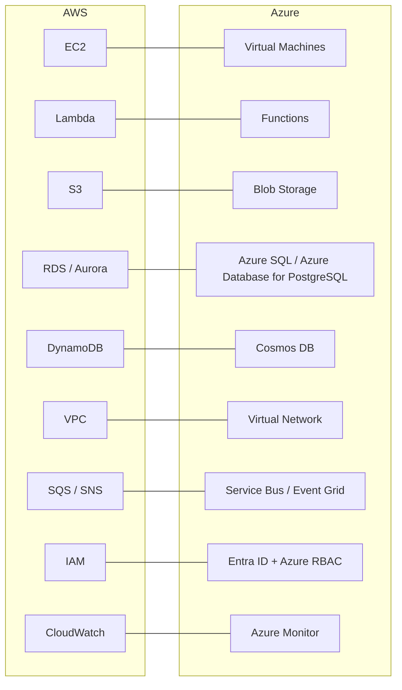

# AWS and Azure Service Mapping

## Introduction

If you know one cloud, the fastest way to learn the other is a **translation table**: "AWS calls it X, Azure calls it Y." This page gives you that table, organized by category, with notes on where the match is close and where it is only rough.

Treat the mapping like a phrasebook for a foreign language. It gets you to the right shop. It does not guarantee that "bread" means the same loaf in both countries. Microsoft's own [AWS-to-Azure comparison](https://learn.microsoft.com/azure/architecture/aws-professional/) states that not every service is listed and that matched services do not always have feature-for-feature parity.

How to use this page:

1. Find the service you know in the left column.
2. Note the equivalent and read the **Notes** column. A "Close match" note means concepts transfer directly. "Partial match" means plan for real differences.
3. Follow the link to the section of this tutorial that teaches that category on both clouds.

:::note
Service names change. This page uses names current at the time of writing, including recent renames such as **Microsoft Entra ID** (formerly Azure Active Directory), **Microsoft Foundry** (formerly Azure AI Foundry and Azure AI Studio) and **Azure Local** (formerly Azure Stack HCI). Check the official docs if a name looks unfamiliar.
:::

## The Big Picture



## Compute

| AWS | Azure | Notes |
|-----|-------|-------|
| Amazon EC2 | Azure Virtual Machines | Close match. Instance types vs VM sizes use different naming schemes. |
| EC2 Auto Scaling groups | Virtual Machine Scale Sets | Close match. |
| EC2 Spot Instances | Azure Spot Virtual Machines | Close match; both can be reclaimed with short notice. |
| Amazon Machine Images (AMIs) | Managed images and Azure Compute Gallery | Close match. |
| AWS Elastic Beanstalk | Azure App Service | Partial match. Beanstalk creates visible EC2 resources; App Service hides its VMs. |
| AWS Lambda | Azure Functions | Close match in concept. Hosting plans, triggers and limits differ. |
| AWS Batch | Azure Batch | Close match. |
| Amazon Lightsail | Azure App Service (simple tiers) | Partial match; Lightsail bundles VM, storage and networking into simple plans. |
| AWS Outposts | Azure Local | Partial match; both put provider-managed infrastructure on your site. |

Learn more in [Choosing a Compute Option](../3-cloud-compute/0-cloud-compute-options.mdx) and [Serverless Introduction](../4-cloud-serverless/0-cloud-serverless-introduction.mdx).

## Containers

| AWS | Azure | Notes |
|-----|-------|-------|
| Amazon ECR | Azure Container Registry (ACR) | Close match. |
| Amazon ECS on AWS Fargate | Azure Container Apps | Partial match. Both run containers without managing servers. Container Apps adds scale-to-zero, built-in revisions and KEDA-based autoscaling. |
| Amazon ECS on EC2 | No direct equivalent | Closest is AKS with your own node pools, or Container Apps workload profiles. |
| AWS App Runner | Azure Container Apps, Web App for Containers | Partial match for simple web containers. |
| (single container, no orchestration) | Azure Container Instances | ECS with a single Fargate task is the nearest AWS pattern. |
| Amazon EKS | Azure Kubernetes Service (AKS) | Close match. Both run upstream Kubernetes; control-plane pricing and add-ons differ. |

See [Container Options in the Cloud](../5-cloud-containers/0-cloud-container-options.mdx).

## Storage

| AWS | Azure | Notes |
|-----|-------|-------|
| Amazon S3 | Azure Blob Storage | Close match. Azure adds a **storage account** level above containers; S3 buckets sit directly in the account. |
| S3 storage classes (Standard, Standard-IA, Glacier tiers) | Blob access tiers (Hot, Cool, Cold, Archive) | Partial match. Similar ideas, different retrieval models and minimum durations. |
| Amazon EBS | Azure Managed Disks | Close match. |
| Amazon EFS | Azure Files (NFS shares) | Partial match. Azure Files also offers SMB, which EFS does not. |
| Amazon FSx (Windows, NetApp ONTAP and others) | Azure Files, Azure NetApp Files | Partial match, depends on the FSx flavor. |
| AWS Backup | Azure Backup | Close match. |
| AWS DataSync | Azure Storage Mover, AzCopy | Partial match. |
| AWS Snowball | Azure Data Box | Close match for offline bulk transfer. |

See [Object, Block and File Storage](../6-cloud-storage/0-cloud-storage-types.mdx).

## Databases

| AWS | Azure | Notes |
|-----|-------|-------|
| Amazon RDS for PostgreSQL / MySQL | Azure Database for PostgreSQL / MySQL (flexible server) | Close match. |
| Amazon RDS for SQL Server | Azure SQL Database, Azure SQL Managed Instance, SQL Server on Azure VMs | Partial match; Azure has more SQL Server options. |
| Amazon Aurora (and Aurora Serverless v2) | Azure Database for PostgreSQL / MySQL; Azure SQL Database serverless | Partial match. Aurora's shared distributed storage layer has no exact equivalent. |
| Amazon DynamoDB | Azure Cosmos DB for NoSQL | Partial match. Both are key-value / document stores with different consistency, capacity and pricing models. Cosmos DB offers several APIs. |
| Amazon DocumentDB | Azure Cosmos DB for MongoDB | Partial match. |
| Amazon Keyspaces | Azure Cosmos DB for Apache Cassandra, Azure Managed Instance for Apache Cassandra | Partial match. |
| Amazon Neptune | Azure Cosmos DB for Apache Gremlin | Partial match. |
| Amazon ElastiCache (Redis OSS, Valkey, Memcached) | Azure Managed Redis, Azure Cache for Redis | Partial match. Microsoft is steering new Redis workloads to Azure Managed Redis; check the current guidance. |
| Amazon Redshift | Azure Synapse Analytics, Microsoft Fabric Data Warehouse | Partial match. |
| Amazon Athena | Synapse serverless SQL pools, Microsoft Fabric | Partial match. |
| AWS Database Migration Service | Azure Database Migration Service | Close match in purpose. |

See [Choosing a Cloud Database](../7-cloud-databases/0-cloud-database-options.mdx).

## Networking

| AWS | Azure | Notes |
|-----|-------|-------|
| Amazon VPC | Azure Virtual Network (VNet) | Close match. |
| Subnets | Subnets | Close match. AWS subnets live in one AZ; Azure subnets span all zones in the region. |
| Security groups | Network security groups (NSGs) | Partial match. AWS security groups are stateful and allow-only; NSGs are stateful with allow and deny rules and priorities. |
| Network ACLs | NSGs on subnets | Partial match. AWS NACLs are stateless. |
| Internet gateway | Built into the VNet (default outbound) or NAT Gateway / public IP | Partial match. Microsoft is phasing out implicit default outbound internet access for new VNets in favor of explicit methods such as NAT Gateway; check the current timeline. |
| NAT gateway | Azure NAT Gateway | Close match. |
| Application Load Balancer | Azure Application Gateway | Close match (layer 7). |
| Network Load Balancer | Azure Load Balancer | Close match (layer 4). |
| Amazon Route 53 | Azure DNS, Azure Traffic Manager | Partial match. Route 53 combines DNS hosting and routing policies; Azure splits them. |
| Amazon CloudFront | Azure Front Door | Close match. |
| AWS Global Accelerator | Azure Front Door, Azure cross-region Load Balancer | Partial match. |
| AWS Transit Gateway | Azure Virtual WAN, hub-and-spoke VNets | Partial match. |
| AWS PrivateLink / VPC endpoints | Azure Private Link / private endpoints | Close match. |
| VPC peering | VNet peering | Close match. |
| AWS Direct Connect | Azure ExpressRoute | Close match. |
| AWS Site-to-Site VPN | Azure VPN Gateway | Close match. |
| AWS WAF | Azure Web Application Firewall | Close match. |
| AWS Network Firewall | Azure Firewall | Close match. |

See [Cloud Networking Introduction](../8-cloud-networking/0-cloud-networking-introduction.mdx).

## Messaging and Integration

| AWS | Azure | Notes |
|-----|-------|-------|
| Amazon SQS | Azure Service Bus queues, Azure Queue Storage | Partial match. Service Bus adds sessions, transactions and richer features; Queue Storage is the simpler option. |
| Amazon SNS | Service Bus topics, Azure Event Grid | Partial match. |
| Amazon EventBridge | Azure Event Grid | Partial match. Both route events by rules; schemas and sources differ. |
| Amazon Kinesis Data Streams | Azure Event Hubs | Close match for event streaming. |
| Amazon MSK (managed Kafka) | Azure Event Hubs (Kafka endpoint) | Partial match. Event Hubs speaks the Kafka protocol but is not Kafka itself. |
| Amazon Data Firehose | Event Hubs Capture, Azure Stream Analytics | Partial match. |
| AWS Step Functions | Azure Logic Apps, Durable Functions | Partial match. Logic Apps is connector-heavy and low-code; Durable Functions is code-first. |
| Amazon API Gateway | Azure API Management | Partial match. API Management is a fuller API platform with a developer portal. |

See [Choosing a Messaging Service](../9-cloud-messaging-and-integration/0-cloud-messaging-options.mdx).

## Identity, Security and Governance

| AWS | Azure | Notes |
|-----|-------|-------|
| AWS IAM (policies) | Azure RBAC (role assignments) | Partial match. Different permission models; see [AWS vs Azure](./5-cloud-aws-vs-azure.mdx). |
| AWS IAM Identity Center | Microsoft Entra ID | Partial match. Entra ID is a full directory; Identity Center connects to a directory (its own or an external IdP). |
| IAM roles for EC2 / Lambda | Managed identities | Close match in purpose. |
| Amazon Cognito | Microsoft Entra External ID | Partial match for customer sign-in. |
| AWS Organizations, OUs | Management groups | Partial match. |
| Service control policies | Azure Policy (deny effects) | Partial match. SCPs limit permissions; Azure Policy evaluates resource properties. |
| AWS KMS, AWS CloudHSM | Azure Key Vault, Key Vault Managed HSM | Close match. |
| AWS Secrets Manager | Azure Key Vault (secrets) | Close match; Key Vault stores keys, secrets and certificates in one service. |
| AWS Certificate Manager | Key Vault certificates, App Service managed certificates | Partial match. |
| Amazon GuardDuty | Microsoft Defender for Cloud (threat protection), Microsoft Sentinel | Partial match. |
| AWS Security Hub | Microsoft Defender for Cloud | Partial match. |
| Amazon Inspector | Defender for Cloud vulnerability assessment | Partial match. |
| AWS Config | Azure Policy, Azure Resource Graph change tracking | Partial match. |
| AWS CloudTrail | Azure Activity Log (plus resource logs) | Partial match. |
| AWS Shield | Azure DDoS Protection | Close match. |
| AWS Artifact | Microsoft Service Trust Portal | Close match. |

See [Cloud IAM Concepts](../2-cloud-identity/0-cloud-iam-concepts.mdx) and [Cloud Security Services](../12-cloud-observability-and-security/4-cloud-security-services.mdx).

## Monitoring, Management and DevOps

| AWS | Azure | Notes |
|-----|-------|-------|
| Amazon CloudWatch (metrics, alarms, dashboards) | Azure Monitor | Close match. |
| CloudWatch Logs | Azure Monitor Logs (Log Analytics workspaces) | Partial match. Log Analytics uses the KQL query language. |
| AWS X-Ray | Application Insights | Partial match. Both support OpenTelemetry. |
| AWS Systems Manager | Azure Automation, Azure Update Manager, Azure Arc | Partial match. |
| AWS Trusted Advisor | Azure Advisor | Close match. |
| AWS Cost Explorer, AWS Budgets | Microsoft Cost Management (cost analysis, budgets) | Close match. |
| AWS CloudFormation | ARM templates, Bicep | Close match in purpose. |
| AWS CDK | No direct native equivalent | Bicep is the native language; Terraform and Pulumi work on both. |
| AWS CodePipeline, CodeBuild, CodeDeploy | Azure Pipelines, GitHub Actions | Partial match. |
| AWS CloudShell | Azure Cloud Shell | Close match. |

## AI and Machine Learning

| AWS | Azure | Notes |
|-----|-------|-------|
| Amazon Bedrock | Microsoft Foundry (models, Agent Service) | Partial match. Both host foundation models from several vendors behind one API; model catalogs differ. |
| Amazon SageMaker AI | Azure Machine Learning | Close match for building and training custom models. |
| Amazon Rekognition | Azure AI Vision (Foundry Tools) | Partial match. |
| Amazon Textract | Azure AI Document Intelligence | Partial match. |
| Amazon Comprehend | Azure AI Language | Partial match. |
| Amazon Polly, Amazon Transcribe | Azure AI Speech | Partial match. |

Microsoft has been regrouping its prebuilt AI services under the Foundry brand (for example, "Azure AI Services" is now called **Foundry Tools**). See [Cloud AI Services: Bedrock and Microsoft Foundry](../13-cloud-architecture/7-cloud-ai-services.mdx).

## Checking Availability in a Region

A mapping tells you a service exists. It does not tell you it exists **in your region**. Check before you design.

### On AWS

AWS publishes service availability as public SSM parameters:

```bash
# Is Amazon Bedrock available in eu-west-3?
aws ssm get-parameters-by-path \
  --path /aws/service/global-infrastructure/regions/eu-west-3/services \
  --query "Parameters[?Value=='bedrock'].Value" \
  --output text
```

Example output (empty output means "not listed"):

```text
bedrock
```

### On Azure

Each Azure service is a **resource provider** with resource types and supported locations:

```bash
# Where can I create Azure Container Apps?
az provider show \
  --namespace Microsoft.App \
  --query "resourceTypes[?resourceType=='containerApps'].locations | [0]" \
  --output tsv
```

Example output (trimmed):

```text
East US
East US 2
West Europe
North Europe
Sweden Central
```

## A Mapping Helper in Python

When planning a migration, it helps to keep the mapping in code so you can translate an architecture inventory and flag partial matches for review.

```python
# service_map.py: translate an AWS component list to Azure and flag risky matches.

MAPPING = {
    "EC2": ("Azure Virtual Machines", "close"),
    "Lambda": ("Azure Functions", "close"),
    "S3": ("Azure Blob Storage", "close"),
    "RDS PostgreSQL": ("Azure Database for PostgreSQL", "close"),
    "Aurora": ("Azure Database for PostgreSQL / MySQL", "partial"),
    "DynamoDB": ("Azure Cosmos DB for NoSQL", "partial"),
    "SQS": ("Azure Service Bus queues", "partial"),
    "EventBridge": ("Azure Event Grid", "partial"),
    "ECS Fargate": ("Azure Container Apps", "partial"),
    "CloudFront": ("Azure Front Door", "close"),
    "Ground Station": (None, "none"),
}

architecture = ["CloudFront", "ECS Fargate", "Aurora", "SQS", "Lambda", "S3", "Ground Station"]

for svc in architecture:
    target, match = MAPPING.get(svc, (None, "unknown"))
    flag = {"close": "ok", "partial": "REVIEW", "none": "NO EQUIVALENT", "unknown": "NOT IN MAP"}[match]
    print(f"{svc:15} -> {target or '-':40} [{flag}]")
```

Output:

```text
CloudFront      -> Azure Front Door                         [ok]
ECS Fargate     -> Azure Container Apps                     [REVIEW]
Aurora          -> Azure Database for PostgreSQL / MySQL    [REVIEW]
SQS             -> Azure Service Bus queues                 [REVIEW]
Lambda          -> Azure Functions                          [ok]
S3              -> Azure Blob Storage                       [ok]
Ground Station  -> -                                        [NO EQUIVALENT]
```

Every `REVIEW` line is where you should read both services' docs and test before committing.

## Real-World Scenario

Your company acquired a startup whose product runs on AWS: CloudFront, ECS on Fargate, Aurora PostgreSQL, SQS, a few Lambda functions and S3. The parent company standardizes on Azure. Leadership asks how hard it would be to move the product to Azure, and whether it is worth it.

**Your approach:**

1. **Inventory** every AWS service in use (Cost Explorer grouped by service, plus a tag report).
2. **Map** each one with the table above and the script, and mark partial matches.
3. **Spike the risky parts**: run the containers on Azure Container Apps; test the app on Azure Database for PostgreSQL (checking any Aurora-specific features the code depends on); rewrite one SQS consumer for Service Bus.
4. **Estimate** effort and cost for both options: migrate, or keep the product on AWS and integrate at the identity, networking and billing level.

The spikes show that containers and PostgreSQL move easily, while queue code and IaC need rewriting. You present both options with honest effort estimates.

### Why this approach

A mapping table makes the plan fast to draft, but partial matches hide the real work. Spiking the riskiest components replaces guesses with evidence before anyone commits to a timeline.

### When to use it and when not to

Use a mapping-driven assessment whenever you translate an architecture between clouds or evaluate a second cloud. Do not use the mapping alone as a migration plan; it says nothing about data volume, downtime tolerance or team skills.

### Alternatives and trade-offs

| Approach | Pros | Cons | Best for |
|----------|------|------|----------|
| Keep the acquired product on AWS | No migration risk, team keeps its skills | Two clouds to govern | Products that work well and have a stable team |
| Rehost containers and databases, rewrite glue | Moves most value quickly | Queue and event code needs changes | Container-based apps with standard databases |
| Full re-architecture on Azure-native services | Best long-term fit with the parent platform | Longest and riskiest | Products due for a rewrite anyway |
| Make the app portable first (Kubernetes, standard Kafka or AMQP, PostgreSQL) | Easier future moves | Gives up some managed-service benefits | Companies expecting more acquisitions or moves |

## Common Mistakes

- **Treating the mapping as exact.** "DynamoDB equals Cosmos DB" hides real differences in consistency, capacity and pricing.
- **Forgetting the glue.** IAM policies, IaC templates, CI/CD pipelines and monitoring queries all need translating too.
- **Not checking regional availability** for the target service.
- **Missing services with no equivalent**, such as niche AWS-only or Azure-only offerings.
- **Using old names** when searching docs. Search for current names, such as Entra ID and Microsoft Foundry.

## Summary

- Most core AWS services have an Azure counterpart, but many matches are partial.
- Biggest structural differences: Azure storage accounts and resource groups, AWS per-AZ subnets, different permission models, and how messaging is split across services.
- Always check regional availability with `aws ssm get-parameters-by-path` or `az provider show`.
- Use mapping tables to draft plans, then spike partial matches before committing.

## Further Learning

Exercises:

1. Add five more services your project uses to `MAPPING` in `service_map.py`, with honest match ratings.
2. Pick one "partial match" pair (for example SQS and Service Bus queues). List three features that differ, using the official docs.
3. Use the region availability commands above to check whether the services you need exist in your preferred region on both clouds.

Related pages:

- [AWS vs Azure: How the Platforms Compare](./5-cloud-aws-vs-azure.mdx)
- [Cloud Terminology Cheat Sheet](./9-cloud-terminology.mdx)
- [Migration Strategies: The 7 Rs](../13-cloud-architecture/6-cloud-migration-strategies.mdx)
- [Multi-Cloud and Hybrid Strategy](../13-cloud-architecture/5-cloud-multi-cloud-strategy.mdx)

External reading:

- [Azure for AWS professionals](https://learn.microsoft.com/azure/architecture/aws-professional/)
- [AWS services by Region](https://aws.amazon.com/about-aws/global-infrastructure/regional-product-services/)
- [Azure products available by region](https://azure.microsoft.com/explore/global-infrastructure/products-by-region)
