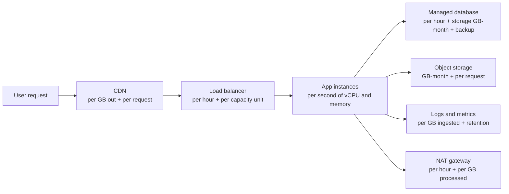

# Cloud Pricing Models

## Introduction

Cloud bills surprise people. Not because providers hide prices, since both publish detailed price lists, but because cloud pricing has **many small meters** running at once. A simple web app might be billed for VM seconds, disk GB-months, snapshot storage, load balancer hours, load balancer capacity units, requests, log ingestion, and every gigabyte of data sent to users.

This page teaches you **how** the clouds bill, not how much. Exact prices vary by region, change over time, and depend on your agreements, so this tutorial never states them as fact. Instead, use the official calculators:

- [AWS Pricing Calculator](https://calculator.aws/)
- [Azure Pricing Calculator](https://azure.microsoft.com/pricing/calculator/)

An analogy: cloud pricing is like a utility bill. Electricity is billed per kilowatt-hour, water per cubic meter, and there is a fixed connection fee. You can sign a fixed-rate contract for a discount, or pay the spot rate. Understanding the meters is what lets you predict and control the bill.

## The Main Billing Dimensions

Almost every cloud charge is one of these units, multiplied by a rate:

| Dimension | Unit | Examples |
|-----------|------|----------|
| Compute time | Per second or per hour of capacity | EC2 instances, Azure VMs, App Service plans, Fargate vCPU and memory |
| Compute duration x memory | GB-seconds | AWS Lambda, Azure Functions Flex Consumption |
| Requests or operations | Per million requests, per 10,000 operations | Lambda invocations, S3 GET/PUT, Blob Storage transactions, API Gateway calls |
| Storage | Per GB-month | S3, Blob Storage, EBS, Managed Disks, backups and snapshots |
| Provisioned throughput or capacity | Per unit-hour | DynamoDB provisioned capacity, Cosmos DB RU/s, provisioned IOPS on disks |
| Data transfer | Per GB | Data out to the internet (egress), between regions, sometimes between zones |
| Fixed resource hours | Per hour the resource exists | Load balancers, NAT gateways, VPN gateways, public IPv4 addresses |
| Per user or seat | Per user per month | Some SaaS and developer tools |
| Support plans | Monthly fee or percentage of spend | AWS Support plans, Azure support plans |



Every arrow and box in that diagram is a separate meter. A cost estimate that only includes "the servers" will be wrong.

### Data transfer: the meter people forget

The general pattern on both clouds:

- **Data into the cloud (ingress)** from the internet is usually free.
- **Data out to the internet (egress)** is billed per GB beyond a free monthly allowance, with lower per-GB rates at higher volumes.
- **Data between regions** is billed.
- **Data between availability zones** is billed on AWS for many services; Azure documents that it does not charge for data transfer between zones in the same region.
- **Data within the same zone** using private IPs is generally free.
- **CDNs** have their own egress pricing, often lower than serving directly from a region.

Both providers also offer free egress for customers **moving their data out** to another provider, under conditions (for example, AWS requires you to contact support and complete the move within a time window). This was influenced partly by the EU Data Act.

## Pricing Models for Compute

For the same VM, you can usually choose between several purchase models.

| Model | How it works | Commitment | Risk | Best for |
|-------|--------------|-----------|------|----------|
| On-demand / pay-as-you-go | Pay the list rate per second or hour | None | Highest unit price | New, variable or short-lived workloads |
| Savings plans | Commit to spend a fixed amount per hour for 1 or 3 years; discount applies flexibly | 1 or 3 years | Paying for unused commitment | Steady baseline usage that may change shape |
| Reserved capacity (Reserved Instances, Azure Reservations) | Commit to a specific resource type, often in a region, for 1 or 3 years | 1 or 3 years | Less flexible than savings plans | Very stable workloads, databases |
| Spot | Use spare capacity at a deep discount; it can be reclaimed with short notice | None | Interruptions | Fault-tolerant batch, CI runners, stateless workers |
| License benefits (BYOL) | Use existing licenses to reduce the price | Depends on licenses | Compliance with license terms | Windows Server and SQL Server workloads |

### On AWS

- **Savings Plans**: commit to a consistent amount of usage (measured in currency per hour) for one or three years.
  - **Compute Savings Plans** apply across EC2 instance families, sizes, regions and operating systems, and also to AWS Fargate and AWS Lambda.
  - **EC2 Instance Savings Plans** give a larger discount but apply to one instance family in one region.
  - **SageMaker AI Savings Plans** cover SageMaker AI instance usage.
  - Payment options: all upfront, partial upfront, or no upfront.
- **Reserved Instances**: still used, especially for services such as Amazon RDS, ElastiCache, OpenSearch and Redshift.
- **Spot Instances**: spare EC2 capacity with a two-minute interruption notice.

AWS Cost Explorer recommends a commitment based on your past usage:

```bash
aws ce get-savings-plans-purchase-recommendation \
  --savings-plans-type COMPUTE_SP \
  --term-in-years ONE_YEAR \
  --payment-option NO_UPFRONT \
  --lookback-period-in-days THIRTY_DAYS \
  --query "SavingsPlansPurchaseRecommendation.SavingsPlansPurchaseRecommendationSummary.{commit:HourlyCommitmentToPurchase, savingsPct:EstimatedSavingsPercentage}"
```

Example output (values depend entirely on your usage):

```text
{
    "commit": "<recommended hourly commitment>",
    "savingsPct": "<estimated percentage>"
}
```

### On Azure

- **Azure savings plan for compute**: commit to a fixed hourly spend for one or three years; it applies across eligible compute services and regions.
- **Azure Reservations**: commit to a specific resource (for example a VM size in a region, or database capacity) for one or three years.
- **Azure Spot Virtual Machines**: spare capacity that can be evicted; you set an eviction policy (deallocate or delete) and optionally a maximum price.
- **Azure Hybrid Benefit**: apply existing Windows Server or SQL Server licenses with Software Assurance (or qualifying subscriptions) to reduce the price.

Azure Advisor shows reservation and savings plan recommendations:

```bash
az advisor recommendation list \
  --category Cost \
  --query "[].{impact:impact, problem:shortDescription.problem}" \
  --output table
```

Example output:

```text
Impact    Problem
--------  ------------------------------------------------------------
High      Consider virtual machine reserved instance to save over your on-demand costs
Medium    Right-size or shutdown underutilized virtual machines
Low       Use Standard Storage to store Managed Disks snapshots
```

### Mapping

| Concept | AWS | Azure |
|---------|-----|-------|
| Pay per use, no commitment | On-Demand | Pay-as-you-go |
| Flexible spend commitment | Compute Savings Plans | Azure savings plan for compute |
| Resource-specific commitment | Reserved Instances, EC2 Instance Savings Plans | Azure Reservations |
| Spare capacity | Spot Instances | Azure Spot Virtual Machines |
| Bring your own license | BYOL on EC2 (with Dedicated Hosts for some licenses) | Azure Hybrid Benefit |
| Commitment recommendations | Cost Explorer recommendations | Azure Advisor, Cost Management |
| Free offers for new customers | AWS Free Tier (Free plan with credits) | Azure free account |

## Looking Up Prices Programmatically

Both clouds publish machine-readable price lists. These are free to query and do not create resources.

### On AWS: the Price List Query API

```bash
# The Price List API is served from a few regions such as us-east-1
aws pricing get-products \
  --region us-east-1 \
  --service-code AmazonEC2 \
  --filters \
    Type=TERM_MATCH,Field=instanceType,Value=t3.micro \
    Type=TERM_MATCH,Field=location,Value="US East (N. Virginia)" \
    Type=TERM_MATCH,Field=operatingSystem,Value=Linux \
    Type=TERM_MATCH,Field=tenancy,Value=Shared \
    Type=TERM_MATCH,Field=preInstalledSw,Value=NA \
    Type=TERM_MATCH,Field=capacitystatus,Value=Used \
  --max-results 1 \
  --query "PriceList[0]" \
  --output text | python3 -m json.tool | head -20
```

The result is a JSON document describing the product and its `terms` (OnDemand and Reserved), each with a `pricePerUnit` and a `unit` such as `Hrs`.

### On Azure: the Retail Prices API

The Azure Retail Prices API is public and needs no sign-in. Here is a small Python script that queries it with the standard library:

```python
# azure_retail_price.py: look up the retail price meters for one VM size.
import json
import urllib.parse
import urllib.request

API = "https://prices.azure.com/api/retail/prices"
flt = (
    "serviceName eq 'Virtual Machines' "
    "and armRegionName eq 'eastus' "
    "and armSkuName eq 'Standard_B2s' "
    "and priceType eq 'Consumption'"
)
url = API + "?" + urllib.parse.urlencode({"$filter": flt})

with urllib.request.urlopen(url, timeout=30) as resp:
    data = json.load(resp)

for item in data["Items"]:
    print(item["productName"], "|", item["meterName"], "|",
          item["unitOfMeasure"], "|", item["retailPrice"], item["currencyCode"])
```

Example output (shape only; prices omitted because they change):

```text
Virtual Machines BS Series | B2s | 1 Hour | <price> USD
Virtual Machines BS Series Windows | B2s | 1 Hour | <price> USD
Virtual Machines BS Series | B2s Spot | 1 Hour | <price> USD
```

Notice how one VM size has several meters: Linux, Windows (which includes the OS license), and Spot. That is typical.

## Modeling Commitments

The key question for any commitment is: **how much of my usage is steady enough to commit to?** Committing to more than your steady baseline means paying for unused commitment. Committing to less leaves savings on the table.

The script below models a week of hourly usage and compares commitment levels. **The rate and discount are invented placeholders**; plug in real numbers from the calculators.

```python
# commitment_model.py: how much should we commit? (illustrative numbers only)

ON_DEMAND_RATE = 1.00   # cost units per vCPU-hour (placeholder)
DISCOUNT = 0.30         # placeholder commitment discount, 30%

# vCPUs in use for each hour of a typical day: low at night, peak in the afternoon
day = [8] * 7 + [12, 16, 20, 24, 24, 24, 24, 20, 20, 16, 12] + [8] * 6
week = day * 7


def weekly_cost(committed_vcpus):
    committed_rate = ON_DEMAND_RATE * (1 - DISCOUNT)
    total = 0.0
    for used in week:
        total += committed_vcpus * committed_rate          # paid whether used or not
        overflow = max(0, used - committed_vcpus)
        total += overflow * ON_DEMAND_RATE                  # anything above the commitment
    return total


baseline = weekly_cost(0)
for commit in [0, 4, 8, 12, 16, 24]:
    cost = weekly_cost(commit)
    print(f"commit {commit:>2} vCPU: cost {cost:8.1f}  saving vs on-demand {100 * (1 - cost / baseline):5.1f}%")
```

Output:

```text
commit  0 vCPU: cost   2212.0  saving vs on-demand   0.0%
commit  4 vCPU: cost   2010.4  saving vs on-demand   9.1%
commit  8 vCPU: cost   1808.8  saving vs on-demand  18.2%
commit 12 vCPU: cost   1971.2  saving vs on-demand  10.9%
commit 16 vCPU: cost   2189.6  saving vs on-demand   1.0%
commit 24 vCPU: cost   2822.4  saving vs on-demand -27.6%
```

The best commitment here is the **always-on baseline** (8 vCPUs). Committing to the peak (24 vCPUs) costs **more** than paying on-demand. The peaks are better served by on-demand capacity, autoscaling, or Spot.

## Billing Shapes for Serverless and Storage

Not everything is priced by the hour. Serverless and storage services usually combine two or three meters, and it helps to write the formula down before you open a calculator.

| Service type | AWS example | Azure example | Formula shape |
|--------------|-------------|---------------|---------------|
| Functions | Lambda | Functions Flex Consumption | requests x rate + (GB-seconds) x rate, plus any always-ready or provisioned capacity |
| Object storage | S3 | Blob Storage | GB-month x tier rate + operations x rate + retrieval (cool and archive tiers) + egress |
| NoSQL database | DynamoDB on-demand | Cosmos DB serverless | read and write request units x rate + GB-month storage |
| API front door | API Gateway | API Management (consumption tier) | requests x rate + data transfer |
| Queues | SQS | Service Bus | requests or operations x rate (Service Bus also has tiered base charges) |

Here is the function formula as code. The rates are **placeholders**; fill them in from the official pricing pages for your region.

```python
# serverless_estimate.py: estimate a function's monthly bill from its usage shape.
# All rates are placeholders, not real prices.

RATE_PER_MILLION_REQUESTS = 0.20
RATE_PER_GB_SECOND = 0.0000167
FREE_REQUESTS = 0            # set to your plan's monthly free grant, if any
FREE_GB_SECONDS = 0


def monthly_function_cost(requests, avg_duration_ms, memory_mb):
    gb_seconds = requests * (avg_duration_ms / 1000) * (memory_mb / 1024)
    billable_requests = max(0, requests - FREE_REQUESTS)
    billable_gb_s = max(0, gb_seconds - FREE_GB_SECONDS)
    return (billable_requests / 1e6) * RATE_PER_MILLION_REQUESTS + billable_gb_s * RATE_PER_GB_SECOND


for mem in (512, 1024, 2048):
    cost = monthly_function_cost(requests=5_000_000, avg_duration_ms=120, memory_mb=mem)
    print(f"{mem:>5} MB: {cost:6.2f} cost units per month")
```

Output:

```text
  512 MB:   6.01 cost units per month
 1024 MB:  11.02 cost units per month
 2048 MB:  21.04 cost units per month
```

Doubling memory roughly doubles the compute part of the bill, **unless** the extra memory (which also brings more CPU on Lambda) makes each invocation finish faster. Measure duration at each memory size before deciding.

## Support Plans and Agreements

Two items rarely appear in a calculator estimate but affect the real bill:

- **Support plans**: both providers offer tiers from free basic support to business and enterprise plans. Paid tiers are usually priced as a monthly minimum or a percentage of your spend. Production workloads typically need at least a business-level plan for timely help.
- **Commercial agreements**: large customers sign enterprise agreements or private pricing deals with committed spend in exchange for discounts. Buying through a partner or marketplace can also change the price. These terms are private and vary by customer.

## Free Tiers and Credits

Both providers offer free options, and both changed them recently, so read the current terms:

- **AWS**: new customers choose between a **Free plan** (promotional credits, access to selected services, no charges unless you upgrade, and the account closes after a set period or when credits run out) and a **Paid plan**. Some services also have always-free monthly allowances. See [AWS Free Tier](https://aws.amazon.com/free/).
- **Azure**: the **free account** gives a credit for the first 30 days, popular services free for 12 months, and some services always free within monthly limits. To continue after 30 days you upgrade to pay-as-you-go. See [Azure free account](https://azure.microsoft.com/pricing/purchase-options/azure-account).

Free allowances are per account and limited. Leaving resources running after the allowance ends is a common way to receive a first bill.

## Real-World Scenario

You run the platform for a SaaS helpdesk on AWS (the same reasoning applies to Azure). The monthly bill has grown steadily, and finance asks you to cut it without hurting reliability. Cost Explorer shows:

- Compute on EC2 and Fargate is the largest line, with a steady weekday baseline and afternoon peaks.
- NAT gateway data processing is surprisingly high.
- Log ingestion has doubled since a debug log level was left on.
- Several unattached EBS volumes and old snapshots exist.

**The plan, in order:**

1. **Remove waste first**: delete unattached volumes and old snapshots, fix the log level, add log retention policies. Never commit to waste.
2. **Fix architecture costs**: route S3 and DynamoDB traffic through VPC gateway endpoints instead of the NAT gateway, which removes NAT data processing charges for that traffic.
3. **Right-size**: use utilization data to move over-sized instances to smaller sizes.
4. **Commit to the new baseline**: buy a one-year Compute Savings Plan covering the steady baseline only.
5. **Use Spot for fault-tolerant work**: move CI runners and the nightly report workers to Spot.
6. **Watch it**: budgets and anomaly alerts per team, using tags.

On Azure the equivalent steps are: delete orphaned disks, set Log Analytics retention and table plans, use private endpoints or service endpoints for storage traffic, right-size with Azure Advisor, buy an Azure savings plan for compute for the baseline, and use Spot VMs or Spot node pools for batch work.

### Why this approach

Commitments lock in your current usage pattern. Cleaning up and right-sizing first means you commit to a smaller, efficient baseline. Fixing the NAT and logging issues removes costs that no discount would touch.

### When to use it and when not to

Commit only when you have a few months of stable usage data and expect the workload to last at least the term. Do not commit for a product that may be shut down or re-architected (for example, moving from VMs to serverless) within the term, unless the plan type covers the new service.

### Alternatives and trade-offs

| Approach | Pros | Cons | Best for |
|----------|------|------|----------|
| Stay fully on-demand | Maximum flexibility | Highest unit price | Early-stage or rapidly changing workloads |
| Flexible savings plan for the baseline | Good discount, survives instance changes | Commitment risk if usage falls | Steady but evolving compute |
| Resource-specific reservations | Often the deepest discount | Locked to a type and region | Very stable databases and VMs |
| Spot for interruptible work | Large discounts | Interruptions; needs retry-friendly design | Batch, CI, stateless workers |
| Architecture changes (endpoints, caching, serverless) | Removes costs at the source | Engineering effort | Large non-compute line items |

## Common Mistakes

- **Estimating only compute.** Data transfer, NAT gateways, load balancers, logs and backups add up.
- **Committing before cleaning up.** You lock in waste for one to three years.
- **Committing to peak usage.** Commit to the baseline and let on-demand or Spot absorb peaks.
- **Forgetting fixed hourly resources.** NAT gateways, load balancers and public IPv4 addresses bill every hour they exist, even with no traffic.
- **Ignoring region price differences.** The same service can cost noticeably more in some regions.
- **Assuming free tier lasts forever.** Read the end date and set a budget alert.

## Summary

- Cloud bills are the sum of many meters: compute time, GB-seconds, requests, GB-months, data transfer, fixed resource hours and support.
- Data egress and cross-zone or cross-region traffic are easy to overlook.
- Purchase models trade flexibility for discount: on-demand, savings plans, reservations, Spot and license benefits.
- Commit only to your steady baseline, after removing waste and right-sizing.
- Use the official calculators and price APIs for numbers; prices vary by region and change over time.

## Further Learning

Exercises:

1. Change `commitment_model.py` so the workload runs only on weekdays. What is the best commitment level now?
2. Use the AWS or Azure pricing calculator to estimate a small web app: two small VMs, a load balancer, a managed database and 100 GB of egress per month. Which line is largest?
3. Run `azure_retail_price.py` for two different regions and compare how many meters each VM size has.

Related pages:

- [Budgets and Billing Alerts](../1-cloud-getting-started/7-cloud-budgets-and-alerts.mdx)
- [Spot, Reserved and Savings Plans](../3-cloud-compute/4-cloud-spot-and-reserved.mdx)
- [Cost Optimization and FinOps](../13-cloud-architecture/4-cloud-cost-optimization.mdx)
- [Project: Cost Monitoring and Alerts](../14-cloud-projects/6-cloud-project-cost-dashboard.mdx)

External reading:

- [What are Savings Plans? (AWS)](https://docs.aws.amazon.com/savingsplans/latest/userguide/what-is-savings-plans.html)
- [Azure savings plan for compute](https://learn.microsoft.com/azure/cost-management-billing/savings-plan/savings-plan-compute-overview)
- [Azure Retail Prices API](https://learn.microsoft.com/rest/api/cost-management/retail-prices/azure-retail-prices)
- [AWS Price List API](https://docs.aws.amazon.com/awsaccountbilling/latest/aboutv2/price-changes.html)
