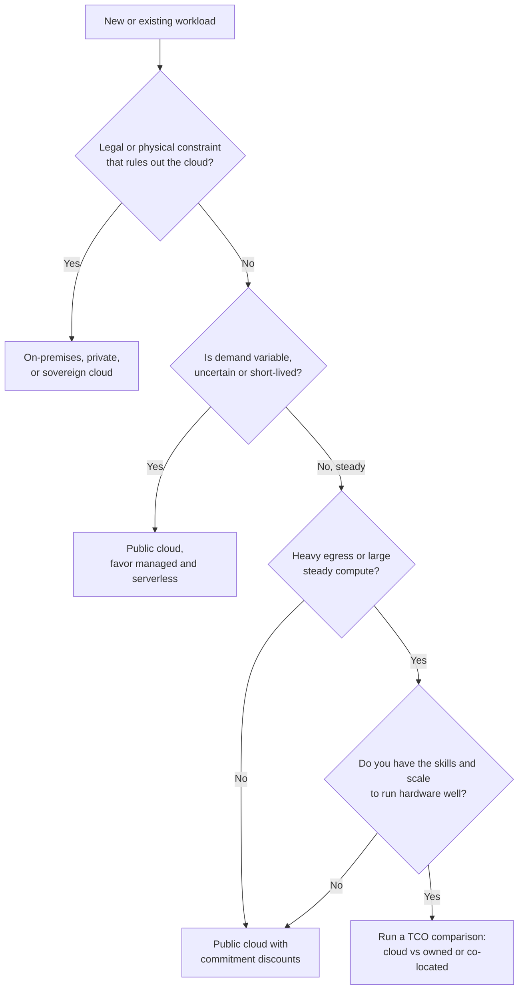

# When the Cloud Makes Sense and When It Doesn't

## Introduction

Cloud providers, consultants and conference talks mostly tell you why you should move to the cloud. This page gives you the other half too. The cloud is an excellent fit for many workloads, a poor fit for some, and a "depends on how you use it" fit for the rest.

The question is never "cloud or not?" in general. It is "**for this workload, with this team, at this stage, what is the best place to run it?**"

An analogy: renting a car versus buying one. If you need a car for a weekend trip, or a van once a year, or ten cars for a week, renting is obviously better. If you drive the same commute every day for ten years, buying is often cheaper, as long as you are willing to handle maintenance and insurance. Most people do both at different times. Companies do too.

This page covers:

- The workload traits that make the cloud a strong fit
- The traits that make it a weak fit
- How to compare **total cost of ownership** (TCO) honestly
- How to make and revisit the decision

## Where the Cloud Shines

| Trait | Why the cloud helps | Example |
|-------|---------------------|---------|
| **Variable or spiky demand** | Pay for peaks only while they last; scale down afterward | Ticket sales, tax season, marketing campaigns |
| **Uncertain growth** | No need to buy hardware for a guess about next year | A new product or startup |
| **Short-lived or experimental work** | Create, test and delete in hours | Prototypes, load tests, training runs |
| **Need for many managed services** | Databases, queues, ML and identity without building them | Most modern web apps |
| **Global users** | Regions and edge networks on every continent | Consumer apps, SaaS with international customers |
| **Small team, no ops staff** | The provider runs hardware, patching and much of the platform | Startups, internal tools teams |
| **Disaster recovery** | A second region without building a second data center | Backups and standby environments |
| **Fast hiring and onboarding** | Widely known platforms and tools | Teams that need to grow quickly |

## Where the Cloud Struggles

| Trait | Why it can be a weak fit | What teams do instead |
|-------|-------------------------|-----------------------|
| **Large, steady, predictable load** | You pay a premium for elasticity you never use | Owned or co-located hardware, or deep commitments |
| **Very high data egress** | Per-GB egress fees on huge volumes add up | CDNs with negotiated pricing, co-location, keeping processing near the data |
| **Ultra-low latency to on-site equipment** | The nearest region may be too far | On-premises, edge offerings (Outposts, Azure Local, Local Zones) |
| **Strict physical control or sovereignty** | Some rules require specific facilities or operators | Private cloud, sovereign cloud offerings |
| **Legacy software tied to hardware or licenses** | Licensing may not allow cloud use, or costs more there | Keep on-premises, or negotiate license mobility |
| **Scarce specialized hardware at scale** | Large GPU fleets may be hard to get on demand | Reserved capacity, owned clusters, specialized GPU providers |
| **A team that will not learn cloud operations** | Cloud mistakes (open storage, leaked keys, runaway costs) are expensive | Training first, or a simpler managed platform |

Some well-known companies have publicly moved large, steady workloads **off** the public cloud onto their own hardware ("repatriation"), citing cost. Others have moved **into** the cloud and shut down data centers, citing speed and reliability. Both can be right, because their workloads and teams differ.

## The Decision Flow



## Measuring What You Spend Today

You cannot compare options without knowing your current costs. If you already run on a cloud, start with spend by service.

### On AWS

```bash
# Last full month's cost, grouped by service
aws ce get-cost-and-usage \
  --time-period Start=2026-09-01,End=2026-10-01 \
  --granularity MONTHLY \
  --metrics UnblendedCost \
  --group-by Type=DIMENSION,Key=SERVICE \
  --query "ResultsByTime[0].Groups[].[Keys[0], Metrics.UnblendedCost.Amount]" \
  --output table
```

Example output (amounts replaced with placeholders):

```text
---------------------------------------------------------
|                   GetCostAndUsage                     |
+-------------------------------------------+-----------+
|  Amazon Elastic Compute Cloud - Compute   |  <amount> |
|  Amazon Relational Database Service       |  <amount> |
|  Amazon Simple Storage Service            |  <amount> |
|  AWS Data Transfer                        |  <amount> |
|  AmazonCloudWatch                         |  <amount> |
+-------------------------------------------+-----------+
```

### On Azure

The Cost Management Query API returns the same kind of breakdown. The `az rest` command calls it with your current sign-in:

```bash
SUB_ID=$(az account show --query id --output tsv)

az rest --method post \
  --url "https://management.azure.com/subscriptions/$SUB_ID/providers/Microsoft.CostManagement/query?api-version=2023-03-01" \
  --body '{
    "type": "ActualCost",
    "timeframe": "TheLastMonth",
    "dataset": {
      "granularity": "None",
      "aggregation": { "totalCost": { "name": "Cost", "function": "Sum" } },
      "grouping": [ { "type": "Dimension", "name": "ServiceName" } ]
    }
  }' \
  --query "properties.rows" --output table
```

Example output (amounts replaced with placeholders):

```text
Column1     Column2           Column3
----------  ----------------  ---------
<amount>    Virtual Machines  USD
<amount>    Storage           USD
<amount>    Azure Monitor     USD
<amount>    Bandwidth         USD
```

These breakdowns tell you where the money goes, which is where your decision should focus.

## Comparing Total Cost of Ownership

A fair comparison includes **everything**, not just the server price. Owned hardware has costs that do not show up on a cloud bill, and the cloud has costs that do not show up on a hardware quote.

| Cost category | On-premises / co-located | Cloud |
|---------------|-------------------------|-------|
| Hardware | Servers, storage, network gear, spares, refresh every few years | Included in service prices |
| Facilities | Rack space, power, cooling, physical security | Included |
| Software licenses | OS, virtualization, databases | Included in some prices, separate in others, or BYO |
| People | Hardware, network and data center staff, on-call | Fewer infrastructure staff, but cloud and FinOps skills needed |
| Managed services | Build and run your own databases, queues, backups | Pay per service |
| Data transfer | Bandwidth contracts | Per-GB egress |
| Capacity buffer | Buy for peak plus growth, often idle | Scale with demand |
| Speed of change | Weeks to months to add capacity | Minutes |
| Risk | Hardware failures, single-site disasters | Provider outages, cost overruns, lock-in |

The script below compares a simplified three-year TCO. **All numbers are placeholders**; the value is in the structure, so replace them with your own quotes and calculator estimates.

```python
# tco_compare.py: a simplified three-year TCO comparison (placeholder numbers only).

YEARS = 3

on_prem = {
    "hardware (amortized)": 120_000,      # servers, storage, network for 3 years
    "facilities (power, rack)": 18_000 * YEARS,
    "licenses": 10_000 * YEARS,
    "ops staff share": 60_000 * YEARS,    # portion of salaries spent on infrastructure
    "spare capacity for peaks": 30_000,   # extra hardware bought for peak season
}

cloud = {
    "compute (with commitments)": 70_000 * YEARS,
    "managed database": 20_000 * YEARS,
    "storage and backups": 6_000 * YEARS,
    "data transfer": 8_000 * YEARS,
    "ops staff share": 25_000 * YEARS,    # less hardware work, still needs cloud skills
    "migration project (one-time)": 40_000,
}


def show(name, items):
    total = sum(items.values())
    print(f"{name} ({YEARS} years): {total:,}")
    for k, v in sorted(items.items(), key=lambda kv: -kv[1]):
        print(f"   {k:32} {v:>9,}  ({100 * v / total:4.1f}%)")
    return total


a = show("On-premises", on_prem)
b = show("Cloud", cloud)
print(f"Difference (cloud - on-prem): {b - a:+,}")
```

Output:

```text
On-premises (3 years): 414,000
   ops staff share                    180,000  (43.5%)
   hardware (amortized)               120,000  (29.0%)
   facilities (power, rack)            54,000  (13.0%)
   licenses                            30,000  ( 7.2%)
   spare capacity for peaks            30,000  ( 7.2%)
Cloud (3 years): 427,000
   compute (with commitments)         210,000  (49.2%)
   ops staff share                     75,000  (17.6%)
   managed database                    60,000  (14.1%)
   migration project (one-time)        40,000  ( 9.4%)
   data transfer                       24,000  ( 5.6%)
   storage and backups                 18,000  ( 4.2%)
Difference (cloud - on-prem): +13,000
```

With these made-up inputs, the two options are close. That is common, and it means **non-cost factors decide**: speed, reliability, risk and focus. Notice also how much the "ops staff share" lines matter. Teams often leave people costs out entirely, which makes on-premises look much cheaper than it is.

## Scoring Workload Fit

When you have many workloads, a lightweight scoring sheet keeps decisions consistent and makes the reasoning visible to others. Store it next to your architecture docs as YAML:

```yaml
# workload-fit.yaml: one entry per workload, scored 0 (weak cloud fit) to 2 (strong cloud fit)
workloads:
  - name: customer-portal
    demand_variability: 2     # big daily and seasonal swings
    growth_uncertainty: 2     # new product
    managed_services_needed: 2
    egress_volume: 1          # moderate
    steady_large_compute: 2   # no
    physical_constraints: 2   # none
  - name: transcoding-farm
    demand_variability: 0     # flat 24/7
    growth_uncertainty: 0     # stable for years
    managed_services_needed: 0
    egress_volume: 1
    steady_large_compute: 0   # yes, large and steady
    physical_constraints: 2
```

A short script turns the sheet into a ranked list:

```python
# workload_fit.py: rank workloads by cloud fit from a YAML scoring sheet.
# Requires: pip install pyyaml
import yaml

SHEET = """
workloads:
  - {name: customer-portal, demand_variability: 2, growth_uncertainty: 2, managed_services_needed: 2,
     egress_volume: 1, steady_large_compute: 2, physical_constraints: 2}
  - {name: transcoding-farm, demand_variability: 0, growth_uncertainty: 0, managed_services_needed: 0,
     egress_volume: 1, steady_large_compute: 0, physical_constraints: 2}
  - {name: video-archive, demand_variability: 1, growth_uncertainty: 1, managed_services_needed: 1,
     egress_volume: 2, steady_large_compute: 2, physical_constraints: 2}
"""

data = yaml.safe_load(SHEET)
for w in data["workloads"]:
    if w["physical_constraints"] == 0:
        verdict = "blocked: physical or legal constraint"
        score = 0
    else:
        score = sum(v for k, v in w.items() if k != "name")
        verdict = "strong fit" if score >= 10 else "run a TCO comparison" if score >= 6 else "weak fit"
    print(f"{w['name']:18} score {score:2}/12  -> {verdict}")
```

Output:

```text
customer-portal    score 11/12  -> strong fit
transcoding-farm   score  3/12  -> weak fit
video-archive      score  9/12  -> run a TCO comparison
```

The thresholds are a team agreement, not a law. The value is that everyone sees the same criteria and can argue about specific scores instead of opinions.

## Signals It Is Time to Revisit

Placement decisions age. Review a workload when you see any of these signals:

- **Spend grows faster than usage or revenue** for several months in a row.
- **Utilization stays flat and high** for a year, which suggests the workload no longer needs elasticity.
- **Egress becomes a top-three line item** on the bill.
- **A new regulation or customer contract** changes where data may live.
- **The team changes**: you lose (or gain) the people who can run hardware or a specific cloud well.
- **A provider launches a service** that removes a large chunk of your own operational work.
- **Hardware is due for refresh**, which is the natural moment to reconsider on-premises workloads.

## Beyond Cost: Questions to Ask

1. **Speed**: How much is it worth to launch a new environment in an hour instead of a month?
2. **Reliability**: Can your team match multi-zone redundancy and automated backups on its own?
3. **Security**: Do you have the staff to patch and monitor everything the provider would handle?
4. **Focus**: Would your engineers rather build product features or manage hardware?
5. **Lock-in**: How hard would it be to leave? Is that acceptable for this workload?
6. **Skills**: Does your team know the cloud well enough to avoid expensive mistakes?
7. **Exit**: If the decision turns out wrong, what does reversing it cost?

## Real-World Scenario

You lead engineering at a media company with three workloads:

1. A **video archive** of several petabytes, rarely read, but kept for legal reasons.
2. A **transcoding farm** that runs at full capacity 24/7, converting incoming video. Load has been steady for three years.
3. A **new streaming app** for a product launch next quarter, with unknown demand.

The CFO asks whether everything should move to the cloud.

**Analysis:**

- **Archive**: Archive storage tiers (S3 Glacier Deep Archive or Azure Blob Archive) are designed for exactly this: very low cost per GB-month, with retrieval taking hours. Compare against your current tape or disk costs including staff and refresh. This is often a strong cloud fit, as long as retrieval needs are rare and predictable.
- **Transcoding farm**: Steady, fully used compute is the weakest case for on-demand cloud pricing. Options: keep it on owned hardware, move it with deep commitments, or move only the overflow to cloud Spot capacity. Run a TCO comparison with real quotes.
- **Streaming app**: Unknown demand and a launch date make this an ideal cloud workload: managed services, autoscaling and a CDN. Buying hardware for a guess would be risky either way.

### Why this approach

Each workload has a different shape, so each gets its own decision. The archive benefits from cheap cold storage, the app from elasticity and speed, and the transcoding farm from careful cost analysis rather than default assumptions.

### When to use it and when not to

Per-workload decisions fit any organization with more than one kind of system. A small startup with one app and no hardware should usually skip this analysis and start in the cloud; the TCO question becomes relevant once a workload is large and stable.

### Alternatives and trade-offs

| Approach | Pros | Cons | Best for |
|----------|------|------|----------|
| All-in public cloud | One operating model, fastest innovation | Pays elasticity premium on steady workloads | Most startups and digital-native companies |
| Stay on-premises | Predictable costs for steady load, full control | Slow to change, hardware and staff burden | Stable workloads with strong ops teams |
| Hybrid by workload | Each workload where it fits best | Two environments to secure and connect | Companies with mixed workload shapes |
| Cloud bursting (on-prem baseline, cloud peaks) | Cheap baseline, elastic peaks | Complex networking and data movement | Compute-heavy batch with occasional spikes |
| Co-location plus cloud | Owned hardware without owning a building | Still need hardware skills | Large steady compute with cloud for the rest |

## Common Mistakes

- **Comparing a cloud bill to a hardware quote.** Include people, facilities, licenses, refresh cycles and spare capacity on the on-premises side.
- **Lifting and shifting without optimizing.** Moving over-sized VMs as they are usually costs more than the data center did.
- **Ignoring egress** for data-heavy workloads.
- **Deciding once and never revisiting.** Workloads change shape; review placement every year or two.
- **Assuming leaving is impossible.** Plan an exit path for critical workloads, even if you never use it.
- **Moving for the wrong reason.** "Everyone else is" is not a business case.

## Summary

- The cloud fits variable, uncertain, short-lived and global workloads, and small teams that need managed services.
- It fits less well for large steady compute, very high egress, strict physical constraints and hardware-bound software.
- Compare **total cost of ownership**, including people, facilities and migration, not just unit prices.
- When costs are close, decide on speed, reliability, risk, focus and exit cost.
- Decide per workload, and revisit decisions as workloads change.

## Further Learning

Exercises:

1. Pick a workload you know. Classify it using the "shines" and "struggles" tables. Which traits dominate?
2. Replace the numbers in `tco_compare.py` with rough estimates for a workload you know (use the pricing calculators for the cloud side). Which single line item changes the answer most?
3. Write a one-paragraph exit plan for a cloud workload: what would you need to move, and how long would it take?

Related pages:

- [Cloud Pricing Models](./7-cloud-pricing-models.mdx)
- [Public, Private, Hybrid and Multi-Cloud](./2-cloud-deployment-models.mdx)
- [Migration Strategies: The 7 Rs](../13-cloud-architecture/6-cloud-migration-strategies.mdx)
- [Cost Optimization and FinOps](../13-cloud-architecture/4-cloud-cost-optimization.mdx)

External reading:

- [Six advantages of cloud computing (AWS whitepaper)](https://docs.aws.amazon.com/whitepapers/latest/aws-overview/six-advantages-of-cloud-computing.html)
- [Microsoft Cloud Adoption Framework: Strategy](https://learn.microsoft.com/azure/cloud-adoption-framework/strategy/)
- [FinOps Foundation: What is FinOps?](https://www.finops.org/introduction/what-is-finops/)
