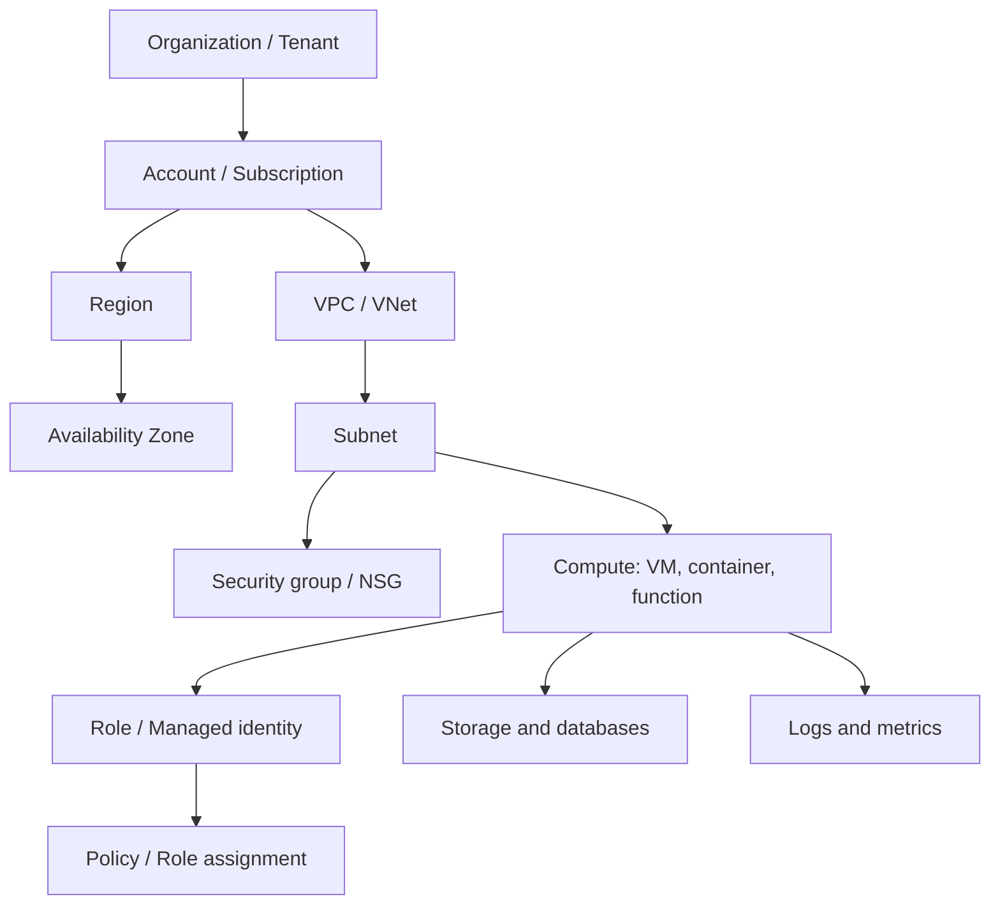

# Cloud Terminology Cheat Sheet

## Introduction

Cloud conversations are full of jargon: "Put it in a private subnet behind an ALB, give the task an IAM role, and ship logs to CloudWatch." On Azure the same sentence becomes: "Put it in a subnet with an NSG behind Application Gateway, give the container app a managed identity, and send logs to Log Analytics."

This page is a reference you can keep open while reading the rest of the tutorial or a real design document. It has three parts:

1. **General terms** that apply to every cloud
2. **AWS and Azure equivalents** for the terms you will meet most often
3. **A CLI cheat sheet** for everyday tasks on both clouds

Think of it as a pocket dictionary. You do not read a dictionary cover to cover. You look up a word, see how it is used, and get back to work.

## How the Terms Fit Together



## General Cloud Terms

### Architecture and reliability

| Term | Meaning |
|------|---------|
| **Availability** | The share of time a system works as expected, often written as a percentage over a period. |
| **SLA** (service level agreement) | A provider's contractual promise about availability, usually with service credits if missed. |
| **SLO** (service level objective) | Your own internal target, for example "99.9% of requests succeed within 300 ms". |
| **RTO** (recovery time objective) | The maximum acceptable time to restore service after a failure. |
| **RPO** (recovery point objective) | The maximum acceptable amount of data loss, measured in time. |
| **High availability (HA)** | Designing to keep running through component failures, usually with redundancy across zones. |
| **Disaster recovery (DR)** | Restoring service after a major event, often in another region. |
| **Fault domain / update domain** | Groups of hardware that share a failure source or maintenance window (Azure terms; AWS uses placement groups and AZs). |
| **Single point of failure** | Any component whose failure takes the whole system down. |
| **Horizontal scaling (scale out)** | Adding more instances. |
| **Vertical scaling (scale up)** | Making one instance bigger. |
| **Elasticity** | Scaling automatically in both directions as demand changes. |
| **Stateless** | A component that keeps no local data between requests, so any copy can serve any request. |
| **Idempotent** | An operation that has the same result whether it runs once or several times; essential for retries. |

### Infrastructure and operations

| Term | Meaning |
|------|---------|
| **Control plane** | The APIs you use to create and configure resources (create a VM, change a setting). |
| **Data plane** | The path your actual traffic and data take (read a blob, query a database). |
| **Infrastructure as Code (IaC)** | Defining infrastructure in files that tools apply, such as Terraform, CloudFormation or Bicep. |
| **Drift** | When real infrastructure no longer matches its IaC definition because of manual changes. |
| **Immutable infrastructure** | Replacing servers or containers instead of changing them in place. |
| **Golden image** | A pre-built machine image with your software and settings baked in. |
| **Bootstrapping / user data** | A script that runs when a VM first starts (EC2 user data, Azure custom data or cloud-init). |
| **Ephemeral** | Short-lived and disposable, such as a container's local disk. |
| **Quota / service limit** | A cap on how many resources you can create, often raisable by request. |
| **Throttling** | The provider rejecting or slowing requests that exceed a rate limit. |
| **Tenancy** | Whether hardware is shared (multi-tenant) or dedicated to you. |

### Security and identity

| Term | Meaning |
|------|---------|
| **Principal** | Any identity that can make a request: a user, group, role, service or workload. |
| **Authentication (AuthN)** | Proving who you are. |
| **Authorization (AuthZ)** | Deciding what you are allowed to do. |
| **Least privilege** | Granting only the permissions needed, and nothing more. |
| **Federation** | Trusting identities from another system, such as signing in to AWS with your company's Entra ID account. |
| **SSO** (single sign-on) | One sign-in that gives access to many systems. |
| **OIDC** (OpenID Connect) | An identity standard used for SSO and for keyless CI/CD access to clouds. |
| **Short-lived credentials** | Temporary tokens that expire automatically, preferred over long-lived access keys. |
| **Encryption at rest / in transit** | Protecting stored data, and data moving over the network. |
| **KMS / key vault** | A managed service that stores and uses encryption keys. |
| **Blast radius** | How much damage a single mistake or compromise can cause. |
| **Guardrail** | An organization-wide rule that prevents or detects risky configurations. |

### Cost

| Term | Meaning |
|------|---------|
| **On-demand / pay-as-you-go** | Paying list price with no commitment. |
| **Reserved capacity / reservation** | A one- or three-year commitment to specific resources for a discount. |
| **Savings plan** | A one- or three-year commitment to an hourly spend for a discount that applies flexibly. |
| **Spot** | Spare capacity at a discount that can be reclaimed at short notice. |
| **Egress** | Data leaving a cloud region, usually billed per GB. |
| **Ingress** | Data entering the cloud, usually free. |
| **GB-month** | Storage billing unit: one GB stored for one month. |
| **GB-second** | Serverless billing unit: memory in GB multiplied by run time in seconds. |
| **TCO** | Total cost of ownership, including people, facilities and hidden costs. |
| **FinOps** | The practice of managing cloud spend collaboratively across engineering and finance. |
| **Showback / chargeback** | Reporting (showback) or billing (chargeback) cloud costs to the teams that caused them. |

## AWS and Azure Equivalents

### Organization and identity

| Concept | AWS term | Azure term |
|---------|----------|------------|
| Identity directory | IAM Identity Center (or external IdP) | Microsoft Entra ID tenant |
| Billing and isolation boundary | Account | Subscription |
| Group of accounts or subscriptions | Organizational Unit (OU) | Management group |
| Container for related resources | (tags, optional resource groups) | Resource group |
| Workload identity | IAM role | Managed identity |
| Permissions document or definition | IAM policy | Role definition |
| Granting permissions | Attaching a policy to a principal or resource | Role assignment at a scope |
| Org-wide permission guardrail | Service control policy (SCP) | Azure Policy (and deny assignments) |
| Unique resource identifier | ARN | Resource ID |
| Key-value labels | Tags | Tags |

### Compute and containers

| Concept | AWS term | Azure term |
|---------|----------|------------|
| Virtual machine | EC2 instance | Virtual machine |
| VM size | Instance type (for example `m7g.large`) | VM size / SKU (for example `Standard_D2s_v5`) |
| Machine image | AMI | Image (Azure Compute Gallery) |
| VM group that scales | Auto Scaling group | Virtual Machine Scale Set |
| Managed web app hosting | Elastic Beanstalk | App Service |
| Functions | Lambda function | Azure Function (in a function app) |
| Function execution permissions | Execution role | Managed identity of the function app |
| Serverless containers | ECS on Fargate | Azure Container Apps |
| Container registry | ECR | Azure Container Registry |
| Managed Kubernetes | EKS | AKS |

### Storage and databases

| Concept | AWS term | Azure term |
|---------|----------|------------|
| Object storage container | S3 bucket | Blob container (inside a storage account) |
| Object | Object (key) | Blob |
| Storage cost tiers | Storage classes | Access tiers |
| Temporary object access link | Presigned URL | SAS token (shared access signature) |
| Block storage | EBS volume | Managed disk |
| Shared file system | EFS | Azure Files share |
| Managed relational database | RDS / Aurora | Azure SQL Database, Azure Database for PostgreSQL / MySQL |
| NoSQL key-value / document | DynamoDB table | Cosmos DB container |
| NoSQL capacity unit | Read/write capacity units (RCU/WCU) | Request units (RU/s) |
| Managed cache | ElastiCache | Azure Managed Redis / Azure Cache for Redis |

### Networking

| Concept | AWS term | Azure term |
|---------|----------|------------|
| Private network | VPC | Virtual network (VNet) |
| Instance-level firewall | Security group | Network security group (on NIC) |
| Subnet-level firewall | Network ACL | Network security group (on subnet) |
| Outbound internet for private resources | NAT gateway | NAT Gateway |
| Private access to a service | VPC endpoint / PrivateLink | Private endpoint / Private Link |
| Layer 7 load balancer | Application Load Balancer | Application Gateway |
| Layer 4 load balancer | Network Load Balancer | Azure Load Balancer |
| DNS | Route 53 hosted zone | Azure DNS zone |
| CDN | CloudFront distribution | Front Door profile |
| Private line to on-premises | Direct Connect | ExpressRoute |

### Operations

| Concept | AWS term | Azure term |
|---------|----------|------------|
| Metrics and alarms | CloudWatch metrics and alarms | Azure Monitor metrics and alert rules |
| Log store and query | CloudWatch Logs (Logs Insights) | Log Analytics workspace (KQL) |
| Application tracing | X-Ray | Application Insights |
| Audit log of API calls | CloudTrail | Activity Log |
| Native IaC | CloudFormation stack | ARM / Bicep deployment |
| Secrets | Secrets Manager secret | Key Vault secret |
| Cost tools | Cost Explorer, Budgets | Cost Management, budgets |
| Recommendations | Trusted Advisor | Azure Advisor |

## Everyday CLI Cheat Sheet

The commands below are read-only unless marked otherwise. Set up both CLIs in [The AWS CLI](../1-cloud-getting-started/2-cloud-aws-cli.mdx) and [The Azure CLI](../1-cloud-getting-started/3-cloud-azure-cli.mdx).

| Task | AWS CLI | Azure CLI |
|------|---------|-----------|
| Sign in | `aws sso login --profile dev` | `az login` |
| Who am I? | `aws sts get-caller-identity` | `az account show` |
| Switch account / subscription | `export AWS_PROFILE=prod` | `az account set --subscription "shop-prod"` |
| Set default region | `aws configure set region eu-west-1` | `az configure --defaults location=westeurope` |
| List regions | `aws ec2 describe-regions` | `az account list-locations` |
| List VMs | `aws ec2 describe-instances` | `az vm list` |
| List storage | `aws s3 ls` | `az storage account list` |
| Copy a file to storage | `aws s3 cp report.csv s3://my-bucket/` | `az storage blob upload --account-name st1 --container-name reports --file report.csv --auth-mode login` |
| List functions | `aws lambda list-functions` | `az functionapp list` |
| Find resources by tag | `aws resourcegroupstaggingapi get-resources --tag-filters Key=env,Values=dev` | `az resource list --tag env=dev` |
| Tail logs | `aws logs tail /aws/lambda/my-fn --follow` | `az webapp log tail --name my-app --resource-group rg-app` |
| Delete a group of resources (destructive) | Delete each resource, or delete the CloudFormation stack | `az group delete --name rg-demo` |

Both CLIs support `--query` with JMESPath and `--output table|json|text` (Azure also has `tsv` and `yaml`). For example:

```bash
# AWS: names of all S3 buckets created this year
aws s3api list-buckets \
  --query "Buckets[?CreationDate>='2026-01-01'].Name" \
  --output text

# Azure: names of all resource groups in West Europe
az group list \
  --query "[?location=='westeurope'].name" \
  --output tsv
```

Example output:

```text
acme-reports-2026 acme-uploads-dev
rg-shop-dev
rg-shop-prod
```

## Practice: A Terminology Flashcard Script

Translating terms quickly is a skill that improves with practice. This small script quizzes you in both directions. It needs only the Python standard library.

```python
# cloud_flashcards.py: quiz yourself on AWS <-> Azure terms.
import random

PAIRS = [
    ("Account", "Subscription"),
    ("IAM role (for a workload)", "Managed identity"),
    ("Security group", "Network security group"),
    ("S3 bucket", "Blob container"),
    ("Presigned URL", "SAS token"),
    ("EBS volume", "Managed disk"),
    ("Auto Scaling group", "Virtual Machine Scale Set"),
    ("CloudTrail", "Activity Log"),
    ("Service control policy", "Azure Policy"),
    ("CloudFront", "Front Door"),
]


def quiz(rounds=5, seed=None):
    rng = random.Random(seed)
    score = 0
    for _ in range(rounds):
        aws, azure = rng.choice(PAIRS)
        if rng.random() < 0.5:
            prompt, answer, target = aws, azure, "Azure"
        else:
            prompt, answer, target = azure, aws, "AWS"
        guess = input(f"{prompt} -> {target}? ").strip()
        if guess.lower() == answer.lower():
            print("  correct")
            score += 1
        else:
            print(f"  answer: {answer}")
    print(f"Score: {score}/{rounds}")


if __name__ == "__main__":
    quiz(rounds=5)
```

Example session:

```text
Security group -> Azure? Network security group
  correct
Managed disk -> AWS? EBS volume
  correct
Activity Log -> AWS? CloudWatch
  answer: CloudTrail
Front Door -> AWS? CloudFront
  correct
Subscription -> AWS? Account
  correct
Score: 4/5
```

## Terms That Look the Same but Differ

These pairs share a name or look identical but behave differently. They cause real bugs and design mistakes.

| Term | On AWS | On Azure |
|------|--------|----------|
| **Subnet** | Lives in exactly one availability zone | Spans all zones in the region |
| **Resource group** | Optional saved query over tags (AWS Resource Groups) | Mandatory lifecycle container for every resource |
| **Security group vs NSG** | Allow rules only; stateful | Allow and deny rules with priorities; stateful |
| **Tags** | Inherited by nothing by default; tag each resource | Not inherited from resource groups by default either; Azure Policy can add inheritance |
| **Zone "1" or "a"** | `us-east-1a` maps to a physical zone per account; use AZ IDs | Logical zone `1` maps to a physical zone per subscription |
| **Function app vs function** | A Lambda function is the unit you deploy | A function app is the deployable unit containing one or more functions |
| **"Serverless" database** | Aurora Serverless v2 scales capacity in fine-grained units | Azure SQL Database serverless can auto-pause when idle; Cosmos DB has a serverless capacity mode |
| **Region pair** | No such concept | Some regions have a Microsoft-chosen pair |

## Real-World Scenario

A new developer joins your team. She knows Azure well from a previous job, but your product runs on AWS. On her first day she reads this incident summary:

> At 14:05 the ALB target group for `orders-api` started returning 502s. The ECS service on Fargate had scaled in to one task because a deployment changed the task definition's memory. The task's IAM role lacked `kms:Decrypt` for the new Secrets Manager secret, so new tasks failed health checks. CloudWatch alarms fired, but the SNS topic had no subscribers. Rolled back via CodeDeploy at 14:40.

She uses the cheat sheet to translate it into terms she already knows: an Application Gateway backend pool returned errors; a Container Apps app scaled down to one replica after a revision changed its memory; the managed identity lacked permission to use the Key Vault key that protects a secret; Azure Monitor alerts fired, but the action group had no receivers; the team rolled back to the previous revision.

Within an hour she understands the incident and can join the fix: adding the missing permission to the IaC, and adding a subscriber test for the alert topic.

### Why this approach

Mapping new terms onto familiar concepts is much faster than learning a platform from scratch. A shared glossary also reduces misunderstandings in design reviews and incident calls, where precise words matter.

### When to use it and when not to

Use a translation glossary for onboarding, cross-cloud design reviews and migrations. Do not rely on it for detailed behavior; for that, read the service docs, because "equivalent" services often differ in limits, defaults and failure modes (see [AWS and Azure Service Mapping](./6-cloud-service-mapping.mdx)).

### Alternatives and trade-offs

| Approach | Pros | Cons | Best for |
|----------|------|------|----------|
| Shared team glossary (like this page) | Fast onboarding, common language | Must be kept current | Teams using one or both clouds |
| Provider certification study | Deep, structured knowledge | Takes weeks; exam-focused | Engineers going deep on one cloud |
| Learn by doing with mentors | Context-rich, practical | Depends on mentor time | Small teams |
| Vendor-neutral abstractions only | One vocabulary | Hides real platform differences | High-level planning documents |

## Best Practices

- **Use precise names in docs and tickets.** "The ALB" is clearer than "the load balancer" when you also have an NLB.
- **Spell out acronyms once** in every design document. Not everyone knows what RPO or SCP means.
- **Note the cloud** when terms collide. "Resource group" means very different things on AWS and Azure.
- **Keep your team glossary in the repo** next to architecture docs, and update it when you adopt a new service.
- **Check for renames.** Search docs with the current name, such as Microsoft Entra ID instead of Azure AD.

## Summary

- General cloud terms (availability, RTO and RPO, control and data plane, egress, least privilege) apply to every provider.
- AWS and Azure use different words for similar concepts: account and subscription, IAM role and managed identity, security group and NSG, CloudTrail and Activity Log.
- Some identical-looking terms behave differently, such as subnets, resource groups and zone labels.
- Both CLIs follow similar patterns, with `--query` (JMESPath) and `--output` options.
- Keep a glossary close by and use precise names in documents and incident reports.

## Further Learning

Exercises:

1. Add ten more pairs to `cloud_flashcards.py` from the tables above, then score at least 9 out of 10 on three runs in a row.
2. Rewrite the incident summary from the scenario fully in Azure terms, then back into AWS terms without looking.
3. Pick three terms from the "Terms That Look the Same but Differ" table. For each, find the official doc page on both clouds that explains the behavior.

Related pages:

- [Cloud Computing Introduction](./0-cloud-introduction.mdx)
- [AWS vs Azure: How the Platforms Compare](./5-cloud-aws-vs-azure.mdx)
- [AWS and Azure Service Mapping](./6-cloud-service-mapping.mdx)
- [Setting Up an AWS Account Safely](../1-cloud-getting-started/0-cloud-aws-account-setup.mdx)

External reading:

- [AWS glossary](https://docs.aws.amazon.com/glossary/latest/reference/glos-chap.html)
- [Azure glossary (Microsoft Learn)](https://learn.microsoft.com/azure/azure-glossary-cloud-terminology)
- [Azure for AWS professionals](https://learn.microsoft.com/azure/architecture/aws-professional/)
