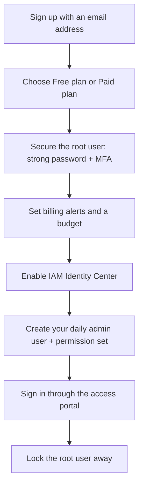
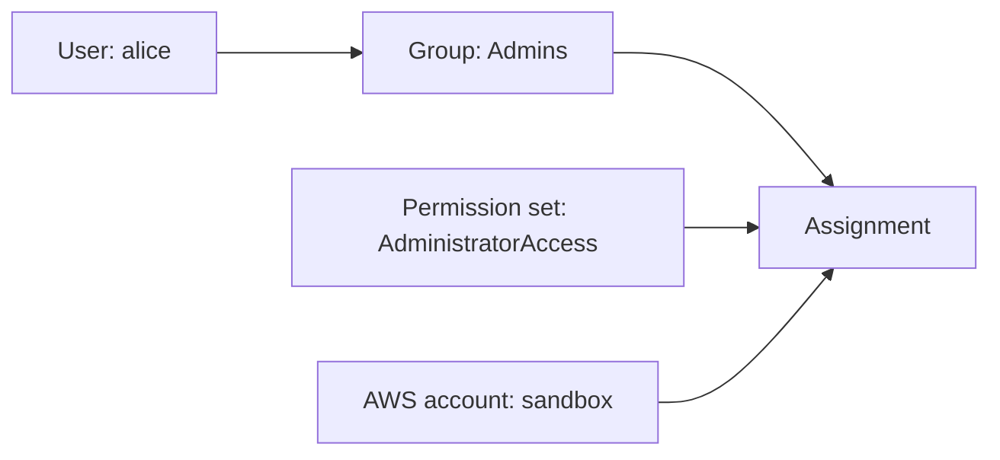

# Setting Up an AWS Account Safely

## Introduction

Creating an AWS account takes about ten minutes. Creating one *safely* takes about thirty. The extra twenty minutes are the best investment you will make in this whole tutorial, because the two most common beginner disasters in the cloud are:

1. **A surprise bill.** Someone launches a large instance or a NAT gateway for a test, forgets about it, and finds a bill weeks later.
2. **A compromised account.** Someone pastes a long-lived access key into a public GitHub repository, and within minutes bots use it to launch crypto-mining machines.

Both are preventable with a few habits set up on day one. Think of it like moving into a new apartment: before you unpack, you change the locks (root user and MFA), make spare keys for daily use (Identity Center users), and set up a smoke detector (billing alerts).

This page walks through those steps in order. The matching Azure page is [Setting Up an Azure Account Safely](./1-cloud-azure-account-setup.mdx).

:::info Things change
AWS sign-up offers, credit amounts and Free Tier rules change over time. The details below reflect the AWS documentation at the time of writing. Always confirm on the official [AWS Free Tier](https://aws.amazon.com/free/) page before relying on them.
:::

## The Big Picture



The key idea: **the root user is for emergencies only.** Everyday work happens through an identity with limited, temporary credentials.

## Step 1: Sign Up and Choose a Plan

Go to [aws.amazon.com/free](https://aws.amazon.com/free/) and choose **Create free account**. You will provide:

- An **email address** for the root user. Use a shared mailbox or alias you control long term, such as `aws-root+personal@yourdomain.com`, rather than a personal inbox you might lose access to.
- An **account name**, such as `alice-sandbox`.
- Contact details and a payment method. AWS verifies the card even on the free plan.
- Phone verification.

### Free account plan vs Paid account plan

Since mid-2025, new AWS accounts choose between two plans during sign-up. According to the [AWS Free Tier documentation](https://docs.aws.amazon.com/awsaccountbilling/latest/aboutv2/free-tier.html):

| Aspect | Free account plan | Paid account plan |
| --- | --- | --- |
| Sign-up credits | Yes, new customers receive credits | Yes, the same credits |
| Charges | None while on the plan | Pay-as-you-go once credits are used |
| Service access | Select services only | All services and features |
| Duration | Ends after a limited period or when credits run out | Ongoing |
| What happens at the end | Account closes unless you upgrade within a grace period | Nothing, billing continues |
| Best for | Learning and experiments | Real workloads, AWS Organizations |

Important details from the docs:

- When the free plan ends, the account **closes automatically**. AWS keeps your content for a grace period (90 days at the time of writing), during which you can upgrade to keep it.
- Free plan accounts are upgraded to the paid plan automatically if you do certain things, such as **joining AWS Organizations** or setting up AWS Control Tower.
- Some services that could quickly use up credits, such as Savings Plans or Reserved Instances, are not available on the free plan.

**Which should you pick?** If you are learning alone, the Free plan is the safest choice because it cannot produce charges. If you plan to follow the multi-account pages in this tutorial (AWS Organizations), you will need the Paid plan, and the billing alerts below become essential.

:::caution Free does not mean unlimited
Even on a paid plan with credits, "always free" services have monthly limits, and many services are not free at all. Credits hide charges until they run out. Set alerts anyway.
:::

## Step 2: Secure the Root User

The **root user** is the email address you signed up with. It has unrestricted access to everything in the account, including closing it and changing payment details. IAM policies cannot restrict it.

### Use a strong, unique password

Use a password manager. Never reuse this password anywhere else.

### Turn on MFA (it is mandatory now)

AWS now **requires** MFA for the root user of every account type. If MFA is not set up, you must register it within a short window after first console sign-in. Per the [IAM documentation](https://docs.aws.amazon.com/IAM/latest/UserGuide/enable-mfa-for-root.html), the supported types are:

| MFA type | Example | Phishing resistant | Notes |
| --- | --- | --- | --- |
| Passkey or security key (FIDO2) | YubiKey, Touch ID, synced passkey | Yes | AWS recommends this where possible |
| Virtual authenticator app (TOTP) | Authenticator apps on your phone | No | Fine as a starting point |
| Hardware TOTP token | Key-fob code generator | No | Less common now |

To enable it: sign in as root, open the account menu (top right), choose **Security credentials**, then **Assign MFA device**. Register **two** devices if you can (for example, a security key and an authenticator app) so losing one does not lock you out.

### Do not create root access keys

On the same **Security credentials** page, check the **Access keys** section. It should say you have none. Root access keys give full, permanent API access to your entire account. There is no good reason for a beginner to have them.

### Keep the contact details current

Under **Account settings**, make sure the email address and phone number are correct. AWS uses them for account recovery if you lose your MFA device, and sends security and billing notices there. Also add **alternate contacts** for Billing, Operations and Security, even if they are all you.

## Step 3: Turn On Billing Visibility Before Anything Else

Do this before you create any resources, because cost data takes time to appear.

1. As root, open **Billing and Cost Management**.
2. Under **Billing preferences**, turn on **Free Tier usage alerts** and **CloudWatch billing alerts** (names may differ slightly in the console).
3. Under **Account**, enable **IAM user and role access to Billing information**. Without this, even an admin user created later cannot see the bill.
4. Create a **monthly cost budget** with email alerts at, for example, 50%, 80% and 100% of a small amount you are comfortable with.

Budgets get a full page later in this section: [Budgets and Billing Alerts](./7-cloud-budgets-and-alerts.mdx). The short version is that a budget **alerts**; it does not stop spending by default.

## Step 4: Create Your Everyday Identity with IAM Identity Center

You need an identity for daily work. AWS gives you two options:

| Option | Credentials | Recommended for |
| --- | --- | --- |
| **IAM Identity Center** user | Short-lived, issued at sign-in | People. This is the AWS recommendation. |
| **IAM user** with password and access keys | Long-lived keys | Legacy cases where nothing else works |

**IAM Identity Center** (formerly AWS Single Sign-On) gives people a single sign-in portal and hands out temporary credentials for each account and role. Nothing long-lived sits on your laptop.

### Enable Identity Center

1. Open the **IAM Identity Center** console and choose **Enable**.
2. If prompted, choose to enable it **with AWS Organizations** (recommended, and it prepares you for multiple accounts) or as an **account instance**. Enabling Organizations upgrades a free plan account to paid, so read the plan note above first.
3. Pick the AWS Region for Identity Center deliberately. It is where your directory lives, and moving it later is not trivial.
4. Note your **AWS access portal URL**. It looks like `https://d-1234567890.awsapps.com/start` and can be customized.

### Create a user, a group and a permission set



1. **Users** → **Add user**: username `alice`, your work email. Identity Center emails an invitation.
2. **Groups** → **Create group**: `Admins`. Add `alice`.
3. **Permission sets** → **Create permission set**: choose the predefined `AdministratorAccess` for now. You will tighten this in [Least Privilege in Practice](../2-cloud-identity/3-cloud-least-privilege.mdx). AWS suggests `PowerUserAccess` for developers who do not manage IAM.
4. **AWS accounts** → select your account → **Assign users or groups** → `Admins` → `AdministratorAccess`.

Accept the email invitation, set a password, and **register MFA for this user too**.

### Sign in the new way

Open the access portal URL, sign in as `alice`, pick the account and the `AdministratorAccess` role, and choose **Management console**. You now have an admin session with temporary credentials.

From the command line, the same identity works through `aws configure sso`, covered in detail on [The AWS CLI](./2-cloud-aws-cli.mdx):

```bash
aws configure sso
```

Example output (trimmed):

```text
SSO session name (Recommended): my-sso
SSO start URL [None]: https://d-1234567890.awsapps.com/start
SSO region [None]: us-east-1
SSO registration scopes [None]: sso:account:access
Attempting to automatically open the SSO authorization page in your default browser.
There are 1 AWS accounts available to you.
Using the account ID 111122223333
The only role available to you is: AdministratorAccess
Default client Region [None]: us-east-1
CLI default output format (json if not specified) [None]: json
Profile name [AdministratorAccess-111122223333]: sandbox-admin
```

Verify who you are:

```bash
aws sts get-caller-identity --profile sandbox-admin
```

Output:

```json
{
    "UserId": "AROAEXAMPLEID:alice",
    "Account": "111122223333",
    "Arn": "arn:aws:sts::111122223333:assumed-role/AWSReservedSSO_AdministratorAccess_abc123/alice"
}
```

The `assumed-role` in the ARN tells you these are **temporary role credentials**, not a permanent key. That is exactly what you want.

:::tip No Identity Center? Use `aws login`
Recent AWS CLI versions (2.32.0 and later) include `aws login`, which turns an existing console sign-in (IAM user, federated user, or even root) into short-lived CLI credentials through the browser. It is a better choice than creating access keys. For people, Identity Center is still the recommended long-term setup.
:::

## Step 5: Put the Root User Away

Now sign out of root and stop using it. Write down which tasks genuinely need root, so you know when it is legitimate to take it out. According to AWS, these include:

- Changing account settings such as the root email or closing the account
- Restoring IAM permissions if the only admin locked themselves out
- Some billing and tax settings
- Registering as a seller in the Reserved Instance Marketplace
- Configuring certain S3 bucket policies that deny all principals (recovery)

Store the root password and MFA recovery details somewhere safe, such as a password manager vault shared only with a trusted person in a business context.

## Step 6: Turn On Basic Security Signals

A few low-effort services give you early warning if something goes wrong. They are covered in depth in the [Observability and Security](../12-cloud-observability-and-security/4-cloud-security-services.mdx) section; on day one, simply know they exist:

| Service | What it does on day one | Billing model |
| --- | --- | --- |
| AWS CloudTrail (event history) | Records API calls for the last 90 days by default | Event history is included; trails and data events cost extra |
| IAM Access Analyzer | Flags resources shared outside your account | Basic external access analysis has no extra charge; some analyzers are paid |
| Amazon GuardDuty | Detects suspicious activity such as unusual API calls | Paid after a trial period, billed by volume of analyzed events |
| AWS Budgets | Alerts on spend | A limited number of budgets are free; check the pricing page |

Pricing and free allowances vary by Region and change over time. Check the [AWS Pricing Calculator](https://calculator.aws/) and each service's pricing page.

## Step 7: Verify the Setup from the CLI

Once your SSO profile works, you can check the two most important root settings without signing in as root. The IAM account summary includes flags for root MFA and root access keys:

```bash
aws iam get-account-summary --profile sandbox-admin \
  --query "SummaryMap.{RootMFA:AccountMFAEnabled,RootKeys:AccountAccessKeysPresent,Users:Users}" \
  --output table
```

Example output:

```text
---------------------------------
|       GetAccountSummary       |
+----------+-----------+--------+
| RootKeys |  RootMFA  | Users  |
+----------+-----------+--------+
|  0       |  1        |  0     |
+----------+-----------+--------+
```

`RootMFA` should be `1` and `RootKeys` should be `0`. `Users` counts **IAM users**, not Identity Center users, so `0` is a good sign: nobody has created long-lived IAM users.

You can wrap this into a tiny script and run it whenever you take over an account:

```bash
#!/usr/bin/env bash
# check-account.sh - quick safety check for an AWS account
set -euo pipefail
PROFILE="${1:-default}"

summary=$(aws iam get-account-summary --profile "$PROFILE" --output json)
mfa=$(echo "$summary" | python3 -c 'import sys,json; print(json.load(sys.stdin)["SummaryMap"]["AccountMFAEnabled"])')
keys=$(echo "$summary" | python3 -c 'import sys,json; print(json.load(sys.stdin)["SummaryMap"]["AccountAccessKeysPresent"])')

[ "$mfa" = "1" ]  && echo "OK   root MFA enabled"     || echo "FAIL root MFA missing"
[ "$keys" = "0" ] && echo "OK   no root access keys"  || echo "FAIL root access keys exist"
```

Output:

```text
OK   root MFA enabled
OK   no root access keys
```

## Real-World Scenario

**You are a freelance developer** who has just landed a client that wants a small web app hosted on AWS. You will also keep a personal sandbox to experiment in. You want to avoid mixing your experiments with the client's bill, and you want the client to be able to take over the account cleanly when the contract ends.

### The setup

1. **Separate accounts.** Create the client account with an email address the *client* owns (for example, `aws-root@client.com`), and a separate sandbox account for yourself. Never put client workloads in your personal account.
2. **Root user hardening in both.** Strong unique passwords and two MFA devices each. For the client account, the client keeps one MFA device.
3. **Identity Center in the client account** (or in their organization if they have one). You get a permission set scoped to what you need, such as `PowerUserAccess`, instead of the root login.
4. **Budgets on day one** in both accounts, with the client's finance contact on the client budget alerts.
5. **No access keys on your laptop.** You use `aws configure sso` profiles named `client-dev` and `sandbox-admin`.

### Why this approach

- **Clean ownership.** The client owns the root email and billing. Handing over is just removing your Identity Center assignment.
- **Blast radius.** A mistake in your sandbox cannot touch the client's production data.
- **Auditability.** CloudTrail records show your Identity Center user name in the role session, so actions are traceable to you.

### When to use it, and when not to

This "one account per purpose" approach fits almost everyone. For a five-minute throwaway experiment, a single sandbox account is fine, as long as root is secured and a budget is set. For a company with many teams, go further with AWS Organizations, a landing zone and SCPs, covered in [Multi-Account and Landing Zone Strategy](../2-cloud-identity/7-cloud-multi-account-strategy.mdx).

### Alternatives and trade-offs

| Approach | Pros | Cons | Best for |
| --- | --- | --- | --- |
| Root user for everything | Nothing to set up | Huge risk, no audit trail per person, against AWS guidance | Never |
| IAM user with access keys | Familiar, works with old tools | Long-lived keys leak; manual rotation | Legacy tools only |
| IAM user + `aws login` | No stored keys, quick for one person | Still a per-account IAM user to manage | A solo single-account sandbox |
| IAM Identity Center | Temporary credentials, one portal, scales to many accounts | Slightly more setup; Region choice matters | Most people and teams |
| External IdP (Entra ID, Okta) federated into Identity Center | Single company login, central offboarding | Requires an IdP | Companies with an existing IdP |

## Common Mistakes

1. **Using a personal email for the root user of a company account.** When that person leaves, recovery becomes painful. Use a role mailbox the organization controls.
2. **Only one MFA device.** Losing your phone becomes a support ticket. Register two.
3. **Creating access keys "just to get the CLI working."** Use `aws configure sso` or `aws login` instead. If you must create a key for a legacy tool, scope it narrowly, never commit it, and delete it as soon as possible.
4. **Skipping billing alerts until later.** Later is usually after the surprise bill.
5. **Forgetting to enable billing access for IAM.** Your admin user then cannot see costs, so nobody looks at them.
6. **Assuming the Free plan protects a paid account.** If you upgrade (or join Organizations), the safety net is gone. Budgets become your safety net.
7. **Launching resources in many Regions while exploring.** You will forget them. Pick one home Region and stick to it.

## Cleanup and Account Closure

Creating the account and Identity Center users costs nothing by itself. If you are done experimenting and want to close a sandbox account:

1. Delete resources you created (instances, databases, NAT gateways, load balancers, storage). Check **every Region** you used.
2. Use the **Billing** console to confirm there are no running charges.
3. Sign in as root and close the account from **Account settings**. Closed accounts enter a post-closure period during which they can be reopened. Read the current rules in the [AWS Account Management guide](https://docs.aws.amazon.com/accounts/latest/reference/manage-acct-closing.html).

You can quickly list a few common cost drivers in a Region with the CLI:

```bash
REGION=us-east-1
aws ec2 describe-instances --region "$REGION" \
  --query "Reservations[].Instances[].[InstanceId,State.Name,InstanceType]" --output table
aws ec2 describe-nat-gateways --region "$REGION" \
  --query "NatGateways[?State=='available'].NatGatewayId" --output text
aws rds describe-db-instances --region "$REGION" \
  --query "DBInstances[].DBInstanceIdentifier" --output text
```

Example output:

```text
-------------------------------------------------
|               DescribeInstances               |
+----------------------+----------+-------------+
|  i-0abc123def4567890 |  stopped |  t3.micro   |
+----------------------+----------+-------------+
```

A stopped instance still incurs charges for its attached EBS volumes and any Elastic IP, so delete what you do not need.

## Best Practices Checklist

- [ ] Root email is a long-lived address you control
- [ ] Root password is unique and stored in a password manager
- [ ] Two MFA devices on root, preferably a passkey or security key
- [ ] No root access keys exist
- [ ] Alternate contacts are filled in
- [ ] Billing access for IAM is enabled
- [ ] A monthly budget with email alerts exists
- [ ] IAM Identity Center is enabled and you have an MFA-protected user
- [ ] The CLI uses SSO profiles, not access keys
- [ ] You have picked a home Region

## Summary

- New AWS accounts choose a **Free account plan** (no charges, limited services, closes when it ends) or a **Paid account plan** (full access, pay-as-you-go after credits). Terms change, so check the official Free Tier page.
- The **root user** has unlimited power. Protect it with a strong password and MFA (now mandatory), never create root access keys, and use it only for the few tasks that need it.
- Set up **billing visibility and a budget** before creating resources.
- Use **IAM Identity Center** for your daily identity so you only ever hold temporary credentials. `aws login` is a good fallback for a single-account setup.
- Separate accounts by purpose (personal sandbox, client, production) to limit blast radius and simplify ownership.

## Exercises

1. Create a new AWS account on the Free plan, enable MFA on the root user with two devices, and confirm there are no root access keys.
2. Enable IAM Identity Center, create a user and an `Admins` group, assign `AdministratorAccess` to your account, and sign in through the access portal.
3. Configure an SSO profile with `aws configure sso` and run `aws sts get-caller-identity`. Explain each part of the returned ARN.
4. Write down the list of tasks that require the root user and where you store its credentials. Share it with a teammate for review if you work in a team.

### Related pages

- [Setting Up an Azure Account Safely](./1-cloud-azure-account-setup.mdx)
- [The AWS CLI](./2-cloud-aws-cli.mdx)
- [Budgets and Billing Alerts](./7-cloud-budgets-and-alerts.mdx)
- [AWS IAM Users, Groups, Roles and Policies](../2-cloud-identity/1-cloud-aws-iam.mdx)
- [Federation, SSO and Identity Center](../2-cloud-identity/5-cloud-federation-and-sso.mdx)
