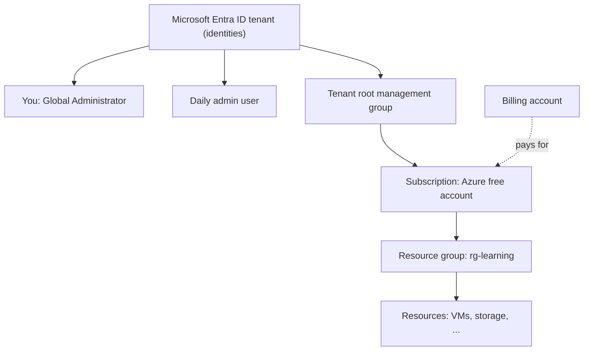

# Setting Up an Azure Account Safely

## Introduction

Signing up for Azure looks like signing up for any website, but behind the scenes you create **three different things** at once:

1. A **Microsoft Entra ID tenant** (formerly Azure Active Directory), which is your identity directory: users, groups and app identities.
2. An **Azure subscription**, which is the billing and resource container where your virtual machines, databases and storage live.
3. A **billing account**, which holds your payment method and invoices.

Understanding that split is the single most useful thing a beginner can learn about Azure, because almost every "why can't I see this?" question comes from mixing them up. A good analogy is an office building: the **tenant** is the security desk with the staff list and badges, the **subscription** is a rented floor where you put your furniture (resources), and the **billing account** is the lease and the bank account that pays rent.

This page sets up all three safely. If you are coming from AWS, compare with [Setting Up an AWS Account Safely](./0-cloud-aws-account-setup.mdx). The big difference is that in AWS the account is both the identity boundary and the billing boundary, while Azure separates identity (tenant) from resources and billing (subscription).

:::info Offers change
Microsoft's free account offer, credit amount and included services change over time. The details below follow Microsoft Learn at the time of writing. Check the official [Azure free account page](https://azure.microsoft.com/pricing/purchase-options/azure-account) before relying on them.
:::

## How the Pieces Fit Together



- A tenant can trust many subscriptions; each subscription trusts exactly **one** tenant.
- Permissions on resources come from **Azure RBAC** role assignments at a scope (management group, subscription, resource group or resource).
- Permissions on the directory itself (creating users, resetting passwords) come from **Microsoft Entra roles** such as Global Administrator. These are separate from Azure RBAC.

| Concept | AWS closest match | Azure |
| --- | --- | --- |
| Identity directory | IAM (per account) or IAM Identity Center | Microsoft Entra ID tenant |
| Billing and resource boundary | AWS account | Subscription |
| Grouping of related resources | Tags, CloudFormation stacks | Resource groups (mandatory) |
| Top-level governance | AWS Organizations, OUs | Management groups |
| All-powerful sign-up identity | Root user | Your sign-up account becomes Global Administrator and subscription Owner |

## Step 1: Sign Up

Go to the [Azure free account](https://azure.microsoft.com/pricing/purchase-options/azure-account) page and start the sign-up. You can sign up with:

- A **Microsoft account** (personal, such as an Outlook.com address), or
- A **work or school account** that already exists in an organization's Entra ID tenant.

If you use a personal Microsoft account, Azure creates a new tenant for you, typically named after your email, such as `alicecontoso.onmicrosoft.com`.

You will verify a phone number and a card. As of the latest Microsoft Learn guidance, an eligible **Azure free account** includes:

- A **credit** in your billing currency that is valid for the first **30 days**
- A limited quantity of selected **free services for 12 months**
- A set of **always free** services with monthly limits

See [Avoid charges with your Azure free account](https://learn.microsoft.com/azure/cost-management-billing/manage/avoid-charges-free-account) for the current rules.

### The spending limit: your built-in safety net

Free account and credit-based subscriptions have a **spending limit**. When the credit runs out or expires, Azure **disables** the subscription and its services instead of charging your card. Your resources stop, but you do not get a bill.

When you **upgrade to pay-as-you-go**, the spending limit goes away. After that, usage beyond free quantities is billed at pay-as-you-go rates. This is the moment to make sure the budget from Step 5 exists.

| Situation | What happens |
| --- | --- |
| Free account, credit remaining | Usage is covered by credit |
| Free account, credit used up or 30 days passed | Subscription disabled until you upgrade |
| Upgraded to pay-as-you-go | Free services continue for 12 months; everything else is billed |
| Free service monthly quantity exceeded (after upgrade) | Excess billed at pay-as-you-go rates |

:::caution Compare with AWS
AWS's Free account plan **closes** the account when it ends (with a grace period to upgrade). Azure's free account **disables** the subscription. Both protect you from charges, and both stop doing so the moment you upgrade.
:::

## Step 2: Make Sure MFA Is On

Microsoft now enforces **mandatory MFA** for Azure sign-ins in two phases, as described in [Plan for mandatory Microsoft Entra MFA](https://learn.microsoft.com/entra/identity/authentication/concept-mandatory-multifactor-authentication):

- **Phase 1:** the Azure portal, Microsoft Entra admin center and Intune admin center require MFA.
- **Phase 2:** Azure CLI, Azure PowerShell, the Azure mobile app, infrastructure-as-code tools and REST API calls to Azure Resource Manager require MFA for create, update and delete operations.

There is no opt-out. **Workload identities** (managed identities and service principals) are not affected, which is one more reason never to use a human account in automation.

Practical steps:

1. Sign in to the [Azure portal](https://portal.azure.com) and register an authenticator method when prompted.
2. Prefer **passkeys (FIDO2)** or the Microsoft Authenticator app. Phishing-resistant methods are strongest.
3. Confirm that **security defaults** are enabled for your tenant: **Microsoft Entra ID** → **Overview** → **Properties** → **Manage security defaults**. Security defaults are free and turn on baseline protections, including MFA registration for all users and blocking legacy authentication. New tenants have them on by default.

If you later buy Entra ID P1 or P2, you can replace security defaults with **Conditional Access** policies for finer control.

## Step 3: Understand Your Two Admin Roles

Right after sign-up, your account holds two powerful roles:

| Role | Where it applies | What it allows |
| --- | --- | --- |
| **Global Administrator** (Entra role) | The whole tenant | Manage users, groups, app registrations, security settings |
| **Owner** (Azure RBAC role) | The subscription | Create and delete any resource, and grant access to others |

Both are the Azure equivalent of the AWS root user's power. You cannot "lock away" your sign-up account quite the way you lock away AWS root, because in a personal tenant it may be your only Global Administrator. Instead:

- Protect it with strong MFA.
- Create an **emergency access** (break-glass) account with a passkey, stored safely, so that a lost phone does not lock you out of the tenant.
- Create a **separate daily-use identity** with less power for routine work.

## Step 4: Create a Daily-Use Identity

For a learning tenant, a sensible split is:

- **Sign-up account:** Global Administrator, used rarely.
- **Daily admin user:** no Entra admin role, **Contributor** on the subscription. Contributor can create and manage resources but cannot grant access to others.

You can do this in the portal (**Microsoft Entra ID** → **Users** → **New user**, then **Subscriptions** → **Access control (IAM)** → **Add role assignment**). Here is the CLI version, which you will learn properly on [The Azure CLI](./3-cloud-azure-cli.mdx):

```bash
# Run while signed in as the Global Administrator
az login

TENANT_DOMAIN=$(az rest --method get \
  --url "https://graph.microsoft.com/v1.0/domains" \
  --query "value[?isDefault].id | [0]" -o tsv)
SUB_ID=$(az account show --query id -o tsv)

# Prompt for a temporary password instead of typing it into history
read -rsp "Temporary password: " TMP_PW && echo

az ad user create \
  --display-name "Alice Daily" \
  --user-principal-name "alice.daily@${TENANT_DOMAIN}" \
  --password "$TMP_PW" \
  --force-change-password-next-sign-in true \
  --query "{upn:userPrincipalName,id:id}" -o json
```

Example output:

```json
{
  "id": "aaaaaaaa-1111-2222-3333-bbbbbbbbbbbb",
  "upn": "alice.daily@alicecontoso.onmicrosoft.com"
}
```

Now grant Contributor on the subscription:

```bash
az role assignment create \
  --assignee "alice.daily@${TENANT_DOMAIN}" \
  --role "Contributor" \
  --scope "/subscriptions/${SUB_ID}" \
  --query "{role:roleDefinitionName,scope:scope}" -o json
```

Example output:

```json
{
  "role": "Contributor",
  "scope": "/subscriptions/00000000-0000-0000-0000-000000000000"
}
```

Sign in as the new user in a private browser window, change the password and register MFA.

:::tip Even narrower
Contributor on the whole subscription is fine for a personal sandbox. In a team, assign roles at the **resource group** scope instead, so each person or app only touches its own resources. See [Microsoft Entra ID and Azure RBAC](../2-cloud-identity/2-cloud-azure-entra-id.mdx) and [Least Privilege in Practice](../2-cloud-identity/3-cloud-least-privilege.mdx).
:::

### Personal Microsoft account users

If you signed up with a personal Microsoft account, it appears in your tenant as an **external** (guest-like) member. That works, but many organizations prefer a **cloud-only** admin user inside the tenant, like `admin@yourtenant.onmicrosoft.com`, so that the tenant does not depend on a consumer account. Creating one and making it a second Global Administrator is a good emergency-access pattern.

## Step 5: Turn On Cost Visibility

Do this before creating resources.

1. In the portal, open **Cost Management + Billing** → **Cost Management** → **Budgets**.
2. Create a **monthly budget** on your subscription with email alerts at, for example, 50%, 80% and 100% of a small amount, plus a **forecasted** alert at 100%.
3. Open **Cost analysis** and pin it to your dashboard.

New subscriptions can take up to 48 hours before all Cost Management features are available, so do not worry if budgets are not available in the first hour.

A budget **notifies**; it does not stop resources (unless you wire it to an automation through an action group). The full walkthrough, including Bicep and CLI, is on [Budgets and Billing Alerts](./7-cloud-budgets-and-alerts.mdx).

## Step 6: Pick a Home Region and a Naming Convention

Azure resources live in **regions** such as `eastus`, `westeurope` or `southeastasia`. Pick one close to you and use it consistently while learning, so that you never forget a resource in another region. List them with:

```bash
az account list-locations --query "[?metadata.regionType=='Physical'].name" -o tsv | head -5
```

Example output:

```text
eastus
eastus2
southcentralus
westus2
westus3
```

Also adopt a simple naming convention now. The [Cloud Adoption Framework](https://learn.microsoft.com/azure/cloud-adoption-framework/ready/azure-best-practices/resource-naming) suggests prefixes such as `rg-` for resource groups, `st` for storage accounts and `vm-` for virtual machines, for example `rg-learning-eastus`.

## Step 7: Verify Your Setup

Sign in as your daily user and check what you can see:

```bash
az login
az account show --query "{name:name, id:id, tenant:tenantId, user:user.name}" -o json
```

Example output:

```json
{
  "id": "00000000-0000-0000-0000-000000000000",
  "name": "Azure subscription 1",
  "tenant": "11111111-1111-1111-1111-111111111111",
  "user": "alice.daily@alicecontoso.onmicrosoft.com"
}
```

And check your role assignments:

```bash
az role assignment list --assignee "$(az ad signed-in-user show --query id -o tsv)" \
  --all --query "[].{role:roleDefinitionName, scope:scope}" -o table
```

Example output:

```text
Role         Scope
-----------  ---------------------------------------------------
Contributor  /subscriptions/00000000-0000-0000-0000-000000000000
```

## Where to Find Things in the Portal

Beginners often get lost because identity, resources and billing live in different blades. Bookmark these:

| You want to... | Portal location |
| --- | --- |
| See users, groups, tenant ID, security defaults | **Microsoft Entra ID** (or the Entra admin center) |
| See your subscriptions and rename them | **Subscriptions** |
| Grant someone access to resources | Subscription or resource group → **Access control (IAM)** |
| Check free service usage and when free benefits expire | **Subscriptions** → your subscription → free services grid |
| Create budgets and see spend | **Cost Management + Billing** → **Cost Management** |
| Upgrade the free account | **Subscriptions** → your subscription → **Upgrade** |
| Open a browser terminal with `az` preinstalled | The Cloud Shell icon in the top bar |

Azure Cloud Shell is handy on a locked-down laptop: it is already signed in as you and has the Azure CLI, Bicep and Terraform installed. You can run it as an ephemeral session, or attach a storage account to keep files between sessions; that storage account is billed like any other.

## Real-World Scenario

**Your three-person startup** builds a .NET API and has decided to use Azure because the team already uses Microsoft 365. The founder signed up for Azure with a personal Outlook account during a hackathon, and everything (including a production database) lives in that one subscription. Now an investor's security questionnaire asks how access is controlled.

### The fix

1. **Use the company tenant.** The company already has a Microsoft Entra ID tenant from Microsoft 365. Create a new pay-as-you-go subscription inside *that* tenant (or transfer the existing subscription into it, which re-homes access control and needs planning).
2. **Two subscriptions:** `sub-prod` and `sub-dev`. Development experiments cannot accidentally delete production resources, and costs are separated.
3. **Groups, not individuals:** create Entra groups `grp-cloud-admins` and `grp-developers`. Give developers Contributor on `sub-dev` and Reader on `sub-prod`. Admins get Owner on both, but only through a group.
4. **Emergency access:** two break-glass Global Administrator accounts with passkeys, excluded from nothing (mandatory MFA applies to them too).
5. **Budgets on both subscriptions**, alerting the founders and the shared finance mailbox.
6. **No user accounts in CI/CD.** The pipeline uses a workload identity with OIDC federation, covered in [Keyless CI/CD with OIDC](../2-cloud-identity/6-cloud-oidc-for-ci.mdx).

### Why this approach

- **One identity system.** Employees already sign in to Microsoft 365. Offboarding someone in Entra ID removes their Azure access too.
- **Separation by subscription** gives clean cost reports and a hard boundary for permissions and policies.
- **Groups** make access reviews easy: "who is in `grp-cloud-admins`?" answers the investor's question.

### When to use it, and when not to

Use the company tenant whenever one exists. A separate personal tenant is fine for individual learning, but never for company production. If your company uses another identity provider such as Okta or Google Workspace, you can still federate it with Entra ID; see [Federation, SSO and Identity Center](../2-cloud-identity/5-cloud-federation-and-sso.mdx).

### Alternatives and trade-offs

| Approach | Pros | Cons | Best for |
| --- | --- | --- | --- |
| Personal Microsoft account, one subscription | Fastest to start | Weak ownership, everything mixed together | Solo learning |
| Company tenant, one subscription, resource groups per environment | Simple, one bill | Permissions and policies harder to separate | Very small teams |
| Company tenant, subscription per environment | Clear boundaries for cost, RBAC and policy | More subscriptions to manage | Most startups and teams |
| Management groups + landing zone | Central policy at scale | More upfront design | Larger organizations; see [Multi-Account and Landing Zone Strategy](../2-cloud-identity/7-cloud-multi-account-strategy.mdx) |

## Common Mistakes

1. **Confusing tenant and subscription.** You can be Global Administrator of a tenant and still have **no** access to a subscription's resources (and vice versa). Check both Entra roles and Azure RBAC.
2. **Using a human account in scripts.** With mandatory MFA, scripts using `az login --username --password` fail on create, update and delete. Use managed identities or service principals.
3. **Upgrading to pay-as-you-go without a budget.** The spending limit disappears at upgrade time.
4. **Assigning Owner when Contributor is enough.** Owner can grant access to others; Contributor cannot.
5. **Leaving the default "Azure subscription 1" name.** Rename subscriptions to something meaningful, such as `sub-learning`, so you never deploy to the wrong one.
6. **Spreading test resources across regions.** Pick a home region.
7. **Deleting resources one by one.** Put experiments in one resource group and delete the group (see below).

## Cleanup

Creating a tenant, users and role assignments costs nothing. Resources cost money. The easiest cleanup habit in Azure is to put everything for an experiment in **one resource group** and delete the group when you are done:

```bash
az group list --query "[].name" -o tsv
az group delete --name rg-learning-eastus --yes --no-wait
```

`--no-wait` returns immediately while deletion continues in the background. Check progress with `az group show --name rg-learning-eastus`, which returns an error once it is gone.

To remove the daily user and its role assignment created on this page:

```bash
az role assignment delete --assignee "alice.daily@${TENANT_DOMAIN}" --scope "/subscriptions/${SUB_ID}"
az ad user delete --id "alice.daily@${TENANT_DOMAIN}"
```

If you want to stop using Azure entirely, cancel the subscription under **Subscriptions** → your subscription → **Cancel subscription**. Microsoft describes the process and retention in [Cancel your Azure subscription](https://learn.microsoft.com/azure/cost-management-billing/manage/cancel-azure-subscription).

## Best Practices Checklist

- [ ] You know your tenant ID, tenant domain and subscription ID
- [ ] MFA is registered, preferably a passkey or Authenticator app
- [ ] Security defaults (or Conditional Access) are enabled
- [ ] An emergency access account exists and is stored safely
- [ ] Daily work uses a separate identity with Contributor (or narrower)
- [ ] Access is granted to groups, not individuals, in team settings
- [ ] A budget with actual and forecasted alerts exists
- [ ] A home region and naming convention are chosen
- [ ] Experiments live in a resource group you can delete in one command

## Summary

- Azure separates the **tenant** (identities, Microsoft Entra ID), the **subscription** (resources and billing boundary) and the **billing account**.
- The **free account** gives time-limited credit plus free services; a **spending limit** disables the subscription instead of charging you, until you upgrade to pay-as-you-go.
- **MFA is mandatory** for Azure portal, CLI, PowerShell, IaC and API management operations by user accounts. Workload identities are not affected, so use them for automation.
- Your sign-up account is both **Global Administrator** and subscription **Owner**. Protect it, add an emergency account, and do daily work with a less-privileged identity.
- Add a **budget** before creating resources, and use **resource groups** to make cleanup a single command.

## Exercises

1. Sign up for an Azure free account and find your tenant ID, default domain and subscription ID in the portal and with `az account show`.
2. Check whether security defaults are enabled in your tenant. List which protections they turn on.
3. Create a daily-use user with Contributor on a single resource group (not the subscription). Sign in as that user and confirm they cannot create a resource group of their own.
4. Write a one-paragraph comparison of the AWS root user and the Azure Global Administrator plus subscription Owner. What can each do that the other cannot?

### Related pages

- [Setting Up an AWS Account Safely](./0-cloud-aws-account-setup.mdx)
- [The Azure CLI](./3-cloud-azure-cli.mdx)
- [Organizing Resources: Accounts, Subscriptions and Resource Groups](./5-cloud-resource-organization.mdx)
- [Budgets and Billing Alerts](./7-cloud-budgets-and-alerts.mdx)
- [Microsoft Entra ID and Azure RBAC](../2-cloud-identity/2-cloud-azure-entra-id.mdx)
