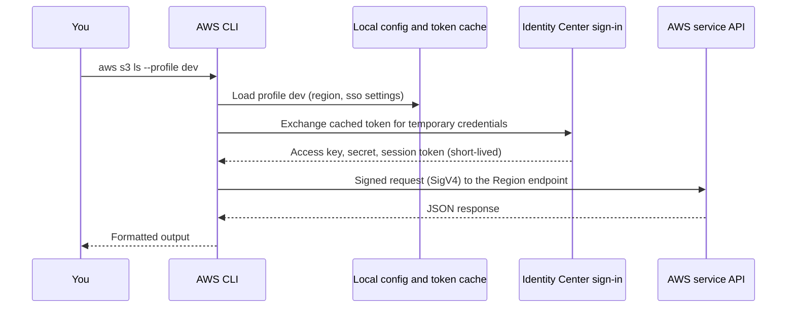

# The AWS CLI

## Introduction

The AWS Management Console is great for exploring, but every serious AWS user ends up in the terminal. The **AWS Command Line Interface (AWS CLI)** lets you do almost anything the console does, and it lets you do it **repeatably**: in scripts, in CI pipelines and in runbooks that a teammate can follow at 3 a.m.

Think of the console as driving a car by hand and the CLI as writing down the exact route. The first is faster for a single trip; the second is what you need when the trip happens every day or someone else has to make it.

This page covers **AWS CLI version 2**, the current major version. You will learn how to install it, sign in **without long-lived keys**, shape output with queries, and write scripts that are safe to run. The Azure counterpart is [The Azure CLI](./3-cloud-azure-cli.mdx), and the table at the end maps the commands between the two.

## How the CLI Works

Every CLI command becomes a signed HTTPS request to an AWS service API. The CLI needs three things to build that request: **credentials**, a **Region**, and the **command** itself.



The command structure is always:

```text
aws <service> <operation> [--parameters] [--global-options]
```

For example, `aws ec2 describe-instances --region eu-west-1 --output table`.

## Installing the CLI

AWS now recommends a single **install script** for Linux and macOS, and a PowerShell script for Windows. Commands below are from the [official install guide](https://docs.aws.amazon.com/cli/latest/userguide/getting-started-install.html); check it for the latest options.

### Linux and macOS

```bash
# Installs for the current user under ~/.local by default
curl -fsSL https://awscli.amazonaws.com/v2/install.sh | bash
```

The classic method still works and lets you pin a version:

```bash
curl "https://awscli.amazonaws.com/awscli-exe-linux-x86_64.zip" -o "awscliv2.zip"
unzip awscliv2.zip
sudo ./aws/install
```

On macOS you can also use the `AWSCLIV2.pkg` installer.

### Windows

Use the MSI installer from `https://awscli.amazonaws.com/AWSCLIV2.msi`, or run the install script from PowerShell as described in the guide.

### Verify

```bash
aws --version
```

Example output:

```text
aws-cli/2.27.41 Python/3.11.6 Linux/6.8.0 exe/x86_64
```

Your version will be newer. To update an installation made with the script or official installers, recent versions provide `aws update`.

:::caution Version 1 still exists
AWS CLI v1 (installed with `pip install awscli`) uses the same `aws` command name. If `aws --version` starts with `aws-cli/1.`, remove it and install v2. Features on this page such as `aws configure sso` with sessions and `aws login` need v2.
:::

## Signing In Without Access Keys

There are three ways to give the CLI credentials. Prefer them in this order.

### Option 1: IAM Identity Center (recommended for people)

If you followed [Setting Up an AWS Account Safely](./0-cloud-aws-account-setup.mdx), you have an Identity Center user. Run the wizard once:

```bash
aws configure sso
```

Example output (trimmed):

```text
SSO session name (Recommended): my-sso
SSO start URL [None]: https://d-1234567890.awsapps.com/start
SSO region [None]: us-east-1
SSO registration scopes [None]: sso:account:access
There are 2 AWS accounts available to you.
> DevAccount (111122223333)
  ProdAccount (444455556666)
Using the account ID 111122223333
There are 2 roles available to you.
> ReadOnly
  PowerUserAccess
Default client Region [None]: us-east-1
CLI default output format (json if not specified) [None]: json
Profile name [PowerUserAccess-111122223333]: dev
```

Since CLI version 2.22.0 the sign-in uses the **PKCE** browser flow by default. On a machine without a browser, add `--use-device-code`.

The wizard writes this to `~/.aws/config`:

```ini
[profile dev]
sso_session = my-sso
sso_account_id = 111122223333
sso_role_name = PowerUserAccess
region = us-east-1
output = json

[sso-session my-sso]
sso_region = us-east-1
sso_start_url = https://d-1234567890.awsapps.com/start
sso_registration_scopes = sso:account:access
```

Add more profiles that reuse the same `sso-session`, for example a `prod-readonly` profile pointing at the production account with the `ReadOnly` role. Each morning, sign in once:

```bash
aws sso login --sso-session my-sso
aws sts get-caller-identity --profile dev
```

Output:

```json
{
    "UserId": "AROAEXAMPLEID:alice",
    "Account": "111122223333",
    "Arn": "arn:aws:sts::111122223333:assumed-role/AWSReservedSSO_PowerUserAccess_0123abcd/alice"
}
```

When you are done, `aws sso logout` deletes the cached tokens.

### Option 2: `aws login` with console credentials

Since version 2.32.0, the CLI can reuse a **console sign-in** (IAM user, federated user, or root) to get temporary credentials:

```bash
aws login --profile sandbox
```

The CLI opens a browser, you pick the session, and it writes a profile with a `login_session` setting. Credentials refresh automatically for up to the session duration (at most 12 hours). The IAM identity needs the `SignInLocalDevelopmentAccess` managed policy (root does not). Use `aws login --remote` on a headless machine and `aws logout` when finished. See [Login for AWS local development](https://docs.aws.amazon.com/cli/latest/userguide/cli-configure-sign-in.html).

Some older SDKs and tools may not understand `login_session` yet. The docs describe a workaround using `credential_process` with `aws configure export-credentials`.

### Option 3: Access keys (avoid)

`aws configure` still asks for an access key ID and secret and stores them in plain text in `~/.aws/credentials`. These keys **never expire** unless you rotate them. Use them only if a tool truly supports nothing else, and never for the root user.

### Where credentials come from (precedence)

When several sources exist, the CLI uses the first one it finds, roughly in this order:

1. Command-line options such as `--profile` or `--region`
2. Environment variables such as `AWS_ACCESS_KEY_ID`, `AWS_PROFILE`, `AWS_REGION`
3. Web identity token (used by OIDC in CI and on EKS)
4. The profile in `~/.aws/config` and `~/.aws/credentials` (SSO, login, keys, `credential_process`, role assumption)
5. Container credentials (ECS task role)
6. Instance metadata (EC2 instance profile role)

The full list is in [Configuration and credential file settings](https://docs.aws.amazon.com/cli/latest/userguide/cli-configure-files.html). The practical lesson: a stray `AWS_ACCESS_KEY_ID` in your shell silently overrides your profile. When something behaves strangely, run `aws configure list`:

```bash
aws configure list --profile dev
```

Example output:

```text
      Name                    Value             Type    Location
      ----                    -----             ----    --------
   profile                      dev           manual    --profile
access_key     ****************WXYZ              sso
secret_key     ****************abcd              sso
    region                us-east-1      config-file    ~/.aws/config
```

## Regions and Profiles in Daily Use

Most AWS services are **regional**. If you create something in `eu-west-1` and list resources in `us-east-1`, it looks like it disappeared. Set the Region in your profile, and override it per command when needed:

```bash
export AWS_PROFILE=dev            # use the dev profile for this shell
aws ec2 describe-vpcs --region eu-west-1 --query "Vpcs[].VpcId" --output text
```

A few services, such as IAM and Organizations, are global and ignore the Region.

## Output Formats and `--query`

The CLI supports `json` (default), `yaml`, `yaml-stream`, `text` and `table`. Combine them with `--query`, which uses the [JMESPath](https://jmespath.org/) language to filter the response **on your machine**.

Start with a raw call:

```bash
aws ec2 describe-instances --output json | head -20
```

Then narrow it:

```bash
aws ec2 describe-instances \
  --query "Reservations[].Instances[].{Id:InstanceId,Type:InstanceType,State:State.Name,Name:Tags[?Key=='Name']|[0].Value}" \
  --output table
```

Example output:

```text
-------------------------------------------------------------
|                     DescribeInstances                     |
+----------------------+-----------+-----------+------------+
|          Id          |   Name    |   State   |   Type     |
+----------------------+-----------+-----------+------------+
|  i-0abc123def4567890 |  web-1    |  running  |  t3.micro  |
|  i-0fed987cba6543210 |  batch    |  stopped  |  t3.small  |
+----------------------+-----------+-----------+------------+
```

Useful JMESPath patterns:

| Goal | Expression |
| --- | --- |
| Flatten nested lists | `Reservations[].Instances[]` |
| Filter | `Instances[?State.Name=='running']` |
| Pick fields and rename | `{Id:InstanceId,Type:InstanceType}` |
| First match | `Tags[?Key=='Name'] \| [0].Value` |
| Count | `length(Reservations[].Instances[])` |

Use `--output text` when feeding values into another command, because it prints plain tab-separated values:

```bash
for id in $(aws ec2 describe-instances \
    --filters "Name=instance-state-name,Values=stopped" \
    --query "Reservations[].Instances[].InstanceId" --output text); do
  echo "Stopped instance: $id"
done
```

### `--filters` vs `--query`

`--filters` (supported by many `describe-*` calls) is applied **by AWS on the server**, so less data comes back. `--query` is applied **by the CLI** after the response arrives. Use `--filters` to reduce data and `--query` to shape it.

## Pagination, Pagers and Waiters

- **Pagination:** the CLI automatically follows pages for most list calls. To limit output, use `--max-items 50`; continue with `--starting-token` from the `NextToken` in the output.
- **Pager:** v2 pipes long output through a pager (`less`) by default. In scripts, set `export AWS_PAGER=""` or pass `--no-cli-pager`.
- **Waiters:** many services have `wait` subcommands that poll until a state is reached, which is much better than `sleep` loops.

```bash
aws ec2 start-instances --instance-ids i-0fed987cba6543210
aws ec2 wait instance-running --instance-ids i-0fed987cba6543210
echo "Instance is running"
```

## High-Level vs Low-Level Commands

S3 has two command sets:

- `aws s3` gives friendly, file-system-like commands: `ls`, `cp`, `sync`, `rm`, `mb`, `rb`.
- `aws s3api` maps one-to-one to the S3 API: `put-bucket-versioning`, `get-bucket-policy` and so on.

A small, cheap end-to-end example:

:::warning Cost note
S3 bills for storage per GB-month and for requests. A few small files cost very little, but not nothing, and prices vary by Region. Run the cleanup commands at the end.
:::

```bash
BUCKET="cli-demo-$(date +%s)-$RANDOM"     # bucket names are globally unique
aws s3 mb "s3://$BUCKET" --region us-east-1
echo "hello from the CLI" > hello.txt
aws s3 cp hello.txt "s3://$BUCKET/demo/hello.txt"
aws s3 ls "s3://$BUCKET/demo/"
aws s3api get-bucket-location --bucket "$BUCKET"
```

Example output:

```text
make_bucket: cli-demo-1760000000-12345
upload: ./hello.txt to s3://cli-demo-1760000000-12345/demo/hello.txt
2026-10-11 09:15:02         19 hello.txt
{
    "LocationConstraint": null
}
```

(`null` means `us-east-1`, a historical quirk.)

Cleanup:

```bash
aws s3 rm "s3://$BUCKET" --recursive
aws s3 rb "s3://$BUCKET"
rm hello.txt
```

## Safety Features for Scripts

| Feature | What it does | Example |
| --- | --- | --- |
| `--dry-run` (EC2 and some others) | Checks permissions and parameters without making changes | `aws ec2 run-instances ... --dry-run` |
| `--cli-input-json` / `--cli-input-yaml` | Reads parameters from a file you can review and commit | `aws ec2 run-instances --cli-input-yaml file://launch.yaml` |
| `--generate-cli-skeleton` | Prints a template of all parameters | `aws ec2 run-instances --generate-cli-skeleton yaml-input` |
| `--cli-auto-prompt` | Interactive prompts with autocomplete for learning | `aws ec2 --cli-auto-prompt` |
| `--debug` | Shows the HTTP requests and credential resolution | `aws s3 ls --debug 2>&1 \| head` |

A `--dry-run` that would succeed returns an error code named `DryRunOperation`, which is the confusing but documented way of saying "this would have worked":

```text
An error occurred (DryRunOperation) when calling the RunInstances operation: Request would have succeeded, but DryRun flag is set.
```

## Real-World Scenario

**Your platform team** gets a monthly cost report showing charges for EC2 instances that nobody recognizes, spread across several Regions. You want a small script anyone on the team can run, read-only, that lists every non-terminated instance in every enabled Region with its `owner` tag, and flags instances with no owner.

```bash
#!/usr/bin/env bash
# find-instances.sh - list EC2 instances in all enabled Regions (read-only)
set -euo pipefail
export AWS_PAGER=""
PROFILE="${1:-dev}"

regions=$(aws ec2 describe-regions --profile "$PROFILE" \
  --filters "Name=opt-in-status,Values=opt-in-not-required,opted-in" \
  --query "Regions[].RegionName" --output text)

printf "%-15s %-20s %-10s %-10s %s\n" REGION INSTANCE STATE TYPE OWNER
for r in $regions; do
  aws ec2 describe-instances --profile "$PROFILE" --region "$r" \
    --filters "Name=instance-state-name,Values=pending,running,stopping,stopped" \
    --query "Reservations[].Instances[].[InstanceId,State.Name,InstanceType,Tags[?Key=='owner']|[0].Value]" \
    --output text |
  while read -r id state type owner; do
    [ -z "$id" ] && continue
    [ "$owner" = "None" ] && owner="(MISSING)"
    printf "%-15s %-20s %-10s %-10s %s\n" "$r" "$id" "$state" "$type" "$owner"
  done
done
```

Example output:

```text
REGION          INSTANCE             STATE      TYPE       OWNER
us-east-1       i-0abc123def4567890  running    t3.micro   alice
eu-west-1       i-0fed987cba6543210  stopped    m5.large   (MISSING)
ap-southeast-2  i-0123456789abcdef0  running    t3.medium  (MISSING)
```

### Why this approach

- **Read-only and safe.** It only calls `describe-*` operations, so it can run with a `ReadOnly` role.
- **Server-side filters** keep responses small; `--query` shapes the output.
- **No keys.** It uses whatever SSO profile you pass in.

### When to use it, and when not to

A CLI script is perfect for ad-hoc investigation and simple runbooks. Once you need error handling, retries, complex logic or unit tests, move to Python with boto3 (see [Using Cloud SDKs from Code](./4-cloud-sdks.mdx)). For ongoing governance across many accounts, use managed tools like AWS Config or Resource Explorer instead of a script someone has to remember to run. Tag standards themselves are covered in [Tagging Strategies](./6-cloud-tagging.mdx).

### Alternatives and trade-offs

| Approach | Pros | Cons | Best for |
| --- | --- | --- | --- |
| Console | Visual, discoverable | Not repeatable, easy to miss Regions | Exploring |
| AWS CLI script | Quick, readable, runs anywhere | Bash error handling is limited | Runbooks, ad-hoc checks |
| AWS CloudShell | CLI preinstalled and pre-authenticated in the browser | Session limits, small home directory | Quick tasks without local setup |
| boto3 script | Real programming language, tests, retries | More code | Tools and automation |
| Infrastructure as code | Declarative, reviewable | Not for ad-hoc queries | Creating and changing resources |

## AWS CLI and Azure CLI Side by Side

| Task | AWS CLI | Azure CLI |
| --- | --- | --- |
| Sign in (people) | `aws configure sso` then `aws sso login` | `az login` |
| Who am I? | `aws sts get-caller-identity` | `az account show` |
| Switch context | `--profile dev` or `AWS_PROFILE` | `az account set --subscription <id>` |
| Default location | `region` in profile | `az config set defaults.location=eastus` |
| Query output | `--query` (JMESPath) | `--query` (JMESPath) |
| Output formats | `json`, `yaml`, `text`, `table` | `json`, `jsonc`, `yaml`, `tsv`, `table`, `none` |
| Wait for state | `aws ec2 wait instance-running` | `az vm wait --created` |
| Browser shell | AWS CloudShell | Azure Cloud Shell |

Both CLIs use JMESPath, so query skills transfer directly.

## Common Mistakes

1. **Working in the wrong Region.** Put `region` in every profile and show it in your shell prompt.
2. **Stale environment variables.** Leftover `AWS_ACCESS_KEY_ID` overrides your SSO profile. Check with `aws configure list`.
3. **Parsing `json` with `grep`.** Use `--query` and `--output text` instead.
4. **Forgetting `AWS_PAGER=""` in scripts.** The script hangs waiting for `less`.
5. **Running destructive commands without a check.** Use `--dry-run` where available, and print what you are about to delete before deleting.
6. **Mixing CLI v1 and v2.** Check `aws --version` on CI runners too.
7. **Committing `~/.aws/credentials`.** Add it to global gitignore, or better, never create it.

## Summary

- AWS CLI v2 turns commands into signed API calls using **credentials**, a **Region** and **parameters**.
- Sign in with **IAM Identity Center** (`aws configure sso`, `aws sso login`) or **`aws login`**. Avoid stored access keys.
- Know the **credential precedence**; `aws configure list` shows what is in use.
- Use `--filters` to reduce data on the server and `--query` (JMESPath) with `--output text` or `table` to shape it.
- Use **waiters**, `--dry-run`, `--cli-input-yaml` and `AWS_PAGER=""` to write safe, repeatable scripts.

## Exercises

1. Create two SSO profiles sharing one `sso-session`: `dev` (PowerUserAccess) and `dev-readonly` (ReadOnly). Show that `aws s3 mb` fails with the read-only profile.
2. Write a JMESPath query that lists all security groups that allow inbound traffic from `0.0.0.0/0`, showing group ID and port.
3. Extend `find-instances.sh` to also report unattached EBS volumes (`aws ec2 describe-volumes` with the `status=available` filter) in every Region.
4. Run the S3 example with `--debug` and find the lines that show which credential provider was used.

### Related pages

- [The Azure CLI](./3-cloud-azure-cli.mdx)
- [Using Cloud SDKs from Code](./4-cloud-sdks.mdx)
- [Setting Up an AWS Account Safely](./0-cloud-aws-account-setup.mdx)
- [Keyless CI/CD with OIDC](../2-cloud-identity/6-cloud-oidc-for-ci.mdx)
