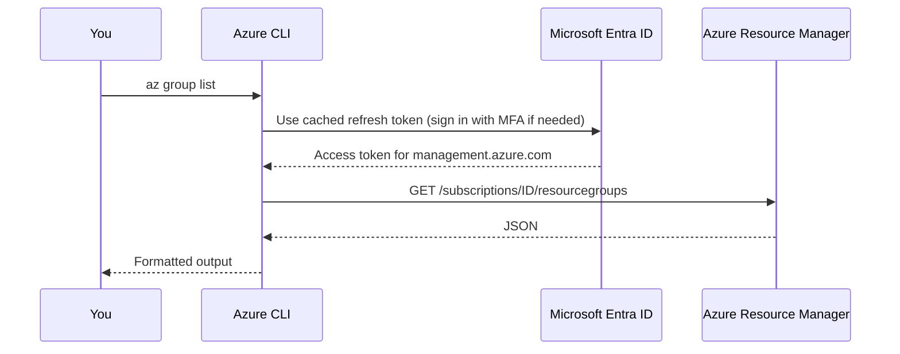

# The Azure CLI

## Introduction

The **Azure CLI** (`az`) is Microsoft's cross-platform command-line tool for creating and managing Azure resources. It runs on Linux, macOS and Windows, and it is preinstalled in **Azure Cloud Shell** in the browser.

Why bother when the Azure portal is so polished? For the same reasons you would use the AWS CLI: commands are **repeatable**, **reviewable** and **scriptable**. A command in a runbook or a pull request is documentation that actually works. The portal is a great map; the CLI is the turn-by-turn directions you can hand to someone else.

This page mirrors [The AWS CLI](./2-cloud-aws-cli.mdx). Both tools use **JMESPath** for queries, so what you learn here transfers directly. The biggest conceptual differences are:

- Azure organizes everything into **resource groups**, so almost every command takes `--resource-group` (`-g`).
- Your "context" is a **subscription** inside a **tenant**, not an account plus Region.
- Many commands distinguish the **control plane** (managing resources, governed by Azure RBAC roles like Contributor) from the **data plane** (reading blobs or secrets, which needs data roles). You will see this in the storage example below.

## How the CLI Works



Almost every management command goes through **Azure Resource Manager (ARM)** at `management.azure.com`. That is why the same RBAC roles and Azure Policy rules apply whether you use the portal, CLI, Bicep, Terraform or an SDK.

Command structure:

```text
az <group> [<subgroup>] <command> [--parameters] [--global-options]
```

For example, `az storage account list --resource-group rg-demo --output table`.

## Installing

Commands below follow the [Azure CLI install docs](https://learn.microsoft.com/cli/azure/install-azure-cli). Check there for your exact distribution.

```bash
# Debian / Ubuntu: one-line install script maintained by the Azure CLI team
curl -fsSL 'https://azurecliprod.blob.core.windows.net/$root/deb_install.sh' | sudo bash

# macOS with Homebrew
brew update && brew install azure-cli
```

On Windows, use the MSI installer or `winget install --exact --id Microsoft.AzureCLI`.

Verify:

```bash
az version
```

Example output:

```json
{
  "azure-cli": "2.91.0",
  "azure-cli-core": "2.91.0",
  "azure-cli-telemetry": "1.1.0",
  "extensions": {}
}
```

Your version may be newer. Update later with `az upgrade`, which also updates installed extensions.

## Signing In

### Interactive sign-in (people)

```bash
az login
```

Since version 2.61.0, `az login` uses the **Web Account Manager (WAM)** broker on Windows and the browser on Linux and macOS. If you have several subscriptions, it shows a **subscription selector**:

```text
Retrieving subscriptions for the selection...

[Tenant and subscription selection]

No    Subscription name     Subscription ID                       Tenant name
----  --------------------  ------------------------------------  -----------
[1]   sub-dev               00000000-0000-0000-0000-000000000001  Contoso
[2] * sub-prod              00000000-0000-0000-0000-000000000002  Contoso

The default is marked with an *; the default tenant is 'Contoso' and subscription is 'sub-prod'.

Select a subscription and tenant (Type a number or Enter for no changes): 1
```

Pick the **dev** subscription. A habit worth forming: never leave production as your default.

Useful variations:

| Situation | Command |
| --- | --- |
| No browser on this machine | `az login --use-device-code` |
| Sign in to a specific tenant | `az login --tenant contoso.onmicrosoft.com` |
| Skip the selector in scripts | `az config set core.login_experience_v2=off` |
| Running on an Azure VM or App Service with a managed identity | `az login --identity` |
| Sign out | `az logout` |

:::warning MFA is mandatory for user accounts
Microsoft enforces MFA for Azure CLI create, update and delete operations by user accounts. Scripts that call `az login -u user -p password` will fail. For automation, use a **managed identity** (`az login --identity`) or a **service principal with workload identity federation (OIDC)** in CI. See [Keyless CI/CD with OIDC](../2-cloud-identity/6-cloud-oidc-for-ci.mdx).
:::

### Checking and switching context

```bash
az account show --query "{sub:name, id:id, tenant:tenantId, user:user.name}" -o json
az account list --query "[].{name:name, id:id, default:isDefault}" -o table
az account set --subscription "sub-dev"
```

Example output of the list:

```text
Name      Id                                    Default
--------  ------------------------------------  ---------
sub-dev   00000000-0000-0000-0000-000000000001  True
sub-prod  00000000-0000-0000-0000-000000000002  False
```

For a single command against another subscription, add `--subscription sub-prod` instead of changing the default. In scripts, always pass `--subscription` explicitly so a teammate's default never matters.

## Defaults and Configuration

Typing `--resource-group` and `--location` on every command gets old. Set defaults, either globally or per directory:

```bash
az config set defaults.location=eastus defaults.group=rg-learning
# Only for the current folder and its subfolders:
az config set defaults.group=rg-project-x --local
az config get defaults
```

Example output:

```json
[
  { "name": "location", "source": "/home/alice/.azure/config", "value": "eastus" },
  { "name": "group", "source": "/home/alice/project-x/.azure/config", "value": "rg-project-x" }
]
```

Configuration lives in `~/.azure/config`. Environment variables named `AZURE_DEFAULTS_GROUP` and `AZURE_DEFAULTS_LOCATION` override it, which is handy in CI.

## Output Formats and `--query`

The `--output` (`-o`) option accepts `json` (default), `jsonc` (colored), `yaml`, `yamlc`, `table`, `tsv` and `none`.

- `table` is for humans.
- `tsv` is for scripts: plain tab-separated values, no quotes.
- `none` suppresses output, useful for create commands in scripts.

`--query` takes a JMESPath expression, exactly like the AWS CLI:

```bash
az resource list \
  --query "[].{name:name, type:type, rg:resourceGroup, owner:tags.owner}" -o table
```

Example output:

```text
Name           Type                                RG             Owner
-------------  ----------------------------------  -------------  -------
stlearn01      Microsoft.Storage/storageAccounts   rg-learning    alice
vm-test        Microsoft.Compute/virtualMachines   rg-learning
```

More patterns:

```bash
# Filter: resource groups in a given location
az group list --query "[?location=='eastus'].name" -o tsv

# Count resources in a group
az resource list -g rg-learning --query "length(@)"

# Capture a single value into a variable
SA_ID=$(az storage account show -n stlearn01 -g rg-learning --query id -o tsv)
```

Many `list` commands also accept server-side filters such as `--tag owner=alice` on `az resource list` or `az group list`.

## Discovering Commands

| Need | Command |
| --- | --- |
| Help for any command | `az vm create --help` |
| Examples from Microsoft's usage data | `az find "az storage account create"` |
| Interactive shell with autocomplete | `az interactive` |
| What will a command send? | Add `--debug` |
| Call any ARM or Graph API directly | `az rest --method get --url ...` |

### Extensions

Some services ship commands as **extensions**, installed on demand. The CLI usually prompts you automatically the first time you use one. You can also manage them explicitly:

```bash
az extension list-available --query "[?name=='containerapp'].{name:name,version:version}" -o table
az extension add --name containerapp
az extension list -o table
```

Pin extension versions in CI, because extensions update independently of the core CLI.

## Long-Running Operations

Creating a VM or deleting a resource group can take minutes. Two patterns:

```bash
# Fire and forget, then wait explicitly where you need it
az group delete --name rg-old --yes --no-wait
az group wait --name rg-old --deleted

# Many resource types have wait commands with conditions
az vm wait -g rg-learning -n vm-test --created
```

This is the Azure equivalent of AWS CLI waiters.

## End-to-End Example: Storage Account and a Blob

This example also shows the **control plane vs data plane** distinction that trips up many beginners.

:::warning Cost note
Storage accounts bill per GB-month stored, per operation, and for data transfer out. A tiny test costs very little, but prices vary by region and can change. Run the cleanup at the end.
:::

```bash
RG=rg-cli-demo
LOC=eastus
SA="stclidemo$RANDOM"          # 3-24 lowercase letters and digits, globally unique

az group create -n "$RG" -l "$LOC" --tags owner=alice purpose=cli-demo -o none
az storage account create -n "$SA" -g "$RG" -l "$LOC" \
  --sku Standard_LRS --kind StorageV2 \
  --allow-blob-public-access false --min-tls-version TLS1_2 -o none
```

Now try to create a container using your Entra ID identity:

```bash
az storage container create --account-name "$SA" --name demo --auth-mode login
```

If you only hold **Owner** or **Contributor**, this can fail with an authorization error. Those are **control plane** roles: they manage the storage account but do not grant access to the data inside it. Grant yourself a **data plane** role:

```bash
ME=$(az ad signed-in-user show --query id -o tsv)
SA_ID=$(az storage account show -n "$SA" -g "$RG" --query id -o tsv)
az role assignment create --assignee "$ME" \
  --role "Storage Blob Data Contributor" --scope "$SA_ID" -o none
```

Role assignments can take a few minutes to propagate. Then:

```bash
az storage container create --account-name "$SA" --name demo --auth-mode login
echo "hello from az" > hello.txt
az storage blob upload --account-name "$SA" --container-name demo \
  --name hello.txt --file hello.txt --auth-mode login -o none
az storage blob list --account-name "$SA" --container-name demo \
  --auth-mode login --query "[].{name:name,size:properties.contentLength}" -o table
```

Example output:

```text
Name       Size
---------  ------
hello.txt  14
```

`--auth-mode login` uses your Entra ID token instead of the storage **account key**. Account keys are long-lived shared secrets with full access, so prefer Entra ID authentication, just as you prefer roles over access keys on AWS.

Cleanup removes everything at once:

```bash
az group delete -n "$RG" --yes --no-wait
rm hello.txt
```

## Real-World Scenario

**Your team's dev subscription** costs more every month because developers leave VMs running overnight. You want a nightly job that **deallocates** (stops and releases compute billing for) every VM in the dev subscription unless it has the tag `keep-running=true`.

```bash
#!/usr/bin/env bash
# stop-dev-vms.sh - deallocate running VMs without keep-running=true
set -euo pipefail
SUB="${1:?usage: stop-dev-vms.sh <subscription>}"
DRY_RUN="${DRY_RUN:-true}"

az vm list -d --subscription "$SUB" \
  --query "[?powerState=='VM running' && tags.\"keep-running\"!='true'].[id,name,resourceGroup]" \
  -o tsv |
while IFS=$'\t' read -r id name rg; do
  if [ "$DRY_RUN" = "true" ]; then
    echo "[dry-run] would deallocate $name in $rg"
  else
    echo "Deallocating $name in $rg"
    az vm deallocate --ids "$id" --no-wait
  fi
done
```

Example output:

```text
[dry-run] would deallocate vm-api-test in rg-team-a
[dry-run] would deallocate vm-ml-scratch in rg-team-b
```

Run it with `DRY_RUN=false` once the list looks right. In production, the job runs in an Azure Automation account or a scheduled pipeline that signs in with a **managed identity** (`az login --identity`) holding the **Virtual Machine Contributor** role on the dev subscription only.

### Why this approach

- `az vm list -d` includes the **power state**, so one call finds running VMs.
- **Deallocate**, not stop: a VM stopped from inside the OS keeps its compute allocation and can still be billed for compute; a deallocated VM is not (disks are still billed).
- **Dry run by default** makes the script safe for a newcomer to run.
- **Tags as an opt-out** let teams protect the few VMs that must stay up. See [Tagging Strategies](./6-cloud-tagging.mdx).

### When to use it, and when not to

This is great for dev and test subscriptions. Do not run it against production. For a single VM, the built-in **auto-shutdown** setting on the VM is simpler. For many VMs with schedules, consider the managed **Start/Stop VMs** solution or Azure Automation.

### Alternatives and trade-offs

| Approach | Pros | Cons | Best for |
| --- | --- | --- | --- |
| VM auto-shutdown setting | Built in, per VM | Shutdown only, configured one VM at a time | A few VMs |
| CLI script in a scheduled pipeline | Flexible, reviewable, tag-aware | You own the code and schedule | Teams already using CI |
| Azure Automation runbook | Managed schedule, managed identity | Another service to learn | Recurring operations |
| Azure Policy plus tags | Prevents untagged resources | Does not stop VMs by itself | Governance |

## Azure CLI and AWS CLI Side by Side

| Task | Azure CLI | AWS CLI |
| --- | --- | --- |
| Sign in | `az login` | `aws sso login` / `aws login` |
| Workload sign-in on a VM | `az login --identity` | Automatic via instance profile |
| Current identity | `az account show` | `aws sts get-caller-identity` |
| Switch context | `az account set -s sub-dev` | `--profile dev` |
| Group resources | Resource group (required) | Tags or stacks (optional) |
| Default location | `az config set defaults.location=eastus` | `region` in profile |
| Async + wait | `--no-wait` then `az ... wait` | `aws ... wait ...` |
| Generic API call | `az rest` | Service-specific commands only |
| Extensions | `az extension add` | Not needed |

## Common Mistakes

1. **Running against the wrong subscription.** Check `az account show` and pass `--subscription` in scripts.
2. **Using a user account in automation.** Mandatory MFA breaks it. Use managed identities or OIDC federation.
3. **Assuming Contributor can read data.** Storage, Key Vault and others need data plane roles such as Storage Blob Data Reader.
4. **Using storage account keys by habit.** Use `--auth-mode login` and Entra ID roles; consider disabling shared key access.
5. **Parsing `json` output with text tools.** Use `--query` with `-o tsv`.
6. **Forgetting `--yes` in non-interactive deletes**, which makes a script hang on a prompt.
7. **Unpinned extensions in CI**, which can change behavior overnight.

## Summary

- `az` sends requests to **Azure Resource Manager**, so RBAC and Azure Policy apply exactly as in the portal.
- Sign in with `az login` (WAM or browser, subscription selector). Use `--use-device-code` on headless machines and `--identity` on Azure-hosted compute.
- Switch context with `az account set`, and pass `--subscription` explicitly in scripts.
- Use `az config` defaults, `--query` with JMESPath, and `-o table` or `-o tsv`.
- Distinguish **control plane** roles (Contributor) from **data plane** roles (Storage Blob Data Contributor).
- Put experiments in a resource group and delete the group to clean up.

## Exercises

1. Set `defaults.group` locally in a project folder and confirm with `az config get` that it only applies there.
2. Write a query that lists all resources in your subscription that have **no** `owner` tag.
3. Repeat the storage example but try to list blobs with only the **Reader** role on the storage account. Then add **Storage Blob Data Reader** and try again. Explain the difference.
4. Translate `find-instances.sh` from [The AWS CLI](./2-cloud-aws-cli.mdx) into an Azure CLI script that lists running VMs with their `owner` tag across all your subscriptions.

### Related pages

- [The AWS CLI](./2-cloud-aws-cli.mdx)
- [Using Cloud SDKs from Code](./4-cloud-sdks.mdx)
- [Setting Up an Azure Account Safely](./1-cloud-azure-account-setup.mdx)
- [Microsoft Entra ID and Azure RBAC](../2-cloud-identity/2-cloud-azure-entra-id.mdx)
- [Workload Identity: Instance Roles and Managed Identities](../2-cloud-identity/4-cloud-workload-identity.mdx)
