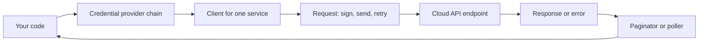

# Using Cloud SDKs from Code

## Introduction

The CLI is perfect for humans and short scripts. But when your **application** needs to upload a file, read a secret or send a message to a queue, it talks to the cloud through an **SDK** (software development kit): a library in your programming language that wraps the cloud's HTTP APIs.

Both clouds publish SDKs for Python, JavaScript/TypeScript, Java, .NET, Go and more. This page uses Python because it is short and readable:

- **AWS:** `boto3` (built on `botocore`)
- **Azure:** a family of packages, each named `azure-*`, plus `azure-identity` for authentication. Examples: `azure-storage-blob`, `azure-mgmt-resource`, `azure-keyvault-secrets`

The concepts are the same in every language: **credentials**, **clients**, **pagination**, **errors and retries**, and **long-running operations**. Learn them once and switching languages becomes a matter of syntax.

An analogy: the raw HTTP API is like a restaurant kitchen's order system. You *could* walk in and write tickets yourself, but the SDK is the waiter who knows the format, signs the ticket, retries when the kitchen is busy, and brings back the food in a nice dish.

## The Shape of an SDK Call



| Concept | boto3 (AWS) | Azure SDK for Python |
| --- | --- | --- |
| Install | `pip install boto3` | `pip install azure-identity azure-storage-blob` (one package per service) |
| Credentials | Default credential chain in `boto3.Session` | `DefaultAzureCredential` or a specific credential class |
| Client | `session.client("s3")` | `BlobServiceClient(account_url, credential)` |
| Paging | `client.get_paginator("list_objects_v2")` | Methods return an `ItemPaged` iterator |
| Errors | `botocore.exceptions.ClientError` | `azure.core.exceptions.HttpResponseError` and subclasses |
| Retries | `botocore.config.Config(retries=...)` | Built-in retry policy, configurable with keyword arguments |
| Long-running operations | Waiters: `client.get_waiter(...)` | Pollers: methods starting with `begin_` return an `LROPoller` |

## Step 1: Credentials Without Secrets in Code

The golden rule: **never put keys in your code.** Both SDKs look for credentials in a chain of places, so the *same code* works on your laptop and in production.

### On AWS

`boto3` checks, in order: explicit parameters, environment variables, the web identity token (OIDC), the shared config files (`~/.aws/config`, including SSO and `aws login` profiles), container credentials (ECS task role) and EC2 instance metadata (instance profile role).

```python
import boto3

# Locally: uses the SSO profile you signed in with (aws sso login --profile dev)
# On AWS compute: drop profile_name and the role attached to the compute is used
session = boto3.Session(profile_name="dev", region_name="us-east-1")
sts = session.client("sts")
identity = sts.get_caller_identity()
print(identity["Account"], identity["Arn"])
```

Output:

```text
111122223333 arn:aws:sts::111122223333:assumed-role/AWSReservedSSO_PowerUserAccess_0123abcd/alice
```

A cleaner habit than hard-coding the profile: leave it out of the code and set `AWS_PROFILE=dev` in your shell. In production the variable is simply absent, and the compute role takes over.

### On Azure

`DefaultAzureCredential` tries, in order: environment variables (service principal), workload identity, managed identity, the Visual Studio or VS Code sign-in, the **Azure CLI** (`az login`), Azure PowerShell, the Azure Developer CLI, and optionally a broker or interactive browser. See [Credential chains in the Azure Identity library](https://learn.microsoft.com/azure/developer/python/sdk/authentication/credential-chains).

```python
import os
from azure.identity import DefaultAzureCredential
from azure.mgmt.resource.resources import ResourceManagementClient

credential = DefaultAzureCredential()
subscription_id = os.environ["AZURE_SUBSCRIPTION_ID"]

client = ResourceManagementClient(credential, subscription_id)
for rg in client.resource_groups.list():
    print(rg.name, rg.location)
```

Output:

```text
rg-learning eastus
rg-cli-demo eastus
```

:::caution Package layout changed recently
In `azure-mgmt-resource` version 25 and later, several modules moved into their own packages, and the recommended import is `from azure.mgmt.resource.resources import ResourceManagementClient`. Listing subscriptions now uses the separate `azure-mgmt-resource-subscriptions` package (`from azure.mgmt.resource.subscriptions import SubscriptionClient`), and deployments moved to `azure-mgmt-resource-deployments`. Older tutorials that import `ResourceManagementClient` directly from `azure.mgmt.resource` fail with an `ImportError` on new versions. Check each package's changelog on PyPI when upgrading.
:::

### Production guidance for `DefaultAzureCredential`

Microsoft recommends `DefaultAzureCredential` for getting started, but suggests a **specific** credential once deployed, because the chain can be slow, hard to debug and affected by environment variables set on the host. Two good options:

```python
from azure.identity import ChainedTokenCredential, ManagedIdentityCredential, AzureCliCredential

# Production first, developer fallback second: explicit and predictable
credential = ChainedTokenCredential(
    ManagedIdentityCredential(),   # pass client_id=... for a user-assigned identity
    AzureCliCredential(),
)
```

Or keep `DefaultAzureCredential` and restrict it with the `AZURE_TOKEN_CREDENTIALS` environment variable (`prod`, `dev`, or a single credential name such as `ManagedIdentityCredential`), supported in recent `azure-identity` versions.

The AWS chain has the same trade-off in principle, but it is shorter and the compute role is usually the only source in production, so explicit configuration is rarely needed.

## Step 2: Clients and Your First Data Operation

Let's upload and list objects in both clouds. These calls create billable storage operations, so use a test bucket or account created on [The AWS CLI](./2-cloud-aws-cli.mdx) or [The Azure CLI](./3-cloud-azure-cli.mdx) pages, and clean up afterwards.

### On AWS

```python
import boto3

s3 = boto3.client("s3")          # region and credentials from the environment
bucket = "cli-demo-1760000000-12345"

s3.put_object(Bucket=bucket, Key="reports/2026-10.csv", Body=b"id,total\n1,42\n")

paginator = s3.get_paginator("list_objects_v2")
for page in paginator.paginate(Bucket=bucket, Prefix="reports/"):
    for obj in page.get("Contents", []):
        print(obj["Key"], obj["Size"])
```

Output:

```text
reports/2026-10.csv 14
```

`list_objects_v2` returns at most 1,000 keys per call. The **paginator** follows the continuation tokens for you. Forgetting pagination is one of the most common SDK bugs: the code works in tests with 10 objects and silently misses data in production with 10,000.

### On Azure

```python
from azure.identity import DefaultAzureCredential
from azure.storage.blob import BlobServiceClient

account_url = "https://stclidemo12345.blob.core.windows.net"
service = BlobServiceClient(account_url, credential=DefaultAzureCredential())
container = service.get_container_client("demo")

container.upload_blob("reports/2026-10.csv", b"id,total\n1,42\n", overwrite=True)

for blob in container.list_blobs(name_starts_with="reports/"):
    print(blob.name, blob.size)
```

Output:

```text
reports/2026-10.csv 14
```

`list_blobs` returns an `ItemPaged` iterator, which fetches pages lazily as you loop. Paging is built in rather than a separate object.

Remember from [The Azure CLI](./3-cloud-azure-cli.mdx) that your identity needs a **data plane** role such as **Storage Blob Data Contributor**. Owner or Contributor alone is not enough for `DefaultAzureCredential`-based blob access.

## Step 3: Handling Errors

Cloud calls fail. Networks drop, permissions are missing, resources do not exist, and APIs throttle you. Handle the errors you expect and let the rest surface.

### On AWS

```python
import boto3
from botocore.exceptions import ClientError

s3 = boto3.client("s3")

def read_report(bucket: str, key: str) -> str | None:
    try:
        obj = s3.get_object(Bucket=bucket, Key=key)
        return obj["Body"].read().decode()
    except ClientError as err:
        code = err.response["Error"]["Code"]
        if code in ("NoSuchKey", "404"):
            return None                     # expected: report not generated yet
        if code in ("AccessDenied", "403"):
            raise PermissionError(f"No read access to s3://{bucket}/{key}") from err
        raise                               # anything else is unexpected

print(read_report("cli-demo-1760000000-12345", "reports/missing.csv"))
```

Output:

```text
None
```

The error code lives in `err.response["Error"]["Code"]`. Each service documents its codes in its API reference.

### On Azure

```python
from azure.core.exceptions import ResourceNotFoundError, HttpResponseError, ClientAuthenticationError
from azure.identity import DefaultAzureCredential
from azure.storage.blob import BlobServiceClient

service = BlobServiceClient("https://stclidemo12345.blob.core.windows.net",
                            credential=DefaultAzureCredential())

def read_report(container: str, name: str) -> str | None:
    blob = service.get_blob_client(container, name)
    try:
        return blob.download_blob().readall().decode()
    except ResourceNotFoundError:
        return None
    except ClientAuthenticationError as err:
        raise PermissionError("Could not get a token; run az login or check the identity") from err
    except HttpResponseError as err:
        if err.status_code == 403:
            raise PermissionError(f"Missing data role on {container}/{name}") from err
        raise

print(read_report("demo", "reports/missing.csv"))
```

Output:

```text
None
```

Azure maps common HTTP failures to typed exceptions such as `ResourceNotFoundError` and `ResourceExistsError`, all subclasses of `HttpResponseError`.

## Step 4: Retries and Timeouts

Both SDKs retry throttling and transient errors automatically with exponential backoff. You usually tune, not replace, that behavior.

```python
import boto3
from botocore.config import Config

config = Config(
    retries={"max_attempts": 5, "mode": "standard"},   # "adaptive" adds client-side rate limiting
    connect_timeout=5,
    read_timeout=30,
)
dynamodb = boto3.client("dynamodb", config=config)
```

```python
from azure.identity import DefaultAzureCredential
from azure.storage.blob import BlobServiceClient

service = BlobServiceClient(
    "https://stclidemo12345.blob.core.windows.net",
    credential=DefaultAzureCredential(),
    retry_total=5,          # total retry attempts
    connection_timeout=5,
    read_timeout=30,
)
```

Rules of thumb:

- **Make your operations idempotent** before adding retries, so a retried "create order" does not create two orders.
- **Keep timeouts short** in request paths of web apps, and longer in batch jobs.
- **Do not wrap SDK calls in your own retry loop** on top of built-in retries, or one failure can turn into dozens of calls.

## Step 5: Long-Running Operations

Creating a database or a VM takes minutes. The API returns quickly and you wait for completion.

### On AWS: waiters

```python
import boto3

ec2 = boto3.client("ec2")
ec2.start_instances(InstanceIds=["i-0fed987cba6543210"])
ec2.get_waiter("instance_running").wait(
    InstanceIds=["i-0fed987cba6543210"],
    WaiterConfig={"Delay": 10, "MaxAttempts": 30},
)
print("running")
```

### On Azure: pollers

Methods that start long operations are prefixed with `begin_` and return a poller:

```python
import os
from azure.identity import DefaultAzureCredential
from azure.mgmt.resource.resources import ResourceManagementClient

client = ResourceManagementClient(DefaultAzureCredential(), os.environ["AZURE_SUBSCRIPTION_ID"])
poller = client.resource_groups.begin_delete("rg-cli-demo")
poller.result()            # blocks until the delete finishes
print("deleted:", poller.status())
```

Output:

```text
deleted: Succeeded
```

## Step 6: Testing Without the Cloud

Unit tests should not call real cloud APIs. They would be slow, flaky and cost money.

**AWS:** `botocore` ships a `Stubber` that queues fake responses for a real client. This test runs offline:

```python
import boto3
from botocore.stub import Stubber


def count_buckets_by_prefix(s3_client, prefix: str) -> int:
    response = s3_client.list_buckets()
    return sum(1 for b in response["Buckets"] if b["Name"].startswith(prefix))


def test_count_buckets_by_prefix():
    s3 = boto3.client("s3", region_name="us-east-1",
                      aws_access_key_id="testing", aws_secret_access_key="testing")
    with Stubber(s3) as stub:
        stub.add_response("list_buckets", {"Buckets": [
            {"Name": "team-a-logs"}, {"Name": "team-a-data"}, {"Name": "team-b-data"},
        ]})
        assert count_buckets_by_prefix(s3, "team-a-") == 2
        stub.assert_no_pending_responses()


if __name__ == "__main__":
    test_count_buckets_by_prefix()
    print("test passed")
```

Output:

```text
test passed
```

The dummy keys exist only so the client can sign requests that the stubber intercepts. The open-source `moto` library goes further and emulates many AWS services in memory.

**Azure:** pass the client into your function (dependency injection) and use `unittest.mock` in unit tests. For storage, the **Azurite** emulator runs Blob, Queue and Table storage locally in Docker for integration tests.

## Other Languages at a Glance

| Language | AWS SDK | Azure SDK auth package |
| --- | --- | --- |
| JavaScript / TypeScript | AWS SDK for JavaScript v3, modular packages such as `@aws-sdk/client-s3` | `@azure/identity` |
| Java | AWS SDK for Java 2.x | `com.azure:azure-identity` |
| .NET | AWS SDK for .NET (`AWSSDK.*` NuGet packages) | `Azure.Identity` |
| Go | AWS SDK for Go v2 | `azidentity` |

The ideas on this page (credential chain, per-service clients, pagination, typed errors, waiters or pollers) apply in all of them.

## Real-World Scenario

**Your team builds a report service** that runs as a container. A customer can deploy it on AWS or Azure, so the service must store generated PDF reports in S3 **or** Blob Storage. Developers run it locally against a dev account.

### The design

```python
# storage.py
from typing import Protocol


class ReportStore(Protocol):
    def save(self, name: str, data: bytes) -> None: ...
    def list(self, prefix: str) -> list[str]: ...


class S3ReportStore:
    def __init__(self, bucket: str):
        import boto3
        self._s3 = boto3.client("s3")
        self._bucket = bucket

    def save(self, name: str, data: bytes) -> None:
        self._s3.put_object(Bucket=self._bucket, Key=name, Body=data)

    def list(self, prefix: str) -> list[str]:
        pages = self._s3.get_paginator("list_objects_v2").paginate(Bucket=self._bucket, Prefix=prefix)
        return [o["Key"] for p in pages for o in p.get("Contents", [])]


class BlobReportStore:
    def __init__(self, account_url: str, container: str):
        from azure.identity import DefaultAzureCredential
        from azure.storage.blob import BlobServiceClient
        service = BlobServiceClient(account_url, credential=DefaultAzureCredential())
        self._container = service.get_container_client(container)

    def save(self, name: str, data: bytes) -> None:
        self._container.upload_blob(name, data, overwrite=True)

    def list(self, prefix: str) -> list[str]:
        return [b.name for b in self._container.list_blobs(name_starts_with=prefix)]


def make_store(env: dict) -> ReportStore:
    if env.get("REPORT_BACKEND") == "azure":
        return BlobReportStore(env["REPORT_ACCOUNT_URL"], env["REPORT_CONTAINER"])
    return S3ReportStore(env["REPORT_BUCKET"])
```

- On AWS, the container runs with an **ECS task role** that allows `s3:PutObject` and `s3:ListBucket` on one bucket.
- On Azure, it runs with a **managed identity** that holds **Storage Blob Data Contributor** on one container.
- Locally, developers use `aws sso login` or `az login`. The code never changes.

### Why this approach

- **No secrets anywhere.** Credential chains pick up the role or managed identity automatically.
- **A thin interface** isolates cloud-specific code, which keeps the business logic testable with a fake store.
- **Lazy imports** mean the AWS image does not need Azure packages at runtime if you split dependencies.

### When to use it, and when not to

A small storage interface is worthwhile when you genuinely must support two clouds or want easy testing. Do not build a big "cloud abstraction layer" for every service on day one: you lose each cloud's best features and gain a lot of code. The trade-offs are discussed further in [Multi-Cloud and Hybrid Strategy](../13-cloud-architecture/5-cloud-multi-cloud-strategy.mdx).

### Alternatives and trade-offs

| Approach | Pros | Cons | Best for |
| --- | --- | --- | --- |
| Native SDK directly in business code | Simplest, full features | Hard to test and to port | Single-cloud apps |
| Thin interface per capability (this example) | Testable, portable where it matters | Some duplicate code | Apps that support two clouds |
| Generic multi-cloud library (for example, Apache Libcloud or fsspec-based tools) | One API for many providers | Lowest common denominator, lags new features | Simple storage use cases |
| Raw REST calls | No dependencies | You reimplement signing, retries, paging | Almost never |

## Common Mistakes

1. **Hard-coding access keys or connection strings.** Use credential chains, roles and managed identities.
2. **Ignoring pagination.** Always use paginators or iterate the paged result.
3. **Creating a new client per request.** Clients are relatively expensive to build; create them once and reuse them. `boto3` clients are generally thread-safe; `boto3` sessions and resources are not.
4. **Catching every exception.** Handle the specific codes you expect and re-raise the rest.
5. **Adding custom retries on top of SDK retries**, multiplying load during an outage.
6. **Using old import paths** after a major Azure SDK upgrade. Read changelogs.
7. **Tests that call the real cloud.** Use stubs, mocks or emulators, and keep a small separate suite of integration tests.

## Summary

- SDKs wrap cloud APIs with **signing, retries, pagination and typed errors**.
- `boto3` and `DefaultAzureCredential` both use **credential chains**, so the same code runs locally (SSO or `az login`) and in production (roles or managed identities). Consider a specific credential in production on Azure.
- Use **paginators** (AWS) and **`ItemPaged` iteration** (Azure) for list calls.
- Long operations use **waiters** (AWS) and **`begin_` pollers** (Azure).
- Tune built-in retries and timeouts instead of writing your own loops.
- Test offline with `Stubber`, `moto`, mocks or Azurite.

## Exercises

1. Write a function that returns the total size in bytes of all objects under a prefix in S3, using a paginator. Test it with `Stubber` returning two pages.
2. Write the Azure equivalent for Blob Storage and test it with `unittest.mock`.
3. Set `AZURE_TOKEN_CREDENTIALS=AzureCliCredential` and enable `azure.identity` debug logging. Observe which credentials are tried.
4. Change `S3ReportStore.save` to set server-side encryption and a `Content-Type` of `application/pdf`. Find the matching options for `upload_blob`.

### Related pages

- [The AWS CLI](./2-cloud-aws-cli.mdx)
- [The Azure CLI](./3-cloud-azure-cli.mdx)
- [Workload Identity: Instance Roles and Managed Identities](../2-cloud-identity/4-cloud-workload-identity.mdx)
- [Amazon S3](../6-cloud-storage/1-cloud-s3.mdx)
- [Azure Blob Storage](../6-cloud-storage/2-cloud-azure-blob.mdx)
