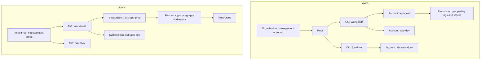
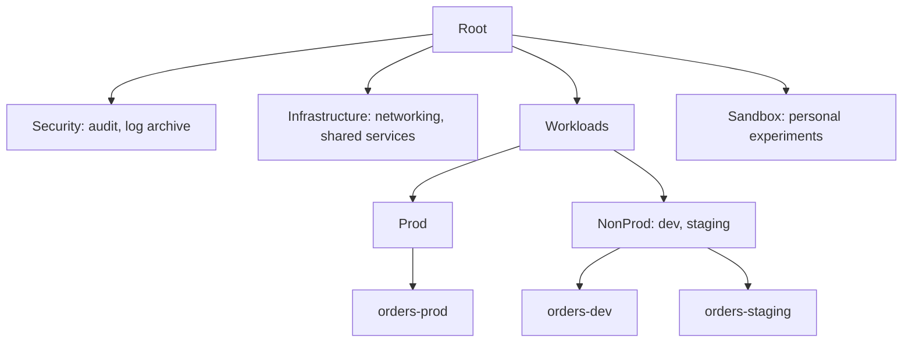

# Organizing Resources: Accounts, Subscriptions and Resource Groups

## Introduction

On day one you have a single AWS account or a single Azure subscription, and everything goes into it. That works for a weekend project. A few months later you have a dev database next to the production database, nobody can say what a given resource is for, and the monthly bill is a single number nobody can explain.

Organizing resources is about drawing **boundaries** early, so that three questions always have easy answers:

1. **Who can touch this?** (security boundary)
2. **Who pays for this?** (billing boundary)
3. **What else breaks if this is deleted?** (lifecycle boundary)

A house analogy helps. The **building** is your organization. **Apartments** (AWS accounts or Azure subscriptions) have their own locks and their own utility meters. **Rooms** (Azure resource groups) group the furniture that belongs together, so you can clear out the spare room without touching the kitchen.

This page explains the containers each cloud gives you, how they map to each other, and how to choose a structure. Identity-heavy topics such as landing zones and service control policies are covered in more depth in [Multi-Account and Landing Zone Strategy](../2-cloud-identity/7-cloud-multi-account-strategy.mdx).

## The Hierarchies Side by Side



| Level | AWS | Azure | Notes |
| --- | --- | --- | --- |
| Top-level container | Organization | Microsoft Entra tenant with its root management group | One per company is typical |
| Grouping for policy | Organizational unit (OU) | Management group | Both can nest; Azure allows up to six levels below the root |
| Billing and security boundary | Account | Subscription | The main isolation unit in both clouds |
| Grouping inside the boundary | Tags, AWS Resource Groups, CloudFormation stacks | **Resource group** (every resource must be in exactly one) | Biggest structural difference |
| Guardrails | Service control policies (SCPs), resource control policies (RCPs) | Azure Policy, assigned at any scope | Covered in [Policies and Governance](../12-cloud-observability-and-security/7-cloud-compliance-and-governance.mdx) |
| Deletion protection | Termination protection per service, SCPs | Resource locks (`CanNotDelete`, `ReadOnly`) | |

### Key difference: the resource group

In Azure, **every resource lives in exactly one resource group**, and the resource group lives in exactly one subscription. Resource groups are mandatory, permissions and policies can be assigned on them, and deleting a resource group deletes everything in it.

AWS has no mandatory equivalent. Inside an account, you group resources with **tags**, with **CloudFormation stacks** (or Terraform state), and optionally with the **AWS Resource Groups** service, which builds groups from tag queries or stacks. This makes the **account** the main grouping tool on AWS, which is why AWS guidance encourages many accounts.

## AWS: Organizations, OUs and Accounts

**AWS Organizations** lets one **management account** create and govern many **member accounts**. It provides:

- **Consolidated billing:** one bill, with per-account breakdowns.
- **OUs** to group accounts and apply policies to the group.
- **SCPs and RCPs** that set maximum permissions for every identity or resource in the accounts below.
- **Centralized services** such as IAM Identity Center, CloudTrail organization trails and delegated administrators for security tools.

AWS Organizations itself has no extra charge; you pay for what runs in the accounts. Remember from [Setting Up an AWS Account Safely](./0-cloud-aws-account-setup.mdx) that a Free plan account that joins an organization is upgraded to the paid plan.

### Creating a minimal structure with the CLI

Run these from the management account with an admin SSO profile:

```bash
export AWS_PROFILE=mgmt-admin

aws organizations create-organization --feature-set ALL
ROOT_ID=$(aws organizations list-roots --query "Roots[0].Id" --output text)

WORKLOADS_OU=$(aws organizations create-organizational-unit \
  --parent-id "$ROOT_ID" --name Workloads \
  --query "OrganizationalUnit.Id" --output text)
SANDBOX_OU=$(aws organizations create-organizational-unit \
  --parent-id "$ROOT_ID" --name Sandbox \
  --query "OrganizationalUnit.Id" --output text)
echo "$ROOT_ID $WORKLOADS_OU $SANDBOX_OU"
```

Example output:

```text
r-ab12 ou-ab12-11111111 ou-ab12-22222222
```

Create a member account. Each account needs a **unique email address**, which becomes its root user:

```bash
aws organizations create-account \
  --email "aws+app-dev@example.com" \
  --account-name "app-dev" \
  --query "CreateAccountStatus.{Id:Id,State:State}"
```

Example output:

```json
{
    "Id": "car-0123456789abcdef0123456789abcdef",
    "State": "IN_PROGRESS"
}
```

Account creation is asynchronous. Check it, then move the new account into its OU:

```bash
aws organizations describe-create-account-status \
  --create-account-request-id car-0123456789abcdef0123456789abcdef \
  --query "CreateAccountStatus.[State,AccountId]" --output text

aws organizations move-account --account-id 444455556666 \
  --source-parent-id "$ROOT_ID" --destination-parent-id "$WORKLOADS_OU"
```

Example output:

```text
SUCCEEDED	444455556666
```

New member accounts get a role named `OrganizationAccountAccessRole` that administrators in the management account can assume. In practice, grant access through IAM Identity Center permission sets instead, and keep the management account for organization tasks only: **do not run workloads in the management account**, because SCPs do not apply to it.

:::tip AWS Control Tower
If you want a prebuilt, opinionated structure (log archive and audit accounts, guardrails, account factory), **AWS Control Tower** sets one up for you on top of Organizations. It is a good choice for companies; for learning, building a small structure by hand teaches you more.
:::

## Azure: Management Groups, Subscriptions and Resource Groups

### Management groups

Management groups sit above subscriptions. According to [Microsoft Learn](https://learn.microsoft.com/azure/governance/management-groups/overview):

- Every tenant has a single **Tenant root group**, whose ID equals the tenant ID. New subscriptions land there by default.
- A management group tree supports **up to six levels** of depth (not counting the root or subscription level).
- Each management group and subscription has **one parent**.
- **Azure RBAC role assignments and Azure Policy assignments inherit** downward to all child management groups, subscriptions, resource groups and resources.

```bash
az account management-group create --name mg-workloads --display-name "Workloads"
az account management-group create --name mg-sandbox --display-name "Sandbox"
az account management-group subscription add --name mg-workloads --subscription "sub-app-dev"
az account management-group show --name mg-workloads --expand \
  --query "children[].{name:displayName,type:type}" -o table
```

Example output:

```text
Name          Type
------------  ---------------------------------------
sub-app-dev   /subscriptions
```

Management groups have no direct charge.

### Subscriptions

A subscription is the **billing unit** and a strong **access and quota boundary**. Use separate subscriptions for production and non-production, and for teams or products that need their own budgets and limits. Many service quotas (such as vCPUs per region) are per subscription, which is another reason to split large workloads.

### Resource groups

A resource group is a **lifecycle container**: put things together that are created, updated and deleted together.

```bash
az group create --name rg-orders-dev-eastus --location eastus \
  --tags owner=team-orders environment=dev cost-center=cc-1234 -o table
```

Example output:

```text
Location    Name
----------  --------------------
eastus      rg-orders-dev-eastus
```

Things to know:

- The resource group's **location** stores its metadata. Resources inside can be in other regions, but keeping them aligned is simpler.
- Resource groups **cannot be renamed**. Many resource types can be **moved** between groups and subscriptions, but not all, so name carefully.
- **Resources do not inherit tags** from their resource group automatically. Use Azure Policy or Cost Management tag inheritance (see [Tagging Strategies](./6-cloud-tagging.mdx)).
- `az group delete` removes **everything** inside. That is a feature for experiments and a hazard for production.

### Resource locks for production

Protect important resource groups from accidental deletion:

```bash
az lock create --name lock-no-delete --lock-type CanNotDelete \
  --resource-group rg-orders-prod-eastus
az lock list --resource-group rg-orders-prod-eastus -o table
```

Example output:

```text
Name            ResourceGroup          Level
--------------  ---------------------  ------------
lock-no-delete  rg-orders-prod-eastus  CanNotDelete
```

A `ReadOnly` lock is stronger but can break normal operations, such as listing storage account keys, so prefer `CanNotDelete` unless you have a specific reason.

## Designing a Structure

### Principles that apply to both clouds

1. **Separate production from everything else** at the account or subscription level. This is the most important boundary.
2. **Group by policy needs, not by org chart.** OUs and management groups exist to apply guardrails. Teams reorganize; "production workloads need the same rules" rarely changes.
3. **Keep the top-level small:** a few OUs or management groups such as Security, Infrastructure (shared networking), Workloads (with Prod and NonProd beneath), and Sandbox.
4. **Give experiments a home** (a sandbox account or subscription) with tight budgets, so nobody experiments in production.
5. **Automate account and subscription creation** once you need more than a handful (AWS Control Tower Account Factory, Azure subscription vending with Bicep or Terraform).

### A starter layout



On AWS, each leaf is an **account** and the boxes above are **OUs**. On Azure, each leaf is a **subscription**, the boxes are **management groups**, and inside each subscription you use **resource groups** per application component, such as `rg-orders-api-prod-eastus` and `rg-orders-data-prod-eastus`.

## Codifying the Structure

Clicking together OUs and resource groups is fine to learn, but the structure itself should live in code so it is reviewed and repeatable. Infrastructure as code is covered in its own [section](../10-cloud-infrastructure-as-code/0-cloud-iac-introduction.mdx); here is a taste.

### On AWS (Terraform)

```hcl
terraform {
  required_providers {
    aws = { source = "hashicorp/aws" }
  }
}

data "aws_organizations_organization" "this" {}

resource "aws_organizations_organizational_unit" "workloads" {
  name      = "Workloads"
  parent_id = data.aws_organizations_organization.this.roots[0].id
}

resource "aws_organizations_account" "orders_dev" {
  name      = "orders-dev"
  email     = "aws+orders-dev@example.com"
  parent_id = aws_organizations_organizational_unit.workloads.id
  close_on_deletion = false   # removing from code does not close the account
}
```

### On Azure (Bicep, deployed at subscription scope)

```bicep
targetScope = 'subscription'

param location string = 'eastus'

resource rg 'Microsoft.Resources/resourceGroups@2024-03-01' = {
  name: 'rg-orders-prod-eastus'
  location: location
  tags: {
    owner: 'team-orders'
    environment: 'prod'
  }
}

module lock 'lock.bicep' = {
  name: 'rg-lock'
  scope: rg
}
```

Here `lock.bicep` (deployed at resource-group scope) contains a single `Microsoft.Authorization/locks` resource with `level: 'CanNotDelete'`. Deploy with `az deployment sub create --location eastus --template-file main.bicep`.

## Real-World Scenario

**You run engineering at a 40-person SaaS company** selling an order-management product. Today everything lives in one AWS account (for the main app) and one Azure subscription (for a reporting feature built on Azure services). An auditor flagged that developers have admin access to production, and finance cannot split costs between the "orders" and "reporting" products.

### The plan

1. **AWS:** creating an organization from the current account would make it the management account, which is not where production should live. Instead, create a **new** management account, create the organization there, and **invite** the existing account as a member, placing it in `Workloads/Prod`. Create new `orders-dev` and `orders-staging` accounts under `Workloads/NonProd` and migrate dev resources there over time.
2. **Azure:** create management groups `mg-workloads` (with `mg-prod` and `mg-nonprod` beneath) and `mg-sandbox`. Create `sub-reporting-dev` and move non-production resource groups into it. Keep `sub-reporting-prod` for production only, with `CanNotDelete` locks on its data resource groups.
3. **Access:** developers get admin-like rights in NonProd accounts and subscriptions, and read-only in Prod. Production changes go through CI/CD pipelines with their own identities.
4. **Billing:** costs now split naturally by account and subscription. Tags (next page) add product and team detail.

### Why this approach

- **Account and subscription boundaries are the strongest isolation** both clouds offer: separate IAM, separate quotas, separate bills.
- **Policies at the OU or management-group level** apply automatically to new accounts and subscriptions.
- **A dedicated management account** follows AWS guidance and keeps SCPs effective on all workloads.

### When to use it, and when not to

A multi-account or multi-subscription layout pays off as soon as you have production customers or more than a few engineers. For a solo developer or a hackathon project, one account or subscription with a budget and good resource groups or tags is enough. Splitting too early adds friction (cross-account networking, more places to look).

### Alternatives and trade-offs

| Approach | Pros | Cons | Best for |
| --- | --- | --- | --- |
| One account or subscription for everything | Simple, no cross-boundary networking | Weak isolation, hard cost split, risky | Prototypes |
| Separate by environment (prod vs non-prod) | Big security win for little effort | Products still mixed together | Small teams |
| Separate by environment and product | Clean costs and ownership | More accounts and subscriptions to manage | Growing companies |
| Full landing zone (Control Tower, Azure landing zones) | Governance at scale, automation | Upfront design and learning curve | Larger organizations, regulated industries |
| Resource groups only (Azure) or tags only (AWS) | No new boundaries | Permissions and quotas shared | Grouping within a boundary, not instead of one |

## Common Mistakes

1. **Running workloads in the AWS management account.** SCPs do not restrict it. Keep it nearly empty.
2. **Mirroring the org chart in OUs or management groups.** Reorganizations then force moves. Group by policy needs.
3. **Deep hierarchies.** Three levels are usually plenty; deeper trees make inherited policies hard to reason about.
4. **One giant Azure resource group per subscription.** You lose the "delete together" benefit and fine-grained RBAC. Group by lifecycle.
5. **Resource groups that mix environments**, such as dev and prod databases in the same group.
6. **Forgetting that `az group delete` is recursive.** Use locks on production.
7. **Reusing one email for many AWS accounts.** Each account's root user needs a unique address; plus-addressing (`aws+name@`) is a common solution if your mail system supports it.

## Cleanup

Everything created on this page is free by itself, but tidy up test structures:

```bash
# Azure: remove the test subscription from the management group, then delete the groups
az account management-group subscription remove --name mg-workloads --subscription "sub-app-dev"
az account management-group delete --name mg-workloads
az account management-group delete --name mg-sandbox
az lock delete --name lock-no-delete --resource-group rg-orders-prod-eastus
az group delete --name rg-orders-dev-eastus --yes --no-wait
```

On AWS, empty OUs can be deleted with `aws organizations delete-organizational-unit --organizational-unit-id ou-ab12-22222222`. Member accounts must be **closed** (`aws organizations close-account --account-id ...`) or removed from the organization; closing has a waiting period and quota limits, so read the [AWS Organizations documentation](https://docs.aws.amazon.com/organizations/latest/userguide/orgs_manage_accounts_close.html) before you try it.

## Summary

- Both clouds offer a **hierarchy**: AWS Organization → OUs → accounts; Azure tenant root group → management groups → subscriptions → **resource groups**.
- **Accounts and subscriptions** are the strongest boundary for security, billing and quotas. Always separate production from non-production at this level.
- Azure **resource groups** are mandatory lifecycle containers; AWS uses **tags and stacks** for grouping inside an account.
- Apply guardrails at the **OU or management-group** level so new accounts and subscriptions inherit them.
- Protect production with **locks** (Azure) and by keeping the AWS **management account** free of workloads.

## Exercises

1. Draw the hierarchy for your current or imagined project in both clouds, with at least prod, non-prod and sandbox.
2. In Azure, create a resource group with two storage accounts, add a `CanNotDelete` lock, and try to delete the group. Read the error, remove the lock and clean up.
3. In AWS (on a paid plan account you control), create an organization with two OUs and one member account. List the tree with `aws organizations list-children`.
4. Explain why the AWS management account should not host workloads, and what the closest Azure equivalent concern is.

### Related pages

- [Tagging Strategies](./6-cloud-tagging.mdx)
- [Budgets and Billing Alerts](./7-cloud-budgets-and-alerts.mdx)
- [Multi-Account and Landing Zone Strategy](../2-cloud-identity/7-cloud-multi-account-strategy.mdx)
- [Policies and Governance: SCPs and Azure Policy](../12-cloud-observability-and-security/7-cloud-compliance-and-governance.mdx)
- [Managing Dev, Staging and Production](../11-cloud-devops/3-cloud-environments.mdx)
