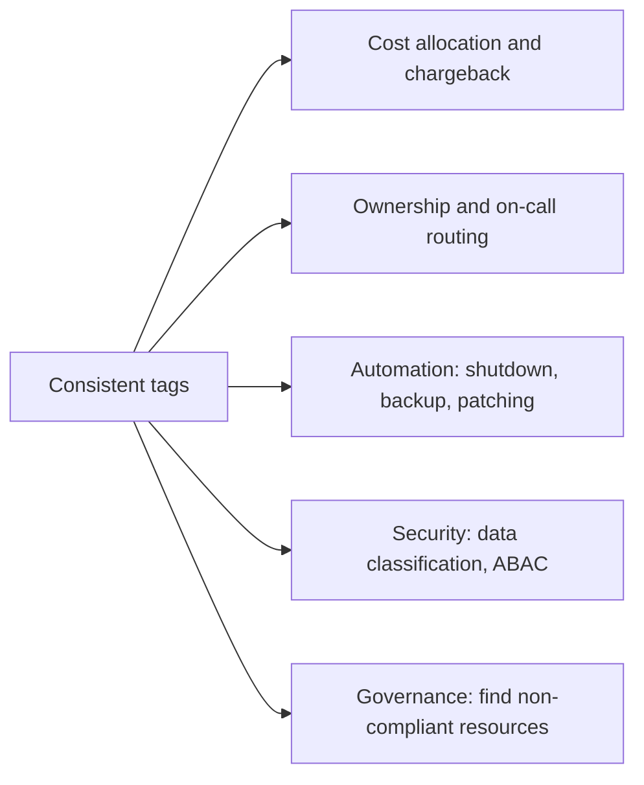

# Tagging Strategies

## Introduction

A **tag** is a key-value label you attach to a cloud resource, such as `owner = team-orders` or `environment = prod`. Tags cost nothing, take seconds to add, and are one of the highest-value habits in cloud engineering. They answer the questions that come up every week:

- "Who owns this database, and can I delete it?"
- "How much does the checkout service cost per month?"
- "Which VMs should the nightly shutdown script skip?"
- "Which resources hold customer data?"

Think of tags like labels on boxes when you move house. Without them, every box has to be opened to find out what is inside. With a consistent labeling scheme (room, owner, fragile), anyone can carry the right box to the right place.

The hard part is not adding tags, it is **consistency**. `Env=Prod`, `environment=production` and `stage=prd` on three resources are as useless as no tags at all in a cost report. This page shows how to design a small, consistent scheme, apply it automatically, and enforce it on both clouds.

## What Tags Are Used For



| Use | Example tag | Who reads it |
| --- | --- | --- |
| Cost allocation | `cost-center = cc-1234` | Finance, cost reports |
| Ownership | `owner = team-orders` | Engineers, incident responders |
| Environment | `environment = prod` | Automation, policies, humans |
| Automation | `auto-shutdown = true` | Scheduled scripts |
| Data sensitivity | `data-classification = confidential` | Security tooling |
| Access control (ABAC) | `project = phoenix` | IAM conditions on AWS, conditions on Azure role assignments |

## Rules and Limits on Each Cloud

The two clouds treat tags slightly differently. These limits come from the [AWS tagging best practices](https://docs.aws.amazon.com/tag-editor/latest/userguide/best-practices-and-strats.html) and [Azure tag documentation](https://learn.microsoft.com/azure/azure-resource-manager/management/tag-resources); check them for service-specific exceptions.

| Rule | AWS | Azure |
| --- | --- | --- |
| Max tags per resource | 50 user-created tags (AWS-generated `aws:` tags do not count) | 50 per resource, resource group or subscription (some services allow only 15) |
| Key length | 1 to 128 characters | Up to 512 characters (128 for storage accounts) |
| Value length | 0 to 256 characters | Up to 256 characters |
| Case sensitivity | Keys and values are case-sensitive | Tag **names** are case-insensitive for operations; **values** are case-sensitive |
| Reserved prefixes | `aws:` is reserved | Some services add their own tags (for example `hidden-` tags); avoid service-like prefixes |
| Disallowed characters | Varies by service; generally letters, numbers, spaces and `_ . : / = + - @` are safe | `<`, `>`, `%`, `&`, `\`, `?`, `/` are not allowed in names |
| Inheritance | No automatic inheritance | Resources do **not** inherit resource group or subscription tags automatically |

:::warning Tags are not secret
Both clouds store tags in plain text and expose them in billing data, APIs and logs. Never put passwords, keys or personal data in tags.
:::

The safest common denominator for a multi-cloud scheme: **lowercase keys, hyphen-separated words, short values without special characters**, such as `cost-center = cc-1234`.

## Designing a Tag Scheme

### Keep the mandatory set small

A strategy with 20 mandatory tags will be ignored. Start with four or five that you will actually enforce:

| Key | Allowed values | Purpose |
| --- | --- | --- |
| `owner` | Team name, such as `team-orders` | Who to ask; routes alerts |
| `environment` | `prod`, `staging`, `dev`, `sandbox` | Policies, automation, cost split |
| `cost-center` | Finance code, such as `cc-1234` | Chargeback |
| `application` | Service name, such as `checkout-api` | Cost per product or service |
| `data-classification` | `public`, `internal`, `confidential` | Security reviews |

Optional tags can be added freely, for example `repo`, `ticket` or `expires-on` for temporary resources.

### Write it down

Publish the scheme as a short document (or better, as a policy file in a repository), including:

- Exact key spelling and case
- The allowed values for each key
- Which resource types must carry which tags
- Who owns the scheme and how to propose changes

Prefer **team names over personal names** for `owner`. People change teams; resources outlive them.

## Applying Tags

### With the CLI

On AWS, most services have their own tag commands, and the **Resource Groups Tagging API** works across services:

```bash
aws resourcegroupstaggingapi tag-resources \
  --resource-arn-list arn:aws:s3:::cli-demo-1760000000-12345 \
  --tags owner=team-orders,environment=dev,cost-center=cc-1234

aws resourcegroupstaggingapi get-resources \
  --tag-filters Key=environment,Values=dev \
  --query "ResourceTagMappingList[].ResourceARN" --output text
```

Example output:

```text
arn:aws:s3:::cli-demo-1760000000-12345
```

Note that `get-resources` returns resources that are **tagged or were previously tagged**, so it is not a complete inventory of untagged resources. For that, use AWS Config rules (such as `required-tags`) or AWS Resource Explorer.

On Azure, use `az tag update` with an operation of `Merge` (add or change), `Replace` (overwrite all) or `Delete`:

```bash
RG_ID=$(az group show -n rg-orders-dev-eastus --query id -o tsv)
az tag update --resource-id "$RG_ID" --operation Merge \
  --tags owner=team-orders environment=dev cost-center=cc-1234 -o none

az resource list --tag environment=dev --query "[].name" -o tsv
az group list --query "[?tags.owner==null].name" -o tsv     # resource groups without an owner
```

Example output of the last command:

```text
rg-old-experiment
NetworkWatcherRG
```

`Replace` removes any tag you do not list, so prefer `Merge` unless you mean it.

### With infrastructure as code (the best way)

Tags added by hand drift. Tags defined once in code apply to everything automatically.

**On AWS with Terraform**, the AWS provider's `default_tags` block adds tags to every resource that supports them:

```hcl
provider "aws" {
  region = "us-east-1"

  default_tags {
    tags = {
      owner         = "team-orders"
      environment   = "dev"
      cost-center   = "cc-1234"
      application   = "checkout-api"
      managed-by    = "terraform"
    }
  }
}

resource "aws_s3_bucket" "reports" {
  bucket = "checkout-api-reports-dev-111122223333"
  tags = {
    data-classification = "internal"    # merged with the default tags
  }
}
```

In CloudFormation, stack-level tags passed with `aws cloudformation deploy --tags owner=team-orders environment=dev` propagate to supported resources in the stack.

**On Azure with Bicep**, pass a common tag object and merge per-resource extras with `union()`:

```bicep
param location string = resourceGroup().location
param commonTags object = {
  owner: 'team-orders'
  environment: 'dev'
  'cost-center': 'cc-1234'
  application: 'checkout-api'
  'managed-by': 'bicep'
}

resource reports 'Microsoft.Storage/storageAccounts@2023-05-01' = {
  name: 'stcheckoutrptdev01'
  location: location
  sku: { name: 'Standard_LRS' }
  kind: 'StorageV2'
  tags: union(commonTags, { 'data-classification': 'internal' })
}
```

Terraform's `azurerm` provider has no `default_tags` equivalent, so teams usually define a `local.common_tags` map and use `merge()` on each resource.

## Enforcing Tags

Documentation alone does not keep tags consistent. Both clouds can enforce rules **at creation time**.

### On AWS: tag policies and SCPs

**Tag policies** in AWS Organizations define the allowed keys, their capitalization and allowed values. They can run in report-only mode first and then be enforced for specific resource types:

```json
{
  "tags": {
    "environment": {
      "tag_key": { "@@assign": "environment" },
      "tag_value": { "@@assign": ["prod", "staging", "dev", "sandbox"] },
      "enforced_for": { "@@assign": ["ec2:instance", "s3:bucket"] }
    }
  }
}
```

Tag policies check **values and spelling**, but they do not force a tag to exist. To **require** a tag, add a service control policy that denies creation without it:

```json
{
  "Version": "2012-10-17",
  "Statement": [
    {
      "Sid": "DenyRunInstancesWithoutOwner",
      "Effect": "Deny",
      "Action": "ec2:RunInstances",
      "Resource": "arn:aws:ec2:*:*:instance/*",
      "Condition": { "Null": { "aws:RequestTag/owner": "true" } }
    }
  ]
}
```

This must be written per service and action, so most teams require tags on a handful of expensive resource types and use AWS Config to report on the rest.

### On Azure: Azure Policy

Azure Policy has built-in definitions for tags, assignable at management group, subscription or resource group scope. Look them up by display name instead of copying IDs:

```bash
REQUIRE_RG_TAG=$(az policy definition list \
  --query "[?displayName=='Require a tag on resource groups'].name | [0]" -o tsv)

az policy assignment create \
  --name require-owner-on-rg \
  --display-name "Require owner tag on resource groups" \
  --policy "$REQUIRE_RG_TAG" \
  --scope "/subscriptions/$(az account show --query id -o tsv)" \
  --params '{ "tagName": { "value": "owner" } }'
```

Now creating a resource group without `owner` fails:

```bash
az group create -n rg-no-owner -l eastus
```

Example output:

```text
(RequestDisallowedByPolicy) Resource 'rg-no-owner' was disallowed by policy.
```

A popular companion is the built-in **"Inherit a tag from the resource group if missing"** policy, which uses the `modify` effect to copy a tag from the resource group onto resources. Modify policies need a managed identity on the assignment and a **remediation task** to fix existing resources. Microsoft Cost Management also has a **tag inheritance** setting that applies resource group and subscription tags to cost data only, without changing the resources.

| Goal | AWS | Azure |
| --- | --- | --- |
| Standardize keys and values | Tag policies | Azure Policy with allowed values |
| Require a tag at creation | SCP with `aws:RequestTag` condition | "Require a tag on resources / resource groups" policies |
| Add missing tags automatically | IaC default tags; automation | `modify` policies and remediation tasks |
| Report non-compliance | AWS Config `required-tags` rule, tag policy compliance reports | Azure Policy compliance view |

## Tags in Cost Reports

Tags only help finance if billing sees them.

- **AWS:** user-defined tags must be **activated as cost allocation tags** in the Billing and Cost Management console (or with `aws ce update-cost-allocation-tags-status`). Newly applied tag keys can take up to 24 hours to appear for activation and up to another 24 hours to activate. Cost data from before activation is not tagged unless you request a **backfill**, which the Cost Explorer API supports for a limited look-back period.
- **Azure:** tags appear in Cost Management and usage exports for services that support tags in billing. Enable **tag inheritance** in Cost Management if you tag resource groups and subscriptions but not every resource.

```bash
aws ce update-cost-allocation-tags-status \
  --cost-allocation-tags-status TagKey=owner,Status=Active TagKey=cost-center,Status=Active
aws ce list-cost-allocation-tags --status Active --query "CostAllocationTags[].TagKey" --output text
```

Example output:

```text
cost-center	owner
```

## Real-World Scenario

**Your finance team** wants a monthly chargeback: each of five product teams pays for its own cloud usage across AWS and Azure. Today about 40% of spend is untagged, and tags that exist use three spellings of "environment".

### The plan

1. **Agree on four mandatory tags** (`owner`, `environment`, `cost-center`, `application`) with lowercase keys and fixed value lists. Publish them in a repository.
2. **Fix the pipeline first.** Add Terraform `default_tags` and Bicep `commonTags` to every module so new resources are always tagged.
3. **Report, then enforce.** Run tag policies (AWS) and Azure Policy in audit mode for a month, share weekly compliance reports with teams, then switch to deny for resource groups (Azure) and expensive resource types (AWS).
4. **Backfill existing resources** with a script that tags by account or subscription (for example, everything in `orders-prod` gets `owner=team-orders`).
5. **Activate cost allocation tags** on AWS and enable tag inheritance in Azure Cost Management.
6. **Accept a remainder.** Shared costs (networking, support plans) are split by a formula, not by tags.

A small Python report for the weekly AWS compliance email:

```python
import boto3
from collections import Counter

REQUIRED = {"owner", "environment", "cost-center", "application"}

def missing_tags_report(region: str = "us-east-1") -> Counter:
    client = boto3.client("resourcegroupstaggingapi", region_name=region)
    missing = Counter()
    for page in client.get_paginator("get_resources").paginate(ResourcesPerPage=100):
        for res in page["ResourceTagMappingList"]:
            keys = {t["Key"] for t in res.get("Tags", [])}
            for tag in REQUIRED - keys:
                missing[tag] += 1
    return missing

if __name__ == "__main__":
    for tag, count in missing_tags_report().most_common():
        print(f"{tag:<12} missing on {count} resources")
```

Example output:

```text
cost-center  missing on 37 resources
application  missing on 21 resources
owner        missing on 9 resources
```

### Why this approach

- **Small, enforced scheme** beats a large, ignored one.
- **Automation at creation time** (IaC and policy) prevents the problem instead of cleaning it up forever.
- **Audit before deny** avoids breaking teams' deployments overnight.

### When to use it, and when not to

Every team that pays a cloud bill should tag. Strict deny policies make sense once teams deploy through IaC; for a sandbox, audit-only is usually enough. Tags are not a substitute for **account and subscription separation**: if two teams must not affect each other, give them separate boundaries (see [Organizing Resources](./5-cloud-resource-organization.mdx)).

### Alternatives and trade-offs

| Approach | Pros | Cons | Best for |
| --- | --- | --- | --- |
| Tags only | Flexible, cheap | Depends on discipline; some costs untaggable | Fine-grained cost split inside a boundary |
| Account or subscription per team | Hard boundary, automatic cost split | More boundaries to manage | Strong ownership |
| Both (recommended) | Coarse split by boundary, fine split by tags | Requires both disciplines | Most organizations |
| Naming conventions only | Visible everywhere | Cannot be queried well in billing; names often immutable | A complement to tags, not a replacement |

## Common Mistakes

1. **Too many mandatory tags.** Start with four or five.
2. **Inconsistent case and spelling.** Fix the convention and enforce allowed values.
3. **Personal names as owners.** Use team names or group aliases.
4. **Expecting Azure resources to inherit resource group tags.** They do not, unless you use policy or Cost Management tag inheritance.
5. **Forgetting to activate cost allocation tags on AWS.** Tags exist on resources but never show up in Cost Explorer.
6. **Secrets or personal data in tag values.**
7. **Enforcing deny policies before IaC templates are updated**, which blocks deployments.

## Summary

- Tags are free key-value labels that power **cost allocation, ownership, automation, security and governance**.
- Limits differ: both allow 50 tags per resource; AWS keys are case-sensitive, Azure tag names are case-insensitive for operations. Use lowercase, hyphenated keys everywhere.
- Keep a **small mandatory set** such as `owner`, `environment`, `cost-center` and `application`.
- Apply tags through **IaC defaults** (Terraform `default_tags`, Bicep `union()`), not by hand.
- Enforce with **tag policies and SCPs** on AWS and **Azure Policy** on Azure, starting in audit mode.
- **Activate cost allocation tags** on AWS and consider **tag inheritance** in Azure Cost Management.

## Exercises

1. Write your team's tag scheme as a table with keys, allowed values and purpose. Keep it to five mandatory keys.
2. Assign the "Require a tag on resource groups" policy to a test subscription, confirm creating an untagged group fails, then remove the assignment with `az policy assignment delete --name require-owner-on-rg`.
3. Add `default_tags` to a Terraform AWS provider and run `terraform plan` on an existing configuration. Which resources change?
4. Extend the Python report to group missing tags by resource type (hint: parse the service from the ARN).

### Related pages

- [Organizing Resources: Accounts, Subscriptions and Resource Groups](./5-cloud-resource-organization.mdx)
- [Budgets and Billing Alerts](./7-cloud-budgets-and-alerts.mdx)
- [Cost Optimization and FinOps](../13-cloud-architecture/4-cloud-cost-optimization.mdx)
- [Policies and Governance: SCPs and Azure Policy](../12-cloud-observability-and-security/7-cloud-compliance-and-governance.mdx)
- [Terraform tutorial](/docs/devops/terraform)
