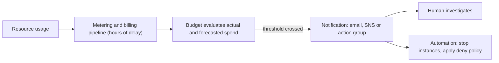
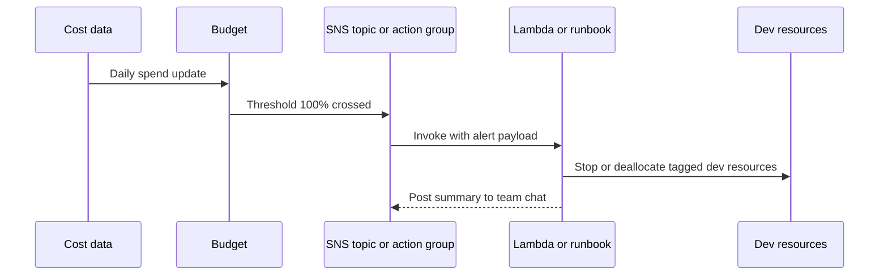

# Budgets and Billing Alerts

## Introduction

The cloud bills you for what you use, and it will happily let you use a lot. A forgotten GPU instance, a test database left running over a holiday, or a misconfigured loop that writes millions of log lines can turn a small monthly bill into a painful one.

**Budgets and billing alerts** are your smoke detectors. They do not prevent the fire on their own, but they tell you early, while it is still small. With a little extra wiring, they can also trigger an automatic response, like a sprinkler.

This page shows how to set up budgets and alerts on both clouds, explains what they can and cannot do, and walks through an automated response. It is the practical follow-up to the cost concepts in [Cloud Pricing Models](../0-cloud-fundamentals/7-cloud-pricing-models.mdx).

:::info No prices here
Prices vary by region and change over time, so this page never quotes amounts as facts. The budget amounts in examples are placeholders. Use the [AWS Pricing Calculator](https://calculator.aws/) and the [Azure Pricing Calculator](https://azure.microsoft.com/pricing/calculator/) to estimate costs, and the AWS Budgets and Azure Cost Management pricing pages to check whether budgets themselves have any charge beyond a free allowance.
:::

## The Most Important Fact: Budgets Alert, They Do Not Cap

Neither AWS Budgets nor Azure budgets **stop spending by default**. When a threshold is crossed, they send notifications. Resources keep running and keep costing money until someone or something acts.

There are only a few hard stops:

- **AWS Free account plan:** no charges while on the plan; the account closes when the plan ends unless you upgrade. See [Setting Up an AWS Account Safely](./0-cloud-aws-account-setup.mdx).
- **Azure spending limit:** free accounts and some credit-based subscriptions are **disabled** when credit runs out, instead of being charged. See [Setting Up an Azure Account Safely](./1-cloud-azure-account-setup.mdx).

Once you are on pay-as-you-go, budgets plus automation are your safety net.

Also remember that **billing data lags**. Usage is metered and processed in batches, so cost data and therefore alerts typically arrive hours after the usage happened. A runaway resource can run for a while before any alert fires. Forecasted alerts help, but they are estimates.

## How Alerts Flow



## Concepts Side by Side

| Feature | AWS | Azure |
| --- | --- | --- |
| Budget service | AWS Budgets | Cost Management budgets |
| Scopes | Account (or whole organization from the management account), filtered by service, tag, account, Region and more | Management group, subscription, resource group (and billing scopes), filtered by resource group, meter, tag and more |
| Budget types | Cost, usage, Savings Plans and Reserved Instance utilization or coverage | Cost or usage |
| Periods | Daily, monthly, quarterly, annually, custom | Monthly, quarterly, annually |
| Alert types | Actual and forecasted thresholds | Actual and forecasted thresholds |
| Notification targets | Email (up to 10 recipients per notification), Amazon SNS topics, chatbot integrations | Email addresses, roles (Owner, Contributor, Reader), Azure Monitor action groups |
| Automated response | **Budget actions**: apply an IAM policy or SCP, or stop specific EC2 or RDS instances | Action groups that call Azure Functions, Logic Apps, Automation runbooks or webhooks |
| Anomaly detection | AWS Cost Anomaly Detection | Cost anomaly alerts in Cost Management |
| Hard spending cap | Free account plan only | Spending limit on free and some credit subscriptions only |

## Step 1: A Monthly Cost Budget

Pick an amount you would be uncomfortable to exceed, and alert at several thresholds. A common pattern:

| Alert | Type | Purpose |
| --- | --- | --- |
| 50% | Actual | "Halfway through the budget" heads-up |
| 80% | Actual | Time to look closely |
| 100% | Forecasted | The month is trending over budget |
| 100% | Actual | Over budget: act now |

### On AWS

The CLI needs your account ID and two JSON files. The structure follows the [`create-budget` reference](https://docs.aws.amazon.com/cli/latest/reference/budgets/create-budget.html).

`budget.json`:

```json
{
  "BudgetName": "monthly-account-budget",
  "BudgetType": "COST",
  "TimeUnit": "MONTHLY",
  "BudgetLimit": { "Amount": "50", "Unit": "USD" }
}
```

`notifications.json`:

```json
[
  {
    "Notification": {
      "NotificationType": "ACTUAL",
      "ComparisonOperator": "GREATER_THAN",
      "Threshold": 80,
      "ThresholdType": "PERCENTAGE"
    },
    "Subscribers": [{ "SubscriptionType": "EMAIL", "Address": "cloud-alerts@example.com" }]
  },
  {
    "Notification": {
      "NotificationType": "FORECASTED",
      "ComparisonOperator": "GREATER_THAN",
      "Threshold": 100,
      "ThresholdType": "PERCENTAGE"
    },
    "Subscribers": [{ "SubscriptionType": "EMAIL", "Address": "cloud-alerts@example.com" }]
  }
]
```

Create it and confirm:

```bash
ACCOUNT_ID=$(aws sts get-caller-identity --query Account --output text)

aws budgets create-budget \
  --account-id "$ACCOUNT_ID" \
  --budget file://budget.json \
  --notifications-with-subscribers file://notifications.json

aws budgets describe-budgets --account-id "$ACCOUNT_ID" \
  --query "Budgets[].{Name:BudgetName,Limit:BudgetLimit.Amount,Actual:CalculatedSpend.ActualSpend.Amount,Forecast:CalculatedSpend.ForecastedSpend.Amount}" \
  --output table
```

`create-budget` prints nothing on success. Example output of `describe-budgets`:

```text
--------------------------------------------------------------
|                       DescribeBudgets                      |
+---------+-----------+--------+-----------------------------+
| Actual  | Forecast  | Limit  |            Name             |
+---------+-----------+--------+-----------------------------+
|  12.34  |  31.20    |  50.0  |  monthly-account-budget     |
+---------+-----------+--------+-----------------------------+
```

The amounts are illustrative. Budgets can also filter by **cost allocation tags** (see [Tagging Strategies](./6-cloud-tagging.mdx)), which lets you create one budget per team or application.

### On Azure

The Azure CLI's `az consumption budget create` command is in preview, and the simplest variant does not configure notifications. A reliable approach is a small **Bicep** file deployed at subscription scope, based on the [official budget quickstart](https://learn.microsoft.com/azure/cost-management-billing/costs/quick-create-budget-bicep).

`budget.bicep`:

```bicep
targetScope = 'subscription'

param budgetName string = 'monthly-subscription-budget'
param amount int = 50
@description('First day of a month, YYYY-MM-DD')
param startDate string
param contactEmails array

resource budget 'Microsoft.Consumption/budgets@2023-11-01' = {
  name: budgetName
  properties: {
    category: 'Cost'
    amount: amount
    timeGrain: 'Monthly'
    timePeriod: {
      startDate: startDate
    }
    notifications: {
      actual80: {
        enabled: true
        operator: 'GreaterThan'
        threshold: 80
        thresholdType: 'Actual'
        contactEmails: contactEmails
      }
      forecast100: {
        enabled: true
        operator: 'GreaterThan'
        threshold: 100
        thresholdType: 'Forecasted'
        contactEmails: contactEmails
      }
    }
  }
}

output budgetId string = budget.id
```

Deploy it and list budgets:

```bash
az deployment sub create \
  --name budget-deploy \
  --location eastus \
  --template-file budget.bicep \
  --parameters startDate=2026-10-01 contactEmails='["cloud-alerts@example.com"]'

az consumption budget list --query "[].{name:name, amount:amount, current:currentSpend.amount}" -o table
```

Example output:

```text
Name                         Amount    Current
---------------------------  --------  ---------
monthly-subscription-budget  50.0      12.34
```

Notes from the Microsoft docs:

- The **start date must be the first of a month**, and not more than a few months in the future.
- If you leave out the end date, a default (ten years at the time of writing) is used.
- New subscriptions can take **up to 48 hours** before budgets and other Cost Management features work.
- Budgets support management group, subscription and resource group scopes for Azure RBAC; deploy with a `resourceGroup` target scope for a resource-group budget.

### On AWS: a CloudWatch billing alarm (optional extra)

Before AWS Budgets existed, the classic approach was a CloudWatch alarm on the `EstimatedCharges` metric. It still works and is useful if you already route CloudWatch alarms to an on-call tool. Billing metrics are published only in **us-east-1** and only after you enable **CloudWatch billing alerts** in Billing preferences.

```bash
aws cloudwatch put-metric-alarm --region us-east-1 \
  --alarm-name estimated-charges-over-limit \
  --namespace AWS/Billing --metric-name EstimatedCharges \
  --dimensions Name=Currency,Value=USD \
  --statistic Maximum --period 21600 --evaluation-periods 1 \
  --threshold 50 --comparison-operator GreaterThanThreshold \
  --alarm-actions arn:aws:sns:us-east-1:111122223333:billing-alerts
```

The metric is the **month-to-date estimated total**, updated several times a day, so it suits a single "total spend" alarm. Budgets are more flexible (filters, forecasts, actions) and are the better default.

## Step 2: Anomaly Detection

Fixed thresholds miss problems that are big **relative to normal** but small relative to the budget, such as a service that usually costs a little suddenly costing ten times as much. Both clouds offer machine-learning-based anomaly detection:

- **AWS Cost Anomaly Detection:** create a **monitor** (for example, per AWS service, per linked account, or per cost allocation tag) and an **alert subscription** with an impact threshold and email or SNS delivery. Set it up in the Billing and Cost Management console under **Cost Anomaly Detection**.
- **Azure cost anomaly alerts:** in Cost Management, create an **anomaly alert** for a subscription. Azure evaluates daily costs and emails recipients when it detects unusual changes.

Turn these on in addition to budgets; they catch different failure modes.

## Step 3: Automated Responses

Notifications are only useful if someone reads them. For sandboxes and dev environments, automation is often better.

### On AWS: budget actions

**AWS Budgets actions** run when a threshold is crossed. Three action types exist:

1. Apply an **IAM policy** to users, groups or roles (for example, a policy that denies `ec2:RunInstances`).
2. Apply a **service control policy** to an account or OU (from the management account).
3. **Stop specific EC2 or RDS instances**.

Actions can run automatically or wait for approval. They need an IAM role that AWS Budgets can assume with the permissions to perform the action. Configure them in the console under the budget's **Actions** tab, or with `aws budgets create-budget-action`.

For more flexible responses, send the notification to an **SNS topic** and subscribe a Lambda function that, for example, stops every instance tagged `environment=dev`.

### On Azure: action groups

Azure budget notifications can target an **Azure Monitor action group**. The action group can call an **Automation runbook**, an **Azure Function**, a **Logic App** or a webhook. A typical pattern deallocates all VMs in a dev resource group when the budget hits 100%, using a runbook that runs with a managed identity.



## Checking Spend on Demand

When an alert arrives, the first question is "what is costing money?" On AWS, the Cost Explorer API answers it from the CLI (each Cost Explorer API request has a small charge, so do not call it in a tight loop):

```bash
aws ce get-cost-and-usage \
  --time-period Start=2026-10-01,End=2026-10-11 \
  --granularity MONTHLY --metrics UnblendedCost \
  --group-by Type=DIMENSION,Key=SERVICE \
  --query "ResultsByTime[0].Groups[].[Keys[0],Metrics.UnblendedCost.Amount]" --output text
```

Example output (amounts illustrative):

```text
Amazon Elastic Compute Cloud - Compute	9.81
Amazon Simple Storage Service	0.42
AWS Key Management Service	0.30
```

On Azure, open **Cost analysis** for the subscription and group by **Service name** or **Resource group**, or schedule a **cost export** to a storage account for analysis in your own tools.

## Real-World Scenario

**You run a university course** where 60 students each get their own cloud sandbox for a semester: an AWS account in a `Students` OU for half the class, and an Azure subscription under a `mg-students` management group for the other half. Last year, two students left GPU machines running for weeks, and the department paid for it.

### The design

1. **A budget per sandbox**, created automatically when the account or subscription is created (Terraform or Bicep in the provisioning pipeline), with alerts at 50%, 80% and forecasted 100% to the student and the teaching assistants.
2. **Restrictive guardrails** so the expensive mistakes are impossible: an SCP on the `Students` OU that denies GPU and large instance families and Regions outside one approved Region; an Azure Policy on `mg-students` with **Allowed virtual machine size SKUs** and **Allowed locations**.
3. **Automatic response at 100% actual:**
   - AWS: a budget action applies an SCP that denies creating new resources in that account, and a second action stops tagged EC2 instances.
   - Azure: the budget's action group calls a runbook that deallocates all VMs in the student's subscription.
4. **Anomaly detection** on the course payer account and on the `mg-students` scope, alerting the instructor.

### Why this approach

- **Prevention first.** Policies that block expensive SKUs stop the most damaging mistakes before any cost occurs. Budgets catch everything else.
- **Per-sandbox budgets** make it obvious which student needs help and keep one student's mistake from hiding in a class-wide total.
- **Automation** works at 2 a.m. on a holiday; teaching assistants do not.

### When to use it, and when not to

Automatic stop actions are excellent for sandboxes, labs and dev environments. **Do not** wire automatic shutdowns to **production** budgets: an outage triggered by a cost alert is usually worse than the bill. For production, alert humans, investigate, and use architectural fixes (right-sizing, autoscaling limits, reservations) covered in [Cost Optimization and FinOps](../13-cloud-architecture/4-cloud-cost-optimization.mdx).

### Alternatives and trade-offs

| Approach | Pros | Cons | Best for |
| --- | --- | --- | --- |
| Email budget alerts only | Easy, no risk of outages | Depends on someone reading email; billing lag | Production, small teams |
| Budget + automatic stop | Limits damage without humans | Can stop something important; still lags | Sandboxes, labs, dev |
| Preventive policies (SCP, Azure Policy) | Stops expensive mistakes before they cost anything | Must be maintained; may block legitimate needs | Shared or student environments |
| Anomaly detection | Catches unusual changes below budget thresholds | Needs some history; can be noisy | Everyone, as an extra layer |
| Free plan or spending limit | True hard cap | Only for free or credit-based offers; disables everything | Personal learning |

## Common Mistakes

1. **Believing a budget caps spending.** It alerts. Add automation or policies if you need enforcement.
2. **Sending alerts to one person's inbox.** Use a team distribution list or a chat integration.
3. **Only "actual" alerts.** Add a **forecasted** alert so you hear about trouble before month end.
4. **One big budget for everything.** Create budgets per account, subscription, team or tag so you can tell where the money goes.
5. **Ignoring billing lag.** Pair budgets with preventive policies and resource limits.
6. **Automatic shutdown on production.** Keep automated actions to non-production scopes.
7. **Forgetting new accounts or subscriptions.** Create budgets in the same pipeline that creates the account or subscription.

## Cleanup

Budgets are inexpensive or free within allowances, but remove test budgets to keep things tidy:

```bash
# AWS
aws budgets delete-budget --account-id "$ACCOUNT_ID" --budget-name monthly-account-budget

# Azure
az consumption budget delete --budget-name monthly-subscription-budget
```

If you created SNS topics, Lambda functions, action groups or runbooks for automated responses, delete those too. They may have small ongoing costs.

## Summary

- **Budgets alert; they do not cap.** Only the AWS Free plan and the Azure spending limit act as hard stops, and both disappear when you upgrade.
- Create a **monthly cost budget** on day one with several **actual** thresholds and a **forecasted** threshold.
- On AWS, use `aws budgets create-budget` with JSON; on Azure, deploy a `Microsoft.Consumption/budgets` resource with Bicep (the CLI budget commands are in preview).
- Turn on **anomaly detection** in both clouds.
- For non-production scopes, add **automated responses**: AWS budget actions or SNS plus Lambda; Azure action groups with runbooks or Functions.
- Combine budgets with **preventive policies** because billing data lags by hours.

## Exercises

1. Create a monthly cost budget in your AWS account with 50%, 80% and forecasted 100% alerts. Verify it with `describe-budgets`.
2. Deploy the Bicep budget to your Azure subscription, then add a third notification at 100% actual that targets the `Owner` role using `contactRoles`.
3. Design (on paper) an automated response for a dev environment: which resources would be stopped, how they are identified (tags), and which identity performs the action.
4. Turn on AWS Cost Anomaly Detection and Azure anomaly alerts. Compare the setup options and write down two differences.

### Related pages

- [Tagging Strategies](./6-cloud-tagging.mdx)
- [Cloud Pricing Models](../0-cloud-fundamentals/7-cloud-pricing-models.mdx)
- [Cost Optimization and FinOps](../13-cloud-architecture/4-cloud-cost-optimization.mdx)
- [Project: Cost Monitoring and Alerts](../14-cloud-projects/6-cloud-project-cost-dashboard.mdx)
- [Alerting and Dashboards](../12-cloud-observability-and-security/3-cloud-alerting.mdx)
