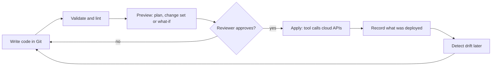

# Infrastructure as Code in the Cloud

## Introduction

Up to this point in the tutorial you have created most resources with the console, the AWS CLI or the Azure CLI. That is the right way to learn, but it does not scale. After a few months nobody remembers which settings were clicked, the staging environment no longer matches production, and rebuilding everything after a mistake takes days.

**Infrastructure as Code (IaC)** solves this by describing your cloud resources in text files that live in Git. A tool reads those files, compares them with what already exists in your account or subscription, and makes the cloud match the files.

Think of it like a recipe versus cooking from memory. A good cook can make a dish from memory, but a written recipe lets anyone in the kitchen make the same dish, lets you change one ingredient and see exactly what changed, and survives the cook going on vacation.

In this section you will learn:

1. What IaC is and which problems it solves (this page)
2. [AWS CloudFormation](./1-cloud-cloudformation.mdx), the native AWS engine
3. [AWS CDK](./2-cloud-aws-cdk.mdx), which writes CloudFormation using real programming languages
4. [Azure Bicep and ARM Templates](./3-cloud-bicep-and-arm.mdx), the native Azure option
5. [Terraform for AWS and Azure](./4-cloud-terraform-multi-cloud.mdx), one tool for both clouds
6. [Choosing an IaC Tool](./5-cloud-choosing-iac-tool.mdx), a decision guide

:::note
This site already has a full [Terraform tutorial](/docs/devops/terraform). This section focuses on how IaC fits into AWS and Azure and compares the tools. It links to the Terraform tutorial instead of re-teaching Terraform syntax.
:::

## Three Ways to Create Cloud Resources

Imagine you need a storage bucket for reports, with versioning turned on and an `owner` tag. There are three broad ways to do it.

### 1. ClickOps (the console)

You open the AWS console or the Azure portal, click through a wizard and press **Create**. It is fast for one resource and great for exploring, but:

- Nothing records what you chose.
- Repeating it in another account or region means clicking again, and making small mistakes.
- Reviewing a change before it happens is impossible.

### 2. Imperative scripts

You write a shell script with CLI commands:

```bash
#!/usr/bin/env bash
set -euo pipefail

BUCKET="reports-$(date +%s)"
aws s3api create-bucket --bucket "$BUCKET" --region us-east-1
aws s3api put-bucket-versioning --bucket "$BUCKET" \
  --versioning-configuration Status=Enabled
aws s3api put-bucket-tagging --bucket "$BUCKET" \
  --tagging 'TagSet=[{Key=owner,Value=data-team}]'
echo "Created $BUCKET"
```

Example output:

```text
{
    "Location": "/reports-1760180000"
}
Created reports-1760180000
```

This is repeatable, but it describes **steps**, not the **result**. Run it twice and you get two buckets. If someone later turns versioning off by hand, the script does not notice. To change the tag you must write a new script that handles "the bucket already exists".

### 3. Declarative Infrastructure as Code

You describe **what should exist**, and the tool works out the steps. Here is the same bucket in three popular IaC languages.

**AWS CloudFormation (YAML):**

```yaml
AWSTemplateFormatVersion: "2010-09-09"
Resources:
  ReportsBucket:
    Type: AWS::S3::Bucket
    Properties:
      VersioningConfiguration:
        Status: Enabled
      Tags:
        - Key: owner
          Value: data-team
Outputs:
  BucketName:
    Value: !Ref ReportsBucket
```

**Azure Bicep** (the Azure equivalent of a bucket is a storage account):

```bicep
param location string = resourceGroup().location

resource reports 'Microsoft.Storage/storageAccounts@2025-01-01' = {
  name: 'streports${uniqueString(resourceGroup().id)}'
  location: location
  sku: {
    name: 'Standard_LRS'
  }
  kind: 'StorageV2'
  properties: {
    minimumTlsVersion: 'TLS1_2'
    allowBlobPublicAccess: false
  }
  tags: {
    owner: 'data-team'
  }
}

output storageAccountName string = reports.name
```

**Terraform (HCL), targeting AWS:**

```hcl
terraform {
  required_providers {
    aws = {
      source  = "hashicorp/aws"
      version = "~> 6.0"
    }
  }
}

provider "aws" {
  region = "us-east-1"
}

resource "aws_s3_bucket" "reports" {
  bucket_prefix = "reports-"
  tags = {
    owner = "data-team"
  }
}

resource "aws_s3_bucket_versioning" "reports" {
  bucket = aws_s3_bucket.reports.id
  versioning_configuration {
    status = "Enabled"
  }
}

output "bucket_name" {
  value = aws_s3_bucket.reports.bucket
}
```

Run any of these twice and nothing new is created, because the resource already matches. This property is called **idempotency**. Change the tag in the file and the tool updates only the tag.

| Approach | Repeatable | Shows changes before applying | Detects manual changes | Best for |
| --- | --- | --- | --- | --- |
| Console (ClickOps) | No | No | No | Learning, one-off experiments |
| Imperative scripts | Partly | No | No | Small glue tasks, data operations |
| Declarative IaC | Yes | Yes (plan, change set, what-if) | Yes (drift detection) | Anything that lives longer than a day |

## How Declarative IaC Works

Every IaC tool, whatever its syntax, follows the same loop.



1. **Desired state.** Your files describe what should exist.
2. **Current state.** The tool learns what exists now. How it does this is the biggest difference between tools (see below).
3. **Diff.** The tool compares desired and current state and builds a list of creates, updates, replacements and deletes.
4. **Preview.** You review that list. In AWS CloudFormation it is a **change set**, in Azure it is **what-if**, in Terraform it is a **plan**.
5. **Apply.** The tool calls the cloud APIs in dependency order. For example, it creates a network before the virtual machine that uses it.
6. **Drift detection.** Later, the tool can compare reality with the record and report anything changed by hand.

### Where the state lives

To compute a diff, the tool must know which real resources belong to your code. The tools take very different approaches.

| Tool | Where state lives | What you manage |
| --- | --- | --- |
| AWS CloudFormation and CDK | Inside the AWS service, as a **stack** | Nothing; AWS stores it |
| Azure ARM templates and Bicep | Azure Resource Manager reads the live resources; history is kept as **deployments** and optional **deployment stacks** | Nothing; Azure stores it |
| Terraform and OpenTofu | A **state file** you store, usually in an S3 bucket or Azure Storage container | Storage, locking and access to the state file |
| Pulumi | A state backend, either Pulumi Cloud or your own bucket | The backend |

Service-managed state is simpler to start with. A state file gives the tool a full record of every resource it manages, which makes plans precise and lets one tool manage many clouds, but you must protect it because it can contain secrets. The [Terraform remote state page](../../terraform/4-terraform-outputs-and-state/4-terraform-remote-state.mdx) covers this in depth.

### Mutable versus replacement changes

Not every change is an in-place update. Some properties cannot be changed after creation, such as the name of an S3 bucket or the region of an Azure storage account. Changing them makes the tool **replace** the resource: delete the old one and create a new one. For a database, replacement can mean data loss.

This is why the preview step matters. Every tool marks replacements clearly:

- CloudFormation change sets show `Replacement: True` (or `Conditional`).
- Terraform plans show `-/+ destroy and then create replacement`.
- Azure what-if shows the change type for each resource. Some property changes are rejected by the resource provider instead of triggering a replacement, so read the docs for properties that cannot change.

## The IaC Tool Landscape for AWS and Azure

| Tool | Clouds | Language | Engine | Covered on |
| --- | --- | --- | --- | --- |
| AWS CloudFormation | AWS | YAML or JSON | AWS service | [AWS CloudFormation](./1-cloud-cloudformation.mdx) |
| AWS SAM | AWS | CloudFormation YAML with serverless shortcuts | CloudFormation | [AWS Lambda](../4-cloud-serverless/1-cloud-aws-lambda.mdx) |
| AWS CDK | AWS | TypeScript, Python, Java, C#, Go, JavaScript | Generates CloudFormation | [AWS CDK](./2-cloud-aws-cdk.mdx) |
| ARM templates | Azure | JSON | Azure Resource Manager | [Bicep and ARM](./3-cloud-bicep-and-arm.mdx) |
| Bicep | Azure | Bicep DSL | Compiles to ARM JSON | [Bicep and ARM](./3-cloud-bicep-and-arm.mdx) |
| Terraform | AWS, Azure and many more | HCL | Terraform CLI with providers | [Terraform for AWS and Azure](./4-cloud-terraform-multi-cloud.mdx) |
| OpenTofu | Same as Terraform | HCL | Open-source fork of Terraform | [Terraform for AWS and Azure](./4-cloud-terraform-multi-cloud.mdx) |
| Pulumi | AWS, Azure and many more | TypeScript, Python, Go, C#, Java, YAML | Pulumi engine with providers | [Choosing an IaC Tool](./5-cloud-choosing-iac-tool.mdx) |

The AWS and Azure columns line up neatly:

| Concept | AWS | Azure |
| --- | --- | --- |
| Native template language | CloudFormation YAML or JSON | ARM JSON, authored as Bicep |
| Unit of deployment | Stack | Deployment, optionally grouped as a deployment stack |
| Preview changes | Change set | What-if |
| Programming-language option | AWS CDK | No first-party equivalent; Pulumi or Terraform are common |
| Detect manual changes | Drift detection | What-if against live resources, deployment stack status |
| Deploy to many accounts or subscriptions | StackSets | Deployment stacks at management group scope, or pipelines |
| Reusable building blocks | Modules, nested stacks, CDK constructs | Bicep modules, Azure Verified Modules |

## A First Look at the Workflow

Here is what deploying the CloudFormation bucket above looks like from the AWS CLI. Use the profile you set up in [The AWS CLI](../1-cloud-getting-started/2-cloud-aws-cli.mdx).

:::caution Cost warning
The commands in this section create real resources. An empty bucket or storage account costs little, but storage, requests and data transfer are billed. Run the cleanup commands at the end, and set up a budget alert first (see [Budgets and Billing Alerts](../1-cloud-getting-started/7-cloud-budgets-and-alerts.mdx)).
:::

### On AWS

```bash
aws cloudformation deploy \
  --stack-name reports-demo \
  --template-file bucket.yaml

aws cloudformation describe-stacks \
  --stack-name reports-demo \
  --query "Stacks[0].Outputs" --output table
```

Example output:

```text
Waiting for changeset to be created..
Waiting for stack create/update to complete
Successfully created/updated stack - reports-demo
-----------------------------------------------------------------
|                         DescribeStacks                        |
+-------------+-------------------------------------------------+
|  OutputKey  |                   OutputValue                   |
+-------------+-------------------------------------------------+
|  BucketName |  reports-demo-reportsbucket-1a2b3c4d5e6f        |
+-------------+-------------------------------------------------+
```

Run the same `deploy` command again without changing the file:

```text
Waiting for changeset to be created..

No changes to deploy. Stack reports-demo is up to date
```

That second run is idempotency in action.

### On Azure

```bash
az group create --name rg-reports-demo --location eastus

az deployment group what-if \
  --resource-group rg-reports-demo \
  --template-file storage.bicep

az deployment group create \
  --resource-group rg-reports-demo \
  --template-file storage.bicep \
  --query properties.outputs
```

Example output (trimmed):

```text
Resource and property changes are indicated with this symbol:
  + Create

The deployment will update the following scope:

Scope: /subscriptions/0000.../resourceGroups/rg-reports-demo

  + Microsoft.Storage/storageAccounts/streportsx7k2abcd3 [2025-01-01]

Resource changes: 1 to create.

{
  "storageAccountName": {
    "type": "String",
    "value": "streportsx7k2abcd3"
  }
}
```

### Cleanup

```bash
# AWS: deleting the stack deletes the bucket (it must be empty)
aws cloudformation delete-stack --stack-name reports-demo
aws cloudformation wait stack-delete-complete --stack-name reports-demo

# Azure: deleting the resource group deletes everything in it
az group delete --name rg-reports-demo --yes --no-wait
```

Notice the difference. On AWS the **stack** is the lifecycle boundary. On Azure the **resource group** is the most common boundary, and a deployment by itself does not own its resources (deployment stacks change that, as you will see in the [Bicep page](./3-cloud-bicep-and-arm.mdx)).

## What Belongs in IaC (and What Does Not)

IaC is great for **long-lived, structural** resources:

- Networks, subnets, security groups and NSGs
- IAM roles, managed identities and role assignments
- Databases, buckets, storage accounts, queues and topics
- Compute platforms: Lambda functions, App Service plans, container apps, Kubernetes clusters
- Monitoring: alarms, dashboards, log workspaces, budgets

It is a poor fit for:

- **Application data.** Rows in a database and files in a bucket are not infrastructure.
- **Secret values.** Store the *secret container* (Secrets Manager secret, Key Vault) in IaC, but put the value in through a secure process. See [Secrets Management](../11-cloud-devops/4-cloud-secrets-management.mdx).
- **High-frequency changes.** Deploying a new container image ten times a day is usually a CI/CD job that updates one parameter, not a full infrastructure review. See [CI/CD on AWS](../11-cloud-devops/0-cloud-ci-cd-on-aws.mdx).
- **Short experiments.** Exploring a new service in the console first is fine. Codify it once you keep it.

## Real-World Scenario

Your team runs a small SaaS helpdesk on AWS and recently won a customer that requires data to stay in the EU, hosted on Azure. Everything on AWS was built by hand over two years. When the lead engineer tries to write down how production is configured, she finds three security groups nobody can explain and a bucket that is publicly readable.

**The plan:**

1. **Inventory and codify AWS.** Use the CloudFormation IaC generator (covered in [AWS CloudFormation](./1-cloud-cloudformation.mdx)) or Terraform import blocks to turn existing resources into code. Fix the public bucket in code, review the change set, and apply it.
2. **Build the Azure environment from code on day one.** Because nothing exists yet, there is nothing to import. The team writes Bicep or Terraform and deploys into a fresh subscription.
3. **Put every change through a pull request.** CI runs a linter and a preview (change set, plan or what-if) and posts it on the PR. A second engineer approves before anything is applied.
4. **Turn on drift detection** weekly so hand edits are noticed.

**Why this approach:** the team gets a reviewable record of production, can recreate an environment after an incident, and can build the EU environment without repeating two years of clicking.

**When to use it / when not to:** IaC pays off as soon as more than one person touches the infrastructure, or you need more than one environment. For a weekend prototype that you will delete on Monday, the console is fine.

**Alternatives and trade-offs:**

| Approach | Pros | Cons | Best for |
| --- | --- | --- | --- |
| Keep using the console | No learning curve | No history, no review, environments drift apart | Prototypes |
| Shell scripts with the CLI | Simple, familiar | Not idempotent, no preview, no drift detection | One-off migrations, glue |
| Native IaC per cloud (CloudFormation or CDK, plus Bicep) | Best day-one support for new services, no state file | Two languages and two workflows | Teams that go deep on each cloud |
| Terraform or OpenTofu for both | One language and workflow for AWS and Azure | You manage state; provider updates can lag new services | Teams spanning several clouds |

## Common Mistakes

- **Mixing manual changes with IaC.** If someone "just fixes it in the console", the next deploy may silently undo the fix or fail. Make the change in code, or at least back-port it immediately.
- **Skipping the preview.** Most painful IaC outages come from an unnoticed `replace` or `delete`. Always read the change set, plan or what-if output.
- **One giant stack for everything.** A single template with the network, databases and every app becomes slow and risky to update. Split by lifecycle and ownership (network, data, app).
- **Hardcoding environment values.** Account IDs, regions and sizes belong in parameters or variables so the same code builds dev, staging and prod.
- **Long-lived admin keys in CI.** Use OIDC federation instead. See [Keyless CI/CD with OIDC](../2-cloud-identity/6-cloud-oidc-for-ci.mdx).
- **Forgetting deletion protection.** Stateful resources such as databases and buckets need retain or delete-protection settings so a refactor does not destroy data.

## Summary

- Infrastructure as Code describes cloud resources in version-controlled files and lets a tool make reality match.
- Declarative tools are idempotent, show a preview before applying, and can detect drift.
- AWS-native options are CloudFormation and the CDK; Azure-native options are ARM templates and Bicep; Terraform, OpenTofu and Pulumi work across both.
- The biggest technical difference between tools is **where state lives**: inside the cloud service, or in a state file you manage.
- Always review replacements and deletions before applying, and keep secrets and application data out of IaC.

## Exercises

1. Write down every resource you created by hand while following earlier sections of this tutorial. Group them by lifecycle (network, data, application).
2. Take the CloudFormation and Bicep snippets on this page and add a second tag, `environment`. Predict what the preview will show, then run the preview commands to check.
3. Deploy the Terraform snippet with `terraform init`, `terraform plan` and `terraform apply`, then change the tag by hand in the console and run `terraform plan` again. What does Terraform report? Destroy everything afterwards.
4. Read [Choosing an IaC Tool](./5-cloud-choosing-iac-tool.mdx) first if you need to pick a tool for your team, then come back to the tool-specific pages.

**Next:** start with [AWS CloudFormation](./1-cloud-cloudformation.mdx), or jump to [Azure Bicep and ARM Templates](./3-cloud-bicep-and-arm.mdx) if you work mainly on Azure.
