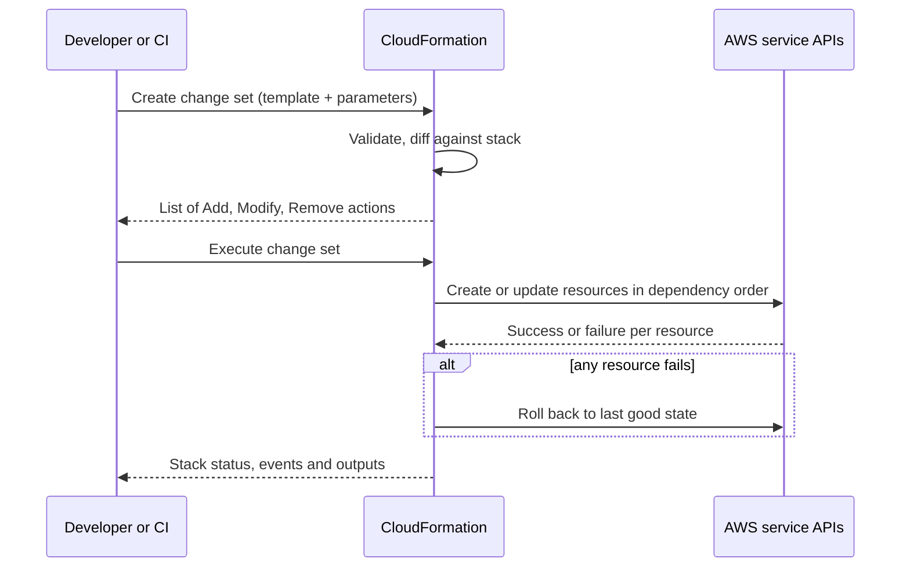

# AWS CloudFormation

## Introduction

**AWS CloudFormation** is the infrastructure-as-code engine built into AWS. You describe resources in a **template** (YAML or JSON), hand it to CloudFormation, and the service creates a **stack**: a named group of resources that it creates, updates and deletes together.

CloudFormation matters even if you never write a template by hand. The [AWS CDK](./2-cloud-aws-cdk.mdx), AWS SAM, Elastic Beanstalk, Amplify and many AWS Solutions all generate CloudFormation under the hood. When a CDK deployment fails, the error you read is a CloudFormation error.

A useful analogy is a building contractor with a blueprint. You give the contractor (CloudFormation) a blueprint (template). The contractor orders the work in the right sequence, keeps a record of everything built (the stack), and if a step fails halfway through, tears down the partial work and puts the building back the way it was (rollback).

This page covers:

1. Template anatomy and intrinsic functions
2. Linting and policy checks before you deploy
3. Deploying, and previewing updates with **change sets**
4. Protecting data with deletion and replacement policies
5. Sharing values between stacks
6. Drift detection, and newer features such as drift-aware change sets and express mode
7. How the Azure equivalents (ARM templates and Bicep) compare

If IaC is new to you, read [Infrastructure as Code in the Cloud](./0-cloud-iac-introduction.mdx) first.

## How CloudFormation Works



Key points:

- CloudFormation **stores the state for you**. There is no state file to manage.
- It figures out dependencies from references between resources (`!Ref`, `!GetAtt`) and creates independent resources in parallel.
- If an update fails, the default behaviour is to **roll back** to the previous working configuration.
- CloudFormation itself has no charge for AWS resource types in the `AWS::` namespace; you pay for the resources it creates. Third-party resource types and hooks can have handler charges. Check the [CloudFormation pricing page](https://aws.amazon.com/cloudformation/pricing/) for current details.

## Template Anatomy

A template has a handful of top-level sections. Only `Resources` is required.

| Section | Purpose |
| --- | --- |
| `AWSTemplateFormatVersion` | Template format version; always `"2010-09-09"` |
| `Description` | Free-text description shown in the console |
| `Parameters` | Inputs supplied at deploy time, such as environment name |
| `Mappings` | Static lookup tables, for example per-region values |
| `Conditions` | Booleans that switch resources or properties on and off |
| `Resources` | The AWS resources to create (required) |
| `Outputs` | Values to show after deploy or export to other stacks |

Here is a realistic template for a receipts-processing app: a private, encrypted upload bucket and an SQS queue. Save it as `uploads.yaml`.

```yaml
AWSTemplateFormatVersion: "2010-09-09"
Description: Upload bucket and processing queue for the receipts app

Parameters:
  Environment:
    Type: String
    AllowedValues: [dev, staging, prod]
    Default: dev
    Description: Deployment environment name
  RetentionDays:
    Type: Number
    Default: 30
    MinValue: 1
    MaxValue: 365
    Description: Days to keep uploaded files before they expire

Conditions:
  IsProd: !Equals [!Ref Environment, prod]

Resources:
  UploadBucket:
    Type: AWS::S3::Bucket
    DeletionPolicy: Retain
    UpdateReplacePolicy: Retain
    Properties:
      BucketEncryption:
        ServerSideEncryptionConfiguration:
          - ServerSideEncryptionByDefault:
              SSEAlgorithm: AES256
      PublicAccessBlockConfiguration:
        BlockPublicAcls: true
        BlockPublicPolicy: true
        IgnorePublicAcls: true
        RestrictPublicBuckets: true
      VersioningConfiguration:
        Status: !If [IsProd, Enabled, Suspended]
      LifecycleConfiguration:
        Rules:
          - Id: expire-old-uploads
            Status: Enabled
            ExpirationInDays: !Ref RetentionDays
      Tags:
        - Key: environment
          Value: !Ref Environment
        - Key: app
          Value: receipts

  ProcessingQueue:
    Type: AWS::SQS::Queue
    Properties:
      QueueName: !Sub "receipts-${Environment}-processing"
      VisibilityTimeout: 120
      MessageRetentionPeriod: 345600
      SqsManagedSseEnabled: true

Outputs:
  BucketName:
    Description: Name of the upload bucket
    Value: !Ref UploadBucket
    Export:
      Name: !Sub "${AWS::StackName}-BucketName"
  QueueUrl:
    Description: URL of the processing queue
    Value: !Ref ProcessingQueue
  QueueArn:
    Description: ARN of the processing queue
    Value: !GetAtt ProcessingQueue.Arn
```

A few things to notice:

- The bucket has **no name**. CloudFormation generates a unique one such as `uploads-uploadbucket-1x2y3z`. Bucket names are global, so letting CloudFormation name them avoids collisions and allows replacement.
- `Status: !If [IsProd, Enabled, Suspended]` turns on versioning only in production.
- New S3 buckets are already encrypted with SSE-S3 and block public access by default. Setting these explicitly still helps: reviewers and policy tools can see the intent in the template.

### Intrinsic functions you will use constantly

| Function | Short form | What it does | Example |
| --- | --- | --- | --- |
| `Ref` | `!Ref` | Parameter value, or a resource's main ID | `!Ref UploadBucket` gives the bucket name |
| `Fn::GetAtt` | `!GetAtt` | A specific attribute of a resource | `!GetAtt ProcessingQueue.Arn` |
| `Fn::Sub` | `!Sub` | String interpolation | `!Sub "receipts-${Environment}"` |
| `Fn::If` | `!If` | Choose a value based on a condition | `!If [IsProd, 3, 1]` |
| `Fn::Equals` | `!Equals` | Compare two values in `Conditions` | `!Equals [!Ref Environment, prod]` |
| `Fn::ImportValue` | `!ImportValue` | Read an output exported by another stack | `!ImportValue network-VpcId` |
| `Fn::FindInMap` | `!FindInMap` | Look up a value in `Mappings` | `!FindInMap [RegionMap, !Ref "AWS::Region", Ami]` |

Pseudo parameters such as `AWS::Region`, `AWS::AccountId` and `AWS::StackName` are always available without declaring them.

:::tip
Every property of every resource type is documented in the [CloudFormation resource and property reference](https://docs.aws.amazon.com/AWSCloudFormation/latest/TemplateReference/aws-template-resource-type-ref.html). Keep it open while writing templates. The VS Code CloudFormation and cfn-lint extensions give autocompletion from the same schemas.
:::

## Step 1: Lint and Check Before Deploying

Typos in property names are the most common template error. Catch them locally with **cfn-lint**, an open-source linter maintained by AWS.

```bash
python3 -m pip install cfn-lint
cfn-lint uploads.yaml && echo "Template looks good"
```

Output:

```text
Template looks good
```

Now introduce two mistakes: misspell `BucketEncryption` and set `VisibilityTimeout: 99999`.

```bash
cfn-lint broken.yaml
```

Output:

```text
E3002 Additional properties are not allowed ('BucketEncyption' was unexpected. Did you mean 'BucketEncryption'?)
broken.yaml:26:7

E3034 99999 is greater than the maximum of 43200
broken.yaml:52:7
```

cfn-lint knows the schema of every resource type, including allowed ranges. Run it in CI on every pull request.

### Policy as code with CloudFormation Guard

Linting checks that a template is **valid**. **CloudFormation Guard** (`cfn-guard`) checks that it follows **your rules**, such as "every bucket must block public access". Rules are written in a small DSL:

```text
let buckets = Resources.*[ Type == 'AWS::S3::Bucket' ]

rule s3_buckets_encrypted when %buckets !empty {
    %buckets.Properties.BucketEncryption exists
}

rule s3_buckets_block_public_access when %buckets !empty {
    %buckets.Properties.PublicAccessBlockConfiguration.BlockPublicAcls == true
    %buckets.Properties.PublicAccessBlockConfiguration.RestrictPublicBuckets == true
}
```

```bash
cfn-guard validate --data uploads.yaml --rules s3-rules.guard --show-summary all
```

Output:

```text
uploads.yaml Status = PASS
PASS rules
s3-rules.guard/s3_buckets_encrypted              PASS
s3-rules.guard/s3_buckets_block_public_access    PASS
```

Run the same rules against a template whose bucket lacks those settings and Guard reports `FAIL` with the exact missing property and line number. To enforce rules on the server side too, so that nobody can bypass CI, use **CloudFormation Hooks**, which can run Guard rules or Lambda functions before CloudFormation provisions a resource.

## Step 2: Deploy the Stack

:::caution Cost warning
This creates a real S3 bucket and SQS queue. Both are cheap when idle, but you pay for storage, requests and data transfer. Follow the **Cleanup** section when you finish.
:::

The simplest command is `aws cloudformation deploy`. It creates a change set and executes it in one go, and works for both new and existing stacks.

```bash
aws cloudformation deploy \
  --stack-name receipts-dev \
  --template-file uploads.yaml \
  --parameter-overrides Environment=dev RetentionDays=14 \
  --tags team=receipts cost-center=1234
```

Example output:

```text
Waiting for changeset to be created..
Waiting for stack create/update to complete
Successfully created/updated stack - receipts-dev
```

Read the outputs:

```bash
aws cloudformation describe-stacks --stack-name receipts-dev \
  --query "Stacks[0].Outputs[].[OutputKey,OutputValue]" --output text
```

Example output:

```text
BucketName  receipts-dev-uploadbucket-k2m4n6p8q0r2
QueueUrl    https://sqs.us-east-1.amazonaws.com/111122223333/receipts-dev-processing
QueueArn    arn:aws:sqs:us-east-1:111122223333:receipts-dev-processing
```

If the template creates IAM resources, you must acknowledge that with `--capabilities CAPABILITY_IAM` (or `CAPABILITY_NAMED_IAM` when you name the roles yourself). This is a deliberate speed bump: a template that creates IAM roles can grant permissions.

When something fails, the **stack events** tell you why:

```bash
aws cloudformation describe-stack-events --stack-name receipts-dev \
  --query "StackEvents[?contains(ResourceStatus,'FAILED')].[LogicalResourceId,ResourceStatusReason]" \
  --output text
```

## Step 3: Preview Updates with Change Sets

For production you want to **see** the changes before CloudFormation makes them. That is what a change set is: a computed diff that you review and then execute (or throw away).

Suppose you change `RetentionDays` and rename the queue in the template. Create a change set:

```bash
aws cloudformation create-change-set \
  --stack-name receipts-dev \
  --change-set-name rename-queue \
  --template-body file://uploads.yaml \
  --parameters ParameterKey=Environment,UsePreviousValue=true \
               ParameterKey=RetentionDays,ParameterValue=60

aws cloudformation wait change-set-create-complete \
  --stack-name receipts-dev --change-set-name rename-queue

aws cloudformation describe-change-set \
  --stack-name receipts-dev --change-set-name rename-queue \
  --query "Changes[].ResourceChange.[Action,LogicalResourceId,ResourceType,Replacement]" \
  --output table
```

Example output:

```text
-------------------------------------------------------------------
|                        DescribeChangeSet                        |
+---------+-------------------+---------------------+-------------+
|  Modify |  ProcessingQueue  |  AWS::SQS::Queue    |  True       |
|  Modify |  UploadBucket     |  AWS::S3::Bucket    |  False      |
+---------+-------------------+---------------------+-------------+
```

`Replacement: True` on the queue is the important line. Changing `QueueName` means CloudFormation creates a **new** queue and deletes the old one, along with any messages in it. With that knowledge you can decide whether to drain the queue first or keep the old name.

If you are happy, execute it; otherwise delete it:

```bash
aws cloudformation execute-change-set \
  --stack-name receipts-dev --change-set-name rename-queue

# or
aws cloudformation delete-change-set \
  --stack-name receipts-dev --change-set-name rename-queue
```

:::tip
In a pipeline, create the change set in one job, post the `describe-change-set` output to the pull request or an approval step, and execute it in a later job. `aws cloudformation deploy --no-execute-changeset` creates the change set without running it.
:::

## Step 4: Protect Your Data

When a resource is removed from the template, or the whole stack is deleted, CloudFormation deletes the resource by default. For stateful resources that is rarely what you want.

| Setting | Applies when | Common values |
| --- | --- | --- |
| `DeletionPolicy` | The resource is removed from the template or the stack is deleted | `Delete` (default for most), `Retain`, `RetainExceptOnCreate`, `Snapshot` (databases, volumes) |
| `UpdateReplacePolicy` | An update forces the resource to be replaced | `Delete`, `Retain`, `Snapshot` |
| Stack termination protection | Anyone tries to delete the stack | On or off |
| Stack policy | An update would modify or replace protected resources | JSON policy that denies `Update:Replace`, for example |

Our bucket uses `Retain` for both, so even `delete-stack` leaves the bucket and its files in place. Turn on termination protection for production stacks:

```bash
aws cloudformation update-termination-protection \
  --stack-name receipts-prod --enable-termination-protection
```

`RetainExceptOnCreate` is handy: if the very first creation fails and rolls back, the half-created resource is cleaned up, but once it exists it is retained.

## Step 5: Sharing Values Between Stacks

Real systems use several stacks, split by lifecycle: a network stack that rarely changes, a data stack, and app stacks that change daily. There are three ways to connect them.

| Technique | How it works | Pros | Cons |
| --- | --- | --- | --- |
| Exports and `!ImportValue` | Stack A exports an output; stack B imports it by name | Native, checked by CloudFormation | Exporting stack cannot change or delete a value that is imported somewhere |
| Nested stacks | A parent template includes child templates as `AWS::CloudFormation::Stack` resources | Deployed and rolled back as one unit | Large blast radius; whole tree updates together |
| SSM Parameter Store | Stack A writes a parameter; stack B reads it with an `AWS::SSM::Parameter::Value` parameter type | Loose coupling, values can change | No built-in protection against deleting a value in use |

For deploying the **same** stack to many accounts and regions, for example a security baseline across an AWS Organization, use **StackSets**. See [Multi-Account and Landing Zone Strategy](../2-cloud-identity/7-cloud-multi-account-strategy.mdx).

## Step 6: Drift Detection

**Drift** is the difference between what the template says and what actually exists, usually caused by someone editing a resource in the console. CloudFormation can detect it:

```bash
DRIFT_ID=$(aws cloudformation detect-stack-drift \
  --stack-name receipts-dev --query StackDriftDetectionId --output text)

aws cloudformation describe-stack-drift-detection-status \
  --stack-drift-detection-id "$DRIFT_ID" \
  --query "[DetectionStatus,StackDriftStatus]" --output text

aws cloudformation describe-stack-resource-drifts \
  --stack-name receipts-dev \
  --stack-resource-drift-status-filters MODIFIED DELETED \
  --query "StackResourceDrifts[].[LogicalResourceId,PropertyDifferences[0].PropertyPath,PropertyDifferences[0].ActualValue]" \
  --output text
```

Example output after someone changed the queue's visibility timeout in the console:

```text
DETECTION_COMPLETE  DRIFTED
ProcessingQueue  /VisibilityTimeout  30
```

### Drift-aware change sets

A normal change set compares the **new template** with the **previous template**. It does not know about manual changes, so a deploy might silently keep or overwrite them. A **drift-aware change set** does a three-way comparison of the actual state, the previous deployment and your new template, and brings drifted resources back in line:

```bash
aws cloudformation create-change-set \
  --stack-name receipts-dev \
  --change-set-name fix-drift \
  --template-body file://uploads.yaml \
  --deployment-mode REVERT_DRIFT
```

This is useful after an incident where someone hot-fixed production by hand: you see exactly what the next deploy will revert before it happens. Some resource types are not supported; check the [drift-aware change sets guide](https://docs.aws.amazon.com/AWSCloudFormation/latest/UserGuide/drift-aware-change-sets.html).

### Express mode for faster dev loops

By default CloudFormation waits until each resource is fully stable (for example, an EC2 instance is `running`). **Express mode** reports success as soon as the configuration is applied, which speeds up iteration in development. Rollback is disabled by default in express mode.

```bash
aws cloudformation update-stack --stack-name receipts-dev \
  --template-body file://uploads.yaml \
  --parameters ParameterKey=Environment,UsePreviousValue=true \
  --deployment-config '{"mode": "EXPRESS"}'
```

Use it for dev stacks only. In production you want the default mode, which confirms resources are actually ready.

## Bringing Existing Resources Under Management

Few teams start with a clean account. Two features help:

- **IaC generator** scans resources in a region that are not managed by any stack, and generates a template from them (`start-resource-scan`, then `create-generated-template`). You can then import them into a stack or into a CDK app with `cdk migrate`.
- **Resource import** (`create-change-set --change-set-type IMPORT`) adopts specific existing resources into a stack, provided the template matches their current configuration.

To deploy from Git without writing a pipeline, **Git sync** lets CloudFormation watch a repository branch and update the stack whenever the template or its deployment file changes. It supports GitHub, GitLab and Bitbucket.

## How Azure Compares

Azure's native equivalent is **Azure Resource Manager (ARM)**, with templates written in JSON or, more commonly today, **Bicep**. The [Bicep and ARM page](./3-cloud-bicep-and-arm.mdx) covers it in detail; here is the mapping.

| CloudFormation | Azure equivalent | Notable difference |
| --- | --- | --- |
| Template (YAML or JSON) | ARM template (JSON) or Bicep file | Bicep is a separate, more concise language that compiles to ARM JSON |
| Stack | Deployment in a resource group; deployment stack for lifecycle management | A plain Azure deployment does not "own" its resources; deleting the deployment record leaves them |
| Change set | What-if (`az deployment group what-if`) | What-if can show "noise" for properties Azure sets by default |
| Rollback on failure | No automatic rollback; optional `--rollback-on-error` redeploys the last successful deployment | Plan for partial deployments on Azure |
| `DeletionPolicy: Retain` | Resource locks, deployment stack `--action-on-unmanage detachAll` | Different mechanism, similar intent |
| Drift detection | What-if against live resources; deployment stack deny settings prevent drift | Azure compares with live state at deploy time |
| StackSets | Deployment stacks at management group scope, or a pipeline per subscription | |
| cfn-lint, Guard, Hooks | Bicep linter, PSRule for Azure, Azure Policy | Azure Policy evaluates at the API level for every tool |

The same bucket-plus-queue idea on Azure would be a storage account and a Service Bus queue:

```bash
az deployment group create \
  --resource-group rg-receipts-dev \
  --template-file uploads.bicep \
  --parameters environment=dev
```

## Real-World Scenario

Your team runs a receipts-scanning product. Developers upload images to S3, a worker reads messages from SQS, and the whole thing was built in the console. Last month someone renamed the queue by hand and the workers stopped for an hour.

**The solution:**

1. Use the IaC generator to produce a template from the existing bucket and queue, clean it up so it looks like `uploads.yaml`, and import the resources into a `receipts-prod` stack.
2. Add `DeletionPolicy: Retain` and `UpdateReplacePolicy: Retain` to the bucket and turn on termination protection.
3. In CI, run `cfn-lint` and `cfn-guard` on every pull request, then create a change set and post its table to the PR. A human approves; a later job executes it.
4. Run drift detection on a schedule and alert on `DRIFTED`.

**Why this approach:** the team already lives entirely on AWS, wants no state files to manage, and needs a clear review step. Change sets show the `Replacement: True` warning that would have prevented last month's outage.

**When to use it / when not to:** raw CloudFormation fits small to medium stacks and teams that like declarative YAML. When templates grow past a few hundred lines with lots of repetition, the [AWS CDK](./2-cloud-aws-cdk.mdx) gives you loops, functions and reusable constructs while keeping the same engine. If you also manage Azure, consider [Terraform](./4-cloud-terraform-multi-cloud.mdx).

**Alternatives and trade-offs:**

| Approach | Pros | Cons | Best for |
| --- | --- | --- | --- |
| Raw CloudFormation YAML | No extra tooling, readable, service-managed state, rollback | Verbose, limited logic, copy-paste between stacks | Small to medium AWS-only stacks |
| AWS SAM | Short syntax for Lambda, API Gateway and DynamoDB; local testing | Serverless-focused | Serverless apps |
| AWS CDK | Real languages, high-level constructs, unit tests | Extra build step; generated templates are long | Larger AWS-only codebases |
| Terraform | One tool for AWS and Azure, precise plans | You manage state; no automatic rollback | Multi-cloud teams |

## Common Mistakes

- **Naming resources that never need a name.** Fixed names (`BucketName`, `QueueName`, `RoleName`) block replacement and cause collisions when you deploy the same template twice. Let CloudFormation generate names unless something outside the stack must know them.
- **Ignoring `Replacement: True`.** Always read change sets for replacements of stateful resources.
- **No deletion policy on data.** Add `Retain` or `Snapshot` to buckets, tables and databases.
- **Huge single stacks.** CloudFormation has [quotas](https://docs.aws.amazon.com/AWSCloudFormation/latest/UserGuide/cloudformation-limits.html), such as a maximum number of resources per stack, and big stacks are slow to update and roll back. Split by lifecycle.
- **Stack stuck in `UPDATE_ROLLBACK_FAILED`.** This usually happens when something outside CloudFormation changed a resource. Fix the underlying resource, then run `aws cloudformation continue-update-rollback`.
- **Secrets in parameters.** Use dynamic references such as `{{resolve:secretsmanager:...}}` written inside the template, and never put secret values in parameter files committed to Git. See [Secrets Management](../11-cloud-devops/4-cloud-secrets-management.mdx).

## Cleanup

Because the bucket has `DeletionPolicy: Retain`, deleting the stack leaves it behind. Empty and delete it separately.

```bash
BUCKET=$(aws cloudformation describe-stacks --stack-name receipts-dev \
  --query "Stacks[0].Outputs[?OutputKey=='BucketName'].OutputValue" --output text)

aws cloudformation delete-stack --stack-name receipts-dev
aws cloudformation wait stack-delete-complete --stack-name receipts-dev

aws s3 rm "s3://$BUCKET" --recursive
aws s3api delete-bucket --bucket "$BUCKET"
```

If versioning was enabled, you must also delete old object versions before the bucket can be deleted (the S3 console's **Empty** button does this for you).

## Summary

- CloudFormation turns a YAML or JSON template into a **stack** and stores its state for you.
- Use parameters, conditions and intrinsic functions (`!Ref`, `!GetAtt`, `!Sub`, `!If`) to make templates reusable.
- Lint with **cfn-lint** and enforce your rules with **CloudFormation Guard** and Hooks.
- Preview every production update with a **change set** and look for replacements.
- Protect data with `DeletionPolicy`, `UpdateReplacePolicy` and termination protection.
- Detect drift regularly; drift-aware change sets and express mode are newer options worth knowing.
- On Azure, the same role is played by ARM and Bicep, with what-if instead of change sets.

## Exercises

1. Add a `Mappings` section that sets `RetentionDays` per environment (7 for dev, 30 for staging, 365 for prod) and use `!FindInMap` instead of the parameter.
2. Add an `AWS::SQS::Queue` dead-letter queue and connect it with a `RedrivePolicy`. Create a change set and confirm it shows `Add` for the new queue and `Modify` for the existing one.
3. Write a Guard rule that fails if any SQS queue does not have `SqsManagedSseEnabled: true` or a KMS key.
4. Deploy the stack, change a property in the console, and run drift detection. Then create a drift-aware change set and see what it would revert.

**Related pages:** [AWS CDK](./2-cloud-aws-cdk.mdx) builds on everything here, [Azure Bicep and ARM Templates](./3-cloud-bicep-and-arm.mdx) covers the Azure side, and [Project: Multi-Environment Infrastructure as Code](../14-cloud-projects/5-cloud-project-multi-env-iac.mdx) puts it into practice.
