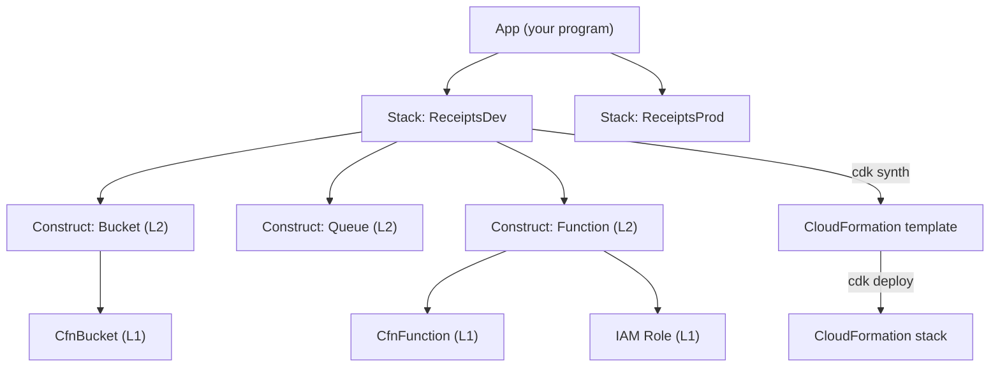

# AWS CDK

## Introduction

The **AWS Cloud Development Kit (CDK)** lets you define AWS infrastructure with a general-purpose programming language such as TypeScript, Python, Java, C#, Go or JavaScript. Your program does not call AWS APIs directly. Instead it **synthesizes** a [CloudFormation](./1-cloud-cloudformation.mdx) template, and CloudFormation deploys it.

Why would you want that? Look at the CloudFormation page again: a bucket, a queue and their outputs took about 70 lines of YAML. Add a Lambda function, its IAM role and policy, the event source mapping, a dead-letter queue and the S3 notification, and you are well past 300 lines. Most of that is boilerplate that follows rules, like "the function's role needs read access to this bucket". Rules are what code is good at.

An analogy: CloudFormation YAML is like writing assembly by hand. The CDK is a compiler. You write higher-level code, it emits the low-level template, and you can still read that template whenever you want.

On this page you will:

1. Learn the construct model (apps, stacks, constructs and the L1, L2 and L3 levels)
2. Build a small receipts-processing app in Python
3. Run `cdk synth`, `cdk diff` and `cdk deploy`
4. Write unit tests for infrastructure
5. See where the CDK fits compared with Azure options

:::info Versions
This page uses **CDK v2** (`aws-cdk-lib`). CDK v1 reached end of support in June 2023. Since early 2025 the CDK CLI (the `aws-cdk` npm package) has its own version line (2.1000 and up) separate from the construct library (`aws-cdk-lib`, 2.x). Keep the CLI at least as new as the library. Check the [CDK developer guide](https://docs.aws.amazon.com/cdk/v2/guide/home.html) for current versions.
:::

## Core Concepts



- **App:** the root of your program. It contains one or more stacks.
- **Stack:** maps one-to-one to a CloudFormation stack.
- **Construct:** a building block. Constructs contain other constructs, forming a tree.

Constructs come in three levels:

| Level | What it is | Example | When to use |
| --- | --- | --- | --- |
| L1 (`Cfn*`) | Exact one-to-one mapping of a CloudFormation resource, generated from the CloudFormation schema | `s3.CfnBucket` | A brand-new feature with no L2 support yet, or full control |
| L2 | Curated, hand-written class with secure defaults and helper methods | `s3.Bucket`, `bucket.grant_read(fn)` | Most of the time |
| L3 (patterns) | Several resources wired together for a common architecture | `ecs_patterns.ApplicationLoadBalancedFargateService` | Standard architectures you do not want to rebuild |

Here is the same bucket at L1 and at L2:

```python
from aws_cdk import RemovalPolicy, Stack, aws_s3 as s3
from constructs import Construct


class LevelsDemo(Stack):
    def __init__(self, scope: Construct, construct_id: str, **kwargs) -> None:
        super().__init__(scope, construct_id, **kwargs)

        # L1: you spell out CloudFormation properties yourself
        s3.CfnBucket(
            self,
            "RawBucket",
            public_access_block_configuration=s3.CfnBucket.PublicAccessBlockConfigurationProperty(
                block_public_acls=True,
                block_public_policy=True,
                ignore_public_acls=True,
                restrict_public_buckets=True,
            ),
        )

        # L2: intent-level options and helpers
        s3.Bucket(
            self,
            "FriendlyBucket",
            block_public_access=s3.BlockPublicAccess.BLOCK_ALL,
            enforce_ssl=True,
            removal_policy=RemovalPolicy.RETAIN,
        )
```

`enforce_ssl=True` on the L2 bucket also generates a bucket policy that denies non-HTTPS requests. At L1 you would write that policy yourself.

## Setting Up

You need Node.js (the CDK CLI is an npm package even when you write Python), the language runtime you want, and AWS credentials. Use IAM Identity Center (SSO) credentials as shown in [The AWS CLI](../1-cloud-getting-started/2-cloud-aws-cli.mdx), not long-lived access keys.

```bash
npm install -g aws-cdk
cdk --version

mkdir receipts && cd receipts
cdk init app --language python
source .venv/bin/activate
python -m pip install -r requirements.txt
```

Example output:

```text
2.1145.0 (build 13877dc)
Applying project template app for python
...
✅ All done!
```

### Bootstrapping

Before the first deploy into an account and region, run `cdk bootstrap`. It creates a stack called `CDKToolkit` containing an S3 bucket and an ECR repository for **assets** (your Lambda code, Docker images) plus IAM roles that the CLI assumes to deploy.

```bash
cdk bootstrap aws://111122223333/us-east-1
```

Example output (trimmed):

```text
 ⏳  Bootstrapping environment aws://111122223333/us-east-1...
 ✅  Environment aws://111122223333/us-east-1 bootstrapped.
```

:::caution Cost warning
Bootstrapping creates an S3 bucket and an ECR repository that store assets. They cost little but grow over time. `cdk gc` can garbage-collect old assets. The app below also creates a bucket, queues and a Lambda function. Destroy everything when you finish (see **Cleanup**).
:::

## Building the Receipts App

The project layout:

```text
receipts/
├── app.py
├── cdk.json
├── lambda/
│   └── handler.py
├── receipts/
│   ├── __init__.py
│   └── receipts_stack.py
└── tests/
    └── test_receipts_stack.py
```

### The stack

```python
# receipts/receipts_stack.py
from aws_cdk import (
    CfnOutput,
    Duration,
    RemovalPolicy,
    Stack,
    Tags,
    aws_lambda as lambda_,
    aws_lambda_event_sources as sources,
    aws_s3 as s3,
    aws_s3_notifications as s3n,
    aws_sqs as sqs,
)
from constructs import Construct


class ReceiptsStack(Stack):
    def __init__(self, scope: Construct, construct_id: str, *, stage: str, **kwargs) -> None:
        super().__init__(scope, construct_id, **kwargs)
        is_prod = stage == "prod"

        # L2 construct: secure defaults plus helper methods
        bucket = s3.Bucket(
            self,
            "Uploads",
            encryption=s3.BucketEncryption.S3_MANAGED,
            block_public_access=s3.BlockPublicAccess.BLOCK_ALL,
            enforce_ssl=True,
            versioned=is_prod,
            lifecycle_rules=[s3.LifecycleRule(expiration=Duration.days(365 if is_prod else 14))],
            removal_policy=RemovalPolicy.RETAIN if is_prod else RemovalPolicy.DESTROY,
            auto_delete_objects=not is_prod,
        )

        dlq = sqs.Queue(self, "ProcessingDlq", retention_period=Duration.days(14))
        queue = sqs.Queue(
            self,
            "Processing",
            visibility_timeout=Duration.seconds(120),
            dead_letter_queue=sqs.DeadLetterQueue(max_receive_count=3, queue=dlq),
        )

        # New objects in the bucket send a message to the queue
        bucket.add_event_notification(s3.EventType.OBJECT_CREATED, s3n.SqsDestination(queue))

        worker = lambda_.Function(
            self,
            "Worker",
            runtime=lambda_.Runtime.PYTHON_3_13,
            architecture=lambda_.Architecture.ARM_64,
            handler="handler.main",
            code=lambda_.Code.from_asset("lambda"),
            timeout=Duration.seconds(60),
            memory_size=256,
            environment={"STAGE": stage},
        )
        worker.add_event_source(sources.SqsEventSource(queue, batch_size=10))

        # One line creates a least-privilege IAM policy for the function role
        bucket.grant_read(worker)

        Tags.of(self).add("app", "receipts")
        Tags.of(self).add("environment", stage)

        CfnOutput(self, "BucketName", value=bucket.bucket_name)
        CfnOutput(self, "QueueUrl", value=queue.queue_url)
```

Things the CDK does for you here:

- `bucket.add_event_notification(...)` creates the S3 notification **and** the SQS queue policy that allows S3 to send messages.
- `worker.add_event_source(...)` creates the event source mapping **and** adds the SQS permissions to the function's role.
- `bucket.grant_read(worker)` adds a scoped IAM policy for that one bucket.
- `auto_delete_objects=True` adds a small custom resource that empties the bucket when the stack is deleted, so dev stacks clean up fully.
- Python `if` logic gives dev and prod different settings from the same class.

### The Lambda handler and the app

```python
# lambda/handler.py
import json


def main(event, context):
    for record in event["Records"]:
        s3_event = json.loads(record["body"])
        for item in s3_event.get("Records", []):
            key = item["s3"]["object"]["key"]
            print(f"Processing receipt {key}")
    return {"batchItemFailures": []}
```

```python
# app.py
#!/usr/bin/env python3
import aws_cdk as cdk

from receipts.receipts_stack import ReceiptsStack

app = cdk.App()

ReceiptsStack(app, "ReceiptsDev", stage="dev")
ReceiptsStack(app, "ReceiptsProd", stage="prod")

app.synth()
```

Two stacks from one class: this is how CDK apps model environments. In a real setup you would also pass `env=cdk.Environment(account=..., region=...)` so dev and prod go to different accounts (see [Multi-Account and Landing Zone Strategy](../2-cloud-identity/7-cloud-multi-account-strategy.mdx)).

## Synth, Diff, Deploy

### cdk synth

```bash
cdk ls
cdk synth ReceiptsDev > receipts-dev.yaml
grep -E "Type: (AWS|Custom)::" receipts-dev.yaml | sort | uniq -c
```

Output:

```text
ReceiptsDev
ReceiptsProd
      1     Type: AWS::CDK::Metadata
      2     Type: AWS::IAM::Policy
      3     Type: AWS::IAM::Role
      1     Type: AWS::Lambda::EventSourceMapping
      3     Type: AWS::Lambda::Function
      1     Type: AWS::S3::Bucket
      1     Type: AWS::S3::BucketPolicy
      2     Type: AWS::SQS::Queue
      1     Type: AWS::SQS::QueuePolicy
      1     Type: Custom::S3AutoDeleteObjects
      1     Type: Custom::S3BucketNotifications
```

About 70 lines of Python produced a template of roughly 600 lines. The two extra Lambda functions are the helpers behind the bucket notification and auto-delete custom resources. Here is part of the IAM policy that `grant_read` and `add_event_source` generated:

```yaml
- Action:
    - s3:GetObject*
    - s3:GetBucket*
    - s3:List*
  Effect: Allow
  Resource:
    - Fn::GetAtt:
        - Uploads4F6EB0FD
        - Arn
    - Fn::Join:
        - ""
        - - Fn::GetAtt:
              - Uploads4F6EB0FD
              - Arn
          - /*
```

Always skim synthesized IAM policies at least once. They are scoped to the right resources, but the action lists can be broader than you expect.

### cdk diff and cdk deploy

`cdk diff` compares your code with the deployed stack and highlights IAM and security group changes separately, because those are the riskiest.

```bash
cdk diff ReceiptsDev
cdk deploy ReceiptsDev
```

Example output (trimmed):

```text
Stack ReceiptsDev
IAM Statement Changes
┌───┬──────────────────────┬────────┬──────────────────┬───────────────────────────┐
│   │ Resource             │ Effect │ Action           │ Principal                 │
├───┼──────────────────────┼────────┼──────────────────┼───────────────────────────┤
│ + │ ${Uploads.Arn}/*     │ Allow  │ s3:GetObject*    │ AWS:${Worker/ServiceRole} │
└───┴──────────────────────┴────────┴──────────────────┴───────────────────────────┘
Resources
[+] AWS::S3::Bucket Uploads Uploads4F6EB0FD
[+] AWS::SQS::Queue Processing Processing8219A923
[+] AWS::Lambda::Function Worker Worker1A2B3C4D
...

Do you wish to deploy these changes (y/n)? y
ReceiptsDev: deploying... [1/1]
 ✅  ReceiptsDev

Outputs:
ReceiptsDev.BucketName = receiptsdev-uploads4f6eb0fd-a1b2c3d4e5f6
ReceiptsDev.QueueUrl = https://sqs.us-east-1.amazonaws.com/111122223333/ReceiptsDev-Processing8219A923-AbCdEf
```

By default `cdk deploy` asks for approval only when security-sensitive changes appear. In CI, set `--require-approval never` and put the human approval on the pull request instead, where the `cdk diff` output is posted.

### Other CLI commands worth knowing

| Command | What it does |
| --- | --- |
| `cdk watch` | Redeploys on file save; uses hotswap for Lambda code where possible (dev only) |
| `cdk deploy --hotswap` | Updates supported resources directly through service APIs, bypassing CloudFormation (dev only; causes drift) |
| `cdk drift` | Runs CloudFormation drift detection on your stacks |
| `cdk refactor` | Keeps deployed resources when you rename or move constructs, instead of replacing them |
| `cdk import` | Adopts existing resources into a stack |
| `cdk migrate` | Generates a CDK app from an existing stack, template or scanned resources |
| `cdk gc` | Removes unused assets from the bootstrap bucket and repository |
| `cdk destroy` | Deletes stacks |

:::warning Logical IDs matter
The CDK derives each resource's CloudFormation logical ID from its **construct path** (for example `Uploads4F6EB0FD`). If you rename a construct or move it into another construct, the logical ID changes and CloudFormation will **replace** the resource. For a bucket or database that can mean data loss. Run `cdk diff` after every refactor and use `cdk refactor` when you restructure code.
:::

## Testing Infrastructure

Because your infrastructure is code, you can unit test it. The `aws_cdk.assertions` module synthesizes a stack in memory and lets you assert on the template. No AWS account is needed.

```python
# tests/test_receipts_stack.py
import aws_cdk as cdk
from aws_cdk.assertions import Match, Template

from receipts.receipts_stack import ReceiptsStack


def synth(stage: str) -> Template:
    app = cdk.App()
    stack = ReceiptsStack(app, f"Test-{stage}", stage=stage)
    return Template.from_stack(stack)


def test_bucket_blocks_public_access():
    template = synth("dev")
    template.has_resource_properties(
        "AWS::S3::Bucket",
        {
            "PublicAccessBlockConfiguration": {
                "BlockPublicAcls": True,
                "BlockPublicPolicy": True,
                "IgnorePublicAcls": True,
                "RestrictPublicBuckets": True,
            }
        },
    )


def test_prod_bucket_is_retained_and_versioned():
    template = synth("prod")
    template.has_resource(
        "AWS::S3::Bucket",
        {
            "DeletionPolicy": "Retain",
            "Properties": Match.object_like(
                {"VersioningConfiguration": {"Status": "Enabled"}}
            ),
        },
    )


def test_worker_reads_from_queue():
    template = synth("dev")
    template.resource_count_is("AWS::Lambda::EventSourceMapping", 1)
    template.has_resource_properties("AWS::Lambda::Function", {"Runtime": "python3.13"})
```

```bash
python -m pip install pytest
python -m pytest -q
```

Output:

```text
...                                                                      [100%]
3 passed in 1.24s
```

These tests catch regressions such as "someone turned off retention on the prod bucket" before they reach a pull request review. Teams often add **cdk-nag**, an open-source library that checks stacks against rule packs such as the AWS Solutions checks, as another automated gate.

## Building Your Own Constructs

The real payoff comes when your platform team packages company standards as constructs. For example, a `CompanyBucket` that always has encryption, SSL enforcement, access logging and the mandatory tags:

```python
from aws_cdk import RemovalPolicy, Tags, aws_s3 as s3
from constructs import Construct


class CompanyBucket(Construct):
    """An S3 bucket that follows company standards."""

    def __init__(self, scope: Construct, construct_id: str, *, owner: str, retain: bool = True) -> None:
        super().__init__(scope, construct_id)
        self.bucket = s3.Bucket(
            self,
            "Bucket",
            encryption=s3.BucketEncryption.S3_MANAGED,
            block_public_access=s3.BlockPublicAccess.BLOCK_ALL,
            enforce_ssl=True,
            removal_policy=RemovalPolicy.RETAIN if retain else RemovalPolicy.DESTROY,
        )
        Tags.of(self).add("owner", owner)
```

Publish it as a Python package or npm package, and every team gets the standards by default. Constructs written in TypeScript can be published to all CDK languages through **jsii**, and the community shares them on [Construct Hub](https://constructs.dev/).

## How Azure Compares

There is **no first-party CDK for Azure**. Microsoft's native IaC language is [Bicep](./3-cloud-bicep-and-arm.mdx), which is declarative rather than a general-purpose language. If your team wants "infrastructure in a real programming language" on Azure, the common choices are:

| Need on Azure | Option | Notes |
| --- | --- | --- |
| Native, declarative | Bicep | Day-one support for new Azure resource types; no state file |
| Real programming language | Pulumi (Python, TypeScript, Go, C#, Java) | Third-party; manages its own state |
| Same tool for AWS and Azure | Terraform or OpenTofu | HCL, not a general-purpose language |
| CDK-style for Terraform | CDK for Terraform (CDKTF) | **Archived by HashiCorp in December 2025**; avoid for new projects |

| CDK concept | Closest Bicep concept |
| --- | --- |
| Construct | Module |
| L2 secure defaults | Azure Verified Modules (AVM) |
| `cdk synth` | `bicep build` (Bicep to ARM JSON) |
| `cdk diff` | `az deployment group what-if` |
| `cdk deploy` | `az deployment group create` or `az stack group create` |
| `aws_cdk.assertions` tests | Bicep linter, PSRule for Azure, `bicep snapshot` |

## Real-World Scenario

A fintech startup has twelve microservices on AWS. Each service team copied and modified the same 400-line CloudFormation template for "Lambda + queue + DLQ + alarms". Six months later the templates have drifted apart: some have alarms, some do not; two still use a deprecated Lambda runtime.

**The solution:** the platform team writes a `QueueWorker` L3 construct in TypeScript (so it can be published to Python and Java teams via jsii). It creates the queue, dead-letter queue, function, alarms and dashboard with company defaults. Each service's stack shrinks to about 20 lines. Upgrading the runtime for all services is now a library version bump, tested by assertions and rolled out through each team's pipeline.

**Why this approach:** the company is AWS-only, developers already write TypeScript and Python, and the problem is repetition, which is exactly what code abstractions fix. The CDK still deploys through CloudFormation, so the team keeps rollback and service-managed state.

**When to use it / when not to:** use the CDK when templates are large and repetitive and developers own their infrastructure. Avoid it if your infrastructure is maintained by people who do not program, if you need multi-cloud from one tool, or if the extra build step and long generated templates would confuse more than help.

**Alternatives and trade-offs:**

| Approach | Pros | Cons | Best for |
| --- | --- | --- | --- |
| AWS CDK | Abstractions, tests, IDE support, uses CloudFormation | Needs Node.js plus a language toolchain; generated templates are hard to read; logical ID pitfalls | AWS-only teams of developers |
| Raw CloudFormation | Simple, readable, no build step | Repetitive at scale | Small stacks, ops-led teams |
| AWS SAM | Concise for serverless, `sam local` testing | Serverless only | Lambda-centric apps |
| Pulumi | Real languages, multi-cloud | Third-party service or self-managed state | Multi-cloud developer teams |
| Terraform | Huge ecosystem, multi-cloud | HCL limits; state management | Ops-heavy or multi-cloud teams |

## Common Mistakes

- **Renaming constructs casually.** It changes logical IDs and replaces resources. Use `cdk diff` and `cdk refactor`.
- **Using hotswap or watch against production.** They bypass CloudFormation and create drift.
- **Calling AWS SDKs during synth.** Synthesis should be deterministic. Use context lookups (such as `Vpc.from_lookup`) whose results are cached in `cdk.context.json`, and commit that file.
- **Leaving `RemovalPolicy.DESTROY` on production data.** Make the default `RETAIN` and opt in to destroy for dev only, as in the example.
- **Unpinned library versions.** Pin `aws-cdk-lib` in `requirements.txt` or `package.json` and upgrade deliberately; read the release notes for feature flag changes.
- **Ignoring feature flags.** `cdk.json` contains feature flags that change default behaviour. New projects get the recommended set from `cdk init`; review them with `cdk flags` before upgrading older apps.

## Cleanup

```bash
cdk destroy ReceiptsDev
```

Example output:

```text
Are you sure you want to delete: ReceiptsDev (y/n)? y
ReceiptsDev: destroying... [1/1]
 ✅  ReceiptsDev: destroyed
```

The dev bucket is emptied and deleted because of `auto_delete_objects`. If you deployed `ReceiptsProd`, its bucket is **retained**: empty and delete it manually as shown on the [CloudFormation page](./1-cloud-cloudformation.mdx). Leave the `CDKToolkit` bootstrap stack if you plan to keep using the CDK in that account and region; otherwise delete it and its asset bucket.

## Summary

- The CDK defines AWS infrastructure in TypeScript, Python, Java, C#, Go or JavaScript and synthesizes CloudFormation.
- Apps contain stacks; stacks contain constructs at three levels: L1 (raw), L2 (curated) and L3 (patterns).
- `cdk bootstrap` prepares an environment; `cdk synth`, `cdk diff` and `cdk deploy` are the daily loop.
- Helpers like `grant_read` and `add_event_source` generate least-privilege IAM and wiring for you.
- Unit test stacks with `aws_cdk.assertions`, and package standards as your own constructs.
- Azure has no first-party CDK; teams use Bicep, Pulumi or Terraform. CDKTF has been archived.

## Exercises

1. Add a CloudWatch alarm on the dead-letter queue's `ApproximateNumberOfMessagesVisible` metric and write a test that asserts one `AWS::CloudWatch::Alarm` exists.
2. Extract the bucket, queue and worker into a `QueueWorker` construct and use it twice in the same stack. Run `cdk diff` against a deployed stack and observe how logical IDs change.
3. Add `env=cdk.Environment(account="...", region="eu-west-1")` to the prod stack and synthesize. What changes in the template?
4. Compare this page with [Azure Bicep and ARM Templates](./3-cloud-bicep-and-arm.mdx) and write the receipts app in Bicep using a storage account, a Service Bus queue and an Azure Function.

**Related pages:** [AWS CloudFormation](./1-cloud-cloudformation.mdx), [AWS Lambda](../4-cloud-serverless/1-cloud-aws-lambda.mdx), [Choosing an IaC Tool](./5-cloud-choosing-iac-tool.mdx).
