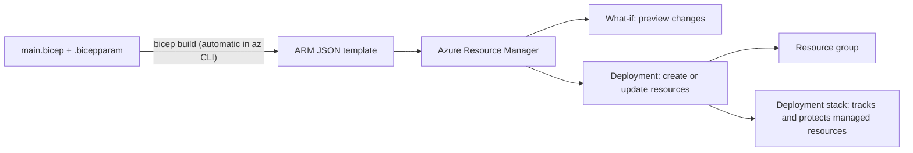

# Azure Bicep and ARM Templates

## Introduction

Every change you make in Azure, whether from the portal, the Azure CLI, PowerShell or Terraform, goes through **Azure Resource Manager (ARM)**, the control plane API for Azure. ARM also has a built-in infrastructure-as-code format: **ARM templates**, written in JSON.

ARM JSON is powerful but painful to write by hand. **Bicep** is Microsoft's answer: a concise, typed language that compiles to ARM JSON. You write Bicep, the Bicep CLI turns it into an ARM template, and ARM deploys it. Bicep supports every Azure resource type and API version from the day it appears, because it reads the same resource schemas as ARM.

If CloudFormation is "AWS's contractor reading a blueprint", ARM is Azure's contractor, ARM JSON is the formal blueprint the contractor reads, and Bicep is a much friendlier drawing tool that exports that formal blueprint for you.

On this page you will:

1. Compare ARM JSON and Bicep
2. Write a Bicep file with parameters, variables, child resources and a module
3. Use `.bicepparam` files for each environment
4. Preview with **what-if**, then deploy
5. Manage lifecycle and cleanup with **deployment stacks**
6. Reuse **Azure Verified Modules** and lint your code
7. Map everything to the AWS equivalents

If you have not set up the Azure CLI yet, see [Setting Up an Azure Account Safely](../1-cloud-getting-started/1-cloud-azure-account-setup.mdx) and [The Azure CLI](../1-cloud-getting-started/3-cloud-azure-cli.mdx).

## ARM JSON versus Bicep

Here is one storage account in both formats. First ARM JSON:

```json
{
  "$schema": "https://schema.management.azure.com/schemas/2019-04-01/deploymentTemplate.json#",
  "contentVersion": "1.0.0.0",
  "parameters": {
    "location": {
      "type": "string",
      "defaultValue": "[resourceGroup().location]"
    }
  },
  "resources": [
    {
      "type": "Microsoft.Storage/storageAccounts",
      "apiVersion": "2025-01-01",
      "name": "[format('streports{0}', uniqueString(resourceGroup().id))]",
      "location": "[parameters('location')]",
      "sku": { "name": "Standard_LRS" },
      "kind": "StorageV2",
      "properties": { "minimumTlsVersion": "TLS1_2" }
    }
  ]
}
```

And the same thing in Bicep:

```bicep
param location string = resourceGroup().location

resource reports 'Microsoft.Storage/storageAccounts@2025-01-01' = {
  name: 'streports${uniqueString(resourceGroup().id)}'
  location: location
  sku: {
    name: 'Standard_LRS'
  }
  kind: 'StorageV2'
  properties: {
    minimumTlsVersion: 'TLS1_2'
  }
}
```

| Feature | ARM JSON | Bicep |
| --- | --- | --- |
| Syntax | JSON with expressions inside `"[...]"` strings | Clean DSL, direct function calls |
| References between resources | `resourceId(...)` plus explicit `dependsOn` | Symbolic names; dependencies inferred |
| Modules | Linked or nested templates (URLs, complex) | `module` keyword with local or registry paths |
| Editor support | Basic JSON schema | VS Code extension with IntelliSense, linting, type checks |
| Output | Deployed directly | Compiled to ARM JSON, then deployed |
| When you still need it | Tools that only emit or accept JSON, legacy templates | New work |

You can convert both ways: `bicep build` compiles Bicep to JSON, and `bicep decompile` gives you a best-effort Bicep file from existing JSON (review it afterwards).



## The Building Blocks

A Bicep file is made of a few kinds of declarations, in any order:

| Keyword | Purpose | Example |
| --- | --- | --- |
| `param` | Input value, with optional decorators | `param environment string = 'dev'` |
| `var` | Computed local value | `var isProd = environment == 'prod'` |
| `resource` | An Azure resource, typed by `'Type@apiVersion'` | `resource sa 'Microsoft.Storage/storageAccounts@2025-01-01' = ...` |
| `module` | Another Bicep file or registry module | `module storage 'modules/storage.bicep' = ...` |
| `output` | Value returned after deployment | `output name string = sa.name` |
| `targetScope` | Resource group (default), subscription, management group or tenant | `targetScope = 'subscription'` |

Decorators such as `@allowed`, `@minLength`, `@maxValue`, `@secure()` and `@description` add validation and documentation to parameters.

## Example: The Receipts App on Azure

We will build the Azure version of the receipts app from the [CloudFormation](./1-cloud-cloudformation.mdx) and [CDK](./2-cloud-aws-cdk.mdx) pages: a storage account with an `uploads` container and a lifecycle rule, plus a Service Bus queue for processing.

```text
receipts-infra/
├── bicepconfig.json
├── main.bicep
├── main.dev.bicepparam
├── main.prod.bicepparam
└── modules/
    └── storage.bicep
```

### The storage module

```bicep
// modules/storage.bicep
@description('Storage account name, 3-24 lowercase letters and numbers')
@minLength(3)
@maxLength(24)
param name string

param location string
param tags object = {}

@description('Number of days before blobs are deleted')
@minValue(1)
param retentionDays int

resource account 'Microsoft.Storage/storageAccounts@2025-01-01' = {
  name: name
  location: location
  tags: tags
  sku: {
    name: 'Standard_LRS'
  }
  kind: 'StorageV2'
  properties: {
    accessTier: 'Hot'
    minimumTlsVersion: 'TLS1_2'
    allowBlobPublicAccess: false
    allowSharedKeyAccess: false
    supportsHttpsTrafficOnly: true
  }
}

resource blobService 'Microsoft.Storage/storageAccounts/blobServices@2025-01-01' = {
  parent: account
  name: 'default'
}

resource uploads 'Microsoft.Storage/storageAccounts/blobServices/containers@2025-01-01' = {
  parent: blobService
  name: 'uploads'
  properties: {
    publicAccess: 'None'
  }
}

resource lifecycle 'Microsoft.Storage/storageAccounts/managementPolicies@2025-01-01' = {
  parent: account
  name: 'default'
  properties: {
    policy: {
      rules: [
        {
          name: 'expire-old-uploads'
          enabled: true
          type: 'Lifecycle'
          definition: {
            filters: {
              blobTypes: [
                'blockBlob'
              ]
              prefixMatch: [
                'uploads/'
              ]
            }
            actions: {
              baseBlob: {
                delete: {
                  daysAfterModificationGreaterThan: retentionDays
                }
              }
            }
          }
        }
      ]
    }
  }
}

output id string = account.id
output name string = account.name
output blobEndpoint string = account.properties.primaryEndpoints.blob
```

Notes:

- `parent: account` declares a child resource without building long `account/default/uploads` names by hand.
- `allowSharedKeyAccess: false` forces Microsoft Entra ID authentication, so apps use managed identities instead of account keys (see [Workload Identity](../2-cloud-identity/4-cloud-workload-identity.mdx)).
- Unlike S3, the Azure lifecycle policy is a separate child resource (`managementPolicies`). See [Storage Classes, Tiers and Lifecycle Policies](../6-cloud-storage/3-cloud-storage-classes.mdx).

### The main file

```bicep
// main.bicep
@description('Deployment environment')
@allowed([
  'dev'
  'staging'
  'prod'
])
param environment string = 'dev'

param location string = resourceGroup().location

@description('Days to keep uploaded files')
param retentionDays int = 30

var suffix = uniqueString(resourceGroup().id)
var isProd = environment == 'prod'
var tags = {
  app: 'receipts'
  environment: environment
}

module storage 'modules/storage.bicep' = {
  name: 'storage'
  params: {
    name: 'streceipts${suffix}'
    location: location
    tags: tags
    retentionDays: retentionDays
  }
}

resource bus 'Microsoft.ServiceBus/namespaces@2026-01-01' = {
  name: 'sb-receipts-${environment}-${suffix}'
  location: location
  tags: tags
  sku: {
    name: isProd ? 'Premium' : 'Standard'
  }
  properties: {
    minimumTlsVersion: '1.2'
    disableLocalAuth: true
  }
}

resource queue 'Microsoft.ServiceBus/namespaces/queues@2026-01-01' = {
  parent: bus
  name: 'processing'
  properties: {
    lockDuration: 'PT2M'
    maxDeliveryCount: 3
    deadLetteringOnMessageExpiration: true
  }
}

output storageAccountName string = storage.outputs.name
output serviceBusNamespace string = bus.name
output queueName string = queue.name
```

`uniqueString(resourceGroup().id)` produces a deterministic 13-character hash. It is the same every time you deploy to the same resource group, so names are stable but globally unique enough for storage accounts.

:::caution Cost warning
Service Bus **Premium** is billed per messaging unit per hour whether or not you send messages, and costs far more than Standard. The example uses Premium only when `environment` is `prod`. For learning, deploy only the `dev` parameters, and check the [Azure Pricing Calculator](https://azure.microsoft.com/pricing/calculator/) before deploying anything else.
:::

### Parameter files per environment

`.bicepparam` files are type-checked against the Bicep file named in their `using` line.

```bicep
// main.dev.bicepparam
using 'main.bicep'

param environment = 'dev'
param retentionDays = 14
```

```bicep
// main.prod.bicepparam
using 'main.bicep'

param environment = 'prod'
param retentionDays = 365
```

Never put secrets in parameter files. For secret values use a `@secure()` parameter, and fetch it from Key Vault with `getSecret()` in the parameter file or pass it from your pipeline. See [Secrets Management](../11-cloud-devops/4-cloud-secrets-management.mdx).

### Build and lint locally

The Bicep CLI is bundled with the Azure CLI (`az bicep install`, `az bicep upgrade`) and also available as a standalone binary.

```bash
az bicep build --file main.bicep
az bicep lint --file main.bicep
```

`bicep build` writes `main.json`; for this example it is about 236 lines of ARM JSON from 56 lines of Bicep plus the 78-line module. The linter is configured with `bicepconfig.json`:

```json
{
  "analyzers": {
    "core": {
      "enabled": true,
      "rules": {
        "no-hardcoded-location": {
          "level": "error"
        },
        "use-recent-api-versions": {
          "level": "warning"
        },
        "outputs-should-not-contain-secrets": {
          "level": "error"
        }
      }
    }
  }
}
```

Lint a file that hardcodes `'eastus'` and outputs a storage key, and you get:

```text
bad.bicep(3,13) : Error no-hardcoded-location: A resource location should not use a hard-coded string or variable value. Please use a parameter value, an expression, or the string 'global'. Found: 'eastus'
bad.bicep(10,21) : Error outputs-should-not-contain-secrets: Outputs should not contain secrets. Found possible secret: function 'listKeys'
```

## Preview with What-If, Then Deploy

```bash
az group create --name rg-receipts-dev --location eastus --tags app=receipts

az deployment group what-if \
  --resource-group rg-receipts-dev \
  --parameters main.dev.bicepparam
```

Because the `.bicepparam` file has a `using` line, you do not need `--template-file`. Example output (trimmed):

```text
Resource and property changes are indicated with this symbol:
  + Create

The deployment will update the following scope:

Scope: /subscriptions/0000.../resourceGroups/rg-receipts-dev

  + Microsoft.ServiceBus/namespaces/sb-receipts-dev-x7k2abcd3efgh [2026-01-01]
  + Microsoft.ServiceBus/namespaces/sb-receipts-dev-x7k2abcd3efgh/queues/processing [2026-01-01]
  + Microsoft.Storage/storageAccounts/streceiptsx7k2abcd3efgh [2025-01-01]
  + Microsoft.Storage/storageAccounts/streceiptsx7k2abcd3efgh/blobServices/default [2025-01-01]
  + Microsoft.Storage/storageAccounts/streceiptsx7k2abcd3efgh/blobServices/default/containers/uploads [2025-01-01]
  + Microsoft.Storage/storageAccounts/streceiptsx7k2abcd3efgh/managementPolicies/default [2025-01-01]

Resource changes: 6 to create.
```

Deploy, with a confirmation prompt that shows the same what-if output first:

```bash
az deployment group create \
  --resource-group rg-receipts-dev \
  --name receipts-$(date +%Y%m%d%H%M) \
  --parameters main.dev.bicepparam \
  --confirm-with-what-if \
  --query properties.outputs
```

Example output:

```text
{
  "queueName": { "type": "String", "value": "processing" },
  "serviceBusNamespace": { "type": "String", "value": "sb-receipts-dev-x7k2abcd3efgh" },
  "storageAccountName": { "type": "String", "value": "streceiptsx7k2abcd3efgh" }
}
```

### Reading what-if output carefully

- What-if compares your template with the **live resources**, so it also reveals manual changes.
- It can show **noise**: properties reported as changing that Azure sets by default. Over time you learn which lines to ignore for each resource type.
- Expressions it cannot evaluate before deployment, such as `utcNow()` or values from `reference()`, appear as unresolved.
- `--validation-level` (in recent Azure CLI versions) controls how deep preflight validation goes, including permission checks.

## Deployment Modes and Their Dangers

A normal resource group deployment runs in **Incremental** mode: it creates or updates resources in the template and leaves anything else in the resource group alone. That means **removing a resource from your Bicep file does not delete it**.

**Complete** mode (`--mode Complete`) deletes resources in the resource group that are not in the template. It cleans up, but it is dangerous: a template that forgets one resource, or a teammate's resources in the same group, gets deleted. It only works at resource group scope.

Neither is ideal, which is why Azure added deployment stacks.

## Deployment Stacks: Lifecycle and Protection

A **deployment stack** (`Microsoft.Resources/deploymentStacks`) is a resource that remembers which resources a template manages. It gives Azure something close to a CloudFormation stack:

- When you remove a resource from the template, the stack can **detach** it (leave it running but unmanaged) or **delete** it, depending on `--action-on-unmanage`.
- **Deny settings** can block changes or deletes made outside the stack, preventing drift.
- Deleting the stack can delete everything it manages.

```bash
az stack group create \
  --name receipts-dev \
  --resource-group rg-receipts-dev \
  --parameters main.dev.bicepparam \
  --action-on-unmanage deleteResources \
  --deny-settings-mode denyDelete
```

| Option | Values | Meaning |
| --- | --- | --- |
| `--action-on-unmanage` | `detachAll`, `deleteResources`, `deleteAll` | What happens to resources removed from the template (or when the stack is deleted). `deleteAll` also deletes managed resource groups |
| `--deny-settings-mode` | `none`, `denyDelete`, `denyWriteAndDelete` | Blocks control-plane deletes, or writes and deletes, by anyone not excluded |
| `--deny-settings-excluded-principals` | Up to five object IDs | Identities that bypass deny settings, such as your CI identity or a break-glass group |

Deny settings apply to the control plane only. They do not stop someone deleting blobs inside a storage account. Deployment stacks need a recent Azure CLI (2.61 or later per the docs); see the [deployment stacks documentation](https://learn.microsoft.com/azure/azure-resource-manager/bicep/deployment-stacks) for current limitations.

## Reusing Code: Modules and Azure Verified Modules

Local modules (`modules/storage.bicep`) work within one repository. To share across teams, publish modules to a private **Azure Container Registry** or use **template specs**.

Microsoft also maintains **Azure Verified Modules (AVM)**, a library of tested modules for common resources, published to the public Bicep registry (and as Terraform modules). They play a similar role to CDK L2 constructs: good defaults so you write less.

```bicep
param location string = resourceGroup().location

module receiptsStorage 'br/public:avm/res/storage/storage-account:0.33.1' = {
  name: 'receipts-storage'
  params: {
    name: 'streceipts${uniqueString(resourceGroup().id)}'
    location: location
    skuName: 'Standard_LRS'
    allowBlobPublicAccess: false
    blobServices: {
      containers: [
        {
          name: 'uploads'
        }
      ]
    }
  }
}

output storageAccountName string = receiptsStorage.outputs.name
```

Always pin a module version (here `0.33.1`, current at the time of writing). AVM modules are pre-1.0 and can change their parameters between minor versions. Browse the catalog at [azure.github.io/Azure-Verified-Modules](https://azure.github.io/Azure-Verified-Modules/).

## How AWS Compares

| Azure (ARM and Bicep) | AWS equivalent | Notable difference |
| --- | --- | --- |
| ARM JSON template | CloudFormation JSON or YAML template | CloudFormation accepts YAML directly; ARM needs JSON |
| Bicep | No direct equivalent; CloudFormation YAML or the CDK | Bicep is a dedicated DSL that compiles to the native format |
| Resource group deployment | Stack create or update | A plain deployment does not own its resources |
| Deployment stack | Stack | Stacks are opt-in on Azure, the default on AWS |
| What-if | Change set | What-if compares with live state; a normal change set compares with the previous template |
| Incremental mode | Default stack update | Removing a resource from a CloudFormation template deletes it; on Azure incremental mode leaves it |
| Deny settings | Stack policy, termination protection, SCPs | |
| Azure Verified Modules | CDK L2 and L3 constructs, AWS Solutions Constructs | |
| Template specs, Bicep registry | S3-hosted templates, Service Catalog, Construct Hub | |
| Bicep linter, PSRule for Azure, Azure Policy | cfn-lint, CloudFormation Guard, Hooks | Azure Policy also blocks non-compliant changes from any tool |

The biggest behavioural difference: on AWS, deleting a resource from the template deletes it; on Azure, with a normal deployment, it does not. Teams moving from AWS to Azure are often surprised by orphaned resources piling up. Use deployment stacks, or delete whole resource groups for ephemeral environments.

## Real-World Scenario

A retail company runs its e-commerce platform on Azure. Each of four product teams has dev, test and prod subscriptions. Resources were created from portal exports and a few ARM JSON files that nobody likes editing. Last quarter a developer deleted a production Service Bus namespace by accident from the portal.

**The solution:**

1. Run `bicep decompile` on the existing ARM JSON and clean up the result into Bicep modules. Use `az group export` (or the portal's **Export template**) for resources that were never in a template, then tidy the output.
2. Replace hand-written storage and networking resources with pinned Azure Verified Modules.
3. Create one `.bicepparam` per environment.
4. Deploy production through **deployment stacks** with `--deny-settings-mode denyDelete` and the pipeline's managed identity as the only excluded principal. Nobody can delete the namespace from the portal again.
5. In the pull request pipeline, run `bicep lint` and `az deployment group what-if`; post the what-if output for review. Authenticate the pipeline with OIDC (see [Keyless CI/CD with OIDC](../2-cloud-identity/6-cloud-oidc-for-ci.mdx)).

**Why this approach:** the company is Azure-only, wants new Azure features as soon as they ship, and has no appetite for managing a state file. Deployment stacks provide the lifecycle and protection the team was missing.

**When to use it / when not to:** Bicep is the default choice for Azure-only teams. If the same team also manages significant AWS infrastructure, one multi-cloud tool such as [Terraform](./4-cloud-terraform-multi-cloud.mdx) may be simpler than two native tools.

**Alternatives and trade-offs:**

| Approach | Pros | Cons | Best for |
| --- | --- | --- | --- |
| Bicep | Concise, all Azure features on day one, no state file, free | Azure only; what-if noise | Azure-focused teams |
| ARM JSON | Native format, no compile step | Verbose and hard to review | Generated templates, legacy |
| Terraform (azurerm and azapi) | Multi-cloud, precise plans, big ecosystem | State file to manage; azurerm can lag new features (azapi fills gaps) | Multi-cloud teams |
| Pulumi | General-purpose languages | Third-party; state backend | Developer-led teams wanting code |

## Common Mistakes

- **Assuming removed resources are deleted.** In incremental mode they are not. Use deployment stacks or clean up explicitly.
- **Using Complete mode on shared resource groups.** It deletes anything not in your template.
- **Hardcoding locations and names.** Use `resourceGroup().location` and `uniqueString()`. The linter can enforce this.
- **Unpinned registry modules.** Always pin versions of AVM and private modules.
- **Outputs containing secrets.** Outputs are stored in the deployment history. Never output keys or connection strings; use managed identities.
- **Ignoring old API versions.** Each resource uses a specific API version. Very old ones may lack properties or be retired; the `use-recent-api-versions` linter rule helps.
- **Skipping what-if.** It takes seconds and catches most surprises.

## Cleanup

If you deployed with a plain deployment, delete the resource group:

```bash
az group delete --name rg-receipts-dev --yes --no-wait
```

If you deployed with a deployment stack, delete the stack and its resources (deny settings are removed with it):

```bash
az stack group delete \
  --name receipts-dev \
  --resource-group rg-receipts-dev \
  --action-on-unmanage deleteResources \
  --yes

az group delete --name rg-receipts-dev --yes --no-wait
```

Confirm nothing is left with `az group list --tag app=receipts --output table`.

## Summary

- ARM is Azure's control plane; ARM templates are its JSON IaC format.
- Bicep is a concise, typed language that compiles to ARM JSON and supports every resource type immediately.
- Use parameters with decorators, `.bicepparam` files per environment, child resources with `parent`, and modules.
- Always run `bicep lint` and `az deployment group what-if` before deploying.
- Incremental mode never deletes removed resources; **deployment stacks** add lifecycle management and deny settings.
- Azure Verified Modules provide tested building blocks; pin their versions.
- Compared with CloudFormation: what-if instead of change sets, no automatic rollback by default, and opt-in stacks.

## Exercises

1. Add a `@secure()` parameter for a webhook secret and a Key Vault with a secret resource. Confirm the linter complains if you output the secret.
2. Add a dead-letter alert: an Azure Monitor metric alert on the queue's dead-lettered message count. Run what-if and check that only the new alert appears.
3. Deploy with `az stack group create`, then remove the Service Bus queue from `main.bicep` and redeploy with `--action-on-unmanage detachAll`. Is the queue still there? Repeat with `deleteResources`.
4. Rewrite `modules/storage.bicep` to use the AVM storage account module and compare the line counts and what-if results.

**Related pages:** [AWS CloudFormation](./1-cloud-cloudformation.mdx) for the AWS side, [Terraform for AWS and Azure](./4-cloud-terraform-multi-cloud.mdx) for a single-tool approach, and [Policies and Governance: SCPs and Azure Policy](../12-cloud-observability-and-security/7-cloud-compliance-and-governance.mdx).
