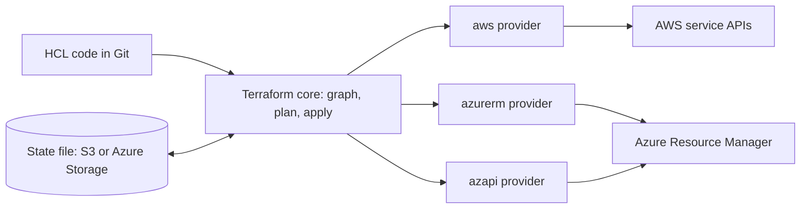

# Terraform for AWS and Azure

## Introduction

[Terraform](https://developer.hashicorp.com/terraform) is the most widely used infrastructure-as-code tool that is **not** tied to one cloud. You write HCL, Terraform talks to each cloud through a **provider** plugin, and it records what it manages in a **state file**. The same workflow (`init`, `plan`, `apply`) works for AWS, Azure, GitHub, Cloudflare, Datadog and thousands of other services.

This page is about using Terraform **for AWS and Azure specifically**: how the two providers differ, how to authenticate without long-lived keys, where to keep state in each cloud, and how to structure a code base that spans both. It does not re-teach Terraform basics. If HCL, resources, variables or `terraform plan` are new to you, work through the site's [Terraform tutorial](/docs/devops/terraform) first, especially the [introduction](../../terraform/0-terraform-fundamentals/0-terraform-introduction.mdx), the [AWS provider](../../terraform/9-terraform-with-aws/0-terraform-aws-provider.mdx) and [Azure provider](../../terraform/10-terraform-with-azure/0-terraform-azure-provider.mdx) pages, [remote state](../../terraform/4-terraform-outputs-and-state/4-terraform-remote-state.mdx) and [modules](../../terraform/5-terraform-modules/0-terraform-modules-introduction.mdx).

An analogy: Terraform is a universal remote control. One remote, one set of buttons, but each device (cloud) still has its own channels and quirks, and you still need to know what each device can do. A universal remote does not turn your TV into a sound bar.

:::info Versions at the time of writing
Terraform CLI 1.16, AWS provider 6.x and AzureRM provider 5.x. Both providers had recent major releases with breaking changes (covered below). Always check the [AWS provider](https://registry.terraform.io/providers/hashicorp/aws/latest) and [AzureRM provider](https://registry.terraform.io/providers/hashicorp/azurerm/latest) pages and their upgrade guides before you pin versions.
:::

## How Terraform Talks to Both Clouds



- **Terraform core** builds a dependency graph and computes the plan. It knows nothing about clouds.
- **Providers** translate resources into API calls. Each cloud's provider has its own resource names, arguments and behaviours.
- **State** maps your resource addresses (like `aws_s3_bucket.uploads`) to real IDs. Unlike CloudFormation and ARM, you must store and protect it yourself.

| Aspect | AWS provider (`hashicorp/aws`) | AzureRM provider (`hashicorp/azurerm`) |
| --- | --- | --- |
| Talks to | Each AWS service's API | Azure Resource Manager |
| Required provider config | Region (or from environment) | `features {}` block and `subscription_id` |
| Region or location | Provider `region`; since v6 also a per-resource `region` argument | `location` argument on each resource |
| Grouping | None required; tags are common | Most resources must belong to a resource group |
| Bucket-like resource | `aws_s3_bucket` plus separate config resources (versioning, lifecycle, public access block) | `azurerm_storage_account` plus `azurerm_storage_container` and management policy |
| Gap filler for brand-new features | `awscc` provider (Cloud Control API) | `azapi` provider (any ARM API version) |
| Verified modules | `terraform-aws-modules` (community) | Azure Verified Modules (Microsoft) |

## Recent Provider Changes Worth Knowing

**AWS provider 6.0** made most resources **region-aware**. You can set `region` on an individual resource instead of declaring an aliased provider for every region. Changing a resource's `region` forces replacement.

```hcl
resource "aws_s3_bucket" "replica" {
  region        = "eu-west-1"
  bucket_prefix = "receipts-replica-"
}
```

**AzureRM provider 4.0** made `subscription_id` mandatory in the provider block (or the `ARM_SUBSCRIPTION_ID` environment variable). **AzureRM 5.0** went further:

- It no longer registers about 60 Azure resource providers automatically. Register the ones you need with `resource_providers_to_register`, or set `resource_provider_registrations = "legacy"` to get the old behaviour.
- Location validation at plan time is now off by default, so a typo in `location` fails at apply time unless you enable `features.enhanced_validation`.
- Long-deprecated resources such as `azurerm_app_service` and `azurerm_function_app` were removed in favour of `azurerm_linux_web_app`, `azurerm_service_plan` and friends.
- On `azurerm_storage_account`, `allow_nested_items_to_be_public` now defaults to `false`.

## A Project That Spans Both Clouds

Scenario: the receipts app from earlier pages runs on AWS. An EU customer requires a copy of uploads to be stored in Azure in West Europe. We will manage both storage locations from one Terraform configuration.

```text
infra/
├── versions.tf
├── providers.tf
├── variables.tf
├── main.tf
├── modules/
│   ├── aws-receipts-storage/
│   │   └── main.tf
│   └── azure-receipts-storage/
│       └── main.tf
└── tests/
    └── naming.tftest.hcl
```

### Providers and versions

```hcl
# versions.tf
terraform {
  required_version = ">= 1.10"
  required_providers {
    aws     = { source = "hashicorp/aws", version = "~> 6.0" }
    azurerm = { source = "hashicorp/azurerm", version = "~> 5.0" }
  }
}

# providers.tf
provider "aws" {
  region = var.aws_region

  default_tags {
    tags = local.common_tags
  }
}

provider "azurerm" {
  features {}
  subscription_id     = var.azure_subscription_id
  storage_use_azuread = true
}
```

`default_tags` applies tags to every AWS resource automatically. AzureRM has no equivalent, so we pass `tags` explicitly. `storage_use_azuread = true` makes the provider use Entra ID instead of storage account keys for data-plane calls, which matters because we disable shared keys below.

```hcl
# variables.tf
variable "environment" {
  type        = string
  description = "Deployment environment"
  validation {
    condition     = contains(["dev", "staging", "prod"], var.environment)
    error_message = "environment must be dev, staging or prod."
  }
}

variable "aws_region" { default = "us-east-1" }
variable "azure_location" { default = "westeurope" }
variable "retention_days" { default = 30 }
variable "azure_subscription_id" { type = string }
```

### One module per cloud

Do **not** try to write one "generic storage" module that hides whether it is S3 or Azure Blob. The services differ too much (resource groups, naming rules, identity models). Instead, give each cloud its own module with a **similar interface**.

```hcl
# modules/aws-receipts-storage/main.tf
terraform {
  required_providers {
    aws = { source = "hashicorp/aws" }
  }
}

variable "name_prefix" { type = string }
variable "retention_days" { type = number }

resource "aws_s3_bucket" "uploads" {
  bucket_prefix = var.name_prefix
}

resource "aws_s3_bucket_public_access_block" "uploads" {
  bucket                  = aws_s3_bucket.uploads.id
  block_public_acls       = true
  block_public_policy     = true
  ignore_public_acls      = true
  restrict_public_buckets = true
}

resource "aws_s3_bucket_lifecycle_configuration" "uploads" {
  bucket = aws_s3_bucket.uploads.id

  rule {
    id     = "expire-old-uploads"
    status = "Enabled"
    filter {}
    expiration {
      days = var.retention_days
    }
  }
}

output "bucket_name" {
  value = aws_s3_bucket.uploads.bucket
}
```

```hcl
# modules/azure-receipts-storage/main.tf
terraform {
  required_providers {
    azurerm = { source = "hashicorp/azurerm" }
    random  = { source = "hashicorp/random" }
  }
}

variable "resource_group_name" { type = string }
variable "location" { type = string }
variable "name_prefix" { type = string }
variable "retention_days" { type = number }
variable "tags" { type = map(string) }

resource "random_string" "suffix" {
  length  = 6
  upper   = false
  special = false
}

resource "azurerm_storage_account" "uploads" {
  name                            = substr("${var.name_prefix}${random_string.suffix.result}", 0, 24)
  resource_group_name             = var.resource_group_name
  location                        = var.location
  account_tier                    = "Standard"
  account_replication_type        = "LRS"
  min_tls_version                 = "TLS1_2"
  allow_nested_items_to_be_public = false
  shared_access_key_enabled       = false
  tags                            = var.tags
}

resource "azurerm_storage_container" "uploads" {
  name                  = "uploads"
  storage_account_id    = azurerm_storage_account.uploads.id
  container_access_type = "private"
}

resource "azurerm_storage_management_policy" "uploads" {
  storage_account_id = azurerm_storage_account.uploads.id

  rule {
    name    = "expire-old-uploads"
    enabled = true
    filters {
      blob_types   = ["blockBlob"]
      prefix_match = ["uploads/"]
    }
    actions {
      base_blob {
        delete_after_days_since_modification_greater_than = var.retention_days
      }
    }
  }
}

output "storage_account_name" {
  value = azurerm_storage_account.uploads.name
}
```

Notice the asymmetry. S3 bucket names allow hyphens and up to 63 characters; storage account names allow only lowercase letters and digits, up to 24 characters. AWS has `bucket_prefix` to generate unique names; on Azure we use the `random` provider.

### The root module

```hcl
# main.tf
locals {
  common_tags = {
    app         = "receipts"
    environment = var.environment
    managed_by  = "terraform"
  }
}

module "aws_storage" {
  source         = "./modules/aws-receipts-storage"
  name_prefix    = "receipts-${var.environment}-"
  retention_days = var.retention_days
}

resource "azurerm_resource_group" "receipts" {
  name     = "rg-receipts-${var.environment}"
  location = var.azure_location
  tags     = local.common_tags
}

module "azure_storage" {
  source              = "./modules/azure-receipts-storage"
  resource_group_name = azurerm_resource_group.receipts.name
  location            = azurerm_resource_group.receipts.location
  name_prefix         = "streceipts${var.environment}"
  retention_days      = var.retention_days
  tags                = local.common_tags
}

output "aws_bucket_name" {
  value = module.aws_storage.bucket_name
}

output "azure_storage_account_name" {
  value = module.azure_storage.storage_account_name
}
```

## Authentication Without Long-Lived Keys

Terraform uses the same credential chains as the cloud CLIs, so you rarely configure credentials in HCL.

### On AWS

For local work, sign in through IAM Identity Center and point Terraform at the profile:

```bash
aws sso login --profile receipts-dev
export AWS_PROFILE=receipts-dev
terraform plan
```

In CI, use GitHub Actions (or another OIDC-capable system) to assume an IAM role. See [Keyless CI/CD with OIDC](../2-cloud-identity/6-cloud-oidc-for-ci.mdx).

### On Azure

For local work, `az login` is enough; the AzureRM provider picks up Azure CLI credentials. On an Azure VM or in a container with a managed identity, set `use_msi = true` (or `ARM_USE_MSI=true`). In CI, use OIDC with `ARM_USE_OIDC=true`, `ARM_CLIENT_ID` and `ARM_TENANT_ID`.

```bash
az login
az account set --subscription "00000000-0000-0000-0000-000000000000"
export TF_VAR_azure_subscription_id=$(az account show --query id -o tsv)
terraform plan -var="environment=dev"
```

Details for each provider are in the Terraform tutorial's [AWS authentication](../../terraform/9-terraform-with-aws/1-terraform-aws-authentication.mdx) and [Azure authentication](../../terraform/10-terraform-with-azure/1-terraform-azure-authentication.mdx) pages.

## Remote State in Each Cloud

The state file must live somewhere shared, encrypted and locked. Pick the cloud your team treats as "home" for the platform; you do not need state in both.

### On AWS: S3 with native locking

```hcl
terraform {
  backend "s3" {
    bucket       = "acme-terraform-state-111122223333"
    key          = "receipts/dev/terraform.tfstate"
    region       = "us-east-1"
    encrypt      = true
    use_lockfile = true
  }
}
```

`use_lockfile = true` uses an S3 lock object (Terraform 1.10 and later), so you no longer need a DynamoDB table for locking. The older `dynamodb_table` argument is deprecated. Turn on bucket versioning so you can recover a corrupted state.

### On Azure: Storage account with blob leases

```hcl
terraform {
  backend "azurerm" {
    resource_group_name  = "rg-terraform-state"
    storage_account_name = "stacmetfstate001"
    container_name       = "tfstate"
    key                  = "receipts/dev/terraform.tfstate"
    use_azuread_auth     = true
  }
}
```

The azurerm backend locks with blob leases automatically. `use_azuread_auth = true` authenticates with Entra ID (RBAC role **Storage Blob Data Contributor** on the container) instead of account keys.

:::warning
State files contain resource attributes in plain text, which can include passwords and connection strings. Restrict access to the state bucket or container as tightly as production itself, enable versioning or soft delete, and never commit state to Git.
:::

## Filling Gaps with azapi and awscc

Sometimes a new Azure feature is available in ARM (and therefore Bicep) before AzureRM supports it. The **azapi** provider, maintained by Microsoft, can manage any ARM resource type and API version directly:

```hcl
# Add Azure/azapi (version "~> 2.0") to required_providers, then:
resource "azapi_resource" "bus" {
  type      = "Microsoft.ServiceBus/namespaces@2026-01-01"
  name      = "sb-receipts-dev-001"
  parent_id = azurerm_resource_group.receipts.id
  location  = azurerm_resource_group.receipts.location

  body = {
    sku = {
      name = "Standard"
    }
    properties = {
      minimumTlsVersion = "1.2"
      disableLocalAuth  = true
    }
  }

  response_export_values = ["properties.serviceBusEndpoint"]
}

output "service_bus_endpoint" {
  value = azapi_resource.bus.output.properties.serviceBusEndpoint
}
```

The `body` uses the same property names as Bicep and ARM JSON. On AWS, the equivalent gap filler is the **awscc** provider, generated from the AWS Cloud Control API.

## Testing and Planning

### terraform test with mock providers

`terraform test` runs `.tftest.hcl` files. With `mock_provider`, it plans without any cloud credentials, which makes it ideal for pull request checks.

```hcl
# tests/naming.tftest.hcl
mock_provider "aws" {}
mock_provider "azurerm" {}
mock_provider "random" {}

variables {
  environment           = "dev"
  azure_subscription_id = "00000000-0000-0000-0000-000000000000"
  retention_days        = 14
}

run "names_follow_conventions" {
  command = plan

  assert {
    condition     = azurerm_resource_group.receipts.name == "rg-receipts-dev"
    error_message = "Resource group name should be rg-receipts-<environment>."
  }
}

run "rejects_unknown_environment" {
  command = plan

  variables {
    environment = "qa"
  }

  expect_failures = [var.environment]
}
```

```bash
terraform init -backend=false && terraform test
```

Output:

```text
tests/naming.tftest.hcl... in progress
  run "names_follow_conventions"... pass
  run "rejects_unknown_environment"... pass
tests/naming.tftest.hcl... tearing down
tests/naming.tftest.hcl... pass

Success! 2 passed, 0 failed.
```

### A real plan

:::caution Cost warning
`terraform apply` creates an S3 bucket, an Azure resource group, a storage account and a container. Idle cost is small, but storage, requests and egress are billed in both clouds. Run `terraform destroy` when you finish.
:::

```bash
terraform init
terraform plan -var="environment=dev" -out=tfplan
```

Example output (trimmed):

```text
Terraform will perform the following actions:

  # azurerm_resource_group.receipts will be created
  + resource "azurerm_resource_group" "receipts" {
      + location = "westeurope"
      + name     = "rg-receipts-dev"
    }

  # ... 7 more resources ...

Plan: 8 to add, 0 to change, 0 to destroy.
```

Then `terraform apply tfplan`. Applying a saved plan guarantees that what you reviewed is exactly what runs.

### Planning in CI for both clouds

One job can authenticate to both clouds with OIDC, run the checks and produce a plan for review:

```yaml
name: terraform-plan

on:
  pull_request:
    paths: ["infra/**"]

permissions:
  id-token: write
  contents: read

jobs:
  plan:
    runs-on: ubuntu-latest
    defaults:
      run:
        working-directory: infra
    env:
      ARM_USE_OIDC: "true"
      ARM_CLIENT_ID: ${{ vars.AZURE_CLIENT_ID }}
      ARM_TENANT_ID: ${{ vars.AZURE_TENANT_ID }}
      ARM_SUBSCRIPTION_ID: ${{ vars.AZURE_SUBSCRIPTION_ID }}
      TF_VAR_azure_subscription_id: ${{ vars.AZURE_SUBSCRIPTION_ID }}
    steps:
      - uses: actions/checkout@v7
      - uses: aws-actions/configure-aws-credentials@v6
        with:
          role-to-assume: arn:aws:iam::111122223333:role/github-terraform-plan
          aws-region: us-east-1
      - uses: hashicorp/setup-terraform@v4
      - run: |
          terraform init -input=false
          terraform fmt -check -recursive && terraform validate && terraform test
          terraform plan -input=false -var="environment=dev" -out=tfplan
```

Give the plan role **read-only** permissions and use a separate, more privileged role for apply, gated by an environment approval. More pipeline patterns are in [Terraform with GitHub Actions](../../terraform/8-terraform-cicd/1-terraform-with-github-actions.mdx) and [CI/CD with Azure DevOps and GitHub Actions](../11-cloud-devops/1-cloud-ci-cd-on-azure.mdx).

## Bringing Existing Resources In

Use `import` blocks (Terraform 1.5 and later) to adopt resources created by hand, and preview the import with `plan`:

```hcl
import {
  to = aws_s3_bucket.legacy_uploads
  id = "receipts-uploads-legacy"
}

resource "aws_s3_bucket" "legacy_uploads" {
  bucket = "receipts-uploads-legacy"
}
```

`terraform plan -generate-config-out=generated.tf` can write the resource block for you. On Azure, Microsoft's **aztfexport** tool exports an entire resource group into Terraform configuration and state, which is a fast way to start codifying an existing subscription.

## OpenTofu

In 2023 HashiCorp moved Terraform to the Business Source License. The community forked the last open-source version as **OpenTofu**, now a Linux Foundation project. OpenTofu uses the same HCL, the same providers and a compatible state format, so everything on this page works with the `tofu` command. The two projects are diverging slowly as each adds features. Choose based on licensing requirements and the features you need, and do not mix them on the same state.

## Real-World Scenario

A B2B analytics company runs its product on AWS. After an acquisition it inherits a team and workloads on Azure, and enterprise customers in Europe ask for Azure-hosted data residency. The platform team of four now supports both clouds.

**The solution:**

1. Standardize on Terraform for both clouds, with state in one S3 bucket per environment account, locked with `use_lockfile`.
2. Create per-cloud modules with matching interfaces (`aws-receipts-storage`, `azure-receipts-storage`), and use Azure Verified Modules and `terraform-aws-modules` where they fit.
3. Split state by cloud and lifecycle: `network-aws`, `network-azure`, `data-aws`, `data-azure`, `app-*`. A failing Azure API should not block an AWS-only change.
4. Run `terraform test` with mocks and `plan` with read-only OIDC roles on every PR; apply after approval.
5. Use `azapi` for the occasional Azure feature AzureRM does not support yet.

**Why this approach:** one language, one review workflow and one set of CI patterns for a small team spanning two clouds. Each cloud still gets cloud-native resources; nothing is "lowest common denominator".

**When to use it / when not to:** Terraform shines when a team manages several clouds or SaaS providers. If you are AWS-only and like code abstractions, the [AWS CDK](./2-cloud-aws-cdk.mdx) may fit better; if you are Azure-only and want zero state management, [Bicep](./3-cloud-bicep-and-arm.mdx) is simpler.

**Alternatives and trade-offs:**

| Approach | Pros | Cons | Best for |
| --- | --- | --- | --- |
| Terraform or OpenTofu for both clouds | One workflow, precise plans, huge provider ecosystem, imports | State management; no automatic rollback; provider lag on brand-new features | Teams on more than one cloud |
| Native tools per cloud (CDK or CloudFormation, plus Bicep) | Best feature coverage, no state file, vendor support | Two languages, two pipelines, two skill sets | Separate teams per cloud |
| Pulumi | Real languages, multi-cloud | Smaller ecosystem than Terraform; state backend | Developer-heavy teams |
| A single "abstract" module that hides the cloud | Looks portable | Leaky, limits features to the lowest common denominator | Rarely a good idea |

## Common Mistakes

- **One giant state for both clouds.** A plan has to refresh everything, and an outage in one cloud blocks changes in the other. Split state by cloud and lifecycle.
- **Abstracting away the cloud.** S3 and Blob Storage differ in naming, identity, networking and consistency. Share interfaces, not implementations.
- **Unpinned providers.** A new major provider version can remove resources or change defaults (as AzureRM 5.0 did). Pin with `~>` and commit `.terraform.lock.hcl`.
- **Static access keys in CI variables.** Use OIDC for both clouds.
- **Forgetting Azure resource provider registration.** With AzureRM 5.0, a new subscription may fail with "subscription is not registered to use namespace". Register the namespaces you use.
- **Editing resources in the portal or console.** The next plan will try to revert it. Run plans on a schedule to catch drift.

## Cleanup

```bash
terraform destroy -var="environment=dev"
```

Example output (trimmed):

```text
Plan: 0 to add, 0 to change, 8 to destroy.

Do you really want to destroy all resources?
  Enter a value: yes

Destroy complete! Resources: 8 destroyed.
```

If the S3 bucket contains objects, `terraform destroy` fails unless you set `force_destroy = true` on `aws_s3_bucket`; empty it first with `aws s3 rm s3://BUCKET --recursive`. Check that the Azure resource group is gone with `az group list --tag app=receipts -o table`.

## Summary

- Terraform manages AWS and Azure with one workflow; each cloud has its own provider with its own resource model.
- AWS provider 6.x adds per-resource `region`; AzureRM 5.x requires `subscription_id` and no longer auto-registers resource providers.
- Authenticate with SSO or `az login` locally and OIDC in CI; never with long-lived keys.
- Keep remote state in S3 (`use_lockfile`) or Azure Storage (blob leases, Entra ID auth), protected like production.
- Write one module per cloud with similar interfaces; do not hide the cloud behind a fake abstraction.
- Use `azapi` or `awscc` for brand-new features, `terraform test` with mocks for fast checks, and `import` blocks or aztfexport to adopt existing resources.

## Exercises

1. Add an S3 bucket in `eu-west-1` using the new per-resource `region` argument instead of a second provider block. What does the plan show?
2. Configure the azurerm backend for this project and migrate local state with `terraform init -migrate-state`.
3. Add a `run` block to the test file that sets `environment = "prod"` and asserts the resource group is named `rg-receipts-prod`.
4. Use `aztfexport` (or `import` blocks) on a resource group you created by hand earlier in this tutorial, and compare the generated code with the module on this page.

**Related pages:** [Choosing an IaC Tool](./5-cloud-choosing-iac-tool.mdx), [Managing Dev, Staging and Production](../11-cloud-devops/3-cloud-environments.mdx), [Multi-Cloud and Hybrid Strategy](../13-cloud-architecture/5-cloud-multi-cloud-strategy.mdx) and [Project: Multi-Environment Infrastructure as Code](../14-cloud-projects/5-cloud-project-multi-env-iac.mdx).
