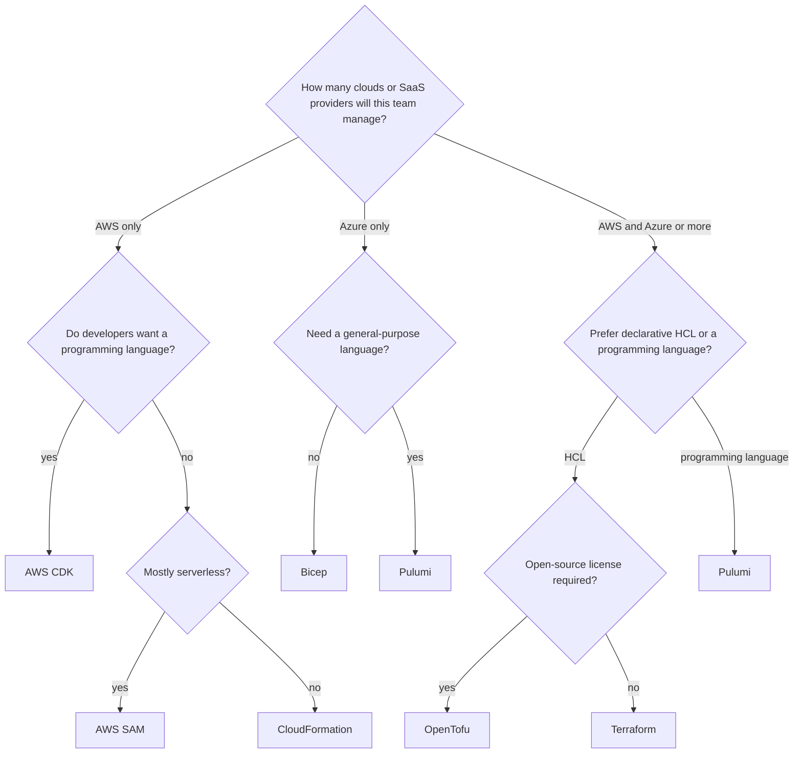
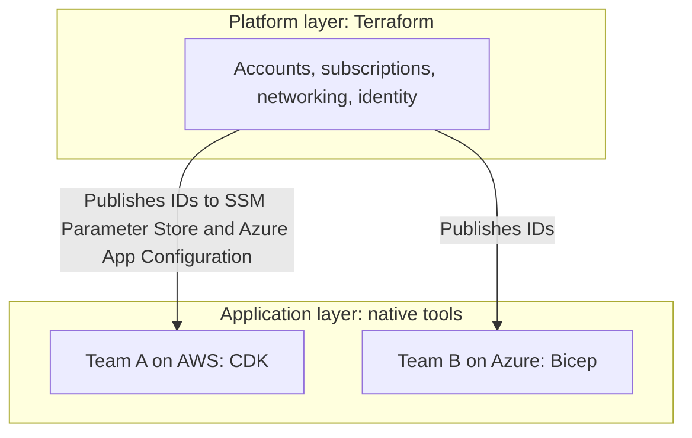

# Choosing an IaC Tool

## Introduction

You have now seen the main infrastructure-as-code options for AWS and Azure:

- [AWS CloudFormation](./1-cloud-cloudformation.mdx): AWS's native, declarative engine
- [AWS CDK](./2-cloud-aws-cdk.mdx): real programming languages that generate CloudFormation
- [Azure Bicep and ARM Templates](./3-cloud-bicep-and-arm.mdx): Azure's native, declarative option
- [Terraform for AWS and Azure](./4-cloud-terraform-multi-cloud.mdx): one tool and workflow across clouds

There is no single best tool. Each makes different trade-offs about **where state lives**, **how you express logic**, **which clouds it covers** and **who on your team will maintain it**. Picking a tool is like picking a vehicle: a city scooter, a pickup truck and a minivan are all "good", but only one fits a family of five moving house.

This page gives you a repeatable way to decide: the criteria that matter, a decision flowchart, a weighted scoring exercise, realistic scenarios with recommendations, and how to migrate or mix tools when your first choice stops fitting.

## The Contenders at a Glance

| Tool | Clouds | Authoring style | State | Owner and license |
| --- | --- | --- | --- | --- |
| CloudFormation | AWS | Declarative YAML or JSON | Managed by AWS (stacks) | AWS service |
| AWS SAM | AWS | CloudFormation plus serverless shortcuts | Managed by AWS | AWS, open-source CLI |
| AWS CDK | AWS | TypeScript, Python, Java, C#, Go, JavaScript | Managed by AWS (via CloudFormation) | AWS, Apache 2.0 |
| ARM templates | Azure | Declarative JSON | Managed by Azure (deployments, deployment stacks) | Azure service |
| Bicep | Azure | Declarative DSL compiled to ARM | Managed by Azure | Microsoft, MIT |
| Terraform | Multi-cloud and SaaS | Declarative HCL | State file you store (or HCP Terraform) | HashiCorp (IBM), Business Source License |
| OpenTofu | Multi-cloud and SaaS | Declarative HCL | State file you store | Linux Foundation, MPL 2.0 |
| Pulumi | Multi-cloud and SaaS | TypeScript, Python, Go, C#, Java, YAML | Pulumi Cloud or self-managed backend | Pulumi, Apache 2.0 engine |

:::note
Licenses, ownership and features change. HashiCorp moved Terraform to the Business Source License in 2023 and archived CDK for Terraform (CDKTF) in December 2025. Check each project's site before making a long-term decision.
:::

## One Queue, Five Tools

Reading the same small resource in each tool is the fastest way to feel the differences. Here is a message queue with a two-minute visibility timeout (or lock duration) and a `team` tag.

**CloudFormation (YAML):** short and explicit; no logic.

```yaml
Resources:
  OrdersQueue:
    Type: AWS::SQS::Queue
    Properties:
      VisibilityTimeout: 120
      Tags:
        - Key: team
          Value: orders
```

**AWS CDK (Python):** a class, typed durations, and the full power of the language around it.

```python
import aws_cdk as cdk
from aws_cdk import Duration, Stack, Tags, aws_sqs as sqs
from constructs import Construct


class OrdersStack(Stack):
    def __init__(self, scope: Construct, construct_id: str, **kwargs) -> None:
        super().__init__(scope, construct_id, **kwargs)
        queue = sqs.Queue(self, "OrdersQueue", visibility_timeout=Duration.seconds(120))
        Tags.of(queue).add("team", "orders")


app = cdk.App()
OrdersStack(app, "Orders")
app.synth()
```

**Bicep:** on Azure, a Service Bus queue lives inside a namespace, so there are two resources.

```bicep
param location string = resourceGroup().location

resource bus 'Microsoft.ServiceBus/namespaces@2026-01-01' = {
  name: 'sb-orders-${uniqueString(resourceGroup().id)}'
  location: location
  sku: {
    name: 'Standard'
  }
  tags: {
    team: 'orders'
  }
}

resource ordersQueue 'Microsoft.ServiceBus/namespaces/queues@2026-01-01' = {
  parent: bus
  name: 'orders'
  properties: {
    lockDuration: 'PT2M'
  }
}
```

**Terraform (HCL):** declarative like CloudFormation, but with provider version pinning and a state file behind it.

```hcl
terraform {
  required_providers {
    aws = { source = "hashicorp/aws", version = "~> 6.0" }
  }
}

resource "aws_sqs_queue" "orders" {
  name_prefix                = "orders-"
  visibility_timeout_seconds = 120
  tags = {
    team = "orders"
  }
}
```

**Pulumi (Python):** a plain program; resources are objects and outputs are exported.

```python
import pulumi
import pulumi_aws as aws

orders = aws.sqs.Queue(
    "orders",
    visibility_timeout_seconds=120,
    tags={"team": "orders"},
)

pulumi.export("queue_url", orders.url)
```

What to notice:

- For one resource, every tool is about the same length. The differences appear at scale: loops, reuse, testing and review.
- The CDK and Pulumi versions need a language runtime and dependencies; the declarative ones need only the tool's CLI.
- The Azure version is not a translation of the AWS one. The services differ (namespace plus queue, ISO 8601 durations), which is exactly why "write once, deploy to any cloud" rarely works.

## The Criteria That Actually Matter

### 1. Which clouds, now and in two years?

This is usually the deciding factor.

- **One cloud, staying there:** native tools (CloudFormation or CDK on AWS, Bicep on Azure) give the best coverage of new services and direct vendor support.
- **Two or more clouds, or lots of SaaS** (GitHub, Datadog, Cloudflare, PagerDuty): Terraform, OpenTofu or Pulumi let one team use one workflow.
- **"Maybe multi-cloud someday":** do not pay the cost now for a future that may not arrive. See [Multi-Cloud and Hybrid Strategy](../13-cloud-architecture/5-cloud-multi-cloud-strategy.mdx).

### 2. Who writes and reviews the code?

| Team profile | Usually prefers |
| --- | --- |
| Application developers who own their infrastructure | CDK or Pulumi in the app's language |
| Platform or operations engineers | Terraform, Bicep or CloudFormation |
| Mixed, with security reviewers who are not programmers | Declarative formats (HCL, Bicep, YAML) that are easy to diff and read |

A general-purpose language is powerful, but loops and inheritance can make infrastructure hard to review. A declarative language is easier to audit but more repetitive.

### 3. Where does state live, and who protects it?

| Model | Tools | You gain | You give up |
| --- | --- | --- | --- |
| Service-managed | CloudFormation, CDK, ARM, Bicep | No state file to secure, lock or back up | Single-cloud only; less precise view of what the tool owns (ARM without stacks) |
| Self-managed state file | Terraform, OpenTofu, Pulumi (self-hosted backend) | Exact record of managed resources; works across clouds | Must secure and lock state; state can contain secrets |
| Hosted state service | HCP Terraform, Pulumi Cloud | Locking, history, policies, UI out of the box | A paid service (usually) and another vendor |

### 4. Safety features

| Feature | CloudFormation and CDK | Bicep and ARM | Terraform and OpenTofu | Pulumi |
| --- | --- | --- | --- | --- |
| Preview | Change set, `cdk diff` | What-if | `plan` | `preview` |
| Automatic rollback on failure | Yes (default) | No (optional redeploy of last good deployment) | No | No |
| Drift detection | Built in, plus drift-aware change sets | What-if against live state; stack deny settings | `plan` refresh | `refresh` |
| Deletion protection | `DeletionPolicy`, termination protection | Resource locks, stack deny settings | `prevent_destroy` lifecycle | `protect` option |
| Policy as code | Guard, Hooks | Azure Policy, PSRule | Sentinel or OPA in HCP Terraform; Checkov, Trivy, Conftest | CrossGuard |

Azure Policy and AWS Service Control Policies apply to **every** tool because they act at the API level. See [Policies and Governance: SCPs and Azure Policy](../12-cloud-observability-and-security/7-cloud-compliance-and-governance.mdx).

### 5. Speed of new feature support

Native tools usually support a new service or property at or near launch: Bicep reads the same resource schemas as ARM, and CloudFormation coverage for new AWS features is typically quick (though not always on day one). Third-party providers need a release first. Terraform users bridge gaps with the `azapi` and `awscc` providers, as shown on the [Terraform page](./4-cloud-terraform-multi-cloud.mdx).

### 6. Ecosystem and hiring

Terraform has the largest pool of modules, examples and engineers who already know it. CloudFormation and Bicep are well known within their clouds. CDK and Pulumi skills overlap with general programming skills, which helps developer-heavy teams.

## A Decision Flowchart



Treat the flowchart as a starting point, not a verdict. Existing skills and existing code often outweigh everything else.

## A Weighted Scoring Exercise

When a team cannot agree, scoring makes the trade-offs explicit. The script below ranks tools against weighted criteria. The scores are **example judgments** for illustration; your team should fill in its own after a short pilot.

```python
"""Score IaC tools against your team's weighted criteria."""

# Scores from 1 (poor fit) to 5 (great fit). These are this team's own
# judgments for its situation, not universal truths. Adjust them.
SCORES = {
    "CloudFormation": {"aws": 5, "azure": 1, "no_state_mgmt": 5, "dev_friendly": 2, "ecosystem": 3, "new_features": 4},
    "AWS CDK":        {"aws": 5, "azure": 1, "no_state_mgmt": 5, "dev_friendly": 5, "ecosystem": 4, "new_features": 4},
    "Bicep":          {"aws": 1, "azure": 5, "no_state_mgmt": 5, "dev_friendly": 3, "ecosystem": 3, "new_features": 5},
    "Terraform":      {"aws": 4, "azure": 4, "no_state_mgmt": 2, "dev_friendly": 3, "ecosystem": 5, "new_features": 3},
    "Pulumi":         {"aws": 4, "azure": 4, "no_state_mgmt": 3, "dev_friendly": 5, "ecosystem": 3, "new_features": 3},
}

MUST_HAVE = 5  # a criterion with this weight is a hard requirement


def rank(weights: dict[str, int]) -> list[tuple[str, float]]:
    total_weight = sum(weights.values())
    results = []
    for tool, scores in SCORES.items():
        # Drop tools that are a poor fit on any must-have criterion
        if any(w == MUST_HAVE and scores[c] < 3 for c, w in weights.items()):
            continue
        score = sum(scores[c] * w for c, w in weights.items()) / total_weight
        results.append((tool, round(score, 2)))
    return sorted(results, key=lambda r: r[1], reverse=True)


TEAMS = {
    "AWS-only product team": {"aws": 5, "azure": 0, "no_state_mgmt": 3, "dev_friendly": 4, "ecosystem": 2, "new_features": 3},
    "Azure-only IT team":    {"aws": 0, "azure": 5, "no_state_mgmt": 4, "dev_friendly": 1, "ecosystem": 2, "new_features": 4},
    "Platform team, both":   {"aws": 5, "azure": 5, "no_state_mgmt": 1, "dev_friendly": 2, "ecosystem": 4, "new_features": 2},
}

for team, weights in TEAMS.items():
    print(team)
    for tool, score in rank(weights)[:3]:
        print(f"  {tool:<15} {score}")
```

Output:

```text
AWS-only product team
  AWS CDK         4.71
  CloudFormation  3.88
  Pulumi          3.76
Azure-only IT team
  Bicep           4.62
  Pulumi          3.44
  Terraform       3.31
Platform team, both
  Terraform       3.89
  Pulumi          3.74
```

Two lessons from the exercise:

- **Hard requirements beat averages.** Without the `MUST_HAVE` filter, an AWS-only tool can still rank third for a team that must manage Azure, because it scores well on everything else. Filter first, then score.
- **The weights are the conversation.** Arguing about whether `dev_friendly` is a 2 or a 4 surfaces what the team really values.

## Running a Short Pilot

Scores on paper are guesses until you try the tools on your own system. A two-week pilot with a fixed checklist keeps the comparison fair:

1. **Same slice for every tool.** For example: a bucket or storage account, a queue, a function with least-privilege access, and tags.
2. **Both environments.** Deploy to a sandbox AWS account and a sandbox Azure subscription if both are in scope, with a budget alert on each (see [Budgets and Billing Alerts](../1-cloud-getting-started/7-cloud-budgets-and-alerts.mdx)).
3. **Keyless CI.** A pull request must show a preview (change set, `cdk diff`, what-if, `plan` or `preview`) using OIDC credentials.
4. **A breaking change.** Rename something that forces replacement. Does the preview make the danger obvious?
5. **Drift.** Change a setting by hand and see how each tool reports it.
6. **A newcomer test.** Ask a teammate who did not write the code to make a small change and time it.
7. **Teardown.** Destroy everything and confirm nothing is left behind, such as retained buckets or orphaned Azure resources.

Write down what happened at each step. The notes are more valuable than the final scores.

:::caution Cost warning
Pilots create real resources in two clouds. Keep them small, tag everything with `purpose=iac-pilot`, and run each tool's destroy or delete command at the end of every day.
:::

## Scenarios and Recommendations

| Situation | Recommendation | Why |
| --- | --- | --- |
| Startup, AWS only, TypeScript developers own infrastructure | AWS CDK | Abstractions, tests and grants in the language they already use; CloudFormation rollback |
| Serverless API on AWS with a small team | AWS SAM, or CDK if it grows | Concise templates and `sam local` testing |
| Enterprise IT, Azure only, infrastructure engineers | Bicep with deployment stacks and Azure Verified Modules | Native, no state file, new features immediately |
| Platform team serving AWS and Azure, plus GitHub and Datadog | Terraform or OpenTofu | One workflow and review process across every provider |
| Developer-led company, multi-cloud, wants real languages | Pulumi | General-purpose languages across clouds |
| Regulated organization requiring open-source licensing for core tooling | OpenTofu, CloudFormation or Bicep | Avoids BSL licensing questions; check with legal |
| Existing large Terraform estate, moving partly to Azure | Keep Terraform, add AzureRM and azapi | Reuse skills, pipelines and modules |

## Mixing Tools Deliberately

Large organizations rarely use exactly one tool. That is fine if the **boundaries are clear**. A common split:



Rules that keep a mixed setup sane:

1. **Each resource has exactly one owner tool.** Two tools managing the same resource will fight on every deploy.
2. **Pass values through a shared store**, not by copy-paste: AWS Systems Manager Parameter Store, Azure App Configuration, or Terraform outputs read through a `terraform_remote_state` data source or plain data sources.
3. **Split by lifecycle.** Slow-changing foundations (networks, identity) in one layer; fast-changing app resources in another.
4. **Same safety bar everywhere:** previews on every pull request, OIDC credentials, policy checks.

## Migrating Between Tools

Changing tools later is possible but not free. These paths exist today:

| From | To | How |
| --- | --- | --- |
| Console-created AWS resources | CloudFormation or CDK | CloudFormation IaC generator, then resource import or `cdk migrate` |
| Console-created Azure resources | Bicep | Portal **Export template** or `az group export`, then `bicep decompile` and clean-up |
| Console-created resources (either cloud) | Terraform | `import` blocks with `terraform plan -generate-config-out`; `aztfexport` for Azure |
| CloudFormation | CDK | `cdk migrate`, or `CfnInclude` to wrap an existing template |
| ARM JSON | Bicep | `bicep decompile` |
| CDK for Terraform | Terraform HCL | `cdktf synth --hcl` (CDKTF is archived) |
| Terraform | OpenTofu | Usually a drop-in switch for the versions OpenTofu forked from; test on a copy of state first |
| Terraform | Pulumi | `pulumi convert --from terraform`, then import state |

Whatever the path, migrate **one bounded unit at a time** (for example, one stack or one resource group), and keep the old tool's deletion behaviour in mind: remove resources from the old tool's management (retain, detach or `terraform state rm`) **before** the new tool adopts them, never after.

## Real-World Scenario

A 40-person SaaS company runs on AWS with a mix of console-built resources and a few CloudFormation templates. Two things are happening: developers are tired of 800-line YAML files, and a large customer wants a dedicated deployment on Azure.

**The team evaluates options with a two-week pilot**: each candidate tool must deploy the same small slice (a bucket or storage account, a queue and a function) to a sandbox account and a sandbox subscription, with a pull request preview and OIDC credentials.

**The decision:**

- **Terraform** for the shared platform layer on both clouds (accounts and subscriptions, networking, identity, state buckets), owned by the two platform engineers.
- **AWS CDK** for application stacks on AWS, owned by product teams in TypeScript.
- **Bicep** with Azure Verified Modules for the Azure application slice, because the customer's own Azure team already knows Bicep and will co-maintain it.

**Why this approach:** each layer uses the tool its owners know best, and clear boundaries prevent two tools from managing the same resource. The pilot replaced opinions with evidence: Terraform's previews for Azure were clearer for the platform team, while the CDK's `grant_*` helpers cut the product teams' IAM bugs.

**When to use it / when not to:** a mixed setup makes sense once separate teams own separate layers. A team of five should pick one tool; three tools for five people is overhead, not flexibility.

**Alternatives and trade-offs:**

| Approach | Pros | Cons | Best for |
| --- | --- | --- | --- |
| One multi-cloud tool everywhere | One skill set, one pipeline pattern | Some loss of native features; state management | Small to medium teams on several clouds |
| Native tool per cloud | Best feature coverage, vendor support | Two or more skill sets and pipelines | Separate teams per cloud |
| Layered mix (platform plus app tools) | Each team uses what fits; clear ownership | Needs discipline at the boundaries | Larger organizations |
| Keep the console and scripts | Zero migration effort | No previews, drift, or review | Never, beyond experiments |

## Common Mistakes

- **Choosing by popularity alone.** The most popular tool is not automatically the right one for an Azure-only team or a developer-led startup.
- **Building for hypothetical multi-cloud.** Abstracting every resource behind cloud-neutral modules costs a lot and rarely pays off.
- **Letting two tools manage one resource.** Each deploy reverts the other's change. Define ownership.
- **Ignoring who maintains it.** A brilliant CDK library is a liability if only one person can read it.
- **Skipping a pilot.** Two weeks on a real slice of your system tells you more than any comparison table, including this one.
- **Forgetting licensing and vendor changes.** Track license terms, end-of-support notices and archived projects (such as CDKTF).

## Summary

- The main options for AWS and Azure are CloudFormation, SAM, CDK, ARM, Bicep, Terraform, OpenTofu and Pulumi.
- Decide based on clouds in scope, who writes the code, where state lives, safety features, new-feature support and ecosystem.
- Use hard requirements to filter, then weighted scores and a short pilot to choose.
- Mixing tools works when each resource has one owner and values flow through a shared store.
- Migration paths exist for every major tool, but migrate one bounded unit at a time.

## Exercises

1. Edit `SCORES` and `TEAMS` in the script to describe your own team. Which criteria are must-haves? Does the ranking match your intuition?
2. Pick two tools from this section and implement the same slice (storage plus a queue) in both. Compare lines of code, preview output and how long a new teammate takes to understand each.
3. Draw the layered ownership diagram for your organization. Which resources currently have more than one owner?
4. Put your chosen tool into practice in [Project: Multi-Environment Infrastructure as Code](../14-cloud-projects/5-cloud-project-multi-env-iac.mdx), then wire it into a pipeline with [CI/CD on AWS](../11-cloud-devops/0-cloud-ci-cd-on-aws.mdx) or [CI/CD with Azure DevOps and GitHub Actions](../11-cloud-devops/1-cloud-ci-cd-on-azure.mdx).

**Back to the start of this section:** [Infrastructure as Code in the Cloud](./0-cloud-iac-introduction.mdx).
