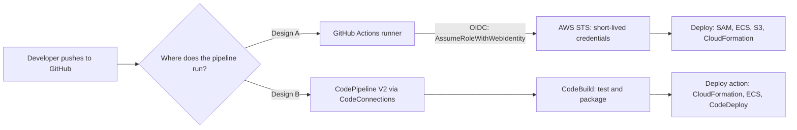
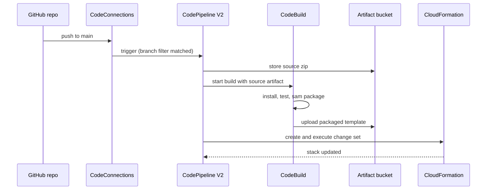

# CI/CD on AWS

## Introduction

You have code in a Git repository and an application running on AWS. **CI/CD on AWS** is the automation that connects the two: every change is built, tested, packaged and shipped to your AWS account without anyone copying files or clicking through the console.

Think of it like an airport baggage system. You drop your bag (a commit) at the counter, and conveyor belts carry it through scanners (tests), tagging (versioning) and sorting (environments) until it reaches the right plane (production). Nobody carries bags by hand, and every bag goes through the same checks.

This page is about the **cloud-specific** parts of CI/CD: how a pipeline gets permission to touch your AWS account, which AWS services can run the pipeline, and how to deploy common AWS targets. If CI/CD itself is new to you, start with the site's [CI/CD tutorial](/docs/devops/cicd). If your team already runs Jenkins, the [Jenkins tutorial](/docs/devops/jenkins) covers it in depth. Everything on this page also works with a Jenkins agent that has an IAM role.

You will learn:

1. The AWS developer tool family and what each service does
2. The two most common pipeline designs: **GitHub Actions + OIDC** and **AWS CodePipeline + CodeBuild**
3. How to write a `buildspec.yml` and a V2 pipeline definition
4. How each option is billed, and when to pick which
5. How the same ideas map to Azure (covered fully on the next page)

:::caution Cost warning
The commands on this page create real AWS resources: build projects, pipelines, S3 artifact buckets, Lambda functions and CloudWatch logs. Build minutes, pipeline executions and storage are billed. Set up a budget first (see [Budgets and Billing Alerts](../1-cloud-getting-started/7-cloud-budgets-and-alerts.mdx)) and run the **Cleanup** section when you finish.
:::

## The AWS Developer Tools Family

AWS sells a set of "Code" services. You can use them together, mix them with GitHub, or ignore them entirely and deploy from another CI system.

| Service | What it does | Rough equivalent elsewhere |
| --- | --- | --- |
| **AWS CodePipeline** | Orchestrates stages: source, build, test, approve, deploy | Azure Pipelines (multi-stage YAML), GitHub Actions workflow |
| **AWS CodeBuild** | Runs build and test commands in a managed container | Azure Pipelines agent job, GitHub-hosted runner |
| **AWS CodeDeploy** | Deploys to EC2, on-premises servers, Lambda and ECS, with canary and linear traffic shifting | App Service slot swap, Azure Pipelines deployment strategies |
| **AWS CodeCommit** | Managed private Git repositories | Azure Repos, GitHub |
| **AWS CodeConnections** | Links CodePipeline and CodeBuild to GitHub, GitLab, Bitbucket and Azure DevOps repositories | Service connections in Azure DevOps |
| **AWS CodeArtifact** | Private package repository (npm, PyPI, Maven, NuGet) | Azure Artifacts, GitHub Packages |
| **Amazon ECR** | Container image registry | Azure Container Registry |

:::note Recent changes worth knowing
- **CodeCommit** was closed to new customers in July 2024 and then [returned to general availability in November 2025](https://aws.amazon.com/blogs/devops/aws-codecommit-returns-to-general-availability/). Older blog posts may tell you it is unavailable. Check the current status before you choose it.
- **CodeStar Connections** was renamed **AWS CodeConnections**. The new CLI namespace is `aws codeconnections`, but you will still see `codestar-connections` in ARNs, IAM actions and older docs. Both work.
- CodePipeline has two pipeline types, **V1** and **V2**. V2 adds Git triggers with branch, tag and file-path filters, pipeline variables, stage rollback and more. Use V2 for new pipelines.
:::

Most teams today keep their code on GitHub (or GitLab) and pick one of two designs.



Both designs end in the same place, your AWS account. They differ in **where the build runs**, **who manages it**, and **how credentials work**.

## Design A: GitHub Actions with OIDC

This is the most common setup for teams already on GitHub. The workflow runs on GitHub's runners and **assumes an IAM role** in your account using OpenID Connect (OIDC). No AWS access keys are stored anywhere.

The OIDC trust setup itself (identity provider, trust policy, `sub` claim conditions) is explained step by step in [Keyless CI/CD with OIDC](../2-cloud-identity/6-cloud-oidc-for-ci.mdx). Here we focus on the pipeline.

### Step 1: The application

We will deploy a tiny Python Lambda function with AWS SAM, the same style used on the [AWS Lambda](../4-cloud-serverless/1-cloud-aws-lambda.mdx) page.

```python
# src/app.py
import json

def handler(event, context):
    return {
        "statusCode": 200,
        "headers": {"Content-Type": "application/json"},
        "body": json.dumps({"service": "orders-api", "status": "ok"}),
    }
```

```python
# tests/test_app.py
import json
from src.app import handler

def test_handler_returns_ok():
    response = handler({}, None)
    assert response["statusCode"] == 200
    assert json.loads(response["body"])["status"] == "ok"
```

Run the test locally before you automate anything:

```bash
pip install pytest
python -m pytest -q
```

Output:

```text
.                                                                        [100%]
1 passed in 0.01s
```

The SAM template describes the function:

```yaml
# template.yaml
AWSTemplateFormatVersion: "2010-09-09"
Transform: AWS::Serverless-2016-10-31
Description: orders-api deployed by CI/CD

Parameters:
  Stage:
    Type: String
    AllowedValues: [dev, staging, prod]

Resources:
  OrdersFunction:
    Type: AWS::Serverless::Function
    Properties:
      FunctionName: !Sub "orders-api-${Stage}"
      Runtime: python3.13
      Handler: app.handler
      CodeUri: src/
      MemorySize: 256
      Timeout: 10
      FunctionUrlConfig:
        AuthType: NONE

Outputs:
  FunctionUrl:
    Value: !GetAtt OrdersFunctionUrl.FunctionUrl
```

:::warning
`AuthType: NONE` makes the function URL public. That is fine for a throwaway demo. Real APIs should use IAM auth or sit behind API Gateway with authorization (see [API Gateway and Azure API Management](../4-cloud-serverless/4-cloud-api-gateway.mdx)).
:::

### Step 2: The workflow

```yaml
# .github/workflows/deploy-aws.yml
name: deploy-aws

on:
  push:
    branches: [main]
  pull_request:

permissions:
  id-token: write   # required to request the OIDC token
  contents: read

env:
  AWS_REGION: us-east-1

jobs:
  test:
    runs-on: ubuntu-latest
    steps:
      - uses: actions/checkout@v7
      - uses: actions/setup-python@v7
        with:
          python-version: "3.13"
      - run: pip install pytest
      - run: python -m pytest -q

  deploy-dev:
    needs: test
    if: github.ref == 'refs/heads/main'
    runs-on: ubuntu-latest
    environment: dev
    steps:
      - uses: actions/checkout@v7
      - uses: actions/setup-python@v7
        with:
          python-version: "3.13"
      - uses: aws-actions/setup-sam@v3
        with:
          use-installer: true
      - uses: aws-actions/configure-aws-credentials@v6
        with:
          role-to-assume: ${{ vars.AWS_DEPLOY_ROLE_ARN }}
          aws-region: ${{ env.AWS_REGION }}
      - run: aws sts get-caller-identity
      - run: sam build
      - run: >
          sam deploy
          --stack-name orders-api-dev
          --parameter-overrides Stage=dev
          --capabilities CAPABILITY_IAM
          --resolve-s3
          --no-confirm-changeset
          --no-fail-on-empty-changeset
```

Key points:

- `permissions: id-token: write` lets the job request a signed OIDC token from GitHub. Without it, the credentials step fails.
- `role-to-assume` is a **role ARN**, not a secret. Storing it as a repository or environment *variable* (`vars`) is fine.
- Pull requests run only the `test` job. Deployment is gated on `main`, and the `dev` **environment** can carry its own protection rules and role ARN (see [Managing Dev, Staging and Production](./3-cloud-environments.mdx)).
- `--no-fail-on-empty-changeset` keeps the job green when nothing changed.

Example output from the credentials and deploy steps (trimmed):

```text
Run aws sts get-caller-identity
{
    "UserId": "AROAEXAMPLEID:GitHubActions",
    "Account": "111122223333",
    "Arn": "arn:aws:sts::111122223333:assumed-role/gha-orders-deploy/GitHubActions"
}
...
CloudFormation events from stack operations
ResourceStatus           ResourceType                     LogicalResourceId
CREATE_COMPLETE          AWS::Lambda::Function            OrdersFunction
CREATE_COMPLETE          AWS::Lambda::Url                 OrdersFunctionUrl
CREATE_COMPLETE          AWS::CloudFormation::Stack       orders-api-dev
Successfully created/updated stack - orders-api-dev in us-east-1
```

:::tip Pin your actions
Action versions move. At the time of writing the current majors are `actions/checkout@v7`, `actions/setup-python@v7`, `aws-actions/setup-sam@v3` and `aws-actions/configure-aws-credentials@v6`. Check each action's README for the latest release. For stricter supply-chain security, pin to a full commit SHA instead of a tag.
:::

### Step 3: Least-privilege deploy role

The role the workflow assumes should be able to deploy **this stack**, not administer the account. A common pattern is to let the CI role only call CloudFormation and pass a separate, pre-created **CloudFormation execution role** that holds the real resource permissions. That way a compromised workflow cannot create arbitrary IAM users. See [Least Privilege in Practice](../2-cloud-identity/3-cloud-least-privilege.mdx) for how to scope these policies.

## Design B: CodePipeline V2 and CodeBuild

In this design the pipeline lives inside your AWS account. GitHub is only the source. AWS runs the build on CodeBuild and deploys through CloudFormation, ECS or CodeDeploy actions.



### Step 1: Create a connection to GitHub

```bash
aws codeconnections create-connection \
  --provider-type GitHub \
  --connection-name github-orders
```

Example output:

```json
{
    "ConnectionArn": "arn:aws:codeconnections:us-east-1:111122223333:connection/EXAMPLE-1111-2222"
}
```

A connection created from the CLI starts in `PENDING` status. Open **Developer Tools > Settings > Connections** in the console once to finish the GitHub App handshake. After that its status is `AVAILABLE`.

### Step 2: The buildspec

CodeBuild reads `buildspec.yml` from the repository root. Its phases are `install`, `pre_build`, `build` and `post_build`, and each phase holds shell commands.

```yaml
# buildspec.yml
version: 0.2

env:
  variables:
    STAGE: "dev"
  # parameter-store and secrets-manager mappings are also supported here

phases:
  install:
    runtime-versions:
      python: 3.13
    commands:
      - pip install pytest aws-sam-cli
  pre_build:
    commands:
      - python -m pytest -q --junitxml=reports/junit.xml
  build:
    commands:
      - sam build
      - sam package --s3-bucket "$ARTIFACT_BUCKET" --output-template-file packaged.yaml

reports:
  unit-tests:
    files:
      - reports/junit.xml
    file-format: JUNITXML

artifacts:
  files:
    - packaged.yaml

cache:
  paths:
    - "/root/.cache/pip/**/*"
```

A few details from the [buildspec reference](https://docs.aws.amazon.com/codebuild/latest/userguide/build-spec-ref.html):

- Use `version: 0.2`. In 0.2 all commands in a build share one shell, so `cd` and `export` carry over between lines.
- Always pin `runtime-versions`. If you omit it, CodeBuild uses the image default, which changes when old versions reach end of life.
- `reports` publishes test results to a CodeBuild report group, so failed tests show up in the console.
- Never put secrets in `env.variables`. Use `parameter-store` or `secrets-manager` mappings, covered in [Secrets Management](./4-cloud-secrets-management.mdx).

The supported runtime versions depend on the CodeBuild image you choose. Check [Available runtimes](https://docs.aws.amazon.com/codebuild/latest/userguide/available-runtimes.html) before pinning one.

### Step 3: The pipeline definition (V2)

Pipelines are JSON. Here is a trimmed V2 pipeline with three stages and a Git trigger that only fires for changes under `src/` or the template on `main`:

```json
{
  "pipeline": {
    "name": "orders-api",
    "pipelineType": "V2",
    "executionMode": "QUEUED",
    "roleArn": "arn:aws:iam::111122223333:role/codepipeline-orders-role",
    "artifactStore": { "type": "S3", "location": "orders-pipeline-artifacts-111122223333" },
    "triggers": [
      {
        "providerType": "CodeStarSourceConnection",
        "gitConfiguration": {
          "sourceActionName": "Source",
          "push": [
            {
              "branches": { "includes": ["main"] },
              "filePaths": { "includes": ["src/**", "template.yaml"] }
            }
          ]
        }
      }
    ],
    "stages": [
      {
        "name": "Source",
        "actions": [
          {
            "name": "Source",
            "actionTypeId": { "category": "Source", "owner": "AWS", "provider": "CodeStarSourceConnection", "version": "1" },
            "configuration": {
              "ConnectionArn": "arn:aws:codeconnections:us-east-1:111122223333:connection/EXAMPLE-1111-2222",
              "FullRepositoryId": "my-org/orders-api",
              "BranchName": "main"
            },
            "outputArtifacts": [{ "name": "SourceOutput" }]
          }
        ]
      },
      {
        "name": "Build",
        "actions": [
          {
            "name": "TestAndPackage",
            "actionTypeId": { "category": "Build", "owner": "AWS", "provider": "CodeBuild", "version": "1" },
            "configuration": { "ProjectName": "orders-api-build" },
            "inputArtifacts": [{ "name": "SourceOutput" }],
            "outputArtifacts": [{ "name": "BuildOutput" }]
          }
        ]
      },
      {
        "name": "DeployDev",
        "actions": [
          {
            "name": "DeployStack",
            "actionTypeId": { "category": "Deploy", "owner": "AWS", "provider": "CloudFormation", "version": "1" },
            "configuration": {
              "ActionMode": "CREATE_UPDATE",
              "StackName": "orders-api-dev",
              "TemplatePath": "BuildOutput::packaged.yaml",
              "Capabilities": "CAPABILITY_IAM,CAPABILITY_AUTO_EXPAND",
              "ParameterOverrides": "{\"Stage\":\"dev\"}",
              "RoleArn": "arn:aws:iam::111122223333:role/cfn-orders-exec-role"
            },
            "inputArtifacts": [{ "name": "BuildOutput" }]
          }
        ]
      }
    ]
  }
}
```

Notice that the source action provider is still called `CodeStarSourceConnection`. The service was renamed, but the action identifier stayed the same.

Create and start the pipeline:

```bash
aws codepipeline create-pipeline --cli-input-json file://pipeline.json
aws codepipeline start-pipeline-execution --name orders-api
aws codepipeline get-pipeline-state --name orders-api \
  --query "stageStates[].{stage:stageName,status:latestExecution.status}" --output table
```

Example output:

```text
-------------------------------
|      GetPipelineState       |
+-------------+---------------+
|    stage    |    status     |
+-------------+---------------+
|  Source     |  Succeeded    |
|  Build      |  Succeeded    |
|  DeployDev  |  InProgress   |
+-------------+---------------+
```

In practice you would define the pipeline itself with infrastructure as code (CloudFormation, CDK or Terraform) instead of hand-written JSON. The [AWS CDK](../10-cloud-infrastructure-as-code/2-cloud-aws-cdk.mdx) has a high-level `pipelines` module that generates most of this for you.

### Adding approval and production stages

To promote to production you add more stages:

- A **Manual approval** action (`"category": "Approval", "provider": "Manual"`) that pauses until someone approves it in the console or through the API.
- A `DeployProd` stage that deploys the **same packaged artifact** with `Stage=prod`, usually into a **different AWS account** through a cross-account role.
- Optionally a **CodeDeploy** action, or SAM's `DeploymentPreference`, to shift traffic gradually with canary or linear configurations such as `CodeDeployDefault.LambdaCanary10Percent5Minutes`. That is covered in [Deployment Strategies in the Cloud](./2-cloud-deployment-strategies.mdx).

## How CI/CD on AWS Is Billed

Never assume a pipeline is free. The *model* matters more than the exact numbers, which vary by region and change over time. Check the [AWS Pricing Calculator](https://calculator.aws/) and each service's pricing page.

| Item | How it is billed |
| --- | --- |
| CodeBuild | Per build minute, with the rate depending on compute type and size (and per-request plus duration for Lambda compute) |
| CodePipeline V2 | Per action execution minute |
| CodePipeline V1 | Per active pipeline per month |
| Artifact bucket | S3 storage per GB-month plus requests |
| CloudWatch Logs | Ingestion and storage of build logs |
| GitHub Actions | Per runner minute beyond your plan's included minutes, on GitHub's bill, not AWS's |
| Data transfer | Pulling large images or dependencies across regions or from the internet can add egress charges |

Some services have free tiers. Their size changes, so check the current pricing page rather than relying on a blog post.

## The Same Ideas on Azure

The next page, [CI/CD with Azure DevOps and GitHub Actions](./1-cloud-ci-cd-on-azure.mdx), builds the Azure version. Here is the mapping:

| Concept | AWS | Azure |
| --- | --- | --- |
| Pipeline orchestration | CodePipeline | Azure Pipelines (multi-stage YAML) |
| Managed build runner | CodeBuild | Microsoft-hosted agents |
| Keyless auth from GitHub | IAM OIDC provider + role | Entra ID app or managed identity + federated credential |
| Repo connection | CodeConnections | Service connections (GitHub, Azure Repos) |
| Gradual traffic shifting | CodeDeploy, Lambda aliases, ECS strategies | App Service slots, Container Apps revisions |
| Approval gate | Manual approval action | Environment approvals and checks |

### On Azure, briefly

The equivalent GitHub Actions job swaps `aws-actions/configure-aws-credentials` for `azure/login` with a client ID, tenant ID and subscription ID. The same `id-token: write` permission is needed:

```yaml
      - uses: azure/login@v3
        with:
          client-id: ${{ vars.AZURE_CLIENT_ID }}
          tenant-id: ${{ vars.AZURE_TENANT_ID }}
          subscription-id: ${{ vars.AZURE_SUBSCRIPTION_ID }}
      - run: az account show --query "{name:name, id:id}" -o table
```

The big difference is the **trust model**. On AWS, the IAM role's *trust policy* decides which GitHub repo and branch may assume it. On Azure, a *federated identity credential* on an Entra ID app registration or user-assigned managed identity does the same job, and an Azure RBAC role assignment decides what it may touch.

## Real-World Scenario

Your team of five runs an order-tracking API for a regional logistics company. Code lives on GitHub. Today one engineer deploys from their laptop with an IAM user's access key. Last month the key leaked in a screenshot, and the company now requires keyless, auditable deployments to a `dev` account and a `prod` account.

### The solution

1. Create an IAM OIDC identity provider for GitHub in each account, and a deploy role whose trust policy only allows `repo:my-org/orders-api:environment:dev` (or `:environment:prod`).
2. Use **Design A**: a GitHub Actions workflow with a `test` job on every pull request, an automatic `deploy-dev` job on `main`, and a `deploy-prod` job that uses a `prod` GitHub environment with required reviewers.
3. Build the SAM package once and deploy that exact artifact to both accounts, so production runs what dev tested.
4. Delete the old IAM user and its access key.

### Why this approach

- The team already reviews code on GitHub, so pull request checks and deployment history stay in one place.
- OIDC removes long-lived keys entirely. CloudTrail shows each deployment as an assumed-role session named after the workflow.
- There is nothing extra to operate. GitHub hosts the runners.

### When to use it, and when not to

Use GitHub Actions + OIDC when your code is on GitHub and your builds do not need to run inside your VPC. Prefer **CodePipeline + CodeBuild** when policy requires builds to run inside your AWS accounts (for example, to reach private package mirrors or databases through a VPC), when you want pipeline state and logs to stay under AWS IAM and CloudTrail, or when you orchestrate many cross-account deployments with CDK Pipelines. Keep an existing **Jenkins** setup if it already works well and your team knows it. Just give its agents IAM roles instead of keys.

### Alternatives and trade-offs

| Approach | Pros | Cons | Best for |
| --- | --- | --- | --- |
| GitHub Actions + OIDC | Familiar, huge marketplace, PR checks built in, no infra | Builds run outside AWS by default; GitHub minute costs | Teams already on GitHub |
| CodePipeline V2 + CodeBuild | Runs in your account, IAM-native, VPC builds, CDK Pipelines | More AWS-specific setup; console UX is less friendly | Regulated or AWS-centric orgs |
| GitHub Actions with CodeBuild-hosted runners | GitHub workflow syntax with builds inside AWS | Two systems to understand | Teams wanting both |
| Jenkins on EC2 or EKS | Full control, huge plugin ecosystem | You patch, scale and secure it | Existing Jenkins shops |
| GitLab CI | Integrated SCM + CI, self-host option | Another platform to adopt | GitLab users |

## Common Mistakes

- **Storing AWS access keys as CI secrets.** Use OIDC. If a tool truly cannot do OIDC, use short-lived keys from a tightly scoped role and rotate them automatically.
- **Trust policies that allow any repository.** A `sub` condition like `repo:my-org/*` lets every repo in the org deploy to production. Scope it to the repo and environment.
- **Building separately for each environment.** Rebuilding for prod means prod runs an artifact nobody tested. Build once, promote the artifact.
- **Giving the CI role `AdministratorAccess`.** Use a CloudFormation execution role and keep the CI role narrow.
- **Not pinning runtimes and action versions.** Builds break when defaults change underneath you.
- **Forgetting the artifact bucket and logs.** They grow forever unless you add an S3 lifecycle rule and a CloudWatch Logs retention period.
- **Pending connections.** A CodeConnections connection created by CLI or IaC stays `PENDING` until someone completes the handshake in the console, and the pipeline's source stage fails until then.

## Cleanup

Delete what you created so nothing keeps billing:

```bash
# Design A resources
sam delete --stack-name orders-api-dev --no-prompts

# Design B resources
aws codepipeline delete-pipeline --name orders-api
aws codebuild delete-project --name orders-api-build
aws codeconnections delete-connection \
  --connection-arn arn:aws:codeconnections:us-east-1:111122223333:connection/EXAMPLE-1111-2222
aws s3 rb s3://orders-pipeline-artifacts-111122223333 --force

# Build logs (log group names depend on your project name)
aws logs delete-log-group --log-group-name /aws/codebuild/orders-api-build
```

`sam deploy --resolve-s3` also creates a managed `aws-sam-cli-managed-default` stack with an S3 bucket. Empty that bucket and delete the stack if you no longer use SAM in that region.

## Summary

- CI/CD on AWS is mostly about **where the pipeline runs** and **how it gets credentials**.
- **GitHub Actions + OIDC** is the simplest keyless option for code on GitHub. Request `id-token: write`, assume a narrowly trusted role, deploy with SAM, CloudFormation, CDK or the CLI.
- **CodePipeline V2 + CodeBuild** keeps the whole pipeline inside AWS. A `buildspec.yml` defines build phases, and CodeConnections links GitHub.
- CodeCommit is available to new customers again, and CodeStar Connections is now **CodeConnections**. Verify service status in the official docs, because these things change.
- Billing is per build minute, per pipeline action minute (V2) and per GB stored. Check the AWS Pricing Calculator for current rates.
- Build once, promote the same artifact, and keep the deploy role least-privilege.

## Further Learning

### Exercises

1. Add a `deploy-prod` job to the GitHub Actions workflow that uses a `prod` environment with a required reviewer and a separate role ARN variable.
2. Convert the CodePipeline JSON into a CloudFormation or Terraform resource so the pipeline itself is version-controlled.
3. Add a Git tag trigger to the V2 pipeline so pushing a tag like `release-1.4.0` starts a production run.
4. Add a CloudWatch Logs retention policy and an S3 lifecycle rule for the artifact bucket, then estimate the monthly storage cost in the AWS Pricing Calculator.

### Related pages

- [Keyless CI/CD with OIDC](../2-cloud-identity/6-cloud-oidc-for-ci.mdx)
- [CI/CD with Azure DevOps and GitHub Actions](./1-cloud-ci-cd-on-azure.mdx)
- [Deployment Strategies in the Cloud](./2-cloud-deployment-strategies.mdx)
- [Managing Dev, Staging and Production](./3-cloud-environments.mdx)
- [AWS CloudFormation](../10-cloud-infrastructure-as-code/1-cloud-cloudformation.mdx)
- Site tutorials: [CI/CD](/docs/devops/cicd), [AWS CodePipeline overview](../../cicd/2-cicd-tools/8-cicd-aws-codepipeline.mdx), [Jenkins](/docs/devops/jenkins)
