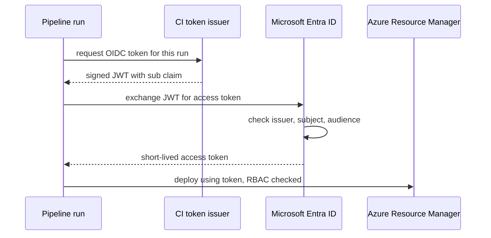
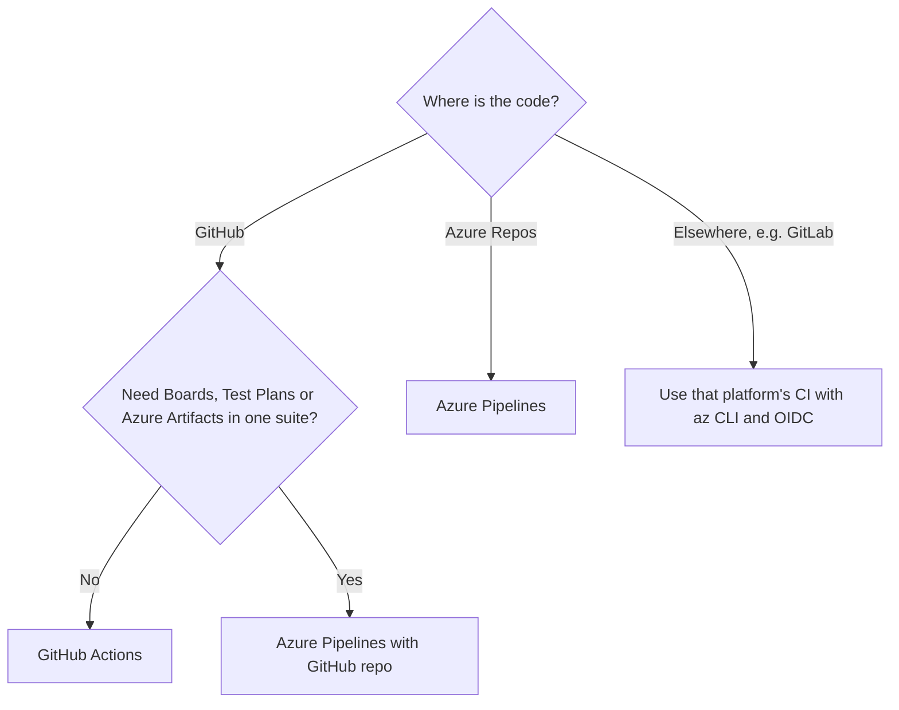

# CI/CD with Azure DevOps and GitHub Actions

## Introduction

Microsoft offers two first-party ways to automate deployments to Azure:

- **Azure DevOps**, a suite of services: Azure Boards (work tracking), Azure Repos (Git), **Azure Pipelines** (CI/CD), Azure Test Plans and Azure Artifacts (packages).
- **GitHub Actions**, the CI/CD built into GitHub (which Microsoft also owns).

Both are actively supported and both deploy to Azure equally well. The choice is usually about where your code and your team's workflow already live, not about Azure features.

A useful analogy: Azure DevOps is a full workshop with a planning board, tool cabinet and assembly line under one roof. GitHub Actions is an assembly line bolted onto the place where your code already sits. Either one can build the same car.

This page covers the Azure-specific parts:

1. How a pipeline authenticates to Azure **without secrets** (workload identity federation)
2. A GitHub Actions workflow that deploys a Python web app to an **App Service staging slot** and swaps it into production
3. The same flow in a multi-stage **Azure Pipelines** YAML file with environments and approvals
4. How to choose between them, and how this maps to [CI/CD on AWS](./0-cloud-ci-cd-on-aws.mdx)

General CI/CD concepts are covered in the site's [CI/CD tutorial](/docs/devops/cicd), including an [Azure DevOps overview](../../cicd/2-cicd-tools/7-cicd-azure-devops.mdx) and a [GitHub Actions overview](../../cicd/2-cicd-tools/2-cicd-github-actions.mdx). If you run Jenkins, see the [Jenkins tutorial](/docs/devops/jenkins). It can deploy to Azure with the same `az` commands shown here.

:::caution Cost warning
Deployment slots need an App Service plan in the **Standard, Premium or Isolated** tier. These tiers cost more than Free or Basic and bill for every hour the plan exists, even when idle. Pipeline minutes beyond any included free grant are also billed. Use the [Azure Pricing Calculator](https://azure.microsoft.com/pricing/calculator/) to estimate, and run the **Cleanup** section when you are done.
:::

## How Pipelines Authenticate to Azure

Every pipeline that changes Azure resources needs an identity in **Microsoft Entra ID** and an **Azure RBAC** role assignment. The old way was a service principal with a client secret pasted into the CI system. Secrets expire, leak and need rotating.

The current recommendation is **workload identity federation**: the CI system issues a signed OIDC token for each run, and Entra ID exchanges it for a short-lived Azure access token if the token's issuer and subject match a **federated identity credential** you configured.



| Piece | GitHub Actions | Azure Pipelines |
| --- | --- | --- |
| Token issuer | `https://token.actions.githubusercontent.com` | Microsoft Entra issuer (new connections) |
| Where you configure trust | Federated credential on an app registration or user-assigned managed identity | An **Azure Resource Manager service connection** using workload identity federation |
| What the pipeline references | `client-id`, `tenant-id`, `subscription-id` | The service connection name (`azureSubscription:`) |
| AWS equivalent | IAM OIDC provider + role trust policy | IAM role assumed by CodeBuild or a runner |

:::note What changed recently
- In Azure DevOps, **workload identity federation** is the recommended authentication type for new Azure Resource Manager service connections. Secret-based options remain only for backward compatibility, and existing connections can be converted.
- New federated service connections use the **Microsoft Entra issuer** by default. Microsoft has announced that the older Azure DevOps issuer retires in 2027. If your organization created federated connections earlier, check the [service connection docs](https://learn.microsoft.com/en-us/azure/devops/pipelines/library/connect-to-azure) for conversion steps.
- Azure DevOps may automatically disable Azure Resource Manager service connections that go unused for a long period. A pipeline that suddenly fails with a disabled connection can be re-enabled under **Project settings > Service connections**.
:::

### Set up federation for GitHub Actions

These commands create an app registration, give it a narrow role on one resource group, and trust only the `production` GitHub environment of one repository. The full background is in [Keyless CI/CD with OIDC](../2-cloud-identity/6-cloud-oidc-for-ci.mdx).

```bash
RG=rg-orders-prod
APP_NAME=gha-orders-deploy
REPO=my-org/orders-web

# 1. App registration and service principal
APP_ID=$(az ad app create --display-name "$APP_NAME" --query appId -o tsv)
az ad sp create --id "$APP_ID"

# 2. Least-privilege role on just the resource group that holds the web app
SUB_ID=$(az account show --query id -o tsv)
az role assignment create \
  --assignee "$APP_ID" \
  --role "Website Contributor" \
  --scope "/subscriptions/$SUB_ID/resourceGroups/$RG"

# 3. Federated credential: only the 'production' environment of this repo
cat > fic.json <<EOF
{
  "name": "orders-web-production",
  "issuer": "https://token.actions.githubusercontent.com",
  "subject": "repo:$REPO:environment:production",
  "audiences": ["api://AzureADTokenExchange"]
}
EOF
az ad app federated-credential create --id "$APP_ID" --parameters fic.json
```

Example output of the last command (trimmed):

```json
{
  "audiences": [ "api://AzureADTokenExchange" ],
  "issuer": "https://token.actions.githubusercontent.com",
  "name": "orders-web-production",
  "subject": "repo:my-org/orders-web:environment:production"
}
```

The `subject` must match exactly. A job that does not declare `environment: production` produces a different subject (for example `repo:my-org/orders-web:ref:refs/heads/main`) and the login fails. That is the point: only the protected environment can deploy.

If you are not allowed to create app registrations in your tenant, use a **user-assigned managed identity** instead (`az identity create` plus `az identity federated-credential create`). It works the same way and does not need directory-level permissions.

## The Sample App

A minimal Flask app with a health endpoint the pipeline can check after deploying:

```python
# app.py
import os
from flask import Flask, jsonify

app = Flask(__name__)

@app.get("/health")
def health():
    return jsonify(status="ok", version=os.environ.get("APP_VERSION", "dev"))

@app.get("/")
def index():
    return "Orders web is running"
```

```python
# test_app.py
from app import app

def test_health():
    client = app.test_client()
    response = client.get("/health")
    assert response.status_code == 200
    assert response.get_json()["status"] == "ok"
```

```text
# requirements.txt
flask
gunicorn
```

```bash
pip install -r requirements.txt pytest
python -m pytest -q
```

Output:

```text
.                                                                        [100%]
1 passed in 0.12s
```

Create the target infrastructure once (in real projects this lives in [Bicep or Terraform](../10-cloud-infrastructure-as-code/3-cloud-bicep-and-arm.mdx)):

```bash
az group create --name rg-orders-prod --location eastus
az appservice plan create --name plan-orders-prod --resource-group rg-orders-prod \
  --sku S1 --is-linux
az webapp create --name orders-web-prod-123 --resource-group rg-orders-prod \
  --plan plan-orders-prod --runtime "PYTHON:3.13"
az webapp deployment slot create --name orders-web-prod-123 \
  --resource-group rg-orders-prod --slot staging
```

Web app names are global DNS names (`orders-web-prod-123.azurewebsites.net`), so pick a unique one. Check `az webapp list-runtimes --os linux` for the runtimes currently offered.

## Option 1: GitHub Actions

The workflow tests every push and pull request. On `main` it deploys to the **staging slot**, smoke-tests it, then swaps staging into production.

```yaml
# .github/workflows/deploy-azure.yml
name: deploy-azure

on:
  push:
    branches: [main]
  pull_request:

permissions:
  id-token: write
  contents: read

env:
  APP_NAME: orders-web-prod-123
  RESOURCE_GROUP: rg-orders-prod

jobs:
  build:
    runs-on: ubuntu-latest
    steps:
      - uses: actions/checkout@v7
      - uses: actions/setup-python@v7
        with:
          python-version: "3.13"
      - run: pip install -r requirements.txt pytest
      - run: python -m pytest -q
      - name: Package
        run: zip -r app.zip app.py requirements.txt
      - uses: actions/upload-artifact@v7
        with:
          name: app
          path: app.zip

  deploy:
    needs: build
    if: github.ref == 'refs/heads/main'
    runs-on: ubuntu-latest
    environment:
      name: production
      url: https://orders-web-prod-123.azurewebsites.net
    steps:
      - uses: actions/download-artifact@v8
        with:
          name: app
      - uses: azure/login@v3
        with:
          client-id: ${{ vars.AZURE_CLIENT_ID }}
          tenant-id: ${{ vars.AZURE_TENANT_ID }}
          subscription-id: ${{ vars.AZURE_SUBSCRIPTION_ID }}
      - name: Deploy to staging slot
        uses: azure/webapps-deploy@v3
        with:
          app-name: ${{ env.APP_NAME }}
          slot-name: staging
          package: app.zip
      - name: Smoke test staging
        run: |
          for i in 1 2 3 4 5; do
            code=$(curl -s -o /dev/null -w "%{http_code}" \
              "https://${APP_NAME}-staging.azurewebsites.net/health") || true
            echo "attempt $i: HTTP $code"
            [ "$code" = "200" ] && exit 0
            sleep 15
          done
          exit 1
      - name: Swap staging into production
        run: |
          az webapp deployment slot swap \
            --resource-group "$RESOURCE_GROUP" --name "$APP_NAME" \
            --slot staging --target-slot production
```

Example output from the smoke test and swap steps:

```text
attempt 1: HTTP 503
attempt 2: HTTP 200
Run az webapp deployment slot swap ...
(no output on success)
```

Things to notice:

- `environment: production` does two jobs: it makes the OIDC subject match the federated credential, and it applies the environment's **protection rules** (required reviewers, wait timer, allowed branches) configured in the repository settings.
- The **same zip** goes to staging and then becomes production through a swap. Nothing is rebuilt between test and release.
- A swap warms up the staging instances before routing traffic, so users see no downtime. If production misbehaves afterwards, **swap again** to put the previous version back.

:::tip Versions and plans
At the time of writing the current majors are `azure/login@v3`, `azure/webapps-deploy@v3`, `actions/upload-artifact@v7` and `actions/download-artifact@v8`. Check each action's README before you copy them. GitHub environments with protection rules on **private** repositories need a paid GitHub plan. On the free plan they are available for public repositories. Check GitHub's current plan docs before you rely on them.
:::

## Option 2: Azure Pipelines

In Azure DevOps you create an **Azure Resource Manager service connection** (Project settings > Service connections > New > Azure Resource Manager > App registration (automatic) with **Workload identity federation**). Scope it to the resource group, give it a name such as `sc-orders-prod`, and do **not** grant it to all pipelines. Authorize each pipeline explicitly.

Then create an **environment** named `orders-prod` under Pipelines > Environments and add an **Approvals** check to it. Approvals and checks are configured on the environment in the UI, not in YAML, so a pipeline author cannot remove them by editing the file.

```yaml
# azure-pipelines.yml
trigger:
  branches:
    include: [main]

pr:
  branches:
    include: [main]

variables:
  appName: orders-web-prod-123
  resourceGroup: rg-orders-prod
  serviceConnection: sc-orders-prod

stages:
  - stage: Build
    jobs:
      - job: BuildAndTest
        pool:
          vmImage: ubuntu-latest
        steps:
          - task: UsePythonVersion@0
            inputs:
              versionSpec: "3.13"
          - script: |
              pip install -r requirements.txt pytest
              python -m pytest -q --junitxml=test-results.xml
            displayName: Test
          - task: PublishTestResults@2
            condition: succeededOrFailed()
            inputs:
              testResultsFiles: test-results.xml
          - script: zip -r $(Build.ArtifactStagingDirectory)/app.zip app.py requirements.txt
            displayName: Package
          - publish: $(Build.ArtifactStagingDirectory)/app.zip
            artifact: app

  - stage: DeployStaging
    dependsOn: Build
    condition: and(succeeded(), eq(variables['Build.SourceBranch'], 'refs/heads/main'))
    jobs:
      - deployment: DeployToSlot
        pool:
          vmImage: ubuntu-latest
        environment: orders-staging
        strategy:
          runOnce:
            deploy:
              steps:
                - task: AzureWebApp@1
                  inputs:
                    azureSubscription: $(serviceConnection)
                    appType: webAppLinux
                    appName: $(appName)
                    deployToSlotOrASE: true
                    resourceGroupName: $(resourceGroup)
                    slotName: staging
                    package: $(Pipeline.Workspace)/app/app.zip

  - stage: SwapToProduction
    dependsOn: DeployStaging
    jobs:
      - deployment: Swap
        pool:
          vmImage: ubuntu-latest
        environment: orders-prod   # approval check configured on this environment
        strategy:
          runOnce:
            deploy:
              steps:
                - download: none
                - task: AzureAppServiceManage@0
                  inputs:
                    azureSubscription: $(serviceConnection)
                    Action: Swap Slots
                    WebAppName: $(appName)
                    ResourceGroupName: $(resourceGroup)
                    SourceSlot: staging
                    SwapWithProduction: true
            on:
              failure:
                steps:
                  - script: echo "Swap failed. Production slot was not changed."
```

How this maps to the GitHub version:

| GitHub Actions | Azure Pipelines |
| --- | --- |
| `jobs:` with `needs:` | `stages:` with `dependsOn:` |
| `environment: production` with protection rules | `deployment` job with `environment: orders-prod` and approval checks |
| `azure/login` with federated credential | Service connection with workload identity federation |
| `azure/webapps-deploy` with `slot-name` | `AzureWebApp@1` with `deployToSlotOrASE` and `slotName` |
| `az webapp deployment slot swap` | `AzureAppServiceManage@0` with `Action: Swap Slots` |
| `actions/upload-artifact` | `publish:` and automatic download in deployment jobs |

A deployment job records **deployment history** against the environment, which is useful for audits ("what ran in prod last Tuesday?"). It also supports `runOnce`, `rolling` (VM targets) and `canary` (Kubernetes) strategies with lifecycle hooks such as `preDeploy`, `routeTraffic` and `postRouteTraffic`. See the [deployment jobs docs](https://learn.microsoft.com/en-us/azure/devops/pipelines/process/deployment-jobs).

Example run summary in the Azure DevOps UI:

```text
Build             Succeeded   1m 12s   1 test passed
DeployStaging     Succeeded   0m 58s   orders-staging
SwapToProduction  Waiting     -        Approval required: orders-prod (1 of 1 approvers)
```

## How These Are Billed

Exact rates vary and change, so check the official pricing pages. What matters is the model:

| Item | How it is billed |
| --- | --- |
| Azure Pipelines Microsoft-hosted agents | Per **parallel job**. A limited free grant may apply; extra parallel jobs are a monthly charge |
| Azure Pipelines self-hosted agents | Per parallel job (with a free allowance), plus whatever the agent VM costs you |
| Azure DevOps users | Per user beyond a free number of Basic users |
| GitHub Actions | Per runner minute beyond the plan's included minutes; larger runners cost more per minute |
| App Service plan | Per hour for the plan tier and instance count, whether or not traffic arrives |
| Deployment slots | No separate charge, but they run on (and consume) the same plan's capacity |

## Choosing Between Them



Azure Pipelines can build code that lives on GitHub, and GitHub Actions can deploy to any cloud. Many organizations use Azure Boards for planning while building and deploying with GitHub Actions.

## Real-World Scenario

A mid-sized insurance company runs its customer portal on App Service. The platform team already uses Azure DevOps for work tracking and has compliance requirements: every production change needs a named approver, an audit trail, and no long-lived credentials. A new product team wants to move its code to GitHub.

### The solution

1. The product team moves code to GitHub and uses **GitHub Actions** for build and test, because pull request checks and code review live there.
2. Production deployments run through **GitHub environments** with required reviewers drawn from the change-approval group, and **federated credentials** scoped to `environment:production`.
3. The deploy identity has **Website Contributor** on the portal's resource group only, not Contributor on the subscription.
4. Releases go to the `staging` slot first, are smoke-tested, and are swapped into production. Rollback is a second swap.
5. Work items stay in **Azure Boards**, linked to GitHub commits and pull requests through the Azure Boards app for GitHub.

### Why this approach

- Developers get the GitHub workflow they want, and compliance still gets approvals, audit history and keyless auth.
- Slot swaps give zero-downtime releases and a one-command rollback without a separate blue/green infrastructure.

### When to use it, and when not to

Slots are a great fit for App Service and Azure Functions apps (on plans that support slots). They are not available on Basic or Free tiers, and they are not a general mechanism: Azure Container Apps uses **revisions** and AKS uses Kubernetes rollouts instead, covered in [Deployment Strategies in the Cloud](./2-cloud-deployment-strategies.mdx). If your organization standardizes on Azure DevOps end to end (Repos, Pipelines, Artifacts, Test Plans), keeping everything there is simpler than splitting tools.

### Alternatives and trade-offs

| Approach | Pros | Cons | Best for |
| --- | --- | --- | --- |
| GitHub Actions + federated credential | Code, reviews and CI in one place; big marketplace | Environment protections on private repos need paid plans | Teams on GitHub |
| Azure Pipelines + WIF service connection | Approvals and checks on environments, deployment history, integrates with Boards and Test Plans | YAML schema and UI to learn; separate from GitHub reviews | Enterprises on Azure DevOps |
| Azure Pipelines building a GitHub repo | Keeps Azure DevOps governance with GitHub code | Two systems, two permission models | Gradual migrations |
| Jenkins with managed identity on an Azure VM | Full control, reuse existing jobs | You run and patch Jenkins | Existing Jenkins users |
| App Service built-in deployment center | Click-to-configure, generates a workflow for you | Less control; still produces a GitHub workflow underneath | Prototypes and demos |

## Common Mistakes

- **Using a client secret or publish profile** when federation is available. Publish profiles also require basic authentication to be enabled on the app, which is better left off.
- **Granting the service connection to all pipelines.** Any pipeline in the project could then deploy to production. Authorize per pipeline.
- **Subject mismatch.** The federated credential says `environment:production`, but the job has no `environment:` key, or the environment name differs in case. The login error mentions `AADSTS70021` (no matching federated identity record).
- **Swapping in the wrong direction.** Production must be the **target** slot, so all warm-up happens on the source slot.
- **Slot-specific settings not marked sticky.** A staging database connection string will follow the code into production on swap unless it is marked as a deployment slot setting.
- **Contributor on the whole subscription.** Scope the role to the resource group or the app.

## Cleanup

```bash
az group delete --name rg-orders-prod --yes --no-wait

# Remove the app registration used for GitHub federation
az ad app delete --id "$APP_ID"
```

In Azure DevOps, delete the `sc-orders-prod` service connection and the `orders-staging` and `orders-prod` environments if you created them for practice. In GitHub, remove the `AZURE_*` variables from the repository or environment.

## Summary

- **Azure DevOps** (Boards, Repos, Pipelines, Test Plans, Artifacts) and **GitHub Actions** both deploy to Azure well. Pick based on where your code and process live.
- Use **workload identity federation** everywhere: a federated credential for GitHub Actions, a WIF service connection for Azure Pipelines. No client secrets.
- Scope the deploy identity with **Azure RBAC** to the smallest resource that works.
- App Service **deployment slots** give warm, zero-downtime swaps and instant rollback. They need Standard tier or higher.
- **Environments** in both tools hold approvals and protection rules. Build once and promote the same artifact.

## Further Learning

### Exercises

1. Add a `staging` GitHub environment with its own federated credential and make the deploy job target it before production.
2. Change the GitHub workflow to use **swap with preview** (`--action preview`, then `--action swap`) so you can validate production settings before completing the swap.
3. In Azure Pipelines, add a **Business hours** or **Invoke REST API** check to the `orders-prod` environment and observe how it gates the stage.
4. Mark an app setting called `DB_CONNECTION` as a slot setting with `--slot-settings` and confirm it does not move during a swap.

### Related pages

- [CI/CD on AWS](./0-cloud-ci-cd-on-aws.mdx)
- [Keyless CI/CD with OIDC](../2-cloud-identity/6-cloud-oidc-for-ci.mdx)
- [Microsoft Entra ID and Azure RBAC](../2-cloud-identity/2-cloud-azure-entra-id.mdx)
- [PaaS App Hosting: Elastic Beanstalk and App Service](../3-cloud-compute/5-cloud-paas-app-hosting.mdx)
- [Deployment Strategies in the Cloud](./2-cloud-deployment-strategies.mdx)
- [Secrets Management: Secrets Manager and Key Vault](./4-cloud-secrets-management.mdx)
