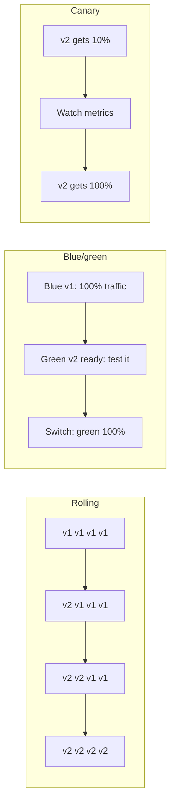
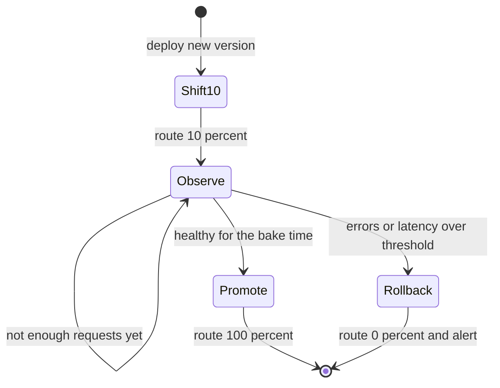

# Deployment Strategies in the Cloud

## Introduction

A **deployment strategy** decides how a new version replaces the old one: all at once, a few servers at a time, side by side with a switch, or by sending a small slice of real traffic to the new version first.

Picture a restaurant changing its menu. It can swap every dish overnight (all at once), change one table section per evening (rolling), set up a second kitchen and move all diners at once when it is ready (blue/green), or offer the new dish to one table in ten and watch their faces (canary). Each choice trades speed, cost and risk differently.

The ideas themselves are platform-neutral and covered in depth in the site's CI/CD tutorial: [blue-green](../../cicd/6-cicd-deployment-strategies/0-cicd-blue-green-deployment.mdx), [canary](../../cicd/6-cicd-deployment-strategies/1-cicd-canary-deployment.mdx), [rolling](../../cicd/6-cicd-deployment-strategies/2-cicd-rolling-deployment.mdx) and [rollback strategy](../../cicd/6-cicd-deployment-strategies/8-cicd-rollback-strategy.mdx). This page focuses on what the clouds give you **built in**:

1. A quick recap of the strategies and their trade-offs
2. Which AWS and Azure feature implements each one
3. Hands-on commands for Lambda aliases, CodeDeploy, ECS, App Service slots and Container Apps revisions
4. Automated health gates and rollback
5. The part everyone forgets: database changes

:::caution Cost warning
Blue/green and canary deployments run **two versions at once**, so you pay for extra capacity during the rollout. App Service slots need Standard tier or higher. Load balancers, target groups and alarms all bill while they exist. Use the [AWS Pricing Calculator](https://calculator.aws/) or [Azure Pricing Calculator](https://azure.microsoft.com/pricing/calculator/), and run the **Cleanup** commands when you are done.
:::

## The Strategies at a Glance



| Strategy | How it works | Extra capacity | Rollback speed | Risk exposure |
| --- | --- | --- | --- | --- |
| All at once (in place) | Replace everything immediately | None | Slow (redeploy old version) | Every user at once |
| Rolling | Replace instances in batches | Small or none | Medium | Grows batch by batch |
| Blue/green | Start a full new copy, then switch traffic | Up to double | Fast (switch back) | All users after the switch |
| Canary | Small percentage first, then the rest | Small | Fast | Small slice at first |
| Linear | Equal steps, for example 10% every minute | Small | Fast | Grows step by step |
| Feature flag (dark launch) | Deploy code switched off, enable later | None | Instant (turn flag off) | Controlled per user |

Canary and linear are really **traffic-shifting** versions of blue/green: both versions run, and the platform moves a percentage of requests between them. Feature flags separate *deploying* code from *releasing* a feature. They are covered in [Configuration and Feature Flags](./5-cloud-configuration-management.mdx).

## What Each Platform Gives You

| Platform | AWS | Azure |
| --- | --- | --- |
| Functions | Lambda **versions + aliases** with weighted routing; CodeDeploy canary/linear; SAM `DeploymentPreference` | Azure Functions **deployment slots** (on plans that support them) with swap |
| PaaS web apps | Elastic Beanstalk rolling, rolling with additional batch, immutable and traffic-splitting deployments | App Service **deployment slots**, swap, swap with preview, percentage **traffic routing** |
| Containers (managed) | ECS rolling updates with circuit breaker; ECS built-in **blue/green** (and newer linear/canary strategies); CodeDeploy blue/green for ECS | Container Apps **revisions** with traffic weights and labels |
| Kubernetes | EKS: rolling updates, plus Argo Rollouts or Flagger for canaries | AKS: the same Kubernetes tools |
| VMs | EC2 Auto Scaling **instance refresh**; CodeDeploy in-place or blue/green | VM Scale Sets rolling upgrades |
| DNS or edge level | Route 53 weighted records; CloudFront continuous deployment | Front Door or Traffic Manager weighted routing |

AWS tends to offer traffic shifting through **CodeDeploy** and service-specific features. Azure tends to put it **inside each hosting service** (slots, revisions). The idea is the same: two versions, one router, and a percentage you control.

## Lambda: Weighted Aliases

A Lambda **alias** such as `live` points at a published version. It can also send a fraction of traffic to a second version. Clients always call the alias, so you shift traffic without changing any caller. The [AWS Lambda](../4-cloud-serverless/1-cloud-aws-lambda.mdx) page explains versions and aliases.

### Manual canary with the CLI

```bash
# Publish the new code as version 7 (version 6 is currently live)
aws lambda publish-version --function-name orders-api --description "release 2026-10-11"

# Send 10% of traffic on alias 'live' to version 7
aws lambda update-alias --function-name orders-api --name live \
  --function-version 6 \
  --routing-config '{"AdditionalVersionWeights": {"7": 0.1}}'

aws lambda get-alias --function-name orders-api --name live
```

Example output:

```json
{
    "Name": "live",
    "FunctionVersion": "6",
    "RoutingConfig": {
        "AdditionalVersionWeights": {
            "7": 0.1
        }
    }
}
```

Promote by pointing the alias fully at version 7 and clearing the extra weight:

```bash
aws lambda update-alias --function-name orders-api --name live \
  --function-version 7 --routing-config '{"AdditionalVersionWeights": {}}'
```

Rollback is the same command with version 6.

### Automated canary with SAM and CodeDeploy

Doing this by hand does not scale. SAM can create the alias, a CodeDeploy application and the traffic shifting for you:

```yaml
# template.yaml (excerpt)
Resources:
  OrdersFunction:
    Type: AWS::Serverless::Function
    Properties:
      Runtime: python3.13
      Handler: app.handler
      CodeUri: src/
      AutoPublishAlias: live
      DeploymentPreference:
        Type: Canary10Percent5Minutes
        Alarms:
          - !Ref OrdersErrorsAlarm
        Hooks:
          PreTraffic: !Ref PreTrafficCheckFunction

  OrdersErrorsAlarm:
    Type: AWS::CloudWatch::Alarm
    Properties:
      Namespace: AWS/Lambda
      MetricName: Errors
      Dimensions:
        - Name: FunctionName
          Value: !Ref OrdersFunction
      Statistic: Sum
      Period: 60
      EvaluationPeriods: 1
      Threshold: 1
      ComparisonOperator: GreaterThanOrEqualToThreshold
      TreatMissingData: notBreaching
```

On every `sam deploy`, SAM publishes a new version, CodeDeploy runs the `PreTraffic` hook (a Lambda function that can call the new version and report success or failure), shifts 10% of traffic, waits five minutes while watching the alarm, then shifts the rest. If the alarm fires, CodeDeploy **rolls the alias back automatically**.

CodeDeploy's predefined Lambda configurations include `LambdaCanary10Percent5Minutes`, `LambdaCanary10Percent10Minutes`, `LambdaCanary10Percent15Minutes`, `LambdaCanary10Percent30Minutes`, `LambdaLinear10PercentEvery1Minute`, `LambdaLinear10PercentEvery2Minutes`, `LambdaLinear10PercentEvery3Minutes`, `LambdaLinear10PercentEvery10Minutes` and `LambdaAllAtOnce` (each prefixed with `CodeDeployDefault.` in the CodeDeploy API). You can also define custom ones. See [CodeDeploy deployment configurations](https://docs.aws.amazon.com/codedeploy/latest/userguide/deployment-configurations.html).

:::tip
In the alarm above, the metric is for the whole function. A better canary alarm watches the **new version** or the alias plus version (`Resource` dimension), so errors from the old version do not mask or trigger a rollback by accident.
:::

## ECS: Rolling, Circuit Breaker and Blue/Green

By default an ECS service does a **rolling update**: it starts new tasks and stops old ones within the bounds of `minimumHealthyPercent` and `maximumPercent`. Turn on the **deployment circuit breaker** so a deployment that keeps failing health checks stops and rolls back by itself:

```bash
aws ecs update-service --cluster prod --service orders \
  --task-definition orders:42 \
  --deployment-configuration \
  "minimumHealthyPercent=100,maximumPercent=200,deploymentCircuitBreaker={enable=true,rollback=true}"
```

Example output (trimmed):

```json
{
    "service": {
        "serviceName": "orders",
        "taskDefinition": "arn:aws:ecs:us-east-1:111122223333:task-definition/orders:42",
        "deploymentConfiguration": {
            "deploymentCircuitBreaker": { "enable": true, "rollback": true },
            "maximumPercent": 200,
            "minimumHealthyPercent": 100
        }
    }
}
```

ECS now also supports **built-in blue/green deployments** without CodeDeploy. ECS starts the green revision next to blue, can send **test traffic** through a separate listener rule, shifts production traffic, keeps blue running for a **bake time** so you can roll back instantly, and can call Lambda **lifecycle hooks** at each stage. It needs an Application Load Balancer, Network Load Balancer, Service Connect or VPC Lattice, with an alternate target group configured. Newer ECS versions add **linear** and **canary** strategies on the same mechanism. The setup has several moving parts, so follow the [ECS blue/green guide](https://docs.aws.amazon.com/AmazonECS/latest/developerguide/deployment-type-blue-green.html) rather than guessing parameter names. Older setups use the `CODE_DEPLOY` deployment controller instead, which still works.

## App Service: Slots and Traffic Routing

On Azure App Service, a **deployment slot** is a full live copy of your app with its own hostname. The pattern from [CI/CD with Azure DevOps and GitHub Actions](./1-cloud-ci-cd-on-azure.mdx) is blue/green: deploy to `staging`, test, swap.

You can also run a **canary** by routing a percentage of production traffic to the staging slot before swapping:

```bash
# Send 10% of production traffic to the staging slot
az webapp traffic-routing set --resource-group rg-orders-prod \
  --name orders-web-prod-123 --distribution staging=10

az webapp traffic-routing show --resource-group rg-orders-prod --name orders-web-prod-123
```

Example output:

```json
[
  {
    "actionHostName": "orders-web-prod-123-staging.azurewebsites.net",
    "name": "staging",
    "reroutePercentage": 10.0
  }
]
```

Users routed to a slot are pinned to it by a cookie (`x-ms-routing-name`) so they do not bounce between versions. When the canary looks healthy, clear the routing rule and swap:

```bash
az webapp traffic-routing clear --resource-group rg-orders-prod --name orders-web-prod-123
az webapp deployment slot swap --resource-group rg-orders-prod \
  --name orders-web-prod-123 --slot staging --target-slot production
```

Unlike CodeDeploy, App Service does **not** watch alarms and roll back on its own. Your pipeline has to check metrics (for example in Application Insights) and either swap or clear the routing. The health gate script below shows the decision logic.

## Container Apps: Revisions and Weights

Azure Container Apps creates an immutable **revision** for every change to the app's template (image, environment variables, scale rules). In **multiple revision mode** you can keep several revisions active and split traffic between them:

```bash
az containerapp revision set-mode --name orders --resource-group rg-orders-prod --mode multiple

# Deploy a new image; this creates a new revision
az containerapp update --name orders --resource-group rg-orders-prod \
  --image myregistry.azurecr.io/orders:1.8.0 --revision-suffix v180

# 90% to the old revision, 10% to the new one
az containerapp ingress traffic set --name orders --resource-group rg-orders-prod \
  --revision-weight orders--v170=90 orders--v180=10

az containerapp ingress traffic show --name orders --resource-group rg-orders-prod -o table
```

Example output:

```text
RevisionName    Weight
--------------  --------
orders--v170    90
orders--v180    10
```

Revisions can also get **labels**, which give each one a stable URL such as `orders---blue.<env-domain>`, a handy way to test the new revision before it receives any production weight. The AWS equivalent is the ECS built-in blue/green test listener. See [Azure Container Apps and Container Instances](../5-cloud-containers/3-cloud-azure-container-apps.mdx) for revision basics.

## Health Gates and Automatic Rollback

Traffic shifting is only as safe as the check that decides whether to continue. A good gate compares the **new version against the old one** over the same time window, waits for enough traffic to be meaningful, and has hard limits.



Here is the decision logic as plain Python. In a real pipeline the numbers would come from CloudWatch (`get-metric-data`) or Application Insights (a Kusto query), but the logic is the same on both clouds:

```python
# canary_gate.py
from dataclasses import dataclass

@dataclass
class WindowStats:
    requests: int
    errors: int
    p95_ms: float

    @property
    def error_rate(self) -> float:
        return self.errors / self.requests if self.requests else 0.0

def evaluate(baseline: WindowStats, canary: WindowStats,
             min_requests: int = 200,
             max_error_rate: float = 0.02,
             max_error_ratio: float = 2.0,
             max_latency_ratio: float = 1.3) -> tuple[str, str]:
    """Return (decision, reason). decision is 'wait', 'rollback' or 'promote'."""
    if canary.requests < min_requests:
        return "wait", f"only {canary.requests} canary requests, need {min_requests}"
    if canary.error_rate > max_error_rate:
        return "rollback", f"canary error rate {canary.error_rate:.2%} above {max_error_rate:.2%}"
    if baseline.error_rate > 0 and canary.error_rate > baseline.error_rate * max_error_ratio:
        return "rollback", (f"canary error rate {canary.error_rate:.2%} is more than "
                            f"{max_error_ratio}x baseline {baseline.error_rate:.2%}")
    if canary.p95_ms > baseline.p95_ms * max_latency_ratio:
        return "rollback", f"canary p95 {canary.p95_ms:.0f} ms vs baseline {baseline.p95_ms:.0f} ms"
    return "promote", "canary within all thresholds"

if __name__ == "__main__":
    baseline = WindowStats(requests=9000, errors=27, p95_ms=180)
    windows = [
        ("minute 1", WindowStats(requests=120, errors=0, p95_ms=175)),
        ("minute 5", WindowStats(requests=950, errors=4, p95_ms=190)),
        ("bad build", WindowStats(requests=980, errors=41, p95_ms=420)),
    ]
    for label, canary in windows:
        decision, reason = evaluate(baseline, canary)
        print(f"{label:10} -> {decision:8} ({reason})")
```

Output:

```text
minute 1   -> wait     (only 120 canary requests, need 200)
minute 5   -> promote  (canary within all thresholds)
bad build  -> rollback (canary error rate 4.18% above 2.00%)
```

Where to plug this in:

| Platform | Where the gate runs | What "rollback" means |
| --- | --- | --- |
| Lambda + CodeDeploy | CloudWatch alarms on the deployment, plus optional `PreTraffic`/`PostTraffic` hooks | CodeDeploy moves the alias back automatically |
| ECS built-in blue/green | CloudWatch alarms and lifecycle hook Lambdas | ECS shifts traffic back to blue |
| App Service slots | A pipeline step after `traffic-routing set` | Pipeline runs `traffic-routing clear` (before swap) or swaps back (after swap) |
| Container Apps | A pipeline step after `ingress traffic set` | Pipeline sets the old revision back to 100 |
| Kubernetes (EKS or AKS) | Argo Rollouts or Flagger analysis templates | The controller scales the canary down |

:::warning
Low-traffic services make statistics unreliable. Ten requests with one error is a 10% error rate, or just bad luck. That is why the gate waits for `min_requests`. For quiet services, send **synthetic traffic** (a smoke-test job) to the new version, or use blue/green with a thorough pre-switch test instead of a percentage canary.
:::

## Database Changes: Expand and Contract

During any strategy except all-at-once, **old and new code run at the same time against the same database**. If v2 renames a column that v1 still reads, v1 breaks the moment the migration runs, and rolling back the code will not bring the column back.

Use the **expand and contract** (parallel change) pattern:

1. **Expand**: add the new column or table. Do not remove anything. Both versions work.
2. **Deploy** code that writes to both old and new, and reads from the new one with a fallback.
3. **Backfill** existing rows.
4. **Contract**: once no running version uses the old column, remove it in a later release.

Each step is a separate, backward-compatible deployment. This applies equally to RDS, Aurora, Azure SQL, DynamoDB and Cosmos DB (where "schema" lives in your code). See [Managed Relational Databases](../7-cloud-databases/1-cloud-rds-and-azure-sql.mdx) for the database services themselves.

## Real-World Scenario

A fintech startup runs a payments API: an AWS Lambda function behind API Gateway for card authorization, and a customer dashboard on Azure App Service (the dashboard team came from an acquisition). A bad release last quarter caused 20 minutes of failed payments because the team deployed all at once and had to rebuild the old version to roll back.

### The solution

- **Payments (AWS)**: SAM with `AutoPublishAlias: live` and `DeploymentPreference: Canary10Percent10Minutes`, a `PreTraffic` hook that sends a test authorization to the new version, and CloudWatch alarms on the alias's errors and p99 latency. A bad build now affects at most a tenth of traffic for a few minutes, and rollback is automatic.
- **Dashboard (Azure)**: deploy to the `staging` slot, route 10% of traffic to it for 15 minutes, run the health gate against Application Insights metrics, then swap. Rollback is a swap back.
- **Database**: every schema change follows expand and contract, reviewed as its own pull request.

### Why this approach

- Payment failures are expensive and visible, so limiting blast radius and automating rollback is worth the extra setup.
- Both choices use the platform's native mechanism, so there is no extra infrastructure (no second load balancer, no service mesh).

### When to use it, and when not to

Canaries need **enough traffic** and **good metrics**. For an internal admin tool with 50 requests a day, a blue/green swap with a scripted smoke test is simpler and just as safe. For batch jobs or queue consumers there is no request traffic to split, so roll out per consumer or use feature flags. If a release includes a breaking API change for external clients, no traffic-shifting strategy helps: you need API versioning.

### Alternatives and trade-offs

| Approach | Pros | Cons | Best for |
| --- | --- | --- | --- |
| Rolling update (ECS, ASG, AKS default) | Simple, little extra capacity | Mixed versions during rollout; rollback is another rollout | Stateless services with good health checks |
| Blue/green (slots, ECS blue/green) | Full test before switch; instant rollback | Up to double capacity; all users switch at once | Apps with thorough pre-release tests |
| Canary or linear (CodeDeploy, weighted alias, revisions) | Small blast radius; automatic rollback on alarms | Needs traffic and metrics; more setup | High-traffic, high-risk services |
| Feature flags | Release per user without redeploying; instant off | Code complexity; flag debt | Product features and experiments |
| DNS weighted routing (Route 53, Traffic Manager) | Works across regions or clouds | DNS caching makes shifts slow and imprecise | Region migrations, large cutovers |

## Common Mistakes

- **Rolling back code but not data.** A destructive migration cannot be undone by redeploying. Use expand and contract.
- **Alarms that watch the wrong thing.** A function-wide error alarm can trigger on the old version's errors. Watch the new version specifically when you can.
- **No minimum sample size.** Promoting after one quiet minute proves nothing.
- **Forgetting sticky settings on slots.** Staging connection strings swap into production unless marked as slot settings.
- **Health checks that only return 200.** A `/health` endpoint that never touches the database will pass even when every real request fails. Check real dependencies, but keep it fast.
- **Leaving traffic splits in place.** A forgotten 10% route to an old slot or revision quietly serves stale code for weeks. Clear splits at the end of every pipeline run.

## Cleanup

```bash
# Lambda: point the alias at one version only, then delete the stack if this was a demo
aws lambda update-alias --function-name orders-api --name live \
  --function-version 7 --routing-config '{"AdditionalVersionWeights": {}}'
sam delete --stack-name orders-api-dev --no-prompts

# App Service: remove routing rules and the demo resource group
az webapp traffic-routing clear --resource-group rg-orders-prod --name orders-web-prod-123
az group delete --name rg-orders-prod --yes --no-wait

# Container Apps: return to single revision mode (or delete the app)
az containerapp revision set-mode --name orders --resource-group rg-orders-prod --mode single
```

## Summary

- Rolling, blue/green, canary and linear deployments trade **extra capacity** against **blast radius** and **rollback speed**.
- On **AWS**, traffic shifting comes from Lambda weighted aliases, CodeDeploy configurations such as `LambdaCanary10Percent5Minutes`, and ECS rolling, circuit breaker and built-in blue/green.
- On **Azure**, it lives inside each service: App Service **slots** with swap and percentage routing, and Container Apps **revisions** with weights and labels.
- CodeDeploy and ECS can **roll back automatically** on CloudWatch alarms. App Service and Container Apps rely on your pipeline to check metrics and revert.
- Gate promotions on **comparisons with the old version**, with a minimum sample size.
- Old and new code share the database during a rollout, so use **expand and contract** for schema changes.

## Further Learning

### Exercises

1. Extend `canary_gate.py` to read baseline and canary stats from a JSON file, and exit with a non-zero code on `rollback` so a pipeline step fails.
2. Change the SAM example to `Linear10PercentEvery1Minute` and write down how long a full rollout takes and how much traffic a bad build could affect.
3. On Container Apps, add labels `blue` and `green` to two revisions and test each label URL before shifting weights.
4. Plan an expand and contract migration that renames `customer_name` to `full_name` across three releases.

### Related pages

- [CI/CD on AWS](./0-cloud-ci-cd-on-aws.mdx)
- [CI/CD with Azure DevOps and GitHub Actions](./1-cloud-ci-cd-on-azure.mdx)
- [Configuration and Feature Flags](./5-cloud-configuration-management.mdx)
- [Amazon ECS and Fargate](../5-cloud-containers/2-cloud-ecs-and-fargate.mdx)
- [Alerting and Dashboards](../12-cloud-observability-and-security/3-cloud-alerting.mdx)
- Site tutorial: [Progressive delivery](../../cicd/6-cicd-deployment-strategies/7-cicd-progressive-delivery.mdx)
