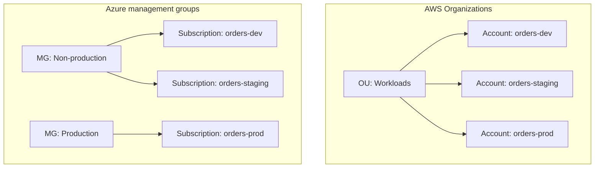
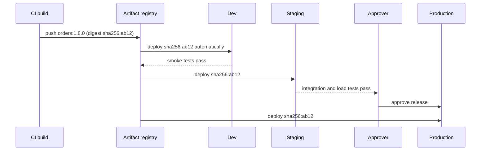

# Managing Dev, Staging and Production

## Introduction

An **environment** is a complete, separate copy of your application and its infrastructure, used for one purpose. Most teams have at least three:

- **Dev**: where developers try things. Breaking it is fine.
- **Staging** (or pre-production): as close to production as you can afford, used for final testing.
- **Production**: what customers use. Changes here are controlled and audited.

Think of a theatre. Rehearsal rooms (dev) are messy and full of experiments. The dress rehearsal (staging) uses the real stage, costumes and lighting. Opening night (production) has a paying audience, and nobody improvises with the set.

In the cloud, creating an environment is cheap and fast, which tempts teams into two opposite mistakes: environments that drift apart until staging proves nothing, or environments so loosely separated that a dev script deletes a production database. This page covers how to avoid both on AWS and Azure:

1. Choosing an **isolation boundary**: accounts, subscriptions or resource groups
2. Defining every environment from the **same infrastructure code** with different parameters
3. **Promoting** one build through the environments with approvals
4. Keeping non-production **cheap** without making it useless
5. Handling **data** safely

General background lives in the site's [environment management](../../cicd/3-cicd-practices/8-cicd-environment-management.mdx) and [environment parity](../../cicd/8-cicd-best-practices/5-cicd-environment-parity.mdx) pages.

:::caution Cost warning
Every environment is a full set of running resources. Three environments can cost close to three times one environment if you size them all like production. The commands on this page create resource groups, accounts or subscriptions. Set budgets per environment (see [Budgets and Billing Alerts](../1-cloud-getting-started/7-cloud-budgets-and-alerts.mdx)) and delete practice resources when you finish.
:::

## Step 1: Choose an Isolation Boundary

The most important decision is **what separates one environment from another**. The stronger the boundary, the harder it is for a mistake in dev to touch prod.



| Boundary | AWS | Azure | Isolation strength |
| --- | --- | --- | --- |
| Separate account / subscription per environment | One AWS **account** per environment in AWS Organizations | One **subscription** per environment under management groups | Strong: separate IAM/RBAC, quotas, billing, blast radius |
| Shared account, separate network | One account, a VPC per environment | One subscription, a VNet per environment | Medium: IAM policies must be very careful |
| Shared account, naming and tags only | Resources named `orders-dev-*` | A **resource group** per environment | Weak for AWS; reasonable on Azure for small teams |
| Shared cluster, separate namespaces | EKS namespaces | AKS namespaces | Weak: shared control plane and nodes |

Both clouds recommend **separate accounts or subscriptions for production** as the default for anything serious. Why:

- **Permissions**: developers can be administrators in the dev account and read-only in prod, with no complicated policy conditions.
- **Blast radius**: a runaway script, a leaked credential or a bad `terraform destroy` can only touch one environment.
- **Quotas**: a load test in staging cannot use up the production account's Lambda concurrency or vCPU quota.
- **Billing**: costs per environment show up automatically, without perfect tagging.
- **Policy**: you can attach stricter service control policies (AWS) or Azure Policy assignments to production only.

Azure has one extra level that AWS lacks: **resource groups**. They are a real lifecycle and RBAC boundary, so "one subscription, one resource group per environment" is a reasonable starting point for small Azure projects. On AWS, a single account has no equivalent container, so separating environments inside one account relies on naming, tags and careful IAM conditions.

Account structure is covered in [Organizing Resources](../1-cloud-getting-started/5-cloud-resource-organization.mdx) and [Multi-Account and Landing Zone Strategy](../2-cloud-identity/7-cloud-multi-account-strategy.mdx).

### On AWS

```bash
# Run from the Organizations management account (or with delegated permissions)
aws organizations create-account \
  --email orders-staging@example.com \
  --account-name orders-staging

aws organizations list-accounts \
  --query "Accounts[?starts_with(Name, 'orders')].[Name,Id,Status]" --output table
```

Example output:

```text
-------------------------------------------------
|                 ListAccounts                  |
+-----------------+----------------+------------+
|  orders-dev     |  111111111111  |  ACTIVE    |
|  orders-staging |  222222222222  |  ACTIVE    |
|  orders-prod    |  333333333333  |  ACTIVE    |
+-----------------+----------------+------------+
```

Larger organizations usually create accounts through **AWS Control Tower** account factory so guardrails, logging and SSO access are applied automatically. People reach each account through **IAM Identity Center** permission sets, never through IAM users per account.

### On Azure

```bash
# Subscriptions are usually created by a billing admin or through a subscription vending process.
# Once they exist, place them under management groups:
az account management-group create --name mg-nonprod
az account management-group create --name mg-prod
az account management-group subscription add --name mg-prod --subscription "orders-prod"

az account list --query "[?starts_with(name, 'orders')].{name:name, id:id, state:state}" -o table
```

Example output:

```text
Name            Id                                    State
--------------  ------------------------------------  -------
orders-dev      aaaaaaaa-0000-0000-0000-000000000001  Enabled
orders-staging  aaaaaaaa-0000-0000-0000-000000000002  Enabled
orders-prod     aaaaaaaa-0000-0000-0000-000000000003  Enabled
```

Creating subscriptions programmatically depends on your billing agreement type, so check the [subscription creation docs](https://learn.microsoft.com/en-us/azure/cost-management-billing/manage/create-subscription) for your account. Azure **landing zones** play the role of Control Tower.

## Step 2: One Codebase, Many Parameter Files

Every environment should be built from **the same infrastructure code**. Only the parameters differ: instance sizes, counts, retention periods, domain names. If staging is built by hand and prod by Terraform, staging tests nothing.

Decide which differences are **allowed**. A small model of that decision, in plain Python:

```python
# env_matrix.py
BASE = {
    "instance_size": "small",
    "min_instances": 1,
    "max_instances": 2,
    "deletion_protection": False,
    "log_retention_days": 7,
    "backups": False,
}

OVERRIDES = {
    "dev": {},
    "staging": {"max_instances": 4, "log_retention_days": 30, "backups": True},
    "prod": {
        "instance_size": "large",
        "min_instances": 3,
        "max_instances": 20,
        "deletion_protection": True,
        "log_retention_days": 365,
        "backups": True,
    },
}

def settings_for(env: str) -> dict:
    if env not in OVERRIDES:
        raise ValueError(f"unknown environment: {env}")
    return {**BASE, **OVERRIDES[env]}

def check_guardrails(env: str, s: dict) -> list[str]:
    problems = []
    if env == "prod":
        if not s["deletion_protection"]:
            problems.append("prod must have deletion protection")
        if s["min_instances"] < 2:
            problems.append("prod needs at least 2 instances for availability")
        if not s["backups"]:
            problems.append("prod must have backups enabled")
    return problems

if __name__ == "__main__":
    keys = list(BASE)
    print(f"{'setting':22}" + "".join(f"{e:>10}" for e in OVERRIDES))
    for k in keys:
        print(f"{k:22}" + "".join(f"{str(settings_for(e)[k]):>10}" for e in OVERRIDES))
    for env in OVERRIDES:
        issues = check_guardrails(env, settings_for(env))
        print(f"{env}: {'OK' if not issues else issues}")
    print(check_guardrails("prod", {**settings_for("prod"), "min_instances": 1}))
```

Output:

```text
setting                      dev   staging      prod
instance_size              small     small     large
min_instances                  1         1         3
max_instances                  2         4        20
deletion_protection        False     False      True
log_retention_days             7        30       365
backups                    False      True      True
dev: OK
staging: OK
prod: OK
['prod needs at least 2 instances for availability']
```

The table makes differences **visible and reviewable**, and the guardrail check catches a risky production change before it ships. Each IaC tool expresses the same idea in its own way.

### Terraform (both clouds)

```hcl
# variables.tf
variable "environment" {
  type = string
  validation {
    condition     = contains(["dev", "staging", "prod"], var.environment)
    error_message = "environment must be dev, staging or prod"
  }
}
variable "min_instances" { type = number }
variable "max_instances" { type = number }
variable "log_retention_days" { type = number }
```

```hcl
# envs/prod.tfvars
environment        = "prod"
min_instances      = 3
max_instances      = 20
log_retention_days = 365
```

```bash
# Each environment has its own state, in its own account or subscription
terraform init -backend-config=envs/prod.backend.hcl
terraform plan -var-file=envs/prod.tfvars -out=prod.plan
terraform apply prod.plan
```

Keep **state separate per environment**, ideally in a backend that lives in that environment's account or subscription. Many teams prefer a directory per environment calling shared modules over Terraform workspaces, because each directory has explicit backend settings and cannot be applied to the wrong environment by forgetting to switch workspaces. See [Terraform for AWS and Azure](../10-cloud-infrastructure-as-code/4-cloud-terraform-multi-cloud.mdx).

### Bicep (Azure)

Bicep uses `.bicepparam` files that point at the template they parameterize:

```bicep
// prod.bicepparam
using './main.bicep'

param environmentName = 'prod'
param appServiceSku = 'P1v3'
param minInstances = 3
param logRetentionDays = 365
```

```bash
az deployment group create \
  --resource-group rg-orders-prod \
  --parameters prod.bicepparam \
  --what-if
```

`--what-if` shows the planned changes without applying them, like `terraform plan`. See [Azure Bicep and ARM Templates](../10-cloud-infrastructure-as-code/3-cloud-bicep-and-arm.mdx).

### AWS CDK (AWS)

In the CDK, an environment is usually a **Stage** instantiated once per account:

```python
# app.py (excerpt)
import aws_cdk as cdk
from orders.orders_stage import OrdersStage

app = cdk.App()
OrdersStage(app, "Dev",
            env=cdk.Environment(account="111111111111", region="us-east-1"),
            min_instances=1, log_retention_days=7)
OrdersStage(app, "Prod",
            env=cdk.Environment(account="333333333333", region="us-east-1"),
            min_instances=3, log_retention_days=365)
app.synth()
```

CloudFormation itself uses one template with a parameters file per environment. See [AWS CDK](../10-cloud-infrastructure-as-code/2-cloud-aws-cdk.mdx).

## Step 3: Promote One Build Through the Environments

The core rule: **build once, deploy many times**. The artifact (zip, container image digest, SAM package) produced by CI is the one that moves to staging and then production. Only configuration changes between environments.



Each CI system has a concept for an environment with gates:

| Tool | Environment object | Typical gates |
| --- | --- | --- |
| GitHub Actions | Repository **environments** | Required reviewers, wait timer, allowed branches and tags, environment-scoped secrets and variables |
| Azure Pipelines | Pipelines **environments** | Approvals, business hours, invoke Azure Function or REST API, query Azure Monitor alerts, exclusive lock |
| AWS CodePipeline | **Stages** with actions | Manual approval action, V2 stage conditions (for example, fail on CloudWatch alarm), cross-account deploy roles |

### On AWS

A GitHub Actions job per environment, each assuming a role in a **different account**:

```yaml
  deploy-staging:
    needs: build
    runs-on: ubuntu-latest
    environment: staging
    steps:
      - uses: aws-actions/configure-aws-credentials@v6
        with:
          role-to-assume: ${{ vars.AWS_DEPLOY_ROLE_ARN }}   # role in 222222222222
          aws-region: us-east-1
      - run: ./deploy.sh staging "${{ needs.build.outputs.image_digest }}"

  deploy-prod:
    needs: deploy-staging
    runs-on: ubuntu-latest
    environment: prod   # required reviewers configured on this environment
    steps:
      - uses: aws-actions/configure-aws-credentials@v6
        with:
          role-to-assume: ${{ vars.AWS_DEPLOY_ROLE_ARN }}   # role in 333333333333
          aws-region: us-east-1
      - run: ./deploy.sh prod "${{ needs.build.outputs.image_digest }}"
```

Because `vars.AWS_DEPLOY_ROLE_ARN` is defined **per environment**, the same expression resolves to the staging role in one job and the prod role in the other. The prod role's trust policy only accepts tokens whose subject ends in `:environment:prod`.

### On Azure

The pattern is identical with `azure/login` and a client ID per environment, or in Azure Pipelines with one service connection per subscription and a `deployment` job per environment. The full YAML is on [CI/CD with Azure DevOps and GitHub Actions](./1-cloud-ci-cd-on-azure.mdx).

:::tip Deploy by digest, not tag
Container tags such as `latest` or even `1.8.0` can be overwritten. Promote the **image digest** (`sha256:...`) so every environment provably runs the same bytes. Both ECR and ACR can also be set to make tags immutable.
:::

## Step 4: Keep Non-Production Cheap but Useful

Staging should match production in **shape** (same services, same topology, same IaC) but not necessarily in **size**.

| Technique | AWS | Azure | Trade-off |
| --- | --- | --- | --- |
| Smaller sizes | Smaller instance types, fewer tasks, lower Aurora capacity | Lower App Service SKU, fewer replicas | Performance tests are less realistic |
| Scale to zero at night | Scheduled scaling for ECS or ASGs; Instance Scheduler | VM auto-shutdown; Container Apps scale to zero; scheduled scaling | Morning warm-up time |
| Serverless by default | Lambda, Fargate, Aurora Serverless v2, DynamoDB on-demand | Functions, Container Apps, Azure SQL serverless | Different behavior from provisioned prod |
| Ephemeral environments | A stack per pull request, deleted on merge | A resource group per pull request, deleted on merge | Needs fully automated IaC |
| Shorter retention | Logs 7 days, fewer backups | Same | Less history for debugging |

Examples of scheduled shutdown:

```bash
# Azure: shut a dev VM down every evening at 19:00 UTC
az vm auto-shutdown --resource-group rg-orders-dev --name vm-dev-tools --time 1900

# AWS: scale a dev ECS service to zero tasks (run from a scheduled job or EventBridge Scheduler)
aws ecs update-service --cluster dev --service orders --desired-count 0
```

**Ephemeral preview environments** are worth calling out. A pipeline creates a full, isolated copy of the app for each pull request (`orders-pr-123`), posts its URL on the PR, and destroys it when the PR closes. Reviewers test real behavior, and you pay only while the PR is open. This only works if your IaC creates *everything* without manual steps, which is a healthy pressure on its own.

:::warning
Ephemeral environments that fail to delete become permanent bills. Tag them with the PR number and creation time, and run a nightly cleanup job that deletes anything older than a few days. See [Tagging Strategies](../1-cloud-getting-started/6-cloud-tagging.mdx).
:::

## Step 5: Data in Non-Production

- **Never copy raw production data into dev.** It usually contains personal data, and dev environments have weaker access controls. Use synthetic data, or a masked and subsetted copy produced by an automated, reviewed job.
- **Staging data** should be realistic in volume and shape so performance and migrations are tested properly. Database snapshots can be restored into the staging account after masking.
- **Secrets and endpoints differ per environment**: each environment has its own database credentials, API keys and vault. Covered in [Secrets Management](./4-cloud-secrets-management.mdx).
- **Third-party services**: use sandbox or test modes (payment providers, email services) in dev and staging so a test run never charges a real card or emails a real customer.

## Real-World Scenario

A five-person startup sells scheduling software for clinics. Everything runs in **one AWS account** (and a small Azure subscription for a reporting tool). Last week a developer ran a database migration script against the wrong connection string and deleted a production table. Recovery from backup took four hours.

### The solution

1. Create an AWS Organization with three accounts, `sched-dev`, `sched-staging` and `sched-prod`, through Control Tower, and three Azure subscriptions under `mg-nonprod` and `mg-prod`.
2. Give developers administrator access in dev, deploy-and-read in staging, and **read-only** in prod through IAM Identity Center and Entra ID groups. Production changes happen only through the pipeline.
3. Refactor infrastructure into Terraform modules with `envs/dev.tfvars`, `envs/staging.tfvars` and `envs/prod.tfvars`, and a separate state backend in each account or subscription.
4. Promote the same container image digest through dev, staging and prod, with a required reviewer on the prod GitHub environment.
5. Staging runs one task per service and scales to zero overnight. Prod runs at least three tasks across availability zones.

### Why this approach

- The mistake that caused the outage (a dev credential reaching prod) becomes impossible, not just unlikely.
- Same code, different parameters means staging failures predict production failures.
- Costs per environment show up on separate bills, so the team can see that non-production is a fraction of production.

### When to use it, and when not to

Separate accounts and subscriptions add some overhead: cross-account roles, more networking, more places to set budgets. A solo developer with a hobby project can reasonably use **resource groups on Azure** or a **single non-production account plus a production account** on AWS. Once real customer data or revenue is involved, isolate production.

### Alternatives and trade-offs

| Approach | Pros | Cons | Best for |
| --- | --- | --- | --- |
| Account or subscription per environment | Strongest isolation, clean billing, simple IAM | More accounts to manage; cross-account setup | Any production workload |
| Two accounts: non-prod and prod | Isolates prod with less overhead | Dev and staging can interfere | Small teams |
| Resource group per environment (Azure) | Simple, real RBAC boundary | Shared quotas and subscription-level policies | Small Azure projects |
| Naming and tags in one AWS account | Quick to start | Weak isolation; IAM conditions get complex | Prototypes only |
| Namespaces in one Kubernetes cluster | Cheap, fast | Shared nodes and control plane; noisy neighbors | Dev and preview environments |
| Ephemeral per-PR environments | Realistic review, pay only while open | Needs mature IaC and cleanup | Teams with full automation |

## Common Mistakes

- **Configuration drift.** Someone "quickly fixes" staging in the console. Run plans regularly and treat any drift as a bug.
- **Rebuilding per environment.** Different builds mean production runs untested code.
- **Shared credentials across environments.** One leaked staging key should not unlock prod.
- **Staging that is too different.** No load balancer, no TLS, no private networking in staging means those problems first appear in production.
- **Staging that is identical in size.** It doubles your bill without proportionate benefit. Match the shape, scale down the size.
- **No owner for ephemeral resources.** Untagged leftovers accumulate silently.

## Cleanup

```bash
# Azure practice resources
az group delete --name rg-orders-dev --yes --no-wait
az group delete --name rg-orders-staging --yes --no-wait

# Terraform-managed environments: destroy non-production first
terraform plan -destroy -var-file=envs/dev.tfvars -out=destroy.plan
terraform apply destroy.plan
```

Closing an AWS account or cancelling an Azure subscription has waiting periods and billing implications. Read the [AWS account closure](https://docs.aws.amazon.com/organizations/latest/userguide/orgs_manage_accounts_close.html) and [Azure subscription cancellation](https://learn.microsoft.com/en-us/azure/cost-management-billing/manage/cancel-azure-subscription) docs before you do either.

## Summary

- Use **separate AWS accounts or Azure subscriptions** for production at minimum. Azure resource groups are a lighter, reasonable boundary for small projects.
- Build every environment from the **same IaC** with per-environment parameter files (`.tfvars`, `.bicepparam`, CDK stages) and separate state.
- **Build once, promote the same artifact** (by digest) through dev, staging and prod, gated by environment approvals.
- Keep non-production **the same shape, smaller in size**, and scale it down when idle. Consider ephemeral per-PR environments.
- Never copy raw production data into lower environments, and give each environment its own secrets.

## Further Learning

### Exercises

1. Add a guardrail to `env_matrix.py` that rejects `log_retention_days` below 90 in prod, and run it in CI before `terraform plan`.
2. Write `envs/staging.tfvars` and `envs/staging.backend.hcl` for a module of your choice, with state stored in the staging account or subscription.
3. Configure a GitHub environment called `prod` with a required reviewer and a deployment branch rule that allows only `main`.
4. Design an ephemeral environment workflow: what creates it, how it is named and tagged, and what deletes it if the PR is abandoned.

### Related pages

- [Organizing Resources: Accounts, Subscriptions and Resource Groups](../1-cloud-getting-started/5-cloud-resource-organization.mdx)
- [Multi-Account and Landing Zone Strategy](../2-cloud-identity/7-cloud-multi-account-strategy.mdx)
- [Choosing an IaC Tool](../10-cloud-infrastructure-as-code/5-cloud-choosing-iac-tool.mdx)
- [Secrets Management: Secrets Manager and Key Vault](./4-cloud-secrets-management.mdx)
- [Project: Multi-Environment Infrastructure as Code](../14-cloud-projects/5-cloud-project-multi-env-iac.mdx)
- [Cost Optimization and FinOps](../13-cloud-architecture/4-cloud-cost-optimization.mdx)
