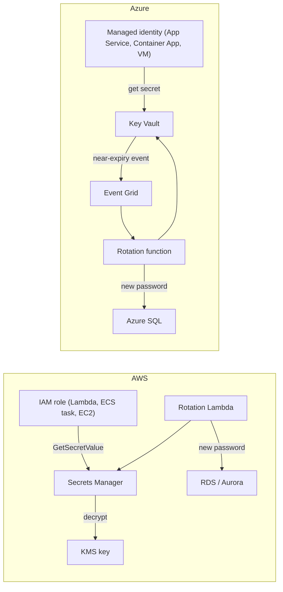

# Secrets Management: Secrets Manager and Key Vault

## Introduction

A **secret** is any value that grants access to something: a database password, an API key for a payment provider, a TLS private key, a signing key for tokens. If someone outside your team reads it, they can act as your application.

Secrets are hard because applications **need** them at runtime, and every place you put one (source code, a config file, a CI variable, an environment variable, a log line) is another place it can leak. A **secrets manager** is a locked, audited safe that hands each secret only to identities that are allowed to have it, keeps old versions, and can change the combination on a schedule.

Picture a hotel. Guests do not get a master key taped to the room door (a password in the code). The front desk (the secrets manager) checks who you are (identity), gives you a key card that only opens your room (least privilege), logs every card it issues (audit), and can re-key the locks without anyone moving out (rotation).

This page covers:

1. What belongs in a secrets store, and what does not
2. **AWS Secrets Manager**, **Systems Manager Parameter Store** and **Azure Key Vault** side by side
3. Creating and reading secrets with the CLI and Python SDKs
4. Injecting secrets into Lambda, ECS, App Service, Container Apps and CI pipelines
5. Rotation, and when you can avoid having a secret at all

For the general CI/CD view of secrets, see the site's [secret management](../../cicd/8-cicd-best-practices/4-cicd-secret-management.mdx) page.

:::caution Cost warning
Secrets stores are inexpensive but not free. Secrets Manager bills **per secret per month plus per API call**. Key Vault bills **per operation** (transactions), with extra charges for HSM-protected keys and certificate features. Parameter Store standard parameters are cheap, while advanced parameters and higher throughput are billed. Rates vary by region and change over time, so check the [AWS Pricing Calculator](https://calculator.aws/) and [Azure Pricing Calculator](https://azure.microsoft.com/pricing/calculator/). Run the **Cleanup** section when you finish.
:::

## Secrets vs Configuration

Not every setting is a secret. Putting everything in a vault makes it slow and noisy. Putting secrets in plain config leaks them.

| Value | Secret? | Where it belongs |
| --- | --- | --- |
| Database password, API key, OAuth client secret | Yes | Secrets Manager or Key Vault |
| TLS private key and certificate | Yes | Key Vault certificates, ACM (AWS), or a secrets store |
| Encryption key material | Yes, but special | KMS or Key Vault keys (never exported). See [Encryption and KMS](../12-cloud-observability-and-security/5-cloud-encryption-and-kms.mdx) |
| Database hostname, queue URL, bucket name | No | Environment variables or a config service |
| Feature flags, timeouts, page sizes | No | Config service. See [Configuration and Feature Flags](./5-cloud-configuration-management.mdx) |
| Application Insights connection string | Generally not treated as a secret by Microsoft | App settings |

## The Services Compared

| Feature | AWS Secrets Manager | AWS SSM Parameter Store (SecureString) | Azure Key Vault |
| --- | --- | --- | --- |
| Stores | Secrets (text or JSON) | Parameters, optionally KMS-encrypted | Secrets, keys and certificates |
| Built-in rotation | Yes, with rotation Lambdas and managed rotation for some services | No | Keys and certificates have rotation policies; secrets use event-driven rotation you build |
| Versioning | Yes, with staging labels (`AWSCURRENT`, `AWSPREVIOUS`) | Yes, numeric versions and labels | Yes, every update creates a version |
| Access control | IAM policies plus resource policies | IAM policies | **Azure RBAC** (default for new vaults) or legacy access policies |
| Cross-account or cross-tenant | Resource policies | Limited (advanced parameters can be shared) | RBAC on the vault for identities in the tenant |
| Audit | CloudTrail | CloudTrail | Azure Monitor diagnostic logs and Activity Log |
| Deletion safety | Recovery window before deletion | Immediate | Soft delete (always on) and optional purge protection |
| Billing model | Per secret per month plus API calls | Standard tier low cost; advanced tier per parameter | Per operation; premium tier for HSM-backed keys |

A common AWS pattern is **Secrets Manager for credentials that need rotation** and **Parameter Store for plain config and simple encrypted values**. On Azure, **Key Vault holds secrets, keys and certificates**, and **App Configuration** holds non-secret settings with references into Key Vault.



The key point in both clouds: **the workload's identity** (an IAM role or a managed identity) is what unlocks the secret. You never need a "secret to get the secret". See [Workload Identity: Instance Roles and Managed Identities](../2-cloud-identity/4-cloud-workload-identity.mdx).

## Creating and Reading Secrets

### On AWS

```bash
# Store a JSON secret (in real use, generate the password; don't type it in shell history)
aws secretsmanager create-secret \
  --name orders/dev/db \
  --description "orders-api dev database credentials" \
  --secret-string '{"username":"orders_app","password":"CHANGE-ME-generated"}'

# Or let AWS generate a strong password for you
aws secretsmanager get-random-password --password-length 32 \
  --exclude-punctuation --query RandomPassword --output text
```

Example output from `create-secret`:

```json
{
    "ARN": "arn:aws:secretsmanager:us-east-1:111122223333:secret:orders/dev/db-AbCdEf",
    "Name": "orders/dev/db",
    "VersionId": "a1b2c3d4-5678-90ab-cdef-EXAMPLE11111"
}
```

Notice the random six-character suffix (`-AbCdEf`) on the ARN. IAM policies that name a specific secret should use `orders/dev/db-*` or the full ARN.

Reading from Python with `boto3`, using whatever role the code runs under:

```python
# aws_secret.py
import json
import boto3

client = boto3.client("secretsmanager", region_name="us-east-1")

def get_db_credentials(secret_id: str) -> dict:
    response = client.get_secret_value(SecretId=secret_id)
    return json.loads(response["SecretString"])

if __name__ == "__main__":
    creds = get_db_credentials("orders/dev/db")
    print("user:", creds["username"])
    print("password length:", len(creds["password"]))
```

Example output:

```text
user: orders_app
password length: 32
```

The role needs only `secretsmanager:GetSecretValue` on that secret (and `kms:Decrypt` if you use a customer managed KMS key):

```json
{
  "Version": "2012-10-17",
  "Statement": [
    {
      "Effect": "Allow",
      "Action": "secretsmanager:GetSecretValue",
      "Resource": "arn:aws:secretsmanager:us-east-1:111122223333:secret:orders/dev/db-*"
    }
  ]
}
```

For simple values, Parameter Store works the same way:

```bash
aws ssm put-parameter --name /orders/dev/stripe-api-key \
  --type SecureString --value "sk_test_EXAMPLE"
aws ssm get-parameter --name /orders/dev/stripe-api-key --with-decryption \
  --query Parameter.Value --output text
```

### On Azure

Create a vault with **Azure RBAC** authorization (the default model for new vaults in recent API versions; passing the flag makes it explicit), then grant roles:

```bash
RG=rg-orders-dev
KV=kv-orders-dev-123          # globally unique, 3-24 characters

az keyvault create --name "$KV" --resource-group "$RG" --location eastus \
  --enable-rbac-authorization true

# You (the operator) can manage secrets
az role assignment create --role "Key Vault Secrets Officer" \
  --assignee "$(az ad signed-in-user show --query id -o tsv)" \
  --scope "$(az keyvault show --name $KV --query id -o tsv)"

az keyvault secret set --vault-name "$KV" --name db-password --value "CHANGE-ME-generated"
```

Example output from `secret set` (trimmed):

```json
{
  "attributes": { "enabled": true, "recoveryLevel": "Recoverable+Purgeable" },
  "id": "https://kv-orders-dev-123.vault.azure.net/secrets/db-password/7f3c9e0d1b2a4c5d8e9f0a1b2c3d4e5f",
  "name": "db-password",
  "value": "CHANGE-ME-generated"
}
```

Notice that `secret set` **prints the value back**. In scripts, add `--output none` so it does not end up in CI logs.

The application's managed identity only needs the read role, **Key Vault Secrets User**:

```bash
APP_PRINCIPAL_ID=$(az webapp identity assign --name orders-web-dev-123 \
  --resource-group "$RG" --query principalId -o tsv)

az role assignment create --role "Key Vault Secrets User" \
  --assignee-object-id "$APP_PRINCIPAL_ID" --assignee-principal-type ServicePrincipal \
  --scope "$(az keyvault show --name $KV --query id -o tsv)"
```

Reading from Python with `azure-identity` and `azure-keyvault-secrets`:

```python
# azure_secret.py
import os
from azure.identity import DefaultAzureCredential
from azure.keyvault.secrets import SecretClient

vault_url = os.environ["KEY_VAULT_URL"]  # e.g. https://kv-orders-dev-123.vault.azure.net
client = SecretClient(vault_url=vault_url, credential=DefaultAzureCredential())

if __name__ == "__main__":
    secret = client.get_secret("db-password")
    print("name:", secret.name)
    print("version:", secret.properties.version)
    print("value length:", len(secret.value))
```

Example output:

```text
name: db-password
version: 7f3c9e0d1b2a4c5d8e9f0a1b2c3d4e5f
value length: 19
```

`DefaultAzureCredential` uses your `az login` session on a laptop and the **managed identity** when deployed, so the same code works in both places without any credentials in configuration.

:::note Key Vault access model
Key Vault has two permission models: **Azure RBAC** and the older **vault access policies**. Microsoft recommends RBAC, and it is the default for new vaults created with API version 2026-02-01 or later. Switching an existing vault from access policies to RBAC invalidates the old policies, so assign the RBAC roles first. Microsoft also recommends **one vault per application per environment**. See the [Key Vault RBAC guide](https://learn.microsoft.com/en-us/azure/key-vault/general/rbac-guide).
:::

## Caching: Do Not Call the Vault on Every Request

Fetching a secret on every request adds latency, costs money (both clouds bill per call or per operation) and can hit throttling limits. Fetching it once at startup means a rotated secret is never picked up. The usual answer is a **short-lived cache** that refreshes periodically and can be invalidated after an authentication failure.

```python
# secret_cache.py
import time
from typing import Callable

class SecretCache:
    """Cache secret values for a short time so we don't call the vault on every request."""

    def __init__(self, fetch: Callable[[str], str], ttl_seconds: float = 300,
                 clock: Callable[[], float] = time.monotonic):
        self._fetch = fetch
        self._ttl = ttl_seconds
        self._clock = clock
        self._items: dict[str, tuple[str, float]] = {}

    def get(self, name: str) -> str:
        now = self._clock()
        cached = self._items.get(name)
        if cached and now - cached[1] < self._ttl:
            return cached[0]
        value = self._fetch(name)
        self._items[name] = (value, now)
        return value

    def invalidate(self, name: str) -> None:
        """Call this after an auth failure: the secret may have been rotated."""
        self._items.pop(name, None)

if __name__ == "__main__":
    vault = {"orders/db-password": "v1-s3cret"}
    calls = []

    def fake_fetch(name: str) -> str:
        calls.append(name)
        return vault[name]

    fake_now = [0.0]
    cache = SecretCache(fake_fetch, ttl_seconds=300, clock=lambda: fake_now[0])

    cache.get("orders/db-password")
    cache.get("orders/db-password")
    print("vault calls after 2 reads:", len(calls))

    vault["orders/db-password"] = "v2-rotated"    # rotation happens
    fake_now[0] = 120
    print("at t=120s:", cache.get("orders/db-password"))
    fake_now[0] = 301
    print("at t=301s:", cache.get("orders/db-password"))

    vault["orders/db-password"] = "v3-rotated"
    cache.invalidate("orders/db-password")      # e.g. after a login failure
    print("after invalidate:", cache.get("orders/db-password"))
    print("total vault calls:", len(calls))
```

Output:

```text
vault calls after 2 reads: 1
at t=120s: v1-s3cret
at t=301s: v2-rotated
after invalidate: v3-rotated
total vault calls: 3
```

In production you would plug in the real fetch function (`get_db_credentials` or `client.get_secret(name).value`). You often do not need to write this yourself: AWS publishes caching clients for Secrets Manager and the **AWS Parameters and Secrets Lambda Extension**, and App Service resolves Key Vault references for you (next section).

## Injecting Secrets into Platforms

Most platforms can fetch secrets **for** your app, so your code only reads an environment variable.

| Platform | How secrets get in | Notes |
| --- | --- | --- |
| AWS Lambda | AWS Parameters and Secrets Lambda Extension (local HTTP cache), or SDK calls | Avoid plain environment variables for secrets: anyone with `lambda:GetFunctionConfiguration` can read them |
| Amazon ECS | Task definition `secrets` with `valueFrom` pointing at Secrets Manager or Parameter Store | Resolved at task start; restart tasks to pick up rotations |
| AWS CodeBuild | `env.secrets-manager` and `env.parameter-store` in `buildspec.yml` | Values are masked in build logs if printed exactly as stored |
| App Service and Functions | **Key Vault references** in app settings | Uses the app's managed identity; refreshed periodically |
| Container Apps | Secrets with `keyvaultref:` plus `secretref:` environment variables | Uses a managed identity |
| Azure Pipelines | `AzureKeyVault@2` task or a variable group linked to Key Vault | Through a WIF service connection |
| GitHub Actions | Log in with OIDC, then read from the vault in a step | Avoid copying cloud secrets into GitHub secrets |

### On AWS: an ECS task definition

```json
{
  "family": "orders-api",
  "executionRoleArn": "arn:aws:iam::111122223333:role/orders-task-execution",
  "containerDefinitions": [
    {
      "name": "api",
      "image": "111122223333.dkr.ecr.us-east-1.amazonaws.com/orders@sha256:ab12",
      "environment": [
        { "name": "DB_HOST", "value": "orders-dev.cluster-abc.us-east-1.rds.amazonaws.com" }
      ],
      "secrets": [
        {
          "name": "DB_PASSWORD",
          "valueFrom": "arn:aws:secretsmanager:us-east-1:111122223333:secret:orders/dev/db-AbCdEf:password::"
        }
      ]
    }
  ]
}
```

The `:password::` suffix selects the `password` key from the JSON secret. The **task execution role** (not the task role) needs permission to read the secret, because ECS fetches it before your container starts.

### On Azure: App Service Key Vault references

```bash
az webapp config appsettings set --name orders-web-dev-123 --resource-group "$RG" \
  --settings "DB_PASSWORD=@Microsoft.KeyVault(VaultName=$KV;SecretName=db-password)" \
  --output none
```

Your app reads `DB_PASSWORD` like any environment variable. App Service resolves the reference with the app's managed identity. When no version is specified, it picks up new versions within about a day (App Service caches references and refetches them periodically), and any configuration change triggers an immediate refetch. If a reference cannot be resolved, the app sees the literal `@Microsoft.KeyVault(...)` string, so check the reference status in the portal when something fails.

For Container Apps the idea is the same:

```bash
az containerapp secret set --name orders --resource-group "$RG" \
  --secrets "db-password=keyvaultref:https://$KV.vault.azure.net/secrets/db-password,identityref:$IDENTITY_ID"
az containerapp update --name orders --resource-group "$RG" \
  --set-env-vars "DB_PASSWORD=secretref:db-password"
```

## Rotation, and Avoiding Secrets Entirely

**Rotation** limits the damage of a leak: a stolen password stops working after the next rotation.

- **Secrets Manager** can rotate on a schedule with a rotation Lambda function. For RDS and Aurora you can let RDS manage the master password in Secrets Manager (`--manage-master-user-password`), including rotation, so you never see it. Rotation uses staging labels: the new value becomes `AWSCURRENT` and the old one `AWSPREVIOUS`, which is why apps should re-read the secret after an authentication failure.
- **Key Vault** has rotation policies for **keys** and auto-renewal for **certificates**. For **secrets**, you set an expiry date, subscribe to the `SecretNearExpiry` event through Event Grid, and run a function that creates a new credential and stores a new version.

The best secret, though, is the one that does not exist. Many services accept identity-based authentication:

| Instead of a password for... | On AWS | On Azure |
| --- | --- | --- |
| Database | RDS/Aurora IAM database authentication | Microsoft Entra authentication for Azure SQL, PostgreSQL and MySQL |
| Storage | IAM role on S3 | Managed identity with a Storage Blob Data role |
| Queues and events | IAM role on SQS, SNS, EventBridge | Managed identity on Service Bus, Event Hubs |
| Container registry | Task or node role for ECR | Managed identity with `AcrPull` |
| CI/CD to cloud | OIDC role | Workload identity federation |

Remaining secrets are usually **third-party API keys** (payment providers, email services) and legacy systems.

## Real-World Scenario

An e-commerce team runs its checkout service on ECS Fargate (AWS) and its customer-support portal on App Service (Azure). A security review found the Stripe API key and database passwords in a `.env` file committed two years ago, copied into GitHub secrets, and visible in plain text in the ECS task definition's environment variables.

### The solution

1. **Rotate everything first.** Anything that was in Git history is compromised, no matter how old.
2. **Checkout (AWS)**: move the Aurora master password to RDS-managed Secrets Manager rotation. Switch the app to **IAM database authentication** where the driver supports it. Store the Stripe key in Secrets Manager and inject it with the task definition `secrets` block. Scope the execution role to those two secret ARNs.
3. **Portal (Azure)**: create `kv-portal-prod`, give the App Service managed identity **Key Vault Secrets User**, and replace plain app settings with Key Vault references. Use Entra authentication to Azure SQL instead of a SQL password.
4. **CI**: delete the cloud credentials from GitHub secrets. Pipelines log in with OIDC and never handle application secrets at all, because the platforms inject them at runtime.
5. Turn on secret scanning in the repository and CloudTrail / Key Vault diagnostic logs for an audit trail.

### Why this approach

- Identity-based access removed most secrets entirely, and the remaining ones live in one audited place per cloud.
- Application code changed very little: it still reads environment variables.

### When to use it, and when not to

Use a managed secrets store for anything that grants access. Do not use it for non-sensitive configuration (you pay per call and make config harder to review). Do not hand-roll encryption of secrets in your own database. And if a service supports identity-based auth, prefer that over storing a password, even in a vault.

### Alternatives and trade-offs

| Approach | Pros | Cons | Best for |
| --- | --- | --- | --- |
| Secrets Manager | Rotation built in, JSON secrets, resource policies | Per-secret monthly cost | Credentials on AWS that rotate |
| Parameter Store SecureString | Low cost, hierarchical paths, simple | No built-in rotation | Simple encrypted config on AWS |
| Azure Key Vault | Secrets, keys and certs in one service, RBAC, soft delete | Secret rotation is DIY; per-operation billing | Everything secret on Azure |
| HashiCorp Vault (self-managed or HCP) | Multi-cloud, dynamic secrets, rich auth methods | Another system to run and secure | Multi-cloud or on-premises estates |
| CI-platform secrets (GitHub, Azure DevOps) | Easy for build-time values | Not for runtime secrets; copies multiply | Build-time tokens only |
| Identity-based auth (no secret) | Nothing to leak or rotate | Not every service or driver supports it | Cloud-native databases, storage, messaging |

## Common Mistakes

- **Secrets in Git**, even in a private repo or "temporarily". Assume anything in history is leaked and rotate it.
- **Secrets in plain environment variables** on Lambda or in ECS `environment`. Anyone who can read the configuration can read them.
- **Printing secrets in logs**, including `az keyvault secret set` output in CI and debug logs of HTTP headers.
- **One vault for everything.** Separate vaults (or secret paths and policies) per application and environment keep blast radius small.
- **Wildcard permissions** such as `secretsmanager:*` on `*`, or Key Vault Secrets Officer for the application identity. Apps need read-only access to specific secrets.
- **Caching forever.** Rotation does nothing if the app never re-reads the value.
- **Forgetting soft delete.** A deleted Key Vault name stays reserved during the retention period, and a deleted Secrets Manager secret name cannot be reused during its recovery window.

## Cleanup

```bash
# AWS: delete with a short recovery window (or force immediate deletion for practice secrets)
aws secretsmanager delete-secret --secret-id orders/dev/db --recovery-window-in-days 7
aws secretsmanager delete-secret --secret-id orders/dev/db --force-delete-without-recovery
aws ssm delete-parameter --name /orders/dev/stripe-api-key

# Azure: delete the vault, then purge it so the name is released (not possible if purge protection is on)
az keyvault delete --name "$KV" --resource-group "$RG"
az keyvault purge --name "$KV"
az group delete --name "$RG" --yes --no-wait
```

## Summary

- Keep **credentials** in a secrets store and **plain settings** in configuration. Encryption keys belong in KMS or Key Vault keys.
- **AWS Secrets Manager** (rotation, JSON secrets) and **Parameter Store** (simple, hierarchical) cover AWS. **Azure Key Vault** stores secrets, keys and certificates, with **RBAC** as the recommended access model.
- The workload's **IAM role or managed identity** unlocks secrets. There is never a "secret to get the secret".
- Let platforms inject secrets: ECS `secrets`, the Lambda extension, App Service Key Vault references, Container Apps `keyvaultref`.
- **Cache with a TTL** and re-read after authentication failures so rotation works.
- Prefer **identity-based authentication** so many secrets disappear entirely.

## Further Learning

### Exercises

1. Write an IAM policy that lets an ECS task execution role read only `orders/prod/*` secrets, and test it with the IAM policy simulator.
2. Create a Key Vault, assign **Key Vault Secrets User** to a user-assigned managed identity, and read a secret from a Container App using `keyvaultref`.
3. Extend `SecretCache` so that `get()` retries once with `invalidate()` when a caller-supplied `use` function raises an authentication error.
4. List every secret your current project uses, and mark which ones could be replaced by identity-based authentication.

### Related pages

- [Workload Identity: Instance Roles and Managed Identities](../2-cloud-identity/4-cloud-workload-identity.mdx)
- [Keyless CI/CD with OIDC](../2-cloud-identity/6-cloud-oidc-for-ci.mdx)
- [Encryption and KMS](../12-cloud-observability-and-security/5-cloud-encryption-and-kms.mdx)
- [Audit Logging: CloudTrail and Activity Log](../12-cloud-observability-and-security/6-cloud-audit-logging.mdx)
- [Configuration and Feature Flags](./5-cloud-configuration-management.mdx)
- [Managing Dev, Staging and Production](./3-cloud-environments.mdx)
