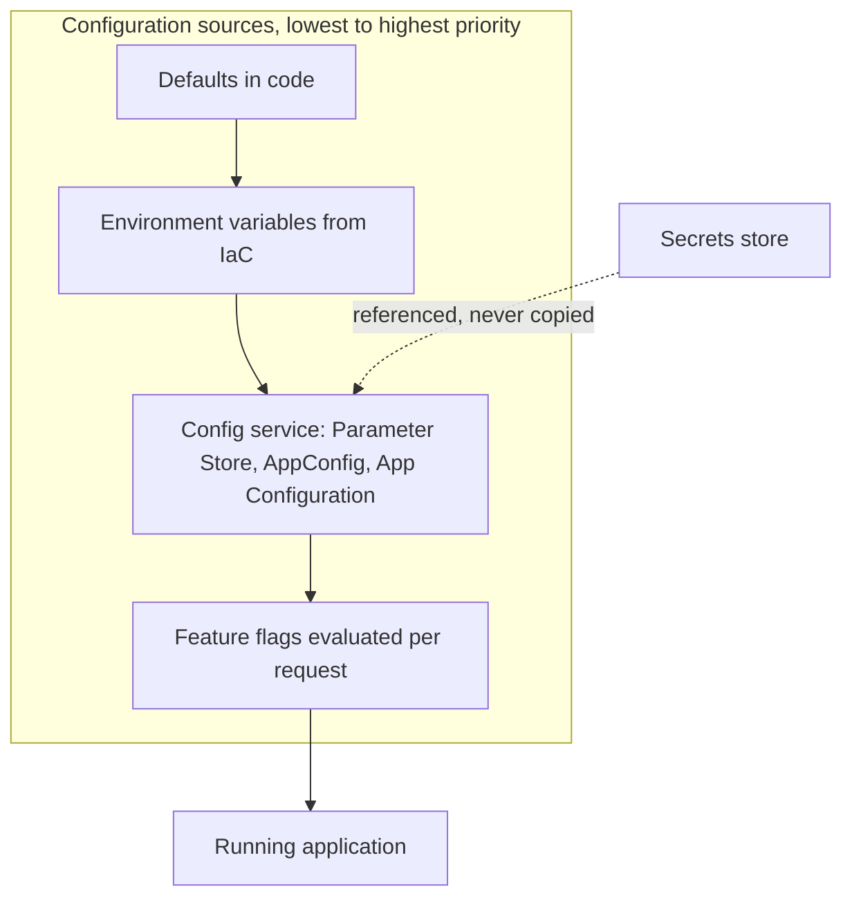
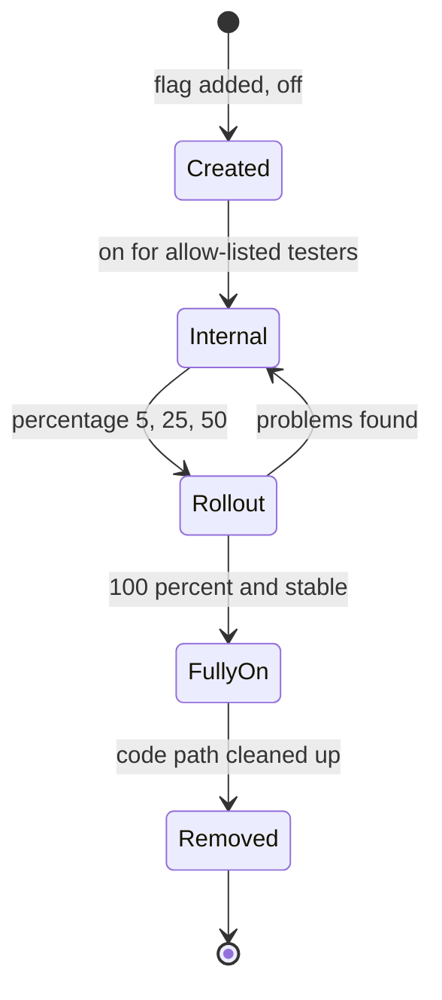

# Configuration and Feature Flags

## Introduction

**Configuration** is everything your application needs to know that is not code: which database host to use, how many items per page, how long to wait for a payment provider, whether the new checkout page is turned on. **Feature flags** are a special kind of configuration that switch behavior on or off, for everyone or for some users, without a new deployment.

Think of a building's control room. The wiring (code) is installed once, but the switches on the panel (configuration) decide which lights are on, how warm each floor is, and whether the new elevator is open to the public. Changing a switch is fast and reversible. Rewiring is slow and risky.

Externalizing configuration has three big benefits:

- **Same build everywhere**: one artifact runs in dev, staging and prod with different settings (see [Managing Dev, Staging and Production](./3-cloud-environments.mdx)).
- **Fast, safe changes**: raise a timeout or switch off a broken feature in seconds instead of running a full release.
- **Decouple deploy from release**: ship code dark, then turn it on gradually, the gentlest [deployment strategy](./2-cloud-deployment-strategies.mdx) of all.

This page covers:

1. Where each kind of setting belongs
2. **SSM Parameter Store** and **AWS AppConfig** on AWS, **App Service settings** and **Azure App Configuration** on Azure
3. How a feature flag evaluates (with a runnable example)
4. Rolling out configuration safely, with validation and automatic rollback
5. Flag hygiene and when to use a third-party flag service

For the general practices, see the site's [configuration management](../../cicd/3-cicd-practices/9-cicd-configuration-management.mdx) and [feature flags](../../cicd/3-cicd-practices/10-cicd-feature-flags.mdx) pages.

:::caution Cost warning
AWS AppConfig is billed by **configuration requests and configurations received**, so polling too often costs more. Azure App Configuration has a **free tier with limits** and paid tiers billed **per store per day plus requests over an included amount**. Parameter Store advanced parameters and higher-throughput settings are billed. Check the [AWS Pricing Calculator](https://calculator.aws/) and [Azure Pricing Calculator](https://azure.microsoft.com/pricing/calculator/), and run the **Cleanup** section afterwards.
:::

## Where Each Setting Belongs

| Kind of setting | Changes how often | Example | Where it belongs |
| --- | --- | --- | --- |
| Constants | Never without a code change | HTTP status codes, retry algorithm | Code |
| Build-time settings | Per release | Compiled-in defaults, dependency versions | Code or build config |
| Environment settings | Per environment, rarely | DB host, queue URL, log level | Environment variables set by IaC |
| Dynamic settings | Any time, without a deploy | Timeouts, rate limits, page size | Parameter Store, AppConfig, App Configuration |
| Feature flags | Often, sometimes per user | `new-checkout` on for 10% of users | AppConfig feature flags, App Configuration feature manager |
| Secrets | Rotated | Passwords, API keys | Secrets Manager or Key Vault. See [Secrets Management](./4-cloud-secrets-management.mdx) |

A sensible rule: **start with environment variables** set by your IaC, and move a setting into a configuration service only when you need to change it without a deployment, share it across services, or roll it out gradually.



## The Services Compared

| Capability | AWS | Azure |
| --- | --- | --- |
| Per-app settings set by the platform | Lambda and ECS environment variables | App Service and Functions **app settings**, Container Apps env vars |
| Hierarchical key-value store | **SSM Parameter Store** (`/orders/prod/page_size`) | **Azure App Configuration** key-values with **labels** |
| Validated, gradual config deployment | **AWS AppConfig** (deployment strategies, validators, CloudWatch alarm rollback) | App Configuration snapshots plus your pipeline; feature flag percentage filters |
| Feature flags | AppConfig **feature flag** profiles | App Configuration **feature manager** with `featuremanagement` libraries |
| Secret references | Parameter Store can reference Secrets Manager | Key-values can be **Key Vault references** |
| Client-side caching agent | AppConfig Agent (Lambda extension, ECS/EKS sidecar, EC2) | Provider libraries with refresh intervals |

The biggest difference: **AWS AppConfig treats a configuration change like a deployment**. It validates the new value, rolls it out over minutes using a deployment strategy, watches CloudWatch alarms, and rolls back automatically. **Azure App Configuration** is primarily a fast, labeled key-value and feature flag store. Clients pick up changes on their next refresh, and gradual exposure comes from **feature filters** (percentage, targeting, time window) rather than a deployment process.

## On AWS: Parameter Store

Parameter Store is the simplest option: named values in a path hierarchy.

```bash
aws ssm put-parameter --name /orders/prod/page_size --type String --value 50
aws ssm put-parameter --name /orders/prod/payment_timeout_ms --type String --value 3000
aws ssm get-parameters-by-path --path /orders/prod/ --recursive \
  --query "Parameters[].{name:Name,value:Value,version:Version}" --output table
```

Example output:

```text
-------------------------------------------------------------
|                   GetParametersByPath                     |
+------------------------------------+---------+------------+
|                name                |  value  |  version   |
+------------------------------------+---------+------------+
|  /orders/prod/page_size            |  50     |  1         |
|  /orders/prod/payment_timeout_ms   |  3000   |  1         |
+------------------------------------+---------+------------+
```

Loading a whole path in Python:

```python
# ssm_config.py
import boto3

ssm = boto3.client("ssm", region_name="us-east-1")

def load_config(prefix: str) -> dict:
    """Load every parameter under a path like /orders/prod/ into a flat dict."""
    config = {}
    paginator = ssm.get_paginator("get_parameters_by_path")
    for page in paginator.paginate(Path=prefix, Recursive=True, WithDecryption=False):
        for p in page["Parameters"]:
            key = p["Name"][len(prefix):]
            config[key] = p["Value"]
    return config

if __name__ == "__main__":
    print(load_config("/orders/prod/"))
```

Example output:

```text
{'page_size': '50', 'payment_timeout_ms': '3000'}
```

The IAM policy can grant `ssm:GetParametersByPath` on `arn:aws:ssm:us-east-1:111122223333:parameter/orders/prod/*`, which neatly scopes each service and environment to its own path. Note that every value comes back as a **string**, so parse and validate types in your code.

## On AWS: AppConfig and Feature Flags

AWS AppConfig (a capability of AWS Systems Manager) organizes configuration as **application > environment > configuration profile**, and deploys **versions** of a profile to an environment using a **deployment strategy**.

```bash
APP_ID=$(aws appconfig create-application --name orders --query Id --output text)
ENV_ID=$(aws appconfig create-environment --application-id "$APP_ID" --name prod \
  --query Id --output text)
PROFILE_ID=$(aws appconfig create-configuration-profile --application-id "$APP_ID" \
  --name feature-flags --location-uri hosted --type AWS.AppConfig.FeatureFlags \
  --query Id --output text)
```

A feature flag profile is JSON with flag definitions and their current values:

```json
{
  "version": "1",
  "flags": {
    "new_checkout": { "name": "New checkout flow" }
  },
  "values": {
    "new_checkout": { "enabled": true }
  }
}
```

Upload it as a new version, then deploy it:

```bash
aws appconfig create-hosted-configuration-version \
  --application-id "$APP_ID" --configuration-profile-id "$PROFILE_ID" \
  --content-type application/json --content fileb://flags.json version.json

aws appconfig list-deployment-strategies \
  --query "Items[].{id:Id,name:Name}" --output table

aws appconfig start-deployment --application-id "$APP_ID" --environment-id "$ENV_ID" \
  --configuration-profile-id "$PROFILE_ID" --configuration-version 1 \
  --deployment-strategy-id <strategy-id-from-the-list>
```

AppConfig includes predefined strategies such as `AppConfig.Linear20PercentEvery6Minutes` and `AppConfig.Canary10Percent20Minutes` (both recommended by AWS for production), `AppConfig.AllAtOnce`, and `AppConfig.Linear50PercentEvery30Seconds` (for testing). During the deployment and the following **bake time**, AppConfig watches the CloudWatch alarms you attach to the environment and **rolls back automatically** if one fires. You can also attach **validators** (a JSON Schema or a Lambda function) so a malformed config never deploys.

### Reading flags from Lambda

The **AWS AppConfig Agent Lambda extension** runs next to your function, polls AppConfig in the background, caches the result, and serves it on `localhost:2772`. Your code makes a plain local HTTP call:

```python
# appconfig_agent.py
import json
import urllib.request

AGENT_URL = ("http://localhost:2772/applications/orders"
             "/environments/prod/configurations/feature-flags")

def get_flags() -> dict:
    with urllib.request.urlopen(AGENT_URL, timeout=1) as resp:
        return json.load(resp)

def handler(event, context):
    flags = get_flags()
    if flags.get("new_checkout", {}).get("enabled"):
        return {"statusCode": 200, "body": "new checkout"}
    return {"statusCode": 200, "body": "classic checkout"}
```

Example agent response for a feature flag profile:

```json
{ "new_checkout": { "enabled": true } }
```

Add the extension as a layer (the layer ARN differs by region and architecture, so take it from the [AppConfig Lambda extension docs](https://docs.aws.amazon.com/appconfig/latest/userguide/appconfig-integration-lambda-extensions.html)) and give the function's role permission to start configuration sessions and get the latest configuration. On ECS, EKS and EC2 the same **AppConfig Agent** runs as a sidecar or daemon. Without the agent, clients call the `appconfigdata` API directly with `StartConfigurationSession` and `GetLatestConfiguration`.

## On Azure: App Settings and App Configuration

For a single App Service or Functions app, **app settings** are often enough. They appear to your code as environment variables, can be marked as slot settings, and can reference Key Vault:

```bash
az webapp config appsettings set --name orders-web-prod-123 --resource-group rg-orders-prod \
  --settings PAGE_SIZE=50 PAYMENT_TIMEOUT_MS=3000 --output none
```

Changing an app setting **restarts the app**, which is fine for rare changes but not for per-minute tuning.

**Azure App Configuration** is a central store shared by many apps, with **labels** to hold per-environment values for the same key:

```bash
RG=rg-orders-config
STORE=appcs-orders-123

az appconfig create --name "$STORE" --resource-group "$RG" --location eastus --sku Free

# Same key, different labels per environment (no label = shared default)
az appconfig kv set --name "$STORE" --key orders:page_size --value 20 --yes
az appconfig kv set --name "$STORE" --key orders:page_size --value 50 --label prod --yes

# A Key Vault reference: App Configuration stores a pointer, not the secret
az appconfig kv set-keyvault --name "$STORE" --key orders:db_password --label prod \
  --secret-identifier "https://kv-orders-prod-123.vault.azure.net/secrets/db-password" --yes

# A feature flag, off by default
az appconfig feature set --name "$STORE" --feature NewCheckout --yes
az appconfig feature list --name "$STORE" --fields name state -o table
```

Example output of the last command:

```text
Name         State
-----------  -------
NewCheckout  off
```

Give the app's managed identity the **App Configuration Data Reader** role on the store (and **Key Vault Secrets User** on the vault, if you use references). Disable access-key authentication on the store once everything uses Entra ID.

### Reading configuration and flags in Python

```bash
pip install azure-appconfiguration-provider featuremanagement azure-identity
```

```python
# azure_appconfig.py
import os
from azure.identity import DefaultAzureCredential
from azure.appconfiguration.provider import load, SettingSelector
from featuremanagement import FeatureManager

endpoint = os.environ["APP_CONFIGURATION_ENDPOINT"]   # https://appcs-orders-123.azconfig.io
env = os.environ.get("APP_ENV", "dev")

config = load(
    endpoint=endpoint,
    credential=DefaultAzureCredential(),
    # unlabeled defaults first, then the environment's label overrides them
    selects=[SettingSelector(key_filter="orders:*", label_filter="\0"),
             SettingSelector(key_filter="orders:*", label_filter=env)],
    trim_prefixes=["orders:"],
    feature_flag_enabled=True,
    feature_flag_refresh_enabled=True,
    keyvault_credential=DefaultAzureCredential(),
)
features = FeatureManager(config)

if __name__ == "__main__":
    print("page size:", config.get("page_size"))
    print("NewCheckout on:", features.is_enabled("NewCheckout"))
```

Example output with `APP_ENV=prod`:

```text
page size: 50
NewCheckout on: False
```

Later selectors win, so the `prod` label overrides the unlabeled default. Call `config.refresh()` periodically (for example at the start of a request) to pick up changes. The provider respects a refresh interval (30 seconds by default) so it does not hit the store on every call. In the portal's **Feature manager**, a flag can be a simple **switch**, a percentage **rollout** with targeted users and groups, or an **experiment** with variants.

## How Feature Flag Evaluation Works

Whatever service you use, a flag evaluation answers "is this feature on **for this user, right now**?" Two properties matter:

- **Kill switch first**: if the flag is off, nothing else matters.
- **Sticky percentages**: a user in the 20% group must stay in it on every request, and still be in it when you raise the rollout to 50%. That is done by hashing the flag name and user ID into a stable bucket, not by `random()`.

Here is a minimal evaluator that shows the logic both clouds' libraries implement:

```python
# flags.py
import hashlib
from dataclasses import dataclass, field

@dataclass
class Flag:
    name: str
    enabled: bool = False
    rollout_percent: int = 0                     # 0-100, applied when enabled
    allow_users: set[str] = field(default_factory=set)
    deny_users: set[str] = field(default_factory=set)

def bucket(flag_name: str, user_id: str) -> int:
    """Stable number 0-99 for this user and flag, so a user doesn't flip between variants."""
    digest = hashlib.sha256(f"{flag_name}:{user_id}".encode()).hexdigest()
    return int(digest[:8], 16) % 100

def is_enabled(flag: Flag, user_id: str) -> bool:
    if not flag.enabled:                         # kill switch wins over everything
        return False
    if user_id in flag.deny_users:
        return False
    if user_id in flag.allow_users:
        return True
    return bucket(flag.name, user_id) < flag.rollout_percent

if __name__ == "__main__":
    flag = Flag("new-checkout", enabled=True, rollout_percent=20,
                allow_users={"qa-alice"}, deny_users={"vip-bob"})
    users = [f"user-{i}" for i in range(1000)]
    on = sum(is_enabled(flag, u) for u in users)
    print(f"rollout 20%: {on} of {len(users)} users enabled")
    print("qa-alice:", is_enabled(flag, "qa-alice"))
    print("vip-bob:", is_enabled(flag, "vip-bob"))
    print("user-42 twice:", is_enabled(flag, "user-42"), is_enabled(flag, "user-42"))

    flag.rollout_percent = 50
    still_on = all(is_enabled(flag, u) for u in users
                   if bucket(flag.name, u) < 20)
    print("users enabled at 20% still enabled at 50%:", still_on)

    flag.enabled = False
    print("after kill switch:", sum(is_enabled(flag, u) for u in users), "enabled")
```

Output:

```text
rollout 20%: 198 of 1000 users enabled
qa-alice: True
vip-bob: False
user-42 twice: True True
users enabled at 20% still enabled at 50%: True
after kill switch: 0 enabled
```

In production you would not write your own evaluator. You would use App Configuration's targeting filter, AppConfig's flag attributes and entity-based gradual deployments, or a vendor SDK. But knowing the logic helps you reason about stickiness and kill switches.



## Real-World Scenario

A food-delivery company is rebuilding its checkout. The API runs on AWS Lambda and the restaurant-partner portal runs on Azure App Service. Product wants the new checkout tested on employees first, then 5%, 25% and 100% of customers over two weeks, with an instant off switch if payment errors rise.

### The solution

1. **AWS (customer API)**: a `new_checkout` flag in an AppConfig feature flag profile. Deploy flag changes with `AppConfig.Canary10Percent20Minutes` and attach the CloudWatch alarm on payment errors to the `prod` environment, so a bad flag change rolls back automatically. The Lambda function reads flags through the AppConfig Agent extension.
2. **Azure (partner portal)**: a `NewCheckout` flag in App Configuration with a **targeting filter**: the `employees` group at 100%, everyone else starting at 5%. The portal refreshes configuration every 30 seconds.
3. **Kill switch**: an on-call runbook entry to disable both flags with one CLI command each (`aws appconfig start-deployment` with a version that has `enabled: false`, and `az appconfig feature disable`).
4. **Cleanup ticket**: created on day one to delete the flag and the old code path two weeks after reaching 100%.

### Why this approach

- The release is **decoupled from deployment**: code ships once, behavior changes many times without redeploying.
- Both platforms provide sticky percentage targeting and audit history, so the rollout is controlled and reviewable.
- AppConfig's alarm-based rollback adds a safety net for the payment-critical path.

### When to use it, and when not to

Use flags for risky user-facing changes, gradual rollouts, experiments and operational kill switches. Do not use flags for **secrets**, for settings that never change at runtime (environment variables are simpler), or as a permanent substitute for configuration: a flag that has been at 100% for six months is dead code with a switch attached. For **client-side** apps (browser, mobile), remember that anything sent to the client can be read by users, including targeted user lists.

### Alternatives and trade-offs

| Approach | Pros | Cons | Best for |
| --- | --- | --- | --- |
| Environment variables via IaC | Simple, reviewed, no extra service | Changing them needs a deploy or restart | Per-environment settings |
| SSM Parameter Store | Cheap, hierarchical, IAM by path | No rollout or validation; strings only | Shared settings on AWS |
| AWS AppConfig | Validators, gradual rollout, alarm rollback, feature flags | More concepts; billed per request | Risky config and flags on AWS |
| Azure App Configuration | Labels per environment, Key Vault refs, feature manager with targeting | Rollout is client-refresh based, not a deployment | Shared config and flags on Azure |
| Third-party flag service (LaunchDarkly, Unleash, Flagsmith and others) | Rich targeting, experimentation, multi-cloud SDKs | Another vendor and cost; data leaves your cloud | Product-led experimentation at scale |
| OpenFeature standard SDK | Vendor-neutral API, swap providers later | Still need a provider behind it | Avoiding lock-in to one flag vendor |

## Common Mistakes

- **Secrets in the config store.** Use secret references (Key Vault references, Secrets Manager) instead of plain values.
- **Polling on every request.** It is slow and billed. Use the agent or provider caching and a sensible refresh interval.
- **No validation.** A typo like `page_size: "fifty"` should be rejected before deployment. Use AppConfig validators or a JSON Schema check in CI for App Configuration imports.
- **Random instead of hashed bucketing.** Users flip between old and new experiences on every request.
- **Flag debt.** Every flag doubles the code paths to test. Give each flag an owner and an expiry, and remove it after full rollout.
- **Config changes without review.** Console edits bypass code review. Keep config in Git and apply it through the pipeline, or at least require approvals and keep the audit log.
- **No fallback.** If the config service is unreachable, the app should use the last known values or safe defaults, not crash.

## Cleanup

```bash
# AWS AppConfig: delete in reverse order of creation
aws appconfig delete-environment --application-id "$APP_ID" --environment-id "$ENV_ID"
aws appconfig delete-configuration-profile --application-id "$APP_ID" \
  --configuration-profile-id "$PROFILE_ID"
aws appconfig delete-application --application-id "$APP_ID"

# Parameter Store
aws ssm delete-parameters --names /orders/prod/page_size /orders/prod/payment_timeout_ms

# Azure App Configuration (stores are soft-deleted; purge to release the name)
az appconfig delete --name "$STORE" --resource-group "$RG" --yes
az appconfig purge --name "$STORE" --yes
az group delete --name "$RG" --yes --no-wait
```

Deleting a configuration profile may first require deleting its hosted configuration versions. The CLI error message tells you if so.

## Summary

- Put **per-environment** settings in environment variables from IaC, **dynamic** settings in a config service, **flags** in a feature flag service, and **secrets** in a secrets store.
- **Parameter Store** is a simple hierarchical store. **AWS AppConfig** deploys configuration like code, with validators, gradual strategies and alarm-based rollback.
- **Azure App Configuration** offers labeled key-values, Key Vault references and a **feature manager** with percentage and targeting filters. App Service **app settings** are fine for simple per-app values.
- Good flag evaluation is **kill-switch first** and **sticky** (hashed buckets, not random).
- Treat flags as temporary: give them owners and remove them after rollout.

## Further Learning

### Exercises

1. Extend `flags.py` with a `start_after` timestamp so a flag turns on automatically at a scheduled time, and test it with a fake clock.
2. Write a JSON Schema for an AppConfig free-form profile with `page_size` (integer 10 to 100) and `payment_timeout_ms` (integer), and validate a sample file in Python with the `jsonschema` package.
3. In App Configuration, create the same key with labels `dev` and `prod`, load it twice with different `APP_ENV` values, and confirm the override order.
4. Write a one-page runbook for disabling a flag in an incident on both clouds, including who may do it and how to confirm it took effect.

### Related pages

- [Deployment Strategies in the Cloud](./2-cloud-deployment-strategies.mdx)
- [Secrets Management: Secrets Manager and Key Vault](./4-cloud-secrets-management.mdx)
- [Managing Dev, Staging and Production](./3-cloud-environments.mdx)
- [AWS Lambda](../4-cloud-serverless/1-cloud-aws-lambda.mdx)
- [Monitoring: CloudWatch and Azure Monitor](../12-cloud-observability-and-security/0-cloud-monitoring.mdx)
- Site tutorial: [Feature toggles](../../cicd/6-cicd-deployment-strategies/5-cicd-feature-toggles.mdx)
