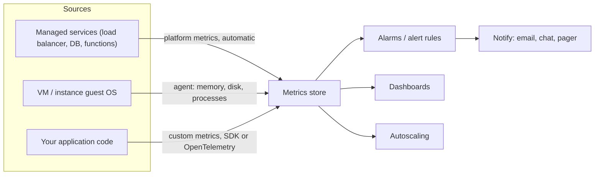

# Monitoring: CloudWatch and Azure Monitor

## Introduction

Once your application runs in the cloud, you can no longer walk over to a server and look at it. You need the cloud to tell you how things are going: how busy the CPUs are, how many requests failed, how long the database took to answer, and whether the queue is piling up.

That is what **monitoring** does. Both big clouds ship a built-in monitoring service:

- **Amazon CloudWatch** on AWS
- **Azure Monitor** on Azure

Think of them as the dashboard of a car. The car (your cloud resources) reports speed, fuel and engine temperature automatically. You decide which gauges to watch, which warning lights to set, and whether to add extra sensors (agents and custom metrics) for things the car does not measure by default.

This page covers **metrics**, the numeric side of monitoring. The rest of this section builds on it:

- [Centralized Logging](./1-cloud-logging.mdx) covers log data.
- [Distributed Tracing: X-Ray and Application Insights](./2-cloud-tracing.mdx) covers request traces.
- [Alerting and Dashboards](./3-cloud-alerting.mdx) turns metrics into alarms and dashboards.

If metrics, logs and traces are new ideas, the vendor-neutral overview in [Observability Concepts](../../../observability/grafana/0-grafana-fundamentals/1-observability-concepts.mdx) is a good primer.

## The Two Services at a Glance

| Concept | AWS (CloudWatch) | Azure (Azure Monitor) |
| --- | --- | --- |
| Numeric time series | CloudWatch Metrics | Azure Monitor Metrics |
| Grouping of metrics | Namespace, such as `AWS/EC2` | Metric namespace, such as `Microsoft.Compute/virtualMachines` |
| Extra labels on a metric | Dimensions, such as `InstanceId` | Dimensions, such as `LUN` or `ApiName` |
| How values are summarized | Statistics: `Average`, `Sum`, `Maximum`, `p99` | Aggregations: `Avg`, `Total`, `Max`, `Count` |
| Logs | CloudWatch Logs | Azure Monitor Logs (Log Analytics workspace) |
| Application performance | CloudWatch Application Signals, X-Ray | Application Insights |
| Agent for guest OS data | CloudWatch agent | Azure Monitor Agent (AMA) with data collection rules |
| Managed Prometheus | Amazon Managed Service for Prometheus | Azure Monitor managed service for Prometheus |
| Managed Grafana | Amazon Managed Grafana | Azure Managed Grafana |
| Container monitoring | Container Insights | Container insights |

The two platforms have the same core model. The main difference is in packaging:

- **AWS** splits observability across several named services (CloudWatch, X-Ray, Managed Prometheus, Managed Grafana). AWS has been folding more of them into the CloudWatch console.
- **Azure** puts nearly everything under the **Azure Monitor** umbrella. Application Insights, Log Analytics and Container insights are all features of Azure Monitor.

## How Monitoring Data Flows



Three kinds of sources feed the metrics store:

1. **Platform metrics** come from managed services automatically. You do not install anything. Examples are load balancer request counts, Lambda invocations and Azure SQL DTU usage.
2. **Guest metrics** come from inside a VM: memory used, disk space and process counts. The hypervisor cannot see inside your operating system, so you need an agent for these.
3. **Custom metrics** come from your code, such as orders placed, payment failures or queue lag.

:::note A classic surprise
Neither cloud reports **memory usage** for a VM out of the box. The hypervisor sees CPU and network, but memory is managed by the guest OS. If you want a "memory above 90%" alarm on EC2 or an Azure VM, install the CloudWatch agent or the Azure Monitor Agent first.
:::

## Metric Anatomy

A metric data point has the same parts on both clouds:

| Part | Example | Meaning |
| --- | --- | --- |
| Namespace | `AWS/ApplicationELB` | Which service or app the metric belongs to |
| Name | `TargetResponseTime` | What is being measured |
| Dimensions | `LoadBalancer=app/web/abc123` | Which specific resource, or which slice of it |
| Timestamp | `2026-10-11T09:15:00Z` | When it was measured |
| Value and unit | `0.182 Seconds` | The measurement |

When you query, you also pick:

- a **period** (AWS) or **granularity/interval** (Azure), such as 1 minute or 5 minutes
- a **statistic** (AWS) or **aggregation** (Azure), such as average, sum, maximum or a percentile

:::tip Averages hide pain
An average latency of 120 ms can hide 2% of users waiting 5 seconds. For latency, watch **percentiles** such as p95 or p99. CloudWatch supports percentile statistics directly. On Azure, Application Insights and log queries (KQL `percentile()`) give you percentiles for request durations.
:::

### Resolution and retention

- **CloudWatch:** many AWS services publish at 1-minute resolution. EC2 sends 5-minute data by default ("basic monitoring"). You can turn on 1-minute "detailed monitoring" for an extra charge. Custom metrics can be standard (1-minute) or high resolution (down to 1 second). CloudWatch keeps metric data for 15 months, rolling older data up into coarser periods.
- **Azure Monitor:** platform metrics are usually collected at 1-minute granularity and stored for 93 days. To keep them longer, route them to a Log Analytics workspace with a diagnostic setting.

These limits change from time to time. Check the [CloudWatch metrics concepts](https://docs.aws.amazon.com/AmazonCloudWatch/latest/monitoring/cloudwatch_concepts.html) and [Azure Monitor Metrics overview](https://learn.microsoft.com/azure/azure-monitor/metrics/data-platform-metrics) pages for current values.

## Reading Platform Metrics

The commands below assume you are signed in with short-lived credentials: `aws sso login` for AWS, and `az login` for Azure. See [The AWS CLI](../1-cloud-getting-started/2-cloud-aws-cli.mdx) and [The Azure CLI](../1-cloud-getting-started/3-cloud-azure-cli.mdx). Reading metrics does not create resources and costs little. CloudWatch API calls are billed per request beyond the free tier, so avoid tight polling loops.

### On AWS

List what metrics exist for a service, then fetch data points:

```bash
# Which EC2 metrics exist in this Region?
aws cloudwatch list-metrics --namespace AWS/EC2 --metric-name CPUUtilization \
  --query 'Metrics[].Dimensions[]' --output table

# Average and max CPU for one instance, 5-minute periods, last hour
aws cloudwatch get-metric-statistics \
  --namespace AWS/EC2 \
  --metric-name CPUUtilization \
  --dimensions Name=InstanceId,Value=i-0abc1234def567890 \
  --start-time "$(date -u -d '-1 hour' +%Y-%m-%dT%H:%M:%SZ)" \
  --end-time "$(date -u +%Y-%m-%dT%H:%M:%SZ)" \
  --period 300 \
  --statistics Average Maximum \
  --output table
```

Example output (trimmed):

```text
-------------------------------------------------------------
|                   GetMetricStatistics                     |
+-----------+-----------------------------+--------+--------+
|  Average  |          Timestamp          |Maximum |  Unit  |
+-----------+-----------------------------+--------+--------+
|  12.48    |  2026-10-11T08:20:00+00:00  |  31.2  | Percent|
|  14.02    |  2026-10-11T08:25:00+00:00  |  40.9  | Percent|
|  71.66    |  2026-10-11T08:30:00+00:00  |  98.5  | Percent|
+-----------+-----------------------------+--------+--------+
```

`get-metric-statistics` is fine for quick checks. For dashboards and code, prefer `get-metric-data`. It fetches many metrics in one call and supports **metric math**, such as an error rate computed as errors divided by requests.

### On Azure

Azure identifies a resource by its full resource ID. Look it up first, then ask for metrics:

```bash
VM_ID=$(az vm show -g rg-helpdesk-prod -n vm-web-01 --query id -o tsv)

# Which metrics does this resource support?
az monitor metrics list-definitions --resource "$VM_ID" \
  --query "[].name.value" -o tsv | head -5

# Average CPU in 5-minute buckets for the last hour
az monitor metrics list \
  --resource "$VM_ID" \
  --metric "Percentage CPU" \
  --interval PT5M \
  --aggregation Average Maximum \
  --offset 1h \
  -o table
```

Example output (trimmed):

```text
Timestamp            Name            Average    Maximum
-------------------  --------------  ---------  ---------
2026-10-11 08:20:00  Percentage CPU  12.51      30.95
2026-10-11 08:25:00  Percentage CPU  13.87      41.20
2026-10-11 08:30:00  Percentage CPU  70.94      98.10
```

Notice the naming difference. AWS uses `CPUUtilization`, Azure uses `Percentage CPU`. Metric names are service-specific on both clouds. Always list the definitions instead of guessing.

## Guest OS Metrics with Agents

### On AWS: the CloudWatch agent

The CloudWatch agent runs on EC2 (or on-premises servers) and collects memory, disk and process metrics, plus log files. It can also receive OpenTelemetry and StatsD data. A minimal configuration file looks like this:

```json
{
  "agent": { "metrics_collection_interval": 60 },
  "metrics": {
    "namespace": "CWAgent",
    "append_dimensions": { "InstanceId": "${aws:InstanceId}" },
    "metrics_collected": {
      "mem": { "measurement": ["mem_used_percent"] },
      "disk": { "measurement": ["used_percent"], "resources": ["/"] }
    }
  }
}
```

The instance needs an **instance profile role** with the `CloudWatchAgentServerPolicy` managed policy. Never put access keys on the box. See [Workload Identity: Instance Roles and Managed Identities](../2-cloud-identity/4-cloud-workload-identity.mdx). You can install and configure the agent at scale with Systems Manager. Store the JSON in Parameter Store and start the agent with `amazon-cloudwatch-agent-ctl`.

### On Azure: the Azure Monitor Agent

Azure uses the **Azure Monitor Agent (AMA)**. It replaced the legacy Log Analytics agent (also called MMA or OMS), which Microsoft retired in 2024. If an old tutorial tells you to install "MMA", it is out of date.

AMA has two parts:

1. The **agent**, installed as a VM extension.
2. A **data collection rule (DCR)**, a separate Azure resource that says *what* to collect and *where* to send it. You associate one DCR with many VMs.

```bash
# Install the agent extension on a Linux VM (it uses the VM's managed identity)
az vm identity assign -g rg-helpdesk-prod -n vm-web-01
az vm extension set \
  --resource-group rg-helpdesk-prod \
  --vm-name vm-web-01 \
  --name AzureMonitorLinuxAgent \
  --publisher Microsoft.Azure.Monitor \
  --enable-auto-upgrade true
```

You then create a DCR, either in the portal ("Data Collection Rules") or as code in Bicep or Terraform, and associate it with the VM. Enabling **VM insights** in the portal creates a suitable DCR for you. The [Azure Monitor Agent overview](https://learn.microsoft.com/azure/azure-monitor/agents/azure-monitor-agent-overview) has the current DCR schema.

| Topic | CloudWatch agent | Azure Monitor Agent |
| --- | --- | --- |
| Where config lives | JSON file, often in SSM Parameter Store | Data collection rule resource |
| One config, many machines | Through SSM or your image | Associate the DCR with many VMs, or assign via Azure Policy |
| Identity | Instance profile role | Managed identity |
| Also collects logs | Yes | Yes |

The DCR design is a real difference. Because the DCR is a first-class Azure resource, you can manage it with Azure Policy ("every VM in this subscription must be associated with DCR X"). On AWS you get a similar result with SSM State Manager associations.

## Publishing Custom Metrics

Platform metrics tell you the infrastructure is healthy. Business metrics tell you the product works. "Tickets created per minute" dropping to zero is often the first sign of an outage, even while the CPU graphs look perfect.

### On AWS with boto3

```python
# publish_metric.py
import boto3

cloudwatch = boto3.client("cloudwatch", region_name="us-east-1")

def record_ticket_created(plan: str) -> None:
    cloudwatch.put_metric_data(
        Namespace="Helpdesk/App",
        MetricData=[
            {
                "MetricName": "TicketsCreated",
                "Dimensions": [{"Name": "Plan", "Value": plan}],
                "Value": 1,
                "Unit": "Count",
            }
        ],
    )

if __name__ == "__main__":
    record_ticket_created("pro")
    print("metric sent")
```

Output:

```text
metric sent
```

Calling `put_metric_data` once per event is simple, but it is slow and costs one API request per call. Two better options:

- **Batch** several data points per call, using the `Values` and `Counts` arrays or multiple `MetricData` entries.
- Use the **Embedded Metric Format (EMF)**. Your code writes a specially shaped JSON log line, and CloudWatch extracts the metric from the logs asynchronously. Your request path makes no extra API call. This works especially well in Lambda, where anything you print to stdout already goes to CloudWatch Logs.

```python
# emf_metric.py - prints an EMF log line; in Lambda, CloudWatch extracts the metric
import json
import time

def emit_ticket_metric(plan: str, latency_ms: float) -> None:
    print(json.dumps({
        "_aws": {
            "Timestamp": int(time.time() * 1000),
            "CloudWatchMetrics": [{
                "Namespace": "Helpdesk/App",
                "Dimensions": [["Plan"]],
                "Metrics": [
                    {"Name": "TicketsCreated", "Unit": "Count"},
                    {"Name": "CreateLatency", "Unit": "Milliseconds"},
                ],
            }],
        },
        "Plan": plan,
        "TicketsCreated": 1,
        "CreateLatency": latency_ms,
        "ticketId": "T-1042",
    }))

emit_ticket_metric("pro", 84.2)
```

Output:

```text
{"_aws": {"Timestamp": 1791710400000, "CloudWatchMetrics": [{"Namespace": "Helpdesk/App", "Dimensions": [["Plan"]], "Metrics": [{"Name": "TicketsCreated", "Unit": "Count"}, {"Name": "CreateLatency", "Unit": "Milliseconds"}]}]}, "Plan": "pro", "TicketsCreated": 1, "CreateLatency": 84.2, "ticketId": "T-1042"}
```

Notice that `ticketId` is a plain property, **not** a dimension. It stays searchable in the log, but it does not create a new metric per ticket.

### On Azure with OpenTelemetry

On Azure, Microsoft's recommended path for application telemetry is **OpenTelemetry** sent to **Application Insights**. For new Python apps, Microsoft now recommends the **Microsoft OpenTelemetry Distro** (`microsoft-opentelemetry` on PyPI). Apps that already use the older **Azure Monitor OpenTelemetry Distro** (`azure-monitor-opentelemetry`) need no change. Custom metrics use the standard OpenTelemetry metrics API:

```python
# azure_custom_metric.py
# pip install microsoft-opentelemetry
# export APPLICATIONINSIGHTS_CONNECTION_STRING="<from your Application Insights resource>"
from microsoft.opentelemetry import use_microsoft_opentelemetry
from opentelemetry import metrics

use_microsoft_opentelemetry(enable_azure_monitor=True)

meter = metrics.get_meter("helpdesk.app")
tickets_created = meter.create_counter(
    "tickets_created", unit="1", description="Tickets created"
)

def record_ticket_created(plan: str) -> None:
    tickets_created.add(1, {"plan": plan})

record_ticket_created("pro")
print("metric recorded; exported on the next export interval")
```

Output:

```text
metric recorded; exported on the next export interval
```

The metric appears in Application Insights under **customMetrics** (and in Metrics Explorer) after the exporter flushes, usually within a minute or two. The OpenTelemetry API calls (`get_meter`, `create_counter`, `add`) are vendor neutral, so the same code can export to AWS through the AWS Distro for OpenTelemetry. That portability is a big reason to prefer OpenTelemetry over proprietary SDKs. [Distributed Tracing: X-Ray and Application Insights](./2-cloud-tracing.mdx) covers the setup in more depth.

:::warning Watch your dimensions
Every unique combination of dimension values is a **separate metric**, and both clouds bill custom metrics by count and by API calls or ingestion. A dimension like `userId` or `requestId` can turn one metric into millions. Keep dimensions low-cardinality, such as plan, region or endpoint. Put high-cardinality values in logs or traces instead.
:::

## Prometheus and Grafana as Managed Services

Many teams already know Prometheus and Grafana, especially if they run Kubernetes. Both clouds offer managed versions:

- **Amazon Managed Service for Prometheus** and **Azure Monitor managed service for Prometheus** store Prometheus metrics without you running Prometheus servers. You query them with PromQL.
- **Amazon Managed Grafana** and **Azure Managed Grafana** host Grafana for you and connect to CloudWatch or Azure Monitor as data sources.

This is a good fit when your team already writes PromQL, or when you want the same dashboards across clouds and on-premises. See the site's [Prometheus tutorial](/docs/observability/prometheus) and [Grafana tutorial](/docs/observability/grafana) for the tools themselves.

## How Monitoring Is Billed

Exact prices vary by Region and change over time, so use the [AWS Pricing Calculator](https://calculator.aws/) or the [Azure Pricing Calculator](https://azure.microsoft.com/pricing/calculator/) for numbers. What matters for design is **what you are billed for**:

| Item | CloudWatch | Azure Monitor |
| --- | --- | --- |
| Platform metrics | Included for most services. EC2 detailed monitoring is extra. | Platform metrics are included |
| Custom metrics | Per metric per month, plus API requests | Billed as ingestion: Application Insights data, or custom metrics |
| Metric API reads | Per request for `GetMetricData` and similar, beyond the free tier | Most metric queries are included; check the current page |
| Logs | Per GB ingested and per GB-month stored | Per GB ingested (by table plan) and retention beyond the included period |
| Dashboards and alarms | Per dashboard and per alarm metric | Per alert rule, depending on type and frequency |

Both clouds have a free tier for monitoring. Its size changes, so check the current CloudWatch and Azure Monitor pricing pages before relying on it.

## Real-World Scenario

Your team runs a SaaS helpdesk. The API runs as containers: **Amazon ECS on Fargate** in the US, and **Azure Container Apps** for an EU customer that requires Azure. Both use a managed PostgreSQL database. Last month, an outage went unnoticed for 40 minutes because the only monitoring was "is the container running?".

**What you set up:**

1. **Golden signals for every service.** Track latency (p95), traffic (requests per minute), errors (5xx rate) and saturation (CPU, memory, DB connections). On AWS, most of these come from the Application Load Balancer and Container Insights. On Azure, they come from Container Apps platform metrics and Application Insights.
2. **One business metric:** `TicketsCreated` per minute, emitted with EMF on AWS and with an OpenTelemetry counter on Azure. A flat line during business hours means something is broken, whatever the CPU says.
3. **Database saturation:** connection count and storage free space on both clouds' managed PostgreSQL.
4. **Consistent naming.** Both clouds use the same metric names (`tickets_created`, `create_latency_ms`) and the same dimensions (`plan`, `region`) in custom metrics, so one runbook works for both.

**Why this approach:** native services need no extra infrastructure. They see every managed service's metrics automatically, and they integrate with each cloud's alerting and autoscaling. OpenTelemetry for custom metrics keeps the application code identical on both clouds.

**When to use it:** small to mid-size teams, mostly on one cloud per workload, who want useful monitoring this week.

**When not to:** if you run many clusters across clouds and on-premises and want one place to see everything, a cloud-neutral stack, such as Prometheus with Grafana or a commercial observability platform, may serve you better than two native consoles.

### Alternatives and trade-offs

| Approach | Pros | Cons | Best for |
| --- | --- | --- | --- |
| Native (CloudWatch / Azure Monitor) | Zero setup for platform metrics, integrated IAM, alarms and autoscaling | Two consoles and two query languages in a multi-cloud setup | Most single-cloud workloads |
| Managed Prometheus + Managed Grafana | PromQL, portable dashboards, strong Kubernetes ecosystem | Still need cloud metrics via data sources; Prometheus cardinality costs | Kubernetes-heavy teams |
| Self-hosted Prometheus/Grafana | Full control, no per-metric fees | You operate storage, HA, upgrades | Teams with platform engineers |
| Commercial SaaS (Datadog, New Relic, and others) | One pane across clouds, polished APM | Per-host or per-GB costs, data leaves your cloud | Multi-cloud orgs that want one vendor |

## Common Mistakes

- **Expecting memory metrics without an agent.** Install the CloudWatch agent or Azure Monitor Agent, and give it a role or managed identity rather than keys.
- **Watching averages only.** Use p95/p99 for latency and `Maximum` for saturation.
- **High-cardinality dimensions.** `userId` as a dimension can create a huge bill. Use logs or traces for per-request detail.
- **Only infrastructure metrics.** Add at least one business metric per service.
- **Installing legacy agents.** On Azure, use AMA and DCRs, not the retired Log Analytics agent. On AWS, the CloudWatch agent replaces older scripts.
- **Forgetting Regions.** CloudWatch metrics are Regional. If you deploy to two Regions, look in both, or set up cross-Region dashboards.

## Summary

- CloudWatch and Azure Monitor share the same model: namespaces, metric names, dimensions, and statistics or aggregations over a period.
- Platform metrics are automatic. Guest OS metrics need an agent: the CloudWatch agent on AWS, or the Azure Monitor Agent plus a data collection rule on Azure.
- Custom business metrics catch outages that infrastructure graphs miss. Use EMF on AWS and OpenTelemetry on Azure (OpenTelemetry also works on AWS).
- Keep dimensions low-cardinality, and prefer percentiles over averages for latency.
- Monitoring is billed per custom metric, per API call and per GB of logs. Check the pricing calculators rather than relying on fixed numbers.

## Exercises

1. Using `aws cloudwatch list-metrics` and `az monitor metrics list-definitions`, list the metrics for one load balancer on each cloud. Write down the names for request count, 5xx errors and latency on each platform.
2. Run `emf_metric.py` locally and identify which fields become metrics, which become dimensions and which stay plain log properties. Add an `endpoint` dimension and explain how it changes the number of metrics.
3. Pick a service you run and define its four golden signals. Name the exact CloudWatch or Azure Monitor metric for each, or note where you need a custom metric.
4. Read [Alerting and Dashboards](./3-cloud-alerting.mdx) next, and design one alarm for each golden signal.

Related pages: [Centralized Logging](./1-cloud-logging.mdx), [Distributed Tracing: X-Ray and Application Insights](./2-cloud-tracing.mdx), [Cost Optimization and FinOps](../13-cloud-architecture/4-cloud-cost-optimization.mdx).
