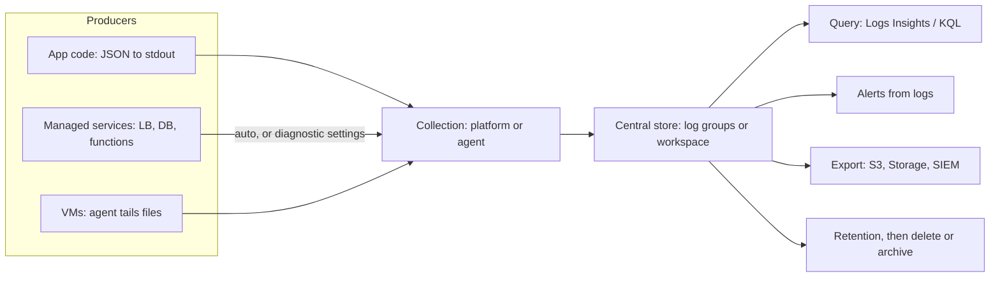
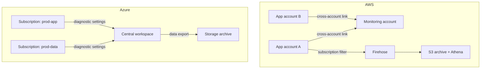

# Centralized Logging

## Introduction

Every piece of your system writes logs: your application, the load balancer, the database, the Kubernetes control plane, the cloud's own APIs. On a single server you could `tail -f /var/log/app.log`. In the cloud, though, a single request might touch a dozen containers that live for minutes and then disappear, along with their local log files.

**Centralized logging** means shipping every log line to one durable, searchable place, the moment it is written. When something breaks at 3 a.m., you search one system instead of SSH-ing into machines that may no longer exist.

A good analogy is a building's security desk. Instead of each office keeping its own visitor notebook, every door reports to one desk that keeps the full record and can answer "who entered floor 4 between 2 and 3 a.m.?" in seconds.

On the two clouds:

- **AWS:** **Amazon CloudWatch Logs**, queried with **CloudWatch Logs Insights**
- **Azure:** **Azure Monitor Logs**, stored in a **Log Analytics workspace** and queried with **KQL** (Kusto Query Language)

This page covers both, plus the habits that make logs useful: structured JSON, sensible retention, and cost control. Security-focused log analysis (SIEM) is covered in the Cybersecurity tutorial's [Logging and SIEM](../../../fundamental/security/11-sec-defensive-operations/1-sec-logging-and-siem.mdx) page. Audit logs of cloud API calls get their own page: [Audit Logging: CloudTrail and Activity Log](./6-cloud-audit-logging.mdx).

## Core Concepts Side by Side

| Concept | AWS CloudWatch Logs | Azure Monitor Logs |
| --- | --- | --- |
| Top-level container | **Log group**, such as `/aws/lambda/create-ticket` | **Log Analytics workspace** |
| Sub-division | **Log stream**, one per instance, container or function instance | **Table**, such as `ContainerAppConsoleLogs_CL` or `AppTraces` |
| Query language | Logs Insights QL; OpenSearch PPL and SQL are also supported | KQL |
| Retention setting | Per log group. The default is **never expire**. | Per workspace and per table |
| Cheaper storage tier | **Infrequent Access** log class | **Basic** and **Auxiliary** table plans |
| Live view | Live Tail | Live metrics (App Insights), log streaming for App Service / Container Apps |
| Route platform logs in | Many services write automatically; others need settings | **Diagnostic settings** on each resource |
| Forward elsewhere | Subscription filters to Kinesis, Firehose or Lambda; export to S3 | Data export rules to Storage or Event Hubs |

The biggest structural difference: **AWS spreads logs across many log groups**, usually one per function or service. **Azure encourages a few large workspaces** that hold many tables. With Azure, one KQL query can join app logs, VM logs and the activity log. With AWS, a single Logs Insights query can span many log groups at once, which covers most needs.

## The Logging Pipeline



## Step 1: Write Structured Logs

Central storage only helps if the logs are searchable. Plain text like `User 42 failed to pay` forces you to write regular expressions. **Structured JSON logs** let both Logs Insights and KQL filter on fields directly.

This example uses only the Python standard library and works the same on Lambda, ECS, Azure Functions or Container Apps, because all of them capture stdout:

```python
# structured_logging.py
import json
import logging
import sys
import time
import uuid

class JsonFormatter(logging.Formatter):
    def format(self, record: logging.LogRecord) -> str:
        entry = {
            "ts": time.strftime("%Y-%m-%dT%H:%M:%SZ", time.gmtime(record.created)),
            "level": record.levelname,
            "logger": record.name,
            "msg": record.getMessage(),
        }
        # Extra fields passed via logger.info(..., extra={"ctx": {...}})
        entry.update(getattr(record, "ctx", {}))
        if record.exc_info:
            entry["exception"] = self.formatException(record.exc_info)
        return json.dumps(entry)

handler = logging.StreamHandler(sys.stdout)
handler.setFormatter(JsonFormatter())
log = logging.getLogger("helpdesk.api")
log.addHandler(handler)
log.setLevel(logging.INFO)

request_id = str(uuid.uuid4())[:8]
log.info("ticket created", extra={"ctx": {"requestId": request_id, "tenant": "acme", "durationMs": 84}})
try:
    1 / 0
except ZeroDivisionError:
    log.error("payment failed", exc_info=True, extra={"ctx": {"requestId": request_id, "tenant": "acme"}})
```

Example output (trimmed):

```text
{"ts": "2026-10-11T09:15:02Z", "level": "INFO", "logger": "helpdesk.api", "msg": "ticket created", "requestId": "3f9a1c2e", "tenant": "acme", "durationMs": 84}
{"ts": "2026-10-11T09:15:02Z", "level": "ERROR", "logger": "helpdesk.api", "msg": "payment failed", "requestId": "3f9a1c2e", "tenant": "acme", "exception": "Traceback (most recent call last):\n ..."}
```

Good habits for every log line:

- Include a **request or correlation ID**, and the **trace ID** once you add tracing, so you can jump between logs and traces.
- Use consistent field names across services, such as `tenant`, `durationMs` and `statusCode`.
- **Never log secrets, tokens or full payment data.** Both clouds offer masking (CloudWatch Logs data protection policies, and transformations in Azure data collection rules), but not logging the data at all is far safer.

## Step 2: Collect and Store

### On AWS

Lambda, ECS with the `awslogs` driver, API Gateway access logs, and many other services write to CloudWatch Logs. For your own log groups, create them explicitly so you control retention:

```bash
# Create a log group with 30-day retention instead of the default "never expire"
aws logs create-log-group --log-group-name /helpdesk/api
aws logs put-retention-policy --log-group-name /helpdesk/api --retention-in-days 30

# A cheaper class for verbose debug logs you rarely query
aws logs create-log-group --log-group-name /helpdesk/api-debug \
  --log-group-class INFREQUENT_ACCESS

# Find log groups that will keep data forever
aws logs describe-log-groups \
  --query 'logGroups[?retentionInDays==`null`].logGroupName' --output text
```

Example output of the last command:

```text
/aws/lambda/create-ticket	/aws/lambda/resize-image	/ecs/helpdesk-worker
```

Each of those groups keeps logs forever and grows its storage bill every month. Setting retention is one of the easiest cost wins on AWS.

:::note Log classes
The **Standard** class supports every feature. **Infrequent Access** has lower ingestion pricing but no metric filters, no subscription filters and no Live Tail. You cannot change the class after you create the log group. A third class, **Delivery**, exists only for delivering Lambda logs on to S3 or Firehose. See [CloudWatch Logs log classes](https://docs.aws.amazon.com/AmazonCloudWatch/latest/logs/CloudWatch_Logs_Log_Classes.html).
:::

### On Azure

Start by creating a workspace. Most Azure resources then need a **diagnostic setting** to send their platform logs to it. Without one, resource logs are simply not collected.

```bash
RG=rg-helpdesk-obs
az group create -n $RG -l westeurope

az monitor log-analytics workspace create \
  -g $RG -n law-helpdesk-prod -l westeurope --retention-time 30

WS_ID=$(az monitor log-analytics workspace show -g $RG -n law-helpdesk-prod --query id -o tsv)
KV_ID=$(az keyvault show -n kv-helpdesk-prod --query id -o tsv)

# Send all Key Vault resource logs and metrics to the workspace
az monitor diagnostic-settings create \
  --name to-law \
  --resource "$KV_ID" \
  --workspace "$WS_ID" \
  --logs '[{"categoryGroup":"allLogs","enabled":true}]' \
  --metrics '[{"category":"AllMetrics","enabled":true}]'
```

Example output (trimmed):

```text
{
  "logs": [ { "categoryGroup": "allLogs", "enabled": true } ],
  "name": "to-law",
  "workspaceId": "/subscriptions/.../workspaces/law-helpdesk-prod"
}
```

Azure Container Apps, App Service and Azure Functions can send console output straight to a workspace or to Application Insights when you configure them. With dozens of resources, creating diagnostic settings by hand gets tedious. Most teams use **Azure Policy** with built-in `deployIfNotExists` policies that add diagnostic settings to every new resource. See [Policies and Governance: SCPs and Azure Policy](./7-cloud-compliance-and-governance.mdx).

### Azure table plans

Azure lets you choose a **plan per table**, which is a strong cost lever:

| Plan | Best for | Trade-off |
| --- | --- | --- |
| **Analytics** | Data you alert on and query often | Highest ingestion price; queries included |
| **Basic** | Troubleshooting data you query occasionally | Cheaper ingestion; you pay per query; limited alerting |
| **Auxiliary** | Verbose or audit data you rarely touch | Cheapest ingestion; slower queries; no alerts |

Total retention can reach 12 years on any plan. See [Azure Monitor Logs overview](https://learn.microsoft.com/azure/azure-monitor/logs/data-platform-logs) for current details.

## Step 3: Query

Here is the same question on both clouds: "Which tenants had the most errors in the last hour, and what was the slowest request?"

### On AWS: Logs Insights

Logs Insights automatically discovers fields in JSON logs:

```text
fields @timestamp, tenant, msg, durationMs
| filter level = "ERROR"
| stats count(*) as errors, max(durationMs) as slowestMs by tenant
| sort errors desc
| limit 10
```

Run it from the CLI. Queries are asynchronous: you start one, then fetch results.

```bash
QUERY_ID=$(aws logs start-query \
  --log-group-name /helpdesk/api \
  --start-time $(date -d '-1 hour' +%s) \
  --end-time $(date +%s) \
  --query-string 'fields tenant | filter level = "ERROR" | stats count(*) as errors by tenant | sort errors desc | limit 10' \
  --query queryId --output text)

sleep 5
aws logs get-query-results --query-id "$QUERY_ID" --query 'results' --output text
```

Example output (trimmed):

```text
tenant	acme
errors	42
tenant	globex
errors	7
```

To follow logs live while you debug, use `aws logs tail /helpdesk/api --follow --filter-pattern ERROR`.

### On Azure: KQL

If your app sends logs through Application Insights, they land in the `AppTraces` table, with your JSON fields in `Properties`:

```text
AppTraces
| where TimeGenerated > ago(1h)
| where SeverityLevel >= 3
| extend tenant = tostring(Properties.tenant), durationMs = todouble(Properties.durationMs)
| summarize errors = count(), slowestMs = max(durationMs) by tenant
| top 10 by errors desc
```

From the CLI, `az monitor log-analytics query` takes the workspace's **customer ID** (a GUID), not the resource ID:

```bash
WS_GUID=$(az monitor log-analytics workspace show -g $RG -n law-helpdesk-prod --query customerId -o tsv)

az monitor log-analytics query -w "$WS_GUID" \
  --analytics-query "AppTraces | where TimeGenerated > ago(1h) | where SeverityLevel >= 3 | summarize errors=count() by tostring(Properties.tenant) | top 10 by errors desc" \
  -o table
```

From Python, use `azure-monitor-query` with `DefaultAzureCredential`, so there are no keys in your code:

```python
# query_logs.py
# pip install azure-identity azure-monitor-query
import os
from datetime import timedelta
from azure.identity import DefaultAzureCredential
from azure.monitor.query import LogsQueryClient, LogsQueryStatus

client = LogsQueryClient(DefaultAzureCredential())
query = """
AppTraces
| where SeverityLevel >= 3
| summarize errors = count() by tenant = tostring(Properties.tenant)
| top 5 by errors desc
"""

response = client.query_workspace(
    workspace_id=os.environ["LOG_WORKSPACE_ID"],
    query=query,
    timespan=timedelta(hours=1),
)

if response.status == LogsQueryStatus.SUCCESS:
    for row in response.tables[0].rows:
        print(f"{row[0]:<10} {row[1]}")
else:
    print("partial result:", response.partial_error)
```

Example output:

```text
acme       42
globex     7
```

The query languages compare like this:

| Task | Logs Insights | KQL |
| --- | --- | --- |
| Filter | `filter level = "ERROR"` | `where SeverityLevel >= 3` |
| Aggregate | `stats count(*) by tenant` | `summarize count() by tenant` |
| Time buckets | `stats count(*) by bin(5m)` | `summarize count() by bin(TimeGenerated, 5m)` |
| Parse text | `parse @message "user=* " as user` | `parse Message with "user=" user " " *` |
| Join sources | Query several log groups together | `join` or `union` across tables |

KQL is the more powerful language, with joins, time-series functions and machine learning operators. Logs Insights is simpler and is enough for most debugging. Both are worth learning to a basic level.

## Step 4: Centralize Across Accounts and Subscriptions

Real organizations have many AWS accounts and Azure subscriptions (see [Multi-Account and Landing Zone Strategy](../2-cloud-identity/7-cloud-multi-account-strategy.mdx)). "Centralized" then means more than one log store per account.

### On AWS

- **CloudWatch cross-account observability:** link source accounts to a central **monitoring account**. You can then query their logs, metrics and traces from that account without copying data.
- **Subscription filters:** stream logs in near real time to Kinesis Data Streams or Amazon Data Firehose, then into a central account, S3 or a third-party tool.
- **S3 as the long-term archive:** export logs to S3 and query them with Athena. This is usually the cheapest option for years of retention.

### On Azure

- **One workspace per environment and region** is a common pattern. Diagnostic settings from any subscription in the same tenant can point at a central workspace.
- **Azure Lighthouse** or cross-workspace queries (`workspace("name").Table`) cover multi-tenant and multi-workspace cases.
- **Data export rules** send selected tables to Storage (an archive) or Event Hubs (an external SIEM).



## How Logging Is Billed

Logging is often the largest observability cost. Both clouds bill in similar ways, though prices vary by Region and change over time (see the [CloudWatch pricing page](https://aws.amazon.com/cloudwatch/pricing/) and the [Azure Monitor pricing page](https://azure.microsoft.com/pricing/details/monitor/)):

- **Ingestion per GB** is usually the dominant charge. It is cheaper for Infrequent Access log groups and for Basic/Auxiliary tables.
- **Storage per GB-month** applies beyond the included retention.
- **Queries:** Logs Insights bills per GB scanned. Azure Analytics tables include queries; Basic and Auxiliary tables bill per GB scanned.
- **Export and streaming** add the cost of the destination service (Firehose, S3, Event Hubs).

:::warning Cost and cleanup
Creating log groups and workspaces costs nothing by itself, but ingestion does. If you created the examples above, delete them when you are done:

```bash
aws logs delete-log-group --log-group-name /helpdesk/api
aws logs delete-log-group --log-group-name /helpdesk/api-debug
az monitor diagnostic-settings delete --name to-law --resource "$KV_ID"
az group delete -n rg-helpdesk-obs --yes --no-wait
```
:::

## Real-World Scenario

Your company runs 30 microservices: 20 on AWS (Lambda and ECS) and 10 on Azure (Container Apps). Developers complain that debugging means opening a dozen browser tabs. Meanwhile, finance flags that the CloudWatch Logs bill doubled in six months.

**What you do:**

1. **Standardize log format.** Every service uses a shared logging library that emits JSON with `requestId`, `traceId`, `tenant`, `service` and `level`.
2. **Fix retention.** A script sets 30 days on every AWS log group with no retention, and an AWS Config rule flags new ones. On Azure, the workspace default is 30 days, and audit tables get longer retention.
3. **Tier the data.** Debug-level logs go to Infrequent Access log groups on AWS and to Basic tables on Azure. Error and request logs stay in Standard/Analytics, where alerts can use them.
4. **Centralize per cloud.** Use CloudWatch cross-account observability for AWS accounts and one workspace per environment on Azure. A Grafana instance with both data sources gives developers one place to start.
5. **Archive cheaply.** Subscription filters send everything to S3 (queried with Athena) for one year to meet the audit requirement.

**Why this approach:** native log stores need no servers and integrate with each cloud's IAM and alerting. Structured logs make both query languages effective. Tiering and retention address the cost problem directly.

**When not to use it:** if you must correlate logs across clouds constantly, or your security team needs one SIEM, a dedicated platform may be worth its cost. Options include Elastic or OpenSearch, Grafana Loki, Splunk, Datadog, or Microsoft Sentinel, which can ingest AWS logs too.

### Alternatives and trade-offs

| Approach | Pros | Cons | Best for |
| --- | --- | --- | --- |
| Native per cloud (CloudWatch Logs, Log Analytics) | No servers, IAM-integrated, alerts built in | Two query languages; can be costly at high volume | Most teams starting out |
| Amazon OpenSearch Service / self-hosted Elastic | Powerful full-text search, Kibana-style dashboards | You size and operate clusters | Heavy text search, existing ELK skills |
| Grafana Loki (self-hosted or Grafana Cloud) | Cheap storage on object storage, label-based | Weaker full-text search; you run it (unless SaaS) | Kubernetes shops already using Grafana |
| Commercial SaaS (Datadog, Splunk, and others) | One pane across clouds, rich features | Per-GB pricing; data leaves your account | Multi-cloud orgs with budget |
| S3/Blob + Athena or similar | Very cheap long-term storage | Slow, not for live debugging | Compliance archives |

Learn more about Loki in the site's [Loki tutorial](/docs/observability/loki).

## Best Practices

- **Log JSON to stdout** and let the platform collect it. Avoid writing files inside containers.
- **Set retention on day one.** On AWS the default is to keep logs forever.
- **Use log levels deliberately.** INFO in production, DEBUG only when you need it, and keep DEBUG volume in a cheaper tier.
- **Add correlation IDs and trace IDs** to every line. See [Distributed Tracing: X-Ray and Application Insights](./2-cloud-tracing.mdx).
- **Use diagnostic settings everywhere on Azure.** Without them, resource logs are not collected. Enforce them with Azure Policy.
- **Do not log secrets or personal data.** Use masking features only as a backup.
- **Separate audit logs.** Keep CloudTrail and the Activity Log in locked-down, long-retention storage that application teams cannot delete.

## Summary

- CloudWatch Logs organizes logs into log groups and streams. Azure Monitor Logs uses Log Analytics workspaces and tables.
- Query with Logs Insights on AWS and KQL on Azure. Structured JSON logs make both easy.
- Retention and tiering (Infrequent Access log class; Basic and Auxiliary table plans) are the main cost levers. Ingestion per GB usually dominates the bill.
- Centralize across accounts with CloudWatch cross-account observability, subscription filters and S3. On Azure, use shared workspaces with diagnostic settings and data export.
- Choose a third-party or self-hosted platform when you need one view across clouds or advanced search, and accept the cost or operational burden that comes with it.

## Exercises

1. Run `structured_logging.py` and pipe its output into `jq`. Add a `traceId` field, and write the Logs Insights and KQL queries that would find all lines for one trace.
2. Write a script that lists every CloudWatch log group with no retention policy, and prints the command to set 30 days on each one. Do not run the command automatically.
3. Translate this Logs Insights query to KQL: `filter statusCode >= 500 | stats count(*) by bin(5m), service`.
4. Design the log architecture for a company with 5 AWS accounts and 3 Azure subscriptions. Decide where logs live, who can read them, how long you keep them, and which data goes to a cheaper tier.

Related pages: [Monitoring: CloudWatch and Azure Monitor](./0-cloud-monitoring.mdx), [Alerting and Dashboards](./3-cloud-alerting.mdx), [Audit Logging: CloudTrail and Activity Log](./6-cloud-audit-logging.mdx).
