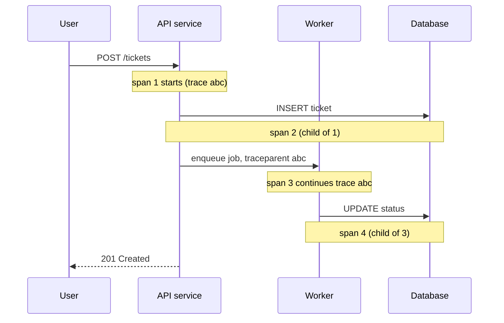
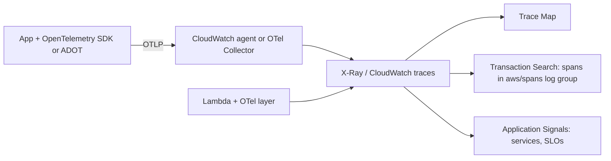

# Distributed Tracing: X-Ray and Application Insights

## Introduction

A user clicks "Submit ticket" and waits four seconds. Where did the time go? The request passed through an API gateway, an API container, a queue, a worker function, a database and a third-party email API. Metrics show that *something* is slow. Logs show what each service did, but nothing ties those lines together.

**Distributed tracing** follows one request across every service it touches, recording how long each step took. It is like a parcel tracking number: every depot scans it, so you can see exactly where the parcel sat for three days.

On the two clouds:

- **AWS:** **AWS X-Ray** stores and visualizes traces. It now sits inside CloudWatch as **Traces**, **Trace Map**, **Transaction Search** and **Application Signals**.
- **Azure:** **Application Insights**, part of Azure Monitor, provides the **Application Map**, the **transaction search** view and the end-to-end transaction view.

The most important update for 2026 is that **both clouds now treat OpenTelemetry as the main way to instrument applications**:

- **AWS** put the X-Ray SDKs and the X-Ray daemon into **maintenance mode on February 25, 2026**. They now get security fixes only. AWS recommends OpenTelemetry SDKs or the AWS Distro for OpenTelemetry (ADOT), with the CloudWatch agent or an OpenTelemetry Collector in place of the daemon. See the [X-Ray migration guide](https://docs.aws.amazon.com/xray/latest/devguide/xray-sdk-migration.html).
- **Azure** recommends the **Microsoft OpenTelemetry Distro** for new .NET, Node.js and Python apps, and the Azure Monitor OpenTelemetry Java agent for Java. Classic Application Insights SDKs are legacy. See [Enable OpenTelemetry in Application Insights](https://learn.microsoft.com/azure/azure-monitor/app/opentelemetry-enable).

This page teaches tracing once with OpenTelemetry, then shows how to send the same traces to each cloud.

## Core Concepts

| Term | Meaning | X-Ray name | Application Insights name |
| --- | --- | --- | --- |
| **Trace** | Everything that happened for one request, end to end | Trace | Operation (`operation_Id`) |
| **Span** | One timed unit of work, such as an HTTP call or DB query | Segment (server span) or subsegment | Request (server) or dependency (client) |
| **Span attributes** | Key-value details on a span | Annotations (indexed) and metadata | Custom dimensions (`customDimensions`) |
| **Context propagation** | Passing the trace ID to the next service | `X-Amzn-Trace-Id` header | W3C `traceparent` header |
| **Sampling** | Recording only some traces to control cost | Sampling rules | Sampling percentage or rate limit |
| **Service graph** | Map of services and calls between them | Trace Map | Application Map |



The key mechanism is **context propagation**. When the API calls the worker, it adds a header carrying the trace ID and the parent span ID. The standard header is W3C `traceparent`; AWS services also understand `X-Amzn-Trace-Id`. The worker reads the header and continues the same trace instead of starting a new one. If any hop drops the header, the trace breaks into two disconnected pieces. Broken propagation is the most common tracing problem.

## Step 1: Tracing Locally with OpenTelemetry

Before involving any cloud, see what spans look like. This example simulates two services in one process. It propagates context through a dictionary of headers exactly as an HTTP call would, and prints spans to the console.

```python
# trace_demo.py
# pip install opentelemetry-sdk
import time
from opentelemetry import trace, propagate
from opentelemetry.sdk.resources import Resource
from opentelemetry.sdk.trace import TracerProvider
from opentelemetry.sdk.trace.export import SimpleSpanProcessor, ConsoleSpanExporter
from opentelemetry.trace import SpanKind

provider = TracerProvider(resource=Resource.create({"service.name": "helpdesk-api"}))
provider.add_span_processor(SimpleSpanProcessor(ConsoleSpanExporter()))
trace.set_tracer_provider(provider)
tracer = trace.get_tracer("helpdesk.demo")

def worker_handle(headers: dict) -> None:
    # The "worker" extracts the context from incoming headers
    ctx = propagate.extract(headers)
    with tracer.start_as_current_span("process-ticket", context=ctx, kind=SpanKind.CONSUMER) as span:
        span.set_attribute("ticket.priority", "high")
        time.sleep(0.05)

def api_create_ticket() -> None:
    with tracer.start_as_current_span("POST /tickets", kind=SpanKind.SERVER) as span:
        span.set_attribute("tenant", "acme")
        with tracer.start_as_current_span("db.insert", kind=SpanKind.CLIENT):
            time.sleep(0.02)
        headers: dict = {}
        propagate.inject(headers)          # adds the W3C traceparent header
        print("outgoing headers:", headers)
        worker_handle(headers)

api_create_ticket()
```

Example output (trimmed; the console exporter prints full JSON per span, and each span prints when it ends):

```text
{ "name": "db.insert", "context": { "trace_id": "0xf25d6ee2d15fae7f3ee7c9cadddd0202", "span_id": "0xcf8452e0b61d00f8" },
  "kind": "SpanKind.CLIENT", "parent_id": "0x44aa35a5829308e7", ... }
outgoing headers: {'traceparent': '00-f25d6ee2d15fae7f3ee7c9cadddd0202-44aa35a5829308e7-03'}
{ "name": "process-ticket", "context": { "trace_id": "0xf25d6ee2d15fae7f3ee7c9cadddd0202", ... },
  "kind": "SpanKind.CONSUMER", "parent_id": "0x44aa35a5829308e7", "attributes": { "ticket.priority": "high" } }
{ "name": "POST /tickets", "context": { "trace_id": "0xf25d6ee2d15fae7f3ee7c9cadddd0202", "span_id": "0x44aa35a5829308e7" },
  "kind": "SpanKind.SERVER", "parent_id": null, "attributes": { "tenant": "acme" } }
```

All three spans share one `trace_id`. The `process-ticket` span's parent is the API span, even though it was started in "another service". That is propagation working. In real code you rarely call `inject` and `extract` yourself. Instrumentation libraries for Flask, FastAPI, `requests`, `boto3` and others do it for you.

## Step 2: Send Traces to AWS

### The AWS pieces



- **ADOT** (AWS Distro for OpenTelemetry) is AWS's supported build of OpenTelemetry, with X-Ray propagation, AWS resource detection and X-Ray remote sampling built in.
- The **CloudWatch agent** (or an OpenTelemetry Collector with the `awsxray` exporter) receives OTLP data from your app and forwards it. This replaces the X-Ray daemon.
- **Transaction Search** stores spans as structured logs in a CloudWatch Logs group called `aws/spans`. You can then search every span attribute, and index a percentage of spans as X-Ray trace summaries.
- **CloudWatch Application Signals** builds an APM view on top: per-service latency, errors and request volume, a service map, and SLOs.

### Zero-code instrumentation with ADOT

For a Python service on EC2, ECS or EKS, install the distro and launch your app through `opentelemetry-instrument`. Supported libraries such as Flask, `requests` and `botocore` are traced automatically:

```bash
pip install aws-opentelemetry-distro

export OTEL_PYTHON_DISTRO=aws_distro
export OTEL_PYTHON_CONFIGURATOR=aws_configurator
export OTEL_RESOURCE_ATTRIBUTES="service.name=helpdesk-api,deployment.environment=prod"
# Sample 10% of new traces; respect the caller's decision for continued traces
export OTEL_TRACES_SAMPLER=parentbased_traceidratio
export OTEL_TRACES_SAMPLER_ARG=0.1

opentelemetry-instrument python app.py
```

By default the distro exports OTLP to a local collector on `localhost:4317`. That collector is the CloudWatch agent or the ADOT/OpenTelemetry Collector, running as a sidecar, a DaemonSet or a host process. The collector needs an IAM role with `xray:PutTraceSegments` (plus CloudWatch permissions if you use Application Signals). No keys go in your application.

On **Lambda**, add the AWS-managed **Lambda layer for OpenTelemetry** and set `AWS_LAMBDA_EXEC_WRAPPER=/opt/otel-instrument`. Layer ARNs differ by Region and runtime, so copy them from the [Application Signals Lambda guide](https://docs.aws.amazon.com/AmazonCloudWatch/latest/monitoring/CloudWatch-Application-Signals-Enable-LambdaMain.html).

### Making attributes searchable in X-Ray

OpenTelemetry attributes become X-Ray **metadata** by default, which you cannot filter on. To make an attribute an indexed **annotation**, list its key in `aws.xray.annotations`:

```python
from opentelemetry import trace
from opentelemetry.trace import SpanKind

tracer = trace.get_tracer("helpdesk.api")

with tracer.start_as_current_span("POST /tickets", kind=SpanKind.SERVER) as span:
    span.set_attribute("tenant", "acme")
    span.set_attribute("plan", "pro")
    span.set_attribute("aws.xray.annotations", ["tenant", "plan"])
```

If you enable Transaction Search, all span attributes are searchable in the `aws/spans` log group anyway. Annotations still matter for X-Ray trace filter expressions.

### Reading traces from the CLI

```bash
# Trace summaries for slow requests in the last 15 minutes
aws xray get-trace-summaries \
  --start-time $(date -d '-15 minutes' +%s) \
  --end-time $(date +%s) \
  --filter-expression 'service("helpdesk-api") AND responsetime > 2' \
  --query 'TraceSummaries[].{id:Id,rt:ResponseTime,url:Http.HttpURL}' \
  --output table
```

Example output (trimmed):

```text
------------------------------------------------------------------------------
|                             GetTraceSummaries                              |
+-------------------------------------+-------+------------------------------+
|                 id                  |  rt   |             url              |
+-------------------------------------+-------+------------------------------+
|  1-6706e1a2-3f0c9d1b2e4a5c6d7e8f9a0b|  4.21 |  https://api.example.com/tickets |
|  1-6706e1b9-8a7b6c5d4e3f2a1b0c9d8e7f|  2.87 |  https://api.example.com/tickets |
+-------------------------------------+-------+------------------------------+
```

## Step 3: Send Traces to Azure

### The Azure pieces

- **Application Insights** is a resource that, in current deployments, stores its data in a **Log Analytics workspace** (workspace-based Application Insights). Classic, non-workspace resources have been retired.
- Your app authenticates to it with a **connection string**. The older "instrumentation key" alone is legacy.
- **Application Map** draws services and dependencies. **Transaction search** and the **end-to-end transaction** view show individual traces.
- The tables you query with KQL are `AppRequests` (server spans), `AppDependencies` (client spans), `AppExceptions` and `AppTraces` (logs).

### Instrumenting a Python app

```python
# app_azure.py
# pip install microsoft-opentelemetry flask
# export APPLICATIONINSIGHTS_CONNECTION_STRING="<copy from the Application Insights resource>"
# export OTEL_SERVICE_NAME=helpdesk-api
import logging
from microsoft.opentelemetry import use_microsoft_opentelemetry

# Initialize BEFORE importing the libraries you want auto-instrumented
use_microsoft_opentelemetry(enable_azure_monitor=True, logger_name="helpdesk")

from flask import Flask
from opentelemetry import trace

app = Flask(__name__)
tracer = trace.get_tracer("helpdesk.api")
log = logging.getLogger("helpdesk")
log.setLevel(logging.INFO)

@app.post("/tickets")
def create_ticket():
    with tracer.start_as_current_span("validate-ticket") as span:
        span.set_attribute("tenant", "acme")
    log.info("ticket created")        # lands in AppTraces with the same operation_Id
    return {"id": "T-1042"}, 201
```

Incoming Flask requests become `AppRequests` rows. The `validate-ticket` span and any outgoing HTTP calls become `AppDependencies` rows. The log line is correlated to the same `operation_Id`.

:::note Two distro names
Older Azure tutorials use `pip install azure-monitor-opentelemetry` and `configure_azure_monitor()`. That **Azure Monitor OpenTelemetry Distro** still works, and Microsoft says existing users need no action. For new apps, Microsoft now points to the **Microsoft OpenTelemetry Distro** shown above. Do not initialize both in the same app. Package names in this area have changed more than once, so check the [current guide](https://learn.microsoft.com/azure/azure-monitor/app/opentelemetry-enable) before you start.
:::

If several services send to one Application Insights resource, set a distinct **cloud role name** for each (`OTEL_SERVICE_NAME` or the `service.name` resource attribute). Otherwise they appear as one box on the Application Map.

### Querying traces with KQL

```text
AppRequests
| where TimeGenerated > ago(1h) and Name == "POST /tickets"
| summarize p95 = percentile(DurationMs, 95), failures = countif(Success == false) by bin(TimeGenerated, 5m)
```

To see where the time went in slow requests, join requests to their dependencies:

```text
AppRequests
| where TimeGenerated > ago(1h) and DurationMs > 2000
| join kind=inner (
    AppDependencies
    | project OperationId, Target, DependencyType, DepMs = DurationMs
  ) on OperationId
| summarize avgDepMs = avg(DepMs), calls = count() by Target, DependencyType
| top 5 by avgDepMs desc
```

Example output (trimmed):

```text
Target                     DependencyType  avgDepMs  calls
-------------------------  --------------  --------  -----
api.mailprovider.example   HTTP            3120.4    18
pg-helpdesk.postgres...    postgresql      41.7      54
```

The slow dependency here is the third-party email API, not your database.

## Sampling: Keep Costs Sane

Recording every span of every request is expensive at scale. Both clouds bill per trace or span ingested, or per GB, and prices vary by Region (see the [CloudWatch pricing](https://aws.amazon.com/cloudwatch/pricing/) and [Azure Monitor pricing](https://azure.microsoft.com/pricing/details/monitor/) pages). Sampling decides which traces to keep.

| Strategy | How it works | Pros | Cons |
| --- | --- | --- | --- |
| **Head sampling (ratio)** | Decide at the first span: keep 10% | Cheap, simple | Might drop the rare slow or failed request |
| **Parent-based** | Follow the upstream service's decision | Traces stay complete across services | Needs all services configured consistently |
| **Rate limiting** | Keep N traces per second | Predictable cost | Busy periods are under-sampled |
| **Tail sampling (in collector)** | Decide after the trace finishes: keep all errors and slow ones | Keeps the interesting traces | Collector must buffer spans; more to operate |
| **X-Ray sampling rules** | Central rules, such as 1 per second plus 5% | Change without redeploying | AWS-specific; ADOT or supported SDKs only |

Sampling also affects logs. If you put the trace ID in every log line, as shown in the next section, some log lines will point at traces that were sampled out. That is expected. The logs are still useful on their own.

## Connecting Traces and Logs

A trace tells you *where* time went. The logs from that span tell you *why*. To jump from one to the other, write the current trace ID into each structured log line. The Azure distro does this automatically for logs sent through it. With plain OpenTelemetry or on AWS, you can do it yourself:

```python
# log_with_trace_id.py
# pip install opentelemetry-sdk
import json
from opentelemetry import trace
from opentelemetry.sdk.trace import TracerProvider

trace.set_tracer_provider(TracerProvider())
tracer = trace.get_tracer("helpdesk.api")

def log(msg: str, **fields) -> None:
    ctx = trace.get_current_span().get_span_context()
    if ctx.is_valid:
        fields["traceId"] = format(ctx.trace_id, "032x")
        fields["spanId"] = format(ctx.span_id, "016x")
    print(json.dumps({"msg": msg, **fields}))

with tracer.start_as_current_span("POST /tickets"):
    log("ticket created", tenant="acme")
```

Example output:

```text
{"msg": "ticket created", "tenant": "acme", "traceId": "5c1e0f9a7d3b4e2f8a6c1d0e9b7f3a21", "spanId": "8e2d4c6a1b3f5e7d"}
```

With Transaction Search on AWS, the `aws/spans` log group and your application log groups share this trace ID, so one Logs Insights query can pull both. On Azure, `AppTraces` rows carry the same `OperationId` as the request.

Default sampling differs by tool and version. The Application Insights Java agent, for example, defaults to a rate limit. Always check what your distro does, so you are not surprised by missing traces or by the bill.

## Real-World Scenario

Your helpdesk SaaS has a checkout flow for upgrading plans: web front end, API, billing service, payment provider, and a worker that sends receipts. Customers report that upgrades "sometimes hang". The p95 latency metric shows spikes, but nobody knows which hop is slow. The API runs on AWS (ECS) and the billing service on Azure (Container Apps), for historical reasons.

**What you do:**

1. **Instrument every service with OpenTelemetry.** Use ADOT auto-instrumentation on the ECS services, and the Microsoft OpenTelemetry Distro on Container Apps. Application code only uses the vendor-neutral `opentelemetry` API.
2. **Use W3C `traceparent` everywhere.** It is the OpenTelemetry default. Keep the X-Ray propagator enabled on AWS too, because AWS services such as API Gateway, SQS and Lambda use the X-Ray header.
3. **Pick a home for cross-cloud traces.** Each cloud's backend only sees its own spans. You can accept two partial views linked by the shared trace ID, or run an OpenTelemetry Collector that sends spans to both clouds or to one neutral backend such as Grafana Tempo, Jaeger or a commercial APM.
4. **Sample smartly.** Keep 100% of errors and slow requests using tail sampling in the collector, plus 5% of normal traffic.
5. **Correlate logs.** Put the trace ID into every structured log line (see [Centralized Logging](./1-cloud-logging.mdx)).

The first slow trace shows the billing service calling the payment provider three times because of an aggressive retry policy with no backoff.

**Why this approach:** OpenTelemetry instrumentation is portable, so you are not locked into either backend. Both clouds now recommend it, and X-Ray's own SDKs are in maintenance mode.

**When not to use it:** a single monolith with one database may get more value from good logs and a profiler. Tracing shines when requests cross process boundaries.

### Alternatives and trade-offs

| Approach | Pros | Cons | Best for |
| --- | --- | --- | --- |
| CloudWatch traces / Application Signals | Native IAM, integrates with Lambda, API Gateway, SQS; SLOs | AWS-only view | AWS-centric workloads |
| Application Insights | Rich Application Map, KQL over traces, logs and metrics together | Azure-only view; ingestion-based cost | Azure-centric workloads |
| Jaeger or Grafana Tempo (self-hosted) | Open source, cloud-neutral | You run storage and scaling | Teams already running Grafana |
| Commercial APM (Datadog, Dynatrace, New Relic, and others) | One view across clouds, strong UIs | Licensing cost, data egress | Multi-cloud orgs |
| Legacy X-Ray SDK / classic App Insights SDK | Existing code keeps working | Maintenance mode or legacy; fewer features | Only while migrating |

## Common Mistakes

- **Starting new projects on the X-Ray SDK or daemon.** Both have been in maintenance mode since February 2026. Use OpenTelemetry with the CloudWatch agent or a collector.
- **Broken propagation.** Message queues and custom HTTP clients often drop trace headers. Check that the consumer span has the producer as its parent.
- **Initializing tracing too late.** On Azure, the distro must be configured before you import Flask, `requests` and similar libraries, or they will not be instrumented.
- **Same service name everywhere.** Set `service.name` (the cloud role name) per service, or your service map collapses into one box.
- **No sampling plan.** You end up with either a surprise bill or no traces when you need them.
- **Sensitive data in attributes.** Span attributes are stored and searchable. Never put tokens, passwords or full card numbers in them.

## Summary

- A trace is a tree of spans sharing one trace ID. Context propagation through headers links spans across services.
- OpenTelemetry is now the recommended way to instrument on both clouds. The X-Ray SDKs and daemon entered maintenance mode on February 25, 2026.
- On AWS, send OTLP to the CloudWatch agent or an OpenTelemetry Collector, then use X-Ray traces, Transaction Search and Application Signals in CloudWatch.
- On Azure, use the Microsoft OpenTelemetry Distro (or the existing Azure Monitor OpenTelemetry Distro) with an Application Insights connection string, and query `AppRequests` and `AppDependencies` with KQL.
- Choose a sampling strategy deliberately, and keep sensitive data out of span attributes.

## Exercises

1. Run `trace_demo.py`. Remove the `context=ctx` argument in `worker_handle` and observe how the trace breaks into two. Explain why.
2. Add a second child span inside `process-ticket` that simulates a call to an email API, and make it slower than the DB call. Which span would you look at first in a trace view?
3. Write the KQL query that returns the ten slowest `POST /tickets` requests in the last day, along with their operation IDs.
4. Design a sampling policy for a service that handles 2,000 requests per second, where errors are rare but critical. Explain where you would run tail sampling.

Related pages: [Monitoring: CloudWatch and Azure Monitor](./0-cloud-monitoring.mdx), [Alerting and Dashboards](./3-cloud-alerting.mdx), [Event-Driven Patterns in the Cloud](../9-cloud-messaging-and-integration/4-cloud-event-driven-patterns.mdx).
