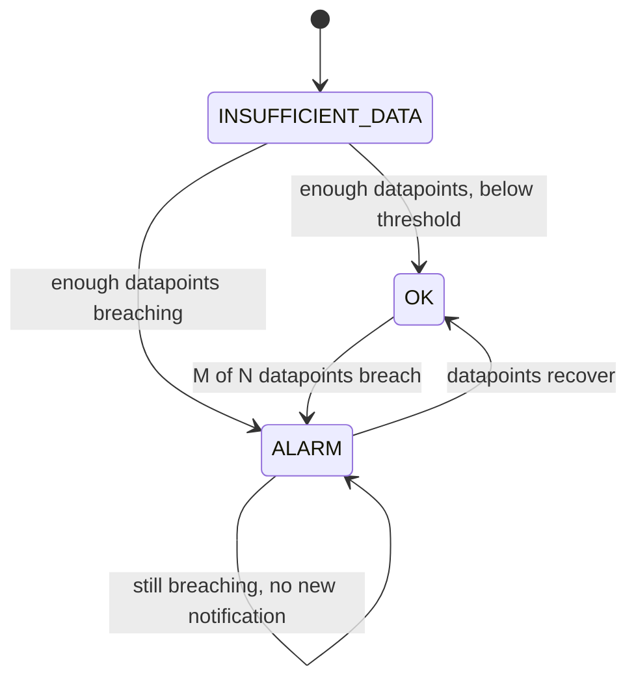

# Alerting and Dashboards

## Introduction

Collecting metrics and logs is only half the job. Somebody has to notice when things go wrong, ideally before customers do. That is what **alerts** are for. **Dashboards** give humans a quick picture of system health during an incident or a weekly review.

Good alerting is surprisingly hard. With too few alerts, outages go unnoticed. With too many, people start ignoring them. That is called **alert fatigue**, and it is how real outages get missed. Think of a smoke detector that beeps every time you make toast: before long, someone takes the battery out.

On the two clouds:

- **AWS:** **CloudWatch alarms** watch metrics and notify through **Amazon SNS** (or trigger actions like autoscaling). **CloudWatch dashboards** visualize metrics and log queries.
- **Azure:** **Azure Monitor alert rules** (metric, log search and activity log alerts) notify through **action groups**. **Workbooks**, **Azure dashboards** and **Azure Managed Grafana** visualize data.

This page assumes you have read [Monitoring: CloudWatch and Azure Monitor](./0-cloud-monitoring.mdx) and [Centralized Logging](./1-cloud-logging.mdx). For tool-neutral alerting ideas, see the site's [Grafana alerting best practices](../../../observability/grafana/6-grafana-alerting/15-alerting-best-practices.mdx) and [Prometheus alerting overview](../../../observability/prometheus/4-prometheus-alerting/0-prometheus-alerting-overview.mdx).

## What Makes a Good Alert

Before touching any console, decide *what* deserves to wake someone up. A useful rule of thumb:

| Alert on | Example | Why |
| --- | --- | --- |
| **Symptoms users feel** | Error rate above 2% for 5 minutes; p95 latency above 1 s | Directly tied to customer pain |
| **Imminent saturation** | Disk will be full in 4 hours; DB connections at 90% | Gives time to act before an outage |
| **Broken business flow** | Zero tickets created in 15 minutes during business hours | Catches "everything is green but nothing works" |
| *Not* individual causes | One container restarted; CPU at 85% for 2 minutes | Often harmless; better on a dashboard or as a low-priority ticket |

Then set a **severity** for each alert:

- **Page** (wake someone up): customers are affected right now.
- **Ticket** (handle during work hours): something degrades slowly, such as a certificate expiring in 14 days.
- **Dashboard only:** useful context, but nobody needs to act.

Every paging alert should link to a **runbook**: what this alert means, how to check it, and how to mitigate it.

## Alarm States and Evaluation



Both clouds evaluate an alert over a time window instead of reacting to a single data point:

| Setting | CloudWatch alarm | Azure metric alert |
| --- | --- | --- |
| Size of each data point | `Period`, such as 60 seconds | Aggregation granularity (`--window-size`) |
| How often it is checked | Every period | `--evaluation-frequency`, such as 1m |
| Breach rule | `DatapointsToAlarm` out of `EvaluationPeriods` ("M of N") | Number of violations out of evaluation periods (dynamic thresholds) or a single window |
| Missing data | `TreatMissingData`: `missing`, `notBreaching`, `breaching`, `ignore` | Depends on rule type; log alerts can be configured |
| States | `OK`, `ALARM`, `INSUFFICIENT_DATA` | Fired, Resolved (auto-mitigate), with monitor conditions |
| Severity | Not built in; use names or tags | Built in: Sev0 (critical) to Sev4 (verbose) |

**M of N** is your main tool against flapping. "3 of 5 one-minute periods above threshold" tolerates a brief spike but still fires within about 5 minutes of a real problem.

## Step 1: Alerts on AWS

:::warning Cost and cleanup
CloudWatch bills per alarm per month (more for high-resolution and anomaly-detection alarms) and per dashboard beyond the free tier. SNS email notifications are cheap, but SMS can cost more depending on country. Check the [CloudWatch pricing page](https://aws.amazon.com/cloudwatch/pricing/). Cleanup commands are at the end of this section.
:::

### Create a notification topic

```bash
TOPIC_ARN=$(aws sns create-topic --name helpdesk-alerts --query TopicArn --output text)

aws sns subscribe --topic-arn "$TOPIC_ARN" \
  --protocol email --notification-endpoint oncall@example.com
```

Example output:

```text
{
    "SubscriptionArn": "pending confirmation"
}
```

The recipient must click the confirmation link in the email. Until then, nothing is delivered. Teams often forget this and discover it during their first incident. For chat notifications, connect the SNS topic to **Amazon Q Developer in chat applications** (formerly AWS Chatbot) for Slack, Microsoft Teams or Amazon Chime. For paging, use an incident tool's SNS integration.

### An alarm on error rate with metric math

Alerting on a raw error *count* misfires when traffic changes: 10 errors are alarming at 3 a.m. but normal at peak. An error **rate** is better. CloudWatch computes it with metric math:

```json
[
  {
    "Id": "errors",
    "MetricStat": {
      "Metric": {
        "Namespace": "AWS/ApplicationELB",
        "MetricName": "HTTPCode_Target_5XX_Count",
        "Dimensions": [{ "Name": "LoadBalancer", "Value": "app/helpdesk-alb/50dc6c495c0c9188" }]
      },
      "Period": 60,
      "Stat": "Sum"
    },
    "ReturnData": false
  },
  {
    "Id": "requests",
    "MetricStat": {
      "Metric": {
        "Namespace": "AWS/ApplicationELB",
        "MetricName": "RequestCount",
        "Dimensions": [{ "Name": "LoadBalancer", "Value": "app/helpdesk-alb/50dc6c495c0c9188" }]
      },
      "Period": 60,
      "Stat": "Sum"
    },
    "ReturnData": false
  },
  {
    "Id": "error_rate",
    "Expression": "IF(requests > 20, 100 * errors / requests, 0)",
    "Label": "5xx error rate (%)",
    "ReturnData": true
  }
]
```

The `IF(requests > 20, ...)` guard avoids alarming on "1 error out of 2 requests" during quiet hours. Save the JSON as `error-rate.json` and create the alarm:

```bash
aws cloudwatch put-metric-alarm \
  --alarm-name helpdesk-api-error-rate \
  --alarm-description "Runbook: https://wiki.example.com/runbooks/api-errors" \
  --metrics file://error-rate.json \
  --comparison-operator GreaterThanThreshold \
  --threshold 2 \
  --evaluation-periods 5 \
  --datapoints-to-alarm 3 \
  --treat-missing-data notBreaching \
  --alarm-actions "$TOPIC_ARN" \
  --ok-actions "$TOPIC_ARN"

# Fire it on purpose to test the notification path
aws cloudwatch set-alarm-state --alarm-name helpdesk-api-error-rate \
  --state-value ALARM --state-reason "Testing notifications"

aws cloudwatch describe-alarms --alarm-names helpdesk-api-error-rate \
  --query 'MetricAlarms[].{name:AlarmName,state:StateValue}' --output table
```

Example output:

```text
-----------------------------------------
|            DescribeAlarms             |
+---------------------------+-----------+
|           name            |   state   |
+---------------------------+-----------+
|  helpdesk-api-error-rate  |  ALARM    |
+---------------------------+-----------+
```

The alarm returns to its real state at the next evaluation. Testing the notification path regularly is cheap insurance.

### Composite alarms and anomaly detection

- **Composite alarms** combine other alarms with `AND`, `OR` and `NOT`. Use them to page only when several symptoms agree, or to mute child alarms during a known incident:

```bash
aws cloudwatch put-composite-alarm \
  --alarm-name helpdesk-api-degraded \
  --alarm-rule 'ALARM("helpdesk-api-error-rate") OR (ALARM("helpdesk-api-latency-p95") AND ALARM("helpdesk-db-cpu"))' \
  --alarm-actions "$TOPIC_ARN"
```

- **Anomaly detection alarms** learn a metric's normal daily and weekly pattern, then alarm outside a band. They suit metrics with strong seasonality, such as `TicketsCreated`, where a fixed threshold is wrong half the day.
- **Log-based alarms:** a **metric filter** turns matching log lines into a metric (for example, count lines with `"level": "ERROR"`), and you alarm on that metric.

### Cleanup (AWS)

```bash
aws cloudwatch delete-alarms --alarm-names helpdesk-api-degraded
aws cloudwatch delete-alarms --alarm-names helpdesk-api-error-rate
aws sns delete-topic --topic-arn "$TOPIC_ARN"
```

Delete the composite alarm first. CloudWatch will not delete an alarm that a composite alarm still references.

## Step 2: Alerts on Azure

Azure separates the **alert rule** (what to watch) from the **action group** (who to notify and what to run). One action group, such as "helpdesk on-call", is reused by many rules.

| Alert rule type | Watches | Typical use |
| --- | --- | --- |
| **Metric alert** | Platform or custom metrics | CPU, request rate, queue length; supports dynamic thresholds |
| **Log search alert** | A KQL query on a schedule | Error rates from `AppRequests`, specific log patterns |
| **Activity log alert** | Control-plane events | "Someone deleted a resource", Service Health notices |
| **Smart detection / Prometheus alerts** | App Insights anomalies; PromQL rules | Failure anomalies; Kubernetes |

:::warning Cost and cleanup
Azure bills alert rules per monitored time series (metric alerts) or by evaluation frequency (log search alerts). SMS and voice notifications are also billed. Check the [Azure Monitor pricing page](https://azure.microsoft.com/pricing/details/monitor/). Cleanup is at the end of this section.
:::

### Create an action group and alert rules

```bash
RG=rg-helpdesk-prod

az monitor action-group create \
  --resource-group $RG \
  --name ag-helpdesk-oncall \
  --short-name hdoncall \
  --action email oncall oncall@example.com usecommonalertschema

AG_ID=$(az monitor action-group show -g $RG -n ag-helpdesk-oncall --query id -o tsv)
VM_ID=$(az vm show -g $RG -n vm-web-01 --query id -o tsv)

# Metric alert: CPU above 90% averaged over 5 minutes, checked every minute
az monitor metrics alert create \
  --resource-group $RG \
  --name alert-web-cpu-high \
  --scopes "$VM_ID" \
  --condition "avg Percentage CPU > 90" \
  --window-size 5m \
  --evaluation-frequency 1m \
  --severity 2 \
  --action "$AG_ID" \
  --description "Runbook: https://wiki.example.com/runbooks/web-cpu"
```

Example output (trimmed):

```text
{
  "criteria": { "allOf": [ { "metricName": "Percentage CPU", "operator": "GreaterThan", "threshold": 90.0, "timeAggregation": "Average" } ] },
  "evaluationFrequency": "PT1M",
  "name": "alert-web-cpu-high",
  "severity": 2,
  "windowSize": "PT5M"
}
```

For an **error-rate** alert based on Application Insights data, use a log search alert. The `scheduled-query` commands are an Azure CLI extension that installs automatically the first time you run them:

```bash
AI_ID=$(az monitor app-insights component show -g $RG --app appi-helpdesk --query id -o tsv)

az monitor scheduled-query create \
  --resource-group $RG \
  --name alert-api-error-rate \
  --scopes "$AI_ID" \
  --condition "avg 'ErrorRate' from 'ErrQuery' > 2 at least 3 violations out of 5 aggregated points" \
  --condition-query ErrQuery="requests | summarize total = count(), failed = countif(success == false) by bin(timestamp, 1m) | where total > 20 | extend ErrorRate = 100.0 * failed / total" \
  --window-size 5m \
  --evaluation-frequency 1m \
  --severity 1 \
  --action-groups "$AG_ID"
```

When scoped to an Application Insights resource, queries use the classic table names (`requests`, `success`, `timestamp`). When scoped to a Log Analytics workspace, use `AppRequests`, `Success` and `TimeGenerated`. Mixing these up is a common reason a log alert "never fires".

Two more Azure features worth knowing:

- **Alert processing rules** suppress notifications during planned maintenance, or add an action group to every alert in a scope, without editing each rule.
- **Dynamic thresholds** on metric alerts learn normal behavior, much like CloudWatch anomaly detection.

### Cleanup (Azure)

```bash
az monitor scheduled-query delete -g $RG -n alert-api-error-rate --yes
az monitor metrics alert delete -g $RG -n alert-web-cpu-high
az monitor action-group delete -g $RG -n ag-helpdesk-oncall
```

## Step 3: Alerts as Code

Alerts created by clicking around get lost, drift between environments, and are never reviewed. Define them in Terraform (or CloudFormation and Bicep) next to the service they protect:

```hcl
# alerts.tf - one alarm per cloud, sharing a threshold variable
variable "cpu_threshold" {
  type    = number
  default = 90
}

resource "aws_sns_topic" "alerts" {
  name = "helpdesk-alerts"
}

resource "aws_cloudwatch_metric_alarm" "worker_cpu" {
  alarm_name          = "helpdesk-worker-cpu-high"
  namespace           = "AWS/ECS"
  metric_name         = "CPUUtilization"
  dimensions          = { ClusterName = "helpdesk", ServiceName = "worker" }
  statistic           = "Average"
  period              = 60
  evaluation_periods  = 5
  datapoints_to_alarm = 3
  threshold           = var.cpu_threshold
  comparison_operator = "GreaterThanThreshold"
  treat_missing_data  = "notBreaching"
  alarm_actions       = [aws_sns_topic.alerts.arn]
  ok_actions          = [aws_sns_topic.alerts.arn]
}

resource "azurerm_monitor_action_group" "oncall" {
  name                = "ag-helpdesk-oncall"
  resource_group_name = "rg-helpdesk-prod"
  short_name          = "hdoncall"

  email_receiver {
    name                    = "oncall"
    email_address           = "oncall@example.com"
    use_common_alert_schema = true
  }
}

resource "azurerm_monitor_metric_alert" "web_cpu" {
  name                = "alert-web-cpu-high"
  resource_group_name = "rg-helpdesk-prod"
  scopes              = [var.web_vm_id]
  severity            = 2
  frequency           = "PT1M"
  window_size         = "PT5M"

  criteria {
    metric_namespace = "Microsoft.Compute/virtualMachines"
    metric_name      = "Percentage CPU"
    aggregation      = "Average"
    operator         = "GreaterThan"
    threshold        = var.cpu_threshold
  }

  action {
    action_group_id = azurerm_monitor_action_group.oncall.id
  }
}

variable "web_vm_id" {
  type = string
}
```

Review alert changes in pull requests like any other code. See [Terraform for AWS and Azure](../10-cloud-infrastructure-as-code/4-cloud-terraform-multi-cloud.mdx) and the site's [Terraform tutorial](/docs/devops/terraform).

## Step 4: Dashboards

A dashboard should answer one question quickly, such as "Is the helpdesk API healthy right now?" Avoid giant walls of 60 graphs that nobody can read during an incident.

### On AWS: CloudWatch dashboards

Dashboards are JSON documents, so you can keep them in version control:

```json
{
  "widgets": [
    {
      "type": "metric", "x": 0, "y": 0, "width": 12, "height": 6,
      "properties": {
        "title": "Requests per minute",
        "region": "us-east-1",
        "stat": "Sum",
        "period": 60,
        "metrics": [["AWS/ApplicationELB", "RequestCount", "LoadBalancer", "app/helpdesk-alb/50dc6c495c0c9188"]]
      }
    },
    {
      "type": "alarm", "x": 12, "y": 0, "width": 12, "height": 6,
      "properties": { "title": "Alarms", "alarms": ["arn:aws:cloudwatch:us-east-1:111122223333:alarm:helpdesk-api-error-rate"] }
    }
  ]
}
```

```bash
aws cloudwatch put-dashboard --dashboard-name helpdesk-api --dashboard-body file://dashboard.json
# Cleanup
aws cloudwatch delete-dashboards --dashboard-names helpdesk-api
```

CloudWatch dashboards can also show Logs Insights query results, and with cross-account observability, metrics from other accounts and Regions.

### On Azure: Workbooks, dashboards and Grafana

- **Workbooks** are interactive reports that mix KQL queries, metrics, text and parameters, such as a drop-down to pick an environment. They are the most flexible native option, and many Azure "Insights" experiences are built from workbooks.
- **Azure dashboards** pin tiles from many resources onto one page. They are good for a simple at-a-glance view.
- **Azure Managed Grafana**, and Grafana dashboards inside the Azure portal, suit teams that already use Grafana or need multi-cloud views.

| Need | AWS | Azure |
| --- | --- | --- |
| Quick ops view | CloudWatch dashboard | Azure dashboard |
| Interactive investigation report | CloudWatch dashboard with variables, Logs Insights widgets | Workbook |
| Multi-cloud or PromQL | Amazon Managed Grafana | Azure Managed Grafana |
| Service health and SLOs | Application Signals | Application Insights, plus workbooks |

## Real-World Scenario

Your five-person team runs the helpdesk API on AWS and a reporting service on Azure. On-call is a rotation, and last month the on-call engineer received 140 alert emails in one week. They started ignoring them, and a real database outage went unnoticed for an hour.

**What you change:**

1. **Audit existing alerts.** For each alert, ask: did it fire in the last 30 days, and did anyone act? Delete alerts that nobody acted on, or downgrade them to dashboard-only.
2. **Page on symptoms only.** Keep error rate, p95 latency, a "no tickets created in 15 minutes during business hours" check, and DB storage forecast. Everything else becomes a ticket or a dashboard tile.
3. **Use M-of-N and rates.** Switch from raw counts to rates with minimum-traffic guards, and use 3-of-5 evaluation.
4. **One route per severity.** Paging alerts go to an incident tool through SNS on AWS and through an action group webhook on Azure. Warnings go to a chat channel. Everything is defined in Terraform.
5. **Runbook link in every alert description,** and a monthly review of what fired.

Alert volume drops by more than 80%, and every remaining page means something.

**Why this approach:** symptom-based alerts track customer impact directly. Native alarms need no extra infrastructure, and code-defined alerts stay consistent across environments.

**When not to use it:** if you already run Prometheus and Grafana for Kubernetes, defining alerts there and routing them through Alertmanager or Grafana alerting may be simpler than maintaining two native alerting systems.

### Alternatives and trade-offs

| Approach | Pros | Cons | Best for |
| --- | --- | --- | --- |
| Native (CloudWatch alarms + SNS, Azure alert rules + action groups) | No extra infrastructure; sees every platform metric; IaC support | Two systems in multi-cloud; basic routing and on-call features | Most teams |
| Prometheus Alertmanager / Grafana alerting | Rich routing, grouping and silencing; portable | Needs metrics in Prometheus or Grafana data sources | Kubernetes-heavy teams |
| Incident management tools (PagerDuty, Opsgenie, incident.io, and others) | Schedules, escalation, acknowledgements | Extra cost; still need alert sources | Any team with real on-call |
| Commercial observability (Datadog, New Relic, and others) | One alerting UI across clouds | Licensing; data export | Large multi-cloud estates |

## Common Mistakes

- **Alerting on causes instead of symptoms,** which leads to noisy pages for harmless CPU spikes.
- **Raw counts without traffic guards,** which fire at night or miss problems at peak.
- **Unconfirmed SNS email subscriptions** and untested action groups. Test with `set-alarm-state` or Azure's "Test action group" feature.
- **Wrong table names in Azure log alerts** (`requests` versus `AppRequests`) depending on the rule's scope.
- **Treating missing data as breaching** for sparse metrics, which causes constant false alarms. Or treating it as "not breaching" for a heartbeat metric, which hides a dead service.
- **No runbook,** so whoever gets paged at 3 a.m. starts from zero.
- **Click-ops alerts** that exist only in production and drift from staging.

## Summary

- Alert on user-facing symptoms, imminent saturation and broken business flows. Put the rest on dashboards.
- CloudWatch alarms use periods, M-of-N evaluation and missing-data handling, notify via SNS, and can be combined into composite alarms.
- Azure alert rules (metric, log search, activity log) notify through reusable action groups, with built-in severities and alert processing rules for suppression.
- Define alerts and dashboards as code, test notification paths, and attach a runbook to every page.
- CloudWatch dashboards, Azure workbooks and managed Grafana each fit different visualization needs.

## Exercises

1. Write the CloudWatch metric-math JSON for a p95 latency alarm on `TargetResponseTime` that only evaluates when `RequestCount` is above 50 per minute.
2. Convert the Azure log search alert above to work when scoped to a Log Analytics workspace, using `AppRequests` column names.
3. Review the alerts in a system you know. Classify each one as page, ticket or dashboard-only, and justify your choices.
4. Extend `alerts.tf` with an `aws_cloudwatch_composite_alarm` that fires only when both the error-rate and latency alarms are in `ALARM`.

Related pages: [Monitoring: CloudWatch and Azure Monitor](./0-cloud-monitoring.mdx), [Distributed Tracing: X-Ray and Application Insights](./2-cloud-tracing.mdx), [Project: Cost Monitoring and Alerts](../14-cloud-projects/6-cloud-project-cost-dashboard.mdx).
