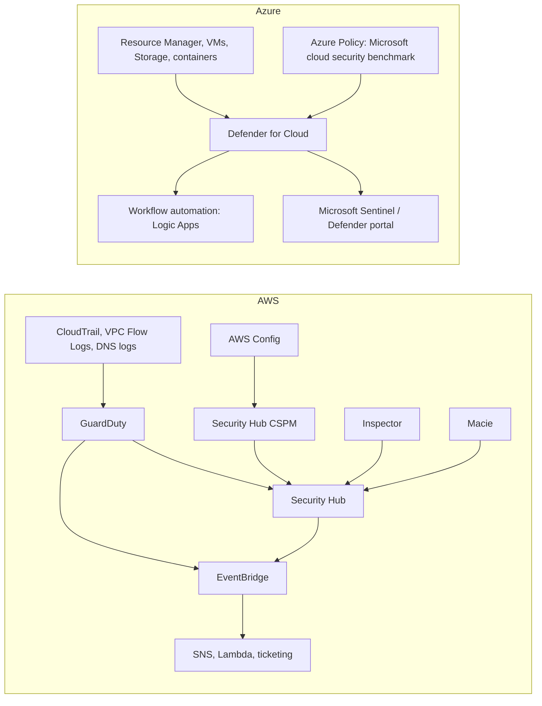

# Cloud Security Services: GuardDuty, Security Hub and Defender

## Introduction

Your cloud accounts are under constant automated attack. Bots scan for open ports, try leaked access keys within minutes of a public GitHub push, and look for public storage buckets. You cannot watch every API call yourself. Both clouds sell managed security services that do the watching for you:

- **Threat detection:** "Something suspicious is happening right now." A key is being used from an unusual country, or an instance is talking to a known crypto-mining pool.
- **Posture management (CSPM):** "Your configuration is risky." A bucket is public, MFA is off for an admin, or a security group allows SSH from anywhere.
- **Vulnerability management:** "This VM, container image or Lambda has a known CVE."
- **Aggregation and response:** "Here are all the findings in one place, prioritized, with automation hooks."

A good analogy is a building: threat detection is the security guard watching cameras, posture management is the inspector checking that doors lock and fire exits are clear, and the aggregation service is the control room that sees both.

This page focuses on the **AWS and Azure services themselves**: what each does, how to switch them on, and how to route findings. For the underlying concepts, see the Cybersecurity tutorial: [Cloud Security Posture Management](../../../fundamental/security/8-sec-cloud-and-container/7-sec-cspm.mdx) explains CSPM tooling (including open-source scanners such as Prowler), and [Common Cloud Misconfigurations](../../../fundamental/security/8-sec-cloud-and-container/2-sec-cloud-misconfigurations.mdx) covers what these tools find.

## The Service Landscape

| Job | AWS | Azure |
| --- | --- | --- |
| Threat detection | **Amazon GuardDuty** (plus protection plans for S3, EKS, runtime, malware, RDS, Lambda, AI) | **Microsoft Defender for Cloud** workload protection plans (Defender for Servers, Storage, Containers, Resource Manager, Key Vault, Databases, and more) |
| Posture management | **AWS Security Hub CSPM** (control checks built on AWS Config) | **Defender for Cloud**: Foundational CSPM (free) and **Defender CSPM** (paid) |
| Unified risk view | **AWS Security Hub** (correlates findings, exposure findings, attack paths) | **Defender for Cloud**, increasingly inside the **Microsoft Defender portal** |
| Vulnerability scanning | **Amazon Inspector** (EC2, ECR images, Lambda) | Defender for Servers / Defender for Containers vulnerability assessment |
| Sensitive data discovery | **Amazon Macie** (S3) | Defender CSPM data-aware posture; Microsoft Purview |
| Unused or excessive access | **IAM Access Analyzer** | Microsoft Entra access reviews, Entra ID Protection |
| Investigation | **Amazon Detective** | Microsoft Sentinel and Defender XDR investigations |
| SIEM | No first-party SIEM. **Amazon Security Lake** collects data in OCSF format for your SIEM. | **Microsoft Sentinel** |

### Names changed recently

Security product names move fast, and older tutorials use outdated ones:

- **AWS Security Hub vs Security Hub CSPM.** AWS renamed the original Security Hub, the one that runs control checks against standards like CIS and the AWS Foundational Security Best Practices, to **AWS Security Hub CSPM**. The name **AWS Security Hub** now refers to a newer unified service. It correlates signals from Security Hub CSPM, GuardDuty, Inspector, Macie and IAM Access Analyzer, produces *exposure findings* and attack path graphs, and uses the **OCSF** finding format. In the AWS CLI, the newer service uses commands with a `-v2` suffix, such as `enable-security-hub-v2`. See [What is AWS Security Hub](https://docs.aws.amazon.com/securityhub/latest/userguide/what-is-securityhub-v2.html).
- **Defender for Cloud in the Defender portal.** Microsoft is bringing Defender for Cloud features into the unified **Microsoft Defender portal** alongside Defender XDR and Microsoft Sentinel. Some features appear only in one portal for now. See the [Defender for Cloud overview](https://learn.microsoft.com/azure/defender-for-cloud/defender-for-cloud-introduction).
- **Azure Security Center** and **Azure Defender** are old names for what is now Defender for Cloud.

## How the Pieces Fit



An important structural difference: on Azure, **Defender for Cloud's posture checks are Azure Policy assignments**. The default initiative is the **Microsoft cloud security benchmark**. On AWS, Security Hub CSPM controls run mostly as **AWS Config rules** that Security Hub manages for you. Either way, the posture service depends on a configuration-recording service underneath. On AWS, you must have **AWS Config recording turned on** for most Security Hub CSPM controls to work.

## Step 1: Threat Detection

:::warning Cost and cleanup
GuardDuty, Security Hub, Inspector and the Defender plans are **billed by volume**: events or GB analyzed, resources protected, checks run, or findings ingested. Most offer a **30-day free trial** per account and Region, which ends automatically, and charges begin without warning. Use the usage pages in each console to estimate costs before the trial ends. Check the [GuardDuty pricing](https://aws.amazon.com/guardduty/pricing/), [Security Hub pricing](https://aws.amazon.com/security-hub/pricing/) and [Defender for Cloud pricing](https://azure.microsoft.com/pricing/details/defender-for-cloud/) pages. Cleanup commands are at the end of this page.
:::

### On AWS: GuardDuty

GuardDuty analyzes **foundational data sources** automatically: CloudTrail management events, VPC flow logs and DNS logs. You do not turn on those logs yourself, and you install nothing. Optional **protection plans** add S3 data events, EKS audit logs, runtime monitoring (an agent on EKS, EC2 and ECS/Fargate), malware scanning, RDS login activity, Lambda network activity, and AI Protection for Bedrock and SageMaker. **Extended Threat Detection**, included at no extra cost, correlates several weak signals into one "attack sequence" finding.

```bash
# Enable GuardDuty in the current Region
DETECTOR_ID=$(aws guardduty create-detector --enable \
  --finding-publishing-frequency FIFTEEN_MINUTES \
  --query DetectorId --output text)

# Generate harmless sample findings to see what they look like
aws guardduty create-sample-findings --detector-id "$DETECTOR_ID" \
  --finding-types "UnauthorizedAccess:IAMUser/InstanceCredentialExfiltration.OutsideAWS" \
                  "CryptoCurrency:EC2/BitcoinTool.B!DNS"

# List high-severity findings (7.0 and above)
FINDINGS=$(aws guardduty list-findings --detector-id "$DETECTOR_ID" \
  --finding-criteria '{"Criterion":{"severity":{"GreaterThanOrEqual":7}}}' \
  --query 'FindingIds' --output text)

aws guardduty get-findings --detector-id "$DETECTOR_ID" --finding-ids $FINDINGS \
  --query 'Findings[].{type:Type,severity:Severity,title:Title}' --output table
```

Example output (trimmed):

```text
--------------------------------------------------------------------------------------------
|                                       GetFindings                                        |
+----------+----------------------------------------------------------+--------------------+
| severity |                          title                           |       type         |
+----------+----------------------------------------------------------+--------------------+
|  8.0     | [SAMPLE] Credentials for instance role used from ...     | UnauthorizedAccess:IAMUser/InstanceCredentialExfiltration.OutsideAWS |
|  8.0     | [SAMPLE] EC2 instance is querying a domain name ...      | CryptoCurrency:EC2/BitcoinTool.B!DNS |
+----------+----------------------------------------------------------+--------------------+
```

Sample findings carry a `[SAMPLE]` prefix, so nobody mistakes them for real incidents. GuardDuty is a **Regional** service. Enable it in every Region you use, including ones you don't expect to use, because attackers love idle Regions. In an organization, use a **delegated administrator** account so it is on everywhere automatically.

### On Azure: Defender for Cloud plans

Defender for Cloud's free tier, **Foundational CSPM**, is on for every subscription and gives you recommendations and a **secure score**. Threat detection comes from paid **Defender plans**, enabled per subscription and per resource type:

```bash
# See which plans are on (tier "Free" or "Standard")
az security pricing list --query "value[].{plan:name, tier:pricingTier}" -o table

# Turn on Defender CSPM and Defender for Servers Plan 1 for this subscription
az security pricing create --name CloudPosture --tier standard
az security pricing create --name VirtualMachines --tier standard --subplan P1
```

Example output (trimmed):

```text
Plan                 Tier
-------------------  --------
VirtualMachines      Standard
SqlServers           Free
AppServices          Free
StorageAccounts      Free
KeyVaults            Free
Arm                  Free
Containers           Free
CloudPosture         Standard
```

(Depending on your CLI version, `az security pricing list` may return a plain array instead of an object with `value`. If the query returns nothing, use `--query "[].{plan:name, tier:pricingTier}"`.)

Then read alerts and the secure score:

```bash
az security alert list --query "[].{name:alertDisplayName, severity:severity, status:status}" -o table
az security secure-scores list --query "[].{score:current, max:max, pct:percentage}" -o table
```

Defender for Cloud can also connect **AWS accounts and GCP projects** through agentless connectors. That gives one posture view across clouds, a real advantage if Azure is your main cloud. Security Hub CSPM can also check some Azure resources (see "Integrating Security Hub CSPM with Microsoft Azure" in the AWS docs), but Defender's multicloud coverage is broader.

## Step 2: Posture Management

### On AWS: Security Hub CSPM and Security Hub

```bash
# Prerequisite: AWS Config recording must be on in this Region (see AWS Config docs)

# Security Hub CSPM: control checks against default standards (FSBP, CIS)
aws securityhub enable-security-hub --enable-default-standards

# The newer unified Security Hub (OCSF findings, exposure findings, attack paths)
aws securityhub enable-security-hub-v2

# Top active critical findings from Security Hub CSPM
aws securityhub get-findings \
  --filters '{"SeverityLabel":[{"Value":"CRITICAL","Comparison":"EQUALS"}],"RecordState":[{"Value":"ACTIVE","Comparison":"EQUALS"}],"WorkflowStatus":[{"Value":"NEW","Comparison":"EQUALS"}]}' \
  --max-items 5 \
  --query 'Findings[].{title:Title,resource:Resources[0].Id}' --output table
```

Example output (trimmed):

```text
----------------------------------------------------------------------------------
|                                  GetFindings                                   |
+-------------------------------------------+------------------------------------+
|                 resource                  |               title                |
+-------------------------------------------+------------------------------------+
|  AWS::::Account:111122223333              |  Root user should have MFA enabled |
|  arn:aws:s3:::helpdesk-exports-legacy     |  S3 general purpose buckets should block public access |
+-------------------------------------------+------------------------------------+
```

The two services complement each other:

- **Security Hub CSPM** answers "which controls fail?" A long list of findings, each tied to a standard.
- **Security Hub** answers "which risks matter most?" For example, an EC2 instance that is internet-reachable, has a critical Inspector CVE, *and* has an over-privileged role is one exposure finding, ranked above a hundred low-risk control failures.

Both support **cross-Region aggregation** and **AWS Organizations** delegated administration. Turn them on centrally, not account by account.

### On Azure: recommendations and Defender CSPM

Foundational CSPM gives recommendations against the Microsoft cloud security benchmark at no cost. **Defender CSPM** adds attack path analysis, the cloud security explorer, agentless scanning, governance rules (assign fixes to owners with due dates) and regulatory compliance dashboards.

Unhealthy recommendations can be queried at scale with **Azure Resource Graph** (`az graph` is an extension that installs on first use):

```bash
az graph query -q "
securityresources
| where type == 'microsoft.security/assessments'
| where properties.status.code == 'Unhealthy'
| summarize resources = count() by recommendation = tostring(properties.displayName)
| top 5 by resources desc" -o table
```

Example output (trimmed):

```text
Recommendation                                                       Resources
-------------------------------------------------------------------  ---------
Machines should have vulnerability findings resolved                 14
Storage accounts should restrict network access                      9
Key Vault secrets should have an expiration date                     6
MFA should be enabled on accounts with owner permissions             1
```

## Step 3: Vulnerability Scanning

Posture tools check *configuration*. Vulnerability scanners check *software*: packages with known CVEs in your VMs, container images and functions.

### On AWS: Amazon Inspector

Inspector scans EC2 instances (agentless, or through the SSM agent), container images in Amazon ECR, and Lambda functions. It rescans automatically when a new CVE is published, and sends findings to Security Hub.

```bash
# Turn on scanning for EC2, ECR images and Lambda functions in this account
aws inspector2 enable --resource-types EC2 ECR LAMBDA

# Critical findings, newest first
aws inspector2 list-findings \
  --filter-criteria '{"severity":[{"comparison":"EQUALS","value":"CRITICAL"}],"findingStatus":[{"comparison":"EQUALS","value":"ACTIVE"}]}' \
  --sort-criteria field=LAST_OBSERVED_AT,sortOrder=DESC \
  --max-results 5 \
  --query 'findings[].{title:title,resource:resources[0].id}' --output table
```

Example output (trimmed):

```text
-----------------------------------------------------------------------------------------------
|                                        ListFindings                                         |
+------------------------------------------------------------+--------------------------------+
|                          resource                          |             title              |
+------------------------------------------------------------+--------------------------------+
|  arn:aws:ecr:us-east-1:111122223333:repository/helpdesk-api/sha256:9f1c...  |  CVE-2026-1234 - openssl  |
|  i-0abc1234def567890                                       |  CVE-2026-2345 - glibc         |
+------------------------------------------------------------+--------------------------------+
```

Inspector also assigns each finding an **Inspector score** that adjusts the CVSS score for your environment. For example, a vulnerable package on an instance that is not reachable from the internet scores lower. Use that score, not raw CVSS, to prioritize.

### On Azure: Defender vulnerability assessment

- **Defender for Servers** includes vulnerability assessment powered by Microsoft Defender Vulnerability Management, with agentless scanning of VM disks available in current plans.
- **Defender for Containers** (and Defender CSPM) scans images in **Azure Container Registry** and running images in AKS, and can also scan Amazon ECR when your AWS account is connected.
- Findings appear as recommendations such as "Machines should have vulnerability findings resolved", with the CVE list per machine or image.

| Scanning target | AWS | Azure |
| --- | --- | --- |
| VMs | Inspector (agentless or SSM agent) | Defender for Servers (agentless or Defender for Endpoint) |
| Container images in a registry | Inspector for ECR | Defender for Containers / Defender CSPM for ACR |
| Serverless functions | Inspector for Lambda (packages and, optionally, code) | Defender CSPM covers some serverless scenarios; check the support matrix |
| Infrastructure as code | Not covered by Inspector; use CI tools | Defender for Cloud DevOps security (GitHub, Azure DevOps, GitLab) |

Scanners only find problems. Fixing them means rebuilding images and patching machines, which is easiest when images are rebuilt regularly in CI. See [Container Registries: ECR and ACR](../5-cloud-containers/1-cloud-container-registries.mdx) and the Cybersecurity tutorial's [Vulnerability Management](../../../fundamental/security/11-sec-defensive-operations/6-sec-vulnerability-management.mdx).

## Step 4: Route Findings to People and Automation

Findings that sit in a console help nobody. Route high-severity findings to the same place as your operational alerts (see [Alerting and Dashboards](./3-cloud-alerting.mdx)).

### On AWS: EventBridge rules

GuardDuty and Security Hub publish findings to **Amazon EventBridge**. This event pattern matches GuardDuty findings with severity 7 or higher:

```json
{
  "source": ["aws.guardduty"],
  "detail-type": ["GuardDuty Finding"],
  "detail": {
    "severity": [{ "numeric": [">=", 7] }]
  }
}
```

```bash
aws events put-rule --name guardduty-high --event-pattern file://gd-high.json
aws events put-targets --rule guardduty-high \
  --targets "Id"="security-sns","Arn"="arn:aws:sns:us-east-1:111122223333:security-alerts"
```

The SNS topic's access policy must allow `events.amazonaws.com` to publish. For automated response, target a Lambda function instead, for example one that tags a compromised instance and swaps its security group for an isolation group. Start with notification only, and automate responses after you trust the findings.

### On Azure: workflow automation and continuous export

- **Workflow automation** triggers a **Logic App** when a Defender alert or recommendation matches your filter. The Logic App can post to Teams, open a ticket or run a remediation.
- **Continuous export** streams alerts and recommendations to a Log Analytics workspace or Event Hubs. From there you can build alert rules, or feed a SIEM.
- **Microsoft Sentinel** sits on a Log Analytics workspace and has data connectors for Defender for Cloud, Entra ID, and AWS sources such as CloudTrail, GuardDuty and VPC flow logs from S3. It adds correlation rules, incidents and SOAR playbooks.

## Real-World Scenario

A 40-person startup runs its product on AWS and its internal tools (Microsoft 365, a few Azure VMs) on Azure. An enterprise customer's security questionnaire asks: "Do you have continuous threat detection, vulnerability scanning and configuration monitoring?" Today, the honest answer is no.

**What you do:**

1. **AWS Organizations:** make a dedicated security account the **delegated administrator** for GuardDuty, Security Hub CSPM, Security Hub and Inspector, with auto-enable for all accounts and Regions.
2. **Enable the core set:** GuardDuty with S3 Protection and Runtime Monitoring for the EKS cluster; Inspector for ECR images and Lambda; Security Hub CSPM with the AWS Foundational Security Best Practices standard; Security Hub for prioritization.
3. **Azure:** keep Foundational CSPM, and enable Defender for Servers on the subscription with VMs. Connect the AWS organization to Defender for Cloud only if you want one cross-cloud posture view; otherwise keep AWS findings in Security Hub.
4. **Routing:** an EventBridge rule sends severity 7+ findings to an SNS topic, which pages the on-call engineer through your incident tool. Defender workflow automation posts high alerts to the same channel.
5. **Hygiene:** suppress expected findings (for example, the intentionally public marketing bucket) with documented automation rules, not by ignoring them. Review trends monthly.
6. **Watch the bill:** check each service's usage page before the 30-day trials end, and adjust protection plans that cost more than they are worth for your workloads.

**Why this approach:** the native services see provider-internal telemetry (DNS logs, control plane events) that third-party tools often cannot. You switch them on in hours, and their findings satisfy common audit questions.

**When not to use it:** if you already have a mature SIEM/XDR platform from another vendor, or need identical tooling across three clouds, a commercial CNAPP may replace some native services. Even then, many teams keep GuardDuty or Defender plans as data sources.

### Alternatives and trade-offs

| Approach | Pros | Cons | Best for |
| --- | --- | --- | --- |
| Native AWS (GuardDuty, Security Hub, Inspector) | Deep AWS telemetry, no agents for core detection, Organizations-wide enablement | AWS-centric; several services to learn; usage-based cost | AWS-first companies |
| Microsoft Defender for Cloud + Sentinel | Strong Azure coverage, multicloud connectors, full SIEM/SOAR | Many plans to choose from; cost scales with data and resources | Microsoft-centric companies |
| Open-source scanners (Prowler, ScoutSuite, and others) | Free, transparent, run in CI | Posture only, no real-time threat detection; you operate them | Small teams, audits, CI gates |
| Commercial CNAPP (Wiz, Prisma Cloud, and others) | One view across clouds, strong attack-path analysis | Licensing cost; another vendor with read access | Large multi-cloud estates |

## Common Mistakes

- **Enabling services in one Region only.** Attackers use the Regions you forgot. Use organization-wide, all-Region enablement.
- **Forgetting AWS Config.** Most Security Hub CSPM controls need Config recording, which has its own cost.
- **Letting trials roll into large bills.** Check usage before the trial ends, and disable plans that do not fit.
- **Ignoring findings instead of suppressing them with a reason.** The noise hides real problems.
- **Auto-remediation on day one.** An automated "fix" that deletes a security group can cause an outage. Start with notifications.
- **Using outdated names.** Searching for "Azure Security Center" or treating "Security Hub" and "Security Hub CSPM" as the same thing leads to the wrong docs.
- **Assuming these services replace secure design.** They detect problems. Least privilege ([Least Privilege in Practice](../2-cloud-identity/3-cloud-least-privilege.mdx)) and guardrails ([Policies and Governance: SCPs and Azure Policy](./7-cloud-compliance-and-governance.mdx)) prevent them.

## Cleanup

If you enabled services only to experiment:

```bash
# AWS (per Region)
aws guardduty delete-detector --detector-id "$DETECTOR_ID"
aws securityhub disable-security-hub-v2
aws securityhub disable-security-hub
aws events remove-targets --rule guardduty-high --ids security-sns
aws events delete-rule --name guardduty-high
aws inspector2 disable --resource-types EC2 ECR LAMBDA

# Azure: return plans to the free tier
az security pricing create --name VirtualMachines --tier free
az security pricing create --name CloudPosture --tier free
```

## Summary

- Threat detection (GuardDuty, Defender plans), posture management (Security Hub CSPM, Defender CSPM) and vulnerability scanning (Inspector, Defender vulnerability assessment) are separate jobs. You usually want all three.
- AWS splits them into several services aggregated by **Security Hub**. Note that the original Security Hub is now **Security Hub CSPM**, and the newer Security Hub uses OCSF findings and `-v2` CLI commands.
- Azure bundles them in **Microsoft Defender for Cloud**, with free Foundational CSPM, paid Defender plans, and **Microsoft Sentinel** as the SIEM.
- Enable centrally across all accounts, subscriptions and Regions, route high-severity findings to on-call, and automate responses only once you trust them.
- Everything is usage-billed after free trials. Check the pricing pages and the in-console usage estimates.

## Exercises

1. In a sandbox account, enable GuardDuty, generate sample findings, and write an EventBridge pattern that matches only `CryptoCurrency:*` finding types. Then delete the detector.
2. Compare the AWS Foundational Security Best Practices standard with the Microsoft cloud security benchmark. List three controls that exist in both, and one that exists in only one of them.
3. Write an Azure Resource Graph query that counts unhealthy Defender for Cloud recommendations per subscription.
4. Draft a one-page "security findings runbook" for your team: who receives severity 7+ findings, the response time target, and when a finding may be suppressed.

Related pages: [Audit Logging: CloudTrail and Activity Log](./6-cloud-audit-logging.mdx), [Encryption and KMS](./5-cloud-encryption-and-kms.mdx), [Multi-Account and Landing Zone Strategy](../2-cloud-identity/7-cloud-multi-account-strategy.mdx), and the Cybersecurity tutorial's [Security Logging and SIEM](../../../fundamental/security/11-sec-defensive-operations/1-sec-logging-and-siem.mdx).
