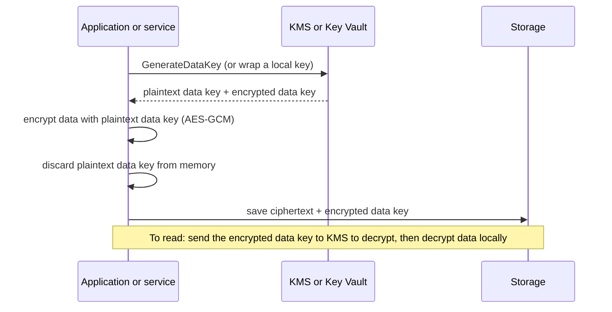

# Encryption and KMS

## Introduction

If someone copied a disk from your cloud provider's data center, or a misconfigured bucket exposed a backup, would they be able to read your data? **Encryption** makes sure the answer is no. Without the right key, the data is just noise.

In the cloud, the hard part is not the encryption algorithm. AES-256 is standard and fast. The hard part is **managing keys**: where they live, who can use them, how they rotate, and how you prove all of this to an auditor. Both clouds offer a managed service for that:

- **AWS Key Management Service (AWS KMS)**, with **AWS CloudHSM** for dedicated hardware
- **Azure Key Vault** (Standard and Premium tiers), with **Azure Key Vault Managed HSM** and **Azure Cloud HSM** for dedicated hardware

Think of a bank. The vault (KMS or Key Vault) holds master keys that never leave the building. Your data is locked in many small safes, each with its own key. Each small key is itself locked inside the vault's master key. This "keys locking keys" idea is called **envelope encryption**, and nearly every cloud service uses it.

This page focuses on the cloud services. For cryptography basics, see the Cybersecurity tutorial's [Symmetric Encryption](../../../fundamental/security/1-sec-cryptography/3-sec-symmetric-encryption.mdx) and [Key Management](../../../fundamental/security/1-sec-cryptography/8-sec-key-management.mdx) pages. Storing passwords and API tokens is a different job, covered in [Secrets Management: Secrets Manager and Key Vault](../11-cloud-devops/4-cloud-secrets-management.mdx).

## Encryption at Rest vs in Transit

| | At rest | In transit |
| --- | --- | --- |
| Protects against | Stolen disks, leaked backups, storage-layer access | Eavesdropping, man-in-the-middle on the network |
| Cloud default | On by default for nearly every storage service | TLS on all public service endpoints |
| Your decisions | Which key type (provider-managed or customer-managed), who can use it, rotation | Enforce HTTPS and a minimum TLS version, manage certificates, encrypt internal traffic |
| Main services | KMS, Key Vault | AWS Certificate Manager (ACM), Key Vault certificates, App Service managed certificates |

**Encryption at rest is mostly already on.** For example, S3 encrypts every new object with SSE-S3 by default, EBS can be set to encrypt by default, and Azure Storage and managed disks always encrypt with Microsoft-managed keys. Your real choice is **who controls the key**, and that drives auditability, access control and cost.

## Envelope Encryption



Why not just send all data to KMS to encrypt?

- **Size limits.** KMS `Encrypt` accepts at most 4 KB of plaintext. It is meant for keys and small secrets, not files.
- **Speed and cost.** Every KMS call is a network round trip and a billed request. Encrypting locally with a data key is fast and free.
- **Security.** The master key (KMS key or Key Vault key) never leaves the HSM-backed service. Only data keys are exposed, briefly, in memory.

When you choose "SSE-KMS" for S3 or "customer-managed key" for Azure Storage, the cloud service does exactly this on your behalf.

## Key Types Side by Side

| Who manages the key | AWS | Azure | Control and audit |
| --- | --- | --- | --- |
| Provider, invisible to you | **AWS owned keys** (default for many services) | **Microsoft-managed keys** (platform-managed) | No key policy and no per-key audit; free |
| Provider, visible in your account | **AWS managed keys** (`aws/s3`, `aws/ebs`), a legacy type that rotates yearly | No direct equivalent | You can see and audit usage, but not change the policy |
| You | **Customer managed keys** in KMS | **Customer-managed keys (CMK)** in Key Vault or Managed HSM | Full control: policy or RBAC, rotation, disable, delete |
| You, with your own key material | Imported key material (BYOK); external key store (XKS) | BYOK into Key Vault or Managed HSM | Strongest control, most operational risk |
| Request-supplied key | SSE-C on S3 | Customer-provided keys on Blob requests | You manage everything; rarely recommended |
| Dedicated HSM | AWS CloudHSM | Key Vault Managed HSM, Azure Cloud HSM | Single-tenant hardware, for strict compliance |

One notable difference: **Key Vault (Standard and Premium) holds RSA and EC keys, not symmetric AES keys.** Symmetric keys are only available in Managed HSM. So on Azure, envelope encryption usually means you generate an AES data key locally and **wrap** it with an RSA key in Key Vault (RSA-OAEP-256). AWS KMS keys are usually symmetric (AES-256-GCM), and KMS generates the data key for you. The result is the same; the API calls differ.

## Step 1: Create and Use a Key

:::warning Cost and cleanup
A customer managed KMS key has a monthly charge (prorated hourly) plus a per-request charge beyond the free tier. Key Vault bills per operation, and Premium HSM-protected keys also have a monthly per-key fee. **Managed HSM and CloudHSM are billed per hour per HSM and cost far more**, so do not create them just to experiment. See [AWS KMS pricing](https://aws.amazon.com/kms/pricing/) and [Key Vault pricing](https://azure.microsoft.com/pricing/details/key-vault/). Cleanup commands are at the end of this page. Note that keys cannot be deleted instantly on either cloud.
:::

### On AWS: KMS

```bash
KEY_ID=$(aws kms create-key \
  --description "Helpdesk attachments" \
  --key-spec SYMMETRIC_DEFAULT \
  --key-usage ENCRYPT_DECRYPT \
  --tags TagKey=app,TagValue=helpdesk \
  --query KeyMetadata.KeyId --output text)

aws kms create-alias --alias-name alias/helpdesk-data --target-key-id "$KEY_ID"

# Automatic rotation; the period is configurable (90 to 2560 days)
aws kms enable-key-rotation --key-id "$KEY_ID" --rotation-period-in-days 365
aws kms get-key-rotation-status --key-id "$KEY_ID"
```

Example output:

```text
{
    "KeyRotationEnabled": true,
    "KeyId": "1234abcd-12ab-34cd-56ef-1234567890ab",
    "RotationPeriodInDays": 365,
    "NextRotationDate": "2027-10-11T09:20:00+00:00"
}
```

Rotation creates new key material behind the same key ID. Old material is kept so that existing ciphertext still decrypts, so you never re-encrypt data because of rotation. You can also call `aws kms rotate-key-on-demand` after a suspected exposure.

Encrypt and decrypt a small secret directly, with an **encryption context**. An encryption context is non-secret key-value data that must match at decrypt time, and it is recorded in CloudTrail:

```bash
printf 'webhook-signing-secret' > secret.txt

aws kms encrypt --key-id alias/helpdesk-data \
  --plaintext fileb://secret.txt \
  --encryption-context app=helpdesk,purpose=webhook \
  --query CiphertextBlob --output text | base64 --decode > secret.enc

aws kms decrypt --ciphertext-blob fileb://secret.enc \
  --encryption-context app=helpdesk,purpose=webhook \
  --query Plaintext --output text | base64 --decode; echo
```

Output:

```text
webhook-signing-secret
```

If you leave out or change the encryption context, decryption fails with `InvalidCiphertextException`. That protects against someone reusing a ciphertext in the wrong place.

### On Azure: Key Vault

```bash
RG=rg-helpdesk-sec
KV=kv-helpdesk-$RANDOM
az group create -n $RG -l westeurope

# RBAC authorization (the default for new vaults in current API versions), purge protection on
az keyvault create -g $RG -n $KV -l westeurope \
  --enable-rbac-authorization true \
  --enable-purge-protection true \
  --retention-days 90

KV_ID=$(az keyvault show -n $KV --query id -o tsv)
ME=$(az ad signed-in-user show --query id -o tsv)
az role assignment create --role "Key Vault Crypto Officer" --assignee "$ME" --scope "$KV_ID"

# An RSA key used only to wrap and unwrap data keys
az keyvault key create --vault-name $KV --name helpdesk-data \
  --kty RSA --size 3072 --ops wrapKey unwrapKey
```

Then define an automatic rotation policy (`rotation-policy.json`):

```json
{
  "lifetimeActions": [
    { "trigger": { "timeAfterCreate": "P90D" }, "action": { "type": "Rotate" } },
    { "trigger": { "timeBeforeExpiry": "P30D" }, "action": { "type": "Notify" } }
  ],
  "attributes": { "expiryTime": "P1Y" }
}
```

```bash
az keyvault key rotation-policy update --vault-name $KV --name helpdesk-data --value rotation-policy.json
```

Unlike KMS, Key Vault rotation creates a **new key version** with its own identifier. Services configured with a versionless key URI pick up the new version automatically. Anything that stored a specific version must keep using that version to unwrap old data.

Starting with Key Vault API version 2026-02-01, Azure RBAC is the default permission model for new vaults, replacing the legacy **access policies**. Use data-plane roles such as **Key Vault Crypto User**, **Key Vault Crypto Service Encryption User** (for services that wrap and unwrap), and **Key Vault Crypto Officer** (for key management). See the [Key Vault RBAC guide](https://learn.microsoft.com/azure/key-vault/general/rbac-guide).

## Step 2: Envelope Encryption in Code

Both examples encrypt a file locally with AES-256-GCM using the `cryptography` package. The only cloud call is getting or wrapping the data key. Both use short-lived credentials from your environment: an IAM role on AWS, and `DefaultAzureCredential` (managed identity or your `az login`) on Azure.

### On AWS with boto3

```python
# envelope_aws.py
# pip install boto3 cryptography
import os
import boto3
from cryptography.hazmat.primitives.ciphers.aead import AESGCM

kms = boto3.client("kms")
KEY = "alias/helpdesk-data"
CONTEXT = {"app": "helpdesk", "tenant": "acme"}

def encrypt(plaintext: bytes) -> dict:
    dk = kms.generate_data_key(KeyId=KEY, KeySpec="AES_256", EncryptionContext=CONTEXT)
    nonce = os.urandom(12)
    ciphertext = AESGCM(dk["Plaintext"]).encrypt(nonce, plaintext, None)
    # Store only the encrypted data key; the plaintext key is dropped here
    return {"edk": dk["CiphertextBlob"], "nonce": nonce, "ct": ciphertext}

def decrypt(blob: dict) -> bytes:
    key = kms.decrypt(CiphertextBlob=blob["edk"], EncryptionContext=CONTEXT)["Plaintext"]
    return AESGCM(key).decrypt(blob["nonce"], blob["ct"], None)

if __name__ == "__main__":
    blob = encrypt(b"Ticket T-1042 attachment contents")
    print("encrypted data key bytes:", len(blob["edk"]))
    print("roundtrip:", decrypt(blob).decode())
```

Example output:

```text
encrypted data key bytes: 184
roundtrip: Ticket T-1042 attachment contents
```

In production, use the **AWS Encryption SDK** rather than hand-rolling this. It handles the message format, key caching and multi-key setups. The code above shows what the SDK does under the hood.

### On Azure with azure-keyvault-keys

```python
# envelope_azure.py
# pip install azure-identity azure-keyvault-keys cryptography
import os
from azure.identity import DefaultAzureCredential
from azure.keyvault.keys import KeyClient
from azure.keyvault.keys.crypto import CryptographyClient, KeyWrapAlgorithm
from cryptography.hazmat.primitives.ciphers.aead import AESGCM

credential = DefaultAzureCredential()
vault_url = os.environ["KEY_VAULT_URL"]          # https://<vault-name>.vault.azure.net
key = KeyClient(vault_url, credential).get_key("helpdesk-data")
crypto = CryptographyClient(key, credential)

def encrypt(plaintext: bytes) -> dict:
    data_key = AESGCM.generate_key(bit_length=256)      # generated locally
    wrapped = crypto.wrap_key(KeyWrapAlgorithm.rsa_oaep_256, data_key)
    nonce = os.urandom(12)
    ct = AESGCM(data_key).encrypt(nonce, plaintext, None)
    return {"wrapped": wrapped.encrypted_key, "key_id": wrapped.key_id, "nonce": nonce, "ct": ct}

def decrypt(blob: dict) -> bytes:
    data_key = crypto.unwrap_key(KeyWrapAlgorithm.rsa_oaep_256, blob["wrapped"]).key
    return AESGCM(data_key).decrypt(blob["nonce"], blob["ct"], None)

if __name__ == "__main__":
    blob = encrypt(b"Ticket T-1042 attachment contents")
    print("wrapped by:", blob["key_id"].split("/keys/")[1])
    print("roundtrip:", decrypt(blob).decode())
```

Example output:

```text
wrapped by: helpdesk-data/3f1c9e0b7a2d4c6e8f0a1b2c3d4e5f60
roundtrip: Ticket T-1042 attachment contents
```

Store `key_id`, which includes the key version, with the data. After a rotation, new data is wrapped by the new version, and old data still unwraps with the version recorded next to it. Microsoft's `azure-storage-blob` library also supports client-side encryption with a Key Vault key, if you only need to protect blobs.

## Step 3: Let Services Use Your Key

Most of the time you will not call KMS or Key Vault yourself. You point a service at your key instead.

### On AWS: S3 with SSE-KMS and a bucket key

```bash
aws s3api put-bucket-encryption --bucket "$BUCKET" \
  --server-side-encryption-configuration '{
    "Rules": [{
      "ApplyServerSideEncryptionByDefault": {
        "SSEAlgorithm": "aws:kms",
        "KMSMasterKeyID": "alias/helpdesk-data"
      },
      "BucketKeyEnabled": true
    }]
  }'
```

**S3 Bucket Keys** reduce the number of KMS requests, and therefore cost, by caching a bucket-level data key for a short time. Leave them on unless you need a CloudTrail event for each object's KMS use.

Then control who can use the key with the **key policy**. This statement lets the application role use the key only through S3:

```json
{
  "Sid": "AllowAppRoleViaS3Only",
  "Effect": "Allow",
  "Principal": { "AWS": "arn:aws:iam::111122223333:role/helpdesk-api" },
  "Action": ["kms:Decrypt", "kms:GenerateDataKey"],
  "Resource": "*",
  "Condition": {
    "StringEquals": { "kms:ViaService": "s3.us-east-1.amazonaws.com" }
  }
}
```

That gives you a second, independent permission check. Even if someone grants broad S3 read access by mistake, readers without key permission get `AccessDenied` on SSE-KMS objects.

### On Azure: Storage with a customer-managed key

```bash
SA=sthelpdesk$RANDOM
az storage account create -g $RG -n $SA -l westeurope --sku Standard_LRS --assign-identity

SA_PRINCIPAL=$(az storage account show -g $RG -n $SA --query identity.principalId -o tsv)
az role assignment create --role "Key Vault Crypto Service Encryption User" \
  --assignee-object-id "$SA_PRINCIPAL" --assignee-principal-type ServicePrincipal --scope "$KV_ID"

# Use the key without a version so new versions are picked up automatically
az storage account update -g $RG -n $SA \
  --encryption-key-source Microsoft.Keyvault \
  --encryption-key-vault "https://$KV.vault.azure.net" \
  --encryption-key-name helpdesk-data
```

The storage account's **managed identity** calls Key Vault to wrap and unwrap its internal account encryption key. Customer-managed keys for Azure Storage require soft delete and **purge protection** on the vault. Without them, a deleted key could permanently brick the account.

| Service-side encryption | AWS | Azure |
| --- | --- | --- |
| Object storage | S3: SSE-S3 (default), SSE-KMS, DSSE-KMS | Storage: Microsoft-managed (default) or CMK; optional infrastructure (double) encryption |
| VM disks | EBS encryption with a KMS key; account-level "encrypt by default" | Managed disks: platform key or CMK via a disk encryption set; encryption at host |
| Databases | RDS and Aurora with a KMS key, chosen at creation | Azure SQL TDE with service-managed or customer-managed key |
| Logs | CloudWatch Logs log groups with a KMS key | Log Analytics customer-managed keys (dedicated clusters) |

## Encryption in Transit

- **Public endpoints:** both clouds serve their APIs over TLS. Enforce HTTPS on *your* endpoints, for example with an S3 bucket policy denying `aws:SecureTransport` = `false`, or by setting a minimum TLS version on Azure Storage and App Service.
- **Certificates:** **AWS Certificate Manager** issues and renews public TLS certificates for load balancers, CloudFront and API Gateway. On Azure, **App Service managed certificates**, **Front Door managed certificates** and **Key Vault certificates** play the same role. Automatic renewal prevents the classic "certificate expired at midnight" outage.
- **Internal traffic:** encrypt service-to-service traffic too, with TLS to databases or a service mesh with mTLS. "It's inside the VPC" is not a security boundary on its own.

## Real-World Scenario

Your helpdesk SaaS stores customer attachments. A large healthcare customer's contract requires that (1) their data is encrypted with keys **your company controls**, (2) every use of the key is auditable, and (3) you can make their data unreadable on request ("crypto-shredding") when they leave.

**Solution:**

1. **One customer-managed key per enterprise tenant:** a KMS key on AWS, and a Key Vault key on Azure for the EU deployment. Smaller tenants share a key per environment.
2. **Envelope encryption in the app** with an encryption context (AWS) or stored key ID (Azure) that includes the tenant ID. Every decrypt shows up in CloudTrail or the Key Vault audit logs with the tenant attached.
3. **Least-privilege access:** the key policy allows only the API role, and only via S3. On Azure, only the app's managed identity has Key Vault Crypto User, at the vault scope.
4. **Offboarding:** disable the tenant's key, then schedule deletion after the contractual waiting period. Backups encrypted under that key become unreadable too. That is the point, so get legal sign-off first.

**Why this approach:** customer-managed keys give per-tenant audit and revocation without building your own key infrastructure.

**When not to use it:** for most data, provider-managed keys are secure and free, and per-tenant keys add cost and operational risk. Use customer-managed keys where a contract, regulation or threat model actually needs them.

### Alternatives and trade-offs

| Approach | Pros | Cons | Best for |
| --- | --- | --- | --- |
| Provider-managed keys (default) | Zero effort, free, always on | No key-level audit or revocation | Most workloads |
| Customer-managed keys in KMS / Key Vault | Audit trail, access control, disable and revoke | Per-key and per-request cost; you can lock yourself out | Regulated or contractual requirements |
| Client-side envelope encryption | Data encrypted before it reaches storage; storage admins see only ciphertext | More code; searching and indexing ciphertext is hard | Highly sensitive fields and files |
| Dedicated HSM (CloudHSM, Managed HSM, Cloud HSM) | Single-tenant, strict compliance | Expensive; you manage capacity and availability | Specific regulatory mandates |
| External or own key material (XKS, BYOK) | Keys under your physical control | Your outage becomes a cloud outage | Sovereignty requirements |

## Common Mistakes

- **Deleting or disabling a key that data still depends on.** Ciphertext is unrecoverable without the key. Both clouds enforce a waiting period: 7 to 30 days for a KMS key deletion, and soft delete plus purge protection on Key Vault. Use it, and alarm on `ScheduleKeyDeletion` and `DisableKey` events.
- **Granting `kms:*` or "Key Vault Administrator" to applications.** Apps need encrypt, decrypt or wrap/unwrap only.
- **Sending files to KMS `Encrypt`.** It is limited to 4 KB. Use data keys.
- **Reusing AES-GCM nonces** in hand-written code. Use a random 12-byte nonce per message, or use the AWS Encryption SDK.
- **Believing encryption replaces access control.** If a role can read the object *and* use the key, encryption does not stop it.
- **Forgetting cross-account and cross-Region needs.** A KMS key is Regional. Replication and disaster recovery may need multi-Region keys or a key in the other Region.

## Cleanup

```bash
# AWS: keys enter a waiting period (minimum 7 days) before deletion
aws kms delete-alias --alias-name alias/helpdesk-data
aws kms schedule-key-deletion --key-id "$KEY_ID" --pending-window-in-days 7
rm -f secret.txt secret.enc

# Azure: deleting the resource group soft-deletes the vault.
# With purge protection on, the vault name stays reserved until the retention period ends.
az group delete -n $RG --yes --no-wait
```

## Summary

- Encryption at rest is on by default almost everywhere. The real decision is who controls the key: provider-managed keys or customer-managed keys in KMS or Key Vault.
- Envelope encryption protects data with a data key, and the data key with a master key that never leaves the service. Cloud services do this automatically when you select your key.
- KMS keys are usually symmetric and rotate behind the same key ID. Key Vault keys are RSA or EC, wrap locally generated AES keys, and rotate into new versions.
- Control key use with key policies (AWS) or Key Vault RBAC (Azure). Enable rotation, and protect against accidental deletion with waiting periods and purge protection.
- Enforce TLS for data in transit, and let ACM or Azure-managed certificates handle renewal.

## Exercises

1. Run `envelope_aws.py` or `envelope_azure.py` against a sandbox key. Then change the encryption context (AWS) or delete the wrapped key (Azure) and observe how decryption fails.
2. Write an S3 bucket policy that denies `PutObject` requests that do not use SSE-KMS with your specific key ARN.
3. Design the key layout for a SaaS app with 3 environments and 200 tenants, 5 of which require customer-managed keys. How many keys do you create, and who can use each?
4. Write a CloudWatch Logs Insights or KQL query that finds every `ScheduleKeyDeletion` (AWS) or key delete operation (Azure) in the last 30 days. Use [Audit Logging: CloudTrail and Activity Log](./6-cloud-audit-logging.mdx) as a guide.

Related pages: [Secrets Management: Secrets Manager and Key Vault](../11-cloud-devops/4-cloud-secrets-management.mdx), [Amazon S3](../6-cloud-storage/1-cloud-s3.mdx), [Azure Blob Storage](../6-cloud-storage/2-cloud-azure-blob.mdx), [Cloud Security Services: GuardDuty, Security Hub and Defender](./4-cloud-security-services.mdx).
