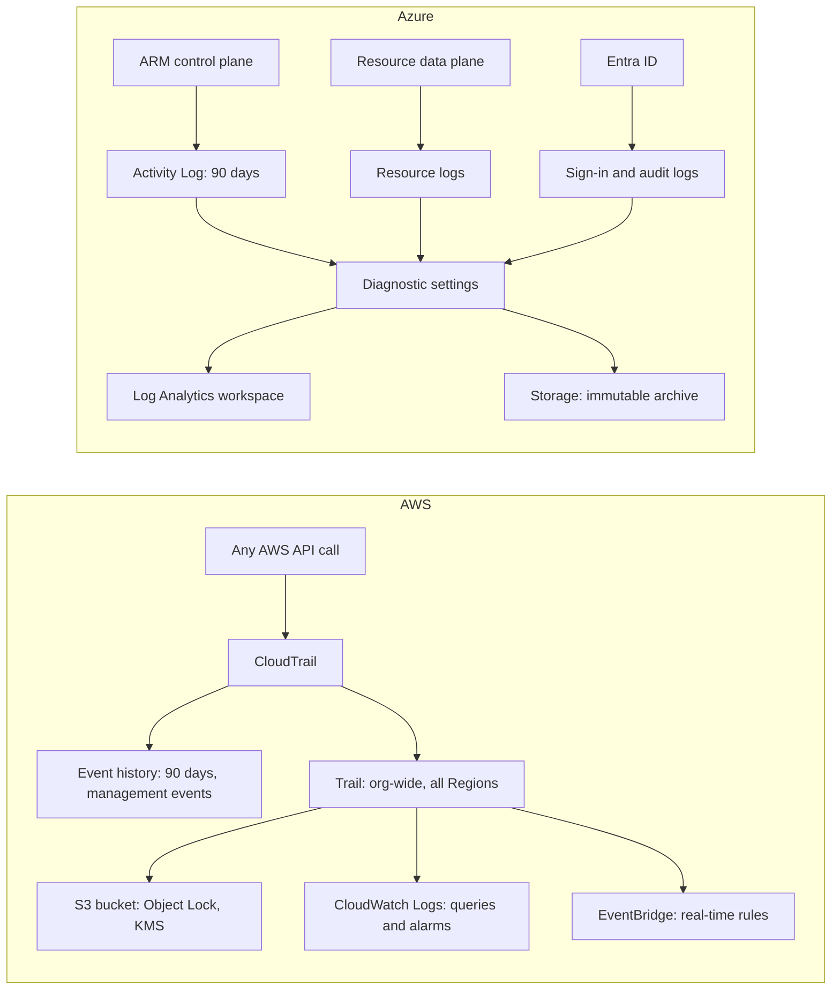

# Audit Logging: CloudTrail and Activity Log

## Introduction

Friday, 4:52 p.m.: the production database disappeared. Was it a deployment script, a teammate in the wrong terminal, or an attacker with stolen credentials? You need a reliable record of **who did what, to which resource, when, and from where**.

That record is the **audit log**. Every action in the cloud, whether from the console, the CLI, an SDK or Terraform, is an API call. Both clouds can record those calls:

- **AWS CloudTrail** records AWS API activity: management events, and optionally data events and network activity events.
- **Azure Activity Log** records **control-plane** operations on Azure resources (create, update, delete, and actions such as "restart VM"). **Resource logs** cover data-plane operations, and **Microsoft Entra ID** logs cover sign-ins and directory changes.

Application logs tell you what your *code* did ([Centralized Logging](./1-cloud-logging.mdx)). Audit logs tell you what *people and automation* did to your *cloud*. They are essential for incident response, compliance (SOC 2, ISO 27001, PCI DSS) and plain debugging ("who changed this security group?").

A good analogy is a bank's ledger. Every transaction is written down, with who made it and when, and nobody is allowed to erase lines. Your audit logs need the same properties: **complete, tamper-resistant and retained** long enough to matter.

## What Each Cloud Records

| Question | AWS | Azure |
| --- | --- | --- |
| Who created, changed or deleted a resource? | CloudTrail **management events** (on by default, 90 days in Event history) | **Activity Log**, Administrative category (on by default, 90 days) |
| Who read an object or secret, or ran a query? | CloudTrail **data events**, such as S3 `GetObject` or Lambda `Invoke` (opt-in, extra cost) | **Resource logs** via diagnostic settings, such as Key Vault `AuditEvent` or Storage read logs (opt-in) |
| Who signed in, from where, with MFA? | CloudTrail (`ConsoleLogin`), IAM Identity Center events | **Entra ID sign-in logs** |
| Who changed users, groups or roles in the directory? | CloudTrail (IAM and Identity Center events) | **Entra ID audit logs**; role assignments also appear in the Activity Log |
| Traffic through VPC endpoints | CloudTrail **network activity events** (opt-in) | Private endpoint and firewall logs via diagnostic settings |
| Unusual API call volume | **CloudTrail Insights** (opt-in, extra cost) | Activity log alerts plus KQL anomaly queries; Defender for Resource Manager |
| Default retention | 90 days, management events in **Event history** | 90 days for the Activity Log; Entra retention depends on license |
| Long-term storage | A **trail** to S3 (plus optional CloudWatch Logs) | A **diagnostic setting** to a Log Analytics workspace, Storage or Event Hubs |

The biggest conceptual difference: **CloudTrail is one service with event types you opt into**, while **Azure spreads auditing across three log sources**: the Activity Log, resource logs and Entra ID logs. On Azure you must collect all three to answer every "who did it" question.



## Anatomy of an Audit Event

Before running commands, it helps to know what an event contains. Here is a trimmed CloudTrail event for a security group change:

```json
{
  "eventVersion": "1.11",
  "userIdentity": {
    "type": "AssumedRole",
    "arn": "arn:aws:sts::111122223333:assumed-role/AWSReservedSSO_Developer_abc123/dana@example.com",
    "sessionContext": { "attributes": { "mfaAuthenticated": "false", "creationDate": "2026-10-11T08:01:12Z" } }
  },
  "eventTime": "2026-10-11T09:14:55Z",
  "eventSource": "ec2.amazonaws.com",
  "eventName": "AuthorizeSecurityGroupIngress",
  "awsRegion": "eu-west-1",
  "sourceIPAddress": "203.0.113.25",
  "userAgent": "aws-cli/2.x Python/3.x",
  "requestParameters": { "groupId": "sg-0a1b2c3d4e5f67890", "ipPermissions": { "items": [ { "fromPort": 22, "toPort": 22, "ipRanges": { "items": [ { "cidrIp": "0.0.0.0/0" } ] } } ] } },
  "responseElements": { "_return": true },
  "eventID": "6b2f3c1e-1f2a-4b3c-9d8e-7f6a5b4c3d2e",
  "recipientAccountId": "111122223333"
}
```

Read it as a sentence: *Dana, signed in through IAM Identity Center with the Developer permission set, used the AWS CLI from 203.0.113.25 to open SSH to the whole internet on security group sg-0a1b2c3d4e5f67890 in eu-west-1, and it succeeded.* Failed calls carry an `errorCode` such as `AccessDenied`, and those are often the most interesting events during an investigation.

An Azure Activity Log entry carries the same ideas under different names: `caller` (who), `operationName` (what), `resourceId` (which resource), `eventTimestamp` (when), `httpRequest.clientIpAddress` (from where), `status` (result), plus `authorization` and `claims` blocks with the role and token details.

## Step 1: Look Up Recent Activity (No Setup Needed)

Both clouds keep 90 days of control-plane history automatically, at no charge.

### On AWS: Event history

```bash
# Who deleted DB instances recently in this Region?
aws cloudtrail lookup-events \
  --lookup-attributes AttributeKey=EventName,AttributeValue=DeleteDBInstance \
  --max-results 5 \
  --query 'Events[].{time:EventTime,user:Username,event:EventName}' \
  --output table
```

Example output:

```text
-------------------------------------------------------------------------
|                             LookupEvents                              |
+-------------------+------------------------------+--------------------+
|       event       |             time             |       user         |
+-------------------+------------------------------+--------------------+
|  DeleteDBInstance |  2026-10-09T16:52:11+00:00   |  deploy-pipeline   |
+-------------------+------------------------------+--------------------+
```

The full event JSON (`CloudTrailEvent`) holds the important details: `userIdentity` (an assumed role and the session name, often the human or pipeline behind it), `sourceIPAddress`, `userAgent`, `requestParameters` and `errorCode`. Event history is **per Region**, filters on one attribute at a time, and only covers management events. For anything more, you need a trail.

The same lookup from Python:

```python
# who_deleted.py
# pip install boto3
import json
import boto3

ct = boto3.client("cloudtrail", region_name="us-east-1")
pages = ct.get_paginator("lookup_events").paginate(
    LookupAttributes=[{"AttributeKey": "EventName", "AttributeValue": "DeleteDBInstance"}],
    PaginationConfig={"MaxItems": 20},
)
for page in pages:
    for e in page["Events"]:
        detail = json.loads(e["CloudTrailEvent"])
        who = detail["userIdentity"].get("arn", "unknown")
        print(e["EventTime"].isoformat(), who, detail.get("sourceIPAddress"),
              detail["requestParameters"].get("dBInstanceIdentifier"))
```

Example output:

```text
2026-10-09T16:52:11+00:00 arn:aws:sts::111122223333:assumed-role/deploy-pipeline/gha-run-8812 192.0.2.44 helpdesk-prod-db
```

The session name `gha-run-8812` points to a GitHub Actions run. This is a good reason to set meaningful role session names in your CI ([Keyless CI/CD with OIDC](../2-cloud-identity/6-cloud-oidc-for-ci.mdx)).

### On Azure: Activity Log

```bash
az monitor activity-log list \
  --resource-group rg-helpdesk-prod \
  --offset 3d \
  --query "[?contains(operationName.value, 'delete')].{time:eventTimestamp, caller:caller, op:operationName.value, status:status.value}" \
  -o table
```

Example output:

```text
Time                          Caller                                 Op                                              Status
----------------------------  -------------------------------------  ----------------------------------------------  ---------
2026-10-09T16:52:11.4821Z     3c1b2a9e-5d6f-4a7b-8c9d-0e1f2a3b4c5d   Microsoft.DBforPostgreSQL/flexibleServers/delete  Succeeded
2026-10-09T16:52:09.1177Z     3c1b2a9e-5d6f-4a7b-8c9d-0e1f2a3b4c5d   Microsoft.DBforPostgreSQL/flexibleServers/delete  Started
```

Here `caller` is a GUID, the object ID of a service principal or managed identity. A human caller shows a user principal name instead. Look the GUID up with `az ad sp show --id <guid>` to find out which pipeline or app it is. Each operation usually logs several entries (Started, Accepted, Succeeded) that share a `correlationId`.

## Step 2: Keep Audit Logs Long-Term and Tamper-Resistant

Ninety days is not enough. Breaches are often discovered months later, and compliance frameworks commonly require a year or more.

:::warning Cost and cleanup
On AWS, the **first copy of management events** delivered by a trail is free from CloudTrail. You pay for S3 storage, KMS requests, CloudWatch Logs ingestion if enabled, and any **data events**, **network activity events** or **Insights events**, which are billed per event analyzed or recorded. S3 data events on a busy bucket can be very expensive. On Azure, there are **no ingestion charges for Activity Log data** sent to a Log Analytics workspace, and retention charges apply only beyond 90 days. Resource logs and Entra logs are billed as normal ingestion. See the [CloudTrail pricing](https://aws.amazon.com/cloudtrail/pricing/) and [Azure Monitor pricing](https://azure.microsoft.com/pricing/details/monitor/) pages.
:::

### On AWS: an organization trail

Create the trail once in the management account (or a delegated administrator account), covering **all accounts and all Regions**. Deliver it to a bucket in a dedicated **log archive account** that application teams cannot touch.

```bash
# Run in the management account; the bucket lives in the log-archive account
aws cloudtrail create-trail \
  --name org-audit \
  --s3-bucket-name acme-org-cloudtrail-111122223333 \
  --is-multi-region-trail \
  --is-organization-trail \
  --enable-log-file-validation \
  --kms-key-id arn:aws:kms:us-east-1:111122223333:key/1234abcd-12ab-34cd-56ef-1234567890ab

aws cloudtrail start-logging --name org-audit

aws cloudtrail get-trail-status --name org-audit \
  --query '{logging:IsLogging,lastDelivery:LatestDeliveryTime}'
```

Example output:

```text
{
    "logging": true,
    "lastDelivery": "2026-10-11T09:42:17+00:00"
}
```

What each protection does:

- **Multi-Region and organization trail:** no Region or account is left out, and member accounts cannot disable it.
- **Log file validation:** CloudTrail writes signed digest files. `aws cloudtrail validate-logs` proves later that no file was modified or deleted.
- **KMS encryption plus a separate account:** reading logs requires both S3 and key permissions in an account attackers are unlikely to control.
- **S3 Object Lock (compliance mode)** on the bucket makes log objects undeletable for the retention period, even by administrators.

In AWS Control Tower landing zones, an organization trail and a log archive account are set up for you (see [Multi-Account and Landing Zone Strategy](../2-cloud-identity/7-cloud-multi-account-strategy.mdx)).

:::note CloudTrail Lake availability
**CloudTrail Lake**, a managed SQL data store for CloudTrail events, is **no longer open to new customers as of May 31, 2026**. Existing customers can keep using it. New setups typically query trail data in S3 with **Amazon Athena**, or send the trail to **CloudWatch Logs** and use Logs Insights. See [CloudTrail Lake availability change](https://docs.aws.amazon.com/awscloudtrail/latest/userguide/cloudtrail-lake-service-availability-change.html).
:::

### On Azure: diagnostic settings for all three sources

```bash
WS_ID=$(az monitor log-analytics workspace show -g rg-security -n law-security --query id -o tsv)

# 1. Activity Log for the subscription
az monitor diagnostic-settings subscription create \
  --name activity-to-law \
  --location westeurope \
  --workspace "$WS_ID" \
  --logs '[{"category":"Administrative","enabled":true},{"category":"Security","enabled":true},{"category":"Policy","enabled":true},{"category":"ServiceHealth","enabled":true}]'

# 2. Resource logs, for example Key Vault data-plane audit events
az monitor diagnostic-settings create --name audit-to-law \
  --resource "$(az keyvault show -n kv-helpdesk-prod --query id -o tsv)" \
  --workspace "$WS_ID" \
  --logs '[{"categoryGroup":"audit","enabled":true}]'
```

3. **Entra ID sign-in and audit logs** are configured in the Entra admin center under **Monitoring and health, Diagnostic settings**. They need an Entra ID P1 or P2 license for most log types, and land in the `SigninLogs` and `AuditLogs` tables.

For tamper resistance on Azure, also send the Activity Log to a **Storage account with an immutability policy** (time-based retention, locked). Keep the security workspace in a subscription that application teams cannot administer. A management-group-level diagnostic setting, or Azure Policy, keeps this consistent across subscriptions.

## Step 3: Investigate with Queries

### On AWS: Logs Insights on a trail in CloudWatch Logs

If your trail also delivers to a CloudWatch Logs group, this query finds who changed security groups in the last day:

```text
fields eventTime, userIdentity.arn, eventName, requestParameters.groupId, sourceIPAddress
| filter eventSource = "ec2.amazonaws.com"
| filter eventName in ["AuthorizeSecurityGroupIngress", "RevokeSecurityGroupIngress", "ModifySecurityGroupRules"]
| sort eventTime desc
| limit 20
```

For longer history in S3, Athena can create a table over the CloudTrail prefix (the CloudTrail console has a **Create Athena table** button), then:

```sql
SELECT eventtime, useridentity.arn, eventname, sourceipaddress
FROM cloudtrail_logs
WHERE eventname = 'DeleteDBInstance'
  AND eventtime > '2026-07-01'
ORDER BY eventtime DESC
LIMIT 20;
```

### On Azure: KQL across all three sources

```text
AzureActivity
| where TimeGenerated > ago(7d)
| where OperationNameValue endswith "/DELETE" and ActivityStatusValue =~ "Success"
| project TimeGenerated, Caller, OperationNameValue, ResourceGroup, _ResourceId, CallerIpAddress
| order by TimeGenerated desc
```

Correlate it with sign-ins to see whether the caller signed in from somewhere unusual:

```text
SigninLogs
| where TimeGenerated > ago(7d)
| where UserPrincipalName =~ "dana@example.com"
| summarize signins = count() by IPAddress, Location = tostring(LocationDetails.countryOrRegion), AppDisplayName
| order by signins desc
```

Use case-insensitive operators such as `=~` on `AzureActivity`. Microsoft notes that values in this table can differ in letter case.

## Step 4: Alert on High-Risk Actions

Some events should notify someone immediately, not wait for an investigation:

| Event | AWS signal | Azure signal |
| --- | --- | --- |
| Root or Global Administrator sign-in | `ConsoleLogin` with `userIdentity.type = Root` | `SigninLogs` for privileged roles; Entra ID Protection |
| Audit logging turned off | `StopLogging`, `DeleteTrail`, `UpdateTrail` | Diagnostic setting deleted (`Microsoft.Insights/diagnosticSettings/delete`) |
| Key scheduled for deletion | `ScheduleKeyDeletion`, `DisableKey` | Key Vault key delete in resource logs |
| Guardrail changed | Organizations `UpdatePolicy`, `DetachPolicy` | `Microsoft.Authorization/policyAssignments/delete` |
| Permission escalation | `AttachRolePolicy`, `PutRolePolicy` on admin roles | `Microsoft.Authorization/roleAssignments/write` at subscription scope |

On AWS, an **EventBridge rule** on CloudTrail events reacts within seconds:

```json
{
  "source": ["aws.cloudtrail"],
  "detail-type": ["AWS API Call via CloudTrail"],
  "detail": {
    "eventSource": ["cloudtrail.amazonaws.com"],
    "eventName": ["StopLogging", "DeleteTrail", "UpdateTrail"]
  }
}
```

On Azure, an **activity log alert** does the same for control-plane operations:

```bash
az monitor activity-log alert create \
  --resource-group rg-security \
  --name alert-role-assignment-write \
  --scope "/subscriptions/$(az account show --query id -o tsv)" \
  --condition category=Administrative and operationName=Microsoft.Authorization/roleAssignments/write \
  --action-group "$(az monitor action-group show -g rg-security -n ag-security --query id -o tsv)"
```

GuardDuty and Defender for Cloud also analyze these logs for suspicious patterns. See [Cloud Security Services: GuardDuty, Security Hub and Defender](./4-cloud-security-services.mdx).

## Real-World Scenario

Back to Friday's missing database. Your company runs on both clouds and wants to answer "who did it?" within 15 minutes, every time, and keep evidence for a year for its SOC 2 audit.

**Investigation today:**

1. On AWS, CloudTrail Event history shows `DeleteDBInstance` by `assumed-role/deploy-pipeline/gha-run-8812`. The GitHub Actions run shows that a Terraform plan targeted the wrong workspace. It was a process failure, not an attacker.
2. On Azure, `AzureActivity` shows the flexible server deletion by a service principal. `az ad sp show` maps it to the same pipeline's Azure identity.

**Improvements:**

- An **organization trail** (all Regions, log file validation, KMS, Object Lock) in a log archive account, plus delivery to CloudWatch Logs with 90-day retention for fast queries.
- On Azure, **subscription Activity Log**, **Key Vault and Storage audit resource logs** and **Entra sign-in and audit logs** all go to a security workspace, with an immutable Storage archive.
- **Alerts** for audit-log tampering, key deletion and role assignment changes.
- **Deletion protection** on production databases, and a pipeline check that refuses plans which destroy production data stores. The audit log tells you what happened; guardrails stop it from happening again ([Policies and Governance: SCPs and Azure Policy](./7-cloud-compliance-and-governance.mdx)).

**Why this approach:** native audit logs capture every control-plane call with no agents. A separate, locked-down destination keeps the evidence trustworthy even if a workload account is compromised.

**When to add more:** a dedicated SIEM such as Microsoft Sentinel or Splunk, or Amazon Security Lake feeding one, makes sense once you need cross-cloud correlation, detection rules and case management for a security team.

### Alternatives and trade-offs

| Approach | Pros | Cons | Best for |
| --- | --- | --- | --- |
| Event history / Activity Log only | Free, zero setup | 90 days, per Region (AWS), easy to lose | Quick lookups only |
| Trail to S3 + Athena; Activity Log to Storage | Cheap, durable, immutable options | Slow ad-hoc queries | Compliance archives |
| Trail to CloudWatch Logs; diagnostic settings to Log Analytics | Fast queries and alerts | Ingestion cost, especially for data events | Day-to-day investigation |
| SIEM (Sentinel, Splunk, and others), possibly via Security Lake | Correlation, detections, cases, cross-cloud | Cost and expertise | Security teams |
| CloudTrail Lake | SQL over events, managed | Closed to new customers since May 31, 2026 | Existing users only |

## Common Mistakes

- **Relying on 90-day defaults.** Set up a trail and diagnostic settings on day one, not after an incident.
- **Single-Region trails.** Attackers launch resources in Regions you do not watch. Use multi-Region organization trails.
- **Audit logs in the same account they audit.** A compromised admin can delete them. Use a separate log archive account or subscription with immutability.
- **Forgetting Azure's other two sources.** The Activity Log does not show who read a secret (resource logs) or who signed in (Entra logs).
- **Turning on all data events everywhere.** S3 or Lambda data events on busy resources can cost more than the workload itself. Enable them selectively, with advanced event selectors, for sensitive buckets and functions.
- **Anonymous automation.** Pipelines that all use one generic role make audit trails useless. Give each pipeline its own role or service principal and meaningful session names.

## Summary

- CloudTrail records AWS API calls: management events by default for 90 days, plus opt-in data, network activity and Insights events. Use an organization, multi-Region trail to S3 with validation, KMS and Object Lock.
- Azure splits auditing into the Activity Log (control plane, 90 days), resource logs (data plane) and Entra ID logs (sign-ins and directory). Collect all three with diagnostic settings.
- Query with Logs Insights or Athena on AWS, and KQL on Azure. Alert in real time on tampering, key deletion and privilege changes.
- CloudTrail Lake has been closed to new customers since May 31, 2026. Plan around Athena, CloudWatch Logs or a SIEM.
- Store audit logs where the audited teams cannot change them.

## Exercises

1. Use `aws cloudtrail lookup-events` or `az monitor activity-log list` to find the last five resources created in a sandbox account or subscription, and identify the caller for each.
2. Write an EventBridge pattern that matches any console sign-in without MFA (`additionalEventData.MFAUsed` = `No`).
3. Write a KQL query that lists role assignments created in the last 30 days at subscription scope, with the caller and the assigned role.
4. Draw the audit-log architecture for a company with an AWS organization of 12 accounts and an Azure tenant with 4 subscriptions. Mark where logs are stored, who can read them, and how long they are kept.

Related pages: [Centralized Logging](./1-cloud-logging.mdx), [Encryption and KMS](./5-cloud-encryption-and-kms.mdx), and the Cybersecurity tutorial's [Security Logging and SIEM](../../../fundamental/security/11-sec-defensive-operations/1-sec-logging-and-siem.mdx).
