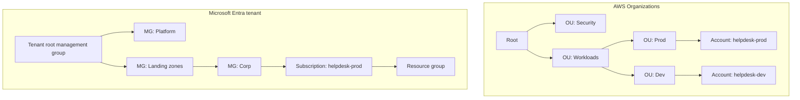

# Policies and Governance: SCPs and Azure Policy

## Introduction

As your cloud grows from one account to fifty, and from three engineers to three hundred, you cannot review every change by hand. Somebody will eventually launch a resource in a Region where you have no legal approval to store data, create a public storage account, or turn off audit logging "just for a minute".

**Governance guardrails** are rules the cloud itself enforces across many accounts or subscriptions at once, no matter who is acting, even administrators. They are like the walls and fire doors of a building. Inside your office you arrange furniture however you like (normal IAM permissions), but you cannot knock down a load-bearing wall.

The main tools are:

- **AWS:** **Service control policies (SCPs)** and **resource control policies (RCPs)** in AWS Organizations, **AWS Config** rules for detection, and **AWS Control Tower** to package them as "controls".
- **Azure:** **Azure Policy**, assigned at **management group**, subscription or resource group scope, plus **resource locks**. **Azure Landing Zones** package them into a reference design.

This page is about the cloud services. For governance concepts such as frameworks, risk and audits, see the Cybersecurity tutorial's [Compliance](../../../fundamental/security/13-sec-governance/2-sec-compliance.mdx) and [Security Frameworks](../../../fundamental/security/13-sec-governance/1-sec-security-frameworks.mdx) pages. For account and subscription structure, read [Multi-Account and Landing Zone Strategy](../2-cloud-identity/7-cloud-multi-account-strategy.mdx) first.

## Preventive vs Detective Controls

| Type | What it does | AWS | Azure |
| --- | --- | --- | --- |
| **Preventive** | Blocks the action before it happens | SCPs, RCPs, declarative policies, permission boundaries | Azure Policy `deny` and `denyAction`; resource locks |
| **Detective** | Reports non-compliant resources after the fact | AWS Config rules and conformance packs; Security Hub CSPM controls | Azure Policy `audit` and `auditIfNotExists` |
| **Corrective** | Fixes or adds configuration automatically | Config remediation (SSM Automation) | Azure Policy `modify`, `append` and `deployIfNotExists` with remediation tasks |
| **Proactive** | Checks templates before deployment | Control Tower proactive controls (CloudFormation Hooks) | Deny policies evaluated at deployment time; policy-as-code checks in CI |

A key difference in design:

- **On AWS, prevention and detection are different services.** SCPs and RCPs act on IAM authorization, and AWS Config evaluates resource configuration.
- **On Azure, one service does both.** An Azure Policy definition can deny, audit, modify or deploy depending on its **effect**, and you can flip a policy from `audit` to `deny` without rewriting it.

## Where Guardrails Attach



Policies **inherit downward**. An SCP attached to the Workloads OU applies to every account below it. An Azure Policy assigned to the Landing zones management group applies to every subscription and resource group below it. Attach broad guardrails high in the tree and specific ones low.

| Concept | AWS | Azure |
| --- | --- | --- |
| Hierarchy | Organization root, organizational units (OUs), accounts | Tenant root management group, management groups, subscriptions, resource groups |
| Identity-side guardrail | **SCP**: maximum permissions for principals in member accounts | Azure RBAC deny assignments (limited); mostly handled by Azure Policy |
| Resource-side guardrail | **RCP**: maximum permissions for access to your resources, including from outside identities | Azure Policy on resource properties; network rules; private endpoints |
| Config compliance | AWS Config rules, conformance packs | Azure Policy compliance, initiatives (policy sets) |
| Packaged baseline | AWS Control Tower controls | Azure Landing Zones policy assignments; Microsoft cloud security benchmark |
| Tag rules | Tag policies (Organizations) | Azure Policy (`modify` to inherit tags, `deny` if missing) |

## Step 1: Service Control Policies on AWS

### How SCPs work

- An SCP **never grants** permissions. It sets the maximum that IAM policies inside the account can grant. An action is allowed only if both the SCP *and* the IAM policy allow it.
- SCPs apply to IAM users and roles in **member accounts**, including the account root user. They do **not** apply to the **management account**, which is one reason to keep workloads out of it.
- SCPs do not restrict **service-linked roles**, which AWS services use on your behalf.
- The default `FullAWSAccess` SCP allows everything. Most organizations keep it and add **deny-list** SCPs on top. That is easier to reason about than allow-lists.

### Example: deny unapproved Regions, protect the audit trail

```json
{
  "Version": "2012-10-17",
  "Statement": [
    {
      "Sid": "DenyOutsideApprovedRegions",
      "Effect": "Deny",
      "NotAction": [
        "iam:*", "organizations:*", "sts:*", "support:*", "budgets:*", "ce:*",
        "cloudfront:*", "route53:*", "route53domains:*", "globalaccelerator:*",
        "health:*", "waf:*", "wafv2:*", "shield:*", "account:*", "sso:*"
      ],
      "Resource": "*",
      "Condition": {
        "StringNotEquals": { "aws:RequestedRegion": ["eu-west-1", "eu-central-1"] },
        "ArnNotLike": { "aws:PrincipalArn": "arn:aws:iam::*:role/OrgBreakGlassAdmin" }
      }
    },
    {
      "Sid": "ProtectAuditTrail",
      "Effect": "Deny",
      "Action": ["cloudtrail:StopLogging", "cloudtrail:DeleteTrail", "cloudtrail:UpdateTrail"],
      "Resource": "*"
    },
    {
      "Sid": "StayInOrganization",
      "Effect": "Deny",
      "Action": "organizations:LeaveOrganization",
      "Resource": "*"
    }
  ]
}
```

Why `NotAction`? Global services such as IAM, CloudFront and Route 53 send requests through `us-east-1`. Denying everything outside your Regions would break them. Check the [AWS example SCPs](https://docs.aws.amazon.com/organizations/latest/userguide/orgs_manage_policies_scps_examples.html) for the current list of global services. The break-glass role exception lets a tightly controlled emergency role act anywhere.

### Create, test and attach

```bash
POLICY_ID=$(aws organizations create-policy \
  --name baseline-guardrails \
  --type SERVICE_CONTROL_POLICY \
  --description "Approved Regions, protect CloudTrail, stay in org" \
  --content file://baseline-guardrails.json \
  --query Policy.PolicySummary.Id --output text)

# Attach to a sandbox OU first, never straight to the root
aws organizations attach-policy --policy-id "$POLICY_ID" --target-id ou-ab12-sandbox1

# From a role in an account in that OU, try something the SCP should block
aws ec2 describe-instances --region ap-southeast-2
```

Example output:

```text
An error occurred (UnauthorizedOperation) when calling the DescribeInstances operation:
You are not authorized to perform this operation. User: arn:aws:sts::222233334444:assumed-role/Developer/dana
is not authorized to perform: ec2:DescribeInstances with an explicit deny in a service control policy
```

The message names the SCP as the source of the deny, which makes troubleshooting much easier. Roll out in stages: sandbox OU, then dev, then prod. Watch CloudTrail for `AccessDenied` errors caused by the SCP in between.

### Resource control policies (RCPs)

SCPs only limit **your own principals**. They cannot stop an identity in *another* AWS account from accessing your resources if a bucket policy mistakenly allows it. **RCPs** close that gap. They set the maximum permissions on **resources** in your accounts, whoever the caller is. RCPs support a growing list of services, including Amazon S3, AWS STS, AWS KMS, Amazon SQS and AWS Secrets Manager.

This RCP builds a simple **data perimeter**: only principals from your organization, or AWS services acting for you, can access S3 objects:

```json
{
  "Version": "2012-10-17",
  "Statement": [
    {
      "Sid": "EnforceOrgIdentitiesOnS3",
      "Effect": "Deny",
      "Principal": "*",
      "Action": "s3:*",
      "Resource": "*",
      "Condition": {
        "StringNotEqualsIfExists": { "aws:PrincipalOrgID": "o-a1b2c3d4e5" },
        "BoolIfExists": { "aws:PrincipalIsAWSService": "false" }
      }
    }
  ]
}
```

```bash
aws organizations enable-policy-type --root-id r-ab12 --policy-type RESOURCE_CONTROL_POLICY
aws organizations create-policy --name s3-org-perimeter --type RESOURCE_CONTROL_POLICY \
  --content file://s3-org-perimeter.json --description "S3 data perimeter"
```

Be careful with legitimate outside access, such as a partner's account uploading to a bucket, or a public website bucket. Exempt those resources explicitly before attaching. See [Authorization policies in AWS Organizations](https://docs.aws.amazon.com/organizations/latest/userguide/orgs_manage_policies_authorization_policies.html) for the SCP and RCP comparison.

### Detective controls with AWS Config

Many rules are about **configuration** rather than API permissions: "every EBS volume is encrypted" or "no security group allows 0.0.0.0/0 on port 22". AWS Config evaluates these continuously:

```bash
aws configservice put-config-rule --config-rule '{
  "ConfigRuleName": "s3-bucket-public-read-prohibited",
  "Source": { "Owner": "AWS", "SourceIdentifier": "S3_BUCKET_PUBLIC_READ_PROHIBITED" }
}'

aws configservice describe-compliance-by-config-rule \
  --config-rule-names s3-bucket-public-read-prohibited \
  --query 'ComplianceByConfigRules[].{rule:ConfigRuleName,status:Compliance.ComplianceType}' --output table
```

Example output:

```text
--------------------------------------------------------
|            DescribeComplianceByConfigRule            |
+-----------------------------------+------------------+
|               rule                |     status       |
+-----------------------------------+------------------+
|  s3-bucket-public-read-prohibited |  NON_COMPLIANT   |
+-----------------------------------+------------------+
```

Group rules into **conformance packs** and deploy them organization-wide. **AWS Control Tower** wraps SCPs, RCPs, Config rules and CloudFormation Hooks as named controls that you enable per OU. If you use Control Tower, manage guardrails through it rather than by hand. AWS Config bills per configuration item recorded and per rule evaluation, so check the [AWS Config pricing](https://aws.amazon.com/config/pricing/) before recording every resource type in every Region.

## Step 2: Azure Policy

### How Azure Policy works

- A **policy definition** is JSON with an `if` condition on resource properties and a `then` **effect**.
- An **initiative** (policy set) groups definitions, such as the Microsoft cloud security benchmark or ISO 27001 sets.
- An **assignment** applies a definition or initiative at a **scope** (management group, subscription or resource group), with parameters, optional exclusions and an **enforcement mode**.
- **Effects** include `audit`, `deny`, `denyAction` (block specific actions such as delete), `modify`, `append`, `auditIfNotExists`, `deployIfNotExists`, `manual` and `disabled`. See [Azure Policy effects](https://learn.microsoft.com/azure/governance/policy/concepts/effect-basics).
- Azure Policy applies to **everyone, including subscription Owners**. Multiple assignments combine as **cumulative most restrictive**.

### Example: allowed locations (built-in)

```bash
MG_SCOPE="/providers/Microsoft.Management/managementGroups/mg-landingzones"

# Built-in "Allowed locations" definition; start in DoNotEnforce to see impact without blocking
az policy assignment create \
  --name allowed-locations \
  --display-name "Allowed locations: EU only" \
  --scope "$MG_SCOPE" \
  --policy e56962a6-4747-49cd-b67b-bf8b01975c4c \
  --params '{"listOfAllowedLocations": {"value": ["westeurope", "northeurope"]}}' \
  --enforcement-mode DoNotEnforce
```

With `DoNotEnforce`, the policy evaluates and reports compliance but does not block anything, which is ideal for a dry run. After a week of reviewing results, switch it on:

```bash
az policy assignment update --name allowed-locations --scope "$MG_SCOPE" --enforcement-mode Default
```

Then a deployment to `eastus` fails:

```text
(RequestDisallowedByPolicy) Resource 'sthelpdesktest' was disallowed by policy.
Policy identifiers: '[{"policyAssignment":{"name":"Allowed locations: EU only", ...}}]'.
```

### Example: custom policy requiring a tag

Built-in policies cover a lot, but you will write custom ones too. This definition requires a `costCenter` tag on resource groups, with the effect as a parameter:

```json
{
  "if": {
    "allOf": [
      { "field": "type", "equals": "Microsoft.Resources/subscriptions/resourceGroups" },
      { "field": "tags['costCenter']", "exists": "false" }
    ]
  },
  "then": { "effect": "[parameters('effect')]" }
}
```

```json
{
  "effect": {
    "type": "String",
    "allowedValues": ["Audit", "Deny", "Disabled"],
    "defaultValue": "Audit"
  }
}
```

```bash
SUB_SCOPE="/subscriptions/$(az account show --query id -o tsv)"

az policy definition create \
  --name require-costcenter-on-rg \
  --display-name "Require costCenter tag on resource groups" \
  --mode All \
  --rules rule.json \
  --params params.json

az policy assignment create \
  --name require-costcenter-on-rg \
  --scope "$SUB_SCOPE" \
  --policy require-costcenter-on-rg \
  --params '{"effect": {"value": "Audit"}}'

# Evaluate now instead of waiting for the periodic scan, then summarize
az policy state trigger-scan --no-wait
az policy state summarize --query "policyAssignments[].{assignment:policyAssignmentId, nonCompliant:results.nonCompliantResources}" -o table
```

Example output (trimmed):

```text
Assignment                                                                  NonCompliant
--------------------------------------------------------------------------  --------------
/subscriptions/.../policyAssignments/require-costcenter-on-rg               7
/providers/Microsoft.Management/managementGroups/.../allowed-locations      0
```

Pair it with the built-in "Inherit a tag from the resource group" (`modify`) policy, so resources pick up `costCenter` automatically. See [Tagging Strategies](../1-cloud-getting-started/6-cloud-tagging.mdx).

### Remediation and exemptions

- `deployIfNotExists` and `modify` policies fix **new** resources automatically. For **existing** ones, create a **remediation task**: `az policy remediation create --name fix-diag --policy-assignment <assignment-id>`. The assignment needs a managed identity with rights to make the change.
- **Exemptions** record intentional exceptions with a category (`Waiver` or `Mitigated`) and an expiry date, for example `az policy exemption create --name legacy-app-waiver --policy-assignment <id> --exemption-category Waiver --expires-on 2027-03-31`. This is better than excluding scopes silently, because exemptions are visible and expire.

### Resource locks

A **resource lock** (`CanNotDelete` or `ReadOnly`) protects critical resources, such as a production database or the audit log workspace, from accidental deletion, even by Owners. For example: `az lock create --name no-delete --lock-type CanNotDelete --resource-group rg-helpdesk-prod`. The AWS equivalents are per-service features, such as RDS deletion protection, S3 Object Lock, and SCP or `denyAction`-style denies on delete actions.

## Step 3: Guardrails as Code

Policies are code and belong in version control, with pull-request review, just like infrastructure:

```hcl
resource "aws_organizations_policy" "baseline" {
  name        = "baseline-guardrails"
  type        = "SERVICE_CONTROL_POLICY"
  description = "Approved Regions, protect CloudTrail, stay in org"
  content     = file("${path.module}/policies/baseline-guardrails.json")
}

resource "aws_organizations_policy_attachment" "workloads" {
  policy_id = aws_organizations_policy.baseline.id
  target_id = var.workloads_ou_id
}

resource "azurerm_management_group_policy_assignment" "allowed_locations" {
  name                 = "allowed-locations"
  management_group_id  = var.landing_zones_mg_id
  policy_definition_id = "/providers/Microsoft.Authorization/policyDefinitions/e56962a6-4747-49cd-b67b-bf8b01975c4c"
  enforce              = true

  parameters = jsonencode({
    listOfAllowedLocations = { value = ["westeurope", "northeurope"] }
  })
}

variable "workloads_ou_id" {
  type = string
}

variable "landing_zones_mg_id" {
  type = string
}
```

A mistake in a root-level SCP or a management-group deny policy can block **every** team at once. Run these changes through the same review and staged rollout as production code. See [Infrastructure as Code in the Cloud](../10-cloud-infrastructure-as-code/0-cloud-iac-introduction.mdx).

## Real-World Scenario

Your company is expanding to the EU. Legal requires that EU customer data never leaves EU Regions. Security wants audit logging tamper-proof and no public storage. Finance wants every resource tagged with a cost center. You have 25 AWS accounts and 12 Azure subscriptions, and dozens of teams with admin rights in their own accounts.

**Solution:**

1. **Structure first.** On AWS, create OUs for Security, Workloads/Prod, Workloads/Dev and Sandbox. On Azure, create management groups for Platform, Landing zones (Corp and Online) and Sandbox.
2. **Region guardrails.** Apply a Region-deny SCP to the EU workload OUs, and the built-in "Allowed locations" policy to the EU landing-zone management group. Both are tested in `DoNotEnforce` mode or on a sandbox OU first.
3. **Protect the audit trail.** An SCP denies CloudTrail changes. On Azure, a `denyAction` policy or lock protects the security workspace and its diagnostic settings, and only the platform team can manage them.
4. **No public storage.** An RCP perimeter and S3 Block Public Access at the account level on AWS. On Azure, deny policies for storage accounts that allow public blob access or lack network restrictions.
5. **Tags.** An Organizations tag policy and an Azure Policy that denies resource groups without `costCenter`, plus tag inheritance with `modify`.
6. **Visibility.** AWS Config conformance packs and Azure Policy compliance dashboards feed the monthly governance review. Exemptions have owners and expiry dates.

**Why this approach:** guardrails attached high in the hierarchy apply automatically to every new account and subscription, even when teams have admin rights. Teams keep autonomy inside safe boundaries.

**When not to use it:** a single-account startup with five engineers gains little from complex OU trees or dozens of policies. Start with a Region restriction, audit-log protection and budgets, and grow from there. Over-restrictive guardrails that block legitimate work push teams to find workarounds.

### Alternatives and trade-offs

| Approach | Pros | Cons | Best for |
| --- | --- | --- | --- |
| SCPs and RCPs | Hard, organization-wide limits that even account admins cannot bypass | IAM-level only (cannot inspect most resource properties); management account exempt | Region limits, protecting security services, data perimeters |
| AWS Config rules and conformance packs | Rich configuration checks, remediation | Detective by default; recording costs | Compliance reporting on AWS |
| Azure Policy | One engine for deny, audit, modify and deploy; huge built-in library | Evaluation and remediation can lag; JSON authoring has a learning curve | Almost all Azure governance |
| AWS Control Tower / Azure Landing Zones | Curated, best-practice baseline | Opinionated; customizing takes care | New organizations, or a fresh start |
| Policy-as-code in CI (OPA/Conftest, Checkov, cfn-guard) | Catches problems before deployment, cloud-neutral | Does not stop changes made outside the pipeline | Shift-left on top of cloud guardrails |

## Common Mistakes

- **Attaching a new SCP or deny policy straight to the root.** Test on a sandbox OU or with `DoNotEnforce` first.
- **Breaking global services with a Region SCP.** Exempt IAM, STS, CloudFront, Route 53 and the others with `NotAction`.
- **Expecting SCPs to restrict the management account.** They do not. Keep workloads out of it.
- **Forgetting outside identities.** SCPs do not stop other accounts' principals; RCPs and resource policies do.
- **Using exclusions instead of exemptions** on Azure, so exceptions become invisible and permanent.
- **`deployIfNotExists` without a managed identity** that has the right roles, so remediation silently fails.
- **No break-glass path.** Keep a tightly monitored emergency role or account that guardrails allow, so an outage can still be fixed.

## Summary

- Guardrails enforce organization-wide rules that hold even for administrators: preventive (block), detective (report) and corrective (fix).
- On AWS, SCPs cap what your principals can do, RCPs cap access to your resources, and AWS Config detects configuration drift. Control Tower packages them as controls.
- On Azure, Azure Policy does all of this through effects, assigned at management group, subscription or resource group scope, with remediation tasks, exemptions and resource locks.
- Attach broad guardrails high in the hierarchy, test with sandbox OUs or `DoNotEnforce`, and manage them as code with staged rollouts.
- Combine cloud guardrails with policy-as-code checks in CI to catch problems before deployment.

## Exercises

1. Write an SCP that denies launching EC2 instances unless IMDSv2 is required (`ec2:MetadataHttpTokens` = `required`). Explain how you would test it safely.
2. Find the built-in Azure Policy that denies storage accounts with public blob access. Assign it in `DoNotEnforce` mode, then list the non-compliant resources.
3. Design the OU and management group structure for a company with production, staging, development and sandbox environments on both clouds. Mark which guardrails attach where.
4. Write an RCP that limits access to Secrets Manager secrets to principals in your organization, and list two legitimate access patterns it could break.

Related pages: [Multi-Account and Landing Zone Strategy](../2-cloud-identity/7-cloud-multi-account-strategy.mdx), [Audit Logging: CloudTrail and Activity Log](./6-cloud-audit-logging.mdx), [Cloud Security Services: GuardDuty, Security Hub and Defender](./4-cloud-security-services.mdx), [Well-Architected Frameworks](../13-cloud-architecture/0-cloud-well-architected.mdx).
