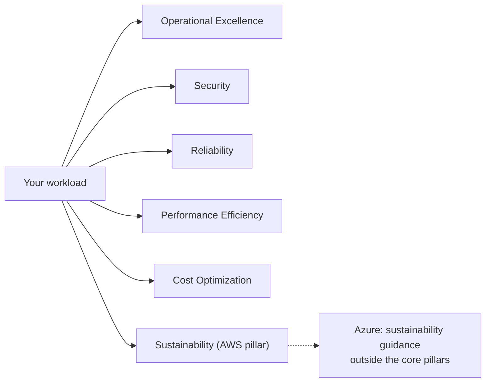
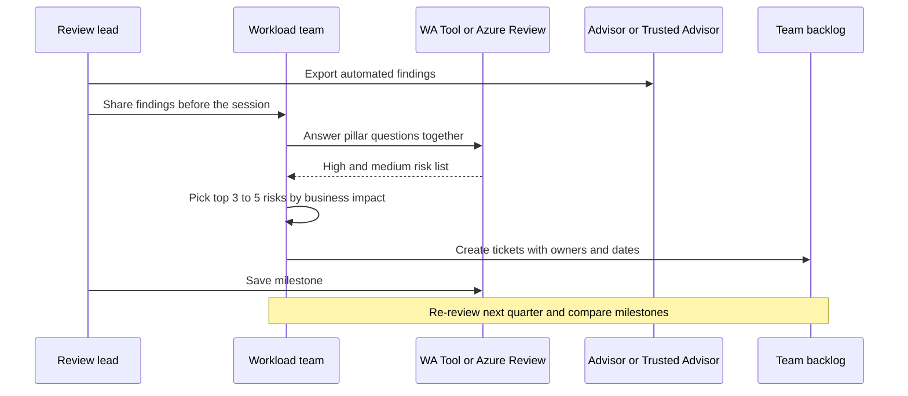

# Well-Architected Frameworks

## Introduction

Ask ten engineers whether a cloud system is "good" and you get ten answers. One cares about uptime, another about the monthly bill, a third about who can read the database. Without a shared checklist, design reviews turn into opinion contests, and important questions get skipped until an outage or an audit asks them for you.

Both big cloud providers publish a **Well-Architected Framework** to fix this:

- The [AWS Well-Architected Framework](https://docs.aws.amazon.com/wellarchitected/latest/framework/welcome.html)
- The [Azure Well-Architected Framework](https://learn.microsoft.com/azure/well-architected/)

Each one is a structured set of **pillars** (areas of concern), **design principles** and **review questions** that you walk through for a *workload*: a set of resources and code that together deliver business value, such as "the checkout service" or "the customer portal".

Think of it like a pre-flight checklist for pilots. A checklist does not fly the plane, and an experienced pilot knows most of it by heart. It still catches the one thing nobody thought about today, and it gives the whole crew the same vocabulary.

This page explains what the frameworks contain, how the AWS and Azure versions line up, and how to run a lightweight review on a real workload. The general ideas behind the pillars (quality attributes and trade-offs) are covered in the Software Architecture tutorial: see [Quality Attributes](../../../fundamental/architecture/0-arch-fundamentals/3-arch-quality-attributes.mdx) and [Architectural Trade-offs](../../../fundamental/architecture/0-arch-fundamentals/4-arch-trade-offs.mdx). Here we focus on how the two clouds package those ideas.

## The Pillars at a Glance

AWS currently lists **six pillars**. Azure lists **five**. The five shared ones are almost the same concepts with the same names:



| Pillar | Core question | AWS name | Azure name |
|--------|---------------|----------|------------|
| Reliability | Does it keep working, and recover when it does not? | Reliability | Reliability |
| Security | Are data and systems protected? | Security | Security |
| Cost | Are we spending money on things that deliver value? | Cost optimization | Cost Optimization |
| Operations | Can we deploy, observe and run it safely? | Operational excellence | Operational Excellence |
| Performance | Does it use resources efficiently as load changes? | Performance efficiency | Performance Efficiency |
| Sustainability | Are we minimizing environmental impact? | Sustainability | Not a core pillar; covered by separate sustainability guidance |

:::note
Pillar lists change rarely, but they do change. AWS added Sustainability as its sixth pillar in 2021. Check the [AWS pillars page](https://docs.aws.amazon.com/wellarchitected/latest/framework/the-pillars-of-the-framework.html) and the [Azure pillars page](https://learn.microsoft.com/azure/well-architected/pillars) for the current list.
:::

### What each pillar asks in practice

Below is a short, practical summary of each pillar. The official documents have many more questions; these are the ones that catch the most problems in a first review.

**Reliability**
- Which failures do we expect (a VM reboot, a zone outage, a bad deployment, a region outage)?
- What are the availability target, the RTO (how long we may be down) and the RPO (how much data we may lose)?
- Do we run across multiple availability zones? Are backups tested by actually restoring them?
- See [High Availability Design](./1-cloud-high-availability.mdx) and [Disaster Recovery Strategies](./2-cloud-disaster-recovery.mdx).

**Security**
- Who and what can access each resource? Are humans using SSO and workloads using roles or managed identities instead of long-lived keys?
- Is data encrypted in transit and at rest? Are secrets in a vault?
- Are audit logs on and centralized?
- See [Least Privilege in Practice](../2-cloud-identity/3-cloud-least-privilege.mdx) and [Encryption and KMS](../12-cloud-observability-and-security/5-cloud-encryption-and-kms.mdx).

**Cost Optimization**
- Do we know what this workload costs and who owns that cost (tags)?
- Are resources right-sized, and do non-production environments shut down at night?
- Are we using commitment discounts for steady load and spot capacity for interruptible work?
- See [Cost Optimization and FinOps](./4-cloud-cost-optimization.mdx).

**Operational Excellence**
- Is everything deployed through infrastructure as code and a pipeline?
- Can we roll back a bad deployment quickly?
- Do we have dashboards, alerts and runbooks, and do we learn from incidents?
- See [Deployment Strategies in the Cloud](../11-cloud-devops/2-cloud-deployment-strategies.mdx).

**Performance Efficiency**
- Can the workload scale out automatically, and have we load-tested it?
- Are we using the right service type (for example, a managed cache instead of a bigger database)?
- See [Scalability Patterns](./3-cloud-scalability-patterns.mdx).

**Sustainability (AWS)**
- Are we using only the capacity we need? Can batch work run where and when energy is cleaner?
- Are we choosing efficient instance families and deleting unused data?

## The Pillars Pull Against Each Other

The frameworks are explicit that pillars **trade off** against one another. Azure publishes a "Tradeoffs" page for each pillar, and AWS discusses trade-offs inside each pillar whitepaper.

| Decision | Helps | Hurts | Example |
|----------|-------|-------|---------|
| Add a second region | Reliability | Cost, Operational complexity | Warm standby in `eu-west-1` or `northeurope` |
| Encrypt with customer-managed keys | Security | Operations (key rotation, access policies) | KMS CMK, Key Vault key |
| Use spot / low-priority VMs | Cost | Reliability (instances can be reclaimed) | Batch rendering on Spot |
| Overprovision for spikes | Performance, Reliability | Cost | Keep 2x capacity always on |
| Use many small managed services | Operations (less patching) | Cost visibility, lock-in | Lambda + DynamoDB + SQS |

A review is not about maximizing every pillar. It is about making the trade-offs **on purpose**, writing them down (an [Architecture Decision Record](../../../fundamental/architecture/13-arch-documenting-and-evolving/0-arch-decision-records.mdx) is ideal), and revisiting them when requirements change.

## How the Two Frameworks Are Packaged

The content overlaps a lot. The surrounding tools and extras are where the providers differ.

| Item | AWS | Azure |
|------|-----|-------|
| Core document | Framework whitepaper plus one whitepaper per pillar | Pillar pages on Microsoft Learn, each with design principles, checklist, recommendations and trade-offs |
| Self-review tool | **AWS Well-Architected Tool** in the console (free to use) | **Azure Well-Architected Review** assessment on Microsoft Learn |
| Specialized guidance | **Lenses**, such as Serverless Applications, SaaS, Machine Learning and Generative AI lenses | **Workload guidance** (for example AI workloads, mission-critical) and **service guides** per Azure service |
| Automated recommendations | AWS Trusted Advisor, AWS Compute Optimizer, Cost Optimization Hub | **Azure Advisor**, whose recommendations and Advisor score are grouped by pillar |
| Reference architectures | AWS Architecture Center, AWS Solutions Library | Azure Architecture Center |
| Programmatic access | `aws wellarchitected` CLI and API | Advisor via `az advisor`; review results exported from the assessment |

One difference worth knowing: Azure ties the framework directly to **Azure Advisor**, so automated findings in the portal are labeled with the same pillar names (Reliability, Security, Cost, Operational Excellence, Performance). On AWS, the Well-Architected Tool is mostly a questionnaire you answer, and you pull automated signals from Trusted Advisor and other services. AWS does integrate some Trusted Advisor checks into the Well-Architected Tool for linked questions.

## Running a Review on AWS

The AWS Well-Architected Tool stores a **workload** and walks you through questions for each pillar. You mark which best practices you follow, and it reports **high-risk issues (HRIs)** and **medium-risk issues (MRIs)**. You can save a **milestone** to compare later reviews against.

You can do this in the console, but the CLI shows what is going on underneath.

### On AWS

```bash
# Create a workload definition (no infrastructure is created, this is metadata only)
aws wellarchitected create-workload \
  --workload-name "helpdesk-api" \
  --description "Customer helpdesk REST API" \
  --environment PRODUCTION \
  --aws-regions us-east-1 \
  --review-owner "platform-team@example.com" \
  --lenses wellarchitected

# List workloads and find the ID
aws wellarchitected list-workloads \
  --query "WorkloadSummaries[].{Name:WorkloadName,Id:WorkloadId,Risks:RiskCounts}"
```

Example output:

```text
{
    "WorkloadId": "a1b2c3d4e5f6a7b8c9d0e1f2a3b4c5d6",
    "WorkloadArn": "arn:aws:wellarchitected:us-east-1:111122223333:workload/a1b2c3d4e5f6a7b8c9d0e1f2a3b4c5d6"
}
[
    {
        "Name": "helpdesk-api",
        "Id": "a1b2c3d4e5f6a7b8c9d0e1f2a3b4c5d6",
        "Risks": {
            "UNANSWERED": 57
        }
    }
]
```

Every question starts as unanswered. Once your team has worked through them, you can list the answers for one pillar and record a milestone:

```bash
WID=a1b2c3d4e5f6a7b8c9d0e1f2a3b4c5d6

# Show the reliability questions and their current risk
aws wellarchitected list-answers \
  --workload-id "$WID" \
  --lens-alias wellarchitected \
  --pillar-id reliability \
  --query "AnswerSummaries[].{Q:QuestionTitle,Risk:Risk}" \
  --output table

# Freeze the current state so you can compare after improvements
aws wellarchitected create-milestone \
  --workload-id "$WID" \
  --milestone-name "2026-Q4-baseline"
```

Example output (trimmed):

```text
-----------------------------------------------------------------------
|                             ListAnswers                             |
+------+--------------------------------------------------------------+
| Risk |                              Q                               |
+------+--------------------------------------------------------------+
| HIGH | How do you back up data?                                     |
| NONE | How do you monitor workload resources?                       |
| HIGH | How do you test reliability?                                 |
| MEDIUM | How do you design your workload to withstand component failures? |
+------+--------------------------------------------------------------+
```

The exact question wording and counts depend on the lens version, so treat these as illustrative.

:::tip
The Well-Architected Tool itself does not create resources or charge you for reviews. Delete practice workloads when you are done with `aws wellarchitected delete-workload --workload-id "$WID"` so your list stays clean.
:::

## Running a Review on Azure

On Azure the questionnaire lives in the **Azure Well-Architected Review** on Microsoft Learn (you sign in and save assessments to your profile). The automated half lives in **Azure Advisor**, which scans your subscription.

### On Azure

```bash
# Advisor recommendations for one resource group, grouped by category (pillar)
az advisor recommendation list \
  --resource-group rg-helpdesk-prod \
  --query "[].{Category:category, Impact:impact, Problem:shortDescription.problem}" \
  --output table
```

Example output (trimmed):

```text
Category               Impact    Problem
---------------------  --------  ------------------------------------------------------------
HighAvailability       High      Use Availability zones for better resiliency and availability
Security               Medium    Storage account public access should be disallowed
Cost                   Medium    Right-size or shutdown underutilized virtual machines
OperationalExcellence  Low       Enable diagnostic settings for App Service
```

Advisor's API still uses `HighAvailability` as the category name for what the framework calls the Reliability pillar. You can filter to one category:

```bash
az advisor recommendation list --category Cost --output table
```

You can also pull recommendations from Python, which is useful for a weekly report:

```python
# pip install azure-identity azure-mgmt-advisor
import os
from collections import Counter

from azure.identity import DefaultAzureCredential
from azure.mgmt.advisor import AdvisorManagementClient

subscription_id = os.environ["AZURE_SUBSCRIPTION_ID"]
client = AdvisorManagementClient(DefaultAzureCredential(), subscription_id)

counts = Counter()
for rec in client.recommendations.list():
    counts[(rec.category, rec.impact)] += 1

for (category, impact), n in sorted(counts.items()):
    print(f"{category:<22} {impact:<7} {n}")
```

Example output:

```text
Cost                   Medium  4
HighAvailability       High    2
OperationalExcellence  Low     6
Performance            Medium  1
Security               High    3
```

`DefaultAzureCredential` picks up your `az login` session locally and a managed identity when running in Azure, so no keys are stored in the script.

## Pulling Automated Signals on AWS

The AWS equivalent of an Advisor scan is a mix of services. A simple, read-only starting point is **Trusted Advisor** (the full set of checks requires a Business, Enterprise On-Ramp or Enterprise support plan; basic accounts get a smaller core set) and **Compute Optimizer** for right-sizing.

```python
# pip install boto3
import boto3

# Trusted Advisor's API is served from us-east-1
support = boto3.client("support", region_name="us-east-1")

checks = support.describe_trusted_advisor_checks(language="en")["checks"]
for check in checks[:5]:
    result = support.describe_trusted_advisor_check_result(checkId=check["id"])
    status = result["result"]["status"]
    print(f"{check['category']:<24} {status:<8} {check['name']}")
```

Example output:

```text
cost_optimizing          warning  Low Utilization Amazon EC2 Instances
security                 error    Security Groups - Specific Ports Unrestricted
fault_tolerance          ok       Amazon EBS Snapshots
performance              ok       High Utilization Amazon EC2 Instances
service_limits           ok       VPC Internet Gateways
```

If your account does not have a qualifying support plan, the `support` API returns a `SubscriptionRequiredException`. In that case, use the Trusted Advisor console page instead.

## A Lightweight Review Process

You do not need a two-week workshop. A 90-minute session every quarter, plus automated checks, catches most problems.



1. **Scope one workload.** "All of our cloud" is too big. Pick one service with a clear owner.
2. **Gather facts first.** Architecture diagram, current SLO, last incident reports, the cost of the workload last month, and the automated findings.
3. **Answer honestly.** "We have backups" is not the same as "we restored a backup last month".
4. **Prioritize by impact.** A high-risk issue on a low-value internal tool can wait. A medium risk on the payments path may not.
5. **Turn findings into tickets** with owners. A review that only produces a PDF changes nothing.
6. **Save a milestone** and compare next time.

## Real-World Scenario

Your team runs a SaaS helpdesk. It started on AWS (API on ECS Fargate, Aurora PostgreSQL, S3 for attachments), and an acquired company brought a reporting service on Azure (App Service, Azure SQL Database). Leadership asks: "Are we in good shape before the big enterprise customer signs?"

**What you do:**

1. Create a workload in the AWS Well-Architected Tool for the helpdesk API and an Azure Well-Architected Review assessment for the reporting service.
2. Export Trusted Advisor and Compute Optimizer findings for AWS, and Advisor recommendations for Azure.
3. Run one 90-minute session per workload.

**Findings (typical for a young product):**

| Pillar | Finding | Risk | Fix |
|--------|---------|------|-----|
| Reliability | Aurora has no replica in a second AZ | High | Add an Aurora replica in another AZ |
| Reliability | Azure SQL database is not zone-redundant | High | Enable zone redundancy on a supported tier |
| Security | CI pipeline uses a long-lived IAM access key | High | Switch to [OIDC federation](../2-cloud-identity/6-cloud-oidc-for-ci.mdx) |
| Cost | Staging runs 24/7 at production size | Medium | Scale staging down nightly, right-size |
| Operations | No runbook for restoring S3 attachments | Medium | Write and test the runbook |

**Why this approach:** the enterprise customer will ask security and reliability questions anyway. Using the provider frameworks gives you a defensible, well-known structure and a written record of risks you have accepted.

**When to use it:** before a major launch or customer commitment, after a significant incident, or on a regular cadence (quarterly works for most teams).

**When not to over-invest:** for a throwaway prototype or a hackathon project, a full review is wasted effort. Skim the security pillar (no public buckets, no keys in code) and move on.

### Alternatives and trade-offs

| Approach | Pros | Cons | Best for |
|----------|------|------|----------|
| Provider WA Tool / Azure Review | Free, structured, maps to provider docs and services | Questionnaire can feel generic; per-provider | Teams mostly on one cloud |
| Automated checks only (Advisor, Trusted Advisor, Security Hub, Defender for Cloud) | Continuous, no meetings | Misses design and process gaps (DR testing, runbooks) | Ongoing hygiene between reviews |
| Partner-led review | Expert eyes, sometimes credits from provider programs | Scheduling, may push provider services | Large or regulated workloads |
| Internal checklist based on both frameworks | One process for multi-cloud | You maintain it | Multi-cloud organizations |
| Third-party CSPM tools | Cross-cloud view, compliance mapping | License cost, alert noise | Security teams spanning clouds |

## Common Mistakes

- **Treating the review as a one-time certification.** Systems drift. Re-review on a schedule and after big changes.
- **Answering for the system you plan to build.** Answer for what runs today, and record plans as tickets.
- **Trying to fix every finding.** Prioritize by business impact. Accept some risks explicitly and write down why.
- **Ignoring trade-offs.** Adding multi-region for a low-traffic internal tool doubles cost for little benefit.
- **Reviewing "the whole cloud".** Scope to one workload with one owner.
- **Relying only on automated tools.** Advisor cannot tell whether anyone has ever restored a backup.
- **Not involving the people who run it.** On-call engineers know where the bodies are buried.

## Summary

- AWS and Azure both publish a Well-Architected Framework: pillars, design principles and review questions for a workload.
- AWS has six pillars (Operational excellence, Security, Reliability, Performance efficiency, Cost optimization, Sustainability). Azure has five core pillars (Reliability, Security, Cost Optimization, Operational Excellence, Performance Efficiency).
- AWS adds **lenses** and the **Well-Architected Tool**. Azure adds **workload guidance**, **service guides**, the **Well-Architected Review** and **Azure Advisor**, which labels findings by pillar.
- Pillars trade off against each other. The goal is deliberate, documented decisions.
- Keep reviews lightweight and recurring, and turn findings into tickets with owners.

## Exercises

1. Pick a small app you have deployed (or a tutorial app). Write one line per pillar describing its biggest weakness.
2. Using the AWS CLI, create a practice workload in the Well-Architected Tool, list its unanswered questions for the `security` pillar, then delete it.
3. Run `az advisor recommendation list --output table` on a test subscription. Group the results by category and decide which two you would fix first, and why.
4. Write a short ADR for one trade-off you would accept (for example, single-region with backups instead of multi-region).

**Related pages in this tutorial:**
- [High Availability Design](./1-cloud-high-availability.mdx)
- [Disaster Recovery Strategies](./2-cloud-disaster-recovery.mdx)
- [Cost Optimization and FinOps](./4-cloud-cost-optimization.mdx)
- [Policies and Governance: SCPs and Azure Policy](../12-cloud-observability-and-security/7-cloud-compliance-and-governance.mdx)
- [Monitoring: CloudWatch and Azure Monitor](../12-cloud-observability-and-security/0-cloud-monitoring.mdx)
