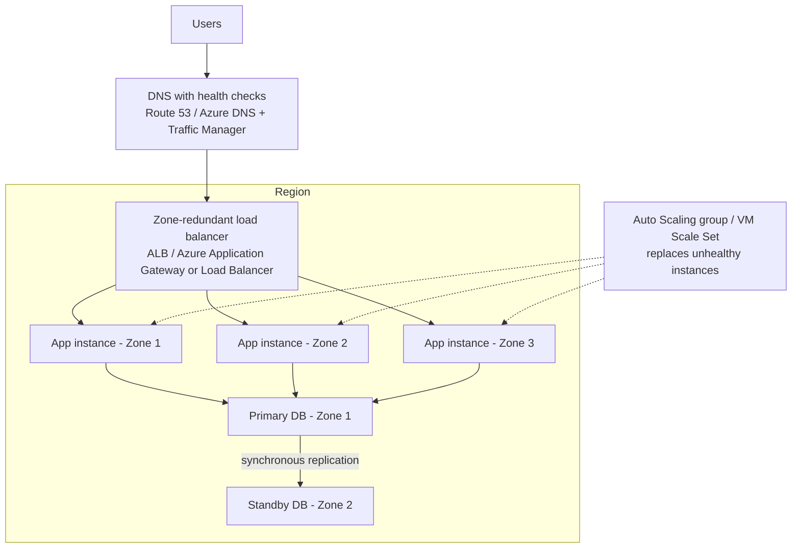

# High Availability Design

## Introduction

**High availability (HA)** means your system keeps serving users through the everyday failures that are *guaranteed* to happen at cloud scale: a VM reboots for patching, a disk dies, a rack loses power, a deployment goes wrong, or, more rarely, a whole data center has trouble.

The key mindset shift is this: in the cloud, **individual components are not highly available. Systems are.** A single EC2 instance or Azure VM can disappear at any moment. You get HA by running **redundant copies** in **independent failure domains** and putting something in front that **routes around failures automatically**.

An analogy: a restaurant with one chef closes when the chef is sick. A restaurant with three chefs on different shifts, and a manager who reassigns orders when someone goes home, keeps serving. The manager is the load balancer, and the shifts are availability zones.

This page shows how to build HA on AWS and Azure. For the general theory (redundancy, failure modes, SLOs), see [Designing for Reliability](../../../fundamental/architecture/12-arch-quality-and-operations/2-arch-reliability.mdx) in the Software Architecture tutorial. Recovering from *disasters* such as region outages or deleted data is a different problem, covered in [Disaster Recovery Strategies](./2-cloud-disaster-recovery.mdx).

## Measuring Availability

Availability is usually expressed as a percentage of time the system works:

| Target | Allowed downtime per 30-day month (approx.) | Allowed downtime per year (approx.) |
|--------|----------------------------------------------|-------------------------------------|
| 99% | 7 h 12 min | 3.65 days |
| 99.9% ("three nines") | 43 min | 8.8 hours |
| 99.95% | 21.6 min | 4.4 hours |
| 99.99% ("four nines") | 4.3 min | 53 min |

These numbers come straight from arithmetic, so you can compute them yourself:

```python
def downtime(availability_pct: float) -> str:
    minutes_per_month = 30 * 24 * 60
    down = minutes_per_month * (1 - availability_pct / 100)
    return f"{availability_pct}% -> {down:.1f} min/month"

for a in (99.0, 99.9, 99.95, 99.99):
    print(downtime(a))
```

Output:

```text
99.0% -> 432.0 min/month
99.9% -> 43.2 min/month
99.95% -> 21.6 min/month
99.99% -> 4.3 min/month
```

Every extra nine costs more money and engineering effort. Agree on the target with the business first. An internal reporting tool rarely needs four nines; a payment API might.

### Composite availability: why chains get weaker

If a request must pass through several components **in series**, their availabilities multiply. If you run **redundant** copies **in parallel**, the chance that *all* of them fail at once multiplies instead.

```python
from math import prod

def serial(*avail):
    """All components must work."""
    return prod(avail)

def parallel(a, n):
    """At least one of n independent copies must work."""
    return 1 - (1 - a) ** n

lb, app_vm, db = 0.9999, 0.995, 0.9995  # illustrative numbers, not real SLAs

print(f"Single VM chain:      {serial(lb, app_vm, db):.5f}")
print(f"Three VMs in 3 zones: {serial(lb, parallel(app_vm, 3), db):.5f}")
print(f"... plus HA database: {serial(lb, parallel(app_vm, 3), parallel(db, 2)):.5f}")
```

Output:

```text
Single VM chain:      0.99440
Three VMs in 3 zones: 0.99940
... plus HA database: 0.99990
```

Two lessons:
1. A chain is weaker than its weakest link. Every dependency you add in series lowers availability.
2. Redundancy only helps if failures are **independent**. Three VMs on the same physical host are not three independent copies. That is why availability zones matter.

:::caution
The numbers in the code are illustrative. Real SLAs differ by service, tier and configuration, and they change. Check the [AWS Service Level Agreements](https://aws.amazon.com/legal/service-level-agreements/) and [Azure SLAs](https://www.microsoft.com/licensing/docs/view/Service-Level-Agreements-SLA-for-Online-Services). An SLA is a billing credit promise, not a guarantee your system will be up.
:::

## The Building Blocks



| Need | AWS | Azure |
|------|-----|-------|
| Independent failure domains in a region | Availability Zones | Availability zones (in regions that support them) |
| Spread VMs inside one data center | Placement groups (spread) | Availability sets (fault and update domains) |
| Self-healing group of VMs across zones | EC2 Auto Scaling group | Virtual Machine Scale Sets (Flexible orchestration) |
| Layer 7 load balancing | Application Load Balancer | Application Gateway, Azure Front Door (global) |
| Layer 4 load balancing | Network Load Balancer | Azure Load Balancer (Standard) |
| Relational DB with automatic failover | RDS Multi-AZ, Aurora replicas | Azure SQL Database zone redundancy, Azure Database for PostgreSQL zone-redundant HA |
| NoSQL with built-in replication | DynamoDB (replicates across AZs automatically) | Cosmos DB with availability zones enabled |
| Storage replicated across zones | S3 Standard (multi-AZ by default) | Zone-redundant storage (ZRS) |
| Health-based DNS routing | Route 53 health checks and failover records | Azure Traffic Manager, Azure Front Door |

A notable difference: on AWS, many regional services such as S3, DynamoDB and SQS are **multi-AZ by default** with no setting to change. On Azure, many services offer **zone redundancy as an option** you must choose, sometimes only on certain tiers (for example Premium or Business Critical), and sometimes only at creation time. Always check the service's reliability guide on Microsoft Learn: [Azure reliability guides by service](https://learn.microsoft.com/azure/reliability/overview-reliability-guidance).

## Step 1: Spread Compute Across Zones

### On AWS

An Auto Scaling group (ASG) launches instances from a launch template into subnets in different AZs and replaces any instance that fails its health check.

```bash
# Assumes a launch template "web-lt" and three private subnets in different AZs
aws autoscaling create-auto-scaling-group \
  --auto-scaling-group-name web-asg \
  --launch-template LaunchTemplateName=web-lt,Version='$Latest' \
  --min-size 3 --max-size 9 --desired-capacity 3 \
  --vpc-zone-identifier "subnet-0aaa1111,subnet-0bbb2222,subnet-0ccc3333" \
  --target-group-arns arn:aws:elasticloadbalancing:us-east-1:111122223333:targetgroup/web-tg/0123456789abcdef \
  --health-check-type ELB \
  --health-check-grace-period 120

aws autoscaling describe-auto-scaling-groups \
  --auto-scaling-group-names web-asg \
  --query "AutoScalingGroups[0].Instances[].{Id:InstanceId,AZ:AvailabilityZone,Health:HealthStatus}" \
  --output table
```

Example output:

```text
-------------------------------------------------
|          DescribeAutoScalingGroups            |
+-------------+-----------+---------------------+
|     AZ      |  Health   |         Id          |
+-------------+-----------+---------------------+
|  us-east-1a |  Healthy  |  i-0a1b2c3d4e5f60001|
|  us-east-1b |  Healthy  |  i-0a1b2c3d4e5f60002|
|  us-east-1c |  Healthy  |  i-0a1b2c3d4e5f60003|
+-------------+-----------+---------------------+
```

`--health-check-type ELB` is important. Without it, the ASG only checks whether the VM is running, not whether your app responds. An instance with a crashed web server would stay in service.

### On Azure

A Virtual Machine Scale Set with `--zones 1 2 3` spreads instances across zones.

```bash
az group create --name rg-ha-demo --location eastus2

az vmss create \
  --resource-group rg-ha-demo \
  --name web-vmss \
  --image Ubuntu2204 \
  --orchestration-mode Flexible \
  --instance-count 3 \
  --zones 1 2 3 \
  --vm-sku Standard_B2s \
  --admin-username azureuser \
  --generate-ssh-keys \
  --lb-sku Standard

az vmss list-instances \
  --resource-group rg-ha-demo --name web-vmss \
  --query "[].{Name:name, Zone:zones[0], State:provisioningState}" \
  --output table
```

Example output:

```text
Name               Zone    State
-----------------  ------  ---------
web-vmss_a1b2c3d4  1       Succeeded
web-vmss_e5f6a7b8  2       Succeeded
web-vmss_c9d0e1f2  3       Succeeded
```

To get automatic replacement of unhealthy instances, enable the **Application Health extension** (or a load balancer health probe) and **automatic instance repairs** on the scale set. Image aliases such as `Ubuntu2204` and default parameters change over time; run `az vm image list --output table` and `az vmss create --help` to see what your CLI version supports.

:::warning Cost and cleanup
Scale sets, load balancers and VMs bill while they exist (per instance-hour plus load balancer hours and data processed). Prices vary by region and change over time; check the [AWS Pricing Calculator](https://calculator.aws/) and the [Azure Pricing Calculator](https://azure.microsoft.com/pricing/calculator/). Clean up practice resources:

```bash
# AWS
aws autoscaling delete-auto-scaling-group --auto-scaling-group-name web-asg --force-delete
# Azure
az group delete --name rg-ha-demo --yes --no-wait
```
:::

## Step 2: Health Checks That Mean Something

A load balancer can only route around failures it can detect. Expose a health endpoint that checks what the instance actually needs, but **not** shared dependencies that would make every instance unhealthy at once.

```python
# health.py - minimal Flask health endpoints
from flask import Flask, jsonify

app = Flask(__name__)
ready = {"config_loaded": True, "warm_cache": True}

@app.get("/healthz")
def liveness():
    # Is the process alive? Keep this trivial.
    return jsonify(status="ok"), 200

@app.get("/readyz")
def readiness():
    # Can this instance serve traffic right now?
    if all(ready.values()):
        return jsonify(status="ready"), 200
    return jsonify(status="not-ready", checks=ready), 503

if __name__ == "__main__":
    app.run(port=8080)
```

Example request and output:

```bash
curl -s -o /dev/null -w "%{http_code}\n" http://localhost:8080/readyz
```

```text
200
```

:::caution
If `/readyz` checks the shared database and the database blips for two seconds, **every** instance fails health checks at once. AWS load balancers "fail open" when all targets are unhealthy (they route to all of them anyway), and Azure Application Gateway returns errors. Either way, checking a shared dependency in the health probe turns a small blip into a full outage. Check local readiness in the probe and handle dependency failures in the request path with retries and timeouts.
:::

## Step 3: Make the Data Tier Highly Available

Stateless app servers are easy to replicate. Data is the hard part, because copies must stay consistent. The managed database services do the heavy lifting.

### On AWS

```bash
# Convert an existing RDS instance to Multi-AZ (a standby in another AZ)
aws rds modify-db-instance \
  --db-instance-identifier helpdesk-db \
  --multi-az \
  --apply-immediately

aws rds describe-db-instances \
  --db-instance-identifier helpdesk-db \
  --query "DBInstances[0].{MultiAZ:MultiAZ,Primary:AvailabilityZone,Standby:SecondaryAvailabilityZone}"
```

Example output:

```text
{
    "MultiAZ": true,
    "Primary": "us-east-1a",
    "Standby": "us-east-1b"
}
```

With Multi-AZ, RDS replicates synchronously to the standby and fails over automatically, keeping the same DNS endpoint. Your application must **reconnect** after failover, so use connection retry logic and keep DNS caching short. Aurora works differently: storage is replicated across three AZs automatically, and you add **Aurora Replicas** in other AZs that can be promoted on failure.

### On Azure

```bash
# Create a zone-redundant Azure SQL database (requires a tier that supports it)
az sql db create \
  --resource-group rg-helpdesk \
  --server helpdesk-sql \
  --name helpdeskdb \
  --edition GeneralPurpose \
  --family Gen5 --capacity 2 \
  --zone-redundant true

az sql db show \
  --resource-group rg-helpdesk --server helpdesk-sql --name helpdeskdb \
  --query "{name:name, zoneRedundant:zoneRedundant, sku:currentSku.name}"
```

Example output:

```text
{
  "name": "helpdeskdb",
  "sku": "GP_Gen5",
  "zoneRedundant": true
}
```

Zone redundancy support depends on the service tier, purchasing model and region. Check the current matrix in the [Azure SQL Database reliability guide](https://learn.microsoft.com/azure/reliability/reliability-sql-database).

More on database HA, including read replicas and backups, is in [Database High Availability and Backups](../7-cloud-databases/4-cloud-database-ha-and-backups.mdx).

## Step 4: Handle Failures in Code

Even with perfect infrastructure, failovers take seconds to tens of seconds. Your code must tolerate **transient faults**: retry with exponential backoff and jitter, use timeouts, and make operations idempotent so retries are safe (see [Idempotency](../../../fundamental/architecture/9-arch-distributed-systems/7-arch-idempotency.mdx)).

The SDKs already include retry logic. Configure it instead of writing your own:

```python
import boto3
from botocore.config import Config

# AWS SDK: "standard" or "adaptive" retry mode with backoff and jitter
cfg = Config(retries={"max_attempts": 5, "mode": "standard"},
             connect_timeout=3, read_timeout=10)
dynamodb = boto3.client("dynamodb", region_name="us-east-1", config=cfg)
print(dynamodb.meta.config.retries)
```

Output:

```text
{'max_attempts': 5, 'mode': 'standard'}
```

```python
from azure.identity import DefaultAzureCredential
from azure.storage.blob import BlobServiceClient, ExponentialRetry

# Azure SDK: exponential retry policy with a cap on attempts
retry = ExponentialRetry(initial_backoff=2, increment_base=2, retry_total=5)
client = BlobServiceClient(
    account_url="https://helpdeskfiles.blob.core.windows.net",
    credential=DefaultAzureCredential(),
    retry_policy=retry,
)
print(f"Blob client for {client.account_name} uses {type(retry).__name__}")
```

Output:

```text
Blob client for helpdeskfiles uses ExponentialRetry
```

Creating the client makes no network call, so this runs even without access to the account. The retry policy applies to every request the client sends later.

For calls to a dependency that is down for longer, add a [circuit breaker](../../../fundamental/architecture/9-arch-distributed-systems/8-arch-circuit-breaker.mdx) so you fail fast instead of piling up waiting requests.

## Real-World Scenario

Your team runs a SaaS helpdesk with a target of 99.95% availability for the agent web app. Today it runs on two VMs in one zone behind a load balancer, with a single database instance. Last quarter a zone-level networking issue took the whole product down for 40 minutes, which used most of the yearly error budget at once.

**Solution:**

1. Move the app tier into an ASG (AWS) or VM Scale Set (Azure) spanning **three zones**, minimum three instances, using load-balancer health checks.
2. Switch the database to RDS Multi-AZ (AWS) or a zone-redundant Azure SQL tier (Azure).
3. Store attachments in S3 Standard or a ZRS storage account.
4. Add `/readyz` probes that check local readiness only, and configure SDK retries.
5. Test it: on AWS, use **AWS Fault Injection Service** to simulate an AZ power interruption; on Azure, use **Azure Chaos Studio** to shut down zone instances. Watch whether the error rate stays within the SLO.

**Why this approach:** zone failures are the most likely large-scale failure this team will face, and multi-AZ inside one region protects against them with modest extra cost and no cross-region data headaches.

**When to use it:** almost any production workload that users depend on during business hours.

**When not to:** dev/test environments, batch jobs that can simply rerun, and internal tools where an hour of downtime is acceptable. A single zone plus good backups is fine there.

### Alternatives and trade-offs

| Approach | Pros | Cons | Best for |
|----------|------|------|----------|
| Single instance + backups | Cheapest, simplest | Downtime on any failure | Dev, low-value internal tools |
| Multiple instances, one zone | Survives instance failures | Zone outage takes everything down | Cost-sensitive, moderate needs |
| Multi-AZ in one region | Survives zone failures, low latency between zones | More instances, some cross-AZ data transfer charges | Most production workloads |
| Multi-region active/passive | Survives region failures | Higher cost, replication lag, failover complexity | Strict DR requirements |
| Multi-region active/active | Highest availability, low latency for global users | Hardest: data conflicts, double cost | Global, mission-critical systems |
| Serverless managed services (Lambda, Functions, DynamoDB, Cosmos DB) | HA across zones handled by provider | Less control, provider limits | Event-driven and spiky workloads |

## Common Mistakes

- **Two instances, same zone.** Redundancy without independence. Always spread across zones.
- **Forgetting the single points of failure you do not see:** one NAT gateway in one AZ, a single self-managed bastion, a cache with no replica, or a cron job running on exactly one VM.
- **Sizing for normal load with no headroom.** If one of three zones fails, the remaining two must carry 100% of the traffic. Plan for N+1 capacity.
- **Health checks that are too shallow or too deep.** A TCP check misses a hung app; a check that queries the shared DB causes cascading failures.
- **Long DNS TTLs and connection pools that never reconnect,** so clients keep hitting the old database primary after failover.
- **Never testing failover.** Run game days. An untested failover is a hope, not a plan.
- **Assuming zone redundancy is on.** On Azure in particular, check each resource's zone settings; some cannot be changed after creation.

## Summary

- HA comes from redundant copies in independent failure domains plus automatic routing around failures.
- Availability multiplies in series and improves with independent parallel copies. Every dependency counts.
- Use availability zones: ASGs or VM Scale Sets across zones, zone-redundant load balancers, Multi-AZ or zone-redundant databases, and S3 or ZRS storage.
- AWS makes many services multi-AZ by default; on Azure, zone redundancy is often a tier or creation-time choice.
- Design good health checks, configure SDK retries and timeouts, and test failures with Fault Injection Service or Chaos Studio.

## Exercises

1. Calculate the composite availability of: CDN (99.9%) then load balancer (99.99%) then two app instances in parallel (99.5% each) then one database (99.95%). Which single change helps most?
2. List every component in an app you know and mark which ones are single points of failure.
3. Write a `/readyz` endpoint for an app that depends on a local config file and a remote database. Decide what goes in the probe and what does not.
4. In a sandbox account, create a three-zone ASG or VM Scale Set, terminate one instance, and time how long it takes to be replaced. Then clean up.

**Related pages:**
- [Regions, Availability Zones and Edge Locations](../0-cloud-fundamentals/4-cloud-regions-and-zones.mdx)
- [Auto Scaling Groups and Scale Sets](../3-cloud-compute/3-cloud-autoscaling.mdx)
- [Load Balancers](../8-cloud-networking/4-cloud-load-balancers.mdx)
- [Disaster Recovery Strategies](./2-cloud-disaster-recovery.mdx)
- [Scalability Patterns](./3-cloud-scalability-patterns.mdx)
