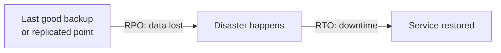
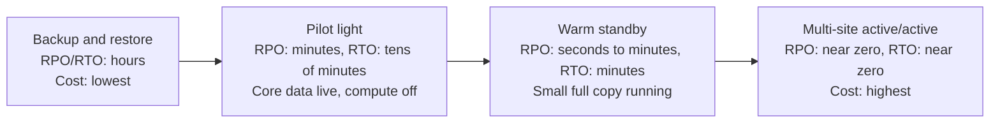
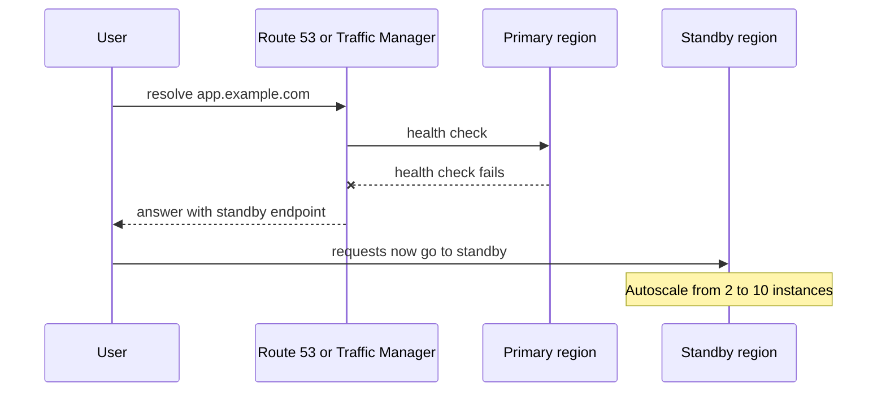

# Disaster Recovery Strategies

## Introduction

[High availability](./1-cloud-high-availability.mdx) protects you from everyday failures inside a region: a VM dies, a zone has trouble. **Disaster recovery (DR)** is about the rare, severe events that HA cannot absorb:

- A whole region becomes unavailable for hours
- Someone runs `DROP TABLE` in production, or a bad migration corrupts data
- Ransomware or a compromised admin account deletes resources
- A deployment script wipes a storage account

Notice that only the first item is about geography. **Most real disasters are data disasters caused by people or software**, and replication alone does not help with them: replication faithfully copies the corruption to the other side within milliseconds.

An analogy: HA is having a spare tire in the car. DR is having insurance, a copy of your documents at a friend's house, and a plan for how you get to work if the car is stolen. You hope never to use it, you must check it actually works, and the more coverage you want the more it costs.

This page covers the two numbers that drive every DR decision, the four standard strategies, and how to implement each on AWS and Azure.

## RTO and RPO

Every DR plan starts with two business requirements, set **per workload** (or even per data flow):

- **RPO (Recovery Point Objective):** how much data you can afford to lose, measured in time. "RPO of 15 minutes" means after a disaster you may lose at most the last 15 minutes of writes.
- **RTO (Recovery Time Objective):** how long you can be down. "RTO of 4 hours" means service must be back within 4 hours of the disaster being declared.



Both numbers cost money as they approach zero. Business owners often ask for "zero and zero" until they see the price, so present options with rough costs and let them choose.

| Workload tier | Example | Typical RPO | Typical RTO |
|---------------|---------|-------------|-------------|
| Tier 0, mission-critical | Payment authorization | Seconds | Minutes |
| Tier 1, business-critical | Customer-facing helpdesk | Minutes | Under an hour |
| Tier 2, important | Internal reporting | Hours | Hours to a day |
| Tier 3, low | Dev environments, archives | A day | Days |

These tiers are a common pattern, not a standard. Your organization should define its own.

## The Four Strategies

AWS's [Disaster Recovery of Workloads on AWS](https://docs.aws.amazon.com/whitepapers/latest/disaster-recovery-workloads-on-aws/disaster-recovery-options-in-the-cloud.html) whitepaper names four strategies, and Azure's guidance in the [Well-Architected Framework](https://learn.microsoft.com/azure/well-architected/design-guides/disaster-recovery) describes the same spectrum (active-passive with cold, warm or hot standby, and active-active). The ideas are provider-neutral.



| Strategy | What runs in the recovery region | How recovery works | Relative cost |
|----------|----------------------------------|--------------------|---------------|
| Backup and restore | Only backup copies | Deploy infrastructure with IaC, restore data | Low |
| Pilot light | Replicated data stores; compute defined but switched off | Turn on and scale out compute, switch traffic | Low to medium |
| Warm standby | A scaled-down but fully working copy | Scale up, switch traffic | Medium to high |
| Multi-site active/active | Full production in every region, serving traffic | Route traffic away from the failed region | Highest |

A key subtlety from the AWS whitepaper: pilot light **cannot serve requests** until you take action (deploy or start servers), while warm standby **can serve traffic immediately**, just at reduced capacity.

### Backups are needed in every strategy

Even active/active needs **point-in-time backups**. If bad data is written, it replicates to every region. Only a backup taken *before* the corruption saves you. Protect backups from the same people and credentials that can delete production: use a separate account or subscription, and immutability features such as **AWS Backup Vault Lock** or **Azure Backup immutable vaults** with soft delete.

## Service Mapping

| Capability | AWS | Azure |
|------------|-----|-------|
| Central backup service | AWS Backup (cross-Region and cross-account copies) | Azure Backup (Recovery Services vaults, Backup vaults) |
| Immutable backups | AWS Backup Vault Lock | Immutable vaults, soft delete |
| VM / server replication to another region | AWS Elastic Disaster Recovery (DRS) | Azure Site Recovery |
| Object storage replication | S3 Cross-Region Replication | Geo-redundant storage (GRS, RA-GRS, GZRS) or object replication |
| Relational DB cross-region | RDS cross-Region read replicas, Aurora Global Database | Azure SQL active geo-replication and failover groups |
| NoSQL multi-region | DynamoDB global tables | Cosmos DB multi-region (single or multiple write regions) |
| Traffic failover | Route 53 failover routing, Amazon Application Recovery Controller (ARC), Global Accelerator | Azure Front Door, Azure Traffic Manager |
| Redeploy infrastructure | CloudFormation (StackSets), CDK, Terraform | Bicep, ARM templates, Terraform |
| Resilience assessment | AWS Resilience Hub | Azure reliability guides, Advisor reliability recommendations |

A difference worth knowing: Azure has **region pairs** for many older regions, and some services (such as GRS storage) replicate to the paired region automatically. Many newer Azure regions are **nonpaired**, and most services let you choose any secondary region. AWS has no built-in pairing; you always pick your recovery region. See [Azure region pairs and nonpaired regions](https://learn.microsoft.com/azure/reliability/regions-paired).

## Strategy 1: Backup and Restore

This is the right default for many workloads. The key is that **data alone is not enough**. You also need the infrastructure definition (IaC), configuration, secrets and images to rebuild in another region.

### On AWS

Create a backup plan that copies backups to a vault in a second region:

```json
{
  "BackupPlanName": "helpdesk-daily",
  "Rules": [
    {
      "RuleName": "daily-with-dr-copy",
      "TargetBackupVaultName": "helpdesk-vault",
      "ScheduleExpression": "cron(0 3 * * ? *)",
      "Lifecycle": { "DeleteAfterDays": 35 },
      "CopyActions": [
        {
          "DestinationBackupVaultArn": "arn:aws:backup:us-west-2:111122223333:backup-vault:helpdesk-dr-vault",
          "Lifecycle": { "DeleteAfterDays": 35 }
        }
      ]
    }
  ]
}
```

```bash
aws backup create-backup-vault --backup-vault-name helpdesk-vault --region us-east-1
aws backup create-backup-vault --backup-vault-name helpdesk-dr-vault --region us-west-2

aws backup create-backup-plan --backup-plan file://backup-plan.json --region us-east-1

# Select resources by tag: everything tagged backup=daily
aws backup create-backup-selection --region us-east-1 \
  --backup-plan-id <plan-id-from-previous-output> \
  --backup-selection '{"SelectionName":"tagged","IamRoleArn":"arn:aws:iam::111122223333:role/service-role/AWSBackupDefaultServiceRole","ListOfTags":[{"ConditionType":"STRINGEQUALS","ConditionKey":"backup","ConditionValue":"daily"}]}'
```

Example output (create-backup-plan):

```text
{
    "BackupPlanId": "8c7b6a5d-1234-4e5f-9abc-0d1e2f3a4b5c",
    "BackupPlanArn": "arn:aws:backup:us-east-1:111122223333:backup-plan:8c7b6a5d-1234-4e5f-9abc-0d1e2f3a4b5c",
    "VersionId": "ZjQ5NTI3YjctZDk0Ni00ZTFk"
}
```

### On Azure

Azure Backup uses a **Recovery Services vault**. Setting the vault's storage redundancy to geo-redundant and enabling **Cross Region Restore** lets you restore in the secondary region.

```bash
az backup vault create \
  --resource-group rg-helpdesk-backup \
  --name helpdesk-rsv \
  --location eastus2

# Must be set before any item is protected
az backup vault backup-properties set \
  --resource-group rg-helpdesk-backup \
  --name helpdesk-rsv \
  --backup-storage-redundancy GeoRedundant \
  --cross-region-restore-flag true

az backup protection enable-for-vm \
  --resource-group rg-helpdesk-backup \
  --vault-name helpdesk-rsv \
  --vm /subscriptions/<sub-id>/resourceGroups/rg-helpdesk/providers/Microsoft.Compute/virtualMachines/helpdesk-vm1 \
  --policy-name DefaultPolicy
```

Example output (trimmed):

```text
{
  "name": "a1b2c3d4-...",
  "properties": {
    "entityFriendlyName": "helpdesk-vm1",
    "operation": "ConfigureBackup",
    "status": "Completed"
  }
}
```

Azure SQL Database and Cosmos DB have their own built-in automated backups (with geo-redundant backup storage options), so you typically do not put them in a Recovery Services vault.

:::warning Cost and cleanup
Backups bill per GB-month of stored data, and cross-region copies add storage in the second region plus data transfer. Prices vary by region and change; see the AWS and Azure pricing calculators. To clean up practice resources, delete backup selections and plans, then recovery points, then vaults (`aws backup delete-backup-plan`, `aws backup delete-backup-vault`). On Azure, stop protection with `az backup protection disable --delete-backup-data true`, then delete the vault. Soft delete may keep data for a retention period, and immutable or locked vaults cannot be deleted early by design.
:::

## Strategy 2: Pilot Light

Keep data continuously replicated to the recovery region, with compute defined in IaC but not running (or scaled to zero). On disaster, deploy or scale up compute and switch traffic.

### On AWS

A common pattern is an **Aurora Global Database** for the relational data plus **S3 Cross-Region Replication** for files, with the app tier defined in CloudFormation or Terraform with `desired_capacity = 0` in the DR region.

```bash
# Promote the secondary Aurora cluster during a regional outage (data loss possible)
aws rds failover-global-cluster \
  --global-cluster-identifier helpdesk-global \
  --target-db-cluster-identifier arn:aws:rds:us-west-2:111122223333:cluster:helpdesk-dr \
  --allow-data-loss

# Scale the DR app tier from 0 to production size
aws autoscaling update-auto-scaling-group \
  --region us-west-2 \
  --auto-scaling-group-name helpdesk-web-dr \
  --min-size 3 --desired-capacity 6
```

The `--allow-data-loss` flag makes the trade-off explicit: in an unplanned failover, writes that had not replicated yet are lost (this is your RPO). For a **planned** switchover when both regions are healthy, Aurora offers a switchover operation without data loss. Check the current flags in the [Aurora Global Database docs](https://docs.aws.amazon.com/AmazonRDS/latest/AuroraUserGuide/aurora-global-database-disaster-recovery.html).

For servers you cannot easily rebuild (legacy VMs, on-premises machines), **AWS Elastic Disaster Recovery** continuously replicates block storage into a low-cost staging area and launches full instances on failover.

### On Azure

**Azure SQL failover groups** give you a replicated secondary database and a listener endpoint that follows the primary. **Azure Site Recovery** replicates VMs to another region.

```bash
# Create a failover group between two logical SQL servers in different regions
az sql failover-group create \
  --resource-group rg-helpdesk \
  --server helpdesk-sql-eastus2 \
  --partner-server helpdesk-sql-centralus \
  --name helpdesk-fog \
  --add-db helpdeskdb \
  --failover-policy Manual

# During a disaster: fail over by running this against the secondary server
az sql failover-group set-primary \
  --resource-group rg-helpdesk \
  --server helpdesk-sql-centralus \
  --name helpdesk-fog \
  --allow-data-loss
```

Applications connect to the failover group listener (`helpdesk-fog.database.windows.net`) instead of a server name, so the connection string does not change after failover.

## Strategy 3: Warm Standby

Run a small but complete copy of production in the recovery region: load balancer, a couple of app instances, replicated database. Because it is always running, you can test it continuously (for example, by sending synthetic traffic) and recover faster: just scale up and shift traffic.

The main trade-off: scaling up during a disaster depends on **control plane** operations (Auto Scaling, VMSS autoscale) and on **capacity being available** in the recovery region at the same moment many other customers are failing over. Keep service quotas in the DR region as high as production, and consider running enough capacity to handle at least the initial load.

### Traffic switching



### On AWS

Route 53 **failover routing** with health checks switches DNS automatically. For a human-controlled switch that does not depend on control-plane APIs during an outage, AWS recommends **Amazon Application Recovery Controller (ARC)** routing controls.

```bash
aws route53 change-resource-record-sets \
  --hosted-zone-id Z0123456789ABCDEFGHIJ \
  --change-batch file://failover-records.json
```

```json
{
  "Changes": [
    {
      "Action": "UPSERT",
      "ResourceRecordSet": {
        "Name": "app.example.com",
        "Type": "CNAME",
        "SetIdentifier": "primary",
        "Failover": "PRIMARY",
        "TTL": 60,
        "HealthCheckId": "11111111-2222-3333-4444-555555555555",
        "ResourceRecords": [{ "Value": "alb-primary-123.us-east-1.elb.amazonaws.com" }]
      }
    },
    {
      "Action": "UPSERT",
      "ResourceRecordSet": {
        "Name": "app.example.com",
        "Type": "CNAME",
        "SetIdentifier": "secondary",
        "Failover": "SECONDARY",
        "TTL": 60,
        "ResourceRecords": [{ "Value": "alb-dr-456.us-west-2.elb.amazonaws.com" }]
      }
    }
  ]
}
```

### On Azure

**Traffic Manager** with priority routing is the DNS-based equivalent. **Azure Front Door** does the same at the HTTP layer with faster failover, because it does not depend on clients refreshing DNS.

```bash
az network traffic-manager profile create \
  --resource-group rg-helpdesk-global \
  --name helpdesk-tm \
  --routing-method Priority \
  --unique-dns-name helpdesk-app \
  --ttl 30 \
  --protocol HTTPS --port 443 --path /readyz

az network traffic-manager endpoint create \
  --resource-group rg-helpdesk-global --profile-name helpdesk-tm \
  --name primary --type externalEndpoints \
  --target helpdesk-eastus2.azurewebsites.net --priority 1

az network traffic-manager endpoint create \
  --resource-group rg-helpdesk-global --profile-name helpdesk-tm \
  --name standby --type externalEndpoints \
  --target helpdesk-centralus.azurewebsites.net --priority 2
```

## Strategy 4: Multi-Site Active/Active

Every region serves live traffic. There is no "failover", only shifting more traffic to the surviving regions. The hard part is **writes**:

- **Write global:** all writes go to one primary region (for example, Aurora Global Database with write forwarding). Simple consistency, but writes have cross-region latency.
- **Write local:** each region accepts writes and replicates (DynamoDB global tables, Cosmos DB multi-region writes). Low latency, but you must handle conflicts. DynamoDB global tables use last-writer-wins; Cosmos DB offers last-writer-wins or custom conflict resolution.
- **Write partitioned:** each user or tenant has a home region, avoiding conflicts.

This is where the [CAP and PACELC](../../../fundamental/architecture/9-arch-distributed-systems/1-arch-cap-and-pacelc.mdx) trade-offs become very real. Only choose active/active when the business case justifies the cost and complexity.

## Testing: The Part Everyone Skips

A DR plan that has never been executed will fail in ways nobody predicted: an expired certificate in the DR region, a missing secret, a quota too low, a runbook step that refers to a renamed resource.

- **Restore backups regularly** into an isolated account or subscription and run checks against the data. Automate this.
- **Run game days** where the team executes the runbook end to end and measures actual RTO and RPO.
- **Use fault injection:** AWS Fault Injection Service and Azure Chaos Studio can simulate failures.
- **Track results** in AWS Resilience Hub or your own reliability dashboard.

A simple automated restore check, using AWS Backup:

```python
# pip install boto3
import boto3
from datetime import datetime, timezone

backup = boto3.client("backup", region_name="us-west-2")

points = backup.list_recovery_points_by_backup_vault(
    BackupVaultName="helpdesk-dr-vault", MaxResults=50
)["RecoveryPoints"]

latest = max(points, key=lambda p: p["CreationDate"])
age_h = (datetime.now(timezone.utc) - latest["CreationDate"]).total_seconds() / 3600
print(f"Latest DR copy: {latest['ResourceType']} {latest['Status']}, {age_h:.1f} h old")
if age_h > 26:
    print("ALERT: newest DR backup is older than the 24 h RPO plus margin")
```

Example output:

```text
Latest DR copy: RDS COMPLETED, 7.4 h old
```

AWS Backup also has **restore testing** plans that automate periodic restores; Azure Backup supports restoring to an alternate location you can validate.

## Real-World Scenario

Your SaaS helpdesk has agreed targets of **RPO 15 minutes, RTO 1 hour** for the ticketing service, and **RPO 24 hours, RTO 1 day** for the analytics service. The company runs mostly on AWS in `us-east-1`, with the analytics service on Azure in `eastus2`.

**Ticketing service (AWS): pilot light**
- Aurora Global Database replicating to `us-west-2` (replication lag typically well under the 15-minute RPO; monitor it).
- S3 Cross-Region Replication for attachments, plus versioning and AWS Backup for point-in-time protection.
- App tier in Terraform, deployed to `us-west-2` with an ASG at size 0. Container images replicated to ECR in both regions.
- Route 53 failover records controlled by ARC routing controls.
- Quarterly game day: fail over, measure, fail back.

**Analytics service (Azure): backup and restore**
- Azure SQL automated backups with geo-redundant backup storage, so geo-restore into another region is possible.
- Bicep templates in Git to redeploy App Service and Functions.
- Twice-yearly restore drill.

**Why this approach:** each service gets the cheapest strategy that meets its business targets. Paying for active/active analytics would waste money; backup-only ticketing would miss the 1-hour RTO.

**When not to go further:** if leadership asks for "zero downtime", show the cost and complexity of active/active and ask which flows truly need it (often only login and ticket creation).

### Alternatives and trade-offs

| Approach | Pros | Cons | Best for |
|----------|------|------|----------|
| Backup and restore | Cheapest, simple, protects against data corruption | Hours of RTO, rebuild risk if IaC is incomplete | Tier 2 and 3 workloads |
| Pilot light | Low running cost, data RPO in minutes or less | Compute must start under pressure, depends on control plane | Tier 1 with tight budget |
| Warm standby | Fast recovery, continuously testable | Pays for idle capacity, scale-up depends on capacity availability | Tier 1 workloads |
| Active/active | Near-zero RTO, serves global users | Highest cost, data conflict design, complex operations | Tier 0, global products |
| DRS / Site Recovery replication | Works for legacy VMs without redesign | VM-centric, not for managed PaaS databases | Lift-and-shift estates |
| Same-region zones only + backups | No cross-region cost or residency issues | Region outage means long recovery | Data residency constrained workloads |

## Common Mistakes

- **Confusing replication with backup.** Replication copies deletions and corruption. Keep point-in-time, immutable backups.
- **Backups in the same account and region as production.** A compromised admin or a regional outage takes both. Copy to another region and account or subscription.
- **Forgetting non-data dependencies:** secrets, certificates, DNS, container images, IAM roles, quotas, third-party allowlists of your IP addresses.
- **Never testing restores.** The first restore attempt should not happen during a real incident.
- **Automatic failover on flaky signals.** A false alarm causes real data loss and downtime. Many teams automate the steps but keep a human decision to start them.
- **Ignoring failback.** After the primary region recovers, you must move back, reconciling any data written in the DR region.
- **Setting RTO and RPO without the business.** These are business decisions with a price tag, not engineering preferences.

## Summary

- DR covers rare, severe events: region outages and, more often, data loss from humans or software.
- RPO is how much data you can lose; RTO is how long you can be down. Both drive cost.
- Four strategies: backup and restore, pilot light, warm standby, multi-site active/active.
- AWS: AWS Backup, Elastic Disaster Recovery, S3 CRR, Aurora Global Database, DynamoDB global tables, Route 53 and ARC.
- Azure: Azure Backup, Azure Site Recovery, GRS storage, SQL failover groups, Cosmos DB multi-region, Front Door and Traffic Manager.
- Always keep immutable point-in-time backups, rebuild with IaC, and test regularly.

## Exercises

1. For three workloads you know (or invent), write an RPO and RTO and choose a strategy. Justify each in one sentence.
2. Write a runbook for failing over the Azure SQL failover group above: who decides, which commands, how you verify, how you fail back.
3. Using the AWS CLI in a sandbox, create an AWS Backup plan with a cross-region copy rule, back up a small DynamoDB table, restore it to a new table name, and clean up.
4. List every dependency your app needs in a DR region besides the database. Which ones are not in your IaC today?

**Related pages:**
- [High Availability Design](./1-cloud-high-availability.mdx)
- [Backup and Archive](../6-cloud-storage/7-cloud-backup-and-archive.mdx)
- [Database High Availability and Backups](../7-cloud-databases/4-cloud-database-ha-and-backups.mdx)
- [DNS: Route 53 and Azure DNS](../8-cloud-networking/5-cloud-dns.mdx)
- [Multi-Cloud and Hybrid Strategy](./5-cloud-multi-cloud-strategy.mdx)
