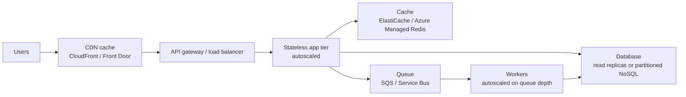
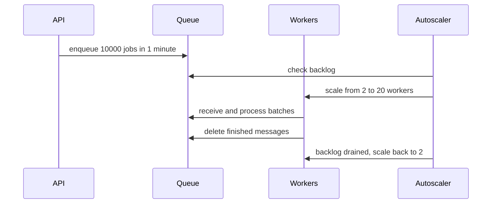

# Scalability Patterns

## Introduction

A system is **scalable** when it can handle more load by adding resources, without being redesigned. In the cloud, adding resources takes minutes instead of the weeks it takes to buy servers, but that only helps if your architecture can actually *use* the extra machines.

Imagine a coffee shop. Hiring a second barista doubles throughput only if both can work at the same time: there are two espresso machines, orders are written on cups rather than memorized by one person, and the cash register is not the bottleneck. Cloud scalability works the same way. You need **stateless workers** (any barista can make any order), **shared state in the right place** (the order on the cup), and **no single choke point** (one register).

The general theory (load parameters, the scale cube, Little's Law, when *not* to scale out) is covered in [Designing for Scalability](../../../fundamental/architecture/12-arch-quality-and-operations/0-arch-scalability.mdx) in the Software Architecture tutorial. This page focuses on how AWS and Azure implement the main patterns, and how to choose between them.

## Vertical vs Horizontal

| | Scale up (vertical) | Scale out (horizontal) |
|---|---|---|
| How | Bigger instance (more vCPU, RAM) | More instances behind a load balancer |
| AWS example | `t3.medium` to `m7i.2xlarge` | EC2 Auto Scaling group from 3 to 12 |
| Azure example | `Standard_B2s` to `Standard_D8s_v5` | VM Scale Set from 3 to 12 |
| Downtime | Usually a restart | None, if the app is stateless |
| Limit | Largest instance size | Mostly quotas and downstream bottlenecks |
| Best for | Databases, legacy apps, quick fixes | Web and API tiers, workers |

Vertical scaling is not wrong. It is often the fastest fix for a database. But horizontal scaling is what lets cloud systems grow and shrink automatically with demand, which is where the cost savings come from.

## The Pattern Map



| Pattern | Problem it solves | AWS | Azure |
|---------|-------------------|-----|-------|
| Stateless scale-out | App tier saturates | EC2 Auto Scaling, ECS Service Auto Scaling, Lambda | VM Scale Sets, Container Apps scale rules, Functions |
| Autoscaling on metrics | Load varies through the day | Target tracking, step, scheduled, predictive scaling | Azure Monitor autoscale (metric, schedule), predictive autoscale for VMSS |
| Queue-based load leveling | Bursts overwhelm backends | SQS + workers scaling on queue depth | Service Bus or Storage Queues + KEDA scaling in Container Apps or Functions |
| Caching | Repeated reads hit the DB | ElastiCache (Valkey, Redis OSS, Memcached), DAX | Azure Managed Redis, Azure Cache for Redis |
| Edge caching | Global users, static content | CloudFront | Azure Front Door |
| Read replicas | Read-heavy relational DB | RDS / Aurora read replicas | Azure SQL read scale-out, geo-replicas, PostgreSQL read replicas |
| Partitioning / sharding | Write-heavy or huge datasets | DynamoDB partition keys | Cosmos DB partition keys |
| Serverless / managed scaling | Spiky or unpredictable load | Lambda, DynamoDB on-demand, Aurora Serverless v2 | Functions Flex Consumption, Cosmos DB autoscale or serverless, SQL Database serverless |

Service names and tiers in the caching row in particular have shifted in recent years (for example, ElastiCache added Valkey, and Microsoft introduced Azure Managed Redis). Check the current options in [Managed Caching](../7-cloud-databases/3-cloud-caching.mdx).

## Pattern 1: Make the App Tier Stateless

Before autoscaling can work, an instance must be **disposable**. Any request can go to any instance, and terminating an instance loses nothing. Move state out:

| State | Where it should live |
|-------|----------------------|
| User sessions | Redis cache, or signed tokens (JWT) in the client |
| Uploaded files | S3 or Blob Storage, never the local disk |
| Background jobs | A queue, not an in-memory list |
| Scheduled tasks | EventBridge Scheduler or a timer-triggered Function, not cron on one VM |
| Configuration | Parameter Store, App Configuration, environment variables |

A quick test: "If the autoscaler terminated this instance right now, what would a user notice?" If the answer is anything other than "nothing", you have state to move.

## Pattern 2: Autoscaling Policies

Autoscalers watch a metric and change the instance count. The most useful policy type on both clouds is **target tracking**: you pick a target value, such as "average CPU 60%", and the autoscaler adds or removes capacity to stay near it.

### On AWS

```json
{
  "PredefinedMetricSpecification": {
    "PredefinedMetricType": "ASGAverageCPUUtilization"
  },
  "TargetValue": 60.0
}
```

```bash
aws autoscaling put-scaling-policy \
  --auto-scaling-group-name web-asg \
  --policy-name cpu-60 \
  --policy-type TargetTrackingScaling \
  --target-tracking-configuration file://cpu-target.json
```

Example output:

```text
{
    "PolicyARN": "arn:aws:autoscaling:us-east-1:111122223333:scalingPolicy:1a2b3c4d-...:autoScalingGroupName/web-asg:policyName/cpu-60",
    "Alarms": [
        { "AlarmName": "TargetTracking-web-asg-AlarmHigh-5e6f...", "AlarmARN": "arn:aws:cloudwatch:..." },
        { "AlarmName": "TargetTracking-web-asg-AlarmLow-7a8b...", "AlarmARN": "arn:aws:cloudwatch:..." }
    ]
}
```

AWS creates and manages the CloudWatch alarms for you. Other useful predefined metrics are `ALBRequestCountPerTarget` (requests per instance, often better than CPU for web apps) and, for ECS services, `ECSServiceAverageCPUUtilization` through Application Auto Scaling. **Predictive scaling** can also forecast daily patterns and launch capacity ahead of time.

### On Azure

Azure Monitor autoscale uses explicit rules: a scale-out rule and a matching scale-in rule.

```bash
az monitor autoscale create \
  --resource-group rg-web \
  --resource web-vmss \
  --resource-type Microsoft.Compute/virtualMachineScaleSets \
  --name web-autoscale \
  --min-count 3 --max-count 12 --count 3

az monitor autoscale rule create \
  --resource-group rg-web --autoscale-name web-autoscale \
  --condition "Percentage CPU > 70 avg 5m" \
  --scale out 2

az monitor autoscale rule create \
  --resource-group rg-web --autoscale-name web-autoscale \
  --condition "Percentage CPU < 30 avg 10m" \
  --scale in 1
```

Example output (rule create, trimmed):

```text
{
  "metricTrigger": {
    "metricName": "Percentage CPU",
    "operator": "GreaterThan",
    "threshold": 70.0,
    "timeAggregation": "Average",
    "timeWindow": "PT5M"
  },
  "scaleAction": { "direction": "Increase", "type": "ChangeCount", "value": "2", "cooldown": "PT5M" }
}
```

Notice the asymmetry: scale out fast (+2 after 5 minutes over 70%) and scale in slowly (-1 after 10 minutes under 30%). The gap between 30% and 70% prevents **flapping**, where the system constantly adds and removes instances.

### Containers: scaling on HTTP or events

**Azure Container Apps** has scaling built in, powered by KEDA. You can scale on concurrent HTTP requests, and even to zero:

```bash
az containerapp update \
  --name helpdesk-api --resource-group rg-web \
  --min-replicas 1 --max-replicas 20 \
  --scale-rule-name http-rule \
  --scale-rule-type http \
  --scale-rule-http-concurrency 50
```

On **ECS with Fargate**, you register the service as a scalable target with Application Auto Scaling and attach a target tracking policy, for example on `ALBRequestCountPerTarget`. See [Amazon ECS and Fargate](../5-cloud-containers/2-cloud-ecs-and-fargate.mdx) and [Azure Container Apps and Container Instances](../5-cloud-containers/3-cloud-azure-container-apps.mdx).

## Pattern 3: Queue-Based Load Leveling

When work arrives in bursts, such as 10,000 email notifications after a marketing campaign, do not make the web tier do it synchronously. Put jobs on a queue and let a separate pool of workers process them at a sustainable rate. The queue absorbs the spike, and workers scale on **queue depth**.



A good scaling metric is **backlog per worker**: messages waiting divided by running workers. If each worker handles 10 messages per second and you want to drain the backlog within 60 seconds, the target is about 600 messages per worker.

```python
import math

def desired_workers(backlog: int, per_worker_rate: float, drain_seconds: int,
                    min_w: int = 1, max_w: int = 50) -> int:
    target_backlog_per_worker = per_worker_rate * drain_seconds
    need = math.ceil(backlog / target_backlog_per_worker) if backlog else min_w
    return max(min_w, min(max_w, need))

for backlog in (0, 450, 6000, 120000):
    print(backlog, "->", desired_workers(backlog, per_worker_rate=10, drain_seconds=60))
```

Output:

```text
0 -> 1
450 -> 1
6000 -> 10
120000 -> 50
```

Note the `max_w` cap. Your database can probably not handle unlimited workers. Scaling the workers faster than the downstream system can absorb just moves the bottleneck.

### On AWS

Workers on ECS or EC2 scale on a custom CloudWatch metric (backlog per task) or on `ApproximateNumberOfMessagesVisible`. **Lambda** with an SQS event source scales pollers automatically, and you can cap it with the event source mapping's **maximum concurrency** setting to protect downstream systems.

```bash
aws lambda create-event-source-mapping \
  --function-name send-notification \
  --event-source-arn arn:aws:sqs:us-east-1:111122223333:notifications \
  --batch-size 10 \
  --scaling-config MaximumConcurrency=20
```

### On Azure

Container Apps and Functions scale on Service Bus queue length through KEDA scalers. In Container Apps:

```bash
az containerapp create \
  --name notify-worker --resource-group rg-web \
  --environment helpdesk-env \
  --image helpdeskacr.azurecr.io/notify-worker:1.4.0 \
  --min-replicas 0 --max-replicas 20 \
  --scale-rule-name sb-queue \
  --scale-rule-type azure-servicebus \
  --scale-rule-metadata "queueName=notifications" "namespace=helpdesk-sb" "messageCount=100" \
  --scale-rule-identity system
```

`messageCount=100` means "aim for one replica per 100 waiting messages". Using a managed identity for the scaler (rather than a connection string) needs a recent CLI version and the right role assignment; check `az containerapp create --help` and the [Container Apps scaling docs](https://learn.microsoft.com/azure/container-apps/scale-app) for the current syntax.

See [Queues: SQS and Azure Service Bus](../9-cloud-messaging-and-integration/1-cloud-sqs-and-service-bus.mdx) for queue details.

## Pattern 4: Cache Before You Scale the Database

The database is usually the hardest tier to scale. Before adding replicas or shards, check whether reads can be served from a cache. The **cache-aside** pattern is the most common:

```python
# pip install redis
import json
import redis

r = redis.Redis(host="localhost", port=6379, decode_responses=True)

def load_ticket_from_db(ticket_id: int) -> dict:
    print(f"  (database query for ticket {ticket_id})")
    return {"id": ticket_id, "subject": "Printer on fire", "status": "open"}

def get_ticket(ticket_id: int) -> dict:
    key = f"ticket:{ticket_id}"
    cached = r.get(key)
    if cached:
        return json.loads(cached)
    ticket = load_ticket_from_db(ticket_id)
    r.set(key, json.dumps(ticket), ex=300)  # expire after 5 minutes
    return ticket

print(get_ticket(42))
print(get_ticket(42))
```

Output (against a local Redis):

```text
  (database query for ticket 42)
{'id': 42, 'subject': 'Printer on fire', 'status': 'open'}
{'id': 42, 'subject': 'Printer on fire', 'status': 'open'}
```

In the cloud you point the same code at ElastiCache or Azure Managed Redis with TLS enabled. Always set an expiry and plan how you invalidate entries on writes. More strategies are in [Caching Strategies](../../../fundamental/architecture/11-arch-data-architecture/2-arch-caching-strategies.mdx).

For static assets, images and even cacheable API responses, a CDN (CloudFront or Azure Front Door) removes load before it reaches your region at all. See [CDNs: CloudFront and Azure Front Door](../8-cloud-networking/6-cloud-cdn.mdx).

## Pattern 5: Scaling the Data Tier

| Situation | AWS option | Azure option | Notes |
|-----------|-----------|--------------|-------|
| Read-heavy relational | RDS / Aurora read replicas (Aurora supports up to 15) | Azure SQL read scale-out (Premium/Business Critical/Hyperscale), named replicas, PostgreSQL read replicas | Replicas lag slightly; route only lag-tolerant reads there |
| Unpredictable relational load | Aurora Serverless v2 (scales in ACUs) | Azure SQL Database serverless, Hyperscale | Check minimum capacity and pause behavior |
| Massive key-value or document data | DynamoDB on-demand or provisioned with auto scaling | Cosmos DB autoscale throughput or serverless | Design the partition key first |
| Write-heavy relational | Sharding in the app, or Aurora PostgreSQL Limitless Database | Azure Database for PostgreSQL elastic clusters (Citus) | Adds real complexity. Azure Cosmos DB for PostgreSQL is on a retirement path, so do not start new projects on it |

The single most important design choice for DynamoDB and Cosmos DB is the **partition key**. A key with few distinct values (like `status`) creates a "hot partition" that cannot scale no matter how much capacity you buy. A key like `tenantId` or `userId` spreads load well. See [NoSQL: DynamoDB and Cosmos DB](../7-cloud-databases/2-cloud-dynamodb-cosmosdb.mdx) and [Replication and Sharding](../../../fundamental/architecture/11-arch-data-architecture/3-arch-replication-and-sharding.mdx).

## Prove It With a Load Test

Autoscaling settings are guesses until you test them. A load test tells you where the system actually breaks, how quickly the autoscaler reacts, and what each instance can handle (the number you need for target tracking).

[Locust](https://locust.io/) is a simple Python load-testing tool:

```python
# locustfile.py
# pip install locust
from locust import HttpUser, task, between

class AgentUser(HttpUser):
    wait_time = between(1, 3)  # seconds between requests per simulated user

    @task(5)
    def view_ticket(self):
        self.client.get("/api/tickets/42", name="/api/tickets/[id]")

    @task(1)
    def create_ticket(self):
        self.client.post("/api/tickets", json={"subject": "Load test", "body": "Hello"})
```

```bash
# Ramp to 500 users, adding 20 per second, for 10 minutes, without the web UI
locust -f locustfile.py --headless -u 500 -r 20 -t 10m \
  --host https://staging.helpdesk.example.com
```

Example output (final summary, trimmed):

```text
Type     Name                    # reqs   # fails |   Avg   Min   Max  Med |  req/s
--------|----------------------|--------|---------|-------|-----|-----|-----|-------
GET      /api/tickets/[id]       118204   12(0.01%)|    84    21  2310   61 |  197.0
POST     /api/tickets             23610    4(0.02%)|   142    35  3105  110 |   39.4
```

While it runs, watch the instance count, CPU, database connections and latency on your dashboards. Managed options exist on both clouds: **Azure Load Testing** runs JMeter and Locust tests at scale, and AWS publishes the **Distributed Load Testing on AWS** solution. Always load test a staging environment, never production without a plan, and remember that generated load creates real cost (instances scale out, requests are billed).

## Real-World Scenario

Your SaaS helpdesk sends ticket notifications (email, Slack, webhooks). Normally there are a few per second. When a large customer's outage hits, their users open thousands of tickets in minutes, the API servers spend their time calling email providers, response times hit 8 seconds, and the database CPU pegs at 100%.

**Solution:**

1. **Decouple notifications** with a queue: the API writes the ticket, enqueues a notification message, and returns immediately.
2. **Autoscale workers on backlog:** Lambda with SQS (capped with maximum concurrency) on AWS, or a Container Apps job/app scaling on Service Bus queue length on Azure.
3. **Target tracking on requests per instance** for the API tier, with a minimum of 3 across zones.
4. **Cache-aside** for ticket reads and tenant settings, which make up most database reads.
5. **Load test** with a realistic spike (10x normal) before declaring victory.

**Why this approach:** the bottleneck was synchronous slow work and repeated reads. Queues and caching fix the cause. Simply adding API servers would have sent even more queries to the already saturated database.

**When to use it:** whenever work can be done asynchronously, and whenever the same data is read far more often than it changes.

**When not to:** if users need the result immediately (a payment authorization), a queue adds latency and complexity. If the data changes on every read, a cache adds staleness bugs without saving much.

### Alternatives and trade-offs

| Approach | Pros | Cons | Best for |
|----------|------|------|----------|
| Scale up the instance | Instant, no code change | Hard ceiling, downtime, wasteful at low load | Quick relief, databases |
| Scale out with autoscaling | Elastic, pay for what you use | Needs stateless app, scaling lag of minutes for VMs | Web and API tiers |
| Serverless (Lambda, Functions) | Scales per request, scales to zero | Cold starts, execution limits, can overwhelm downstream | Spiky event-driven work |
| Queue + workers | Absorbs bursts, protects backends | Eventual results, more moving parts | Background and batch work |
| Cache | Huge read relief, lower latency | Staleness, invalidation complexity | Read-heavy data |
| Overprovision | Simple, no scaling lag | Pays for idle capacity | Very predictable or critical peaks |

## Common Mistakes

- **Autoscaling a stateful app.** Sessions on local disk mean users get logged out on every scale-in.
- **Scaling on the wrong metric.** CPU is a poor signal for I/O-bound apps. Requests per target, latency or queue backlog are often better.
- **No maximum.** An unbounded autoscaler during a bug or attack can produce a very large bill. Set sensible max counts and [budgets](../1-cloud-getting-started/7-cloud-budgets-and-alerts.mdx).
- **Forgetting downstream limits.** 200 Lambda functions hitting a database with a connection limit causes an outage. Use connection pooling (RDS Proxy, PgBouncer) and concurrency caps.
- **Aggressive scale-in causing flapping.** Use cooldowns and a gap between scale-out and scale-in thresholds.
- **Ignoring quotas.** vCPU quotas per region can stop scale-out at the worst moment. Request increases in advance.
- **Never load testing.** Use tools such as k6, Locust, or Azure Load Testing to find the real bottleneck.

## Summary

- Horizontal scaling needs stateless, disposable instances; move sessions, files and jobs to managed services.
- Target tracking (AWS) and metric rules (Azure Monitor autoscale) adjust capacity; Container Apps and Functions scale on HTTP or events via KEDA.
- Queues level bursts; scale workers on backlog per worker and cap concurrency to protect downstream systems.
- Cache reads with Redis and serve static and cacheable content from a CDN before scaling the database.
- For data, use read replicas, serverless database tiers, or partitioned NoSQL with a good partition key.

## Exercises

1. Write a target tracking configuration for an ALB-backed ASG using `ALBRequestCountPerTarget`. What target value would you choose, and how would you find it?
2. Extend `desired_workers` to scale in more slowly than it scales out (for example, only reduce by 1 per minute).
3. Pick an app you know and list every piece of state it keeps on local disk or in memory. Where should each go?
4. In a sandbox, deploy a small Container App with an HTTP scale rule, generate load with a simple loop of `curl` requests, and watch replicas increase. Delete the resource group afterwards.

**Related pages:**
- [Auto Scaling Groups and Scale Sets](../3-cloud-compute/3-cloud-autoscaling.mdx)
- [Event-Driven Patterns in the Cloud](../9-cloud-messaging-and-integration/4-cloud-event-driven-patterns.mdx)
- [Cold Starts and Performance](../4-cloud-serverless/6-cloud-cold-starts.mdx)
- [High Availability Design](./1-cloud-high-availability.mdx)
- [Cost Optimization and FinOps](./4-cloud-cost-optimization.mdx)
