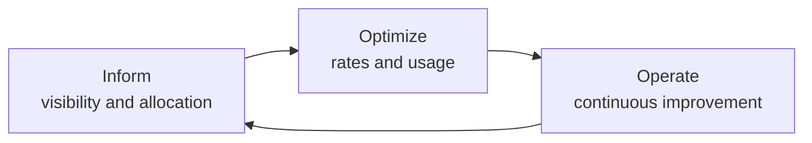
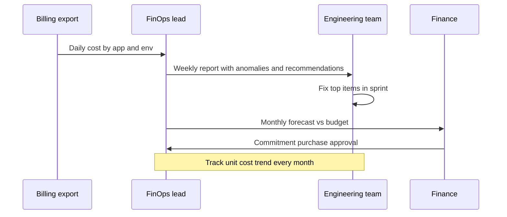

# Cost Optimization and FinOps

## Introduction

In a data center, spending is controlled by a purchasing process: someone signs off before servers arrive. In the cloud, **any engineer with the right permissions can spend money with one API call**, and the bill arrives a month later. That speed is the whole point of the cloud, but it means cost becomes an engineering concern, not just a finance one.

**FinOps** is the practice that deals with this. The [FinOps Foundation](https://www.finops.org/) defines it as an operational framework and cultural practice that brings engineering, finance and business teams together to get the most **business value** out of cloud spending. Note the wording: the goal is not "spend as little as possible". Spending more on a feature that earns more is a good outcome. Paying for idle VMs nobody remembers creating is not.

An analogy: a household budget. You first need to see where money goes (bank statements grouped by category), then cut obvious waste (subscriptions you forgot), then negotiate better rates for things you use every month (annual plans), and finally make it a habit to check every month.

FinOps uses the same three phases:



This page shows how to do each phase on AWS and Azure. For the design-time view (how architecture decisions drive cost), see [Cost-Aware Architecture](../../../fundamental/architecture/12-arch-quality-and-operations/7-arch-cost-awareness.mdx) in the Software Architecture tutorial. How individual services are billed is covered in [Cloud Pricing Models](../0-cloud-fundamentals/7-cloud-pricing-models.mdx).

:::note
This page never states prices. Prices vary by region, change over time, and differ by agreement. Use the [AWS Pricing Calculator](https://calculator.aws/) and the [Azure Pricing Calculator](https://azure.microsoft.com/pricing/calculator/) for estimates, and your actual bill for truth.
:::

## How Cloud Bills Are Built

Before optimizing, understand what you pay for. Almost every charge is **quantity times rate**:

| Dimension | Billed as | Examples |
|-----------|-----------|----------|
| Compute time | Per second or hour of an instance, or per vCPU-second and GB-second | EC2, Azure VMs, Fargate, Container Apps |
| Requests / executions | Per million requests plus duration | Lambda, Azure Functions, API Gateway |
| Storage | Per GB-month, varies by tier | S3 classes, Blob Hot/Cool/Cold/Archive, EBS, Managed Disks |
| Storage operations | Per thousand reads/writes, retrieval fees for cold tiers | S3 GET/PUT, Blob read/write operations |
| Data transfer | Per GB leaving the cloud (egress), between regions, sometimes between zones | Internet egress, cross-region replication |
| Provisioned capacity | Per hour whether used or not | Provisioned DynamoDB/Cosmos DB throughput, NAT gateways, load balancers |
| Licenses | Bundled in the rate or brought by you | Windows Server, SQL Server |

Usage dimensions you **provision** (instances, provisioned throughput, idle load balancers) cost money even when nobody uses them. That is where most waste hides.

## Phase 1: Inform (Visibility and Allocation)

You cannot optimize what you cannot see, and you cannot hold anyone accountable for a cost nobody owns.

### Tag everything that costs money

Use a small, enforced set of tags such as `app`, `env`, `owner` and `cost-center`. On AWS, you must **activate** user-defined tags as cost allocation tags in the Billing console before they appear in cost reports. On Azure, tags appear in Cost Management, and tag inheritance can apply subscription and resource group tags to usage records. Enforce tags with SCPs and tag policies (AWS) or Azure Policy. See [Tagging Strategies](../1-cloud-getting-started/6-cloud-tagging.mdx).

### Query costs from code

### On AWS

Cost Explorer has an API that returns grouped costs. Each Cost Explorer API request has a small per-request charge, so cache results instead of calling it in a tight loop.

```python
# pip install boto3
import boto3

ce = boto3.client("ce", region_name="us-east-1")

resp = ce.get_cost_and_usage(
    TimePeriod={"Start": "2026-09-01", "End": "2026-10-01"},
    Granularity="MONTHLY",
    Metrics=["UnblendedCost"],
    GroupBy=[{"Type": "TAG", "Key": "app"}],
)

for group in resp["ResultsByTime"][0]["Groups"]:
    tag = group["Keys"][0]  # "app$" alone means untagged
    amount = float(group["Metrics"]["UnblendedCost"]["Amount"])
    print(f"{tag:<25} {amount:>10.2f}")
```

Example output (amounts are made up):

```text
app$                          812.40
app$helpdesk-api             2140.18
app$reporting                 655.92
app$search                    301.77
```

The `app$` group with an empty value is **untagged spend**. Driving that number down is often the first FinOps goal.

The same data from the CLI, grouped by service:

```bash
aws ce get-cost-and-usage \
  --time-period Start=2026-09-01,End=2026-10-01 \
  --granularity MONTHLY \
  --metrics UnblendedCost \
  --group-by Type=DIMENSION,Key=SERVICE \
  --query "ResultsByTime[0].Groups[].[Keys[0],Metrics.UnblendedCost.Amount]" \
  --output text | sort -k2 -nr -t$'\t' | head -5
```

### On Azure

**Microsoft Cost Management** exposes a Query API. The Python SDK wraps it:

```python
# pip install azure-identity azure-mgmt-costmanagement
import os
from azure.identity import DefaultAzureCredential
from azure.mgmt.costmanagement import CostManagementClient
from azure.mgmt.costmanagement.models import (
    QueryAggregation, QueryDataset, QueryDefinition, QueryGrouping,
)

scope = f"/subscriptions/{os.environ['AZURE_SUBSCRIPTION_ID']}"
client = CostManagementClient(DefaultAzureCredential())

query = QueryDefinition(
    type="ActualCost",
    timeframe="TheLastMonth",
    dataset=QueryDataset(
        granularity="None",
        aggregation={"totalCost": QueryAggregation(name="Cost", function="Sum")},
        grouping=[QueryGrouping(type="TagKey", name="app")],
    ),
)

result = client.query.usage(scope=scope, parameters=query)
cols = [c.name for c in result.columns]
for row in result.rows:
    rec = dict(zip(cols, row))
    print(f"{rec.get('TagValue') or '(untagged)':<20} {rec['Cost']:>10.2f} {rec['Currency']}")
```

Example output (amounts are made up):

```text
(untagged)               402.11 USD
helpdesk-reporting      1288.54 USD
search                   219.03 USD
```

Column names in the result can differ slightly by API version and grouping type, which is why the code reads them from `result.columns`.

### Exports for serious analysis

For anything beyond quick queries, export detailed billing data on a schedule:

| | AWS | Azure |
|---|---|---|
| Detailed export | AWS Data Exports: **CUR 2.0** to S3 | Cost Management **exports** to a storage account |
| Open standard format | **FOCUS** export (FinOps Open Cost and Usage Specification) | **FOCUS** export |
| Analysis | Athena, QuickSight dashboards | Power BI, Microsoft Fabric, FinOps hubs from the Microsoft FinOps toolkit |

[FOCUS](https://focus.finops.org/) gives AWS and Azure billing data the same column names, which is very useful if you run both clouds.

### Budgets and anomaly alerts

Set budgets per account/subscription and per application, with alerts at, for example, 50%, 80% and 100% of the forecast. AWS also offers **Cost Anomaly Detection**, and Azure Cost Management has **anomaly alerts**. Both use machine learning to flag unusual spikes. Setup is covered in [Budgets and Billing Alerts](../1-cloud-getting-started/7-cloud-budgets-and-alerts.mdx).

## Phase 2: Optimize

Optimization has two levers: **use less** (usage optimization) and **pay less for what you use** (rate optimization). Do usage first. There is no point buying a three-year commitment for a VM that should have been half the size.

### Usage lever 1: Delete what nobody uses

The cheapest resource is the one that does not exist. Common orphans:

- Unattached EBS volumes and Managed Disks left after VMs were deleted
- Old snapshots and machine images
- Idle load balancers and NAT gateways in abandoned environments
- Public IP addresses that are not attached (both clouds charge for public IPv4 addresses)
- Forgotten dev databases

```bash
# AWS: unattached EBS volumes
aws ec2 describe-volumes \
  --filters Name=status,Values=available \
  --query "Volumes[].{Id:VolumeId,GiB:Size,Type:VolumeType,Created:CreateTime}" \
  --output table

# Azure: unattached managed disks
az disk list \
  --query "[?diskState=='Unattached'].{Name:name, RG:resourceGroup, GiB:diskSizeGB, Sku:sku.name}" \
  --output table
```

Example output (Azure):

```text
Name                 RG              GiB    Sku
-------------------  --------------  -----  -----------
old-build-agent-os   rg-ci           128    Premium_LRS
test-data-disk       rg-sandbox      512    StandardSSD_LRS
```

Review before deleting: snapshot first if unsure, then `aws ec2 delete-volume --volume-id ...` or `az disk delete --name ... --resource-group ...`.

### Usage lever 2: Right-size

Most VMs are bigger than they need to be because someone guessed high "to be safe". Both providers analyze utilization and recommend smaller sizes:

| | AWS | Azure |
|---|---|---|
| Right-sizing recommendations | AWS Compute Optimizer (EC2, ASGs, EBS, Lambda, ECS on Fargate, RDS) | Azure Advisor cost recommendations |
| Consolidated savings view | Cost Optimization Hub | Azure Advisor, Cost Management |

```bash
aws compute-optimizer get-ec2-instance-recommendations \
  --query "instanceRecommendations[].{Id:instanceArn,Now:currentInstanceType,Finding:finding,Try:recommendationOptions[0].instanceType}" \
  --output table

az advisor recommendation list --category Cost \
  --query "[].{Resource:impactedValue, Problem:shortDescription.problem}" --output table
```

Example output (AWS, trimmed):

```text
+-----------------------------------------------+--------------------+-------------+-----------+
|  Finding        |  Id                         |  Now               |  Try        |
+-----------------+-----------------------------+--------------------+-------------+
|  OVER_PROVISIONED | ...:instance/i-0a1b2c3d   |  m5.2xlarge        |  m7g.large  |
|  OPTIMIZED      | ...:instance/i-0e5f6a7b     |  t3.medium         |  t3.medium  |
+-----------------+-----------------------------+--------------------+-------------+
```

A suggestion like moving to a Graviton (`m7g`) or Azure Cobalt/Ampere Arm-based size can save money, but only if your software runs on Arm. Test before switching.

### Usage lever 3: Turn things off when nobody is working

Dev and test environments used 10 hours a day, 5 days a week, run only about 30% of the hours in a week. Stopping them outside working hours removes most of their compute cost (storage still bills).

```bash
# Azure: built-in daily auto-shutdown for a VM at 19:00 UTC
az vm auto-shutdown --resource-group rg-dev --name dev-vm1 --time 1900

# AWS: scale a dev ASG to zero every weekday evening with a scheduled action
aws autoscaling put-scheduled-update-group-action \
  --auto-scaling-group-name dev-web-asg \
  --scheduled-action-name nightly-off \
  --recurrence "0 19 * * 1-5" \
  --min-size 0 --max-size 0 --desired-capacity 0
```

Better still, build environments that are **ephemeral**: created by the pipeline for a pull request and destroyed afterwards. See [Managing Dev, Staging and Production](../11-cloud-devops/3-cloud-environments.mdx).

### Usage lever 4: Pick the right service and tier

- Move infrequently accessed data to cheaper storage tiers with lifecycle policies (S3 Standard-IA, Glacier classes, Intelligent-Tiering; Blob Cool, Cold, Archive). See [Storage Classes, Tiers and Lifecycle Policies](../6-cloud-storage/3-cloud-storage-classes.mdx).
- For spiky or low traffic, serverless (Lambda, Functions, DynamoDB on-demand, Aurora Serverless v2, SQL Database serverless) can be far cheaper than always-on capacity. For steady high traffic it can be more expensive. See [Serverless Trade-offs and Costs](../4-cloud-serverless/7-cloud-serverless-trade-offs.mdx).
- Watch **data transfer**: put a CDN in front of downloads, keep chatty services in the same region (and ideally the same zone where HA allows), and use private endpoints or gateway endpoints instead of sending traffic through NAT gateways when possible.

### Rate lever: commitments and spot

Once usage is right, cover steady, predictable usage with commitments and run interruptible work on spot capacity.

| Mechanism | AWS | Azure | Commitment | Flexibility |
|-----------|-----|-------|-----------|-------------|
| Spend commitment on compute | Compute Savings Plans | Azure savings plan for compute | 1 or 3 years of hourly spend | High: across families and regions |
| Resource-specific commitment | Reserved Instances, EC2 Instance Savings Plans, RDS / ElastiCache reservations | Azure Reservations (VMs, SQL, Cosmos DB, and more) | 1 or 3 years | Lower, but usually deeper discount |
| Spare capacity | EC2 Spot Instances, Fargate Spot | Azure Spot Virtual Machines | None | Can be reclaimed with short notice |
| Existing licenses | Bring your own license (limited, depends on license terms) | Azure Hybrid Benefit for Windows Server and SQL Server | Your licenses | Azure-specific advantage for Microsoft licenses |

Rules of thumb:

1. Commit to the **baseline** you are confident will still run in one to three years, not to your peak.
2. Prefer flexible commitments (Compute Savings Plans, Azure savings plan) unless you are certain about the instance family and region.
3. Use spot only for work that tolerates interruption: CI runners, batch jobs, stateless workers with checkpointing.

Details: [Spot, Reserved and Savings Plans](../3-cloud-compute/4-cloud-spot-and-reserved.mdx).

## Phase 3: Operate

Cost optimization is not a project with an end date. Teams change, new services launch, and waste creeps back.



### Track unit economics

Total spend going up is not necessarily bad, if the business is growing faster. Track **cost per unit of business value**: cost per active customer, per 1,000 tickets, per order.

```python
monthly = [
    # month, cloud cost, tickets handled
    ("2026-07", 9800.0, 1_210_000),
    ("2026-08", 10450.0, 1_390_000),
    ("2026-09", 11900.0, 1_420_000),
]

prev = None
for month, cost, tickets in monthly:
    unit = cost / (tickets / 1000)
    trend = "" if prev is None else f"({(unit - prev) / prev:+.1%})"
    print(f"{month}: {unit:.2f} per 1k tickets {trend}")
    prev = unit
```

Output:

```text
2026-07: 8.10 per 1k tickets 
2026-08: 7.52 per 1k tickets (-7.2%)
2026-09: 8.38 per 1k tickets (+11.5%)
```

August looks efficient. September's cost per ticket jumped, even though ticket volume barely changed. That is the signal to investigate, much more useful than "the bill went up".

### Make cost visible to engineers

- Show cost per app on the team dashboard next to latency and error rate.
- Add cost estimates to pull requests that change infrastructure (tools such as Infracost read Terraform plans).
- Give each team its own account or subscription so ownership is unambiguous. See [Organizing Resources](../1-cloud-getting-started/5-cloud-resource-organization.mdx).

## Real-World Scenario

Your SaaS helpdesk's cloud bill grew 60% in six months while revenue grew 25%. The CFO wants a plan.

**Week 1 (Inform):** activate cost allocation tags on AWS, enable tag inheritance on Azure, and build a dashboard of cost by app, environment and service from CUR 2.0 and Cost Management exports (FOCUS format for both). Discovery: 22% of spend is untagged, and staging costs almost as much as production.

**Weeks 2 to 4 (Optimize usage):**
- Delete orphaned disks, snapshots and two forgotten test databases.
- Apply Compute Optimizer and Advisor right-sizing to the app tier (after load testing).
- Shut down staging nights and weekends; move PR environments to ephemeral, pipeline-created stacks.
- Add S3 lifecycle rules and Blob lifecycle management to move old attachments to colder tiers.

**Month 2 (Optimize rates):** buy a Compute Savings Plan on AWS and an Azure savings plan sized to the new, smaller baseline. Move CI runners to Spot.

**Ongoing (Operate):** weekly cost review in the platform team meeting, monthly unit cost (per 1,000 tickets) report to leadership, anomaly alerts routed to the owning team's channel.

**Why this approach:** visibility first prevents optimizing the wrong thing; usage before rates prevents locking in waste; unit cost connects engineering work to business outcomes.

**When not to push hard:** an early-stage startup searching for product-market fit should spend engineering time on the product. Basic hygiene (budgets, tags, no idle giants) is enough until the bill is material.

### Alternatives and trade-offs

| Approach | Pros | Cons | Best for |
|----------|------|------|----------|
| Native tools only (Cost Explorer, Cost Management, Advisor, Compute Optimizer) | Free or low cost, accurate, no data leaves the provider | One cloud at a time, basic allocation | Single-cloud teams starting out |
| FOCUS exports + your own BI | Multi-cloud, flexible, you own the data | Build and maintain pipelines and dashboards | Multi-cloud organizations with data skills |
| Third-party FinOps platform | Cross-cloud views, automation, Kubernetes cost allocation | License cost, another vendor | Large or complex estates |
| Central FinOps team approves everything | Tight control | Slows teams down, becomes a bottleneck | Rarely the right default |
| Decentralized ownership with guardrails | Teams move fast, own their spend | Needs good visibility and culture | Most product organizations |

## Common Mistakes

- **Buying commitments first.** You lock in today's waste for one to three years. Right-size first.
- **Optimizing tiny line items.** Sort by cost and start at the top. Saving a little on a large item beats eliminating a tiny one.
- **Ignoring data transfer and NAT gateway charges.** They rarely appear in estimates but often appear in bills.
- **Cost as finance's problem.** Engineers make the decisions that create cost; they need the data.
- **Over-optimizing at the expense of reliability.** Removing the second zone to save money is a [Well-Architected](./0-cloud-well-architected.mdx) trade-off to make deliberately, not by accident.
- **Untagged resources.** If you cannot tell who owns a resource, nobody will clean it up.
- **Forgetting to clean up after tutorials.** Delete resource groups (`az group delete`) and CloudFormation stacks or Terraform workspaces (`terraform destroy`) when you finish experimenting.

## Summary

- FinOps aims for maximum business value from cloud spending, through the Inform, Optimize and Operate phases.
- Inform: tags, cost queries (Cost Explorer, Cost Management), detailed exports (CUR 2.0, FOCUS), budgets and anomaly alerts.
- Optimize usage first (delete, right-size, schedule, choose the right tier and service), then rates (Savings Plans, reservations, Azure savings plan, Spot, Azure Hybrid Benefit).
- Operate: make cost visible to engineers, review regularly, and track unit cost per business outcome.
- Never trust a remembered price. Use the pricing calculators and your bill.

## Exercises

1. Run the unattached-disk and unattached-volume queries in a sandbox account or subscription. What would you delete and what would you snapshot first?
2. Modify the Cost Explorer script to group by both `SERVICE` and the `env` tag, and print the top five combinations.
3. Pick a unit metric for an app you know (cost per user, per order, per build). Which numbers do you need, and where would each come from?
4. Write a short policy (one paragraph) for when your team should buy commitments and how much of the baseline to cover.

**Related pages:**
- [Cloud Pricing Models](../0-cloud-fundamentals/7-cloud-pricing-models.mdx)
- [Budgets and Billing Alerts](../1-cloud-getting-started/7-cloud-budgets-and-alerts.mdx)
- [Spot, Reserved and Savings Plans](../3-cloud-compute/4-cloud-spot-and-reserved.mdx)
- [Project: Cost Monitoring and Alerts](../14-cloud-projects/6-cloud-project-cost-dashboard.mdx)
- [Well-Architected Frameworks](./0-cloud-well-architected.mdx)
