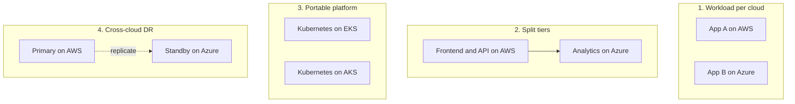

# Multi-Cloud and Hybrid Strategy

## Introduction

Two terms get mixed up constantly:

- **Hybrid cloud:** you run workloads in a public cloud **and** in your own data centers or edge sites, and they work together. Example: a factory keeps control systems on-site and sends data to Azure for analytics.
- **Multi-cloud:** you use **more than one public cloud provider**, such as AWS and Azure. Example: the main product runs on AWS, while the analytics team uses Azure because of an existing Microsoft data platform.

Most large organizations end up multi-cloud **by accident**: an acquisition brings a second cloud, one team picked a different provider, or a SaaS product happens to run elsewhere. Far fewer choose it **by design** for a single application.

An analogy: speaking two languages is valuable if you live near a border or work with two markets. Insisting that every sentence you say must be understandable in both languages at once doubles your effort and helps nobody. Multi-cloud as an organization is often fine. Making every application portable across clouds is usually expensive.

This page helps you decide which kind of multi-cloud or hybrid setup you actually need, and shows the building blocks for connecting AWS, Azure and on-premises. For deployment model definitions, see [Public, Private, Hybrid and Multi-Cloud](../0-cloud-fundamentals/2-cloud-deployment-models.mdx).

## Why Organizations Go Multi-Cloud

| Reason | Holds up? | Comment |
|--------|-----------|---------|
| Acquisition or team history | Yes, it is reality | Integrate identity, billing and governance; do not force a migration without a business case |
| Best-of-breed services | Often | For example, Azure for Microsoft 365 / Entra ID integration, AWS for a specific service the team knows well |
| Customer or regulatory requirement | Sometimes | Some customers require their data in a specific cloud or country |
| Negotiating leverage | Partly | Credible only if you could really move; switching is costly |
| Avoiding vendor lock-in | Partly | You trade provider lock-in for lowest-common-denominator lock-in and higher engineering cost |
| Resilience against a provider-wide outage | Rarely | Region-level failures are far more common than whole-provider failures; multi-region in one cloud is usually cheaper and simpler |

Be honest about which reason applies. "Avoid lock-in" without a concrete scenario often leads to building your own abstraction layer over two clouds, which is itself a form of lock-in, to your own code.

## Four Multi-Cloud Patterns



| Pattern | Description | Complexity | Typical use |
|---------|-------------|------------|-------------|
| 1. Workload per cloud | Each application lives entirely in one cloud | Low | Most common and most sensible |
| 2. Split tiers | One application spans clouds (for example, data flows from AWS into Azure analytics) | Medium | Integrations, data platforms |
| 3. Portable platform | Same app deployable on either cloud via Kubernetes and Terraform | High | ISVs that must deploy into customers' clouds |
| 4. Cross-cloud DR | Standby in a second provider | Very high | Rare, heavily regulated cases |

Pattern 1 gives you most of the organizational benefits with little engineering cost. Patterns 3 and 4 need strong justification, because you give up many managed services (or must implement everything twice) and pay for data transfer between clouds.

## The Shared Foundations

Whatever pattern you choose, a few things should be **common across clouds**: identity, networking, infrastructure as code, observability, governance and cost reporting.

| Concern | Common approach | AWS side | Azure side |
|---------|-----------------|----------|------------|
| Human identity | One identity provider with SSO | IAM Identity Center federated to the IdP | Microsoft Entra ID (often the IdP itself) |
| Workload identity across clouds | OIDC federation, no shared secrets | IAM roles trusting an OIDC provider | Entra workload identity federation |
| Networking | Private connectivity with non-overlapping IP ranges | Site-to-Site VPN, Direct Connect, Transit Gateway | VPN Gateway, ExpressRoute, Virtual WAN |
| Infrastructure as code | Terraform or OpenTofu with both providers | `hashicorp/aws` provider | `hashicorp/azurerm` provider |
| Kubernetes | Same manifests, Helm charts, GitOps | Amazon EKS | Azure Kubernetes Service |
| Observability | OpenTelemetry to one backend | CloudWatch, X-Ray, Managed Prometheus/Grafana | Azure Monitor, Application Insights |
| Governance and inventory | One view of all resources | AWS Config, Systems Manager | Azure Arc, Azure Policy, Resource Graph |
| Cost | FOCUS-format exports into one dataset | AWS Data Exports | Cost Management exports |

### Identity: one IdP, federated everywhere

Do not create separate user accounts in each cloud. A common setup: **Microsoft Entra ID** is the identity provider, and **AWS IAM Identity Center** trusts it via SAML with automatic SCIM provisioning. Engineers sign in once and get role-based access in both clouds. See [Federation, SSO and Identity Center](../2-cloud-identity/5-cloud-federation-and-sso.mdx).

For **workloads**, federate tokens instead of copying keys. Example: a job running on AWS with an IAM role needs to write to Azure Blob Storage. Rather than storing an Azure secret in AWS, configure a **federated identity credential** on an Entra app registration (or user-assigned managed identity) that trusts tokens from an OIDC issuer the AWS workload can obtain. The specifics depend on the token source (EKS service account tokens are a common one), so follow [Workload identity federation](https://learn.microsoft.com/entra/workload-id/workload-identity-federation). CI/CD systems such as GitHub Actions can authenticate to both clouds with OIDC: see [Keyless CI/CD with OIDC](../2-cloud-identity/6-cloud-oidc-for-ci.mdx).

### Networking: plan IP ranges first

The most painful multi-cloud mistake is **overlapping address ranges**. If the AWS VPC and the Azure VNet both use `10.0.0.0/16`, you cannot route between them without NAT tricks. Allocate ranges centrally before building anything:

```text
On-premises        10.0.0.0/12
AWS (all VPCs)     10.16.0.0/12
Azure (all VNets)  10.32.0.0/12
Reserved           10.48.0.0/12
```

Connectivity options between AWS and Azure:

| Option | How | Pros | Cons |
|--------|-----|------|------|
| Site-to-site IPsec VPN | AWS Virtual Private Gateway or Transit Gateway VPN to Azure VPN Gateway | Quick, cheap to start | Bandwidth limits per tunnel, runs over the internet |
| Via your colocation provider | Direct Connect and ExpressRoute into the same facility, connected by a partner | High bandwidth, private | Contracts, lead time, more parts |
| Provider-managed cross-cloud links | AWS Interconnect - multicloud (Azure support listed as preview at the time of writing) | Managed, private | New; check availability and regions |
| Public endpoints with TLS and auth | Call each other's APIs over the internet | Simplest | Egress cost, exposure, no private network |

See [Hybrid Connectivity: VPN and Direct Connect/ExpressRoute](../8-cloud-networking/8-cloud-hybrid-connectivity.mdx) for setup details.

:::warning Cost
Data leaving a cloud is billed per GB (egress), and VPN gateways and dedicated connections bill per hour. Chatty traffic between clouds can become a large line item. Estimate it with both pricing calculators before splitting tiers across clouds, and delete practice gateways when finished (`az network vnet-gateway delete`, `aws ec2 delete-vpn-connection`).
:::

### Infrastructure as code with both providers

Terraform can manage both clouds in a single configuration. Keep **state per cloud and per environment** separate so one cloud's problems do not block changes in the other.

```hcl
terraform {
  required_providers {
    aws = {
      source  = "hashicorp/aws"
      version = "~> 6.0"
    }
    azurerm = {
      source  = "hashicorp/azurerm"
      version = "~> 4.0"
    }
  }
}

provider "aws" {
  region = "us-east-1"
}

provider "azurerm" {
  features {}
  subscription_id = var.azure_subscription_id
}

variable "azure_subscription_id" {
  type = string
}

# Shared naming and tags across both clouds
locals {
  app  = "helpdesk"
  env  = "dev"
  tags = { app = local.app, env = local.env, owner = "platform-team" }
}

resource "aws_s3_bucket" "exports" {
  bucket = "${local.app}-${local.env}-exports-111122223333"
  tags   = local.tags
}

resource "azurerm_resource_group" "analytics" {
  name     = "rg-${local.app}-${local.env}-analytics"
  location = "eastus2"
  tags     = local.tags
}
```

```bash
terraform init
terraform plan -var "azure_subscription_id=$(az account show --query id -o tsv)"
```

Example output (trimmed):

```text
Terraform will perform the following actions:

  # aws_s3_bucket.exports will be created
  + resource "aws_s3_bucket" "exports" {
      + bucket = "helpdesk-dev-exports-111122223333"
      ...
  # azurerm_resource_group.analytics will be created
  + resource "azurerm_resource_group" "analytics" {
      + location = "eastus2"
      + name     = "rg-helpdesk-dev-analytics"
      ...
Plan: 2 to add, 0 to change, 0 to destroy.
```

Provider major versions move over time; check the [Terraform Registry](https://registry.terraform.io/) for current versions. Clean up with `terraform destroy`. More in [Terraform for AWS and Azure](../10-cloud-infrastructure-as-code/4-cloud-terraform-multi-cloud.mdx) and the [Terraform tutorial](/docs/devops/terraform).

Note that Terraform gives you **one workflow**, not portable resources. An `aws_s3_bucket` and an `azurerm_storage_account` are different resources with different options. Portability happens at the application layer, if at all.

### Application code: abstract only what you must

If an application genuinely must run on both clouds, put a thin interface around the few services it uses, and implement it per provider. Keep the interface small.

```python
# storage.py - a minimal port with two adapters
from typing import Protocol

class BlobStore(Protocol):
    def put(self, key: str, data: bytes) -> None: ...
    def get(self, key: str) -> bytes: ...

class S3Store:
    def __init__(self, bucket: str):
        import boto3
        self.s3 = boto3.client("s3")
        self.bucket = bucket

    def put(self, key: str, data: bytes) -> None:
        self.s3.put_object(Bucket=self.bucket, Key=key, Body=data)

    def get(self, key: str) -> bytes:
        return self.s3.get_object(Bucket=self.bucket, Key=key)["Body"].read()

class AzureBlobStore:
    def __init__(self, account_url: str, container: str):
        from azure.identity import DefaultAzureCredential
        from azure.storage.blob import BlobServiceClient
        svc = BlobServiceClient(account_url, credential=DefaultAzureCredential())
        self.container = svc.get_container_client(container)

    def put(self, key: str, data: bytes) -> None:
        self.container.upload_blob(key, data, overwrite=True)

    def get(self, key: str) -> bytes:
        return self.container.download_blob(key).readall()

class MemoryStore:
    """For tests and local development."""
    def __init__(self):
        self.items: dict[str, bytes] = {}

    def put(self, key: str, data: bytes) -> None:
        self.items[key] = data

    def get(self, key: str) -> bytes:
        return self.items[key]

def save_report(store: BlobStore, ticket_id: int, text: str) -> str:
    key = f"reports/{ticket_id}.txt"
    store.put(key, text.encode())
    return key

if __name__ == "__main__":
    store = MemoryStore()
    key = save_report(store, 42, "Resolved: printer replaced")
    print(key, store.get(key).decode())
```

Output:

```text
reports/42.txt Resolved: printer replaced
```

This is the [Hexagonal Architecture](../../../fundamental/architecture/7-arch-clean-architecture/0-arch-hexagonal.mdx) idea: business logic depends on a port, and adapters handle each cloud. The cost is that the interface only exposes what both clouds share. Features such as S3 Object Lambda or Blob immutability policies stay out of reach through the port.

## Hybrid: Bringing the Cloud to Your Servers

Hybrid setups need two things: connectivity (covered above) and **a consistent way to manage machines and clusters wherever they run**.

| Need | AWS | Azure |
|------|-----|-------|
| Manage on-premises or other-cloud servers | AWS Systems Manager (hybrid activations) | **Azure Arc-enabled servers** |
| Manage Kubernetes clusters anywhere | Amazon EKS Hybrid Nodes, EKS Anywhere, EKS Connector | **Azure Arc-enabled Kubernetes** |
| Run containers on your hardware with cloud control plane | Amazon ECS Anywhere | Azure Container Apps on Azure Arc |
| Provider hardware in your data center | AWS Outposts | Azure Local |
| Apply cloud policy to non-cloud resources | AWS Config (limited for hybrid) | Azure Policy through Arc |

Azure Arc is Microsoft's flagship here. It **projects** non-Azure resources, including EC2 instances and on-premises VMs, into Azure Resource Manager so you can apply Azure Policy, Defender for Cloud, Azure Monitor and RBAC to them. The Arc control plane features (inventory, tags, RBAC, Resource Graph) have no extra charge, while services you enable on Arc resources (such as Defender or Monitor) bill as usual.

Connecting a Linux server to Arc uses the Connected Machine agent:

```bash
# On the server, after installing the azcmagent package (see Arc docs for your OS)
sudo azcmagent connect \
  --resource-group rg-hybrid-servers \
  --tenant-id <tenant-id> \
  --location eastus2 \
  --subscription-id <subscription-id>

# From your workstation: list Arc-enabled servers
az connectedmachine list --resource-group rg-hybrid-servers \
  --query "[].{Name:name, Status:status, OS:osName}" --output table
```

Example output:

```text
Name            Status     OS
--------------  ---------  -----
factory-gw-01   Connected  linux
ec2-legacy-07   Connected  linux
```

On the AWS side, Systems Manager hybrid activations register non-EC2 machines as managed nodes:

```bash
aws ssm create-activation \
  --default-instance-name factory-gw \
  --iam-role SSMServiceRoleForHybrid \
  --registration-limit 10 \
  --region us-east-1
```

The command returns an activation code and ID that you pass to the SSM agent on each server. Activation codes are sensitive: they let machines register with your account, so share them like secrets and give them an expiry.

## Real-World Scenario

Your SaaS helpdesk runs on AWS. You acquired a company whose reporting product runs on Azure and whose customers are mostly Microsoft-centric enterprises. The board asks: "Should we consolidate onto one cloud, or go multi-cloud?"

**Recommended approach: pattern 1 (workload per cloud) with shared foundations.**

1. **Do not migrate yet.** Both products work. Migration is a project with its own cost and risk; revisit when there is a business reason (see [Migration Strategies](./6-cloud-migration-strategies.mdx)).
2. **Unify identity:** make Entra ID the IdP for everyone, federate AWS IAM Identity Center to it.
3. **Unify governance and cost:** FOCUS exports from both clouds into one dashboard; equivalent guardrails via SCPs and Azure Policy.
4. **Integrate data, not infrastructure:** the helpdesk publishes ticket events; a small integration pushes them to the Azure reporting product through a secured API, rather than sharing databases across clouds.
5. **Standardize the toolchain:** Terraform, GitHub Actions with OIDC to both clouds, OpenTelemetry for traces.

**Why this approach:** you get the organizational benefits (one sign-in, one cost view, consistent policy) without paying the portability tax on every application.

**When to go further:** if a large customer contractually requires the helpdesk to run in their Azure tenant, you may need pattern 3 (a portable, Kubernetes-based deployment). Price that work into the deal.

**When not to:** do not build cross-cloud active/active "for resilience" unless regulators require it; multi-region in one cloud covers the realistic failure modes for far less.

### Alternatives and trade-offs

| Approach | Pros | Cons | Best for |
|----------|------|------|----------|
| Single cloud | Deepest use of managed services, one skill set, simplest | Provider dependency, one negotiating position | Most startups and many enterprises |
| Workload per cloud | Use each cloud's strengths, low integration cost | Two skill sets, two sets of guardrails | Organizations after acquisitions |
| Split tiers across clouds | Best service for each tier | Egress cost, latency, cross-cloud failure modes | Data and analytics integrations |
| Portable Kubernetes platform | Deploy anywhere, including customer clouds | Lose many managed services, heavy platform team | ISVs, regulated customer deployments |
| Hybrid with Arc / Outposts / Azure Local | Cloud management for on-premises, data stays local | Hardware and operational overhead | Factories, retail, latency or sovereignty needs |

## Common Mistakes

- **Multi-cloud as a goal instead of a means.** Start from a business requirement, not a slogan.
- **Lowest common denominator everywhere.** Avoiding every managed service to stay portable often costs more than a future migration would.
- **Overlapping IP ranges.** Plan the address space before the first VPC or VNet exists.
- **Separate identities per cloud.** Leads to orphaned accounts and inconsistent access. Federate from one IdP.
- **Shared secrets between clouds.** Use OIDC federation and managed identities, not access keys copied into another provider's secret store.
- **Underestimating egress.** Moving data between clouds is billed. Design data flows to minimize cross-cloud chatter.
- **Two clouds, half the expertise each.** Make sure each platform has enough skilled owners.

## Summary

- Hybrid means cloud plus your own infrastructure; multi-cloud means more than one public provider.
- Most organizations are multi-cloud by circumstance. "One workload per cloud" is the most sensible default pattern.
- Share the foundations: one IdP, OIDC federation for workloads, non-overlapping IP plans, Terraform, OpenTelemetry, FOCUS cost data and equivalent guardrails.
- Use thin adapters only where an application truly must run on both clouds.
- For hybrid, Azure Arc, AWS Systems Manager, EKS Hybrid Nodes or EKS Anywhere, ECS Anywhere, Outposts and Azure Local bring cloud management to your own hardware.

## Exercises

1. List the reasons your organization (or a fictional one) uses or might use multiple clouds. Rate each using the "Holds up?" column above.
2. Design a non-overlapping IP plan for on-premises, three AWS VPCs and three Azure VNets across two regions each.
3. Extend the `BlobStore` port with a `list(prefix)` method and implement it for S3 (`list_objects_v2`) and Blob (`list_blobs(name_starts_with=...)`). Test with the in-memory adapter.
4. Write a one-page decision record: "Consolidate on one cloud vs keep both" for the scenario above, including costs you would need to estimate.

**Related pages:**
- [AWS vs Azure: How the Platforms Compare](../0-cloud-fundamentals/5-cloud-aws-vs-azure.mdx)
- [AWS and Azure Service Mapping](../0-cloud-fundamentals/6-cloud-service-mapping.mdx)
- [Choosing an IaC Tool](../10-cloud-infrastructure-as-code/5-cloud-choosing-iac-tool.mdx)
- [Private Endpoints, Peering and Transit](../8-cloud-networking/7-cloud-private-connectivity.mdx)
- [Migration Strategies: The 7 Rs](./6-cloud-migration-strategies.mdx)
